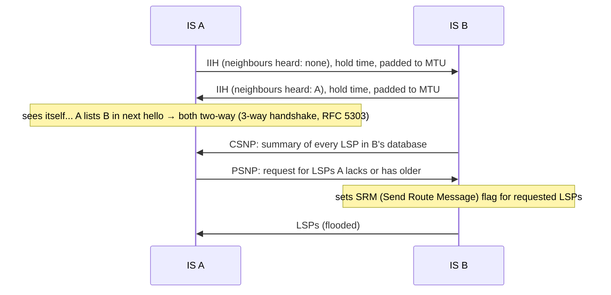
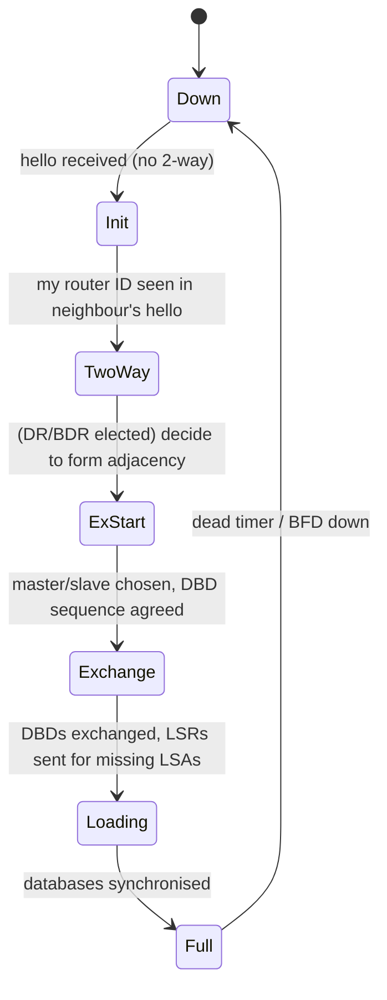

# 2.14 Distance-vector and link-state protocols: RIP, EIGRP, OSPF and IS-IS

| | |
|---|---|
| Level | Intermediate |
| Priority tier | 0 |
| Lab venue | Linux VM with FRR in namespaces/containerlab |
| Part | Part 2: Networking, from first principles to AI fabrics |
| Status | Drafted, labs **untested** |

## Why this matters for AI infrastructure

In many AI data centres the **underlay** (the routed network that gives every switch loopback and link reachability) is OSPF, IS-IS or eBGP; Kubernetes clusters with Calico or Cilium may speak BGP or OSPF to the fabric; HPC sites run OSPF in management networks; and on-prem GPU clouds inherit enterprise networks full of OSPF and EIGRP. You will be asked to read an OSPF neighbour table, explain why an adjacency is stuck in EXSTART (usually MTU), design areas, explain DR/BDR elections on a shared segment, or compare IS-IS and OSPF for a new fabric. This chapter explains the protocols that implement the algorithms of chapter 2.13: how Spanning Tree, RIP and EIGRP (distance-vector family) work, and how OSPF and IS-IS (link-state) form neighbours, flood reliably, and calculate paths, with configuration and troubleshooting in FRR.

## Prerequisites and outcomes

You should know the control-plane concepts in chapter 2.13 (neighbour discovery, flooding, SPF, convergence) and VLAN/STP basics (2.11).

After this chapter you can:

- Explain how STP builds a loop-free tree and learns reachability, and how RIP and EIGRP implement Bellman-Ford and DUAL.
- Explain IS-IS: OSI/NSAP addressing, levels, the single LSP with TLVs and fragments, hello/CSNP/PSNP exchange, SRM flags, flooding, flushing, metrics.
- Explain OSPF: router IDs, packet types, LSA types, neighbour states (Down to Full), DR/BDR, areas and ABRs/ASBRs, network types, costs, reference bandwidth, timers, authentication.
- Compare OSPF and IS-IS and choose between them.
- Configure OSPF and IS-IS in FRR, including point-to-point links, unnumbered interfaces, BFD, passive interfaces, summarisation and ECMP.
- Troubleshoot adjacency and database problems (MTU mismatch, timers, area ID, authentication, duplicate router IDs, network type mismatch).
- Apply link-state routing to a Clos underlay.

## 1. Spanning Tree as a control plane

Spanning Tree (chapter 2.11) is itself a distance-vector-style control plane that computes a loop-free tree rather than shortest paths to every destination:

- **Loop-free tree building**: the lowest bridge ID becomes the root (all switches advertise "the best root I know" in BPDUs and converge on the minimum); each switch selects the root port by lowest cost to the root, each segment elects a designated port, and the rest are blocked. It is the Bellman-Ford idea with a single destination (the root).
- **Reachable-destination learning** is *reactive and data-plane driven*: bridges learn host MACs from source addresses of frames and flood unknown destinations; there is no advertisement of reachability.
- **Limits**: a single tree wastes capacity, converges slowly in classic form, has no hierarchy, and flat L2 domains grow broadcast load. This is why routing protocols took over the scale-out job.

## 2. RIP: the simplest distance-vector protocol

The **Routing Information Protocol** (RIPv2 RFC 2453, RIPng for IPv6) is Bellman-Ford made concrete:

- Every router sends its whole routing table to neighbours every 30 s (multicast 224.0.0.9, UDP 520). Metric = hop count; 16 means unreachable ("infinity"), so networks are limited to 15 hops.
- A router picks, for each destination, the neighbour with the lowest advertised hop count + 1, and installs it. Routes time out after 180 s without refresh, and are flushed after 240 s; **triggered updates**, **split horizon with poison reverse** and **hold-down** timers fight count-to-infinity.
- Strengths: trivial to configure and understand. Weaknesses: slow convergence (tens of seconds to minutes), periodic full-table updates waste bandwidth, hop-count ignores link speed, 15-hop limit, no hierarchy. Use only for tiny networks and teaching; recognise it in legacy gear.

## 3. EIGRP: DUAL-based distance vector

The **Enhanced Interior Gateway Routing Protocol** (originally Cisco; basic functionality published as RFC 7868) keeps distance-vector's neighbour-only information exchange while using DUAL (chapter 2.13) to guarantee loop-freedom and instant failover:

- **Neighbour discovery**: multicast hellos (224.0.0.10, protocol 88) with matching K-values/AS number; hold time 3× hello (5 s/15 s default on fast links).
- **Reliable transport (RTP)**: updates, queries, replies and acks are sequenced and retransmitted, so only changes (not full tables) are sent.
- **Composite metric** from bandwidth, delay (default) and optionally load/reliability: `metric = 256 × (10^7/min bandwidth in kb/s + sum of delays / 10)` in classic mode ("wide" metrics for fast links).
- **Successor and feasible successor**: lowest-metric next hop; any neighbour whose reported distance is below my feasible distance is an instantly usable backup. On failure with a feasible successor: switch immediately, no queries. Without one: go active, query neighbours, converge after replies ("stuck in active" if a neighbour doesn't answer).
- **Unequal-cost load balancing** (`variance`) is unique to EIGRP.
- Support in FRR: EIGRP is not production-grade in FRR; EIGRP is mostly seen in Cisco enterprise networks. For new designs prefer OSPF/IS-IS/BGP.

## 4. Link-state protocols: the shared model

OSPF and IS-IS both implement the same link-state model: discover neighbours, verify two-way connectivity, synchronise a database by reliable flooding, and run Dijkstra's SPF. They differ in packaging.

| Aspect | OSPF | IS-IS |
|---|---|---|
| Runs over | IP (protocol 89), multicast 224.0.0.5/6 (v2); IPv6 link-local FF02::5/6 (v3) | Directly on layer 2 (CLNS), not IP |
| Data marshalling | Fixed-length fields, several LSA types | Single LSP per router, TLVs, fragmentable |
| Node identity | 32-bit router ID (looks like an IPv4 address, is not one) | 6-byte System ID inside an NSAP/NET |
| Hierarchy | Areas (backbone Area 0) with ABRs; strict area-0 centred | Levels (L1 intra-area, L2 backbone; routers can be L1, L2, or L1/L2); area boundary on links not routers |
| Multi-access | DR/BDR election; pseudo-node via Network LSA | DIS election per level; pseudo-node LSP |
| Address families | OSPFv2 IPv4; OSPFv3 IPv6 (and IPv4 via AFs) | One instance carries IPv4, IPv6 and others via TLVs |
| Extensibility | New LSA types/Opaque LSAs | New TLVs easily |
| Typical home | Enterprise, data centre | Service providers, large data centres |

## 5. IS-IS in depth

**Why it looks different.** IS-IS ("Intermediate System to Intermediate System") came from the OSI protocol suite: a router is an Intermediate System (IS), a host an End System (ES). It runs at the link layer, parallel to IP rather than on top of it: it does not depend on IP addressing to bring up adjacencies, never forwards IS-IS packets, and uses a different addressing scheme from the thing it routes, which keeps nodes and destinations clearly separated and makes the protocol robust to IP misconfiguration.

### NSAP/NET addressing

Each IS has an OSI address (a **NET**, network entity title) such as `49.0001.1921.6800.1001.00`:

```text
49.0001 . 1921.6800.1001 . 00
 AFI+area      System ID      N-selector (always 00 for a router)
```

- Everything to the left of the last 7 bytes is the **area address** (`49` is the private AFI; `0001` the area).
- The 6-byte **System ID** must be unique within the domain (conventionally derived from a loopback IP: 192.168.1.1 becomes 1921.6800.1001).
- The final byte (**N-selector**, also called the NSAP) is `00` for the router itself.
- Routers with the same area address are in the same area/flooding domain; mismatched areas form only Level 2 adjacencies.

### Packets and marshalling

IS-IS uses three kinds of PDUs: **hellos** (IIH), **sequence number PDUs** (CSNP complete, PSNP partial), and **link state PDUs (LSPs)**. Each IS originates *one logical LSP* describing itself, its adjacent ISes and its attached destinations, encoded as **TLVs** (type-length-value): e.g. TLV 2/22 neighbour reachability (22 is extended-metric), 128/135 IPv4 reachability (135 extended), 236/237 IPv6, plus segment-routing and other extensions. Because TLV space is large, the logical LSP is split into **fragments**, each flooded as its own LSP; only the fragment that changed is re-flooded. The TLV design is why IS-IS gained new address families and features without redesigning the protocol; the original 6-bit metrics ("narrow") are replaced by 24/32-bit "wide" metrics, which you should always enable.

### Neighbour formation



- Hellos carry the **list of neighbours heard** (two-way check) and the hold time the sender wants the peer to use (typical 10 s hello, 30 s hold; fast timers for convergence).
- **Hello padding** to the interface MTU during adjacency formation detects MTU mismatches (an adjacency that comes up but later fails with large LSPs is the classic symptom of not padding).
- After two-way, the neighbours exchange **CSNPs** (a complete summary of their databases), compare, and request missing/outdated LSPs with **PSNPs**; the flooding process walks LSPs with the **SRM** flag set and sends them.

### Reliable flooding

Every IS in the flooding domain must hold an identical database or loops become possible. The LSP header carries: **remaining lifetime** (counts down from 1200 s; forces periodic refresh and aging out of stale information; zero means purge), **LSP ID** (system ID + pseudonode ID + fragment number), **sequence number** (higher is newer; stops old replays), **checksum**, plus flags (attached, overload, partition). Procedure on a point-to-point link: the originator sets SRM toward each neighbour; the neighbour ACKs by sending a PSNP/CSNP listing the LSP; on receipt the neighbour compares sequence numbers, stores a newer one and floods it onward on its other links. Removing information: originate a newer fragment without the data; flood a zero-lifetime purge; or let the lifetime expire (nodes re-flood the zero-age LSP: "flushing").

On **broadcast (multi-access) links** a **Designated Intermediate System (DIS)** is elected per level (highest priority, then highest MAC; pre-emptive, no backup); it creates a **pseudo-node** representing the LAN and periodically multicasts CSNPs to keep the LAN's databases synchronised, instead of every pair of routers forming an adjacency. Because data-centre links are point-to-point, configure `isis network point-to-point` and avoid DIS entirely.

### Levels, overload and metrics

- **Level 1** routers know their own area; **Level 2** routers form the backbone between areas; **L1/L2** routers connect both (the default type). For a modern single-area data-centre underlay, run everything as Level 2 only (flat) to avoid L1/L2 complexity, or L1 only.
- The **overload bit** tells others not to use this IS for transit (used during maintenance or while BGP converges after boot). The **attached bit** makes L1 routers install a default toward an L1/L2 router.
- **Metrics**: narrow (6-bit, max 63 per link) vs wide (24/32-bit); set `metric-style wide`. Cost defaults to 10 per interface unless configured; scale metrics by link speed yourself.

### FRR IS-IS example

```text
interface lo
 ip router isis FABRIC
 isis passive
interface swp1
 ip router isis FABRIC
 isis network point-to-point
 isis metric 10
 isis hello-interval 1
 isis hello-multiplier 3
 isis bfd
router isis FABRIC
 net 49.0001.1921.6800.1001.00
 is-type level-2-only
 metric-style wide
 lsp-gen-interval 1
 fast-reroute ti-lfa level-2 proto ipv4      ! if supported
vtysh -c 'show isis neighbor' -c 'show isis database detail' -c 'show isis route' -c 'show isis interface detail'
```

## 6. OSPF in depth

**OSPF** (Open Shortest Path First; OSPFv2 RFC 2328 for IPv4, OSPFv3 RFC 5340 for IPv6 with address-family support for IPv4) runs directly over IP (protocol 89) and is the most widely deployed IGP.

### Router ID, packets and LSAs

- The **router ID** is a 32-bit identifier written like an IPv4 address; set it explicitly (`ospf router-id 10.255.0.1`, typically the loopback) rather than letting it be derived. It is not an IP address and need not be reachable. Duplicate router IDs cause database fights and instability.
- **Fixed-length fields** keep parsing cheap and packets small, a design choice from when CPUs and links were scarce. OSPF splits information into **LSA types** rather than one TLV blob:

| LSA type | Name | Generated by | Contents | Flooding scope |
|---|---|---|---|---|
| 1 | Router LSA | Every router (one per router per area) | Router's links, neighbours and attached prefixes | Area |
| 2 | Network LSA | DR on multi-access segments | Routers attached to the segment | Area |
| 3 | Inter-area prefix (Summary) LSA | ABR | Prefixes from other areas | Area |
| 4 | Inter-area router (ASBR summary) LSA | ABR | Route to an ASBR | Area |
| 5 | AS-external LSA | ASBR | Redistributed external prefixes (E1/E2 metric types) | Whole AS (except stub areas) |
| 7 | NSSA external LSA | ASBR in an NSSA | External prefixes inside an NSSA, translated to type 5 by the ABR | NSSA area |
| 9/10/11 | Opaque LSAs | extensions (TE, segment routing) | | link/area/AS |

Each router originates exactly **one Router LSA** (type 1) per area; links are inferred from neighbour and prefix entries, not advertised as separate objects.

- **Packet types**: Hello (1), Database Description/DBD (2), Link State Request/LSR (3), Link State Update/LSU (4), Link State Acknowledgment (5).

### Neighbour state machine



1. **Hello**: neighbours must agree on hello/dead intervals, area ID, network type/subnet mask (multi-access), authentication, stub flags, and MTU (the interface MTU in DBD packets; a mismatch leaves the adjacency stuck in **ExStart/Exchange**).
2. **Two-way** is confirmed when each router sees its own ID in the neighbour's "neighbours seen" list. On broadcast networks only DR/BDR reach Full with everyone; other pairs stay in 2-Way.
3. **ExStart/Exchange**: master and slave are chosen; DBDs summarise each database (headers: LS age, ID, advertising router, sequence, checksum).
4. **Loading**: LSRs request what is missing; LSUs deliver LSAs; LSAcks confirm.
5. **Full**: databases synchronised; SPF runs.

### Reliable flooding

The LSA header carries **LS Age** (counts up to MaxAge 3600 s; routers refresh their own LSAs every 30 min; at MaxAge the LSA is flushed), **LS ID**, **Advertising Router**, **LS Sequence Number** (higher is newer), and **Checksum**. A changed LSA is flooded in an LSU to every neighbour except the one it came from; each receiver acknowledges (explicitly in an LSAck or implicitly by flooding it back), installs it if newer by sequence, and floods onward. The originator retransmits until acknowledged. Flooding is area-scoped, so area size bounds flooding cost.

### Network types, DR and BDR

| Network type | Behaviour | Use |
|---|---|---|
| Broadcast | DR/BDR election; hello 10 s/dead 40 s | Ethernet segments |
| **Point-to-point** | No election, adjacency immediately; hello 10/40 (set faster) | Router-to-router links; **use this for data-centre fabric** (`ip ospf network point-to-point`) |
| NBMA / point-to-multipoint | For non-broadcast media | Legacy WAN |
| Unnumbered | P2P using a loopback's address | Save addresses in fabrics |

On a broadcast segment of n routers a full mesh of adjacencies would need n(n-1)/2 flooding relationships. Instead, a **Designated Router (DR)** and **Backup DR** are elected (highest priority, then highest router ID; non-pre-emptive); all other routers become adjacent only to DR/BDR, send updates to 224.0.0.6, and the DR floods to 224.0.0.5. The DR originates the Network LSA. Priority 0 means never DR. Changing DRs requires clearing the process, so avoid relying on the election: use P2P networks in fabrics.

### Areas and hierarchy

Large flat OSPF domains put everyone's SPF and flooding load on every router. **Areas** divide the AS: **Area 0 (backbone)** connects all other areas; **ABRs** (area border routers) attach to multiple areas, keep a database per area and summarise prefixes between them (type 3 LSAs); **ASBRs** inject external routes (type 5). Special area types reduce state: **stub** (no external LSAs; default route instead), **totally stubby** (also no inter-area routes), **NSSA** (stub that can still originate external routes via type 7). Inter-area routing is distance-vector-like at the ABR level (areas must be loop-free through the backbone). Modern data centres usually use a single area (up to a few hundred routers) or avoid OSPF in favour of IS-IS/BGP for larger scale.

### Cost, SPF and ECMP

- **Cost** = reference bandwidth / interface bandwidth (default reference 100 Mb/s, which makes all links ≥100M cost 1). Always set `auto-cost reference-bandwidth` high (e.g. 400000 or more Mb/s) consistently on all routers, or set interface costs explicitly.
- SPF throttling: `timers throttle spf 50 100 5000` (initial delay, hold, max) and LSA throttling control reaction time.
- **ECMP**: equal-cost paths are installed together (up to `maximum-paths`, default 4 in some implementations; raise to the fabric width, e.g. 64).
- **Authentication**: plain text (never), MD5, or HMAC-SHA (RFC 5709) per interface/area; IPsec for OSPFv3.

### FRR OSPF example

```text
router ospf
 ospf router-id 10.255.0.1
 auto-cost reference-bandwidth 400000
 maximum-paths 64
 timers throttle spf 50 100 2000
 passive-interface default
 no passive-interface swp1
 no passive-interface swp2
interface lo
 ip ospf area 0
interface swp1
 ip ospf area 0
 ip ospf network point-to-point
 ip ospf hello-interval 1
 ip ospf dead-interval 4
 ip ospf bfd
 ip ospf cost 10
vtysh -c 'show ip ospf neighbor' -c 'show ip ospf interface' -c 'show ip ospf database' -c 'show ip ospf route' -c 'show ip ospf database router self-originate'
```

For IPv6 use `ipv6 ospf6` and `router ospf6`.

## 7. OSPF versus IS-IS: choosing

| Consideration | Prefer OSPF | Prefer IS-IS |
|---|---|---|
| Familiarity / tooling / hiring | ✔ Everywhere | Strong in carriers, less in enterprise |
| Multi-protocol (IPv4+IPv6) | v2+v3 (or AFs) | One process carries both |
| Hierarchy | Areas with ABRs, backbone centricity | Levels, boundary on links, flexible |
| Extensibility | LSA types | TLVs (easy) |
| Stability under load | Good | Often more stable at very large scale |
| Adjacency independence from IP | Needs IP | Doesn't (robust) |
| Multi-instance / MPLS TE / SR | Supported | Strong SR/TE heritage |

Both converge in sub-second with tuning and BFD. In practice: choose what your organisation can operate; for hyperscale AI fabrics eBGP (RFC 7938) or link-state variants (RIFT) are common (chapter 2.16), and OSPF/IS-IS serve as the underlay in smaller or EVPN designs.

## 8. Operations and troubleshooting

Neighbour not forming (OSPF): `show ip ospf neighbor` state tells you where it sticks.

| State stuck | Cause | Check |
|---|---|---|
| Down / no neighbour | No hellos: interface down/passive, wrong area, ACL blocks proto 89, auth mismatch, subnet mismatch, hello/dead mismatch | `show ip ospf interface`, `tcpdump -ni swp1 proto 89`, config diff |
| Init | One-way: neighbour doesn't hear me (unidirectional link, filter) | tcpdump on both ends |
| 2-Way (broadcast) | Normal for non-DR/BDR pairs | DR election |
| ExStart/Exchange | **MTU mismatch**, duplicate router ID | `ip link`, `show ip ospf interface`, `ip ospf mtu-ignore` (workaround only) |
| Loading | Lost LSRs/LSUs, large LSAs vs MTU, rate-limiting | `show ip ospf neighbor detail`, counters |
| Full but routes missing | Area/stub/filter policy, summary or distribute-list, wrong network type, redistribution | `show ip ospf database`, route-maps |

IS-IS: `show isis neighbor` (state Up/Initializing), mismatched area addresses only form L2; mismatched `is-type`, authentication, MTU/padding, duplicate System IDs (flapping `show isis database` with the same ID from two sources), overload bit set, narrow vs wide metrics mismatch, and `network point-to-point` mismatch are the usual suspects.

Generic tools: `tcpdump -ni swp1 'proto 89'` (OSPF), `ether proto 0xfefe`/`isis` (IS-IS), packet counters and logs (`debug ospf adj`), `ip route show proto ospf`, and `vtysh` database dumps; compare databases between two routers (they must be identical in an area); watch SPF run counts (`show ip ospf` statistics) to spot flapping; use `ip monitor route` to timestamp convergence.

**Design guidance for fabrics.** Point-to-point everywhere; loopback /32 as router ID and advertised service address; single area (or L2-only IS-IS); BFD at 100-300 ms; consistent reference bandwidth; passive-interface default; ECMP width at least equal to uplink count; authentication; protect the control plane (CoPP); keep the routing table small by not redistributing host routes unnecessarily; stagger maintenance with overload/graceful-shutdown (`max-metric router-lsa on-startup/administrative`) so traffic drains before reloads.

## 9. Hands-on lab: OSPF and IS-IS in FRR

First, run the self-checking Python lab (`code/part02/ospf_isis_protocols_lab.py`) locally. It verifies IS-IS `NET` (`49.0001.1921.6800.1001.00`) parsing and loopback IPv4-to-System-ID derivation (`192.168.1.1` -> `1921.6800.1001`), OSPF `auto-cost reference-bandwidth` link-cost math (`100 Mb/s` default vs `400,000 Mb/s` tuned), OSPF neighbor state-machine transitions (`Down`, `Init`, `2-Way`, `ExStart/Exchange`, `Full`), and EIGRP classic composite metrics.

```bash
python3 code/part02/ospf_isis_protocols_lab.py
```

Next, on a disposable Linux VM using containerlab or network namespaces with FRR (all interactive VM commands below are `untested here`), work through these steps:

1. **OSPF basics**: configure as above in Area 0; watch the state progression (`debug ospf adj` or `watch vtysh -c 'show ip ospf neighbor'`); inspect the LSDB: identify Router LSAs, link the `show ip ospf route` result with your hand-computed SPF; note ECMP between hosts.
2. **MTU mismatch**: set one interface MTU to 1400 and the other 1500; observe ExStart; use `mtu-ignore` and discuss why it is a workaround.
3. **Network types**: put three routers on a bridge; observe DR/BDR election and 2-Way states; change priority; then reconfigure as P2P links and compare adjacency counts.
4. **Areas**: split into Areas 0, 1 and 2; observe LSA types 3 at ABRs; make Area 2 stub and see the default route; add an ASBR with `redistribute connected` and look at type 5.
5. **Timers and BFD**: measure failover with default timers, `hello 1/dead 4`, and BFD (100 ms ×3) using a timestamped ping.
6. **Cost**: demonstrate the reference-bandwidth trap by mixing 1G/10G/100G links with default costs; fix with auto-cost.
7. **IS-IS**: replicate the topology with IS-IS Level-2, wide metrics, P2P; inspect `show isis database detail`, identify TLVs; flush an LSP by shutting a loopback; disable hello padding vs enable and observe MTU detection.
8. **Compare** convergence and CPU/LSDB sizes between OSPF and IS-IS under the same failure scripts (`ip monitor route | ts`).
9. **Authentication**: enable OSPF MD5/SHA and show the mismatch failure.
10. **Clean up**.

## 10. Common mistakes

- Default reference bandwidth in OSPF (all fast links cost 1) or inconsistent costs across routers.
- Broadcast network type on point-to-point Ethernet links (needless DR election, slower convergence).
- Not setting explicit router IDs; duplicate IDs/System IDs; using `mtu-ignore` as a permanent fix.
- Running OSPF on all interfaces (including server-facing ones) instead of passive-interface default.
- Making Area 0 non-contiguous or hanging areas off non-backbone areas without virtual links (a design bug).
- Narrow IS-IS metrics in modern networks; mixing L1/L2 unnecessarily.
- Over-aggressive timers without BFD and CPU protection; no authentication.
- Large flat domains with unstable links and no SPF/LSA throttling.

## 11. Interview angles

- "Walk through OSPF neighbour states. What causes ExStart to be stuck?"
- "What is the DR/BDR for? What happens if the DR fails? How do you avoid it?"
- "List the OSPF LSA types and who generates them."
- "Why does IS-IS run directly on layer 2? What is a NET?"
- "Compare OSPF and IS-IS for a new data-centre underlay."
- "How do OSPF/IS-IS ensure database synchronisation and remove stale information?"
- "What is the reference-bandwidth problem?"
- "What is a stub/NSSA area for?"
- "How do you make OSPF converge in under a second?"
- "How does RIP prevent count to infinity? How does EIGRP's feasibility condition guarantee loop-freedom?"

## Exercises

1. **Spanning Tree, RIP, and EIGRP as Distance-Vector Control Planes (`CN` Chapter 15):** (a) Explain how Spanning Tree's Root Bridge election maps onto Bellman-Ford distance-vector routing with a single destination and how STP learns host reachability; (b) contrast **RIP** (`UDP 520`, `224.0.0.9`, 30 s full-table updates, max 15 hops) with **EIGRP** (`IP proto 88`, `224.0.0.10`, Reliable Transport `RTP`, DUAL `RD < FD`), and calculate the EIGRP classic composite metric (`compute_eigrp_classic_metric()` in `code/part02/ospf_isis_protocols.py`) for `min_bw = 10,000 kb/s` and `total_delay = 100` tens of microseconds (`281,600`).
2. **IS-IS Architecture, `NET` Addressing, TLV Marshaling, and Reliable Flooding (`CN` Chapter 16):** (a) Why does IS-IS run directly over Layer 2 (`CLNS`) rather than IP? Using `ipv4_to_isis_system_id()` and `parse_isis_net()`, convert loopback `192.168.1.1` into a 6-byte System ID (`1921.6800.1001`) and decode `49.0001.1921.6800.1001.00`; (b) explain how IS-IS uses padded **IIH** hellos, **CSNP**, **PSNP**, and the **SRM** flag to synchronize its TLV-based LSP fragments, and why `metric-style wide` (`24/32`-bit) must replace legacy `6`-bit (`max 63`) narrow metrics.
3. **OSPF LSA Types (`1`–`7`), Packet Types (`1`–`5`), and Neighbor State Machine:** (a) List the five OSPF packet types and the purpose and flooding scope of LSA Types `1`, `2`, `3`, `4`, `5`, and `7`; (b) using `diagnose_ospf_neighbor_state()`, trace the 7 OSPF neighbor states (`Down -> Init -> 2-Way -> ExStart -> Exchange -> Loading -> Full`) and state the exact root cause when an adjacency is stuck in `Down`, `Init`, `2-Way`, or `ExStart`/`Exchange`.
4. **Multi-Access `DR`/`BDR` vs. `DIS`, Point-to-Point Fabric Links, and the Reference-Bandwidth Trap:** (a) Why do OSPF (`DR`/`BDR`) and IS-IS (`DIS`) elect a pseudo-node on broadcast Ethernet segments, and why should data-center leaf-spine links always configure `network point-to-point`? (b) Using `compute_ospf_interface_cost()`, compare the OSPF costs assigned to `1G`, `10G`, `100G`, and `400G` links under the default `100 Mb/s` reference bandwidth versus `auto-cost reference-bandwidth 400000`.
5. **OSPF Areas vs. IS-IS Levels, Graceful Drain (`overload` / `max-metric`), and Protocol Selection:** Compare OSPF's area hierarchy (`Area 0` backbone, `ABR`s, `ASBR`s, `stub` / `NSSA` areas) with IS-IS's level hierarchy (`Level 1`, `Level 2`, `L1/L2`, boundary on links rather than routers), and explain how the IS-IS **overload bit** and OSPF **`max-metric router-lsa`** allow you to drain transit traffic off a spine/leaf switch before maintenance.
6. **Configuring and Auditing OSPF and IS-IS Underlays in FRR:** Write the FRR configuration for a leaf switch running either single-area OSPF or `level-2-only` IS-IS over point-to-point fabric links (`swp1`, `swp2`) and loopback `lo` (`10.255.0.1/32`), including `passive-interface default`, `bfd`, `maximum-paths 64`, and wide/reference-bandwidth metrics.

## Checkpoint questions (20)

<details>
<summary>1. In what sense is Spanning Tree (`STP`) a distance-vector protocol, and how does it learn host reachability (`CN` Chapter 15)?</summary>

STP's Root Bridge and Root Port election is a single-destination **Bellman-Ford distance-vector calculation** where switches exchange BPDUs advertising `{root_id, cost_to_root}` and pick the port with the lowest cumulative path cost to the Root Bridge. Unlike routing protocols (which advertise prefixes proactively in the control plane), STP switches learn host MAC reachability **reactively in the data plane** by inspecting the source MAC address of arriving data frames and flooding unknown destinations.
</details>

<details>
<summary>2. How does `RIP` (`RFC 2453`) work, what are its timers and hop limit, and why is it unsuitable for modern data centers?</summary>

RIP routers broadcast/multicast (`224.0.0.9`, `UDP port 520`) their entire routing table every **`30` seconds** (`180 s` invalid timer, `240 s` flush timer). It uses pure **hop count** as its metric (ignoring whether a link is `10 Mb/s` or `400 Gb/s`) with **`16` defined as infinity (`max 15 hops`)**, has no concept of areas/hierarchy, and takes tens of seconds to minutes to converge after a link failure.
</details>

<details>
<summary>3. What three architectural improvements did `EIGRP` (`RFC 7868`) introduce over classic distance-vector protocols like `RIP`?</summary>

(1) **Explicit neighbor discovery and Reliable Transport Protocol (`RTP`, IP protocol `88`, multicast `224.0.0.10`)**: sends only incremental, sequenced, acknowledged updates when changes occur rather than periodic full-table dumps;\n(2) **DUAL (*Diffusing Update Algorithm*)**: tracks Feasible Distance (`FD`) and Reported Distance (`RD`), guaranteeing 100% loop freedom and sub-second local failover whenever a **Feasible Successor (`RD < FD`)** exists; and\n(3) **Composite metric** (combining minimum path bandwidth and cumulative delay) plus support for **unequal-cost load balancing (`variance`)**.
</details>

<details>
<summary>4. Why does `IS-IS` run directly over Layer 2 (`CLNS`) instead of IP, and how is an IS-IS `NET` (`49.0001.1921.6800.1001.00`) structured?</summary>

IS-IS (*Intermediate System to Intermediate System*, ISO 10589 / RFC 1195) was designed in the OSI protocol suite to run directly over the Data Link layer (`EtherType / SNAP`), so **forming router adjacencies does not depend on IPv4 or IPv6 interface addresses** and IS-IS control packets cannot be spoofed from remote IP hops. A **Network Entity Title (`NET`)** such as `49.0001.1921.6800.1001.00` has three parts read from right to left:\n- **`00` (1 byte)**: the **N-Selector (`NSEL`)**, always `00` for the router itself;\n- **`1921.6800.1001` (6 bytes / 12 hex digits)**: the unique **System ID** (conventionally formed by zero-padding the router's loopback IP `192.168.001.001`);\n- **`49.0001` (1–13 bytes)**: the **Area Address** (`49` = private AFI, `0001` = area ID).
</details>

<details>
<summary>5. How does `IS-IS` marshal routing data into `LSP`s, and why did `TLV` encoding make `IS-IS` easier to extend for IPv6 and Segment Routing than `OSPFv2`?</summary>

Each IS-IS router originates a **single logical Link State PDU (`LSP`)** (split into up to 256 independently flooded fragments) whose body is a sequence of extensible **Type-Length-Value (`TLV`)** records (`TLV 22` extended neighbor reachability, `TLV 135` IPv4 prefixes, `TLV 236` IPv6 prefixes). Adding IPv6 (`RFC 5308`) or Segment Routing to IS-IS required only defining new TLV numbers inside the same protocol instance, whereas OSPFv2's fixed-format 32-bit IPv4 headers required creating a whole new protocol version (**`OSPFv3`, RFC 5340**) for IPv6.
</details>

<details>
<summary>6. Explain the roles of `IIH`, `CSNP`, `PSNP`, and the `SRM` flag in `IS-IS` adjacency formation and reliable flooding.</summary>

- **`IIH` (*IS-IS Hello*)**: discovers neighbors, proves 2-way connectivity (3-way P2P handshake, `RFC 5303`), and is **padded to the full interface MTU** so MTU mismatches fail immediately.\n- **`CSNP` (*Complete Sequence Number PDU*)**: a summary catalog of every LSP header (`LSP ID`, sequence number, remaining lifetime, checksum) in the sender's database, exchanged on P2P adjacency up and sent periodically by the `DIS` on broadcast LANs.\n- **`PSNP` (*Partial Sequence Number PDU*)**: used both to **request** missing/newer LSPs discovered in a `CSNP` and to **acknowledge** received LSPs on point-to-point links.\n- **`SRM` (*Send Route Message*) flag**: set per interface on an LSP to mark that it must be transmitted (and retransmitted until acknowledged by a `PSNP`).
</details>

<details>
<summary>7. Why must you always configure `metric-style wide` in `IS-IS`, and what does the `IS-IS` `overload` bit do?</summary>

Original IS-IS (`narrow` metrics, `TLV 2`/`128`) used a **6-bit link metric (`max 63` per link, `1023` total path)**, which is far too coarse to distinguish 1G, 10G, 100G, and 400G links. **`metric-style wide`** (`TLV 22`/`135`/`236`) provides **24-bit link metrics and 32-bit path metrics**. Setting the **overload (`OL`) bit** in a router's LSP tells all other routers to **never route transit traffic through this router** (while still routing to prefixes directly attached to it)—ideal for gracefully draining traffic before a switch maintenance reboot or while waiting for BGP to converge on boot (`set-overload-bit on-startup`).
</details>

<details>
<summary>8. List the five `OSPF` packet types (`IP protocol 89`) and the two `OSPF` multicast addresses.</summary>

The five OSPF packet types are: (1) **Hello** (discover neighbors and keepalives), (2) **Database Description (`DBD`/`DD`)** (exchange LSA header summaries and check interface MTU), (3) **Link State Request (`LSR`)** (request specific missing/newer LSAs), (4) **Link State Update (`LSU`)** (carry full flooded LSAs), and (5) **Link State Acknowledgment (`LSAck`)** (explicitly acknowledge LSUs). Multicast addresses: **`224.0.0.5` (`FF02::5`)** = `AllSPFRouters`; **`224.0.0.6` (`FF02::6`)** = `AllDRRouters` (DR and BDR only).
</details>

<details>
<summary>9. Match `OSPF` `LSA` Types `1`, `2`, `3`, `4`, `5`, and `7` to who originates them and their flooding scope.</summary>

- **Type `1` (Router LSA)**: originated by **every router** (one per area); lists the router's links, neighbors, and costs; flooded **within the area**.\n- **Type `2` (Network LSA)**: originated by the **Designated Router (`DR`)** on broadcast/multi-access links; lists attached routers on that LAN; flooded **within the area**.\n- **Type `3` (Summary LSA)**: originated by an **Area Border Router (`ABR`)**; advertises prefixes from one area into another; flooded **into adjacent areas**.\n- **Type `4` (ASBR Summary LSA)**: originated by an **ABR**; advertises the reachability of an `ASBR`.\n- **Type `5` (AS-External LSA)**: originated by an **Autonomous System Boundary Router (`ASBR`)** for redistributed external routes (`E1`/`E2`); flooded across the **entire AS** (except stub/NSSA areas).\n- **Type `7` (NSSA External LSA)**: originated by an **ASBR inside a Not-So-Stubby Area (`NSSA`)**; flooded only within the NSSA and translated into Type `5` by the NSSA ABR.
</details>

<details>
<summary>10. Walk through the seven `OSPF` neighbor states (`Down -> Init -> 2-Way -> ExStart -> Exchange -> Loading -> Full`).</summary>

- **`Down`**: no Hello received.\n- **`Init`**: Hello received from neighbor, but **my own Router ID is not yet listed** in its Hello (one-way).\n- **`2-Way`**: bidirectional communication confirmed (my Router ID is in neighbor's Hello); DR/BDR elected on broadcast links (`DROTHER`-to-`DROTHER` peers stop here).\n- **`ExStart`**: Master/Slave elected by highest Router ID to sequence `DBD` exchange.\n- **`Exchange`**: routers exchange **`DBD`** summary packets (and verify matching **interface MTU**).\n- **`Loading`**: routers send **`LSR`** packets for missing/outdated LSAs and receive **`LSU`** replies.\n- **`Full`**: Link-State Databases are 100% synchronized and Dijkstra SPF runs.
</details>

<details>
<summary>11. What are the six parameters in an `OSPF` Hello packet that MUST match for two routers to form an adjacency, and what causes an adjacency to stick in `ExStart` / `Exchange`?</summary>

To pass the Hello check, two routers must match on: (1) **Area ID**, (2) **Hello and Dead intervals**, (3) **Subnet mask** (on broadcast/multi-access links), (4) **Authentication type and key**, (5) **Stub / NSSA area flags**, and (6) **unique Router IDs**. If two routers reach `2-Way` and then get stuck in **`ExStart` or `Exchange`**, the #1 cause is an **interface `MTU` mismatch** (recorded inside the `DBD` packet; the router with the smaller MTU rejects the larger `DBD`) or a **duplicate Router ID**.
</details>

<details>
<summary>12. Why do broadcast segments elect a `DR` and `BDR` in `OSPF` (or a `DIS` in `IS-IS`), and why should data-center leaf-spine links always configure `point-to-point` mode?</summary>

On a broadcast Ethernet segment with `n` routers, full-mesh adjacencies would require `n(n - 1) / 2` adjacencies and quadratic LSA flooding. Electing a **Designated Router (`DR`)** and **Backup DR (`BDR`)** creates a logical star (pseudo-node) so every `DROTHER` forms `Full` adjacencies only with the `DR` and `BDR`. However, in a data-center fabric every cable is a **2-router point-to-point link**; leaving them in default `broadcast` mode wastes seconds waiting on the `40 s` DR wait timer and generates useless Type 2 Network LSAs. Always set **`ip ospf network point-to-point`** (or `isis network point-to-point`).
</details>

<details>
<summary>13. What is the `OSPF` `auto-cost reference-bandwidth` trap, and how do you fix it on a 10G/100G/400G fabric?</summary>

OSPF calculates interface cost as `cost = max(1, reference_bandwidth / interface_bandwidth)`. Because the 1990s default `reference_bandwidth` is **`100 Mb/s`**, every link of **`100 Mb/s`, `1 Gb/s`, `10 Gb/s`, `100 Gb/s`, and `400 Gb/s` gets the exact same cost of `1`**—causing OSPF to treat a 1G management link and a 400G spine link as equal. Fix it by setting **`auto-cost reference-bandwidth 400000`** (`400 Gb/s` in `Mb/s`) identically on every router in the domain (or setting explicit `ip ospf cost` per interface).
</details>

<details>
<summary>14. Compare `OSPF` Stub, Totally Stubby, and `NSSA` (*Not-So-Stubby*) areas.</summary>

- **Stub area**: blocks Type `4` and Type `5` AS-External LSAs at the ABR, replacing them with a single Type `3` default route (`0.0.0.0/0`).\n- **Totally Stubby area**: blocks Type `3` inter-area Summary LSAs as well as Type `4`/`5`, leaving only intra-area Type `1`/`2` LSAs plus the single ABR default route.\n- **Not-So-Stubby Area (`NSSA`)**: blocks external Type `5` LSAs from entering the area like a stub area, while still allowing an `ASBR` inside the area to inject external routes as **Type `7` LSAs** (which the ABR translates into Type `5` for the rest of the network).
</details>

<details>
<summary>15. How do `OSPF` and `IS-IS` age out and flush stale LSAs/LSPs from the Link-State Database?</summary>

In **OSPF**, each LSA's `LS Age` counts **up** from `0` to `MaxAge = 3600 s` (1 hour, refreshed by the originator every `1800 s` = 30 min); to withdraw/flush an LSA immediately, the originator floods it with `LS Age = 3600` (`MaxAge`). In **IS-IS**, each LSP's `Remaining Lifetime` counts **down** from `1200 s` (default 20 min) to `0`; to flush an LSP immediately, a router floods it with `Remaining Lifetime = 0` (zero-age purge).
</details>

<details>
<summary>16. Compare how `OSPF` and `IS-IS` place area boundaries on routers versus links.</summary>

In **OSPF**, area boundaries sit **inside the router (`ABR`)**: each interface belongs to a specific area, and an ABR maintains separate LSDBs for Area 0 and each attached area. In **IS-IS**, area boundaries sit **on the links between routers**: an entire router belongs to a single area (`NET`), and hierarchy is formed by whether adjacencies are **Level 1** (intra-area), **Level 2** (inter-area backbone), or **Level 1/2** (making it trivial to run a flat `level-2-only` data-center underlay).
</details>

<details>
<summary>17. Why should every router in an `OSPF` or `IS-IS` fabric set `passive-interface default`?</summary>

Without `passive-interface default`, OSPF/IS-IS sends multicast Hellos out **every IP-enabled interface**, including server-facing access ports and management VLANs—allowing a misconfigured or compromised server/container to form a routing adjacency and inject bogus routes into the fabric. Setting `passive-interface default` and explicitly enabling `no passive-interface swp1..N` on switch-to-switch fabric uplinks advertises connected prefixes without accepting neighbor adjacencies on host ports.
</details>

<details>
<summary>18. How do you gracefully drain traffic off an `OSPF` or `IS-IS` spine switch before a planned maintenance reboot?</summary>

Before rebooting or shutting down ports, advertise the switch as unfavorable for transit so all leaf switches recompute SPF and shift ECMP flows onto the remaining spines with **zero packet loss**:\n- In **OSPF**: configure **`max-metric router-lsa administrative`** (sets all transit link costs in the Router LSA to `65535`; also use `max-metric router-lsa on-startup 120` to wait for BGP on boot).\n- In **IS-IS**: configure **`set-overload-bit`** (and `set-overload-bit on-startup 120`).
</details>

<details>
<summary>19. Compare `OSPF` External Metric Type 1 (`E1`) and Type 2 (`E2`).</summary>

- **`E2` (*External Type 2*, the default)**: the route's cost is **only the external metric** advertised by the `ASBR`, ignoring the internal OSPF path cost to reach the `ASBR` (cold-potato style unless tied).\n- **`E1` (*External Type 1*)**: the route's cost is the **sum of the external metric PLUS the internal OSPF cost to reach the `ASBR`**, allowing routers to factor internal fabric distance into exit selection.
</details>

<details>
<summary>20. Summarize the six best-practice configuration rules for running an `OSPF` or `IS-IS` underlay in an AI leaf-spine fabric.</summary>

(1) Use a **single flat domain** (`Area 0` in OSPF or `is-type level-2-only` in IS-IS); (2) configure all inter-switch links as **`network point-to-point`**; (3) assign a dedicated `/32` loopback for `router-id` / `NET` System ID; (4) set **`auto-cost reference-bandwidth 400000`** (OSPF) or **`metric-style wide`** (IS-IS) and **`maximum-paths 64`**; (5) enable **`BFD`** (`100 ms x 3`) and fast SPF/LSA timers (`timers throttle spf 50 100 2000`); and (6) enable **`passive-interface default`**, authentication (`HMAC-SHA`), and startup overload/max-metric protection.
</details>

## Sources and review notes

- **Sources read in full:**
  - `computer-networking-problems-and-solutions` — Russ White and Ethan Banks, *Computer Networking Problems and Solutions*, **Chapter 15: Distance Vector Control Planes** (Spanning Tree loop-free tree and reactive MAC learning, RIP RFC `1058`/`2453` and its Bellman-Ford mapping, and EIGRP RFC `7868` neighbor discovery, reliable transport protocol RTP, classic composite metric, and DUAL topology-change reaction) and **Chapter 16: Link State and Path Vector Control Planes** (history of OSPF `1989` / OSPFv2 RFC `2328` / OSPFv3 RFC `5340` and IS-IS ISO `10589` / RFC `1195`, IS-IS OSI/NSAP `NET` addressing, TLV marshaling and LSP fragments, IIH/CSNP/PSNP and `SRM` flags, reliable flooding and flushing, OSPF fixed-field marshaling, LSA types `1`–`7`/`9`–`11` and packet types `1`–`5`, neighbor state machine, and multi-access `DR`/`BDR` vs `DIS` pseudo-nodes; BGP sections of Chapter 16 are covered in Chapter 2.15).
- **Run here:** `python3 code/part02/ospf_isis_protocols_lab.py` (15 passed, 0 failed).
- **Explicitly labelled inferences:** The FRR `ospfd` and `isisd` Clos underlay configurations, OSPF neighbor stuck-state troubleshooting table (`Down`, `Init`, `2-Way`, `ExStart`/`Exchange` MTU mismatch, `Loading`, `Full`), and graceful maintenance drain (`max-metric router-lsa` / `set-overload-bit`) synthesize RFCs 1195, 2328, 2453, 5303, 5340, 5709, 7868, and 7938 and the FRR user guide (cross-referenced with Chapters 2.7, 2.11, 2.13, 2.15, 2.16, and 2.27, plus original study items 21, 23, 25, 26, 27, 28, 29, 31, 33, 34, 35, 36, 37, 38, 39, and 40).
- **Not verified on live hardware:** All interactive VM and FRR commands (`vtysh`, `show ip ospf neighbor`, `show ip ospf database`, `show isis neighbor`, `show isis database detail`, `tcpdump proto 89`) are marked (untested here) and must be executed on a disposable Linux VM or containerlab topology.
