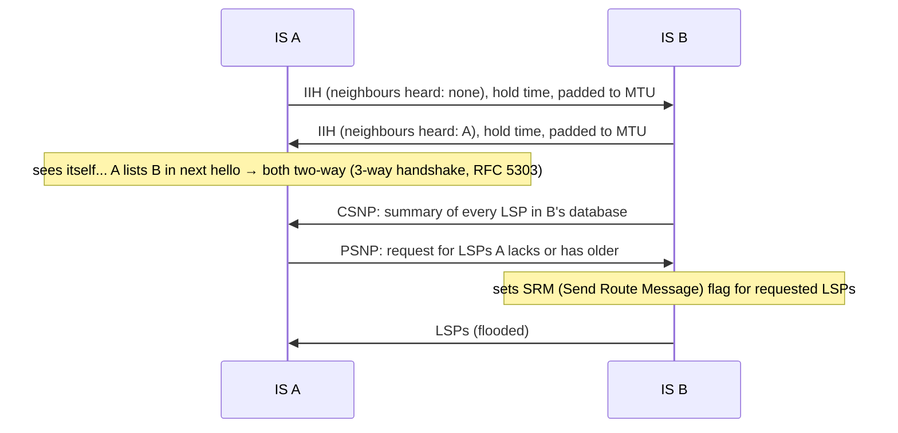
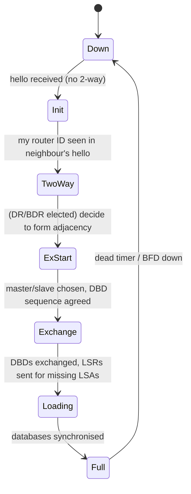

# 2.14 Distance-vector and link-state protocols: RIP, EIGRP, OSPF and IS-IS

| | |
|---|---|
| Level | Intermediate |
| Priority tier | 0 |
| Lab venue | Linux VM with FRR in namespaces/containerlab |
| Part | Part 2: Networking, from first principles to AI fabrics |
| Status | Drafted, labs **untested** |

## Why this matters for AI infrastructure

In many AI data centres the **underlay** (the routed network that gives every switch loopback and link reachability) is OSPF, IS-IS or eBGP; Kubernetes clusters with Calico or Cilium may speak BGP or OSPF to the fabric; HPC sites run OSPF in management networks; and on-prem GPU clouds inherit enterprise networks full of OSPF and EIGRP. You will be asked to read an OSPF neighbour table, explain why an adjacency is stuck in EXSTART (usually MTU), design areas, explain DR/BDR elections on a shared segment, or compare IS-IS and OSPF for a new fabric. This chapter explains the protocols that implement the algorithms of chapter 2.13: how Spanning Tree, RIP and EIGRP (distance-vector family) work, and how OSPF and IS-IS (link-state) form neighbours, flood reliably, and calculate paths, with configuration and troubleshooting in FRR.

## Prerequisites and outcomes

You should know the control-plane concepts in chapter 2.13 (neighbour discovery, flooding, SPF, convergence) and VLAN/STP basics (2.11).

After this chapter you can:

- Explain how STP builds a loop-free tree and learns reachability, and how RIP and EIGRP implement Bellman-Ford and DUAL.
- Explain IS-IS: OSI/NSAP addressing, levels, the single LSP with TLVs and fragments, hello/CSNP/PSNP exchange, SRM flags, flooding, flushing, metrics.
- Explain OSPF: router IDs, packet types, LSA types, neighbour states (Down to Full), DR/BDR, areas and ABRs/ASBRs, network types, costs, reference bandwidth, timers, authentication.
- Compare OSPF and IS-IS and choose between them.
- Configure OSPF and IS-IS in FRR, including point-to-point links, unnumbered interfaces, BFD, passive interfaces, summarisation and ECMP.
- Troubleshoot adjacency and database problems (MTU mismatch, timers, area ID, authentication, duplicate router IDs, network type mismatch).
- Apply link-state routing to a Clos underlay.

## 1. Spanning Tree as a control plane

Spanning Tree (chapter 2.11) is itself a distance-vector-style control plane that computes a loop-free tree rather than shortest paths to every destination:

- **Loop-free tree building**: the lowest bridge ID becomes the root (all switches advertise "the best root I know" in BPDUs and converge on the minimum); each switch selects the root port by lowest cost to the root, each segment elects a designated port, and the rest are blocked. It is the Bellman-Ford idea with a single destination (the root).
- **Reachable-destination learning** is *reactive and data-plane driven*: bridges learn host MACs from source addresses of frames and flood unknown destinations; there is no advertisement of reachability.
- **Limits**: a single tree wastes capacity, converges slowly in classic form, has no hierarchy, and flat L2 domains grow broadcast load. This is why routing protocols took over the scale-out job.

## 2. RIP: the simplest distance-vector protocol

The **Routing Information Protocol** (RIPv2 RFC 2453, RIPng for IPv6) is Bellman-Ford made concrete:

- Every router sends its whole routing table to neighbours every 30 s (multicast 224.0.0.9, UDP 520). Metric = hop count; 16 means unreachable ("infinity"), so networks are limited to 15 hops.
- A router picks, for each destination, the neighbour with the lowest advertised hop count + 1, and installs it. Routes time out after 180 s without refresh, and are flushed after 240 s; **triggered updates**, **split horizon with poison reverse** and **hold-down** timers fight count-to-infinity.
- Strengths: trivial to configure and understand. Weaknesses: slow convergence (tens of seconds to minutes), periodic full-table updates waste bandwidth, hop-count ignores link speed, 15-hop limit, no hierarchy. Use only for tiny networks and teaching; recognise it in legacy gear.

## 3. EIGRP: DUAL-based distance vector

The **Enhanced Interior Gateway Routing Protocol** (originally Cisco; basic functionality published as RFC 7868) keeps distance-vector's neighbour-only information exchange while using DUAL (chapter 2.13) to guarantee loop-freedom and instant failover:

- **Neighbour discovery**: multicast hellos (224.0.0.10, protocol 88) with matching K-values/AS number; hold time 3× hello (5 s/15 s default on fast links).
- **Reliable transport (RTP)**: updates, queries, replies and acks are sequenced and retransmitted, so only changes (not full tables) are sent.
- **Composite metric** from bandwidth, delay (default) and optionally load/reliability: `metric = 256 × (10^7/min bandwidth in kb/s + sum of delays / 10)` in classic mode ("wide" metrics for fast links).
- **Successor and feasible successor**: lowest-metric next hop; any neighbour whose reported distance is below my feasible distance is an instantly usable backup. On failure with a feasible successor: switch immediately, no queries. Without one: go active, query neighbours, converge after replies ("stuck in active" if a neighbour doesn't answer).
- **Unequal-cost load balancing** (`variance`) is unique to EIGRP.
- Support in FRR: EIGRP is not production-grade in FRR; EIGRP is mostly seen in Cisco enterprise networks. For new designs prefer OSPF/IS-IS/BGP.

## 4. Link-state protocols: the shared model

OSPF and IS-IS both implement the same link-state model: discover neighbours, verify two-way connectivity, synchronise a database by reliable flooding, and run Dijkstra's SPF. They differ in packaging.

| Aspect | OSPF | IS-IS |
|---|---|---|
| Runs over | IP (protocol 89), multicast 224.0.0.5/6 (v2); IPv6 link-local FF02::5/6 (v3) | Directly on layer 2 (CLNS), not IP |
| Data marshalling | Fixed-length fields, several LSA types | Single LSP per router, TLVs, fragmentable |
| Node identity | 32-bit router ID (looks like an IPv4 address, is not one) | 6-byte System ID inside an NSAP/NET |
| Hierarchy | Areas (backbone Area 0) with ABRs; strict area-0 centred | Levels (L1 intra-area, L2 backbone; routers can be L1, L2, or L1/L2); area boundary on links not routers |
| Multi-access | DR/BDR election; pseudo-node via Network LSA | DIS election per level; pseudo-node LSP |
| Address families | OSPFv2 IPv4; OSPFv3 IPv6 (and IPv4 via AFs) | One instance carries IPv4, IPv6 and others via TLVs |
| Extensibility | New LSA types/Opaque LSAs | New TLVs easily |
| Typical home | Enterprise, data centre | Service providers, large data centres |

## 5. IS-IS in depth

**Why it looks different.** IS-IS ("Intermediate System to Intermediate System") came from the OSI protocol suite: a router is an Intermediate System (IS), a host an End System (ES). It runs at the link layer, parallel to IP rather than on top of it: it does not depend on IP addressing to bring up adjacencies, never forwards IS-IS packets, and uses a different addressing scheme from the thing it routes, which keeps nodes and destinations clearly separated and makes the protocol robust to IP misconfiguration.

### NSAP/NET addressing

Each IS has an OSI address (a **NET**, network entity title) such as `49.0001.1921.6800.1001.00`:

```text
49.0001 . 1921.6800.1001 . 00
 AFI+area      System ID      N-selector (always 00 for a router)
```

- Everything to the left of the last 7 bytes is the **area address** (`49` is the private AFI; `0001` the area).
- The 6-byte **System ID** must be unique within the domain (conventionally derived from a loopback IP: 192.168.1.1 becomes 1921.6800.1001).
- The final byte (**N-selector**, also called the NSAP) is `00` for the router itself.
- Routers with the same area address are in the same area/flooding domain; mismatched areas form only Level 2 adjacencies.

### Packets and marshalling

IS-IS uses three kinds of PDUs: **hellos** (IIH), **sequence number PDUs** (CSNP complete, PSNP partial), and **link state PDUs (LSPs)**. Each IS originates *one logical LSP* describing itself, its adjacent ISes and its attached destinations, encoded as **TLVs** (type-length-value): e.g. TLV 2/22 neighbour reachability (22 is extended-metric), 128/135 IPv4 reachability (135 extended), 236/237 IPv6, plus segment-routing and other extensions. Because TLV space is large, the logical LSP is split into **fragments**, each flooded as its own LSP; only the fragment that changed is re-flooded. The TLV design is why IS-IS gained new address families and features without redesigning the protocol; the original 6-bit metrics ("narrow") are replaced by 24/32-bit "wide" metrics, which you should always enable.

### Neighbour formation



- Hellos carry the **list of neighbours heard** (two-way check) and the hold time the sender wants the peer to use (typical 10 s hello, 30 s hold; fast timers for convergence).
- **Hello padding** to the interface MTU during adjacency formation detects MTU mismatches (an adjacency that comes up but later fails with large LSPs is the classic symptom of not padding).
- After two-way, the neighbours exchange **CSNPs** (a complete summary of their databases), compare, and request missing/outdated LSPs with **PSNPs**; the flooding process walks LSPs with the **SRM** flag set and sends them.

### Reliable flooding

Every IS in the flooding domain must hold an identical database or loops become possible. The LSP header carries: **remaining lifetime** (counts down from 1200 s; forces periodic refresh and aging out of stale information; zero means purge), **LSP ID** (system ID + pseudonode ID + fragment number), **sequence number** (higher is newer; stops old replays), **checksum**, plus flags (attached, overload, partition). Procedure on a point-to-point link: the originator sets SRM toward each neighbour; the neighbour ACKs by sending a PSNP/CSNP listing the LSP; on receipt the neighbour compares sequence numbers, stores a newer one and floods it onward on its other links. Removing information: originate a newer fragment without the data; flood a zero-lifetime purge; or let the lifetime expire (nodes re-flood the zero-age LSP: "flushing").

On **broadcast (multi-access) links** a **Designated Intermediate System (DIS)** is elected per level (highest priority, then highest MAC; pre-emptive, no backup); it creates a **pseudo-node** representing the LAN and periodically multicasts CSNPs to keep the LAN's databases synchronised, instead of every pair of routers forming an adjacency. Because data-centre links are point-to-point, configure `isis network point-to-point` and avoid DIS entirely.

### Levels, overload and metrics

- **Level 1** routers know their own area; **Level 2** routers form the backbone between areas; **L1/L2** routers connect both (the default type). For a modern single-area data-centre underlay, run everything as Level 2 only (flat) to avoid L1/L2 complexity, or L1 only.
- The **overload bit** tells others not to use this IS for transit (used during maintenance or while BGP converges after boot). The **attached bit** makes L1 routers install a default toward an L1/L2 router.
- **Metrics**: narrow (6-bit, max 63 per link) vs wide (24/32-bit); set `metric-style wide`. Cost defaults to 10 per interface unless configured; scale metrics by link speed yourself.

### FRR IS-IS example

```text
interface lo
 ip router isis FABRIC
 isis passive
interface swp1
 ip router isis FABRIC
 isis network point-to-point
 isis metric 10
 isis hello-interval 1
 isis hello-multiplier 3
 isis bfd
router isis FABRIC
 net 49.0001.1921.6800.1001.00
 is-type level-2-only
 metric-style wide
 lsp-gen-interval 1
 fast-reroute ti-lfa level-2 proto ipv4      ! if supported
vtysh -c 'show isis neighbor' -c 'show isis database detail' -c 'show isis route' -c 'show isis interface detail'
```

## 6. OSPF in depth

**OSPF** (Open Shortest Path First; OSPFv2 RFC 2328 for IPv4, OSPFv3 RFC 5340 for IPv6 with address-family support for IPv4) runs directly over IP (protocol 89) and is the most widely deployed IGP.

### Router ID, packets and LSAs

- The **router ID** is a 32-bit identifier written like an IPv4 address; set it explicitly (`ospf router-id 10.255.0.1`, typically the loopback) rather than letting it be derived. It is not an IP address and need not be reachable. Duplicate router IDs cause database fights and instability.
- **Fixed-length fields** keep parsing cheap and packets small, a design choice from when CPUs and links were scarce. OSPF splits information into **LSA types** rather than one TLV blob:

| LSA type | Name | Generated by | Contents | Flooding scope |
|---|---|---|---|---|
| 1 | Router LSA | Every router (one per router per area) | Router's links, neighbours and attached prefixes | Area |
| 2 | Network LSA | DR on multi-access segments | Routers attached to the segment | Area |
| 3 | Inter-area prefix (Summary) LSA | ABR | Prefixes from other areas | Area |
| 4 | Inter-area router (ASBR summary) LSA | ABR | Route to an ASBR | Area |
| 5 | AS-external LSA | ASBR | Redistributed external prefixes (E1/E2 metric types) | Whole AS (except stub areas) |
| 7 | NSSA external LSA | ASBR in an NSSA | External prefixes inside an NSSA, translated to type 5 by the ABR | NSSA area |
| 9/10/11 | Opaque LSAs | extensions (TE, segment routing) | | link/area/AS |

Each router originates exactly **one Router LSA** (type 1) per area; links are inferred from neighbour and prefix entries, not advertised as separate objects.

- **Packet types**: Hello (1), Database Description/DBD (2), Link State Request/LSR (3), Link State Update/LSU (4), Link State Acknowledgment (5).

### Neighbour state machine



1. **Hello**: neighbours must agree on hello/dead intervals, area ID, network type/subnet mask (multi-access), authentication, stub flags, and MTU (the interface MTU in DBD packets; a mismatch leaves the adjacency stuck in **ExStart/Exchange**).
2. **Two-way** is confirmed when each router sees its own ID in the neighbour's "neighbours seen" list. On broadcast networks only DR/BDR reach Full with everyone; other pairs stay in 2-Way.
3. **ExStart/Exchange**: master and slave are chosen; DBDs summarise each database (headers: LS age, ID, advertising router, sequence, checksum).
4. **Loading**: LSRs request what is missing; LSUs deliver LSAs; LSAcks confirm.
5. **Full**: databases synchronised; SPF runs.

### Reliable flooding

The LSA header carries **LS Age** (counts up to MaxAge 3600 s; routers refresh their own LSAs every 30 min; at MaxAge the LSA is flushed), **LS ID**, **Advertising Router**, **LS Sequence Number** (higher is newer), and **Checksum**. A changed LSA is flooded in an LSU to every neighbour except the one it came from; each receiver acknowledges (explicitly in an LSAck or implicitly by flooding it back), installs it if newer by sequence, and floods onward. The originator retransmits until acknowledged. Flooding is area-scoped, so area size bounds flooding cost.

### Network types, DR and BDR

| Network type | Behaviour | Use |
|---|---|---|
| Broadcast | DR/BDR election; hello 10 s/dead 40 s | Ethernet segments |
| **Point-to-point** | No election, adjacency immediately; hello 10/40 (set faster) | Router-to-router links; **use this for data-centre fabric** (`ip ospf network point-to-point`) |
| NBMA / point-to-multipoint | For non-broadcast media | Legacy WAN |
| Unnumbered | P2P using a loopback's address | Save addresses in fabrics |

On a broadcast segment of n routers a full mesh of adjacencies would need n(n-1)/2 flooding relationships. Instead, a **Designated Router (DR)** and **Backup DR** are elected (highest priority, then highest router ID; non-pre-emptive); all other routers become adjacent only to DR/BDR, send updates to 224.0.0.6, and the DR floods to 224.0.0.5. The DR originates the Network LSA. Priority 0 means never DR. Changing DRs requires clearing the process, so avoid relying on the election: use P2P networks in fabrics.

### Areas and hierarchy

Large flat OSPF domains put everyone's SPF and flooding load on every router. **Areas** divide the AS: **Area 0 (backbone)** connects all other areas; **ABRs** (area border routers) attach to multiple areas, keep a database per area and summarise prefixes between them (type 3 LSAs); **ASBRs** inject external routes (type 5). Special area types reduce state: **stub** (no external LSAs; default route instead), **totally stubby** (also no inter-area routes), **NSSA** (stub that can still originate external routes via type 7). Inter-area routing is distance-vector-like at the ABR level (areas must be loop-free through the backbone). Modern data centres usually use a single area (up to a few hundred routers) or avoid OSPF in favour of IS-IS/BGP for larger scale.

### Cost, SPF and ECMP

- **Cost** = reference bandwidth / interface bandwidth (default reference 100 Mb/s, which makes all links ≥100M cost 1!). Always set `auto-cost reference-bandwidth` high (e.g. 400000 or more Mb/s) consistently on all routers, or set interface costs explicitly.
- SPF throttling: `timers throttle spf 50 100 5000` (initial delay, hold, max) and LSA throttling control reaction time.
- **ECMP**: equal-cost paths are installed together (up to `maximum-paths`, default 4 in some implementations; raise to the fabric width, e.g. 64).
- **Authentication**: plain text (never), MD5, or HMAC-SHA (RFC 5709) per interface/area; IPsec for OSPFv3.

### FRR OSPF example

```text
router ospf
 ospf router-id 10.255.0.1
 auto-cost reference-bandwidth 400000
 maximum-paths 64
 timers throttle spf 50 100 2000
 passive-interface default
 no passive-interface swp1
 no passive-interface swp2
interface lo
 ip ospf area 0
interface swp1
 ip ospf area 0
 ip ospf network point-to-point
 ip ospf hello-interval 1
 ip ospf dead-interval 4
 ip ospf bfd
 ip ospf cost 10
vtysh -c 'show ip ospf neighbor' -c 'show ip ospf interface' -c 'show ip ospf database' -c 'show ip ospf route' -c 'show ip ospf database router self-originate'
```

For IPv6 use `ipv6 ospf6` and `router ospf6`.

## 7. OSPF versus IS-IS: choosing

| Consideration | Prefer OSPF | Prefer IS-IS |
|---|---|---|
| Familiarity / tooling / hiring | ✔ Everywhere | Strong in carriers, less in enterprise |
| Multi-protocol (IPv4+IPv6) | v2+v3 (or AFs) | One process carries both |
| Hierarchy | Areas with ABRs, backbone centricity | Levels, boundary on links, flexible |
| Extensibility | LSA types | TLVs (easy) |
| Stability under load | Good | Often more stable at very large scale |
| Adjacency independence from IP | Needs IP | Doesn't (robust) |
| Multi-instance / MPLS TE / SR | Supported | Strong SR/TE heritage |

Both converge in sub-second with tuning and BFD. In practice: choose what your organisation can operate; for hyperscale AI fabrics eBGP (RFC 7938) or link-state variants (RIFT) are common (chapter 2.16), and OSPF/IS-IS serve as the underlay in smaller or EVPN designs.

## 8. Operations and troubleshooting

Neighbour not forming (OSPF): `show ip ospf neighbor` state tells you where it sticks.

| State stuck | Cause | Check |
|---|---|---|
| Down / no neighbour | No hellos: interface down/passive, wrong area, ACL blocks proto 89, auth mismatch, subnet mismatch, hello/dead mismatch | `show ip ospf interface`, `tcpdump -ni swp1 proto 89`, config diff |
| Init | One-way: neighbour doesn't hear me (unidirectional link, filter) | tcpdump on both ends |
| 2-Way (broadcast) | Normal for non-DR/BDR pairs | DR election |
| ExStart/Exchange | **MTU mismatch**, duplicate router ID | `ip link`, `show ip ospf interface`, `ip ospf mtu-ignore` (workaround only) |
| Loading | Lost LSRs/LSUs, large LSAs vs MTU, rate-limiting | `show ip ospf neighbor detail`, counters |
| Full but routes missing | Area/stub/filter policy, summary or distribute-list, wrong network type, redistribution | `show ip ospf database`, route-maps |

IS-IS: `show isis neighbor` (state Up/Initializing), mismatched area addresses only form L2; mismatched `is-type`, authentication, MTU/padding, duplicate System IDs (flapping `show isis database` with the same ID from two sources), overload bit set, narrow vs wide metrics mismatch, and `network point-to-point` mismatch are the usual suspects.

Generic tools: `tcpdump -ni swp1 'proto 89'` (OSPF), `ether proto 0xfefe`/`isis` (IS-IS), packet counters and logs (`debug ospf adj`), `ip route show proto ospf`, and `vtysh` database dumps; compare databases between two routers (they must be identical in an area); watch SPF run counts (`show ip ospf` statistics) to spot flapping; use `ip monitor route` to timestamp convergence.

**Design guidance for fabrics.** Point-to-point everywhere; loopback /32 as router ID and advertised service address; single area (or L2-only IS-IS); BFD at 100-300 ms; consistent reference bandwidth; passive-interface default; ECMP width at least equal to uplink count; authentication; protect the control plane (CoPP); keep the routing table small by not redistributing host routes unnecessarily; stagger maintenance with overload/graceful-shutdown (`max-metric router-lsa on-startup/administrative`) so traffic drains before reloads.

## 9. Lab: OSPF and IS-IS in FRR (untested)

Use containerlab (chapter 2.27) or namespaces with FRR: a diamond of four routers with loopbacks plus two host namespaces.

1. **OSPF basics**: configure as above in Area 0; watch the state progression (`debug ospf adj` or `watch vtysh -c 'show ip ospf neighbor'`); inspect the LSDB: identify Router LSAs, link the `show ip ospf route` result with your hand-computed SPF; note ECMP between hosts.
2. **MTU mismatch**: set one interface MTU to 1400 and the other 1500; observe ExStart; use `mtu-ignore` and discuss why it is a workaround.
3. **Network types**: put three routers on a bridge; observe DR/BDR election and 2-Way states; change priority; then reconfigure as P2P links and compare adjacency counts.
4. **Areas**: split into Areas 0, 1 and 2; observe LSA types 3 at ABRs; make Area 2 stub and see the default route; add an ASBR with `redistribute connected` and look at type 5.
5. **Timers and BFD**: measure failover with default timers, `hello 1/dead 4`, and BFD (100 ms ×3) using a timestamped ping.
6. **Cost**: demonstrate the reference-bandwidth trap by mixing 1G/10G/100G links with default costs; fix with auto-cost.
7. **IS-IS**: replicate the topology with IS-IS Level-2, wide metrics, P2P; inspect `show isis database detail`, identify TLVs; flush an LSP by shutting a loopback; disable hello padding vs enable and observe MTU detection.
8. **Compare** convergence and CPU/LSDB sizes between OSPF and IS-IS under the same failure scripts (`ip monitor route | ts`).
9. **Authentication**: enable OSPF MD5/SHA and show the mismatch failure.
10. **Clean up**.

Mark tested only after execution.

## 10. Common mistakes

- Default reference bandwidth in OSPF (all fast links cost 1) or inconsistent costs across routers.
- Broadcast network type on point-to-point Ethernet links (needless DR election, slower convergence).
- Not setting explicit router IDs; duplicate IDs/System IDs; using `mtu-ignore` as a permanent fix.
- Running OSPF on all interfaces (including server-facing ones) instead of passive-interface default.
- Making Area 0 non-contiguous or hanging areas off non-backbone areas without virtual links (a design bug).
- Narrow IS-IS metrics in modern networks; mixing L1/L2 unnecessarily.
- Over-aggressive timers without BFD and CPU protection; no authentication.
- Large flat domains with unstable links and no SPF/LSA throttling.

## 11. Interview angles

- "Walk through OSPF neighbour states. What causes ExStart to be stuck?"
- "What is the DR/BDR for? What happens if the DR fails? How do you avoid it?"
- "List the OSPF LSA types and who generates them."
- "Why does IS-IS run directly on layer 2? What is a NET?"
- "Compare OSPF and IS-IS for a new data-centre underlay."
- "How do OSPF/IS-IS ensure database synchronisation and remove stale information?"
- "What is the reference-bandwidth problem?"
- "What is a stub/NSSA area for?"
- "How do you make OSPF converge in under a second?"
- "How does RIP prevent count to infinity? How does EIGRP's feasibility condition guarantee loop-freedom?"

## 12. Checkpoint questions (40)

1. How does STP's root election resemble Bellman-Ford? **A:** Switches converge on the minimum bridge ID by relaying the best root they know.
2. How does STP learn reachability? **A:** From source MACs of data frames (reactive), flooding unknowns.
3. RIP metric and maximum? **A:** Hop count, 15 (16 = unreachable).
4. RIP update interval? **A:** 30 seconds.
5. What are RIP's loop-avoidance tools? **A:** Split horizon/poison reverse, triggered updates, hold-down, limited diameter.
6. What does EIGRP use instead of periodic full updates? **A:** Reliable transport of only changes.
7. What is an EIGRP feasible successor? **A:** Neighbour with reported distance below my feasible distance.
8. What is unique about EIGRP load sharing? **A:** Unequal-cost via variance.
9. Name two link-state protocols. **A:** OSPF and IS-IS.
10. What do link-state routers flood? **A:** Their local links and prefixes (LSAs/LSPs).
11. IS-IS addresses: parts of a NET? **A:** Area address, 6-byte System ID, N-selector 00.
12. Where does IS-IS run? **A:** Directly on layer 2, not on IP.
13. What are IS-IS's PDU types? **A:** Hello, CSNP/PSNP, LSP.
14. What do CSNP and PSNP do? **A:** CSNP summarises the whole database; PSNP requests/acknowledges specific LSPs.
15. What is the SRM flag? **A:** Marks an LSP to send to a neighbour.
16. How does IS-IS check two-way connectivity? **A:** Hellos list neighbours heard; three-way handshake.
17. Why pad IS-IS hellos? **A:** To detect MTU mismatch.
18. How are LSPs aged and purged? **A:** Remaining lifetime counts down; zero-age flood flushes them.
19. What is the DIS? **A:** The elected router that represents a broadcast LAN in IS-IS.
20. What is the OSPF router ID? **A:** A 32-bit identifier, not necessarily an IP address.
21. List OSPF packet types. **A:** Hello, DBD, LSR, LSU, LSAck.
22. Which LSA type does every router generate? **A:** Type 1 Router LSA.
23. Which LSA does the DR generate? **A:** Type 2 Network LSA.
24. Which LSA carries external routes? **A:** Type 5 (type 7 in NSSA).
25. Which LSA type does the ABR generate? **A:** Types 3 and 4.
26. What does ExStart/Exchange stuck usually mean? **A:** MTU mismatch (or duplicate router ID).
27. What must match for OSPF neighbours? **A:** Area, hello/dead, subnet (broadcast), authentication, stub flags, MTU.
28. Why DR/BDR? **A:** Reduce adjacencies and flooding on multi-access links.
29. Which network type for fabric links? **A:** Point-to-point.
30. What is Area 0? **A:** The backbone all areas connect to.
31. ABR versus ASBR? **A:** Area border versus autonomous-system boundary (external route injection).
32. What is a stub area? **A:** An area without external LSAs, using a default route.
33. What is NSSA? **A:** A stub that can still inject externals via type 7.
34. Default OSPF reference bandwidth and its problem? **A:** 100 Mb/s; all faster links cost 1.
35. What do SPF throttle timers do? **A:** Delay/limit SPF runs to avoid churn.
36. How do you authenticate OSPF? **A:** MD5 or HMAC-SHA per interface/area (IPsec in v3).
37. Which tool shows OSPF packets? **A:** `tcpdump 'proto 89'`.
38. Why use wide metrics in IS-IS? **A:** Narrow 6-bit metrics max 63 per link.
39. What is the overload bit? **A:** Tells others not to use this router for transit.
40. Which IGP carries IPv4 and IPv6 in one process? **A:** IS-IS.

## 13. Sources and review notes

**Written in original words.** Principal sources:

- Russ White and Jeff Tantsura (with co-authors), *Computer Networking Problems and Solutions*, chapter 15 (distance-vector control planes: STP loop-free tree and reachability learning, RIP and its Bellman-Ford mapping, EIGRP neighbour discovery, reliable transport and topology change reaction) and chapter 16 (link-state: history of OSPF and IS-IS, IS-IS OSI addressing, marshalling, neighbour discovery and reliable flooding; OSPF marshalling, LSA and packet types, neighbour states, flooding; common elements: multiaccess links, links/nodes/reachability, two-way connectivity validation). The BGP portions of chapter 16 are developed in chapter 2.15.
- Linux/FRR configuration, design guidance and troubleshooting tables are the author's synthesis from RFCs 2328, 5340, 1195, 5303, 5709, 2453, 7868, 7938 and the FRR user guide.

**Flagged for verification before publishing:** FRR syntax per release (IS-IS `fast-reroute`, `maximum-paths`), default timers and costs, EIGRP support status in FRR, LSA code values for OSPFv3, and vendor-specific behaviours; all labs are **untested**.
