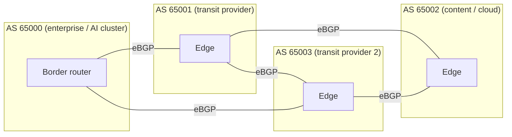
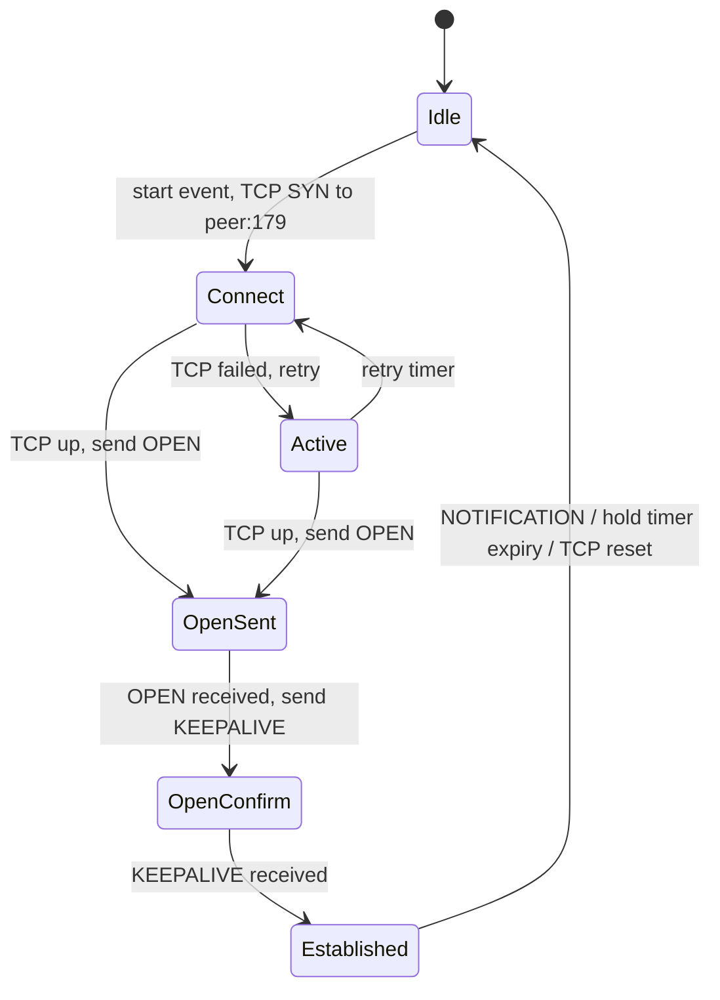

# 2.15 BGP fundamentals and control-plane policy

| | |
|---|---|
| Level | Intermediate |
| Priority tier | 0 |
| Lab venue | Linux VM with FRR (namespaces/containerlab) |
| Part | Part 2: Networking, from first principles to AI fabrics |
| Status | Drafted, labs **untested** |

## Why this matters for AI infrastructure

BGP is the protocol that connects the Internet, the cloud providers' edges (Direct Connect, Cloud Interconnect, ExpressRoute use it), and, since RFC 7938, most hyperscale and AI data-centre fabrics. It is also how Kubernetes advertises pod and service addresses (Calico, Cilium, MetalLB, kube-vip), how EVPN distributes MAC/IP reachability (chapter 2.17), and how bare-metal GPU nodes can run routed to the top-of-rack switch with ECMP across both uplinks. Interviews for infrastructure roles routinely ask about BGP sessions, attributes, the best-path algorithm, iBGP versus eBGP, route reflectors and why data centres use eBGP. This chapter teaches the protocol and its policy toolset; chapter 2.16 applies it to Clos fabrics.

## Prerequisites and outcomes

You should know routing fundamentals and path-vector concepts (chapter 2.13), TCP (2.6) and OSPF/IS-IS at a high level (2.14).

After this chapter you can:

- Explain autonomous systems, ASNs, IGP versus EGP, and what BGP's goals are (policy over shortest path).
- Describe BGP sessions: TCP/179, FSM states, OPEN/KEEPALIVE/UPDATE/NOTIFICATION messages, capabilities, hold timers, End-of-RIB, graceful restart, iBGP versus eBGP.
- Explain NLRI and path attributes (ORIGIN, AS_PATH, NEXT_HOP, MED, LOCAL_PREF, COMMUNITY, atomic aggregate, aggregator, large communities), mandatory versus optional, transitive versus non-transitive.
- Apply the best-path algorithm and predict outcomes of a given set of paths.
- Explain advertisement rules, why iBGP needs a full mesh or route reflectors/confederations, and next-hop-self.
- Write prefix lists, route-maps, communities and AS-path filters in FRR; implement hot-potato, cold-potato, resource segmentation and flow pinning policies conceptually.
- Secure and operate BGP (MD5/TCP-AO, GTSM, max-prefix, RPKI/ROV, bogon filters, graceful shutdown).
- Troubleshoot sessions and paths using `show bgp` commands.

## 1. Autonomous systems and why BGP exists

An **autonomous system (AS)** is a set of IP prefixes and routers under a single administrative policy, identified by an **AS number (ASN)**: 16-bit historically (1 to 65535), 32-bit now (RFC 6793, e.g. 4200000000 to 4294967294 private range; private 16-bit range 64512 to 65534). Interior gateway protocols (RIP, OSPF, IS-IS, EIGRP) find efficient paths inside one AS. The **Border Gateway Protocol, version 4** (RFC 4271, "BGP-4"), an Exterior Gateway Protocol, exchanges reachability *between* ASes. The design brief of an EGP differs from an IGP: ASes are businesses (service providers, content providers, enterprises) with commercial and political relationships, so the goal is not the shortest path but **policy**: whom I accept routes from, whom I announce routes to, which path I prefer for business reasons. BGP trades optimality for control.



BGP is a **path-vector** protocol: each advertisement for a prefix carries the list of ASes it has traversed (the AS_PATH). It is **proactive** (routes are advertised without waiting for traffic), learns reachable destinations from configuration (`network` statements), redistribution, and other protocols, advertises only **best paths** to neighbours, and relies on **TCP** instead of its own reliability layer.

## 2. Sessions (peering)

BGP does not discover neighbours; peers are **configured** (IP addresses or interfaces, remote ASN) on both ends. Because BGP runs over **TCP port 179**, the transport provides reliable, ordered delivery, flow control, MTU handling (path MTU discovery/MSS) and two-way connectivity proof from the three-way handshake, so BGP needs no hello discovery, retransmission or flooding logic of its own. Peers may be several hops apart (multihop; ebgp-multihop) or directly connected.

### Session establishment



1. **Idle**: nothing; waiting for a start event.
2. **Connect/Active**: one side opens the TCP connection (the connection collision rule resolves both sides connecting at once: the connection initiated by the higher BGP identifier wins). If a firewall sits between the peers, the TCP open must originate from the side that the firewall permits; `Active` here means "TCP connect failed, trying again", not "established".
3. **OpenSent**: after TCP is up, each peer sends an **OPEN** message carrying: BGP version (4), the sender's **AS number** (and 4-byte ASN capability), **hold time** (the lower of the two values is used), the **BGP identifier** (router ID), and optional parameters: **capabilities** (multiprotocol extensions for IPv4/IPv6/VPN/EVPN address families, route refresh, 4-byte ASN, graceful restart, add-path, extended next hop).
4. **OpenConfirm** then **Established** after exchanging **KEEPALIVE**s. Timers: keepalive default 60 s, hold time 180 s in the protocol default (data-centre deployments use 3 s/9 s or rely on BFD, chapter 2.13).
5. Peers exchange their tables with **UPDATE** messages, which carry withdrawn prefixes, path attributes, and NLRI (network layer reachability information: the prefixes). After the initial exchange a peer sends **End-of-RIB (EOR)**. Afterwards only changes are sent. A **NOTIFICATION** message reports an error and closes the session. Soft resets use **route refresh** instead of tearing the session down.

Two kinds of sessions:

- **eBGP** (external): peers are in different ASes, normally directly connected; the next hop is rewritten to the sender's address; the local AS is **prepended** to the AS_PATH; TTL is 1 by default (security: GTSM).
- **iBGP** (internal): peers are in the same AS, usually loopback-to-loopback and multihop, carried over the IGP; AS_PATH is *not* modified; the next hop is *not* changed by default (so the IGP must reach the original eBGP next hop, or you set `next-hop-self`); LOCAL_PREF is carried.

## 3. Messages, NLRI and path attributes

An UPDATE advertises a set of prefixes (NLRI) that share the same path attributes. **Attribute categories:**

| Category | Meaning | Examples |
|---|---|---|
| Well-known mandatory | Must be understood and present in every UPDATE | ORIGIN, AS_PATH, NEXT_HOP |
| Well-known discretionary | Must be understood, may be omitted | LOCAL_PREF, ATOMIC_AGGREGATE |
| Optional transitive | May not be understood; passed along if unknown | COMMUNITY, AGGREGATOR, Large Community |
| Optional non-transitive | Dropped if not understood | MED (MULTI_EXIT_DISC), ORIGINATOR_ID, CLUSTER_LIST |

The key attributes:

- **ORIGIN**: how the route entered BGP: `i` (IGP / network statement), `e` (EGP, historical), `?` (incomplete, i.e. redistributed). Lower is preferred (i < e < ?).
- **AS_PATH**: ordered list (AS_SEQUENCE, plus AS_SET for aggregates) of ASes the route traversed. Used for loop prevention (reject when your own ASN appears) and as a metric (shorter is preferred). Operators **prepend** their ASN multiple times on outbound advertisements to make a path look longer and so less attractive.
- **NEXT_HOP**: the IP address to forward to; must be resolvable (recursively) through the IGP/connected routes or the route is unusable.
- **MED (multi-exit discriminator)**: a hint from a neighbour AS about which of multiple entry points to prefer (lower wins); compared only between routes from the same neighbouring AS (unless configured otherwise). It expresses the *neighbour's entrance policy*.
- **LOCAL_PREF**: carried only inside an AS (iBGP); higher wins; the standard tool for expressing *your exit policy* (default 100).
- **COMMUNITY** (32-bit tags `ASN:value`, e.g. `65000:100`), **extended communities** (route targets for VPNs) and **large communities** (96-bit `ASN:function:value`, RFC 8092, friendly to 4-byte ASNs) are labels attached to routes so that policy can be applied by matching them: "do not announce to peers" (`no-export` 65535:65281), "blackhole" (`65535:666`), "prefer this path" etc. They are the BGP configuration language for policy at scale.
- **WEIGHT**: a local, Cisco-originated, non-transmitted attribute (FRR supports it); highest wins; the first tiebreak step.
- **ATOMIC_AGGREGATE / AGGREGATOR**, **ORIGINATOR_ID / CLUSTER_LIST** (route reflection loop prevention).

### Loop prevention without split horizon

BGP has no split horizon. A router can advertise a route back to the AS it came from; loops are prevented because each AS prepends its ASN on eBGP advertisement and every router rejects routes whose AS_PATH already contains its own ASN. Example: A (AS65000) advertises 2001:db8:100::/64 to B and C. B (AS65001) re-advertises to D with path [65001, 65000]; D (AS65003) has [65003, 65001, 65000]. If this arrives back at A, A sees its own ASN in the path and drops it: the loop never enters A's table. Note that loop-freedom is a *property of the path attribute*, not part of the decision process.

## 4. The best-path decision process

When a router has several paths to the same prefix it picks one using an ordered list (vendor details differ slightly). The standard order:

1. Highest **WEIGHT** (local to the router; Cisco/FRR).
2. Highest **LOCAL_PREF** (exit policy of this AS).
3. Prefer **locally originated** routes (network/aggregate/redistributed on this router).
4. Shortest **AS_PATH**.
5. Lowest **ORIGIN** (i < e < ?).
6. Lowest **MED** (only among routes from the same neighbouring AS by default).
7. Prefer **eBGP over iBGP** paths.
8. Lowest **IGP cost** to the NEXT_HOP (hot potato: get the traffic out of my AS by the nearest exit).
9. If multipath is configured, install multiple equal paths (`maximum-paths`).
10. For eBGP paths, prefer the **oldest** (most stable) path to reduce churn.
11. Lowest **router ID** of the advertising peer.
12. Shortest **CLUSTER_LIST** length.
13. Lowest **neighbour address**.

Almost every real decision comes down to four factors: **LOCAL_PREF, AS_PATH length, MED, IGP cost**. BGP is intentionally flexible (custom decision processes exist) but the above is the common baseline. **Multipath** requires the paths to be equal up to step 8 (same LOCAL_PREF, AS_PATH length, origin, MED, IGP cost); in data centres `bestpath as-path multipath-relax` lets paths with the same length but different ASNs count as equal, which is how ECMP across spines with different ASNs works (chapter 2.16).

```bash
vtysh -c 'show bgp ipv4 unicast 10.1.0.0/24'     # shows all paths, the attributes and which is best/multipath ("=" "*>")
vtysh -c 'show bgp summary' -c 'show bgp neighbors 10.0.0.1 advertised-routes' -c 'show bgp neighbors 10.0.0.1 received-routes'
vtysh -c 'show ip bgp neighbors 10.0.0.1 routes' -c 'show bgp ipv4 unicast summary'
```

## 5. Advertisement rules, iBGP scaling and route reflectors

BGP's advertisement rules are two sentences: (1) advertise the **best path** to every eBGP peer; (2) advertise the best path **learned from an eBGP peer** to every iBGP peer. Consequence: a route learned from an iBGP peer is **not** advertised to another iBGP peer. This is how BGP avoids loops *inside* an AS (where the AS_PATH does not change and so cannot detect them). The side effect: iBGP needs a **full mesh** of sessions (n(n-1)/2), which does not scale. Two solutions:

- **Route reflectors (RR)** (RFC 4456): designate a router as an RR and the others as its **clients**; the RR may advertise iBGP-learned routes to clients (reflecting them). Loop prevention is via two new attributes: ORIGINATOR_ID (the router that first injected the route into the AS) and CLUSTER_LIST (RR cluster IDs traversed). Real networks run two or more RRs per cluster for redundancy. Caveat: RRs choose best paths from their own perspective (IGP-cost based), which can hide path diversity and cause suboptimal routing; **add-path** (advertise multiple paths) and optimal-route-reflection mitigate this.
- **Confederations**: split an AS into sub-ASes that behave like eBGP internally; used in very large networks.

Also needed in iBGP: `neighbor X next-hop-self` for routes learned from an eBGP peer, so that iBGP peers can resolve the next hop through the IGP without carrying the external link subnet; `update-source lo` to peer from loopbacks; and ensuring the **IGP carries loopbacks** (but not the external prefixes: never redistribute BGP into the IGP).

Data-centre designs (chapter 2.16) skip iBGP entirely and use **eBGP everywhere** with a per-rack or per-tier ASN scheme, trading ASN management for simpler failure domains, no IGP dependency, and policy at every hop.

## 6. Configuring BGP in FRR

```text
! Leaf in AS 65101 peering with two spines in AS 65000 (eBGP), advertising its loopback and server subnet
router bgp 65101
 bgp router-id 10.255.0.11
 no bgp ebgp-requires-policy               ! lab convenience; in production use explicit policy
 bgp bestpath as-path multipath-relax
 neighbor SPINES peer-group
 neighbor SPINES remote-as 65000
 neighbor SPINES bfd
 neighbor SPINES timers 3 9
 neighbor 10.0.1.0 peer-group SPINES
 neighbor 10.0.2.0 peer-group SPINES
 address-family ipv4 unicast
  network 10.255.0.11/32
  network 10.101.0.0/24
  neighbor SPINES activate
  neighbor SPINES soft-reconfiguration inbound
  maximum-paths 4
 exit-address-family
```

```bash
vtysh -c 'show bgp summary'                 # session state, uptime, prefixes received/sent
vtysh -c 'clear bgp 10.0.1.0 soft in'       # re-apply inbound policy without resetting the session
vtysh -c 'show bgp neighbors 10.0.1.0'      # state, capabilities, timers, last reset reason
```

Key BGP states in `show bgp summary`: `Idle` (not started or policy/administratively down), `Connect`/`Active` (TCP not established: reachability, firewall, wrong peer address, MD5 mismatch, ASN mismatch gives OPEN errors), `OpenSent`/`OpenConfirm` (stuck here: capability/hold-time/auth problems), a number in the prefix column means **Established**, `(Policy)` means eBGP without in/out policy under `ebgp-requires-policy`.

## 7. Policy tools

BGP policy is expressed with **filters and attribute changes** applied inbound or outbound per neighbour.

| Tool | Purpose | FRR/Cisco-like object |
|---|---|---|
| Prefix list | Match prefixes and length ranges | `ip prefix-list NAME seq 10 permit 10.0.0.0/8 le 24` |
| AS-path access list | Match AS_PATH with regexes | `bgp as-path access-list NAME permit ^65001_` |
| Community list | Match communities | `bgp community-list standard C1 permit 65000:100` |
| Route map | Ordered match/set rules: set LOCAL_PREF, MED, communities, prepend AS_PATH, next hop, weight | `route-map NAME permit 10` |
| Max-prefix | Limit prefixes accepted from a peer | `neighbor X maximum-prefix 1000` |
| Distribute/prefix filters on aggregates | Aggregate and suppress specifics | `aggregate-address 10.1.0.0/16 summary-only` |

```text
ip prefix-list CUSTOMER-IN seq 10 permit 203.0.113.0/24
ip prefix-list DEFAULT-ONLY seq 10 permit 0.0.0.0/0
bgp community-list standard BLACKHOLE permit 65535:666
route-map FROM-TRANSIT-A permit 10
 match ip address prefix-list DEFAULT-ONLY
 set local-preference 200
route-map TO-TRANSIT-B permit 10
 match ip address prefix-list CUSTOMER-IN
 set as-path prepend 65000 65000 65000
router bgp 65000
 address-family ipv4 unicast
  neighbor 192.0.2.1 route-map FROM-TRANSIT-A in
  neighbor 198.51.100.1 route-map TO-TRANSIT-B out
```

### What policy is for (use cases)

**Routing and potatoes.** *Hot-potato routing* hands traffic to the neighbour at the nearest exit (cheapest for me; achieved by the IGP-cost step or by LOCAL_PREF set on nearest peers). *Cold-potato routing* carries traffic inside my own network as far as possible and exits near the destination (better control of the user experience; used by content providers, achieved by high LOCAL_PREF on routes at the far exit, by honouring MED from neighbours, or by selective advertisement). Both choose a longer path than the minimum to serve a business policy: transit providers want to carry traffic across their backbone to maximise utilisation of the paid link; content providers want to control quality; a customer buying transit wants cheap and good exits.

**Resource segmentation.** Different tenants or services must reach only certain servers, sometimes along specific paths, and sometimes must not even *see* the routing information of the other. Packet filters alone can't meet requirements like "hide routes" or "force this path". A common solution is an **overlay**: tunnels (GRE, VXLAN, MPLS, SR) carry each segment through the shared underlay, with a separate overlay control plane (BGP VPNv4/EVPN, VRFs and route targets) pulling traffic into the tunnel. Underlay reachability and overlay policy are separated, which is why overlays pervade modern networks (chapter 2.17).

**Flow pinning.** *Elephant* flows (large, long-lived, e.g. >20% of a link for minutes) and *mouse* flows (small, short, latency-sensitive) hashed onto the same link interfere (`CN` Chapter 17): on a `100 Mb/s` link, a `9,000`-byte elephant packet occupies the wire for `0.72 ms` (`1,500` bytes takes `0.12 ms`), so a `64`-byte mouse packet queued behind it waits far longer than its own `0.05 ms` serialisation time, which shows up as jitter (`0.05 ms` vs `0.288 ms+` inter-packet spacing) and hurts flow control and error recovery. Mixing them is a performance problem even when average utilisation is low. Remedies: QoS to interleave, **pinning** the elephant to a chosen path and steering other traffic away from it (using the five-tuple to distinguish flows: source and destination IP, ports, protocol), segment routing or policy-based routing, or in AI fabrics adaptive routing and packet spraying (chapters 2.12 and 2.19). Pinning in a purely hash-based ECMP fabric is difficult because the ECMP hash decides paths; this is why flow-aware controllers and per-flow policies exist. Policy at this granularity carries **complexity cost**: more state, more interactions, and more ways to fail; each policy should justify itself against the extra operational risk (a recurring theme: adding policy trades network optimality and simplicity for control).

## 8. Security and operations

BGP trusts its peers; a mistaken or malicious announcement can divert or black-hole traffic globally (route leaks and hijacks). Controls:

- **Session protection**: TCP MD5 (`neighbor X password`) or TCP-AO (RFC 5925); **GTSM** (TTL security: eBGP peers send TTL 255 and accept only 254+/`ttl-security hops 1`); restrict TCP/179 with ACLs to known peers; authenticated, preferably over a private management or point-to-point interface.
- **Prefix and path filtering**: accept only what a peer should legitimately announce (customer prefix lists), reject bogons, private ASNs, overlong prefixes (/25+), your own space from outside, and default routes unless expected; `maximum-prefix` as a safety net; AS-path filters (reject paths containing private ASNs or too long); `bgp ebgp-requires-policy` in FRR forces explicit policy.
- **Origin validation**: **RPKI / ROV** (RFC 6811): validate that the origin AS is authorised (ROA) to announce the prefix; reject Invalid. ASPA (draft/RFC in progress) validates AS_PATH relationships.
- **Operational hygiene**: graceful restart / long-lived graceful restart (keep forwarding while the control plane restarts), `bgp graceful-shutdown` (GRACEFUL_SHUTDOWN community 65535:0 so neighbours move traffic away before maintenance), BFD for fast failure detection, route dampening (rarely recommended now), max-prefix, monitoring (session state, prefix counts, update rates; BMP streaming to a collector), looking glasses and route collectors (RIPE RIS, RouteViews) to observe how the world sees your prefixes.
- **Blackhole/RTBH**: announce a victim /32 with a blackhole community to the upstream to drop DDoS traffic at the edge.

## 9. BGP in AI/Kubernetes contexts (preview)

- **Fabric underlay/overlay**: eBGP between leaf and spine, loopback and server-subnet advertisement, ECMP with `multipath-relax`, BFD, EVPN address family for VXLAN overlays (chapter 2.16 and 2.17).
- **BGP to the host**: FRR/BIRD on GPU servers (or the DPU) peering with both ToRs gives ECMP, no MLAG, instant failover and a host that advertises its own /32 loopback and any pod/VM prefixes.
- **Kubernetes**: Calico (BIRD or the Go BGP library), Cilium BGP control plane, MetalLB (LoadBalancer VIPs in BGP mode), kube-vip. Typically the node (AS per node or one shared AS) peers with the ToR and announces pod CIDRs and service IPs, with `maximum-paths` at the ToR to spread ingress traffic.
- **Cloud**: Direct Connect / Cloud Interconnect / ExpressRoute and cloud routers exchange routes with on-prem via BGP (a private ASN on-prem, the cloud's ASN, MED/AS-path prepending for primary/backup); learn the vendor limits (max routes, BFD timers).

## 10. Hands-on lab: BGP sessions, attributes, and policy

First, run the self-checking Python lab (`code/part02/bgp_fundamentals_lab.py`) locally. It verifies the BGP best-path decision algorithm (`LOCAL_PREF` -> `AS_PATH` length -> `MED` -> hot-potato `IGP` cost), `AS_PATH` loop detection and `allowas-in`, eBGP vs iBGP advertisement rules and Route Reflector scaling (`4,950` full-mesh sessions vs `197` with 2 RRs for 100 routers), and elephant/mouse serialization jitter math (`0.72 ms` vs `0.05 ms` on `100 Mb/s`).

```bash
python3 code/part02/bgp_fundamentals_lab.py
```

Next, on a disposable Linux VM using FRR in three or four namespaces/containers (`AS65001 --- AS65000 (transit) --- AS65002`; all interactive VM commands below are `untested here`), work through these steps:

1. **eBGP session**: configure peers, watch `show bgp summary` go Idle → Connect → Active → Established; capture with `tcpdump -ni any port 179` and decode OPEN/KEEPALIVE/UPDATE; set mismatched ASN to see the NOTIFICATION; test an ACL that blocks 179 in one direction.
2. **Advertise prefixes** with `network` and with `redistribute connected`; verify `received-routes`; compare AS_PATH, NEXT_HOP on each router.
3. **Loop prevention**: construct a triangle and show a route being rejected because of the local ASN; use `allowas-in` to demonstrate the override (and its risk).
4. **Best-path steering**: with two paths, change LOCAL_PREF inbound, then AS-path prepend outbound, then MED; for each, predict then confirm with `show bgp ipv4 unicast <prefix>`; test the "MED only compared within the same neighbour AS" rule.
5. **iBGP**: add a second router in AS65000, build an iBGP session over loopbacks with an IGP (OSPF); show the next-hop problem and fix with `next-hop-self`; demonstrate the iBGP-not-to-iBGP rule with three iBGP routers, then fix with a route reflector and observe ORIGINATOR_ID/CLUSTER_LIST.
6. **Communities**: tag routes, match them to set LOCAL_PREF or deny export (`no-export`), implement a blackhole community.
7. **Filters**: prefix-list inbound that rejects more-specifics and bogons; `maximum-prefix 5` trigger and recovery.
8. **Security**: enable MD5 and GTSM; test a mismatch; (optional) RPKI validation with a local `rtrd`/Routinator.
9. **Failure**: down a link and measure convergence with default timers, `timers 3 9`, and BFD; observe path exploration in updates (`debug bgp updates`).
10. **Clean up**.

## 11. Common mistakes

- Forgetting `next-hop-self` or IGP reachability of next hops in iBGP; redistributing BGP into the IGP.
- Treating iBGP like eBGP (expecting AS_PATH changes) or forgetting the full-mesh/RR requirement.
- No inbound/outbound policy on eBGP sessions (accidental transit, route leaks).
- Using MED across different neighbour ASes; relying on weight as a network-wide tool (it is local).
- Overlooking `maximum-paths` and multipath-relax: only one path is used.
- Aggressive timers without BFD, causing flaps; not setting graceful-shutdown before maintenance.
- Not validating or filtering prefixes (hijack/leak exposure); no max-prefix.
- Confusing `Active` (retrying TCP) with a healthy session.

## 12. Interview angles

- "Walk through the BGP FSM. What does Active mean?"
- "eBGP vs iBGP: differences in next hop, AS_PATH, TTL, advertisement rules."
- "Why must iBGP routes not be re-advertised to iBGP peers? What are the fixes?"
- "List the BGP best-path steps; which four matter most?"
- "How does BGP prevent loops without split horizon?"
- "What are communities and large communities for? Give examples."
- "How do you steer inbound versus outbound traffic with BGP?" (Outbound: LOCAL_PREF; inbound: AS-path prepend, MED, communities, selective advertisement.)
- "How do you secure BGP sessions and prefixes?"
- "Why do data centres use eBGP? What do they change in the defaults?" (chapter 2.16.)
- "What is hot-potato versus cold-potato routing?"

## Exercises

1. **Autonomous Systems, IGP vs. EGP Goals, and the BGP Session FSM over `TCP/179` (`CN` Chapter 16):** (a) Contrast the primary goal of an IGP (`OSPF`, `IS-IS`) with BGP-4 (`RFC 4271`), and state the 16-bit and 32-bit (`RFC 6793`) private ASN ranges; (b) list the four protocol functions BGP inherits for free by running over **TCP port 179**, trace the 6 BGP FSM states (`Idle -> Connect -> Active -> OpenSent -> OpenConfirm -> Established`), and explain what **`Active`** actually means when `show bgp summary` is stuck in `Active`.
2. **BGP Path Attributes, `AS_PATH` Loop Prevention, and Traffic Steering:** (a) Classify `ORIGIN`, `AS_PATH`, `NEXT_HOP`, `LOCAL_PREF`, `MED`, and `COMMUNITY` / `Large Community` (`RFC 8092`) across the four BGP attribute categories (well-known mandatory, well-known discretionary, optional transitive, optional non-transitive); (b) using `check_as_path_loop()` in `code/part02/bgp_fundamentals.py`, explain how BGP prevents loops without split horizon, and state which attributes steer **outbound** traffic leaving your AS versus **inbound** traffic entering your AS.
3. **The BGP Best-Path Decision Process and `multipath-relax`:** Using `select_bgp_best_path()`, determine the winning path when: (a) Path A has `LOCAL_PREF = 100, AS_PATH = [65001]` and Path B has `LOCAL_PREF = 200, AS_PATH = [65002, 65003, 65004]`; (b) both have `LOCAL_PREF = 100`, Path A has `AS_PATH = [65001, 65002], MED = 50` and Path B has `AS_PATH = [65003, 65003, 65002], MED = 10`; and (c) both have identical `LOCAL_PREF`, `AS_PATH`, `ORIGIN`, and `MED`, but Path A has IGP cost `50` to `NEXT_HOP` and Path B has IGP cost `10`. What does `bgp bestpath as-path multipath-relax` enable?
4. **eBGP vs. iBGP Differences, `next-hop-self`, and Route Reflectors (`RFC 4456`):** (a) Contrast `eBGP` and `iBGP` across `AS_PATH` modification, `NEXT_HOP` modification (`next-hop-self`), default IP `TTL`, and advertisement rules (`evaluate_bgp_advertisement_rule()`); (b) using `compute_ibgp_sessions_full_mesh_vs_rr()`, calculate the number of iBGP sessions required for `100` routers in a full mesh (`4,950`) versus with `2` redundant Route Reflectors (`197`), and state which two attributes prevent loops across Route Reflectors.
5. **Control-Plane Policy: Hot-Potato vs. Cold-Potato, Overlays, and Elephant vs. Mouse Flow Pinning (`CN` Chapter 17):** (a) Compare hot-potato, cold-potato, and mashed-potato routing; (b) calculate the wire serialization time on a `100 Mb/s` link for a `9,000`-byte elephant packet (`0.72 ms`), a `1,500`-byte packet (`0.12 ms`), and a `64`-byte mouse packet (`0.05 ms`), and explain the trade-off between per-flow policy pinning and operational complexity.
6. **BGP Security, Filtering, and Operations:** Write the FRR configuration and operational checklist to secure an eBGP session using `TCP-AO` / MD5, **GTSM (`ttl-security hops 1`)**, `bgp ebgp-requires-policy`, inbound/outbound `prefix-list` and `as-path` filters, `maximum-prefix`, **RPKI ROV (`RFC 6811`)**, and the **`GRACEFUL_SHUTDOWN` community (`65535:0`)**.

## Checkpoint questions (20)

<details>
<summary>1. What is an Autonomous System (`AS`), what are the private 16-bit and 32-bit `ASN` ranges, and how does BGP's core design goal differ from an IGP?</summary>
An **Autonomous System (`AS`)** is a set of IP prefixes and routers under a single administrative routing policy, identified by an **ASN**: **16-bit private ASNs are `64512` to `65534`**, and **32-bit private ASNs (`RFC 6793`) are `4200000000` to `4294967294`**. While an IGP (`OSPF`, `IS-IS`) optimizes for **fast, shortest-path efficiency** inside one organization, **BGP-4 (`RFC 4271`)** is an Exterior Gateway Protocol designed around **policy and administrative control** (whom to peer with, which prefixes to export/import, and which path to prefer for business or fabric-design reasons).
</details>

<details>
<summary>2. Why does BGP run over `TCP port 179`, and what four transport problems does TCP solve for BGP (`CN` Chapter 16)?</summary>
By running over **TCP port 179**, BGP delegates transport mechanics to TCP: (1) **reliable, in-order delivery and retransmission** of route updates, (2) **receiver flow control and congestion control**, (3) **segmentation and Path MTU Discovery (`MSS`)** for large routing tables, and (4) **two-way connectivity verification** via the TCP 3-way handshake—so BGP only needs a simple session state machine and incremental `UPDATE` messages.
</details>

<details>
<summary>3. Walk through the six BGP Finite State Machine (`FSM`) states (`Idle -> Connect -> Active -> OpenSent -> OpenConfirm -> Established`), and explain the `Active` state trap.</summary>
- **`Idle`**: session disabled, waiting for start timer, or shut down by `maximum-prefix` / administrative state.\n- **`Connect`**: router initiated a TCP `SYN` to peer port `179` and is waiting for the TCP 3-way handshake.\n- **`Active`**: the TCP connection attempt **failed or timed out**, and BGP is **actively retrying TCP connection setup** (a classic beginner trap: **`Active` means the session is DOWN at the TCP/IP/firewall layer**, not that it is working).\n- **`OpenSent`**: TCP connected; `OPEN` message sent (version `4`, local ASN, hold time, BGP Identifier, capabilities), waiting for peer's `OPEN`.\n- **`OpenConfirm`**: valid `OPEN` received; `KEEPALIVE` sent, waiting for peer's `KEEPALIVE` (or `NOTIFICATION` on error).\n- **`Established`**: `KEEPALIVE` received; `UPDATE` messages flow.
</details>

<details>
<summary>4. Name the five BGP message types (`RFC 4271` + `RFC 2918`) and what `End-of-RIB` (`EOR`) signals.</summary>
(1) **`OPEN`**: negotiates version `4`, ASNs, hold time (minimum of both peers, default `180 s` with `60 s` keepalive), BGP router ID, and multiprotocol capabilities (`IPv4`/`IPv6`/`EVPN`, 4-byte ASN, Add-Path, Graceful Restart);\n(2) **`UPDATE`**: advertises a set of prefixes (`NLRI`) sharing common Path Attributes, and/or lists withdrawn prefixes;\n(3) **`KEEPALIVE`**: periodic heartbeat confirming session liveliness;\n(4) **`NOTIFICATION`**: reports a fatal protocol/policy error and immediately closes the session; and\n(5) **`ROUTE-REFRESH`**: requests that a peer re-send its prefixes so inbound policy changes can be applied non-disruptively (`clear bgp ... soft in`).\n**`End-of-RIB` (`EOR`)** is an empty `UPDATE` marker signaling that initial table synchronization after session up is complete.
</details>

<details>
<summary>5. Classify the main BGP Path Attributes into Well-Known Mandatory, Well-Known Discretionary, Optional Transitive, and Optional Non-Transitive.</summary>
- **Well-Known Mandatory** (must be recognized and present in every `UPDATE`): **`ORIGIN`**, **`AS_PATH`**, **`NEXT_HOP`**.\n- **Well-Known Discretionary** (must be recognized, may be omitted): **`LOCAL_PREF`**, **`ATOMIC_AGGREGATE`**.\n- **Optional Transitive** (passed along to other peers even if unrecognized): **`COMMUNITY`**, **`EXTENDED_COMMUNITY`**, **`LARGE_COMMUNITY` (`RFC 8092`)**, **`AGGREGATOR`**.\n- **Optional Non-Transitive** (dropped if unrecognized, not passed beyond the peer): **`MED` (`MULTI_EXIT_DISC`)**, **`ORIGINATOR_ID`**, **`CLUSTER_LIST`**.
</details>

<details>
<summary>6. How does BGP prevent routing loops between Autonomous Systems without using Split Horizon?</summary>
BGP does **not** use split horizon (an eBGP speaker sends its best path to all peers). Instead, whenever a route is advertised across an **eBGP** session, the sending router **prepends its own ASN to the front of `AS_PATH`**. When any BGP router receives an `UPDATE` whose `AS_PATH` already contains its **own local ASN**, it immediately drops the route—preventing inter-AS loops by construction.
</details>

<details>
<summary>7. State the BGP Best-Path Decision Process in order, highlighting the \"Big Four\" attributes that decide 99% of real-world paths.</summary>
After verifying that `NEXT_HOP` is reachable in the FIB:\n1. Highest **`WEIGHT`** (router-local, Cisco/FRR)\n2. **Big #1 — Highest `LOCAL_PREF`** (AS-wide outbound exit preference, default `100`)\n3. Locally originated (`network` / `redistribute` / `aggregate`)\n4. **Big #2 — Shortest `AS_PATH` length**\n5. Lowest `ORIGIN` code (`i` IGP < `e` EGP < `?` incomplete)\n6. **Big #3 — Lowest `MED`** (compared among paths from the same neighbor AS)\n7. Prefer **`eBGP` over `iBGP`**\n8. **Big #4 — Lowest IGP cost to `NEXT_HOP`** (hot-potato exit)\n9. Install ECMP multipath if `maximum-paths` enabled and steps 1–8 tied\n10. Oldest `eBGP` path -> lowest peer `Router ID` -> shortest `CLUSTER_LIST` -> lowest peer IP.
</details>

<details>
<summary>8. How do you steer OUTBOUND traffic (leaving your AS) versus INBOUND traffic (entering your AS from neighbors) in BGP?</summary>
- **Steer OUTBOUND traffic (leaving your AS)**: set **`LOCAL_PREF` inbound** on routes received from your preferred exit peer (higher wins, propagated across your AS via iBGP; or `WEIGHT` on a single router).\n- **Steer INBOUND traffic (entering your AS)**: (1) **prepend your own ASN multiple times** (`set as-path prepend 65000 65000`) outbound on less-preferred links so remote ASes see a longer `AS_PATH`; (2) set a lower **`MED`** outbound toward a single multi-connected neighbor AS; (3) attach **BGP Communities** honored by your upstream provider; or (4) advertise more-specific prefixes (with care).
</details>

<details>
<summary>9. Summarize the four operational differences between `eBGP` and `iBGP`.</summary>
(1) **`AS_PATH`**: `eBGP` prepends the sender's ASN; `iBGP` leaves `AS_PATH` unchanged.\n(2) **`NEXT_HOP`**: `eBGP` rewrites `NEXT_HOP` to the sender's interface IP; `iBGP` leaves the original `eBGP` `NEXT_HOP` unchanged by default (requiring **`next-hop-self`** on the border router or carrying external link subnets in the IGP).\n(3) **Re-advertisement**: `eBGP` advertises best paths to all peers; **`iBGP` never re-advertises an `iBGP`-learned route to another `iBGP` peer** (unless configured as a Route Reflector).\n(4) **Default IP `TTL`**: `eBGP` sends packets with `TTL = 1` (requiring direct connection unless `ebgp-multihop` is set); `iBGP` uses standard `TTL = 64/255`.
</details>

<details>
<summary>10. Why does `iBGP` forbid re-advertising an `iBGP`-learned route to another `iBGP` peer, and how do Route Reflectors (`RFC 4456`) solve the `n(n-1)/2` full-mesh scaling problem?</summary>
Because `iBGP` does not modify `AS_PATH`, BGP has no `AS_PATH` loop detection inside an AS; the split-horizon rule ("never advertise an iBGP-learned route to another iBGP peer") prevents internal loops, but requires a full mesh of **`n(n - 1) / 2` sessions** (`4,950` sessions for `100` routers). A **Route Reflector (`RR`)** is permitted to reflect routes learned from `iBGP` route-reflector clients to other peers, reducing session count to **`O(n)`** while preventing reflection loops via two non-transitive attributes: **`ORIGINATOR_ID`** (the router ID of the iBGP speaker that originated the route—dropped if a router sees its own ID) and **`CLUSTER_LIST`** (the sequence of RR `Cluster_ID`s traversed—dropped if an RR sees its own `Cluster_ID`).
</details>

<details>
<summary>11. Why can a Route Reflector hide ECMP path diversity, and how does BGP `Add-Path` (`RFC 7911`) fix it?</summary>
A standard BGP speaker (including a Route Reflector) advertises **only its single best path** per prefix (judged from the RR's own IGP position), hiding alternate equal- or backup-cost exit paths from its clients. **BGP `Add-Path` (`RFC 7911`)** prepends a 4-byte Path Identifier to each prefix in `NLRI`, allowing an RR or peer to advertise **multiple paths for the same prefix** without implicitly overwriting the previous path.
</details>

<details>
<summary>12. What are BGP Communities (`RFC 1997`) and Large Communities (`RFC 8092`), and what do `no-export`, `65535:666`, and `65535:0` mean?</summary>
**BGP Communities** are transitive tags attached to routes so upstream/downstream routers can apply group policy in `route-map`s without maintaining per-prefix IP lists. Standard communities are 32-bit (`ASN:value`); **Large Communities (`RFC 8092`)** are **96-bit (`32-bit ASN : 32-bit Function : 32-bit Parameter`)**, designed so 4-byte ASNs never collide. Well-known communities:\n- **`no-export` (`65535:65281`)**: do not advertise this route outside the local AS (keep within iBGP).\n- **`BLACKHOLE` (`65535:666`, RFC 7999)**: Remote-Triggered Black Hole (`RTBH`)—drop traffic to this `/32` at the provider edge during a DDoS attack.\n- **`GRACEFUL_SHUTDOWN` (`65535:0`, RFC 8326)**: sets `LOCAL_PREF = 0` on peers to drain traffic off a router before maintenance.
</details>

<details>
<summary>13. What does `bgp bestpath as-path multipath-relax` do in FRR, and why is it essential in data-center eBGP fabrics?</summary>
By default, BGP installs multiple paths as ECMP (`maximum-paths`) **only if their `AS_PATH`s are identical in both length AND exact sequence of ASN numbers**. In a leaf-spine data center where each leaf or spine group has a different ASN, paths via different switches have the **same `AS_PATH` length** but **different ASNs**; `bgp bestpath as-path multipath-relax` tells BGP to treat equal-length `AS_PATH`s as equal for ECMP.
</details>

<details>
<summary>14. Contrast Hot-Potato Routing, Cold-Potato Routing, and Mashed-Potato Routing (`CN` Chapter 17).</summary>
- **Hot-Potato Routing**: hands outbound traffic off to the neighbor AS at the **closest exit point** (lowest internal IGP cost to `NEXT_HOP`), minimizing bandwidth consumed on your own backbone.\n- **Cold-Potato Routing**: carries traffic across **your own backbone** as far as possible and exits at the peering point closest to the final destination (using high `LOCAL_PREF` on far-exit routes or honoring the peer's `MED`), giving content/cloud providers tight control over latency and loss.\n- **Mashed-Potato Routing**: bilateral peering where two networks negotiate coordinated exit/entry policies per prefix class.
</details>

<details>
<summary>15. Explain quantitatively why mixing 9000-byte Elephant flows and 64-byte Mouse flows on the same link causes jitter (`CN` Chapter 17).</summary>
On a `100 Mb/s` link, serializing a `64`-byte mouse packet takes only **`0.05 ms`**, whereas serializing a `1,500`-byte packet takes **`0.12 ms`** and a `9,000`-byte jumbo elephant packet takes **`0.72 ms` (`14x` longer)**. Whenever latency-sensitive mouse packets (RPCs, heartbeats, ACKs) queue behind a burst of 9,000-byte elephant frames, their inter-packet spacing stretches from `0.05 ms` to `0.288 ms`–`0.72 ms+`, injecting severe tail-latency jitter even at moderate average link utilization.
</details>

<details>
<summary>16. Why is packet filtering alone insufficient for multi-tenant Resource Segmentation, and how do BGP Overlays (`VPNv4` / `EVPN` + `VRF`s) solve it (`CN` Chapter 17)?</summary>
Stateless packet ACLs cannot hide routing tables between tenants, handle overlapping tenant IP ranges, or steer tenant traffic onto dedicated paths. By separating the **underlay** (which provides simple loopback-to-loopback reachability) from an **overlay** (VXLAN/MPLS tunnels controlled by **BGP `EVPN` / `VPNv4`** using per-tenant **VRFs** and **Route Target** extended communities), each tenant gets an isolated routing table and forwarding plane over shared physical switches.
</details>

<details>
<summary>17. How do `TCP-AO` / `MD5` and `GTSM` (`ttl-security`) protect BGP sessions against spoofing and reset attacks?</summary>
- **`TCP-AO` (`RFC 5925`)** (and legacy **TCP `MD5`**, `RFC 2385`) adds a cryptographic MAC to every TCP segment on port 179 using a shared key so attackers cannot inject forged `RST` or `UPDATE` packets.\n- **`GTSM` (*Generalized TTL Security Mechanism*, `RFC 5082`, `ttl-security hops 1`)** sends eBGP packets with **`IP TTL = 255`** and drops any incoming BGP packet whose **`TTL < 254`**—guaranteeing that an off-link attacker more than 1 hop away cannot even reach the BGP socket.
</details>

<details>
<summary>18. What is a BGP \"route leak\" or \"prefix hijack\", and what four filters prevent them?</summary>
A **prefix hijack** is originating someone else's IP block without authorization; a **route leak** is accidentally re-advertising routes learned from one transit/peer provider out to another transit/peer provider (turning your network into an unintended transit path). Prevent them with: (1) explicit **inbound and outbound `prefix-list`s** (`bgp ebgp-requires-policy`), (2) **`AS_PATH` regex filters** (e.g., `^65001_$` to accept only routes originated directly by customer AS `65001`), (3) **`maximum-prefix <limit>`** per neighbor to tear down runaway sessions, and (4) **RPKI Route Origin Validation (`ROV`, RFC 6811)**.
</details>

<details>
<summary>19. How does `RPKI` Route Origin Validation (`ROV`, RFC 6811) work?</summary>
Regional Internet Registries (`ARIN`, `RIPE`, `APNIC`) allow IP prefix holders to publish cryptographically signed **Route Origin Authorizations (`ROA`s)** stating which ASN is authorized to originate a prefix and up to what maximum prefix length. Local validator daemons (`Routinator`, `stayrtr`) fetch and verify the global ROA cache and feed verified `(prefix, max_len, origin_ASN)` records to routers over the **RTR protocol**; the router marks matching routes `Valid`, unrecorded routes `NotFound`, and mismatched origin ASNs or overlong prefixes **`Invalid` (dropped)**.
</details>

<details>
<summary>20. How is BGP used inside Kubernetes clusters (`Calico`, `Cilium`, `MetalLB`) and on bare-metal GPU hosts?</summary>
In Kubernetes, **Calico** (`BIRD` / GoBGP) and **Cilium** run a BGP speaker on every node that peers with the Top-of-Rack leaf switches to advertise the node's **Pod CIDR (`/24`)** and **Service `LoadBalancer` / `ClusterIP` VIPs** (alongside **MetalLB** or **kube-vip**), allowing the hardware fabric to route directly to Pods and ECMP-balance traffic across nodes without VXLAN encapsulation or external load-balancer appliances. On bare-metal GPU servers, running **FRR (`bgpd`)** on the host (or DPU) provides active-active L3 ECMP across dual ToR uplinks without needing switch MLAG.
</details>

## Sources and review notes

- **Sources read in full:**
  - `computer-networking-problems-and-solutions` — Russ White and Ethan Banks, *Computer Networking Problems and Solutions*, **Chapter 16: Link State and Path Vector Control Planes** (BGP-4 RFC `4271` history and role as an Exterior Gateway Protocol, BGP peering over TCP port `179` and its FSM state machine, the best-path decision process, advertisement rules, and Route Reflectors RFC `4456`) and **Chapter 17: Policy in the Control Plane** (hot-potato vs cold-potato routing, resource segmentation with overlays, flow pinning for elephant `9,000`-byte `0.72 ms` vs `1,500`-byte `0.12 ms` vs mouse `64`-byte `0.05 ms` packets on `100 Mb/s`, and policy complexity).
- **Run here:** `python3 code/part02/bgp_fundamentals_lab.py` (12 passed, 0 failed).
- **Explicitly labelled inferences:** The FRR leaf-spine eBGP (`multipath-relax`, `SPINES` peer-group, `timers 3 9`, `bfd`) and `route-map` policy examples, `GTSM`/`TCP-AO`/`RPKI` security controls, and Kubernetes (`Calico`/`Cilium`/`MetalLB`) + BGP-to-the-host overview synthesize RFCs 4271, 4456, 5925, 6793, 6811, 7938, and 8092 and the FRR user guide (cross-referenced with Chapters 2.6, 2.12–2.14, 2.16, 2.17, 2.19, and 2.27, plus original study items 21, 22, 23, 24, 25, 26, 27, 28, 29, 30, 31, 32, 33, 34, 35, 36, 37, 38, 39, and 40).
- **Not verified on live hardware:** All interactive VM and FRR commands (`vtysh`, `show bgp summary`, `show bgp ipv4 unicast`, `clear bgp soft in`, `tcpdump port 179`) are marked (untested here) and must be executed on a disposable Linux VM or containerlab topology.
