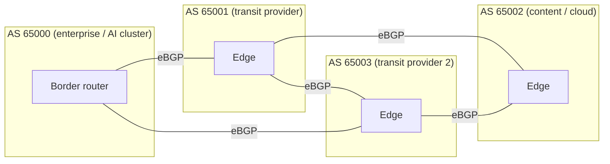
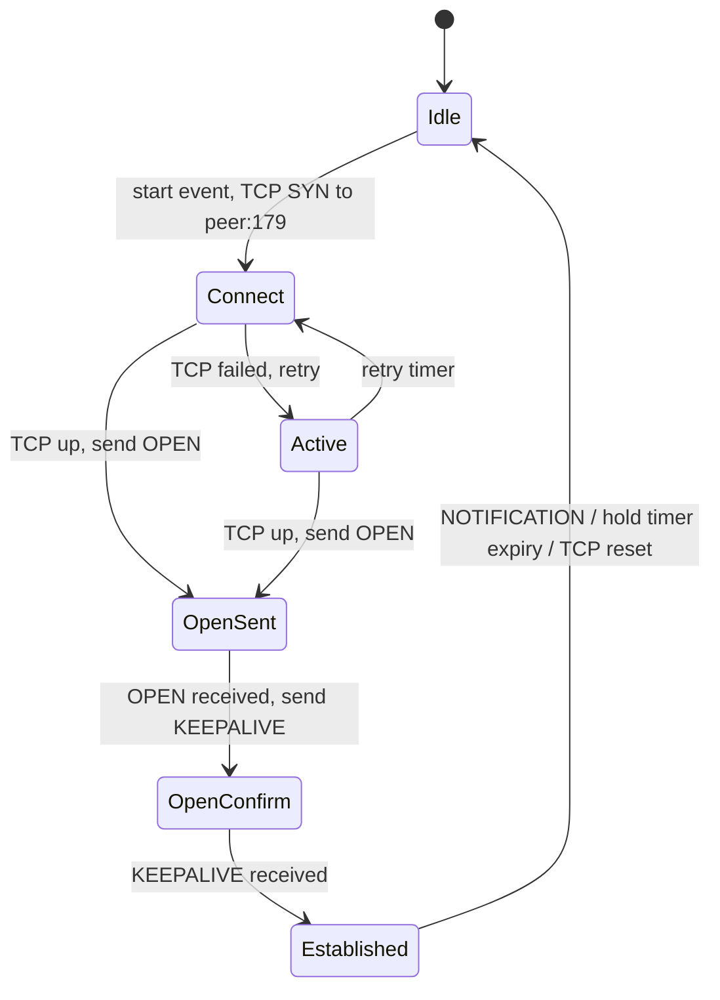

# 2.15 BGP fundamentals and control-plane policy

| | |
|---|---|
| Level | Intermediate |
| Priority tier | 0 |
| Lab venue | Linux VM with FRR (namespaces/containerlab) |
| Part | Part 2: Networking, from first principles to AI fabrics |
| Status | Drafted, labs **untested** |

## Why this matters for AI infrastructure

Suppose you need to know how a Kubernetes pod address reaches the rest of the network. The protocol that does that advertising is BGP. BGP is also the protocol that connects the Internet, and cloud providers use it at their edges. Direct Connect, Cloud Interconnect and ExpressRoute all rely on it. Since RFC 7938, it has carried most hyperscale and AI data-centre fabrics too.

Its reach extends inside the cluster. Bare-metal GPU nodes can run routed to the top-of-rack switch, using ECMP across both uplinks. Calico, Cilium, MetalLB and kube-vip use BGP to advertise pod and service addresses. EVPN uses it to distribute MAC/IP reachability, which chapter 2.17 covers.

Interviews for infrastructure roles routinely ask about BGP sessions, attributes, the best-path algorithm, iBGP versus eBGP, route reflectors and why data centres use eBGP. This chapter teaches the protocol and its policy toolset. Chapter 2.16 applies that toolset to Clos fabrics.

## Prerequisites and outcomes

Before you start, you should know routing fundamentals and path-vector concepts (chapter 2.13). You should also know TCP (2.6) and OSPF and IS-IS at a high level (2.14).

When you finish this chapter, you will be able to do the following.

- Explain autonomous systems, ASNs, and IGP versus EGP. Explain why BGP's goal is policy over shortest path.
- Describe BGP sessions: TCP/179, the FSM states, the OPEN, KEEPALIVE, UPDATE and NOTIFICATION messages, capabilities, hold timers, End-of-RIB, graceful restart, and iBGP versus eBGP.
- Explain NLRI and path attributes: ORIGIN, `AS_PATH`, `NEXT_HOP`, MED, `LOCAL_PREF`, COMMUNITY, atomic aggregate, aggregator and large communities. Say which are mandatory or optional, and which are transitive or non-transitive.
- Apply the best-path algorithm and predict the outcome for a given set of paths.
- Explain the advertisement rules, why iBGP needs a full mesh, route reflectors or confederations, and what next-hop-self does.
- Write prefix lists, route maps, communities and AS-path filters in FRR. Describe hot-potato, cold-potato, resource segmentation and flow pinning policies.
- Secure and operate BGP with MD5 or TCP-AO, GTSM, max-prefix, RPKI and ROV, bogon filters and graceful shutdown.
- Troubleshoot sessions and paths with `show bgp` commands.

## 1. Autonomous systems and why BGP exists

Picture two companies that each run their own network and must decide which routes to trust. Each one needs control over what it accepts and what it announces. An autonomous system (AS) is a set of IP prefixes and routers under a single administrative policy. Each AS has an AS number (ASN). ASNs were 16-bit for a long time, from 1 to 65535. They are 32-bit now (RFC 6793).

Private 32-bit ASNs run from 4200000000 to 4294967294. Private 16-bit ASNs run from 64512 to 65534. Interior gateway protocols (RIP, OSPF, IS-IS, EIGRP) find efficient paths inside one AS. The Border Gateway Protocol, version 4 (RFC 4271, "BGP-4"), is an Exterior Gateway Protocol. It exchanges reachability between ASes.

An EGP has a different job from an IGP. ASes are businesses, such as service providers, content providers and enterprises, with commercial and political relationships. So the goal is not the shortest path. The goal is policy: whom you accept routes from, whom you announce routes to, and which path you prefer for business reasons. BGP trades optimality for control.



BGP is a path-vector protocol. Each advertisement for a prefix carries the list of ASes it has crossed, called the `AS_PATH`. BGP is proactive, so it advertises routes without waiting for traffic. It learns destinations from configuration (`network` statements), from redistribution and from other protocols. It sends only best paths to neighbours, and it relies on TCP instead of a reliability layer of its own.

Decide your policy before you tune any path, because BGP follows the policy you write rather than the shortest route.

## 2. Sessions (peering)

BGP never finds a neighbour on its own. You configure each peer on both ends, with its IP address or interface and its remote ASN. BGP runs over TCP port 179, so TCP does the transport work. TCP gives reliable, ordered delivery, flow control and MTU handling (path MTU discovery and MSS). The three-way handshake also proves two-way connectivity. BGP therefore needs no hello discovery, retransmission or flooding logic of its own. Peers can sit several hops apart (multihop, with `ebgp-multihop`) or be directly connected.

### Session establishment



A session walks through six states, as the diagram shows. `Idle` means nothing is happening yet. BGP waits for a start event. Then one side opens a TCP connection, which moves the session to `Connect`. If both sides connect at once, a collision rule picks the survivor: the connection started by the higher BGP identifier wins. If a firewall sits between the peers, the TCP open must come from the side the firewall permits. `Active` means the TCP connect failed and BGP is trying again. It does not mean the session is established.

Once TCP is up, each peer sends an OPEN message. OPEN carries the BGP version (4), the sender's AS number, and the hold time. The lower of the two hold times is used. It also carries the BGP identifier (the router ID) and a 4-byte ASN capability. Optional capabilities cover multiprotocol extensions for the IPv4, IPv6, VPN and EVPN address families, route refresh, graceful restart, add-path and extended next hop.

After both sides exchange KEEPALIVE messages, the session reaches `OpenConfirm` and then `Established`. The protocol default keepalive is 60 s, and the hold time is 180 s. Data-centre deployments use 3 s and 9 s instead, or rely on BFD (chapter 2.13).

Once the session is up, peers exchange their tables in UPDATE messages. That is stage 5, and it is the step that carries the routes. An UPDATE carries withdrawn prefixes, path attributes and NLRI (network layer reachability information, which is the prefixes themselves). When the initial exchange ends, a peer sends an End-of-RIB (EOR) marker. After that, only changes travel. A NOTIFICATION reports an error and closes the session. For a soft reset, route refresh asks the peer to resend its routes, so you never have to tear the session down.

Two kinds of session exist.

- **eBGP** (external): the peers sit in different ASes, and they are normally directly connected. The next hop is rewritten to the sender's address. The local AS is prepended to the AS_PATH. TTL is 1 by default, which GTSM can protect (see section 8).
- **iBGP** (internal): the peers sit in the same AS, usually loopback to loopback and multihop, carried over the IGP. The AS_PATH is not modified. The next hop is not changed by default, so the IGP must reach the original eBGP next hop, or you set `next-hop-self`. LOCAL_PREF is carried.

Choose the session type first, because it decides the next hop, the AS_PATH and the TTL you need to plan for.

## 3. Messages, NLRI and path attributes

An UPDATE advertises a set of prefixes, the NLRI, and every prefix in the set shares the same path attributes. Attributes fall into four categories. The category tells a router whether it must understand an attribute and whether it passes that attribute on. The table below lists each category with examples.

| Category | Meaning | Examples |
|---|---|---|
| Well-known mandatory | Must be understood and present in every UPDATE | ORIGIN, AS_PATH, NEXT_HOP |
| Well-known discretionary | Must be understood, may be omitted | LOCAL_PREF, ATOMIC_AGGREGATE |
| Optional transitive | May not be understood; passed along if unknown | COMMUNITY, AGGREGATOR, Large Community |
| Optional non-transitive | Dropped if not understood | MED (MULTI_EXIT_DISC), ORIGINATOR_ID, CLUSTER_LIST |

The attributes you will meet most often are the following.

- ORIGIN records how the route entered BGP. `i` means an IGP route or a network statement, `e` means an EGP route (historical), and `?` means incomplete, which is a redistributed route. Lower wins, so i beats e, and e beats ?.
- `AS_PATH` is an ordered list of the ASes the route crossed. It is an AS_SEQUENCE, with an AS_SET added for aggregates. Routers use it to prevent loops, rejecting any route that contains their own ASN. It also acts as a metric, where shorter is preferred. Operators prepend their ASN several times on outbound routes, which makes a path look longer and less attractive.
- `NEXT_HOP` is the IP address to forward to. It must be resolvable, recursively, through the IGP or connected routes. If it is not, the route is unusable.
- MED (multi-exit discriminator) is a hint from a neighbour AS about which of several entry points to prefer. Lower wins. It compares only routes from the same neighbouring AS, unless you configure otherwise. MED expresses the neighbour's entrance policy, not yours.
- `LOCAL_PREF` travels only inside an AS, over iBGP. Higher wins, and the default is 100. It is the standard tool for expressing your exit policy.
- COMMUNITY tags are 32-bit values written `ASN:value`, such as `65000:100`. Extended communities carry route targets for VPNs. Large communities are 96-bit values written `ASN:function:value` (RFC 8092), and they suit 4-byte ASNs. Policy can match these tags, for example "do not announce to peers" (`no-export` 65535:65281), "blackhole" (`65535:666`) or "prefer this path."
- WEIGHT is local to one router, is Cisco-originated, and is never transmitted. FRR supports it. Highest wins, and it is the first tiebreak step.
- `ATOMIC_AGGREGATE` and AGGREGATOR mark aggregated routes. `ORIGINATOR_ID` and `CLUSTER_LIST` prevent loops in route reflection.

### Loop prevention without split horizon

BGP has no split horizon, so a router may advertise a route back toward the AS it came from. Loops are still prevented. Each AS prepends its ASN when it advertises over eBGP, and every router rejects a route whose AS_PATH already contains its own ASN.

Consider a small triangle. A (AS65000) advertises 2001:db8:100::/64 to B and C. B (AS65001) re-advertises it to D with the path [65001, 65000]. D (AS65003) therefore holds [65003, 65001, 65000]. If that route comes back to A, A sees its own ASN in the path and drops it. The loop never enters A's table. Loop-freedom is a property of the path attribute, not part of the decision process.

Keep the attribute categories in mind when you debug a route, because they decide what each router must understand and what it passes on.

## 4. The best-path decision process

A router often hears several paths to the same prefix, and each one can carry different attributes. It has to pick one, and it does so with an ordered list of tests. The list below is the common baseline, although vendors differ in small details. The first test that separates the paths decides the winner.

1. Highest WEIGHT (local to the router; Cisco/FRR).
2. Highest `LOCAL_PREF` (exit policy of this AS).
3. Prefer locally originated routes (network, aggregate or redistributed on this router).
4. Shortest `AS_PATH`.
5. Lowest ORIGIN (i < e < ?).
6. Lowest MED (only among routes from the same neighbouring AS by default).
7. Prefer eBGP over iBGP paths.
8. Lowest IGP cost to the `NEXT_HOP` (hot potato: get the traffic out of my AS by the nearest exit).
9. If multipath is configured, install multiple equal paths (`maximum-paths`).
10. For eBGP paths, prefer the oldest (most stable) path to reduce churn.
11. Lowest router ID of the advertising peer.
12. Shortest `CLUSTER_LIST` length.
13. Lowest neighbour address.

Four factors settle almost every real decision: `LOCAL_PREF`, AS_PATH length, MED and IGP cost. BGP is flexible, and custom decision processes exist, but the list above is the usual starting point. Multipath has a condition of its own. Paths must tie on everything up to step 8, meaning the same `LOCAL_PREF`, AS_PATH length, origin, MED and IGP cost, before they can share traffic. In data centres, `bestpath as-path multipath-relax` treats paths with the same length but different ASNs as equal. That is how ECMP works across spines with different ASNs, as chapter 2.16 shows.

The commands below show every path, its attributes, and which one is best. Each path in the output shows the attributes you just ranked, so you can check each step yourself.

```bash
vtysh -c 'show bgp ipv4 unicast 10.1.0.0/24'     # shows all paths, the attributes and which is best/multipath ("=" "*>")
vtysh -c 'show bgp summary' -c 'show bgp neighbors 10.0.0.1 advertised-routes' -c 'show bgp neighbors 10.0.0.1 received-routes'
vtysh -c 'show ip bgp neighbors 10.0.0.1 routes' -c 'show bgp ipv4 unicast summary'
```

Look for the `*>` and `=` markers in the output. Predict the winner with the list above first, then confirm it with `show bgp ipv4 unicast <prefix>`.

## 5. Advertisement rules, iBGP scaling and route reflectors

A router must decide what it may pass on to each neighbour, and BGP's advertisement rules settle that in two sentences. First, advertise the best path to every eBGP peer. Second, advertise the best path learned from an eBGP peer to every iBGP peer. The consequence is that a route learned from an iBGP peer is not advertised to another iBGP peer. That blocks loops inside an AS, where AS_PATH stays the same and cannot reveal them. The side effect is that iBGP needs a full mesh of sessions, n(n-1)/2, which does not scale.

Two fixes address the scaling problem. The first is a route reflector (RR), defined in RFC 4456. You designate one router as an RR and the others as its clients. The RR may reflect iBGP-learned routes to its clients. Loop prevention then depends on two attributes. ORIGINATOR_ID names the router that first injected the route into the AS. CLUSTER_LIST lists the RR cluster IDs the route has traversed. Real networks run two or more RRs per cluster for redundancy.

Route reflectors carry a caveat. An RR picks best paths from its own IGP-cost point of view, which can hide path diversity and cause suboptimal routing. Add-path, which advertises multiple paths, and optimal-route-reflection reduce that problem. The second fix is confederations, which split an AS into sub-ASes that behave like eBGP internally. Very large networks use them.

iBGP needs three more settings. Use `neighbor X next-hop-self` for routes learned from an eBGP peer, so iBGP peers can resolve the next hop through the IGP without carrying the external link subnet. Use `update-source lo` to peer from loopbacks. Make sure the IGP carries the loopbacks, but never redistribute BGP into the IGP, because the external prefixes do not belong there.

Data-centre designs skip iBGP entirely. Chapter 2.16 covers the alternative, which is eBGP everywhere with a per-rack or per-tier ASN scheme. You trade ASN management for simpler failure domains, no IGP dependency and policy at every hop.

Decide early whether your design uses route reflectors or eBGP everywhere, because that choice shapes the whole fabric.

## 6. Configuring BGP in FRR

Here is a leaf switch in AS 65101. It peers over eBGP with two spines in AS 65000 and advertises its loopback and server subnet.

```text
! Leaf in AS 65101 peering with two spines in AS 65000 (eBGP), advertising its loopback and server subnet
router bgp 65101
 bgp router-id 10.255.0.11
 no bgp ebgp-requires-policy               ! lab convenience; in production use explicit policy
 bgp bestpath as-path multipath-relax
 neighbor SPINES peer-group
 neighbor SPINES remote-as 65000
 neighbor SPINES bfd
 neighbor SPINES timers 3 9
 neighbor 10.0.1.0 peer-group SPINES
 neighbor 10.0.2.0 peer-group SPINES
 address-family ipv4 unicast
  network 10.255.0.11/32
  network 10.101.0.0/24
  neighbor SPINES activate
  neighbor SPINES soft-reconfiguration inbound
  maximum-paths 4
 exit-address-family
```

The `no bgp ebgp-requires-policy` line is a lab shortcut. In production, write explicit policy instead. Three commands cover most day-to-day checks.

```bash
vtysh -c 'show bgp summary'                 # session state, uptime, prefixes received/sent
vtysh -c 'clear bgp 10.0.1.0 soft in'       # re-apply inbound policy without resetting the session
vtysh -c 'show bgp neighbors 10.0.1.0'      # state, capabilities, timers, last reset reason
```

The state column tells you a lot. `Idle` means BGP has not started, or policy has shut the session down. `Connect` and `Active` mean TCP is not up, which points to reachability, a firewall, a wrong peer address or an MD5 mismatch. An ASN mismatch gives OPEN errors instead. `OpenSent` and `OpenConfirm` mean the session is stuck in capability, hold-time or authentication problems. A number in the prefix column means Established. `(Policy)` means an eBGP session has no policy while `ebgp-requires-policy` is in effect.

When a session is stuck, match its state name against this list before you change any config.

## 7. Policy tools

Policy tells BGP what you want, and you express it with filters and attribute changes. You apply them inbound or outbound, per neighbour. Each tool either matches something, such as a prefix, an AS path or a community, or sets something, such as LOCAL_PREF. The table lists the common tools.

| Tool | Purpose | FRR/Cisco-like object |
|---|---|---|
| Prefix list | Match prefixes and length ranges | `ip prefix-list NAME seq 10 permit 10.0.0.0/8 le 24` |
| AS-path access list | Match AS_PATH with regexes | `bgp as-path access-list NAME permit ^65001_` |
| Community list | Match communities | `bgp community-list standard C1 permit 65000:100` |
| Route map | Ordered match/set rules: set LOCAL_PREF, MED, communities, prepend AS_PATH, next hop, weight | `route-map NAME permit 10` |
| Max-prefix | Limit prefixes accepted from a peer | `neighbor X maximum-prefix 1000` |
| Distribute/prefix filters on aggregates | Aggregate and suppress specifics | `aggregate-address 10.1.0.0/16 summary-only` |

The config below shows the tools working together. Read it top to bottom. Two prefix lists and one community list define the routes you match. The first route map sets LOCAL_PREF to 200 on the default route from transit A. The second route map adds three prepends toward transit B for your customer prefix. Each route map is applied to one neighbour, in one direction.

```text
ip prefix-list CUSTOMER-IN seq 10 permit 203.0.113.0/24
ip prefix-list DEFAULT-ONLY seq 10 permit 0.0.0.0/0
bgp community-list standard BLACKHOLE permit 65535:666
route-map FROM-TRANSIT-A permit 10
 match ip address prefix-list DEFAULT-ONLY
 set local-preference 200
route-map TO-TRANSIT-B permit 10
 match ip address prefix-list CUSTOMER-IN
 set as-path prepend 65000 65000 65000
router bgp 65000
 address-family ipv4 unicast
  neighbor 192.0.2.1 route-map FROM-TRANSIT-A in
  neighbor 198.51.100.1 route-map TO-TRANSIT-B out
```

### What policy is for (use cases)

Hot-potato routing hands traffic to the neighbour at the nearest exit, which is the cheapest choice for you. You achieve it through the IGP cost step, or by setting LOCAL_PREF on the nearest peers. Cold-potato routing does the opposite. It carries traffic across your own network as far as possible and exits near the destination. Content providers use it for tighter control of the user experience. You achieve it with high LOCAL_PREF on routes at the far exit, by honouring MED from neighbours, or by selective advertisement.

Both choices can mean a longer path than the minimum, and that is deliberate. A business goal drives it. Transit providers want to carry traffic across their backbone to use the paid link fully. Content providers want to control quality. A customer buying transit wants cheap, good exits.

Sometimes tenants or services must reach only certain servers. Sometimes they must not even see each other's routing information, or they must follow a specific path. Packet filters alone cannot hide routes or force a path. The usual answer is an overlay. Tunnels such as GRE, VXLAN, MPLS and SR carry each segment across the shared underlay. A separate overlay control plane, using BGP VPNv4 or EVPN with VRFs and route targets, pulls traffic into the right tunnel. Underlay reachability and overlay policy stay separate, which is why overlays are everywhere in modern networks (chapter 2.17).

Flow pinning is the last case, and a worked example makes it concrete. The source for this material is chapter 17 of *Computer Networking Problems and Solutions*. An elephant flow is large and long-lived, such as one that takes more than 20% of a link for minutes. A mouse flow is small, short and latency-sensitive. On a 100 Mb/s link, a 9,000-byte elephant packet occupies the wire for 0.72 ms. A 1,500-byte packet takes 0.12 ms. A 64-byte mouse packet needs only 0.05 ms to serialize, but it queues behind the elephant. Its inter-packet spacing stretches from 0.05 ms to 0.288 ms or more, and that shows up as jitter. It hurts flow control and error recovery too.

Mixing the two is a performance problem even when average utilization is low. Remedies include QoS that interleaves the traffic, and pinning the elephant to a chosen path while steering other traffic away from it. Pinning uses the five-tuple (source and destination IP, ports and protocol) to tell flows apart. Segment routing and policy-based routing also help. In AI fabrics, adaptive routing and packet spraying help as well (chapters 2.12 and 2.19). Pinning is hard in a purely hash-based ECMP fabric, because the ECMP hash decides the path. That is why flow-aware controllers and per-flow policies exist. Each such policy adds state, interactions and new ways to fail.

Add a policy only when its benefit outweighs the extra state it brings to your network.

## 8. Security and operations

BGP trusts its peers. A mistaken or malicious announcement can divert or black-hole traffic across the world. Route leaks and hijacks are the usual causes. Protect the session first, then filter what you accept, then operate the session with care.

- **Session protection**: Use TCP MD5 (`neighbor X password`) or TCP-AO (RFC 5925). Use GTSM, the TTL security check. eBGP peers send TTL 255 and accept only 254 or higher, which you configure with `ttl-security hops 1`. Restrict TCP port 179 with ACLs to known peers, and authenticate the sessions, preferably over a private management or point-to-point interface.
- **Prefix and path filtering**: Accept only what a peer should legitimately announce, using customer prefix lists. Reject bogons, private ASNs, prefixes of /25 or longer, your own space arriving from outside, and default routes unless you expect them. Use `maximum-prefix` as a safety net. Use AS-path filters to reject paths that contain private ASNs or run too long. In FRR, `bgp ebgp-requires-policy` forces explicit policy.
- **Origin validation**: RPKI and ROV (RFC 6811) check that the origin AS is authorised, through a ROA, to announce the prefix. Reject routes marked Invalid. ASPA, still a draft or an RFC in progress, validates AS_PATH relationships.
- **Operational hygiene**: Graceful restart and long-lived graceful restart keep forwarding while the control plane restarts. `bgp graceful-shutdown` sends the GRACEFUL_SHUTDOWN community, 65535:0, so neighbours move traffic away before maintenance. Add BFD for fast failure detection. Route dampening is rarely recommended now. Max-prefix and monitoring cover session state, prefix counts and update rates, and BMP streams that data to a collector. Looking glasses and route collectors, such as RIPE RIS and RouteViews, show how the world sees your prefixes.
- **Blackhole (RTBH)**: Announce a victim /32 with a blackhole community to the upstream. The upstream then drops DDoS traffic at the edge.

Set up session protection before you accept your first route from a peer.

## 9. BGP in AI/Kubernetes contexts (preview)

You will meet BGP in AI clusters in four places. Each one below adds a layer on top of the last.

- **Fabric underlay and overlay**: eBGP runs between leaf and spine, advertising loopbacks and server subnets. ECMP works through `multipath-relax`, BFD helps detect failures, and the EVPN address family carries VXLAN overlays (chapters 2.16 and 2.17).
- **BGP to the host**: FRR or BIRD on GPU servers, or on the DPU, peers with both ToRs. That gives ECMP without MLAG, instant failover, and a host that advertises its own /32 loopback and any pod or VM prefixes.
- **Kubernetes**: Calico (through BIRD or the Go BGP library), the Cilium BGP control plane, MetalLB in BGP mode for LoadBalancer VIPs, and kube-vip. Usually the node peers with the ToR, using an AS per node or one shared AS, and announces pod CIDRs and service IPs. Set `maximum-paths` at the ToR to spread ingress traffic.
- **Cloud**: Direct Connect, Cloud Interconnect, ExpressRoute and cloud routers exchange routes with on-premises networks over BGP. The on-premises side uses a private ASN, and the cloud side uses its own ASN. Use MED or AS-path prepending for primary and backup paths. Learn the vendor limits, such as maximum routes and BFD timers, before you rely on them.

Decide the ASN scheme for each layer first, because every layer below depends on it.

## 10. Hands-on lab: BGP sessions, attributes, and policy

Start with the self-checking Python lab, which you run on your own machine.

```bash
python3 code/part02/bgp_fundamentals_lab.py
```

The lab checks the best-path decision algorithm (`LOCAL_PREF` -> `AS_PATH` length -> MED -> hot-potato IGP cost). It also checks AS_PATH loop detection and `allowas-in`, the eBGP and iBGP advertisement rules, and route reflector scaling. That scaling check shows 4,950 full-mesh sessions against 197 with 2 RRs for 100 routers. Finally, it checks elephant and mouse serialization jitter, 0.72 ms against 0.05 ms on 100 Mb/s.

Next, move to a disposable Linux VM running FRR in three or four namespaces or containers, in the topology `AS65001 --- AS65000 (transit) --- AS65002`. Every interactive VM command below is `untested here`. Work through these steps in order.

1. **eBGP session**: Configure the peers and watch `show bgp summary` move from Idle → Connect → Active → Established. Capture the traffic with `tcpdump -ni any port 179` and decode the OPEN, KEEPALIVE and UPDATE messages. Set a mismatched ASN to see the NOTIFICATION, and test an ACL that blocks 179 in one direction.
2. **Advertise prefixes**: Advertise with `network`, and then with `redistribute connected`. Verify `received-routes`, and compare AS_PATH and NEXT_HOP on each router.
3. **Loop prevention**: Build a triangle and show a route being rejected because of the local ASN. Then use `allowas-in` to override the check, and note the risk that comes with it.
4. **Best-path steering**: With two paths, change LOCAL_PREF inbound. Then prepend the AS path outbound. Then change MED. Before each change, predict the result, and then confirm it with `show bgp ipv4 unicast <prefix>`. Finally, test the rule that MED is compared only within the same neighbouring AS.
5. **iBGP**: Add a second router in AS65000, and build an iBGP session over loopbacks with OSPF as the IGP. Show the next-hop problem, then fix it with `next-hop-self`. Build three iBGP routers to show that a route is not re-advertised to another iBGP peer. Fix that with a route reflector, and watch ORIGINATOR_ID and CLUSTER_LIST appear.
6. **Communities**: Tag routes with communities. Match the tags to set LOCAL_PREF, or deny export with `no-export`. Then implement a blackhole community.
7. **Filters**: Write a prefix-list inbound that rejects more-specifics and bogons. Trigger `maximum-prefix 5`, and then recover from it.
8. **Security**: Enable MD5 and GTSM, then test a mismatch. Optionally, validate RPKI with a local `rtrd`/Routinator.
9. **Failure**: Take a link down and measure convergence three ways: with default timers, with `timers 3 9`, and with BFD. Watch the path exploration in the updates with `debug bgp updates`.
10. **Clean up** when you finish.

Run the Python lab first, and only then start the VM steps.

## 11. Common mistakes

These mistakes come up again and again.

- Forgetting `next-hop-self`, or not making sure the IGP reaches the next hops in iBGP. Redistributing BGP into the IGP is another common error.
- Treating iBGP like eBGP and expecting AS_PATH to change. Or forgetting the full-mesh or route reflector requirement.
- Running eBGP sessions with no inbound or outbound policy. That invites accidental transit and route leaks.
- Comparing MED across different neighbour ASes, or using weight as a network-wide tool. Weight is local to one router.
- Overlooking `maximum-paths` and multipath-relax, so that only one path carries traffic.
- Setting aggressive timers without BFD, which causes flaps.
- Not validating or filtering prefixes, which leaves you open to hijacks and leaks. Running with no max-prefix does the same.
- Confusing `Active`, which means BGP is still retrying TCP, with a healthy session.

Review your eBGP and iBGP configs against this list before you roll them out.

## 12. Interview angles

Be ready to answer questions like these.

- Walk through the BGP FSM. What does Active mean?
- How do eBGP and iBGP differ in next hop, AS_PATH, TTL and advertisement rules?
- Why can't iBGP routes be re-advertised to iBGP peers, and what are the fixes?
- What are the BGP best-path steps, and which four matter most?
- How does BGP prevent loops without split horizon?
- What are communities and large communities for? Give examples.
- How do you steer inbound versus outbound traffic with BGP? (Outbound: LOCAL_PREF; inbound: AS-path prepend, MED, communities, selective advertisement.)
- How do you secure BGP sessions and prefixes?
- Why do data centres use eBGP, and what do they change in the defaults? (chapter 2.16.)
- What is hot-potato versus cold-potato routing?

Start with the steering and eBGP questions, since they build on the best-path and advertisement sections.

## Exercises

Work through these six exercises in order. Each one builds on the chapter, and the numbers in them are the ones to check your answers against.

1. Start with the big picture. This exercise draws on chapter 16 of *Computer Networking Problems and Solutions*. (a) Contrast the main goal of an IGP such as `OSPF` or `IS-IS` with the goal of BGP-4 (RFC 4271). Then state the private ASN ranges for 16-bit and 32-bit ASNs (RFC 6793). (b) BGP gets four protocol functions for free by running over TCP/179, which is TCP port 179. List them. Then trace the six BGP FSM states, `Idle -> Connect -> Active -> OpenSent -> OpenConfirm -> Established`. Finally, explain what `Active` really means when `show bgp summary` is stuck there.
2. Work with path attributes, loop prevention and steering. (a) Classify ORIGIN, `AS_PATH`, `NEXT_HOP`, `LOCAL_PREF`, MED, and COMMUNITY or Large Community (RFC 8092) into the four attribute categories: well-known mandatory, well-known discretionary, optional transitive, and optional non-transitive. (b) Use `check_as_path_loop()` in `code/part02/bgp_fundamentals.py` to explain how BGP prevents loops without split horizon. Then say which attributes steer outbound traffic leaving your AS, and which steer inbound traffic entering it.
3. Work through the best-path decision process, and see what `multipath-relax` adds. Use `select_bgp_best_path()` to find the winner in three cases. (a) Path A has `LOCAL_PREF = 100` and `AS_PATH = [65001]`. Path B has `LOCAL_PREF = 200` and `AS_PATH = [65002, 65003, 65004]`. (b) Both have `LOCAL_PREF = 100`. Path A has `AS_PATH = [65001, 65002]` and `MED = 50`. Path B has `AS_PATH = [65003, 65003, 65002]` and `MED = 10`. (c) Both have identical `LOCAL_PREF`, `AS_PATH`, ORIGIN and MED. Path A has IGP cost `50` to `NEXT_HOP`, and Path B has IGP cost `10`. Finally, say what `bgp bestpath as-path multipath-relax` enables.
4. Compare eBGP and iBGP, then look at next-hop-self and route reflectors (RFC 4456). (a) Contrast eBGP and iBGP on `AS_PATH` modification, `NEXT_HOP` modification (`next-hop-self`), default IP `TTL`, and advertisement rules, using `evaluate_bgp_advertisement_rule()`. (b) Use `compute_ibgp_sessions_full_mesh_vs_rr()` to count the iBGP sessions for `100` routers. A full mesh needs `4,950`. With `2` redundant Route Reflectors, you need `197`. Then state which two attributes prevent loops across Route Reflectors.
5. Study control-plane policy. Cover hot-potato versus cold-potato routing, overlays, and elephant versus mouse flows. This exercise draws on chapter 17 of *Computer Networking Problems and Solutions*. (a) Compare hot-potato, cold-potato and mashed-potato routing. (b) Calculate the wire serialization time on a `100 Mb/s` link for a `9,000`-byte elephant packet (`0.72 ms`), a `1,500`-byte packet (`0.12 ms`), and a `64`-byte mouse packet (`0.05 ms`). Then explain the trade-off between per-flow policy pinning and operational complexity.
6. Secure and operate BGP. Write the FRR configuration and a checklist that secures an eBGP session. Include `TCP-AO` or MD5, GTSM (`ttl-security hops 1`), `bgp ebgp-requires-policy`, inbound and outbound `prefix-list` and `as-path` filters, `maximum-prefix`, RPKI ROV (RFC 6811), and the `GRACEFUL_SHUTDOWN` community (`65535:0`).

Do exercises 2 and 3 before exercise 6, since the security work builds on the policy vocabulary.

## Checkpoint questions (20)

<details>
<summary>1. What is an Autonomous System (`AS`), what are the private 16-bit and 32-bit `ASN` ranges, and how does BGP's core design goal differ from an IGP?</summary>

An **Autonomous System (`AS`)** is a set of IP prefixes and routers under one administrative routing policy, and an ASN identifies it. Private 16-bit ASNs run from `64512` to `65534`, and private 32-bit ASNs (`RFC 6793`) run from `4200000000` to `4294967294`. An IGP such as `OSPF` or `IS-IS` looks for the shortest, fastest path inside one organization. BGP-4 (`RFC 4271`) is an Exterior Gateway Protocol built around policy and administrative control. It decides whom you peer with, which prefixes you export or import, and which path you prefer for business or fabric-design reasons.
</details>

<details>
<summary>2. Why does BGP run over `TCP port 179`, and what four transport problems does TCP solve for BGP, according to *Computer Networking Problems and Solutions*, chapter 16?</summary>

BGP hands its transport work to TCP. TCP provides reliable, in-order delivery and retransmission of route updates. It provides flow control and congestion control. It handles segmentation and Path MTU Discovery (`MSS`) for large routing tables. The three-way handshake also verifies two-way connectivity. BGP therefore needs only a simple session state machine and incremental `UPDATE` messages.
</details>

<details>
<summary>3. Walk through the six BGP Finite State Machine (`FSM`) states (`Idle -> Connect -> Active -> OpenSent -> OpenConfirm -> Established`), and explain the `Active` state trap.</summary>

- `Idle`: the session is disabled or waiting for a start timer. Maximum-prefix or an administrative state can also shut it down.
- `Connect`: the router has sent a TCP `SYN` to port `179` and waits for the three-way handshake.
- `Active`: the TCP attempt failed or timed out, and BGP keeps retrying. This is the beginner trap. `Active` means the session is down at the TCP, IP or firewall layer. It does not mean the session is working.
- `OpenSent`: TCP is up and the `OPEN` message has been sent. It carries version `4`, the local ASN, the hold time, the BGP Identifier and capabilities. The router waits for the peer's `OPEN`.
- `OpenConfirm`: a valid `OPEN` has arrived. The router sends a `KEEPALIVE` and waits for the peer's `KEEPALIVE`, or a `NOTIFICATION` if there is an error.
- `Established`: a `KEEPALIVE` has arrived, and `UPDATE` messages flow.
</details>

<details>
<summary>4. Name the five BGP message types (`RFC 4271` + `RFC 2918`) and what `End-of-RIB` (`EOR`) signals.</summary>

The five message types are `OPEN`, `UPDATE`, `KEEPALIVE`, `NOTIFICATION` and `ROUTE-REFRESH`. `OPEN` negotiates version `4`, the ASNs, the hold time (the lower of both peers' values, with a default of `180 s` and a `60 s` keepalive), the router ID, and multiprotocol capabilities such as `IPv4`, `IPv6`, `EVPN`, 4-byte ASN, Add-Path and Graceful Restart. `UPDATE` advertises a set of prefixes (`NLRI`) that share path attributes, and it can also withdraw prefixes. `KEEPALIVE` is the periodic heartbeat that confirms the session is alive. `NOTIFICATION` reports a fatal error and closes the session at once. `ROUTE-REFRESH` asks a peer to resend its prefixes, so inbound policy changes apply without a reset (`clear bgp ... soft in`). `End-of-RIB` (`EOR`) is an empty `UPDATE` that signals the initial table sync is complete.
</details>

<details>
<summary>5. Classify the main BGP Path Attributes into Well-Known Mandatory, Well-Known Discretionary, Optional Transitive, and Optional Non-Transitive.</summary>

Well-known mandatory attributes must be recognized and present in every `UPDATE`: `ORIGIN`, `AS_PATH` and `NEXT_HOP`. Well-known discretionary attributes must be recognized but may be left out: `LOCAL_PREF` and `ATOMIC_AGGREGATE`. Optional transitive attributes pass to other peers even when unrecognized: `COMMUNITY`, `EXTENDED_COMMUNITY`, `LARGE_COMMUNITY` (`RFC 8092`) and `AGGREGATOR`. Optional non-transitive attributes are dropped when unrecognized and do not travel beyond the peer: `MED` (`MULTI_EXIT_DISC`), `ORIGINATOR_ID` and `CLUSTER_LIST`.
</details>

<details>
<summary>6. How does BGP prevent routing loops between Autonomous Systems without using Split Horizon?</summary>

BGP does **not** use split horizon, because an eBGP speaker sends its best path to all peers. Instead, the sending router adds its own ASN to the front of `AS_PATH` whenever it advertises over an **eBGP** session. When a BGP router receives an `UPDATE` whose `AS_PATH` already contains its own local ASN, it drops the route at once. That prevents inter-AS loops by design.
</details>

<details>
<summary>7. State the BGP Best-Path Decision Process in order, highlighting the "Big Four" attributes that decide 99% of real-world paths.</summary>

After checking that `NEXT_HOP` is reachable in the FIB, the router applies these tests in order.

1. Highest `WEIGHT` (router-local, Cisco/FRR).
2. Highest `LOCAL_PREF` (AS-wide outbound exit preference, default `100`). This is Big #1.
3. Locally originated routes (`network`, `redistribute` or `aggregate`).
4. Shortest `AS_PATH` length. This is Big #2.
5. Lowest `ORIGIN` code (`i` IGP below `e` EGP below `?` incomplete).
6. Lowest `MED`, compared among paths from the same neighbor AS. This is Big #3.
7. Prefer `eBGP` over `iBGP`.
8. Lowest IGP cost to `NEXT_HOP`, the hot-potato exit. This is Big #4.
9. Install ECMP multipath if `maximum-paths` is enabled and steps 1 to 8 tie.
10. Oldest `eBGP` path, then lowest peer `Router ID`, then shortest `CLUSTER_LIST`, then lowest peer IP.
</details>

<details>
<summary>8. How do you steer OUTBOUND traffic (leaving your AS) versus INBOUND traffic (entering your AS from neighbors) in BGP?</summary>

- To steer **outbound** traffic, leaving your AS, set `LOCAL_PREF` inbound on routes received from your preferred exit peer. Higher wins, and iBGP spreads the choice across your AS. On a single router, you can set `WEIGHT` instead.
- To steer **inbound** traffic, entering your AS from neighbors, prepend your own ASN several times outbound on less-preferred links (`set as-path prepend 65000 65000`). Remote ASes then see a longer `AS_PATH`. You can also set a lower `MED` outbound toward a single multi-connected neighbor AS. Attach BGP communities that your upstream provider honors. Or advertise more-specific prefixes, carefully.
</details>

<details>
<summary>9. Summarize the four operational differences between `eBGP` and `iBGP`.</summary>

First, `AS_PATH`: `eBGP` prepends the sender's ASN, while `iBGP` leaves `AS_PATH` unchanged. Second, `NEXT_HOP`: `eBGP` rewrites it to the sender's interface IP, while `iBGP` keeps the original `eBGP` `NEXT_HOP` by default. That means you need **`next-hop-self`** on the border router, or the external link subnets must be carried in the IGP. Third, re-advertisement: `eBGP` advertises best paths to all peers, but `iBGP` never re-advertises an `iBGP`-learned route to another `iBGP` peer, unless the router is a Route Reflector. Fourth, default IP `TTL`: `eBGP` sends packets with `TTL = 1`, so the peers must be directly connected unless `ebgp-multihop` is set. `iBGP` uses the standard `TTL = 64/255`.
</details>

<details>
<summary>10. Why does `iBGP` forbid re-advertising an `iBGP`-learned route to another `iBGP` peer, and how do Route Reflectors (`RFC 4456`) solve the `n(n-1)/2` full-mesh scaling problem?</summary>

`iBGP` does not change `AS_PATH`, so BGP has no `AS_PATH` loop check inside an AS. The rule against re-advertising `iBGP`-learned routes stops internal loops, but it demands a full mesh of **`n(n - 1) / 2` sessions**, which is `4,950` sessions for `100` routers. A Route Reflector (`RR`) may reflect routes learned from its `iBGP` clients to other peers. That cuts the session count to **`O(n)`**. Two non-transitive attributes prevent reflection loops. `ORIGINATOR_ID` is the router ID of the iBGP speaker that originated the route, and a router drops the route if it sees its own ID. `CLUSTER_LIST` is the sequence of RR `Cluster_ID`s traversed, and an RR drops the route if it sees its own `Cluster_ID`.
</details>

<details>
<summary>11. Why can a Route Reflector hide ECMP path diversity, and how does BGP `Add-Path` (`RFC 7911`) fix it?</summary>

A standard BGP speaker, including a Route Reflector, advertises **only its single best path** for each prefix. It judges that path from its own IGP position, so its clients never see alternate paths of equal or backup cost. `Add-Path` (`RFC 7911`) adds a 4-byte Path Identifier to each prefix in `NLRI`. That lets an RR or peer advertise **multiple paths for the same prefix** without overwriting the previous one.
</details>

<details>
<summary>12. What are BGP Communities (`RFC 1997`) and Large Communities (`RFC 8092`), and what do `no-export`, `65535:666`, and `65535:0` mean?</summary>

BGP Communities are transitive tags attached to routes, so routers can apply group policy in `route-map`s without keeping per-prefix lists. Standard communities are 32-bit (`ASN:value`). Large Communities (`RFC 8092`) are 96-bit, made of a 32-bit ASN, a 32-bit function and a 32-bit parameter, so 4-byte ASNs never collide. Three well-known communities matter most.

- `no-export` (`65535:65281`) means do not advertise this route outside the local AS. It stays within iBGP.
- `BLACKHOLE` (`65535:666`, `RFC 7999`) is used for Remote-Triggered Black Hole (`RTBH`) filtering. It drops traffic to this `/32` at the provider edge during a DDoS attack.
- `GRACEFUL_SHUTDOWN` (`65535:0`, `RFC 8326`) sets `LOCAL_PREF = 0` on peers, which drains traffic off a router before maintenance.
</details>

<details>
<summary>13. What does `bgp bestpath as-path multipath-relax` do in FRR, and why is it essential in data-center eBGP fabrics?</summary>

By default, BGP installs multiple paths as ECMP (`maximum-paths`) only if their `AS_PATH`s match in both length and the exact sequence of ASNs. In a leaf-spine data center, each leaf or spine group often has a different ASN. Paths through different switches then have the same `AS_PATH` length but different ASNs. The `bgp bestpath as-path multipath-relax` command tells BGP to treat equal-length `AS_PATH`s as equal for ECMP. That is why it matters in data-center eBGP fabrics.
</details>

<details>
<summary>14. Contrast Hot-Potato Routing, Cold-Potato Routing, and Mashed-Potato Routing (*Computer Networking Problems and Solutions*, chapter 17).</summary>

- Hot-potato routing hands outbound traffic to the neighbor AS at the closest exit, meaning the lowest IGP cost to `NEXT_HOP`. That saves bandwidth on your own backbone.
- Cold-potato routing carries traffic across your backbone as far as it can, then exits at the peering point nearest the final destination. It uses high `LOCAL_PREF` on far-exit routes, or honors the peer's `MED`. Content and cloud providers use it for tight control over latency and loss.
- Mashed-potato routing is bilateral peering, where two networks negotiate coordinated exit and entry policies for each prefix class.
</details>

<details>
<summary>15. Explain quantitatively why mixing 9000-byte Elephant flows and 64-byte Mouse flows on the same link causes jitter (*Computer Networking Problems and Solutions*, chapter 17).</summary>

On a `100 Mb/s` link, a `64`-byte mouse packet takes `0.05 ms` to serialize. A `1,500`-byte packet takes `0.12 ms`. A `9,000`-byte jumbo elephant packet takes `0.72 ms`, which is `14x` longer. Mouse packets, such as RPCs, heartbeats and ACKs, queue behind a burst of `9,000`-byte elephant frames. Their inter-packet spacing then stretches from `0.05 ms` to `0.288 ms` or `0.72 ms` and more. That causes severe tail-latency jitter, even at moderate average link utilization.
</details>

<details>
<summary>16. Why is packet filtering alone insufficient for multi-tenant Resource Segmentation, and how do BGP Overlays (`VPNv4` / `EVPN` + `VRF`s) solve it (*Computer Networking Problems and Solutions*, chapter 17)?</summary>

Stateless packet ACLs cannot hide routing tables between tenants. They cannot handle overlapping tenant IP ranges, and they cannot steer tenant traffic onto dedicated paths. An overlay separates the underlay, which gives simple loopback-to-loopback reachability, from the overlay. The overlay uses VXLAN or MPLS tunnels, controlled by BGP `EVPN` or `VPNv4` with per-tenant **VRF**s and **Route Target** extended communities. Each tenant then gets an isolated routing table and forwarding plane across the same physical switches.
</details>

<details>
<summary>17. How do `TCP-AO` / `MD5` and `GTSM` (`ttl-security`) protect BGP sessions against spoofing and reset attacks?</summary>

- `TCP-AO` (RFC 5925), and legacy TCP `MD5` (RFC 2385), adds a cryptographic MAC to every TCP segment on port 179. It uses a shared key, so attackers cannot inject forged `RST` or `UPDATE` packets.
- `GTSM` (Generalized TTL Security Mechanism, RFC 5082, `ttl-security hops 1`) sends eBGP packets with `IP TTL = 255`. It drops any incoming BGP packet whose `TTL < 254`. For example, an off-link attacker more than one hop away cannot even reach the BGP socket.
</details>

<details>
<summary>18. What is a BGP "route leak" or "prefix hijack", and what four filters prevent them?</summary>

A **prefix hijack** means originating someone else's IP block without authorization. A **route leak** means accidentally re-advertising routes learned from one transit or peer provider out to another. That turns your network into an unintended transit path. Four filters help. First, explicit inbound and outbound `prefix-list`s (with `bgp ebgp-requires-policy`). Second, `AS_PATH` regex filters. For example, `^65001_$` accepts only routes originated directly by customer AS `65001`. Third, `maximum-prefix <limit>` per neighbor tears down a runaway session. Fourth, RPKI Route Origin Validation (`ROV`, `RFC 6811`).
</details>

<details>
<summary>19. How does `RPKI` Route Origin Validation (`ROV`, RFC 6811) work?</summary>

Regional Internet Registries (`ARIN`, `RIPE`, `APNIC`) let IP prefix holders publish signed **Route Origin Authorizations (`ROA`s)**. A ROA states which ASN may originate a prefix, and up to what maximum prefix length. A local validator, such as `Routinator` or `stayrtr`, fetches and verifies the global ROA cache. It then feeds verified `(prefix, max_len, origin_ASN)` records to routers over the **RTR protocol**. The router marks a matching route `Valid` and a route with no record `NotFound`. A mismatched origin ASN or an overlong prefix makes the route **`Invalid`**, and the router drops it.
</details>

<details>
<summary>20. How is BGP used inside Kubernetes clusters (`Calico`, `Cilium`, `MetalLB`) and on bare-metal GPU hosts?</summary>

In Kubernetes, **Calico** (`BIRD` or `GoBGP`) and **Cilium** run a BGP speaker on every node. The speaker peers with the Top-of-Rack leaf switches and advertises the node's **Pod CIDR (`/24`)**, along with **Service `LoadBalancer` / `ClusterIP` VIPs**. **MetalLB** or **kube-vip** can handle those VIPs. The hardware fabric then routes straight to Pods and balances traffic across nodes with ECMP. No VXLAN encapsulation or external load-balancer appliance is needed. On bare-metal GPU servers, running **FRR (`bgpd`)** on the host or DPU gives active-active L3 ECMP across dual ToR uplinks, without switch MLAG.
</details>

## Sources and review notes

- **Sources read in full:**
  - `computer-networking-problems-and-solutions` — Russ White and Ethan Banks, *Computer Networking Problems and Solutions*, **Chapter 16: Link State and Path Vector Control Planes** (BGP-4 RFC `4271` history and role as an Exterior Gateway Protocol, BGP peering over TCP port `179` and its FSM state machine, the best-path decision process, advertisement rules, and Route Reflectors RFC `4456`) and **Chapter 17: Policy in the Control Plane** (hot-potato vs cold-potato routing, resource segmentation with overlays, flow pinning for elephant `9,000`-byte `0.72 ms` vs `1,500`-byte `0.12 ms` vs mouse `64`-byte `0.05 ms` packets on `100 Mb/s`, and policy complexity).
- **Run here:** `python3 code/part02/bgp_fundamentals_lab.py` (12 passed, 0 failed).
- **Explicitly labelled inferences:** The FRR leaf-spine eBGP (`multipath-relax`, `SPINES` peer-group, `timers 3 9`, `bfd`) and `route-map` policy examples, `GTSM`/`TCP-AO`/`RPKI` security controls, and Kubernetes (`Calico`/`Cilium`/`MetalLB`) + BGP-to-the-host overview synthesize RFCs 4271, 4456, 5925, 6793, 6811, 7938, and 8092 and the FRR user guide (cross-referenced with Chapters 2.6, 2.12–2.14, 2.16, 2.17, 2.19, and 2.27, plus original study items 21, 22, 23, 24, 25, 26, 27, 28, 29, 30, 31, 32, 33, 34, 35, 36, 37, 38, 39, and 40).
- **Not verified on live hardware:** All interactive VM and FRR commands (`vtysh`, `show bgp summary`, `show bgp ipv4 unicast`, `clear bgp soft in`, `tcpdump port 179`) are marked (untested here) and must be executed on a disposable Linux VM or containerlab topology.
