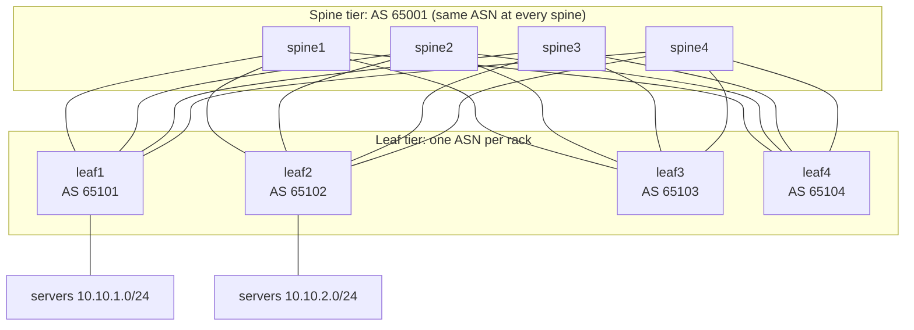

# 2.16 BGP in the data center: eBGP Clos, unnumbered, ECMP, anycast and AI-fabric routing

| | |
|---|---|
| Level | Advanced |
| Priority tier | 0 |
| Lab venue | containerlab with FRR (leaf-spine), or namespaces |
| Part | Part 2: Networking, from first principles to AI fabrics |
| Status | Drafted, labs **untested** |

## Why this matters for AI infrastructure

Picture a 1,000-GPU training job that should run at line rate but does not. The routing design of the fabric decides whether it can. The same design controls how the network reacts when a link or switch fails. It also decides whether tenants stay isolated, and how quickly you can add a rack.

Cloud operators have settled on a small set of practices. They build a Clos topology and run eBGP as the only protocol, with a deliberately simple ASN plan. They use ECMP everywhere and leave links unnumbered. Their route policy limits how far each prefix travels.

AI back-end fabrics add new demands. They need wide ECMP across 400/800 Gb/s links. They need awareness of link and queue state. They need path diversity for elephant flows, which are very large, long-lived flows. They also need predictable behaviour for synchronous collectives, and multi-tenant isolation.

This chapter explains the standard design and the reasons behind it. It shows how failure domains and information hiding keep the design stable. It then covers the newer approaches proposed for AI clusters: BGP link-bandwidth, DPF, IS-IS flood reduction and Flex Algo, RIFT, and segment routing.

## Prerequisites and outcomes

You should know BGP from 2.15, link-state protocols from 2.14, and ECMP from 2.12. You should also understand Clos topologies at a conceptual level. The Clos details come in 2.18.

After this chapter you can:

- Describe the RFC 7938 eBGP design for data centres: ASN allocation, ECMP, `multipath-relax`, private ASNs, `allowas-in`, `remove-private-as`, and why iBGP and an IGP are avoided.
- Explain BGP unnumbered, which uses RFC 5549 and the extended next hop. Cover link-local peering and IPv4 prefixes with IPv6 next hops, and configure it in FRR.
- Explain how a same-ASN spine design prevents suboptimal paths after several failures, and how a per-rack ASN identifies prefixes.
- Apply control-plane scope rules: summarisation, aggregation, filtering, layering, caching and slowing down. Recognise positive feedback loops and failure domains.
- Explain summarisation black holes in Clos fabrics, and how to avoid them with minimum peers per prefix, conditional advertisement, and no summarisation below the spine.
- Describe BGP ADD-PATH, AS-PATH normalisation, the link-bandwidth extended community with weighted ECMP, minimum-peer rules, and BGP DPF with colored sessions and logical fabrics.
- Compare eBGP, IS-IS (with flood reduction and Flex Algo) and RIFT for AI back-ends. Describe dragonfly and sparse topologies at the routing level.
- Design multi-tenancy at the network level and the server level, using EVPN-VXLAN, VRF and GBP microsegmentation. Also cover BGP to the server with FRR, anycast services, and controller or SRv6-based traffic engineering at an overview level.
- Troubleshoot fabric routing: missing prefixes, single-path ECMP, asymmetry, and blackholes after failures.

## 1. The standard design: eBGP in a Clos

Start with the shape of the fabric. A **Clos (leaf-spine)** fabric has tiers of switches. Servers plug into **leaf (ToR)** switches, and every leaf connects to every **spine**. Larger fabrics add a super-spine tier, which gives a five-stage design, or they build pods, covered in chapter 2.18. In a three-stage design, every leaf-to-leaf path crosses exactly one spine. All paths are therefore the same length, and ECMP can use every link.



The diagram shows the key point of the design. All four spines share one ASN, and each leaf has its own.

RFC 7938, *Use of BGP for Routing in Large-Scale Data Centers*, explains why BGP suits this job. Its first advantage is that one protocol does everything. BGP carries underlay prefixes, EVPN overlays and external routes, with the same tooling and operator skills for each.

Failure behaviour is simple and predictable, and it does not depend on flooding. Updates travel only along the relevant paths. Failure domains stay bounded by design, so no SPF recomputation runs across the whole fabric.

BGP also gives you policy. You write per-neighbour filters and use communities for maintenance isolation, for example to set `LOCAL_PREF`, AS-path or drain communities. Each prefix keeps clear provenance through its origin ASN.

BGP scales well and works across vendors. It is the best-studied protocol for large operations. Its weaknesses matter too. Without BFD or tuning, it converges more slowly than link-state protocols. It also does not know about link or queue quality, a gap that section 7 returns to.

### ASN allocation

Three patterns are common.

1. **Per-rack (per-leaf) ASN, one ASN for all spines in a tier (preferred)**: each leaf gets a unique ASN, such as 65101, 65102 and so on. Large fabrics can use the 4-byte private range, 4200000000 to 4294967294. All spines in the tier share one ASN, 65001. Super-spines use another.
2. **Unique ASN per switch**: this gives more freedom, but the plan is complicated and produces more path-exploration noise.
3. **iBGP with route reflectors at the spine and one ASN fabric-wide**: clouds use this less often. The spine must act as a route reflector, and the next hop is not rewritten by default.

The same-spine-ASN rule gives you a useful property. Suppose several links fail. eBGP loop prevention rejects any path that crosses the same ASN twice. A path such as leaf1 → spine1 → leaf2 → spine1 → leaf3 hairpins through a leaf and revisits the spine. With one spine ASN, that path is rejected automatically instead of being installed.

Now suppose the spines had different ASNs. In the same multiple-failure case, the valley path would be installed. Forwarding becomes suboptimal, and latency rises. The path can also saturate the intermediate leaf's uplinks, which is a real concern with elephant flows on 400/800G links. With one spine ASN, the service sees only reduced capacity, or the destination becomes unreachable over that route. Traffic then shifts elsewhere.

Per-rack ASNs add two benefits. Each prefix stays attributable to the rack that originated it. You can also run maintenance with AS-path-based policy, dropping or accepting routes by origin. The AS-PATH length stays bounded by the fabric diameter, so a policy can reject any path longer than 2 or 4 ASNs.

### Making BGP behave like an IGP

Start with the AS-path settings. `bgp bestpath as-path multipath-relax` treats paths with equal AS-path length as equal, even when the AS numbers differ. That lets ECMP use all spines, even if each spine has a different ASN history. Then set `maximum-paths` and `maximum-paths ibgp` to the fabric width, for example 64.

Short timers and BFD catch failures quickly. Use a 3-second keepalive and a 9-second hold, or less. Run BFD at 100-300 ms. Set `neighbor X advertisement-interval 0` to turn off the 30-second advertisement interval on eBGP, so withdrawals propagate quickly.

Keep the AS-PATH length the same at each tier, because ECMP depends on it. Avoid prepending in the fabric. Use `neighbor ... allowas-in` only when you reuse ASNs on purpose, for example when a pod's leaves share an ASN with the global spine layer. Otherwise, avoid it.

At the border, `remove-private-as` or `replace-as` hides the internal plan. The Internet or WAN then sees a public ASN. Disable `bgp ebgp-requires-policy` only with care, and write an explicit policy in its place. That policy should accept the expected prefixes and set communities.

Turn off `bgp bestpath compare-routerid`. Turn on `bgp fast-external-failover`, so an interface going down tears the session down at once.

Decide carefully what each device advertises. Each leaf originates its server subnets and its `/32` loopback, which serves as the router ID and the VTEP/service address. Nothing else is needed. Spines re-advertise. Do not advertise the fabric's point-to-point link subnets at all, whether by using unnumbered links or by filtering them. That keeps the RIB small and removes a source of failure propagation.

## 2. BGP unnumbered (RFC 5549 / RFC 8950)

Each leaf-spine link needs addressing. Assigning and tracking a `/31` for every link is a heavy job. Take a 32-leaf, 16-spine fabric. Multiplying 32 by 16 gives 512 links, and with 8 rails the count reaches the thousands. **BGP unnumbered** removes that addressing work.

Each interface uses its automatically generated IPv6 link-local address, `fe80::/64`, which is derived from the MAC. That address becomes the peering address. Neighbour discovery happens through IPv6 Router Advertisements and Neighbour Discovery on the link. The FRR daemon learns the neighbour's link-local address and MAC from ICMPv6. It then starts the TCP session to port 179.

The BGP OPEN message carries the Extended Next Hop Encoding capability, defined in RFC 8950 (formerly RFC 5549). That capability lets you advertise IPv4 prefixes with an IPv6 next hop, which is the neighbour's link-local address. The forwarding plane installs the next hop as the neighbour's MAC, resolved through ND. An IPv4 route therefore sits on an IPv6 link-local next hop.

As the administrator, you supply only the ASNs and the prefixes to advertise. The peer ASN can be `external` for any different ASN, or it can be a range. For prefixes, you might use `redistribute connected` through a route-map that permits only server subnets and loopbacks. Nodes are then plug-and-play.

```text
! FRR leaf: unnumbered eBGP to four spines on swp1..swp4
frr defaults datacenter
router bgp 65101
 bgp router-id 10.255.0.11
 bgp bestpath as-path multipath-relax
 no bgp ebgp-requires-policy
 neighbor swp1 interface remote-as external
 neighbor swp2 interface remote-as external
 neighbor swp3 interface remote-as external
 neighbor swp4 interface remote-as external
 neighbor swp1 bfd
 address-family ipv4 unicast
  redistribute connected route-map LEAF-OUT
  maximum-paths 64
 exit-address-family
route-map LEAF-OUT permit 10
 match interface lo
route-map LEAF-OUT permit 20
 match interface vlan100
interface swp1
 ipv6 nd ra-interval 10
 no ipv6 nd suppress-ra
```

After you configure a leaf, check the result. `vtysh -c 'show bgp summary'` lists neighbours by interface name. `show ip route` shows next hops via link-local with the interface. `ip route show` displays `via inet6 fe80::... dev swp1 onlink`. A packet capture of the OPEN should show capability code 5, the extended next hop. The server-side equivalent, host BGP with FRR, uses the same configuration. Servers can therefore peer with the ToR unnumbered too, as section 9 explains.

## 3. Controlling scope: failure domains and information hiding

Control planes learn everything by default. That is the problem a scope limit solves. A **failure domain** for a piece of information is the set of devices that must recompute or update when it changes. If a leaf in rack 17 flaps a prefix, every router that knows that prefix must process an update. Routers that do not know it are not affected.

Limiting scope brings several benefits. It cuts resource use, which means cheaper switches and smaller tables. It speeds convergence, because fewer devices must update. It improves security, since an attacker who sees the control plane learns less. It also helps you avoid positive feedback loops.

### Positive feedback loops

In a positive feedback loop, a system's output feeds back to amplify its input until a limit is hit. In a network, a flapping link generates events that ripple through the control plane. A device that receives events faster than it can process them crashes and reboots. It then re-forms its adjacencies and sends its whole database. That overloads its neighbours, which crash in turn. The failure spreads and persists, even after the original flap stops.

Suppose each router can process 10 events per second. A link flaps three times a second, which is six events per second. Some routers pass each update on twice. One downstream device then sees 12 events per second, exceeds its limit, and fails. The cascade begins there. The root cause is the flap. The amplifier is the topology, together with the lack of damping. The countermeasures are to reduce the scope of information and reduce its velocity.

### Techniques

Six techniques bound scope and velocity. The table lists each one, what it does, and how it applies in a data centre.

| Technique | What it does | In a data centre |
|---|---|---|
| **Summarising topology** | Hide detail of links and nodes behind a summarising node (neighbours see destinations "directly attached" to it, with a metric) | Distance-vector behaviour; areas/levels in link state; eBGP naturally hides topology |
| **Aggregating reachability** | Advertise one shorter prefix instead of many longer ones (`10.10.0.0/16` for all racks in a pod) | Pod-level aggregation toward super-spines or the WAN/border |
| **Filtering reachability** | Do not advertise certain prefixes (point-to-point links, host routes) beyond a boundary | Don't carry link subnets; accept only expected prefixes from servers |
| **Layering control planes** | Run a separate overlay control plane (EVPN) for host/tenant reachability on top of an underlay that only knows loopbacks | Underlay BGP/IGP carries loopbacks; EVPN-VXLAN carries MAC/IP routes (chapter 2.17) |
| **Caching** | Keep reachability on demand (reactive learning) instead of everywhere | Host-route install on use, map-server/controller models; ARP/ND |
| **Slowing down** | Rate limit and damp changes: SPF/LSA throttling, BGP MRAI, route flap damping, BFD hysteresis | Throttle timers; dampen unstable links; avoid aggressive flapping detectors |

Notice that every technique trades something away. Each hiding mechanism has a price. Summarising hides the failure of a specific component, so traffic is attracted to the summary and then dropped inside. Aggregation can produce suboptimal paths and **black holes**. Filtering creates unreachability if you filter by mistake. Layering adds a second control plane to operate and correlate. Caching adds first-packet latency, and slowing down lengthens convergence. Your design is the choice of which information to hide, and where.

### The Clos black-hole caveat

Consider aggregation on the spine. Each spine advertises `10.10.0.0/16` for all server subnets below it. Suppose leaf3 loses its uplink to spine2, but still has spines 1, 3 and 4. Spine2 can no longer reach leaf3's `10.10.3.0/24`. Yet it keeps advertising the covering `/16` upward, because other leaves still reach other racks through it. Traffic from outside that hashes via spine2 toward leaf3's subnet is black-holed.

Two rules follow. First, do not summarise on any path where a specific route is needed for correctness. Second, summarise only toward the outside, at the border or the WAN. Elsewhere, make the aggregate depend on the specific routes. Conditional advertisement does this. It advertises the aggregate only if at least N specifics, or N BGP peers, are up.

**Minimum BGP peers per prefix** suits services that need deterministic capacity. Take a prefix with 4-way ECMP. A spine can withdraw that prefix when fewer than N next hops exist. Traffic then goes where full capacity exists, instead of a degraded 3-way path. This rule differs from simple conditional advertisement, because it is driven by the number of active peers per prefix. That makes it useful for capacity-sensitive AI traffic.

## 4. Advanced BGP capabilities for AI fabrics

### ADD-PATH

By default, a BGP speaker advertises only its single best path per prefix. ADD-PATH (RFC 7911) changes that. It advertises multiple paths, each with a path identifier. If you run route reflectors, this keeps path diversity, so ToRs see all next hops rather than only the reflector's choice. In eBGP, a spine can pass both paths it receives from two border leaves. A leaf can then ECMP across both, instead of depending on the spine's best-path pick. The gain is resilience, because only the share on a failed path is affected. Load balancing also improves. The cost is more RIB state.

### AS-PATH strip and replace

Sometimes a fabric that uses private ASNs connects to a core network that also uses private ASNs. Servers may also run their own BGP and inject prefixes with arbitrary AS-PATHs. The fabric can then normalise ingress AS-PATHs. It strips the private ASNs and replaces them with a defined list of the same length. The fabric treats all external sources the same way. ECMP stays equal, and no ASN collides with the internal plan.

This is useful at the border and for server-originated routes in multi-tenant designs. Be careful, though. Replacing the AS-PATH defeats loop prevention. Use it only at controlled boundaries, and never toward the Internet.

### Link Bandwidth Extended Community and weighted ECMP

Plain ECMP splits traffic equally. That becomes a problem when next-hop links differ in capacity. You might have 400G, 800G and 100G paths north-south. Or a link may fail, leaving 1-of-8 uplinks down. Equal splitting then overloads the smaller links.

The **BGP Link Bandwidth extended community** solves this. The advertising router encodes the link speed into it. The receiving router then assigns weights proportional to capacity. This is weighted ECMP, also called UCMP, and sometimes weighted packet spraying when applied at the ASIC level. In one example, four spines with 400, 800, 100 and 400 Gb/s northbound links get roughly 20, 45, 15 and 20 percent of the traffic.

The same idea works inside a five-stage fabric. If a spine loses a link to the super-spine, it advertises its reduced capacity. The source leaves then send proportionally less traffic through it. Use the community for selected prefixes or services, because fabric-wide per-prefix weighting creates a lot of state. Keep all other attributes equal.

### BGP Deterministic Path Forwarding (DPF) and path diversity

The shared Clos fabric is one pool of paths with a single best-effort SLA. ECMP hashing decides which leaf-spine links a flow uses. So elephant RoCE flows can collide on one link while others sit idle. That raises job completion time (JCT) and jitter, even with DCQCN using PFC and ECN to prevent loss.

Load-balancing improvements help. These include packet spraying, with BTH queue pair fields in the hash, dynamic load balancing on local utilisation, and global load balancing that uses next-next-hop link quality. But they can reorder packets, or vary from run to run.

**BGP DPF** comes from HPE Juniper Networking and is described in the IETF draft `draft-wang-idr-dpf`. It divides the physical Clos fabric into several logical fabrics. It then maps selected flows to a logical fabric according to their SLA requirement.

**Session coloring** works like this. eBGP sessions over the same physical links get a colour. A session can carry several colours, exclude a colour, or carry none. A coloured session advertises only routes with at least one matching colour. Unmatched colours are pruned from the route as it crosses. So a coloured route travels only along fabrics of its colour. Route colours travel as communities or attributes. An uncoloured route matches every colour.

The ingress leaf may receive a black-fabric path, which is active, and a grey path, which is backup. Choosing the black path guarantees black-fabric forwarding. The grey path serves as fallback.

There are four ways to map traffic to a fabric ID or colour. Option 1 is filter-based forwarding, which matches RoCEv2 UDP port ranges, or destination QPs from the BTH header, on each interface. Option 2 is an on-box agent that probes path quality and assigns new workloads. Option 3 is a central controller with a global view of topology and utilisation, acting as a path computation element. Option 4 uses EVPN-VXLAN MAC-VRF or RT-5 IP-VRF instances, which can associate with a coloured path address. That correlates overlay tenants with underlay planes.

In a rail-optimised design, each of a server's eight GPUs or NICs connects to a different leaf in the rail group. A leaf failure then hits only one rail's capacity. In a rail-unified design, all GPUs of a server connect to the same ToR. Cabling is cheaper, but a leaf failure takes down the server group.

DPF works in both designs. In the unified case, you can pin each GPU ID, or QP range, to a logical fabric. For example, you could dedicate three of the 400G leaf-spine links, 1.2 Tb/s in total, to the black fabric for the highest-priority tenant. That gives predictable capacity and low JCT. Other tenants share the rest with random spraying and DLB. Measure first, using real-time performance telemetry, so you can decide whether pinning beats spraying for a given tenant. DPF also applies to the front end, where storage and inference domains share the same infrastructure.

Treat DPF as an emerging, vendor-led approach, and validate it on your hardware. The general principle, logical planes in a Clos with controlled mapping of flows to planes, is also achievable with VRFs, segment routing, Flex Algo or policy-based routing.

## 5. IGPs for AI back-end fabrics: IS-IS flood reduction, Flex Algo and RIFT

Why consider an IGP again? Back-end training networks want reactions on a microsecond scale to link and queue conditions. They want awareness of the whole topology and of collective communication patterns. They also need link- and queue-level information. BGP does not natively carry any of this, because it was designed to advertise prefixes. BGP also needs BFD or OAM add-ons for fast detection, and it needs significant CPU to react.

IGPs have built-in heartbeats and flooding, and they can carry link-quality TLVs. At 16,000 to 32,000 GPUs, the control plane must scale to match.

**IS-IS with optimised flooding** (`draft-white-lsr-distoptflood`) targets dense topologies. In a dense leaf-spine with many parallel links, classic flooding sends each LSP fragment over every link. Every node then receives many duplicates. The optimisation elects a subset of links or neighbours to flood updates. That cuts duplicate LSP fragments and speeds convergence. The source cites IS-IS scaling to about 2,500 nodes. IS-IS also runs below IP, so it is not exposed to TCP-level attacks from outside the fabric. Its TLVs can carry extra link and server information.

**IS-IS Flex Algo** is defined in RFC 9350, and RFC 9502 covers IP networks without segment routing. It builds several logical routing planes on one physical fabric. A Flexible Algorithm Definition combines a calculation type, a metric type and constraints. The metric type can be IGP, min-delay or TE. The constraints can include link affinities to include or exclude, and bandwidth limits per draft-ietf-lsr-flex-algo-bw-con. Each node assigns a Flex Algo value and advertises algorithm-specific prefix reachability. That uses a TLV with the algorithm and a multi-topology ID. Each algorithm then gets its own SPF tree. The result can be a low-latency plane for mice, a high-bandwidth plane for elephants, or a plane per tenant. The intent is comparable to BGP DPF, but the mechanism is IGP-based.

**RIFT (Routing in Fat Trees, RFC 9692)** is built for Clos topologies. Northbound, toward the spines, it works as link-state. Leaves and aggregation know the topology upward. Southbound, toward the leaves, it works as distance-vector. Only default routes and summaries flow down, so leaves hold minimal routes.

RIFT also disaggregates automatically on failure. More specific routes go down only where a failure would cause a black hole. That fixes the summarisation black-hole problem without manual work. RIFT offers zero-touch provisioning, so no per-switch ASNs are needed. It supports wide ECMP and unequal-cost multipathing, based on northbound capacity. Its adjacencies run over UDP hellos rather than TCP. Link addressing uses IPv6 ND, and the protocol can carry fabric metadata. It scales to 1,000+ switches.

In a dragonfly topology, RIFT variants (`draft-przygienda-rift-dragonfly`) carry the group-to-group links. They also allow non-shortest-path forwarding.

The table compares the three options on the criteria used in this chapter.

| Characteristic | eBGP | RIFT | IS-IS (flood reduction / Flex Algo) |
|---|---|---|---|
| Clos ECMP (3-/5-stage) | Yes | Yes | Yes |
| Dragonfly topologies | Poor | Yes | Limited |
| Multi-tenancy options (front end) | Many (EVPN, VRFs, policy) | Limited | Limited |
| Convergence | Medium (fast with BFD) | Fast | Fast |
| Link awareness | Low | High | High |
| Full-topology awareness | Medium | High | Medium (high within level) |
| Automatic disaggregation on failure | No | Yes | No |
| Zero-touch provisioning / fabric metadata | No | Yes | No |
| Weighted/unequal ECMP | via link-bandwidth community | Native | via metrics/algorithms |
| Ecosystem maturity | Very high | Early | High (carrier) |

Notice where eBGP falls behind: dragonfly topologies, link awareness and automatic disaggregation.

If your fabric is a front-end network, such as storage, inference, management or tenancy, use eBGP unnumbered with EVPN where needed. Large AI back-ends start with eBGP. They consider IGP-based or colour-based approaches when scale, a dragonfly topology, or path-determinism requirements demand them. You can run a hybrid, with different protocols on different tiers or networks. Start with eBGP, and move to an IGP only when your scale or topology requires it.

## 6. Dragonfly and sparse topologies (routing view)

Consider a dragonfly when hop count and cable length matter. A **dragonfly** has groups of switches that mesh internally. The groups connect to each other through global links. Compared with a deep Clos, it cuts hop count and long cables, which helps latency-sensitive AI and HPC work. Full dragonfly cabling is heavy, so a **sparse dragonfly** keeps each group as a leaf-spine Clos. It connects only the top-of-fabric spines between groups.

The routing consequences are significant. Non-shortest-path forwarding, such as valiant or UCMP, is needed for balance. Control planes must identify inter-group global links and partition the fabric. They must apply split-horizon rules for the group links, and they may reflect link quality. eBGP struggles here, because of policy complexity and the lack of native link awareness. That is why IGP-style protocols, RIFT and IS-IS, are being extended for dragonfly designs.

Scale-up domains are different. NVLink-class pods act like one big GPU server, and they have their own fabric managers. Those are covered in the chapter on NVLink/NVSwitch. The IP fabric connects the pods.

If your fabric is a dragonfly, choose a protocol that can handle the group links, such as RIFT or extended IS-IS.

## 7. Multi-tenancy for AI/ML clusters

Picture a shared GPU cluster where two customers train models on the same leaves. Tenants need isolation for three reasons. Security protects training data and model confidentiality. Performance means dedicated ports and bandwidth, plus lower latency across rails. Capacity planning lets you sell GPU-as-a-service per tenant.

You can isolate tenants at five levels, from coarse to fine.

Level 1 is dedicated ports or hardware. In bare-metal-as-a-service, a tenant owns whole servers. Each of the eight NIC ports on a server goes to a different ToR in the rail group, and the port is reserved for that tenant. This is simple, and it gives strong isolation.

Level 2 is network-level segmentation with EVPN-VXLAN. Each tenant maps to a VLAN and VNI, which gives a MAC-VRF for L2 and/or an IP-VRF with route-type-5 routes for L3. Spines act as route servers for tenant routes and transit IP.

Here is one illustrative sizing. A rail with 8 leaves and 8 spines runs at 1:1. It uses 64 switches of 800G, with breakout to 2x400G ports toward the servers. That gives 64 server ports per ToR. Multiply 8 leaves by 64 ports, and you get 512 GPUs per rail. Dedicating physical servers can host up to four tenants of 128 GPUs in one rail, which fills the 512 GPUs. You add rails and spines as capacity grows.

Level 3 is server-level partitioning. NVIDIA MIG splits a GPU into up to seven instances. You map each instance to a VLAN, which gives seven tenants per server interface. vGPU, and scheduling with NCCL across servers, extend this. Combined with the network, each leaf runs seven MAC-VRFs and seven IP-VRFs. Tenant traffic then stays isolated across racks and rails.

Level 4 is dynamic ACLs from RADIUS tenant profiles at the ToR. These give fine-grained control. But TCAM size limits them at high tenant counts, and they are centralised rather than distributed.

Level 5 is microsegmentation with VXLAN group-based policy (GBP). A tag in the VXLAN header, inside the same VNI, lets two tenants share a subnet. They are still prevented from communicating.

Correlate the overlay with the underlay where needed. Tenants on specific coloured logical fabrics (DPF) or Flex Algo planes get guaranteed paths. Pair tenant isolation with performance isolation, such as PFC/ECN queue assignment, buffer partitioning and rate limits, as chapter 2.19 explains. Routing-level isolation alone will not stop a noisy tenant from congesting shared links.

## 8. Extending routing to the server

Running a routing daemon on the GPU server or its DPU gives you several things. FRR and BIRD are common choices, and Calico or Cilium do this for pods. The server chooses among leaves, with ECMP across its two uplinks and no MLAG. It advertises its own `/32` loopback and its service prefixes. It supports **anycast** services, where the same VIP is advertised from many servers. The fabric ECMPs to the nearest or any of them, and health checks remove a server by withdrawing its route. You also get L3 multi-tenancy with per-tenant VRFs on the host, plus fast failover through BFD.

Three patterns are common.

The first is eBGP server-to-ToR. The server uses its own ASN, either per server or per rack, with unnumbered peering. The ToR applies a prefix-list per server, so only that server's `/32` and assigned service prefixes get through. It also sets `maximum-prefix`, AS-path normalisation and, optionally, `allowas-in` rules.

The second is a route reflector for servers. Servers peer with a hierarchical route reflector, or with a virtual BGP appliance, instead of with every ToR. That reduces the number of peerings. Selected fabric nodes peer with the route reflector. It advertises service prefixes with the right next hops to the spines, and onward to the border.

The third is anycast health. Tie advertisement to local health, using `exabgp` or `bird` with check scripts, MetalLB, or Cilium. A failed service then stops attracting traffic. Be careful with ECMP and stateful TCP services. Resilient hashing and consistent hashing at the fabric, covered in chapter 2.12, plus per-flow state at the app or load balancer, prevent breakage when the next-hop set changes.

Security matters here too. The server is less trusted than a switch. Apply strict ingress policy at the ToR, authenticate sessions, and never let a server's AS-PATH or prefixes pass unfiltered.

Filter every server session at the ToR, so it accepts only the prefixes that server owns.

## 9. Traffic engineering: telemetry, controllers and segment routing

Consider distributed load balancing, where each switch decides for itself. A **central controller** can complement that with a global view. It consumes fabric telemetry, including queue depth trends, sFlow, BGP statistics, per-queue interface counters, and DCQCN and PFC event telemetry. It also uses agent probes of end-to-end path quality, and placement data from the GPU job scheduler. With that information, it steers new jobs and flows onto less-loaded paths. The flows of one job then use a deterministic set of paths.

If you add a controller, it has three requirements. It must know the true topology, using BGP-LS or IGP extensions, so miscabling shows up before optimisation starts. It must be reactive but stable, to avoid oscillation. And the fabric must keep working if the controller is unavailable.

**Segment Routing** (SR) is source routing. The ingress node encodes the path as a list of segments, called SIDs, in the packet. Transit nodes follow those instructions with no per-flow state. SR-MPLS uses labels. **SRv6** uses IPv6 SIDs in a Segment Routing Header (SRH), placed between the IPv6 header and the L4/RDMA payload. A SID has a locator, which is the network address of the node. It also has a function, such as End, End.X for adjacency, or service functions, and optionally an argument.

Compressed SIDs, or micro-segments (uSID), carry 16-bit micro-SIDs inside a 128-bit address. That shrinks long lists, because strict-path traffic engineering needs many hops.

With a controller that computes congestion-avoiding paths for each GPU pair and pushes them to ingress nodes, SR can make per-flow load balancing both sufficient and deterministic. When a failure happens, the controller must push alternatives, or local fast reroute must take over. SR is a promising direction for lossless RoCE fabrics, if DCQCN and PFC semantics survive across SRv6 topologies. IETF drafts already exist for SRv6 in AI back-ends.

In practice, most fabrics today run eBGP, ECMP, load balancing and DCQCN. Treat the controller and SRv6 approaches as options you evaluate.

## 10. Operations: verifying, converging and failing safely

Start with verification. Every leaf should have N ECMP paths to every remote server prefix. `show ip route 10.10.5.0/24` should show 4 or 64 next hops. Loopbacks must be reachable, and `show bgp summary` should show all sessions Established. Prefix counts should match the design, so a leaf carries roughly the number of racks plus loopbacks. Look for unexpected longer AS-PATHs. From a server, `ip route get` with different source ports should hit different uplinks. Check that the MTU is consistent, with jumbo frames on all links, and that BFD is up on every session.

Next, test convergence. Fail links, linecards, a spine and a leaf. Measure with a timestamped ping or iperf3, and watch `ip monitor route`. Typical targets are under 1 s for a link failure with BFD, and sub-second to seconds for a node failure. Planned maintenance should lose 0 packets when you use graceful shutdown.

For maintenance, drain a switch before the reboot. Use `bgp graceful-shutdown`, or set `LOCAL_PREF`, an AS-path prepend, or a maximum metric through a community. Verify that traffic has moved before you touch the switch. Then re-enable it gradually.

Several failure patterns come up again and again. Single-path ECMP appears when `multipath-relax` is missing or `maximum-paths` is too low. Spine hairpins come from an ASN misdesign, and summarisation black holes come from aggregation. An MTU mismatch causes session flaps with large updates. A mis-set ASN, with `remote-as external` accepting the wrong peers, is another risk. BFD flaps under CPU load unless CoPP protects it. Route leaks of fabric prefixes to the WAN happen unless you filter at the border. A missing default route on the leaves breaks external reachability. And IPv6 ND or RA disabled breaks unnumbered peering.

Generate configuration from a source of truth, such as NetBox or YAML, using templates. Then validate it with tests, such as "every leaf must have N next hops to every other leaf's prefixes." Tools include Batfish, Suzieq and pyATS, as well as custom scripts. Chapters 2.28 and 2.29 cover these.

## 11. Hands-on lab: build a leaf-spine eBGP fabric with unnumbered peering

Start on your own machine by running the self-checking Python lab, `code/part02/bgp_datacenter_clos_lab.py`. It checks several behaviours from this chapter. It verifies RFC 7938 same-spine-ASN valley and hairpin path rejection, using `[65102, 65001, 65103]`. It checks the BGP Link-Bandwidth weighted ECMP (`UCMP`) traffic split, `[400, 800, 100, 400]` Gb/s. It also tests the Clos spine summarisation black-hole and minimum-peers rules, and the BGP Deterministic Path Forwarding (`DPF`) colored session filtering.

```bash
python3 code/part02/bgp_datacenter_clos_lab.py
```

Next, build the fabric on a disposable Linux VM with containerlab. Use 2 spines in `AS 65001` and 4 leaves in `AS 65101..65104`. All interactive VM commands below are `untested here`. Work through these steps in order.

1. Set up the topology and addressing. Give each loopback an address of 10.255.0.X/32. Put server subnets, 10.10.X.0/24, on the leaves. Leave the fabric links without addresses, with IPv6 link-local only.
2. Configure unnumbered eBGP with `neighbor swpN interface remote-as external`, `multipath-relax`, `maximum-paths 8` and `redistribute connected` through a route-map. Verify with `show bgp summary`, the ECMP next hops, and `ip route` showing `via inet6 fe80::`. Then capture an OPEN message and find the Extended Next Hop capability.
3. Test ECMP. Run `iperf3 -P 16` between hosts on different leaves, and confirm that both spines are used. Check the effect of `fib_multipath_hash_policy`. Then engineer a collision of two elephant flows by choosing ports, and observe one link saturate.
4. Explore the ASN design. Change the spines to different ASNs. Fail links to create the multi-failure valley path. Leaf1 loses its spine2 uplink, and leaf3 loses its spine1 uplink, and then leaf2 has links... Observe the hairpin route. Next, revert to the same ASN and see the path rejected. Record the AS-PATH lengths.
5. Reproduce the summarisation black hole. Add `aggregate-address 10.10.0.0/16 summary-only` on the spines toward a border router. Fail a leaf-spine link and show the black hole from the border. Then fix it with conditional advertisement, or by not aggregating below the spine.
6. Compare failure recovery under three timer settings: the default timers, `timers 3 9`, and BFD at 100 ms × 3.
7. Test weighted ECMP. Set the link-bandwidth community on advertisements with different values. Enable weighted ECMP in FRR with `neighbor X ... link-bandwidth` or `bgp bestpath bandwidth`, if your build supports it. Then measure the split.
8. Emulate two logical planes, which is conceptual DPF. Use two VRFs, or two sets of sessions and communities. Map flows with policy-based routing, using `ip rule` by UDP port, and observe the isolation.
9. Peer a host with the fabric. Run FRR in a host container, peering unnumbered with two leaves. Advertise a `/32` loopback and an anycast VIP from two hosts. Verify ECMP to the VIP. Stop a service, withdraw the VIP, and verify the failover time.
10. Drain a spine with graceful shutdown and prove zero loss. Run a continuous ping at a 10 ms interval while you do it.
11. Clean up the lab.

## 12. Common mistakes

Watch the ASN plan first. If you use a different ASN per spine without understanding valley paths, you make a common error. So does reusing leaf ASNs without an `allowas-in` design.

When you forget `multipath-relax` and `maximum-paths`, the fabric stays single-path.

Advertising link subnets is a mistake. So is summarising where a specific route is needed, or keeping aggregates that outlive their specifics.

Aggressive BGP timers or BFD without CoPP protection are risky. Running without a graceful shutdown procedure is risky too.

If you treat server-originated BGP as trusted, you invite trouble. So does choosing a protocol because it is fashionable, instead of matching topology, scale, team skill and tooling.

Mixing MTUs in the fabric is another trap. Forgetting that BGP unnumbered requires IPv6 ND on the links is a third.

Finally, do not expect routing to solve congestion. ECMP does not balance elephant flows. Chapter 2.19 covers ECN, PFC and adaptive routing.

## 13. Interview angles

Use these questions to test whether you can reason about the design, not just recite it.

- Why do hyperscalers use eBGP instead of an IGP in the data centre? What are the downsides?
- How do you allocate ASNs in a Clos? Why use the same ASN on the spines?
- What is BGP unnumbered, and how can IPv4 routes have an IPv6 next hop?
- What do you need for ECMP across spines in BGP? Name `multipath-relax` and `maximum-paths`, and the attributes that must match.
- A rack's prefix is unreachable from some spines after a link failure. What went wrong? Think about summarisation black holes and lost uplinks.
- How would you give one tenant guaranteed bandwidth paths in a shared Clos? Consider DPF colours, Flex Algo, VRFs, SR and dedicated ports.
- Compare eBGP, IS-IS and RIFT for an AI back-end.
- How would you run anycast services from GPU servers safely?
- Explain failure domains and positive feedback loops in routing.

## Exercises

1. Start with the RFC 7938 eBGP Clos design, the same-spine-ASN rule that prevents valley paths, and `multipath-relax`. (a) Explain why hyperscale and AI data centres standardised on eBGP, as described in RFC 7938, instead of iBGP or OSPF. State the eight configuration knobs that make eBGP behave like a fast ECMP fabric protocol. (b) Using `check_clos_valley_path_rejection()` in `code/part02/bgp_datacenter_clos.py`, prove why giving all spines in a tier the same ASN (`65001`) prevents suboptimal leaf-hairpin ("valley") paths after multiple link failures.
2. Work through BGP unnumbered, which uses the Extended Next Hop Encoding from RFC 5549 and RFC 8950. Think about how you would deploy it. Explain how it removes `/31` IPv4 subnet management across 512+ leaf-spine links. Combine IPv6 Neighbour Discovery, with its Router Advertisements (RA) and `fe80::/64` link-local addresses, with BGP Capability Code `5`. What does `ip route show` display for an IPv4 route learned over an unnumbered eBGP session?
3. Work through failure domains, positive feedback loops and Clos summarisation black holes, using chapter 19 of *Computer Networking Problems and Solutions* as your source. (a) Define a control-plane failure domain. Walk through the cascade in which 10 events per second meets 3 flaps per second, which becomes 6 events per second and then 12. List the six techniques for bounding control-plane scope. (b) Using `evaluate_spine_summary_and_min_peers()`, explain why configuring `aggregate-address 10.10.0.0/16 summary-only` on Spine 2 blackholes traffic to Leaf 3 (`10.10.3.0/24`) when the single link between Spine 2 and Leaf 3 fails. State two fixes.
4. Explore advanced AI-fabric BGP: ADD-PATH, link-bandwidth weighted ECMP, minimum peers and BGP DPF. (a) Using `compute_weighted_ecmp_shares_pct([400, 800, 100, 400])`, compute the weighted ECMP traffic distribution across four spines. Each advertises a Link-Bandwidth community for 400, 800, 100 and 400 Gb/s of northbound capacity. (b) Using `filter_dpf_colored_route()`, trace how BGP Deterministic Path Forwarding (`DPF`) filters and prunes route colors `{'black', 'grey'}` across coloured eBGP sessions. Then contrast rail-optimised and rail-unified server cabling.
5. Compare eBGP, IS-IS and RIFT for 32k-GPU fabrics and dragonfly topologies, using AI Data Center Network Design and Technologies, chapter 8, as your source. Use `draft-white-lsr-distoptflood`, Flex Algo (RFC 9350 and RFC 9502) and RIFT (RFC 9692) as references. Cover Clos ECMP, dragonfly topologies, link and queue awareness, and automatic disaggregation on failure.
6. Work through multi-tenancy at scale, BGP to the server with anycast, and SRv6 uSID traffic engineering, again from AI Data Center Network Design and Technologies, chapter 8. (a) Compare the five AI cluster multi-tenancy models: dedicated rail ports; EVPN-VXLAN with MAC-VRF and RT-5 IP-VRF for 512 GPUs per rail; server-level NVIDIA MIG, with its 7-instance split mapped to 7 VLANs or VRFs per leaf; RADIUS dynamic ACLs; and VXLAN GBP microsegmentation. (b) Explain how BGP to the server enables MLAG-free ECMP and health-checked anycast VIPs. Then explain how SRv6 16-bit micro-SIDs (uSIDs) enable controller-steered deterministic paths.

## Checkpoint questions (20)

<details>
<summary>1. Why did large-scale data centers standardize on `eBGP` (`RFC 7938`) as their sole routing protocol?</summary>

eBGP gives you five things at once. It is a single protocol for underlay reachability, EVPN overlays, host routing and WAN border peering. It keeps failure domains bounded without link-state flooding, so updates travel only along affected paths and no fabric-wide Dijkstra SPF recomputation happens. Its AS-path loop prevention is deterministic, which naturally enforces valley-free Clos forwarding. Its per-hop policy and origin-ASN attribution show which rack originated a prefix, and let operators drain switches cleanly with communities. Finally, its implementations are mature and interoperate across vendors.
</details>

<details>
<summary>2. What is the RFC 7938 ASN allocation rule for a 3-stage leaf-spine Clos, and how does sharing one ASN across all spines prevent \"valley\" (hairpin) routing?</summary>

Give each leaf switch, or ToR, its own unique ASN, such as `65101`, `65102` and so on. A 4-byte private ASN starting at `4200000000` also works. Give all spine switches in the tier the exact same ASN, `65001`. Suppose Leaf 1 loses its link to Spine 2, and Leaf 3 loses its link to Spine 1. A path from Leaf 1 through Spine 1 to Leaf 2, then through Spine 2 to Leaf 3, would hairpin through Leaf 2. That is valley routing, and it overloads Leaf 2's uplinks. Spine 2 shares ASN `65001` with Spine 1, so it sees `65001` already in the AS_PATH. It therefore rejects the hairpin route automatically.
</details>

<details>
<summary>3. List seven configuration changes required to make `eBGP` converge and load-balance like an IGP inside a data center.</summary>

Seven changes do the job, and you set each one as follows. First, add `bgp bestpath as-path multipath-relax`, so equal-length paths with different leaf or spine ASNs form ECMP. Second, set `maximum-paths 64` to match the fabric width. Third, set `neighbor ... advertisement-interval 0` to remove the default 30 s eBGP MRAI delay. Fourth, use short timers, `timers 3 9`, plus BFD at 100–300 ms. Fifth, enable `bgp fast-external-failover`, which tears the session down at once when local carrier is lost. Sixth, advertise only /32 loopbacks and server subnets, never point-to-point link subnets. Seventh, use `remove-private-as` at the external WAN border.
</details>

<details>
<summary>4. How does `BGP Unnumbered` (`RFC 5549` / `RFC 8950`) work, and why is it a major operational win on a 1,000-GPU fabric?</summary>

On a fabric with hundreds or thousands of point-to-point links, allocating and configuring a `/31` IPv4 subnet on every cable is tedious and error-prone. With BGP unnumbered, configured as `neighbor swp1 interface remote-as external`, the interfaces have no IPv4 addresses. Routers discover each other's `fe80::/64` IPv6 link-local address and MAC automatically, through ICMPv6 Router Advertisements (RA). They then establish the TCP/179 session over IPv6 link-local. Capability Code `5`, the Extended Next Hop Encoding from RFC 8950, lets them advertise IPv4 prefixes with an IPv6 link-local `NEXT_HOP`. The route then shows as `via inet6 fe80::... dev swp1 onlink`. Every cable is 100% plug-and-play.
</details>

<details>
<summary>5. Define a control-plane \"failure domain\" and explain how a Positive Feedback Loop can take down a routing control plane (Computer Networking Problems and Solutions, chapter 19).</summary>

A failure domain is the set of routers that receive an update and must recompute state when a link or prefix changes. A positive feedback loop happens when control-plane load amplifies itself. Suppose routers can process 10 events per second, and a flapping link generates 3 flaps per second, which is 6 events per second. Intermediate routers multiply and re-flood updates across parallel paths, so a downstream router receives 12 events per second. It runs out of CPU or memory, crashes or drops its BFD sessions, and forces a full adjacency teardown and table resync across its neighbors. The cascade spreads across the network even after the original link stops flapping.
</details>

<details>
<summary>6. Name the six techniques for bounding control-plane scope and velocity (Computer Networking Problems and Solutions, chapter 19), along with the cost of each.</summary>

The six techniques, with their costs, are these. Summarising topology hides internal links and nodes behind areas or levels, but it hides the failure of an internal component. Aggregating reachability collapses `/24`s into a `/16`, but it can cause suboptimal paths and black holes on link failure. Filtering reachability drops link subnets or unneeded prefixes, but it causes unreachability if misconfigured. Layering control planes separates underlay loopbacks from an EVPN overlay, but you then operate and correlate two control planes. Caching, or reactive learning of host routes on demand, adds first-packet latency. Slowing down, through SPF and LSA throttling, MRAI and damping, slows convergence.
</details>

<details>
<summary>7. Explain the Clos Spine Summarization Black Hole and why you must never summarize server prefixes on spines toward leaves.</summary>

Spines 1 to 4 all advertise a summary, `10.10.0.0/16`, which covers Leaf 1..4's `10.10.1.0/24..10.10.4.0/24`. They suppress the specific `/24`s. If the single link between Spine 2 and Leaf 3, which serves `10.10.3.0/24`, fails, Spine 2 still reaches Leaves 1, 2 and 4. So Spine 2 keeps advertising `10.10.0.0/16`. Any router that hashes traffic for `10.10.3.0/24` to Spine 2 has those packets dropped in a black hole. Never summarize on spines where specific `/24` reachability can partition. Summarize only at pod or WAN borders, using conditional advertisement or minimum-peers rules.
</details>

<details>
<summary>8. What is the \"Minimum BGP Peers per Prefix\" rule, and why is it useful in AI fabrics (AI Data Center Network Design and Technologies, chapter 8)?</summary>

For synchronous AI workloads that need full non-blocking bisection bandwidth, a spine or aggregation switch advertises a prefix upward only while at least `N` healthy ECMP next-hop peers exist for it. If a link failure drops the available paths below `N`, for example from 4 to 3, the spine withdraws the prefix. Upstream senders then steer traffic only through spines that still have full downstream capacity.
</details>

<details>
<summary>9. How does the `BGP Link Bandwidth Extended Community` enable Weighted ECMP (`UCMP`)?</summary>

Suppose you run standard ECMP. It splits flows equally, `1/N`, across all next hops. That overloads a degraded path when parallel paths differ in capacity. Examples include `400G`, `800G`, `100G` and `400G` northbound trunks, or a spine that lost 1 of its 4 super-spine uplinks. The Link Bandwidth extended community carries a value proportional to the available bandwidth. The receiving router then programs weighted ECMP (`UCMP`) buckets in the switch ASIC. Each next hop receives traffic in strict proportion to its capacity.
</details>

<details>
<summary>10. When is `AS-PATH` Strip and Replace (normalization) used in an AI data center (AI Data Center Network Design and Technologies, chapter 8)?</summary>

Use it when a private-ASN fabric connects to a campus or core network that also uses private ASNs. It also applies when tenant GPU servers run their own BGP daemons and inject prefixes with varying `AS_PATH` lengths. The ToR or border router strips the incoming private ASNs and replaces them with a uniform, fixed-length ASN sequence. That prevents accidental `AS_PATH` loop drops. It also gives all server and external paths the same `AS_PATH` length for ECMP.
</details>

<details>
<summary>11. How does `BGP Deterministic Path Forwarding` (`DPF`, `draft-wang-idr-dpf`) partition a physical Clos into multiple logical fabrics?</summary>

BGP DPF tags eBGP sessions and routes with colours, such as `black` and `grey`. A coloured route is advertised over a session only if the route and the session share at least one colour. Any unmatched colours on the route are pruned as it crosses the session. That confines each colour's routes to its own subset of leaf-spine links, which forms a logical fabric. High-priority tenant RoCE elephant flows, matched by UDP port, RoCE `BTH` destination QP or `EVPN` VRF, go onto a dedicated `black` fabric. An example is `3 x 400G`, which is `1.2 Tb/s`. An optional `grey` path acts as backup. The design removes cross-tenant elephant collisions.
</details>

<details>
<summary>12. Contrast a **Rail-Optimized** GPU fabric with a **Rail-Unified** GPU fabric (AI Data Center Network Design and Technologies, chapter 8).</summary>

In a rail-optimized fabric, each of an 8-GPU server's 8 NICs, `NIC 0..7`, connects to a different leaf switch, `Leaf_Rail_0..Leaf_Rail_7`. Same-rank GPUs across servers communicate in 1 hop through their shared rail leaf. A single leaf failure reduces job bandwidth by only `1/8`, which is `12.5%`. In a rail-unified fabric, all 8 NICs of a server connect to the same ToR leaf switch, or leaf pair. That simplifies rack cabling. But a single ToR failure takes down all 8 GPUs of the server. Intra-rack and inter-rack traffic also share the same leaf uplinks, where logical fabric colouring, such as DPF, helps isolate per-GPU planes.
</details>

<details>
<summary>13. Why are `IGP`s (`IS-IS` and `RIFT`) being evaluated alongside `eBGP` for 16,000–32,000 GPU AI back-end fabrics (AI Data Center Network Design and Technologies, chapter 8)?</summary>

BGP is a prefix-advertisement protocol. It has no native concept of a topology graph, link utilisation or switch queue depth. It also needs external BFD sessions and more CPU for fast failure detection. Link-state IGPs, such as IS-IS with flood reduction and RIFT, have built-in fast UDP or L2 hellos. They offer full topology visibility, extensible TLVs for link and queue state, and native multi-topology and constrained-path calculation.
</details>

<details>
<summary>14. What do `IS-IS Optimised Flooding` (`draft-white-lsr-distoptflood`) and `IS-IS Flex Algo` (`RFC 9350` / `RFC 9502`) do?</summary>

IS-IS Optimised Flooding targets a dense Clos, where every leaf connects to every spine. Classic flooding sends duplicate LSP fragments over every parallel link. Optimised flooding elects a subset of flooding relays, so each node receives an LSP once. That scales single-area IS-IS to about 2,500 switches. Flex Algo, defined in `RFC 9350` and, for plain IP fabrics, `RFC 9502`, lets operators define several Flexible Algorithm IDs. Each ID combines a metric type, such as IGP cost, min-delay or TE, with link affinity constraints, such as include or exclude coloured links, or minimum bandwidth. It then computes separate parallel SPF routing planes on the same physical fabric.
</details>

<details>
<summary>15. How does `RIFT` (*Routing in Fat Trees*, `RFC 9692`) work, and how does it automatically solve the Clos summarization black-hole problem?</summary>

RIFT is a hybrid protocol built for Clos and fat-tree topologies. Northbound, toward the spines, it acts as link-state, flooding topology upward so spines see the full pod. Southbound, toward the leaves, it acts as distance-vector. It advertises only a single default route downward, so leaf FIB tables stay tiny. When a spine loses its link to a specific leaf, such as Leaf 3, RIFT detects the asymmetry. It pushes a positive or negative disaggregation route for `10.10.3.0/24` downward, so sibling leaves stop sending Leaf 3 traffic to the broken spine. The black hole is solved with zero manual configuration.
</details>

<details>
<summary>16. What is a **Dragonfly** (and **Sparse Dragonfly**) topology, and why does it require non-shortest-path (Valiant) routing (AI Data Center Network Design and Technologies, chapter 8)?</summary>

A dragonfly groups switches into local pods or groups. In a canonical dragonfly, the groups are all-to-all meshed. In a sparse dragonfly, each group is a two-tier leaf-spine Clos. Every group connects directly to every other group through a small number of global inter-group links. When traffic between Group 1 and Group 2 saturates their direct global link, the fabric must route flows indirectly through an intermediate Group 3. That is non-shortest-path, or Valiant, load balancing. It needs link-utilisation awareness and loop-free split-horizon rules for groups. IGPs such as RIFT and extended IS-IS handle this better than standard eBGP.
</details>

<details>
<summary>17. Compare Network-Level Multi-Tenancy (`EVPN-VXLAN`), Server-Level Multi-Tenancy (`NVIDIA MIG` + VLANs/VRFs), and `VXLAN GBP` Microsegmentation (AI Data Center Network Design and Technologies, chapter 8).</summary>

Network-level multi-tenancy with EVPN-VXLAN maps whole servers or ports to per-tenant VLANs and VNIs. It uses a MAC-VRF for L2 and a Route Type 5 IP-VRF for L3. For example, an 8-leaf by 8-spine rail with `64x800G` switches provides `512` 400G GPU ports, which hosts `4` isolated tenants of `128` GPUs each. Server-level multi-tenancy with `NVIDIA MIG` and VRFs partitions each physical GPU into up to `7` hardware-isolated MIG instances. Each instance maps to its own `802.1Q` VLAN on the server NIC, and into `7` separate MAC-VRFs or IP-VRFs on the leaf switch. Microsegmentation with `VXLAN GBP`, Group-Based Policy, carries a 16-bit security group tag in the VXLAN header. Two sub-tenants sharing one VNI and subnet can then be blocked from talking to each other at the leaf switch.
</details>

<details>
<summary>18. What are the benefits of running `BGP to the Server` (`FRR` / `BIRD` on the host or DPU), and how does Anycast service health-checking work?</summary>

If you run unnumbered eBGP on the server or DPU, peering with both ToR leaves, you get four benefits. It provides active-active L3 ECMP across dual ToRs, with no proprietary switch MLAG. It advertises the host's `/32` loopback and its local Kubernetes Pod or VM prefixes. It provides host-level multi-tenant VRFs. And it supports anycast VIPs. Several inference, DNS or caching servers advertise the exact same `/32` VIP into BGP, so the fabric ECMP-balances requests across all healthy instances. A local health-check daemon withdraws the `/32` route within milliseconds if the local process fails.
</details>

<details>
<summary>19. How does `Segment Routing over IPv6` (`SRv6`, RFC 8754 / RFC 8986) with `16`-bit Micro-SIDs (`uSID`s) enable deterministic AI traffic engineering?</summary>

In SRv6, the ingress node, a DPU or a ToR, steers a flow along an explicit congestion-free path. A central SDN controller computes that path. The ingress inserts a sequence of IPv6 Segment Identifiers (`SID`s) into the IPv6 header, or into the Segment Routing Header (`SRH`). Each SID contains `Locator : Function : Args`. Transit switches need zero per-flow state. Compressed `16`-bit micro-SIDs (`uSID`s) pack up to six hop instructions inside one standard 128-bit IPv6 destination address, with no header expansion overhead.
</details>

<details>
<summary>20. Walk through the 6-item operational verification checklist for a newly provisioned leaf-spine eBGP AI fabric.</summary>

Six checks apply when you bring up a new fabric. First, `show bgp summary` should show every expected leaf-spine session as `Established`, with BFD `Up`. Second, `show ip route` for a remote rack prefix should show the full expected `N`-way ECMP next hops, which verifies `multipath-relax` and `maximum-paths`. Third, count prefixes. Each leaf's RIB should match the racks plus loopbacks, with no leaked link subnets and no unexpectedly long `AS_PATH`s. Fourth, run an end-to-end jumbo MTU check with `ping -M do -s 8972` across every rail and uplink. Fifth, check flow-hash distribution. `ip route get` with varied L4 ports should exercise all uplinks. Sixth, run a graceful drain drill. `bgp graceful-shutdown` should drain traffic off a spine with `0` lost packets.
</details>

## Sources and review notes

- **Sources read in full:**
  - `ai-data-center-network-design-and-technologies` — Dinakaran Setty,avinash et al., *AI Data Center Network Design and Technologies*, **Chapter 8: IP Routing for AI/ML Fabrics** (dynamic routing options, eBGP underlay for 3-/5-stage AI fabrics, BGP unnumbered, ASN allocation `4200000000–4294967294`, `ADD-PATH`, `AS-PATH` strip and replace, Link Bandwidth Extended Community weighted ECMP `400`/`800`/`100`/`400` Gb/s, minimum BGP peers per prefix, BGP DPF `draft-wang-idr-dpf` colored sessions and rail-optimized vs rail-unified `3 x 400G = 1.2 Tb/s`, IGPs for AI fabrics `RIFT` RFC `9692` and IS-IS flood reduction `draft-white-lsr-distoptflood` `~2,500` nodes / Flex Algo RFC `9350`/`9502`, dragonfly and sparse dragonfly, multi-tenancy `8` leaves x `8` spines `64 x 800G` -> `512` GPUs/rail = `4 x 128` GPUs and MIG `7` instances/VRFs, extending BGP to the server, and controller/SRv6 `uSID` `16`-bit traffic engineering).
  - `computer-networking-problems-and-solutions` — Russ White and Ethan Banks, *Computer Networking Problems and Solutions*, **Chapter 17: Policy in the Control Plane** and **Chapter 19: Failure Domains** (control-plane state scope, positive feedback loops `10` events/s limit vs `3` flaps/s = `6` -> `12` events/s cascade, summarizing topology, aggregating and filtering reachability, layering, caching, slowing down, and the Clos spine summarization black-hole caveat).
- **Run here:** `python3 code/part02/bgp_datacenter_clos_lab.py` (14 passed, 0 failed).
- **Explicitly labelled inferences:** The FRR unnumbered leaf-spine configuration (`frr defaults datacenter`, `neighbor swp1 interface remote-as external`, `ipv6 nd ra-interval 10`) and 6-item fabric verification checklist synthesize RFCs 5549/8950, 7911, 7938, 9350/9502, and 9692 and the FRR and containerlab documentation (cross-referenced with Chapters 2.12, 2.13, 2.14, 2.15, 2.17–2.19, 2.27–2.29, and Part 11, plus original study items 21, 22, 23, 24, 25, 26, 27, 28, 29, 30, 31, 32, 33, 34, and 35).
- **Not verified on live hardware:** All interactive VM and FRR commands (`vtysh`, `neighbor interface remote-as external`, `show bgp summary`, `ip route show`) are marked (untested here) and must be executed on a disposable Linux VM or containerlab topology.
