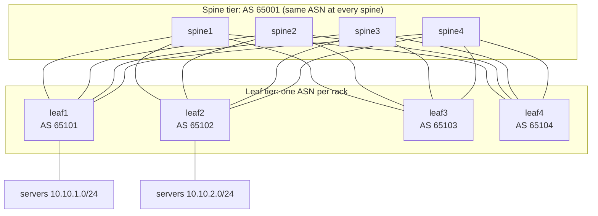

# 2.16 BGP in the data center: eBGP Clos, unnumbered, ECMP, anycast and AI-fabric routing

| | |
|---|---|
| Level | Advanced |
| Priority tier | 0 |
| Lab venue | containerlab with FRR (leaf-spine), or namespaces |
| Part | Part 2: Networking, from first principles to AI fabrics |
| Status | Drafted, labs **untested** |

## Why this matters for AI infrastructure

The routing design of the fabric determines whether a 1,000-GPU job runs at line rate, how it behaves when a link or switch fails, whether tenants are isolated, and how quickly you can add a rack. Cloud operators converged on a small set of practices: a Clos topology, eBGP as the only protocol (with a deliberately simple ASN plan), ECMP everywhere, unnumbered links, and route policy that limits how far each prefix travels. AI back-end fabrics add new demands: wide ECMP across 400/800 Gb/s links, awareness of link and queue state, path diversity for elephant flows, predictable behaviour for synchronous collectives, and multi-tenant isolation. This chapter explains the standard design, the reasons behind it, how failure domains and information hiding keep it stable, and the newer approaches (BGP link-bandwidth, DPF, IS-IS flood reduction and Flex Algo, RIFT, segment routing) proposed for AI clusters.

## Prerequisites and outcomes

You should know BGP (2.15), link-state protocols (2.14), ECMP (2.12) and Clos topologies at a conceptual level (details in 2.18).

After this chapter you can:

- Describe RFC 7938-style eBGP data-centre design: ASN allocation, ECMP, `multipath-relax`, private ASNs, `allowas-in`, remove-private-AS, and why iBGP/IGP are avoided.
- Explain BGP unnumbered (RFC 5549 / extended next hop): link-local peering, IPv4 prefixes with IPv6 next hops, and configure it in FRR.
- Explain how same-ASN-at-spine design prevents suboptimal paths after multiple failures, and how a per-rack ASN identifies prefixes.
- Apply control-plane scope rules: summarisation, aggregation, filtering, layering, caching and slowing down; recognise positive feedback loops and failure domains.
- Explain summarisation black holes in Clos fabrics and how to avoid them (minimum peers per prefix, conditional advertisement, no summarisation below the spine).
- Describe BGP ADD-PATH, AS-PATH normalisation, link-bandwidth extended community with weighted ECMP, minimum-peer rules, and BGP DPF (colored sessions, logical fabrics).
- Compare eBGP, IS-IS (flood reduction, Flex Algo) and RIFT for AI back-ends; describe dragonfly and sparse topologies at routing level.
- Design multi-tenancy (network level, server level, EVPN-VXLAN, VRF, GBP microsegmentation), BGP to the server (FRR), anycast services, and controller/SRv6-based traffic engineering at overview level.
- Troubleshoot fabric routing: missing prefixes, single-path ECMP, asymmetry, blackholes after failures.

## 1. The standard design: eBGP in a Clos

A **Clos (leaf-spine)** fabric has tiers of switches: servers connect to **leaf (ToR)** switches; each leaf connects to every **spine**; larger fabrics add a **super-spine** tier (five-stage) or build pods (chapter 2.18). Every leaf-to-leaf path crosses exactly one spine (three-stage), so all paths are equal length and all links are used under ECMP.



Why BGP (RFC 7938, "Use of BGP for Routing in Large-Scale Data Centers"):

- **One protocol**: BGP carries underlay prefixes, EVPN overlays, and external routes, with the same tooling and operator skills.
- **Simple, predictable failure behaviour** without flooding: updates propagate only along relevant paths and failure domains are bounded by design; no SPF recomputation across the whole fabric.
- **Policy**: per-neighbour filters, communities, maintenance isolation (set LOCAL_PREF/AS-path/drain communities), and clear provenance of each prefix (by origin ASN).
- **Scale and multi-vendor support**; the best-studied protocol for large operations. Weaknesses: slower convergence than link-state without BFD/tuning, and not natively aware of link or queue quality (section 7).

### ASN allocation

Common patterns:

1. **Per-rack (per-leaf) ASN, one ASN for all spines in a tier (preferred)**: leaf ASNs are unique (65101, 65102, ...; 4-byte private range for large fabrics: 4200000000 to 4294967294); all spines in the tier share one ASN (65001); super-spines another. 
2. **Unique ASN per switch**: more freedom, but a complicated plan and more path-exploration noise.
3. **iBGP with route reflectors at the spine and one ASN fabric-wide**: less common in clouds; the spine must be an RR, and the next hop is not rewritten by default.

The same-spine-ASN rule yields a useful property: eBGP's AS-PATH loop prevention rejects any path that crosses the same ASN twice, so after link failures a path like leaf1 → spine1 → leaf2 → spine1 → leaf3 (which would hairpin through a leaf and revisit the spine) is automatically **rejected** instead of used. If spines had different ASNs, the multiple-failure case would install that valley path, creating suboptimal forwarding with higher latency and a risk of saturating the intermediate leaf's uplinks (a real concern with elephant flows on 400/800G links). With the same spine ASN, the service simply sees reduced capacity or the destination is declared unreachable via that route and traffic shifts elsewhere. Per-rack ASNs also make prefixes attributable (which rack originated it), allow maintenance by AS-path-based policy (drop/accept by origin) and keep the AS-PATH length bounded to the fabric diameter (a policy can reject paths longer than 2 or 4 ASNs).

### Making BGP behave like an IGP

- `bgp bestpath as-path multipath-relax`: treat paths with equal AS-path **length** but different AS numbers as equal, so ECMP uses all spines even though each spine has a different (or the same) ASN history; set `maximum-paths` (and `maximum-paths ibgp`) to the fabric width (e.g. 64).
- Short timers plus **BFD** (3 s keepalive / 9 s hold or less; BFD at 100-300 ms) for failure detection; disable the 30 s advertisement interval on eBGP (`neighbor X advertisement-interval 0`) so withdrawals propagate quickly.
- Keep **the same AS-PATH length at each tier** for ECMP; avoid prepending in the fabric.
- `neighbor ... allowas-in` is used only where the plan reuses ASNs deliberately (e.g. a pod's leaves sharing an ASN with the global spine layer in some designs); otherwise avoid.
- `remove-private-as` / `replace-as` at the border so the Internet or WAN sees a public ASN, not the internal plan.
- Disable `bgp ebgp-requires-policy` only with care; write an explicit policy (accept the expected prefixes, set communities).
- `bgp bestpath compare-routerid` off; `bgp fast-external-failover` on, so an interface down tears down the session immediately.
- What to advertise: each leaf originates its server subnets and its /32 loopback (the router ID and VTEP/service address), nothing else; spines re-advertise; **do not advertise the fabric's point-to-point link subnets** at all (unnumbered or filtered), which keeps the RIB small and removes a failure-propagation source.

## 2. BGP unnumbered (RFC 5549 / RFC 8950)

Assigning and tracking a /31 for every leaf-spine link is a large automation burden (a 32-leaf, 16-spine fabric has 512 links; with 8 rails, thousands). **BGP unnumbered** removes the addressing:

- Each interface uses its automatically generated **IPv6 link-local address** (fe80::/64 derived from the MAC) as the peering address; neighbour discovery comes from IPv6 **Router Advertisements/Neighbour Discovery** on the link (the FRR daemon learns the neighbour's link-local address and MAC from ICMPv6 and then initiates the TCP session to port 179).
- The BGP **OPEN** includes the **Extended Next Hop Encoding capability** (RFC 8950, formerly 5549), which allows advertising **IPv4 prefixes with an IPv6 next hop** (the neighbour's link-local address). The forwarding plane installs the next hop as the neighbour's MAC resolved via ND (IPv4 route via an IPv6 link-local next hop).
- Operationally, the administrator provides only ASNs (the peer ASN may be `external` for any different ASN, or a range) and the list of prefixes to advertise (for example, `redistribute connected` through a route-map that permits only server subnets and loopbacks). Nodes are plug-and-play.

```text
! FRR leaf: unnumbered eBGP to four spines on swp1..swp4
frr defaults datacenter
router bgp 65101
 bgp router-id 10.255.0.11
 bgp bestpath as-path multipath-relax
 no bgp ebgp-requires-policy
 neighbor swp1 interface remote-as external
 neighbor swp2 interface remote-as external
 neighbor swp3 interface remote-as external
 neighbor swp4 interface remote-as external
 neighbor swp1 bfd
 address-family ipv4 unicast
  redistribute connected route-map LEAF-OUT
  maximum-paths 64
 exit-address-family
route-map LEAF-OUT permit 10
 match interface lo
route-map LEAF-OUT permit 20
 match interface vlan100
interface swp1
 ipv6 nd ra-interval 10
 no ipv6 nd suppress-ra
```

Verification: `vtysh -c 'show bgp summary'` (neighbours listed by interface name), `show ip route` (nexthops via link-local with interface), `ip route show` (`via inet6 fe80::... dev swp1 onlink`), and a packet capture of the OPEN showing capability code 5 (extended next hop). The server-side equivalent (host BGP with FRR) uses the same configuration, so servers can peer with the ToR unnumbered too (section 9).

## 3. Controlling scope: failure domains and information hiding

Control planes learn everything by default, but a *scope* limit on topology and reachability information is a design tool. A **failure domain** for a piece of information is the set of devices that must recompute or update when it changes. If a leaf in rack 17 flaps an IP prefix, every router that knows about that prefix must process an update; routers that don't know it aren't affected. Limiting scope has several benefits: it reduces resource use (cheaper switches, smaller tables), speeds convergence (fewer devices to update), improves security (an attacker with a view of the control plane learns less), and avoids **positive feedback loops**.

### Positive feedback loops

In a positive feedback loop, a system's output feeds back to amplify its input until a limit is hit. In networks: a flapping link generates events that ripple through the control plane; a device that receives events faster than it can process them crashes, reboots, re-forms adjacencies and sends its whole database, which overloads its neighbours, which crash in turn, so the failure spreads and persists even after the original flap stops. Suppose each router can process 10 events/s and a link flaps three times a second (six events/s). Because some routers pass each update on twice, one downstream device sees 12 events/s, exceeds its limit, fails, and the cascade begins. Root cause: the flap; amplifier: the topology and the lack of damping. The countermeasures are to **reduce the scope** of information and **reduce its velocity**.

### Techniques

| Technique | What it does | In a data centre |
|---|---|---|
| **Summarising topology** | Hide detail of links and nodes behind a summarising node (neighbours see destinations "directly attached" to it, with a metric) | Distance-vector behaviour; areas/levels in link state; eBGP naturally hides topology |
| **Aggregating reachability** | Advertise one shorter prefix instead of many longer ones (`10.10.0.0/16` for all racks in a pod) | Pod-level aggregation toward super-spines or the WAN/border |
| **Filtering reachability** | Do not advertise certain prefixes (point-to-point links, host routes) beyond a boundary | Don't carry link subnets; accept only expected prefixes from servers |
| **Layering control planes** | Run a separate overlay control plane (EVPN) for host/tenant reachability on top of an underlay that only knows loopbacks | Underlay BGP/IGP carries loopbacks; EVPN-VXLAN carries MAC/IP routes (chapter 2.17) |
| **Caching** | Keep reachability on demand (reactive learning) instead of everywhere | Host-route install on use, map-server/controller models; ARP/ND |
| **Slowing down** | Rate limit and damp changes: SPF/LSA throttling, BGP MRAI, route flap damping, BFD hysteresis | Throttle timers; dampen unstable links; avoid aggressive flapping detectors |

Costs: every hiding mechanism has a price. Summarising hides the failure of a specific component (traffic is attracted to the summary and then dropped inside); aggregation can produce suboptimal paths and **black holes**; filtering creates unreachability if mistaken; layering adds an additional control plane to operate and correlate; caching adds first-packet latency; slowing down lengthens convergence. Design is choosing which information to hide where.

### The Clos black-hole caveat

Aggregate on the spine: each spine advertises `10.10.0.0/16` for all server subnets below. If leaf3 loses its uplink to spine2 (but still has spines 1, 3, 4), spine2 can no longer reach leaf3's `10.10.3.0/24`, yet it keeps advertising the covering `/16` upward (other leaves still reach other racks via spine2). Traffic from outside that hashes via spine2 for leaf3's subnet is black-holed. Rules: **do not summarise on the paths where a specific route is needed for correctness**; summarise only towards the outside (border, WAN), or ensure that the aggregate is withdrawn when it no longer represents full reachability by tying advertisement to the presence of the specific routes ("conditional advertisement": advertise the aggregate only if at least N specifics, or N BGP peers, are up).

**Minimum BGP peers per prefix.** For services that need deterministic capacity (for example a prefix with 4-way ECMP), a spine can withdraw a prefix if fewer than N next hops/paths exist, so traffic is steered elsewhere where full capacity exists rather than being sent into a degraded 3-way path. This differs from simple conditional advertisement by being driven by the *number of active peers per prefix* and is useful for capacity-sensitive AI traffic.

## 4. Advanced BGP capabilities for AI fabrics

### ADD-PATH

By default a BGP speaker advertises only its single best path per prefix. With **ADD-PATH** (RFC 7911) it advertises multiple paths with path identifiers. In a fabric with route reflectors it keeps path diversity (so ToRs see all next hops, not only the RR's choice); in eBGP, ADD-PATH lets a spine pass both paths received from two border leaves so a leaf can ECMP across both rather than depend on the spine's best-path pick. Improves resilience (only the share on a failed path is affected) and load balancing; costs more RIB state.

### AS-PATH strip and replace

When the fabric (using private ASNs) connects to a core network that also uses private ASNs, or servers run their own BGP and inject prefixes with arbitrary AS-PATHs, the fabric can **normalise** ingress AS-PATHs: strip private ASNs and replace them with a defined list of the same length, so the fabric treats all external sources uniformly (equal ECMP, no ASN collisions with the internal plan). Useful at the border and for server-originated routes in multi-tenant designs. Caveat: replacing AS-PATH defeats loop prevention; use only at controlled boundaries (never toward the Internet).

### Link Bandwidth Extended Community and weighted ECMP

Plain ECMP splits traffic equally. When next-hop links have different capacities (400G, 800G, 100G paths north-south; or after a 1-of-8 uplink failure) equal splitting overloads the smaller ones. The **BGP Link Bandwidth extended community** (encoded by the advertising router from the link speed) lets the receiving router assign **weights** proportional to capacity (weighted ECMP / UCMP; sometimes called weighted packet spraying when applied at ASIC level): in one example four spines with 400, 800, 100 and 400 Gb/s northbound links get roughly 20/45/15/20 percent of traffic. It can also be applied inside a five-stage fabric: if a spine loses a link to the super-spine, its reduced capacity is advertised and source leaves send proportionally less through it. Use it for selected prefixes or services (fabric-wide per-prefix weighting creates a lot of state), and keep all other attributes equal.

### BGP Deterministic Path Forwarding (DPF) and path diversity

The shared Clos fabric is one pool of paths with a single best-effort SLA: ECMP hash decides which leaf-spine links a flow uses, so elephant RoCE flows can collide on one link while others idle, increasing job completion time (JCT) and jitter even with DCQCN (PFC/ECN) preventing loss. Load balancing improvements (packet spraying with BTH queue pair fields in the hash, dynamic load balancing on local utilisation, global load balancing using next-next-hop link quality) help but can reorder packets or vary run to run. **BGP DPF** (proposed by HPE Juniper Networking, IETF draft `draft-wang-idr-dpf`) divides the physical Clos fabric into multiple **logical fabrics** and maps selected flows to a logical fabric according to their SLA requirement:

- **Session coloring**: eBGP sessions over the same physical links are tagged with a colour (or several, or "exclude colour", or none). Only routes with at least one matching colour are advertised over a coloured session, and unmatched colours are pruned from the route as it crosses, so a coloured route propagates only along fabrics of its colour. Route colours are carried as communities/attributes; an uncoloured route matches every colour.
- **Active/backup colour**: the ingress leaf may receive a black-fabric path (active) and a grey path (backup); choosing the black path guarantees black-fabric forwarding, with the grey path as fallback.
- **Mapping traffic to a fabric ID/colour**: (1) **filter-based forwarding** (match RoCEv2 UDP port ranges or destination QPs from the BTH header per interface); (2) an **on-box agent** that probes path quality and assigns new workloads; (3) a **central controller** with a global view of topology and utilisation (path computation element); (4) **EVPN-VXLAN** MAC-VRF or RT-5 IP-VRF instances associated with a coloured path address, correlating overlay tenants to underlay planes.
- **Rail-optimised vs rail-unified**: in a rail-optimised design each of a server's eight GPUs/NICs connects to a different leaf in the rail group (a leaf failure impacts one rail's capacity), while in a rail-unified design all GPUs of a server connect to the same ToR (cheaper cabling, but a leaf failure takes down the server group). DPF works in both; in the unified case you can pin each GPU ID (or QP range) to a logical fabric, e.g. dedicating three of the 400G leaf-spine links (1.2 Tb/s) to the "black" fabric for the highest-priority tenant, giving predictable capacity and low JCT, while other tenants share the rest with random spraying/DLB. Measure first (real-time performance telemetry) to decide whether pinning beats spraying for a given tenant.
- It also applies to the front end (storage and inference domains separated on the same infrastructure).

Treat DPF as an emerging, vendor-led approach: validate on your hardware; the general principle (logical planes in a Clos, with controlled mapping of flows to planes) is also achievable with VRFs, segment routing, Flex Algo or policy-based routing.

## 5. IGPs for AI back-end fabrics: IS-IS flood reduction, Flex Algo and RIFT

Why consider an IGP again: back-end training networks want microsecond-scale reaction to link and queue conditions, awareness of the whole topology and of collective communication patterns, and link/queue-level information, none of which BGP natively carries (BGP was designed to advertise prefixes). BGP also needs BFD or OAM add-ons for fast detection and needs significant CPU to react. IGPs have built-in heartbeat and flooding, can carry link-quality TLVs, and at 16,000 to 32,000 GPUs the control plane must scale accordingly.

- **IS-IS with optimised flooding for dense topologies** (`draft-white-lsr-distoptflood`): in a dense leaf-spine with many parallel links, classic flooding sends each LSP fragment over every link and every node receives many duplicates; the optimisation elects a subset of links/neighbours to flood updates, minimising duplicate LSP fragments and speeding convergence; IS-IS scales to several thousand nodes (about 2,500 cited). It runs below IP, so it is not exposed to TCP-level attacks from outside the fabric, and TLVs can carry extra link/server information.
- **IS-IS Flex Algo** (RFC 9350, for IP networks without SR via RFC 9502): a Flexible Algorithm Definition combines a calculation type, a metric type (IGP, min-delay, TE) and constraints (include/exclude link affinities, bandwidth constraints per draft-ietf-lsr-flex-algo-bw-con). Each node assigns a Flex Algo value, advertises algorithm-specific prefix reachability (TLV with algorithm and multi-topology ID), and computes separate SPF trees per algorithm. Result: multiple **logical routing planes** on one physical fabric (a low-latency plane for mice, a high-bandwidth plane for elephants, or a plane per tenant), comparable in intent to BGP DPF but IGP-based.
- **RIFT (Routing in Fat Trees, RFC 9692)**: purpose-built for Clos topologies: link-state **northbound** (leaves and aggregation know topology upward) and distance-vector **southbound** (only default routes and summaries flow down, so leaves hold minimal routes), automatic **disaggregation** on failure (more specific routes are pushed down only where a failure would cause a black hole, fixing the summarisation black-hole problem automatically), zero-touch provisioning (no per-switch ASNs), wide ECMP and unequal-cost multipathing based on northbound capacity, adjacency over UDP hellos (not TCP), IPv6 ND-based link addressing, and the ability to carry fabric metadata. Scales to 1,000+ switches. In a dragonfly topology, RIFT variants (`draft-przygienda-rift-dragonfly`) carry the group-to-group links and allow non-shortest-path forwarding.

Comparison (summary of the criteria used in this chapter):

| Characteristic | eBGP | RIFT | IS-IS (flood reduction / Flex Algo) |
|---|---|---|---|
| Clos ECMP (3-/5-stage) | Yes | Yes | Yes |
| Dragonfly topologies | Poor | Yes | Limited |
| Multi-tenancy options (front end) | Many (EVPN, VRFs, policy) | Limited | Limited |
| Convergence | Medium (fast with BFD) | Fast | Fast |
| Link awareness | Low | High | High |
| Full-topology awareness | Medium | High | Medium (high within level) |
| Automatic disaggregation on failure | No | Yes | No |
| Zero-touch provisioning / fabric metadata | No | Yes | No |
| Weighted/unequal ECMP | via link-bandwidth community | Native | via metrics/algorithms |
| Ecosystem maturity | Very high | Early | High (carrier) |

Practical guidance: **front-end and general fabrics** (storage, inference, management, tenancy) use eBGP unnumbered with EVPN where needed; **large AI back-ends** start with eBGP and consider IGP-based or colour-based approaches when scale, topology (dragonfly), or path-determinism requirements demand them. A hybrid is acceptable: different protocols on different tiers or networks.

## 6. Dragonfly and sparse topologies (routing view)

A **dragonfly** has groups of switches (internally meshed) connected group-to-group by global links; it minimises hop count and long cables relative to a deep Clos, helping latency-sensitive AI/HPC. Full dragonfly cabling is heavy, so a **sparse dragonfly** keeps each group as a leaf-spine Clos and connects only the top-of-fabric spines between groups. Routing implications: non-shortest-path (valiant/UCMP) forwarding is needed for balance; control planes must identify inter-group global links, partition the fabric, apply split-horizon rules for the group links, and may reflect link quality. eBGP struggles with this (policy complexity, no native link awareness), which is why IGP-style protocols (RIFT, IS-IS) are being extended for it. Scale-up domains (NVLink-class pods that act like one big GPU server) have their own fabric managers (chapter on NVLink/NVSwitch); the IP fabric connects pods.

## 7. Multi-tenancy for AI/ML clusters

Why isolate tenants: **security** (training data and model confidentiality), **performance** (dedicated ports and bandwidth, lower latency across rails), and **capacity planning** (GPU-as-a-service per tenant). Options, in increasing granularity:

1. **Dedicated ports / hardware**: bare-metal-as-a-service where a tenant owns whole servers; each of the eight NIC ports on a server goes to a different ToR in the rail group, and the port is reserved per tenant (simple, strong isolation).
2. **Network-level segmentation with EVPN-VXLAN**: map each tenant to a VLAN/VNI → MAC-VRF (L2) and/or an IP-VRF with route-type-5 routes (L3); spines act as route servers for tenant routes and transit IP. One illustrative sizing: a rail with 8 leaves and 8 spines at 1:1 using 64×800G switches (breakout 2×400G ports toward servers) yields 64 server ports per ToR and 512 GPUs per rail; dedicating physical servers can host up to four tenants of 128 GPUs in one rail; add rails and spines as capacity grows.
3. **Server-level partitioning**: NVIDIA MIG splits a GPU into up to seven instances; map each instance to a VLAN (seven tenants per server interface); vGPU and scheduling with NCCL across servers extends this. Combined with the network: each leaf runs seven MAC-VRFs and seven IP-VRFs, and tenant traffic stays isolated across racks and rails.
4. **Dynamic ACLs from RADIUS tenant profiles at the ToR**: fine-grained but limited by TCAM size at high tenant counts; centralised rather than distributed.
5. **Microsegmentation with VXLAN group-based policy (GBP)**: a tag in the VXLAN header inside the same VNI lets two tenants share a subnet but still be prevented from communicating.

Correlate overlay to underlay where needed: tenants on specific coloured logical fabrics (DPF) or Flex Algo planes get guaranteed paths. Always pair tenant isolation with *performance isolation* (PFC/ECN queue assignment, buffer partitioning, rate limits) as noted in chapter 2.19, because routing-level isolation does not stop a noisy tenant from causing congestion on shared links.

## 8. Extending routing to the server

Running a routing daemon on the GPU server or its DPU (FRR, BIRD; Calico/Cilium for pods) gives: the server chooses among leaves (ECMP across its two uplinks without MLAG), advertises its own /32 loopback and service prefixes, supports **anycast** services (the same VIP advertised from many servers; the fabric ECMPs to the nearest/any; health checks remove a server by withdrawing the route), L3 multi-tenancy with per-tenant VRFs on the host, and fast failover through BFD. Patterns:

- **eBGP server-to-ToR** (server ASN per server or per rack; unnumbered): ToR applies a prefix-list per server (only its /32 and assigned service prefixes), `maximum-prefix`, AS-path normalisation and optionally `allowas-in` rules.
- **Route reflector for servers**: servers peer with a (hierarchical) route reflector or virtual BGP appliance rather than every ToR, reducing peerings; selected fabric nodes peer with the RR, which advertises service prefixes with the right next hops to the spines and onward to the border.
- **Anycast health**: tie advertisement to local health (`exabgp`/`bird` with check scripts, MetalLB, Cilium) so a failed service stops attracting traffic. Be careful with ECMP and stateful TCP services: resilient hashing and consistent hashing at the fabric (chapter 2.12) plus per-flow state at the app/LB avoid breakage when the next-hop set changes.
- **Security**: the server is less trusted than a switch: strict ingress policy at the ToR, authentication on sessions, never let a server's AS-PATH or prefixes pass unfiltered.

## 9. Traffic engineering: telemetry, controllers and segment routing

Distributed load balancing (each switch decides) can be complemented by a **central controller**: it consumes fabric telemetry (queue depth trends, sFlow, BGP statistics, per-queue interface counters, DCQCN/PFC event telemetry), agent probes of end-to-end path quality, and the GPU **job scheduler's** placement, and steers new jobs/flows onto less-loaded paths so that the flows of one job use a deterministic set of paths. Requirements: the controller must know the true topology (BGP-LS or IGP extensions, so miscabling is detected before optimisation), must be reactive but stable (avoid oscillation), and the fabric must keep working if the controller is unavailable.

**Segment Routing** (SR) is source routing: the ingress node encodes the path as a list of segments (SIDs) in the packet; transit nodes follow the instructions with no per-flow state. SR-MPLS uses labels; **SRv6** uses IPv6 SIDs in a Segment Routing Header (SRH) between the IPv6 header and the L4/RDMA payload. A SID has a locator (network address of the node), a function (End, End.X adjacency, service functions) and optionally an argument. **Compressed SIDs / micro-segment (uSID)** carry 16-bit micro-SIDs inside a 128-bit address to shrink long lists (strict-path TE needs many hops). With a controller computing congestion-avoiding paths for each GPU pair and pushing them to ingress nodes, SR can make per-flow load balancing sufficient and deterministic; failures require the controller to push alternatives (or local fast reroute). It is a promising direction for lossless RoCE fabrics if DCQCN/PFC semantics are preserved across SRv6 topologies (IETF drafts exist for SRv6 in AI backends). In practice most fabrics today run eBGP + ECMP + load balancing + DCQCN, and treat these as options to evaluate.

## 10. Operations: verifying, converging and failing safely

- **Verification checklist**: every leaf has N ECMP paths for every remote server prefix (`show ip route 10.10.5.0/24` shows 4 or 64 next hops); loopbacks reachable; `show bgp summary` shows all sessions Established; prefix counts match design (leaf ≈ number of racks + loopbacks); no unexpected longer AS-PATHs; `ip route get` from a server with different source ports hits different uplinks; MTU consistent (jumbo on all links); BFD up on all sessions.
- **Convergence testing**: fail links, linecards, a spine, a leaf; measure with a timestamped ping or iperf3 and `ip monitor route`; typical targets: under 1 s for link failure with BFD, sub-second to seconds for node failure; 0 packets lost for planned maintenance with graceful shutdown.
- **Maintenance**: drain a switch with `bgp graceful-shutdown` or by setting LOCAL_PREF/AS-path prepend/`maximum` metric via a community before reboot; verify traffic moved before touching; re-enable gradually.
- **Common failure patterns**: single-path ECMP (missing `multipath-relax` or `maximum-paths` too low), spine hairpins from ASN misdesign, summarisation black holes, MTU mismatch causing session flap with large updates, mis-set ASN (`remote-as external` accepting wrong peers), BFD flapping under CPU load (CoPP), route leaks of fabric prefixes to the WAN (always filter at the border), default route missing on leaves (needed for external reachability), IPv6 ND/RA disabled (breaks unnumbered).
- **Automation**: generate configuration from a source of truth (NetBox, YAML) using templates; validate with tests such as "every leaf must have N next hops to every other leaf's prefixes" (Batfish, Suzieq, pyATS, custom scripts, chapters 2.28 and 2.29).

## 11. Hands-on lab: build a leaf-spine eBGP fabric with unnumbered peering

First, run the self-checking Python lab (`code/part02/bgp_datacenter_clos_lab.py`) locally. It verifies RFC 7938 same-spine-ASN valley/hairpin path rejection (`[65102, 65001, 65103]`), BGP Link-Bandwidth weighted ECMP (`UCMP`) traffic split (`[400, 800, 100, 400]` Gb/s), Clos spine summarization black-hole and minimum-peers rules, and BGP Deterministic Path Forwarding (`DPF`) colored session filtering.

```bash
python3 code/part02/bgp_datacenter_clos_lab.py
```

Next, on a disposable Linux VM using containerlab (`2` spines in `AS 65001`, `4` leaves in `AS 65101..65104`; all interactive VM commands below are `untested here`), work through these steps:

1. **Topology and addressing**: loopbacks 10.255.0.X/32; server subnets 10.10.X.0/24 on leaves; no addresses on fabric links (IPv6 link-local only).
2. **Unnumbered eBGP** with `neighbor swpN interface remote-as external`, `multipath-relax`, `maximum-paths 8`, `redistribute connected` through a route-map; verify `show bgp summary`, ECMP next hops, `ip route` showing `via inet6 fe80::`; capture an OPEN message and find the Extended Next Hop capability.
3. **ECMP**: run `iperf3 -P 16` between hosts on different leaves; show both spines used; check the effect of `fib_multipath_hash_policy`; engineer a collision of two elephant flows (choose ports) and observe saturation of one link.
4. **ASN design**: change spines to different ASNs; fail links to create the multi-failure valley path (leaf1 loses spine2 uplink and leaf3 loses spine1 uplink, then leaf2 has links...) and observe the hairpin route; revert to the same ASN and see it rejected; record AS-PATH lengths.
5. **Summarisation black hole**: add `aggregate-address 10.10.0.0/16 summary-only` on spines toward a border router; fail a leaf-spine link and show the black hole from the border; fix with conditional advertisement or by not aggregating below the spine.
6. **BFD and timers**: compare failure recovery with default timers, `timers 3 9`, and BFD 100 ms × 3.
7. **Weighted ECMP**: set link-bandwidth community on advertisements with different values; enable weighted ECMP in FRR (`neighbor X ... link-bandwidth`/`bgp bestpath bandwidth`) if supported, and measure the split.
8. **Colouring (conceptual DPF)**: emulate two logical planes with two VRFs or two sets of sessions and communities; map flows with policy-based routing (`ip rule` by UDP port) and observe isolation.
9. **BGP to the host**: run FRR in a host container peering unnumbered with two leaves; advertise a /32 loopback and an anycast VIP from two hosts; verify ECMP to the VIP; stop a service and withdraw the VIP; verify failover time.
10. **Maintenance drain**: use graceful shutdown to drain a spine and prove zero loss (continuous ping with 10 ms interval).
11. **Clean up**.

## 12. Common mistakes

- Different ASN per spine without understanding valley paths; reusing leaf ASNs without `allowas-in` design.
- Forgetting `multipath-relax` and `maximum-paths`, leaving the fabric single-path.
- Advertising link subnets; summarising where a specific route is needed; aggregates that outlive their specifics.
- BGP timers/BFD aggressive without CoPP protection; no graceful shutdown procedure.
- Treating server-originated BGP as trusted.
- Choosing a protocol on fashion instead of requirements (topology, scale, team skill, tooling).
- Mixing MTUs in the fabric; forgetting that BGP unnumbered requires IPv6 ND to be enabled on links.
- Expecting routing to solve congestion: ECMP does not balance elephant flows (chapter 2.19 for ECN/PFC and adaptive routing).

## 13. Interview angles

- "Why do hyperscalers use eBGP instead of an IGP in the data centre? What are the downsides?"
- "How do you allocate ASNs in a Clos? Why the same ASN on the spines?"
- "What is BGP unnumbered and how can IPv4 routes have an IPv6 next hop?"
- "What do you need for ECMP across spines in BGP?" (`multipath-relax`, `maximum-paths`, same attributes.)
- "A rack's prefix is unreachable from some spines after a link failure. What went wrong?" (Summarisation black hole / lost uplink.)
- "How would you give one tenant guaranteed bandwidth paths in a shared Clos?" (DPF/colours, Flex Algo, VRFs, SR, dedicated ports.)
- "Compare eBGP, IS-IS and RIFT for an AI back-end."
- "How would you run anycast services from GPU servers safely?"
- "Explain failure domains and positive feedback loops in routing."

## Exercises

1. **RFC 7938 eBGP Clos Design, Same-Spine-ASN Valley Prevention, and `multipath-relax`:** (a) Explain why hyperscale and AI data centers standardized on **eBGP (`RFC 7938`)** instead of iBGP or OSPF, and state the eight configuration knobs required to make eBGP behave like a fast ECMP fabric protocol; (b) using `check_clos_valley_path_rejection()` in `code/part02/bgp_datacenter_clos.py`, prove why assigning the **same ASN (`65001`) to all spines in a tier** prevents suboptimal leaf-hairpin ("valley") paths after multiple link failures.
2. **BGP Unnumbered (`RFC 5549` / `RFC 8950` Extended Next Hop):** Explain how BGP unnumbered eliminates `/31` IPv4 subnet management across `512+` leaf-spine links by combining **IPv6 Neighbor Discovery (`RA`, `fe80::/64`)** with **BGP Capability Code `5` (*Extended Next Hop Encoding*, RFC 8950)**. What does `ip route show` display for an IPv4 route learned over an unnumbered eBGP session?
3. **Failure Domains, Positive Feedback Loops, and Clos Summarization Black Holes (`CN` Chapter 19):** (a) Define a control-plane **failure domain**, walk through the `10` events/s vs `3` flaps/s (`6 -> 12` events/s) **positive feedback loop** cascade, and list the six techniques for bounding control-plane scope; (b) using `evaluate_spine_summary_and_min_peers()`, explain why configuring `aggregate-address 10.10.0.0/16 summary-only` on Spine 2 blackholes traffic to Leaf 3 (`10.10.3.0/24`) when the single link `Spine 2 — Leaf 3` fails, and state two fixes.
4. **Advanced AI-Fabric BGP (`ADD-PATH`, Link-Bandwidth Weighted ECMP, Minimum Peers, and `BGP DPF`):** (a) Using `compute_weighted_ecmp_shares_pct([400, 800, 100, 400])`, compute the weighted ECMP traffic distribution across four spines advertising Link-Bandwidth communities for `400`, `800`, `100`, and `400 Gb/s` northbound capacity; (b) using `filter_dpf_colored_route()`, trace how **BGP Deterministic Path Forwarding (`DPF`)** filters and prunes route colors (`{'black', 'grey'}`) across colored eBGP sessions, and contrast **rail-optimized** versus **rail-unified** server cabling.
5. **Comparing `eBGP`, `IS-IS` (Flood Reduction & `Flex Algo`), and `RIFT` (`RFC 9692`) for 32k-GPU Fabrics and Dragonfly (`ADC` Chapter 8):** Compare `eBGP`, `IS-IS` (`draft-white-lsr-distoptflood` + `Flex Algo` `RFC 9350`/`9502`), and `RIFT` (`RFC 9692`) across Clos ECMP, **dragonfly** topologies, link/queue awareness, and **automatic disaggregation on failure**.
6. **Multi-Tenancy at Scale, BGP to the Server / Anycast, and `SRv6` `uSID` Traffic Engineering (`ADC` Chapter 8):** (a) Compare the five AI cluster multi-tenancy models (dedicated rail ports, `EVPN-VXLAN` `MAC-VRF` + `RT-5 IP-VRF` for `512` GPUs/rail, server-level `7`-instance **NVIDIA MIG** mapped to `7` VLANs/VRFs per leaf, RADIUS dynamic ACLs, and VXLAN **GBP** microsegmentation); (b) explain how **BGP to the server** enables MLAG-free ECMP and health-checked **anycast** VIPs, and how **SRv6 `16`-bit micro-SIDs (`uSID`s)** enable controller-steered deterministic paths.

## Checkpoint questions (20)

<details>
<summary>1. Why did large-scale data centers standardize on `eBGP` (`RFC 7938`) as their sole routing protocol?</summary>
(1) **Single protocol** for underlay reachability, EVPN overlays, host routing, and WAN border peering; (2) **bounded failure domains without link-state flooding** (updates propagate only along affected paths with no fabric-wide Dijkstra SPF recomputation); (3) **deterministic AS-path loop prevention** that naturally enforces valley-free Clos forwarding; (4) **rich per-hop policy and origin-ASN attribution** (knowing immediately which rack originated a prefix and draining switches cleanly with communities); and (5) **mature, interoperable multi-vendor implementations**.
</details>

<details>
<summary>2. What is the RFC 7938 ASN allocation rule for a 3-stage leaf-spine Clos, and how does sharing one ASN across all spines prevent \"valley\" (hairpin) routing?</summary>
Assign each **leaf switch (ToR) its own unique ASN** (`65101, 65102, ...` or 4-byte private `4200000000+`), and assign **all spine switches in the tier the exact same ASN (`65001`)**. If Leaf 1 loses its link to Spine 2 and Leaf 3 loses its link to Spine 1, a path `Leaf 1 -> Spine 1 (65001) -> Leaf 2 (65102) -> Spine 2 (65001) -> Leaf 3` would hairpin through Leaf 2 (`valley` routing, overloading Leaf 2's uplinks). Because Spine 2 shares ASN `65001` with Spine 1, Spine 2 sees `65001` already in `AS_PATH` and **automatically rejects the hairpin route**.
</details>

<details>
<summary>3. List seven configuration changes required to make `eBGP` converge and load-balance like an IGP inside a data center.</summary>
(1) **`bgp bestpath as-path multipath-relax`** (so equal-length paths with different leaf/spine ASNs form ECMP); (2) **`maximum-paths 64`** (matching fabric width); (3) **`neighbor ... advertisement-interval 0`** (eliminating the default `30 s` eBGP MRAI delay); (4) **short keepalive/hold timers (`timers 3 9`) plus `BFD` (`100–300 ms`)**; (5) **`bgp fast-external-failover`** (tearing down the session immediately on local carrier loss); (6) **advertising only `/32` loopbacks and server subnets** (never point-to-point link subnets); and (7) **`remove-private-as`** at the external WAN border.
</details>

<details>
<summary>4. How does `BGP Unnumbered` (`RFC 5549` / `RFC 8950`) work, and why is it a major operational win on a 1,000-GPU fabric?</summary>
In a fabric with hundreds or thousands of point-to-point switch and server links, allocating and configuring `/31` IPv4 subnets on every cable is tedious and error-prone. With **BGP unnumbered** (`neighbor swp1 interface remote-as external`), interfaces have **no IPv4 addresses**: routers automatically discover each other's **`fe80::/64` IPv6 link-local address and MAC** via **ICMPv6 Router Advertisements (`RA`)**, establish the TCP/179 session over IPv6 link-local, and use **Capability Code `5` (*Extended Next Hop Encoding*, RFC 8950)** to advertise **IPv4 prefixes with an IPv6 link-local `NEXT_HOP`** (`via inet6 fe80::... dev swp1 onlink`). Every cable is 100% plug-and-play.
</details>

<details>
<summary>5. Define a control-plane \"failure domain\" and explain how a Positive Feedback Loop can take down a routing control plane (`CN` Chapter 19).</summary>
A **failure domain** is the set of routers that receive updates and must recompute state when a link or prefix changes. A **positive feedback loop** occurs when control-plane load amplifies itself: suppose routers can process `10` events/s, and a flapping link generates `3` flaps/s (`6` events/s); because intermediate routers multiply and re-flood updates across parallel paths, a downstream router receives `12` events/s, runs out of CPU/memory, crashes or drops BFD/keepalives, and triggers a full adjacency teardown and table resync across all its neighbors—cascading across the entire network even after the original link stops flapping.
</details>

<details>
<summary>6. Name the six techniques for bounding control-plane scope and velocity (`CN` Chapter 19), along with the cost of each.</summary>
(1) **Summarizing topology** (hiding internal links/nodes behind areas/levels; cost: hides internal component failures);\n(2) **Aggregating reachability** (collapsing `/24`s into a `/16`; cost: suboptimal paths and **black holes** on link failure);\n(3) **Filtering reachability** (dropping link subnets or unneeded prefixes; cost: unreachability if misconfigured);\n(4) **Layering control planes** (separating underlay loopbacks from an EVPN overlay; cost: two control planes to operate and correlate);\n(5) **Caching / reactive learning** (learning host routes on demand; cost: first-packet latency); and\n(6) **Slowing down** (SPF/LSA throttling, MRAI, damping; cost: slower convergence).
</details>

<details>
<summary>7. Explain the Clos Spine Summarization Black Hole and why you must never summarize server prefixes on spines toward leaves.</summary>
Suppose Spine 1..4 all advertise a summary `10.10.0.0/16` (covering Leaf 1..4's `10.10.1.0/24..10.10.4.0/24`) while suppressing the specific `/24`s. If the single link between **Spine 2 and Leaf 3 (`10.10.3.0/24`)** fails, Spine 2 still reaches Leaves 1, 2, and 4—so Spine 2 **keeps advertising `10.10.0.0/16`**. Any router that hashes traffic for `10.10.3.0/24` to Spine 2 will have its packets **dropped in a black hole at Spine 2**. Never summarize on spines where specific `/24` reachability can partition; summarize only at pod/WAN borders using **conditional advertisement** or **minimum-peers rules**.
</details>

<details>
<summary>8. What is the \"Minimum BGP Peers per Prefix\" rule, and why is it useful in AI fabrics (`ADC` Chapter 8)?</summary>
For synchronous AI workloads that require full non-blocking bisection bandwidth, a spine or aggregation switch can be configured to advertise a prefix upward **only while at least `N` healthy ECMP next-hop peers exist for that prefix**. If a link failure drops the available paths below `N` (e.g., from 4 paths to 3), the spine withdraws the prefix so upstream senders steer traffic only through spines that still have 100% downstream capacity.
</details>

<details>
<summary>9. How does the `BGP Link Bandwidth Extended Community` enable Weighted ECMP (`UCMP`)?</summary>
Standard ECMP splits flows equally (`1/N`) across all next hops, which overloads a degraded path when parallel paths have unequal capacity (for example, `400G`, `800G`, `100G`, and `400G` northbound trunks, or a spine that lost 1 of its 4 super-spine uplinks). By attaching the **Link Bandwidth Extended Community** proportional to available bandwidth, the receiving router programs **weighted ECMP (`UCMP`)** buckets in the switch ASIC so each next hop receives traffic strictly proportional to its capacity.
</details>

<details>
<summary>10. When is `AS-PATH` Strip and Replace (normalization) used in an AI data center (`ADC` Chapter 8)?</summary>
When a private-ASN fabric connects to a campus/core network that also uses private ASNs, or when tenant GPU servers run their own BGP daemons and inject prefixes with varying `AS_PATH` lengths, the ToR/border router can **strip incoming private ASNs and replace them with a uniform fixed-length ASN sequence**—preventing accidental `AS_PATH` loop drops and ensuring all server/external paths have identical `AS_PATH` length for ECMP.
</details>

<details>
<summary>11. How does `BGP Deterministic Path Forwarding` (`DPF`, `draft-wang-idr-dpf`) partition a physical Clos into multiple logical fabrics?</summary>
**BGP DPF** tags eBGP sessions and routes with **colors** (e.g., `black`, `grey`). A colored route is advertised over a session **only if the route and session share at least one color**, and any unmatched colors on the route are pruned as it crosses the session—confining each color's routes to its own dedicated subset of leaf-spine links (**logical fabric**). High-priority tenant RoCE elephant flows (matched by UDP port, RoCE `BTH` destination QP, or `EVPN` VRF) are steered onto a dedicated `black` fabric (e.g., `3 x 400G = 1.2 Tb/s`) with an optional `grey` backup path, eliminating cross-tenant elephant collisions.
</details>

<details>
<summary>12. Contrast a **Rail-Optimized** GPU fabric with a **Rail-Unified** GPU fabric (`ADC` Chapter 8).</summary>
- **Rail-Optimized**: each of an 8-GPU server's 8 NICs (`NIC 0..7`) connects to a **different leaf switch** (`Leaf_Rail_0 .. Leaf_Rail_7`). Same-rank GPUs across servers communicate in 1 hop through their shared rail leaf, and a single leaf failure reduces job bandwidth by only `1/8` (`12.5%`).\n- **Rail-Unified**: all 8 NICs of a server connect to the **same ToR leaf switch** (or leaf pair). This simplifies rack cabling, but a single ToR switch failure takes down all 8 GPUs of the server, and intra-rack vs inter-rack traffic shares the same leaf uplinks (where logical fabric coloring like DPF helps isolate per-GPU planes).
</details>

<details>
<summary>13. Why are `IGP`s (`IS-IS` and `RIFT`) being evaluated alongside `eBGP` for 16,000–32,000 GPU AI back-end fabrics (`ADC` Chapter 8)?</summary>
BGP is a prefix-advertisement protocol with no native concept of topology graphs, link utilization, or switch queue depth, and requires external `BFD` sessions and higher CPU for fast failure detection. Link-state IGPs (`IS-IS` with flood reduction, `RIFT`) have built-in fast UDP/L2 hellos, full topology visibility, extensible TLVs for link/queue state, and native multi-topology / constrained-path calculation.
</details>

<details>
<summary>14. What do `IS-IS Optimised Flooding` (`draft-white-lsr-distoptflood`) and `IS-IS Flex Algo` (`RFC 9350` / `RFC 9502`) do?</summary>
- **IS-IS Optimised Flooding**: in a dense Clos where every leaf connects to every spine, classic flooding sends duplicate LSP fragments over every parallel link; optimized flooding elects a subset of flooding relays so each node receives an LSP once, scaling single-area IS-IS to **`~2,500` switches**.\n- **IS-IS Flex Algo (`RFC 9350`, and `RFC 9502` for plain IP fabrics)**: allows operators to define multiple **Flexible Algorithm IDs** combining a metric type (IGP cost, min-delay, TE) and link affinity constraints (include/exclude colored links, minimum bandwidth), computing **separate parallel SPF routing planes** on the same physical fabric.
</details>

<details>
<summary>15. How does `RIFT` (*Routing in Fat Trees*, `RFC 9692`) work, and how does it automatically solve the Clos summarization black-hole problem?</summary>
**RIFT** is a hybrid protocol purpose-built for Clos/fat-tree topologies:\n- **Northbound (toward spines)**: acts as **link-state**, flooding topology upward so spines have full visibility of the pod.\n- **Southbound (toward leaves)**: acts as **distance-vector**, advertising **only a single default route** downward so leaf FIB tables stay tiny.\n- **Automatic Disaggregation**: when a spine loses its link to a specific leaf (`Leaf 3`), RIFT automatically detects the asymmetry and pushes a **positive/negative disaggregation specific route (`10.10.3.0/24`)** downward so sibling leaves never route `Leaf 3` traffic to the broken spine—solving the Clos summarization black hole with zero manual configuration.
</details>

<details>
<summary>16. What is a **Dragonfly** (and **Sparse Dragonfly**) topology, and why does it require non-shortest-path (Valiant) routing (`ADC` Chapter 8)?</summary>
A **Dragonfly** groups switches into local pods/groups (either all-to-all meshed in canonical dragonfly, or a 2-tier leaf-spine Clos per group in **sparse dragonfly**) and connects every group directly to every other group via a small number of **global inter-group links**. When traffic between Group 1 and Group 2 saturates their direct global link, the fabric must route flows indirectly via an intermediate Group 3 (**non-shortest-path / Valiant load balancing**), which requires link-utilization awareness and loop-free group split-horizon rules that IGPs (`RIFT`, extended `IS-IS`) handle better than standard `eBGP`.
</details>

<details>
<summary>17. Compare Network-Level Multi-Tenancy (`EVPN-VXLAN`), Server-Level Multi-Tenancy (`NVIDIA MIG` + VLANs/VRFs), and `VXLAN GBP` Microsegmentation (`ADC` Chapter 8).</summary>
- **Network-Level (`EVPN-VXLAN`)**: maps whole servers/ports to per-tenant VLANs/VNIs (`MAC-VRF` for L2 and `Route Type 5 IP-VRF` for L3; e.g., an 8-leaf x 8-spine rail with `64x800G` switches provides `512` 400G GPU ports, hosting `4` isolated tenants of `128` GPUs each).\n- **Server-Level (`NVIDIA MIG` + VRFs)**: partitions each physical GPU into up to **`7` hardware-isolated MIG instances**, mapping each MIG instance to its own `802.1Q` VLAN on the server NIC and into **`7` separate MAC-VRFs / IP-VRFs** on the leaf switch.\n- **Microsegmentation (`VXLAN GBP`, Group-Based Policy)**: carries a 16-bit security group tag inside the VXLAN header so two sub-tenants sharing the same VNI/subnet can still be blocked from talking to each other at the leaf switch.
</details>

<details>
<summary>18. What are the benefits of running `BGP to the Server` (`FRR` / `BIRD` on the host or DPU), and how does Anycast service health-checking work?</summary>
Running unnumbered **eBGP on the server/DPU** to both ToR leaves gives: (1) **active-active L3 ECMP across dual ToRs without proprietary switch MLAG**, (2) advertisement of the host's `/32` loopback and local Kubernetes Pod/VM prefixes, (3) host-level multi-tenant VRFs, and (4) **Anycast VIPs**: multiple inference or DNS/caching servers advertise the **exact same `/32` VIP** into BGP so the fabric ECMP-balances requests across all healthy instances, and a local health-check daemon withdraws the `/32` route within milliseconds if the local process fails.
</details>

<details>
<summary>19. How does `Segment Routing over IPv6` (`SRv6`, RFC 8754 / RFC 8986) with `16`-bit Micro-SIDs (`uSID`s) enable deterministic AI traffic engineering?</summary>
In **SRv6**, the ingress node (or DPU/ToR) steers a flow along an explicit congestion-free path computed by a central SDN controller by inserting a sequence of IPv6 Segment Identifiers (`SID`s, each containing `Locator : Function : Args`) into the IPv6 header/Segment Routing Header (`SRH`), requiring zero per-flow state on transit switches. **Compressed `16`-bit micro-SIDs (`uSID`s)** pack up to six hop instructions inside a single standard 128-bit IPv6 destination address without header expansion overhead.
</details>

<details>
<summary>20. Walk through the 6-item operational verification checklist for a newly provisioned leaf-spine eBGP AI fabric.</summary>
(1) `show bgp summary`: every expected leaf-spine session is **`Established`** with `BFD` `Up`;\n(2) `show ip route <remote-rack-prefix>`: every leaf installs the **full expected `N`-way ECMP next hops** (verifying `multipath-relax` and `maximum-paths`);\n(3) **Prefix count audit**: every leaf's RIB count matches `#racks + #loopbacks` with no leaked link subnets or unexpected long `AS_PATH`s;\n(4) **End-to-end Jumbo MTU check**: `ping -M do -s 8972` passes across every rail/uplink;\n(5) **Flow-hash distribution check**: `ip route get` with varied L4 ports exercises all uplinks; and\n(6) **Graceful drain drill**: applying `bgp graceful-shutdown` drains traffic off a spine with `0` lost packets.
</details>

## Sources and review notes

- **Sources read in full:**
  - `ai-data-center-network-design-and-technologies` — Dinakaran Setty,avinash et al., *AI Data Center Network Design and Technologies*, **Chapter 8: IP Routing for AI/ML Fabrics** (dynamic routing options, eBGP underlay for 3-/5-stage AI fabrics, BGP unnumbered, ASN allocation `4200000000–4294967294`, `ADD-PATH`, `AS-PATH` strip and replace, Link Bandwidth Extended Community weighted ECMP `400`/`800`/`100`/`400` Gb/s, minimum BGP peers per prefix, BGP DPF `draft-wang-idr-dpf` colored sessions and rail-optimized vs rail-unified `3 x 400G = 1.2 Tb/s`, IGPs for AI fabrics `RIFT` RFC `9692` and IS-IS flood reduction `draft-white-lsr-distoptflood` `~2,500` nodes / Flex Algo RFC `9350`/`9502`, dragonfly and sparse dragonfly, multi-tenancy `8` leaves x `8` spines `64 x 800G` -> `512` GPUs/rail = `4 x 128` GPUs and MIG `7` instances/VRFs, extending BGP to the server, and controller/SRv6 `uSID` `16`-bit traffic engineering).
  - `computer-networking-problems-and-solutions` — Russ White and Ethan Banks, *Computer Networking Problems and Solutions*, **Chapter 17: Policy in the Control Plane** and **Chapter 19: Failure Domains** (control-plane state scope, positive feedback loops `10` events/s limit vs `3` flaps/s = `6` -> `12` events/s cascade, summarizing topology, aggregating and filtering reachability, layering, caching, slowing down, and the Clos spine summarization black-hole caveat).
- **Run here:** `python3 code/part02/bgp_datacenter_clos_lab.py` (14 passed, 0 failed).
- **Explicitly labelled inferences:** The FRR unnumbered leaf-spine configuration (`frr defaults datacenter`, `neighbor swp1 interface remote-as external`, `ipv6 nd ra-interval 10`) and 6-item fabric verification checklist synthesize RFCs 5549/8950, 7911, 7938, 9350/9502, and 9692 and the FRR and containerlab documentation (cross-referenced with Chapters 2.12, 2.13, 2.14, 2.15, 2.17–2.19, 2.27–2.29, and Part 11, plus original study items 21, 22, 23, 24, 25, 26, 27, 28, 29, 30, 31, 32, 33, 34, and 35).
- **Not verified on live hardware:** All interactive VM and FRR commands (`vtysh`, `neighbor interface remote-as external`, `show bgp summary`, `ip route show`) are marked (untested here) and must be executed on a disposable Linux VM or containerlab topology.
