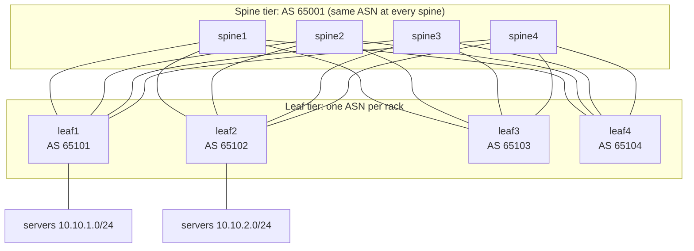
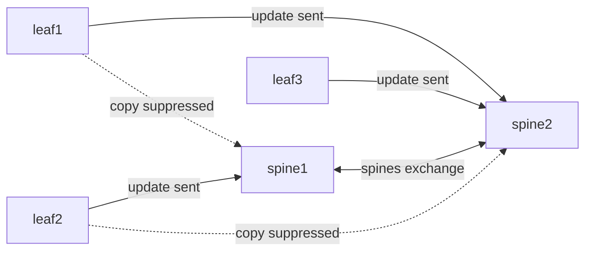
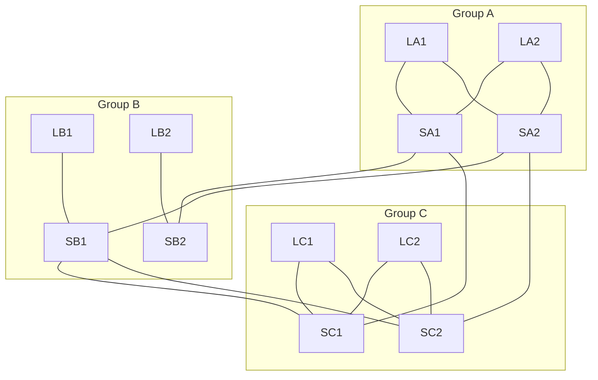
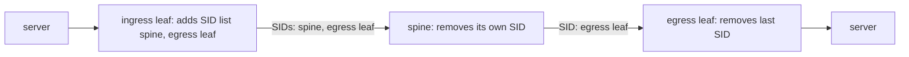

# 2.16 BGP in the data center: eBGP Clos, unnumbered, ECMP, anycast and AI-fabric routing

| | |
|---|---|
| Level | Advanced |
| Priority tier | 0 |
| Lab venue | containerlab with FRR (leaf-spine), or namespaces |
| Part | Part 2: Networking, from first principles to AI fabrics |
| Status | Drafted, labs **untested** |

## Why this matters for AI infrastructure

Picture a 1,000-GPU training job that should run at line rate and does not. The GPUs are healthy and the code is fine, yet step times drift upward. You check the nodes, then the drivers, then the data loader, and everything looks normal. Very often the cause sits somewhere nobody looked: in the routing design of the fabric. That design decides whether the job can use every link. It also decides what happens when a cable or a switch fails in the middle of a run, whether tenants stay apart, and how quickly you can add a rack without a weekend of careful typing.

Cloud operators learned the hard way what works here, and they have settled on a small set of habits. They build a Clos topology, which is a wiring pattern where every rack switch reaches every other rack switch through several equal paths. They run eBGP as the only routing protocol, with a deliberately simple plan for AS numbers. They use ECMP, equal-cost multipath, which means traffic is spread across all equally good paths, and they leave the links between switches without addresses of their own. Route policy limits how far each prefix travels, so one bad event in one rack cannot reach the whole fabric.

AI back-end fabrics, the networks that connect GPUs to each other during training, add new demands on top of those habits. A web fleet can live with a slightly uneven spread of traffic. A training job cannot, and the list below shows why:

- Wide ECMP across 400/800 Gb/s links, because every GPU wants a full-speed path.
- Awareness of link and queue state, which plain BGP does not have.
- Path diversity for elephant flows, meaning very large, long-lived flows that can pile onto one link.
- Predictable behaviour for synchronous collectives, where one slow path stalls every GPU.
- Isolation between tenants who share the same switches.

Each of these demands makes more sense once you see the standard design they are pushing against, so that is where we start: with the blank fabric and the question of how the first routes get into it. After that, we look at why a single flapping link can take down a whole network, and then at the newer tools that people propose for the AI case.

## Prerequisites and outcomes

You will get the most from this chapter if BGP already feels familiar. Chapter 2.15 introduced it: sessions between neighbours, the AS-PATH, and the way a router picks one best path. Chapter 2.14 showed how link-state protocols such as OSPF and IS-IS flood a map of the network, and chapter 2.12 explained ECMP, the habit of sharing traffic across equal paths. A conceptual picture of a Clos topology is enough for now, because the full details of leaf-spine design arrive in chapter 2.18.

Nothing else is assumed. Each new name in this chapter, from ASN plans to DPF, is explained when it first shows up, and the explanation always starts from a situation that you could meet in a real fabric.

## 1. The standard design: eBGP in a Clos

Suppose you are handed a blank fabric and told to make every rack reach every other rack. Before any protocol runs, you have two questions. The first is the shape of the wiring, and the second is the protocol that fills the routing tables. The shape comes first, because the shape is what makes the protocol's job easy.

A **Clos (leaf-spine)** fabric has tiers of switches. Servers plug into **leaf (ToR)** switches. ToR stands for top of rack, and it simply means the switch that sits above one rack of servers. Every leaf connects to every **spine**, and the spines do nothing except carry traffic between leaves. Larger fabrics add a super-spine tier, which gives a five-stage design, or they build pods, a topic chapter 2.18 covers properly. In a three-stage design, every leaf-to-leaf path crosses exactly one spine. Think of a city where every neighbourhood has a road to every one of four ring roads: to get from any neighbourhood to any other, you pick one ring road, and all the choices are the same length. That is why ECMP can use every link. No path is longer or shorter than another, so nothing is wasted.



Look at the ASNs in the diagram. All four spines share one ASN, and each leaf has its own. That choice looks odd at first, because we are used to every router having a unique number. It is the heart of the design, though, and the next few pages explain why.

It helps to say out loud what the diagram claims. Four spine switches, one shared number, and every leaf with a number of its own. Whenever a route crosses the fabric, it picks up the number of each network it passes through, like a passport collecting stamps. Because the spines all carry the same number, a route that has already been stamped by one spine will be refused by every other spine. Hold on to that picture of stamps and refusals, because the next few pages use it to explain both the safety net and the way BGP is tuned to behave like an IGP.

First, why BGP at all? Inside a building, an IGP such as OSPF seems the natural choice. RFC 7938, *Use of BGP for Routing in Large-Scale Data Centers*, explains why large operators went the other way. Its first argument is simplicity of tooling. BGP carries underlay prefixes, EVPN overlays and external routes, so you keep one protocol, one set of tooling and one set of operator skills, rather than one protocol for the inside and another for the edge.

Failure behaviour is the second argument. A link-state protocol floods every change to every router, and every router then recomputes the whole map. BGP updates travel only along the relevant paths, and nothing floods. Failure domains stay bounded by design, so no SPF recomputation runs across the whole fabric. A failure domain, as we will see shortly, is simply the set of devices that have to care when something breaks.

The third argument is policy. You write per-neighbour filters and use communities, which are small tags you attach to routes, for maintenance. For example, you can tag routes so that a switch is drained of traffic before you reboot it, by setting `LOCAL_PREF`, the AS-path or a drain community. Each prefix also keeps clear provenance, because its origin ASN tells you which rack announced it.

On top of that, BGP scales and works across vendors, and it is the best-studied protocol for large operations. Its weaknesses matter too, and an honest design admits them. Without BFD or tuning, it converges more slowly than link-state protocols. BFD, bidirectional forwarding detection, is a tiny heartbeat protocol that notices a dead link in a fraction of a second. BGP also knows nothing about link or queue quality, a gap that section 7 returns to.

### ASN allocation

Before you configure anything you need an ASN plan, and the plan is where most of the cleverness hides. Three patterns are common, and we take them one at a time.

1. **Per-rack (per-leaf) ASN, one ASN for all spines in a tier (preferred).** Each leaf gets a unique ASN, such as 65101, 65102 and so on. Large fabrics can use the 4-byte private range, 4200000000 to 4294967294. All spines in the tier share one ASN, 65001, and super-spines use another.
2. **Unique ASN per switch.** This gives more freedom, but the plan is complicated and produces more path-exploration noise. Path exploration is what BGP does when a route disappears: it tries one backup path after another, announcing each in turn, before it settles.
3. **iBGP with route reflectors at the spine and one ASN fabric-wide.** Clouds use this less often. The spine must act as a route reflector, and the next hop is not rewritten by default.

Why does the first pattern win? It gives you a useful safety net, and the net is easiest to see with a story. Suppose several links fail at once. eBGP has a loop-prevention rule: a router rejects any path that already contains its own ASN. Now look at a path such as leaf1 to spine1 to leaf2 to spine1 to leaf3. It climbs up to a spine, comes back down to a leaf, and then climbs up to the same spine again. That shape is a hairpin, sometimes called a valley. With one ASN on every spine, spine1 sees its own ASN in the path and rejects it automatically, so the ugly path never gets installed.

Now imagine the spines had different ASNs. In the same multiple-failure case, the router would see no repeated ASN, so the valley path would be installed. Forwarding becomes suboptimal and latency rises. The path can also saturate the uplinks of the intermediate leaf, which is a real concern with elephant flows on 400/800G links. With one spine ASN, the service sees only reduced capacity, or the destination becomes unreachable over that route, and traffic shifts elsewhere. A smaller, honest failure is better than a silent, slow one.

Walk through it slowly with the passport picture. A route starts at leaf3 and travels up to spine1, then down to leaf2, where a failed link leaves leaf2 holding the only remaining path. Leaf2 passes the route up to spine2 and onwards. If spine1 and spine2 carry different numbers, nothing in the stamps says that the route has already been through a spine, so the path is accepted. The traffic then goes up, down, up and down again, spending links that were meant for other flows. With one shared spine number, the second spine sees its own stamp in the passport and says no.

Per-rack ASNs add two more benefits. Each prefix stays attributable to the rack that originated it, so when you see a route you know whose it is. You can also run maintenance with AS-path-based policy, dropping or accepting routes by origin. The AS-PATH length stays bounded by the fabric diameter too, which means a policy can reject any path longer than 2 or 4 ASNs, and anything longer is by definition a mistake.

### Making BGP behave like an IGP

Out of the box, BGP is built for the Internet, where stability matters more than speed. Nobody wants a route for a whole country to flap because one cable was wobbly. Inside a fabric you want the opposite, so you tune it in a few places. We go through them in the order you would meet them on a new switch.

Start with the AS-path settings. `bgp bestpath as-path multipath-relax` treats paths with equal AS-path length as equal, even when the AS numbers differ. Without it, BGP would refuse to share traffic between two paths whose ASNs are not identical, and leaf traffic would use a single spine. With it, ECMP uses all spines, even if each spine has a different ASN history. Then set `maximum-paths` and `maximum-paths ibgp` to the fabric width, for example 64, so the router is allowed to keep that many next hops.

Next come the timers, which decide how long a failure goes unnoticed. Short timers and BFD catch failures quickly. Use a 3-second keepalive and a 9-second hold, or less, and run BFD at 100-300 ms. Set `neighbor X advertisement-interval 0` where your implementation defaults to the 30-second eBGP advertisement interval suggested in RFC 4271, so withdrawals propagate quickly. Check your platform default first, because some data-centre profiles already set it to zero.

Keep the AS-PATH length the same at each tier, because ECMP depends on it, and avoid prepending in the fabric. Prepending means adding extra copies of an ASN to make a path look longer, and inside a fabric that would just break the equal-length property you built. Use `neighbor ... allowas-in` only when you reuse ASNs on purpose, for example when a pod's leaves share an ASN with the global spine layer. Otherwise leave it off, because it switches off the very loop check that protects you.

At the border, where the fabric meets the outside world, `remove-private-as` or `replace-as` hides the internal plan, so the Internet or WAN sees a public ASN. Disable `bgp ebgp-requires-policy` only with care, and write an explicit policy in its place that accepts the expected prefixes and sets communities.

Turn on `bgp fast-external-failover`, so an interface going down tears the session down at once instead of waiting for the hold timer to run out.

Finally, decide carefully what each device advertises. Each leaf originates its server subnets and its `/32` loopback, which serves as the router ID and the VTEP/service address. Nothing else is needed. Spines re-advertise what they learn. Do not advertise the point-to-point link subnets of the fabric at all, whether by using unnumbered links or by filtering them. Every one of those subnets is a route that must be stored on every switch and updated whenever a cable moves. Leaving them out keeps the RIB small and removes a source of failure propagation.

## 2. BGP unnumbered (RFC 5549 / RFC 8950)

Every leaf-spine link needs an address, and handing out and tracking a `/31` for each one is tedious work that invites mistakes. A single typo in a spreadsheet, and a session will not come up on a Friday night. Take a 32-leaf, 16-spine fabric. Multiplying 32 by 16 gives 512 links, and with 8 rails the count reaches the thousands. **BGP unnumbered** removes that addressing work altogether.

Here is how it works, step by step. Every interface already has an automatically generated IPv6 link-local address, `fe80::/64`, derived from the MAC. A link-local address is one that only works on its own cable and never goes anywhere else, which is exactly what two neighbours need to talk to each other. That address becomes the peering address. Neighbour discovery happens through IPv6 Router Advertisements and Neighbour Discovery on the link: each side announces itself, and the other side listens. The FRR daemon learns the neighbour's link-local address and MAC from ICMPv6, and then starts the TCP session to port 179.

A small example makes the steps concrete. Two switches are cabled together, and nobody has typed an address on either end. Each side switches on its interface, and the operating system quietly gives it a link-local address. Each switch then announces itself with a router advertisement and hears the other one do the same. Now each side knows the other's address and MAC, so it can open the TCP session to port 179, and the two ends exchange OPEN messages that agree on the extended next hop. By the time you look at the output, the neighbour is simply listed by interface name, and you never had to invent a subnet for the cable.

The next question is how an IPv4 route can survive on a link that has no IPv4 address. The BGP OPEN message, the first message two peers exchange, carries the Extended Next Hop Encoding capability, defined in RFC 8950 (formerly RFC 5549). That capability lets a router advertise IPv4 prefixes with an IPv6 next hop, which is the link-local address of the neighbour. The forwarding plane installs the next hop as the MAC of the neighbour, resolved through ND. An IPv4 route therefore sits on an IPv6 link-local next hop, and it still forwards normally. The packet itself is plain IPv4. Only the "where do I send it next" part of the route uses an IPv6 address.

As the administrator, you supply only the ASNs and the prefixes to advertise. The peer ASN can be `external` for any different ASN, or it can be a range. For prefixes, you might use `redistribute connected` through a route-map that permits only server subnets and loopbacks. New nodes are then plug-and-play: you cable them, and the neighbour discovers them.

```text
! FRR leaf: unnumbered eBGP to four spines on swp1..swp4
frr defaults datacenter
router bgp 65101
 bgp router-id 10.255.0.11
 bgp bestpath as-path multipath-relax
 no bgp ebgp-requires-policy
 neighbor swp1 interface remote-as external
 neighbor swp2 interface remote-as external
 neighbor swp3 interface remote-as external
 neighbor swp4 interface remote-as external
 neighbor swp1 bfd
 address-family ipv4 unicast
  redistribute connected route-map LEAF-OUT
  maximum-paths 64
 exit-address-family
route-map LEAF-OUT permit 10
 match interface lo
route-map LEAF-OUT permit 20
 match interface vlan100
interface swp1
 ipv6 nd ra-interval 10
 no ipv6 nd suppress-ra
```

After you configure a leaf, check the result in three places, because each shows a different layer of the story. `vtysh -c 'show bgp summary'` lists neighbours by interface name, which proves sessions are up. `show ip route` shows next hops via link-local with the interface, and `ip route show` displays `via inet6 fe80::... dev swp1 onlink`, which proves the forwarding table took the IPv6 next hop. A packet capture of the OPEN message should show capability code 5, the extended next hop, which proves the two sides negotiated it. The server-side equivalent, host BGP with FRR, uses the same configuration, so servers can peer unnumbered with the ToR too, as section 9 explains.

## 3. Controlling scope: failure domains and information hiding

Here is the kind of night this section is about. A single link in rack 17 flaps, and ten minutes later half the fabric is reloading. Nobody touched the other racks, so why did they fail? The answer is that control planes learn everything by default, and every device that knows a fact must react when the fact changes. A rack-17 problem becomes everybody's problem because everybody was told about rack 17. A scope limit is the cure: tell fewer devices fewer things.

A **failure domain** for a piece of information is the set of devices that must recompute or update when it changes. If a leaf in rack 17 flaps a prefix, every router that knows that prefix must process an update. Routers that do not know it are not affected. So the goal is never to make failures impossible. It is to make the number of devices that notice them small.

Limiting scope brings several benefits:

- It cuts resource use, which means cheaper switches and smaller tables.
- It speeds convergence, because fewer devices must update.
- It improves security, since an attacker who sees the control plane learns less.
- It helps you avoid positive feedback loops, which are described next.

### Positive feedback loops

You have heard a microphone squeal when it points at its own speaker. The speaker's sound goes into the microphone, comes out louder, goes in again, and the loop runs away until something gives. In a network, the same shape appears. In a positive feedback loop, the output of a system feeds back to amplify its input until a limit is hit. A flapping link generates events that ripple through the control plane. A device that receives events faster than it can process them crashes and reboots. It then re-forms its adjacencies and sends its whole database, which overloads its neighbours, and they crash in turn. The failure spreads and persists, even after the original flap stops.

Here is a worked example with small numbers. Suppose each router can process 10 events per second. A link flaps three times a second, which is six events per second, because each flap is a down event and an up event. Some routers pass each update on twice, so one downstream device sees 12 events per second, exceeds its limit and fails. The cascade begins there. The root cause is the flap. The amplifier is the topology, together with the lack of damping, which is the practice of slowing down how often a noisy event is allowed to be announced. The countermeasures are therefore to reduce the scope of information and to reduce its velocity.

Put the numbers on a timeline. A link flaps, which is a down event and an up event, and it does that three times in every second. Each of those events is sent to neighbours, and each neighbour is able to process only a limited number of events per second. A router near the failure receives six events a second and copes. A router further along, which hears the news twice because it sits on two paths, receives twelve events a second, and that is more than its limit. It falls behind, then crashes, then reboots, and when it comes back it asks its neighbours for everything it missed. That request is itself a burst of work, and now the neighbours are the ones struggling. The original flap has long stopped mattering, because the network has taken over the job of hurting itself.

### Techniques

Six techniques bound scope and velocity. The table lists each one, what it does, and how it applies in a data centre.

| Technique | What it does | In a data centre |
|---|---|---|
| **Summarising topology** | Hide detail of links and nodes behind a summarising node (neighbours see destinations "directly attached" to it, with a metric) | Distance-vector behaviour; areas/levels in link state; eBGP naturally hides topology |
| **Aggregating reachability** | Advertise one shorter prefix instead of many longer ones (`10.10.0.0/16` for all racks in a pod) | Pod-level aggregation toward super-spines or the WAN/border |
| **Filtering reachability** | Do not advertise certain prefixes (point-to-point links, host routes) beyond a boundary | Don't carry link subnets; accept only expected prefixes from servers |
| **Layering control planes** | Run a separate overlay control plane (EVPN) for host/tenant reachability on top of an underlay that only knows loopbacks | Underlay BGP/IGP carries loopbacks; EVPN-VXLAN carries MAC/IP routes (chapter 2.17) |
| **Caching** | Keep reachability on demand (reactive learning) instead of everywhere | Host-route install on use, map-server/controller models; ARP/ND |
| **Slowing down** | Rate limit and damp changes: SPF/LSA throttling, BGP MRAI, route flap damping, BFD hysteresis | Throttle timers; dampen unstable links; avoid aggressive flapping detectors |

Notice that every technique trades something away, because hiding information always has a price. Summarising hides the failure of a specific component, so traffic is attracted to the summary and then dropped inside. Aggregation can produce suboptimal paths and **black holes**, which are places where packets arrive and silently vanish because no route leads onward. Filtering creates unreachability if you filter by mistake. Layering adds a second control plane to operate and correlate. Caching adds first-packet latency, and slowing down lengthens convergence. Your design is the choice of which information to hide, and where.

### The Clos black-hole caveat

The best way to see the price is to aggregate on the spine, so let us do it on purpose and watch it fail. Each spine advertises `10.10.0.0/16` for all server subnets below it. Suppose leaf3 loses its uplink to spine2, but still has spines 1, 3 and 4. Spine2 can no longer reach the `10.10.3.0/24` of leaf3. Yet it keeps advertising the covering `/16` upward, because other leaves still reach other racks through it. From outside, spine2 still looks like a perfectly good way to reach anything in `10.10.0.0/16`. Traffic from outside that hashes via spine2 toward the subnet of leaf3 arrives at spine2, finds no way forward and is black-holed.

Follow one packet to feel the trap. A client outside the fabric wants an address inside the rack that leaf3 serves. The border sees a single covering route for the whole range, advertised by every spine, and so it spreads the client's flows across all of them. The flow that happens to hash to spine2 arrives there. Spine2 looks in its table and finds the same covering route, but nothing more specific that leads towards leaf3, because that link is the one that failed. With nowhere to send the packet, spine2 drops it. Every other spine would have delivered it, and the client sees an outage that comes and goes depending on which flows hash where.

Two rules follow. First, do not summarise on any path where a specific route is needed for correctness. Second, summarise only toward the outside, at the border or the WAN. Elsewhere, make the aggregate depend on the specific routes. Conditional advertisement does this, because it advertises the aggregate only if at least N specifics, or N BGP peers, are up. When the specific route for leaf3 disappears from spine2, the aggregate goes with it, and traffic stops choosing spine2.

**Minimum BGP peers per prefix** suits services that need deterministic capacity. Take a prefix with 4-way ECMP. A spine can withdraw that prefix when fewer than N next hops exist, so traffic goes where full capacity exists instead of down a degraded 3-way path. This rule differs from simple conditional advertisement, because it is driven by the number of active peers per prefix. That makes it useful for capacity-sensitive AI traffic, where a degraded path is sometimes worse than no path, because it quietly slows the whole job.

## 4. Advanced BGP capabilities for AI fabrics

The standard design works well for ordinary traffic. AI traffic stresses it in specific ways, and BGP has grown a few tools to answer. They are ADD-PATH, AS-PATH normalisation, link bandwidth, and DPF. Each one comes from a concrete complaint, so we take each complaint first.

### ADD-PATH

Consider a leaf that learns about one destination from two border leaves, through a spine. By default, a BGP speaker advertises only its single best path per prefix, so the spine picks one and tells the leaf only about that one. The second path, which was perfectly good, is hidden. ADD-PATH (RFC 7911) changes that, because it advertises several paths, each with a path identifier. If you run route reflectors, this keeps path diversity, so ToRs see all next hops rather than only the choice of the reflector. In eBGP, a spine can pass both paths it receives from two border leaves, and a leaf can then ECMP across both instead of depending on the best-path pick of the spine. The gain is resilience, because only the share on a failed path is affected, and load balancing also improves. The cost is more RIB state.

### AS-PATH strip and replace

Sometimes a fabric that uses private ASNs connects to a core network that also uses private ASNs. The two plans may collide, and a router that sees its own number in a path will refuse it. Servers may also run their own BGP and inject prefixes with arbitrary AS-PATHs. In both cases the fabric can normalise ingress AS-PATHs. It strips the private ASNs and replaces them with a defined list of the same length. The fabric then treats all external sources the same way, ECMP stays equal, and no ASN collides with the internal plan.

This is useful at the border and for server-originated routes in multi-tenant designs. Be careful, though. Replacing the AS-PATH defeats loop prevention, so use it only at controlled boundaries, and never toward the Internet.

### Link Bandwidth Extended Community and weighted ECMP

Plain ECMP splits traffic equally, and that becomes a problem when next-hop links differ in capacity. Think of four checkout lanes where one lane is a wide trolley bay and another is a narrow turnstile, and a guard sends exactly a quarter of the shoppers to each. You might have 400G, 800G and 100G paths north-south. Or a link may fail and leave 1-of-8 uplinks down. Equal splitting then overloads the smaller links while the big ones sit half empty.

Notice what the community changes. Without it, every router that receives several equal-looking paths treats them as equals, because BGP carries no idea of how wide each pipe is. With it, the advertising router attaches a small label that says how much bandwidth is behind this route, and the receiver turns those labels into weights. The decision is still made locally on each switch, so no controller is needed, but the information comes from the rest of the network.

The **BGP Link Bandwidth extended community** solves this. The advertising router encodes the link speed into it, and the receiving router assigns weights proportional to capacity. This is weighted ECMP, also called UCMP, and sometimes weighted packet spraying when applied at the ASIC level. In one example, four spines with 400, 800, 100 and 400 Gb/s northbound links get roughly 20, 45, 15 and 20 percent of the traffic. The 800G spine takes the biggest share, the 100G spine takes the smallest, and nobody is overloaded.

The same idea works inside a five-stage fabric. If a spine loses a link to the super-spine, it advertises its reduced capacity, and the source leaves send proportionally less traffic through it. Use the community for selected prefixes or services, because fabric-wide per-prefix weighting creates a lot of state. Keep all other attributes equal.

### BGP Deterministic Path Forwarding (DPF) and path diversity

Think of the shared Clos fabric as one pool of paths with a single best-effort promise. ECMP hashing decides which leaf-spine links a flow uses, and the hash does not know which flows are big. So elephant RoCE flows can collide on one link while others sit idle. That raises job completion time (JCT) and jitter, even with DCQCN using PFC and ECN to prevent loss. (Those three are congestion-control tools that chapter 2.19 explains in detail.)

Load-balancing improvements help. These include packet spraying, with BTH queue pair fields in the hash, dynamic load balancing on local utilisation, and global load balancing that uses next-next-hop link quality. But they can reorder packets, or vary from run to run. Some operators want the opposite: not cleverness, but a guarantee about which path a given tenant will use.

**BGP DPF** comes from HPE Juniper Networking and is described in the IETF draft `draft-wang-idr-dpf`. It divides the physical Clos fabric into several logical fabrics, and then maps selected flows to a logical fabric according to their SLA requirement. An SLA, service-level agreement, is just the promise you made to that tenant about performance.

**Session coloring** is how the logical fabrics are made. Imagine painting some of the roads in the city red and some blue, and telling certain trucks to use only red roads. In the fabric, eBGP sessions over the same physical links get a colour. A session can carry several colours, exclude a colour, or carry none. A coloured session advertises only routes with at least one matching colour, and unmatched colours are pruned from the route as it crosses. So a coloured route travels only along fabrics of its colour. Route colours travel as communities or attributes, and an uncoloured route matches every colour.

Here is a mini-example. Suppose a route is tagged black. A session that is painted black will carry it, a session painted grey will not, and a session painted with both colours will carry it too. A leaf that wants a tenant's traffic to use only the black fabric simply learns that tenant's destination over the black sessions, so the traffic never touches the grey links. When a black link fails, the same leaf can fall back to the grey path if one was left as a backup, and you chose that behaviour in advance rather than finding out about it during an incident.

The ingress leaf may receive a black-fabric path, which is active, and a grey path, which is backup. Choosing the black path guarantees black-fabric forwarding, and the grey path serves as fallback.

That leaves the question of which traffic goes onto which colour. There are four ways to map traffic to a fabric ID or colour:

- Option 1 is filter-based forwarding, which matches RoCEv2 UDP port ranges, or destination QPs from the BTH header, on each interface.
- Option 2 is an on-box agent that probes path quality and assigns new workloads.
- Option 3 is a central controller with a global view of topology and utilisation, acting as a path computation element.
- Option 4 uses EVPN-VXLAN MAC-VRF or RT-5 IP-VRF instances, which can associate with a coloured path address. That correlates overlay tenants with underlay planes.

Cabling decides how DPF behaves when something fails. In a rail-optimised design, each of the eight GPUs or NICs of a server connects to a different leaf in the rail group, so a leaf failure hits only one rail of capacity. In a rail-unified design, all GPUs of a server connect to the same ToR. Cabling is cheaper, but a leaf failure takes down the server group.

DPF works in both designs. In the unified case, you can pin each GPU ID, or QP range, to a logical fabric. For example, you could dedicate three of the 400G leaf-spine links, 1.2 Tb/s in total, to the black fabric for the highest-priority tenant. That gives predictable capacity and low JCT, while other tenants share the rest with random spraying and DLB. Measure first, using real-time performance telemetry, so you can decide whether pinning beats spraying for a given tenant. DPF also applies to the front end, where storage and inference domains share the same infrastructure.

Treat DPF as an emerging, vendor-led approach, and validate it on your hardware. The general principle is logical planes in a Clos with controlled mapping of flows to planes. You can also reach it with VRFs, segment routing, Flex Algo or policy-based routing.

## 5. IGPs for AI back-end fabrics: IS-IS flood reduction, Flex Algo and RIFT

Why would anyone consider an IGP again, after the long argument for eBGP? Because back-end training networks want reactions on a microsecond scale to link and queue conditions. A training step is a synchronised dance, and when one link slows, every GPU waits. They want awareness of the whole topology and of collective communication patterns, plus link- and queue-level information. BGP was designed to advertise prefixes, so it does not carry any of this natively. It also needs BFD or OAM add-ons for fast detection, and it needs significant CPU to react.

IGPs have built-in heartbeats and flooding, and they can carry link-quality TLVs. A TLV is a type-length-value record, which is simply a labelled container for one more piece of information. At 16,000 to 32,000 GPUs, the control plane must scale to match. Three IGP-style options are worth knowing, and each solves a slightly different problem.

**IS-IS with optimised flooding** (`draft-white-lsr-distoptflood`) targets dense topologies. Recall how a link-state protocol works: when something changes, a router floods a small message, an LSP, to its neighbours, and they pass it on. In a dense leaf-spine with many parallel links, classic flooding sends each LSP fragment over every link, so every node receives many duplicates, like a rumour told to you by every person in a crowd. The optimisation elects a subset of links or neighbours to flood updates. That cuts duplicate LSP fragments and speeds convergence. The source cites IS-IS scaling to about 2,500 nodes. IS-IS also runs below IP, so it is not exposed to TCP-level attacks from outside the fabric, and its TLVs can carry extra link and server information.

**IS-IS Flex Algo** is defined in RFC 9350, and RFC 9502 covers IP networks without segment routing. It builds several logical routing planes on one physical fabric. A Flexible Algorithm Definition combines a calculation type, a metric type and constraints. The metric type can be IGP, min-delay or TE. The constraints can include link affinities to include or exclude, and bandwidth limits per draft-ietf-lsr-flex-algo-bw-con. Each node assigns a Flex Algo value and advertises algorithm-specific prefix reachability, using a TLV with the algorithm and a multi-topology ID. Each algorithm then gets its own SPF tree, so the same cables carry several different shortest-path maps. The result can be a low-latency plane for mice, a high-bandwidth plane for elephants, or a plane per tenant. The intent is comparable to BGP DPF, but the mechanism is IGP-based.

**RIFT (Routing in Fat Trees, RFC 9692)** is built for Clos topologies, which is a different starting point from the other two: it was designed for this shape rather than adapted to it. Northbound, toward the spines, it works as link-state, so leaves and aggregation know the topology upward. Southbound, toward the leaves, it works as distance-vector. Only default routes and summaries flow down, so leaves hold minimal routes.

RIFT also disaggregates automatically on failure. Remember the summarisation black hole from section 3? Here, more specific routes go down only where a failure would cause a black hole, which fixes the summarisation black-hole problem without manual work. RIFT offers zero-touch provisioning, so no per-switch ASNs are needed. It supports wide ECMP and unequal-cost multipathing, based on northbound capacity. Its adjacencies run over UDP hellos rather than TCP, link addressing uses IPv6 ND, and the protocol can carry fabric metadata. It scales to 1,000+ switches.

In a dragonfly topology, RIFT variants (`draft-przygienda-rift-dragonfly`) carry the group-to-group links. They also allow non-shortest-path forwarding. Section 6 describes that topology.

The table compares the three options on the criteria used in this chapter.

| Characteristic | eBGP | RIFT | IS-IS (flood reduction / Flex Algo) |
|---|---|---|---|
| Clos ECMP (3-/5-stage) | Yes | Yes | Yes |
| Dragonfly topologies | Poor | Yes | Limited |
| Multi-tenancy options (front end) | Many (EVPN, VRFs, policy) | Limited | Limited |
| Convergence | Medium (fast with BFD) | Fast | Fast |
| Link awareness | Low | High | High |
| Full-topology awareness | Medium | High | Medium (high within level) |
| Automatic disaggregation on failure | No | Yes | No |
| Zero-touch provisioning / fabric metadata | No | Yes | No |
| Weighted/unequal ECMP | via link-bandwidth community | Native | via metrics/algorithms |
| Ecosystem maturity | Very high | Early | High (carrier) |

Notice where eBGP falls behind: dragonfly topologies, link awareness and automatic disaggregation. Those are the three places where its Internet heritage shows.

So which one should you pick? If your fabric is a front-end network, such as storage, inference, management or tenancy, use eBGP unnumbered with EVPN where needed. Large AI back-ends start with eBGP, because the team already knows it and the tooling exists. They consider IGP-based or colour-based approaches when scale, a dragonfly topology, or path-determinism requirements demand them. You can run a hybrid, with different protocols on different tiers or networks. Start with eBGP, and move to an IGP only when your scale or topology requires it.

### 5.1 Flood reduction in a small example

Picture a leaf that has to tell every spine about a new server. Classic flooding copies that update to every spine, so the same news arrives many times. Flood reduction picks one relay per update instead. The diagram shows a tiny fabric where each leaf sends its update to one chosen spine, and the spines pass it on to each other. Follow the solid arrows first, since those are the updates that really travel, and then the dotted ones, which are the copies that the optimisation avoids.



In this small topology the saving is minor, because there are only a few copies to save. With 32 or 64 spines, each leaf sends one copy instead of dozens, and convergence speeds up. The gain grows in dense multilevel fabrics with many parallel links between each pair of nodes, which is typical of a non-oversubscribed AI cluster. The optimisation is described in the draft `draft-white-lsr-distoptflood`, and some open-source networks and vendors already use it.

RIFT was first built in the open-source community for routing on servers. Some vendors have since released it as a separate routing package for switches. If your vendor offers it, check its release notes before you plan to use it on the fabric.

## 6. Dragonfly and sparse topologies (routing view)

A Clos is not the only way to wire a cluster, and sometimes it is not the cheapest one. Think about what a deep Clos costs you at large scale: many tiers, so many hops, and many long cables between rows. Consider a dragonfly when hop count and cable length matter. A **dragonfly** has groups of switches that mesh internally, and the groups connect to each other through global links. Picture several small towns where everyone knows everyone, and each town has a few direct highways to every other town. Compared with a deep Clos, it cuts hop count and long cables, which helps latency-sensitive AI and HPC work. Full dragonfly cabling is heavy, so a **sparse dragonfly** keeps each group as a leaf-spine Clos and connects only the top-of-fabric spines between groups.

The routing consequences are significant, because a protocol that was happy in a Clos now meets a topology where the shortest path is not always the best path. Non-shortest-path forwarding, such as valiant or UCMP, is needed for balance. Valiant routing means sending traffic through a random intermediate group so that no single highway is overloaded. Control planes must identify the inter-group global links and partition the fabric. They must apply split-horizon rules for the group links, and they may reflect link quality. eBGP struggles here, because of policy complexity and the lack of native link awareness. That is why IGP-style protocols, RIFT and IS-IS, are being extended for dragonfly designs.

Scale-up domains are different. NVLink-class pods act like one big GPU server, and they have their own fabric managers. Those are covered in the chapter on NVLink/NVSwitch, and the IP fabric connects the pods.

If your fabric is a dragonfly, choose a protocol that can handle the group links, such as RIFT or extended IS-IS.

### 6.1 The canonical dragonfly

In the canonical dragonfly, every group is a full mesh of switches, and every group links to every other group. Seven groups of eight switches each make a good picture. Each group needs several global links to each other group, and the cabling grows quickly, because each new group adds a link to every group that already exists. There is a second catch. Only a limited share of traffic can cross between two groups at once, so collective operations should stay mostly inside a group. Otherwise the inter-group links become the bottleneck.

Cabling is the main reason designers simplify this. Usually only the higher-density spine switches connect to other groups, and that simpler version is the sparse dragonfly.

### 6.2 The sparse dragonfly

In a sparse dragonfly, each group is a small leaf-spine Clos fabric, and only the top-of-fabric spines show the dragonfly shape. The diagram shows three groups. Leaves stay inside their group, and the spines carry the cross-group links.



The cross-group links are the part that the routing protocol must understand. The sparse design gives shorter paths with fewer long cables. Traffic can take several routes between the same two points, and the fabric can be split into partitions. The control plane has to find the inter-group links, know the topology and use adaptive routing with unequal-cost paths.

Reducing the diameter matters for AI and HPC, because direct links cut the path length. Cabling and standardising the extra links can cost too much, though. In that case, a traditional IP Clos fabric, with no links between peers at each level, may be the better choice.

A link from a ToR to a top-of-fabric spine is normally not supported, and routing would withdraw it. In the RIFT dragonfly variant, the group-to-group link is part of the advertisement. That also allows forwarding over horizontal links, which the original RIFT definition did not include. The control-plane details, such as partitioning and split-horizon, are in the IETF draft `draft-przygienda-rift-dragonfly`.

## 7. Multi-tenancy for AI/ML clusters

Picture a shared GPU cluster where two customers train models on the same leaves. Neither wants the other to see its data, and neither wants the other to slow it down. Those are two different wishes, and a good design answers both. Tenants need isolation for three reasons. Security protects training data and model confidentiality. Performance means dedicated ports and bandwidth, plus lower latency across rails. Capacity planning lets you sell GPU-as-a-service per tenant.

You can isolate tenants at five levels, from coarse to fine. Think of it as the difference between giving each customer a separate building, a separate floor, a separate room, a locked drawer and a name tag.

Level 1 is dedicated ports or hardware. In bare-metal-as-a-service, a tenant owns whole servers. Each of the eight NIC ports on a server goes to a different ToR in the rail group, and the port is reserved for that tenant. This is simple, and it gives strong isolation.

Level 2 is network-level segmentation with EVPN-VXLAN. Each tenant maps to a VLAN and VNI, which gives a MAC-VRF for L2 and/or an IP-VRF with route-type-5 routes for L3. A VRF is a private routing table, so two tenants can even reuse the same addresses without meeting. Spines act as route servers for tenant routes and transit IP.

Here is one illustrative sizing. A rail with 8 leaves and 8 spines runs at 1:1. Each switch has 64 ports of 800G, and the server-facing ports break out into 2x400G. That gives 64 server ports per ToR. Multiply 8 leaves by 64 ports, and you get 512 GPUs per rail. Dedicating physical servers can host up to four tenants of 128 GPUs in one rail, which fills the 512 GPUs. You add rails and spines as capacity grows.

Level 3 is server-level partitioning. NVIDIA MIG splits a GPU into up to seven instances. You map each instance to a VLAN, which gives seven tenants per server interface. vGPU, and scheduling with NCCL across servers, extend this. Combined with the network, each leaf runs seven MAC-VRFs and seven IP-VRFs, so tenant traffic stays isolated across racks and rails.

Level 4 is dynamic ACLs from RADIUS tenant profiles at the ToR. These give fine-grained control. But TCAM size limits them at high tenant counts, and they are centralised rather than distributed. TCAM is the special fast memory in a switch that holds filter rules, and there is only so much of it.

Level 5 is microsegmentation with VXLAN group-based policy (GBP). A tag in the VXLAN header, inside the same VNI, lets two tenants share a subnet and still prevents them from communicating.

Correlate the overlay with the underlay where needed. Tenants on specific coloured logical fabrics (DPF) or Flex Algo planes get guaranteed paths. Pair tenant isolation with performance isolation, such as PFC/ECN queue assignment, buffer partitioning and rate limits, as chapter 2.19 explains. Routing-level isolation alone will not stop a noisy tenant from congesting shared links. Two neighbours can have separate keys and still wake each other up through the wall.

## 8. Extending routing to the server

So far routing stops at the ToR and the server is a dumb endpoint. It has one default route, and the switch decides everything. That changes when you run a routing daemon on the GPU server or its DPU, the network card that has its own small computer. FRR and BIRD are common choices, and Calico or Cilium do this for pods. The server then chooses among leaves, with ECMP across its two uplinks and no MLAG. MLAG is a vendor feature that makes two switches pretend to be one, and it is a source of its own complexity. The server advertises its own `/32` loopback and its service prefixes. It supports **anycast** services, where the same VIP is advertised from many servers, the fabric ECMPs to the nearest or any of them, and health checks remove a server by withdrawing its route. You also get L3 multi-tenancy with per-tenant VRFs on the host, plus fast failover through BFD.

Three patterns are common, and they differ in who the server talks to.

The first is eBGP server-to-ToR. The server uses its own ASN, either per server or per rack, with unnumbered peering. The ToR applies a prefix-list per server, so only the `/32` of that server and its assigned service prefixes get through. It also sets `maximum-prefix`, AS-path normalisation and, optionally, `allowas-in` rules.

The second is a route reflector for servers. Servers peer with a hierarchical route reflector, or with a virtual BGP appliance, instead of with every ToR, which reduces the number of peerings. Selected fabric nodes peer with the route reflector, and it advertises service prefixes with the right next hops to the spines, and onward to the border.

The third is anycast health. Tie advertisement to local health, using `exabgp` or `bird` with check scripts, MetalLB, or Cilium, so a failed service stops attracting traffic. The idea is simple: a server that cannot serve should stop announcing that it can. Be careful with ECMP and stateful TCP services. Resilient hashing and consistent hashing at the fabric, covered in chapter 2.12, plus per-flow state at the app or load balancer, prevent breakage when the next-hop set changes. Without them, adding or removing one server can reshuffle existing connections onto servers that have never heard of them.

Security matters here too, because the server is less trusted than a switch. A server is a general-purpose computer that runs somebody's code, and a mistake or a compromise there should not poison the fabric. Apply strict ingress policy at the ToR, authenticate sessions, and never let the AS-PATH or prefixes of a server pass unfiltered.

Filter every server session at the ToR, so it accepts only the prefixes that server owns.

## 9. Traffic engineering: telemetry, controllers and segment routing

Distributed load balancing leaves every switch deciding for itself, and no switch sees the whole picture. It is like drivers each choosing a route from what they can see through the windscreen, with no traffic radio. A **central controller** can complement it with a global view. It consumes fabric telemetry, including queue depth trends, sFlow, BGP statistics, per-queue interface counters, and DCQCN and PFC event telemetry. It also uses agent probes of end-to-end path quality, and placement data from the GPU job scheduler. With that information, it steers new jobs and flows onto less-loaded paths, so the flows of one job use a deterministic set of paths.

If you add a controller, it has three requirements. It must know the true topology, using BGP-LS or IGP extensions, so miscabling shows up before optimisation starts. It must be reactive but stable, to avoid oscillation, where every flow moves to the quiet road at once and makes it the busy one. And the fabric must keep working if the controller is unavailable.

**Segment Routing** (SR) is source routing. The ingress node encodes the path as a list of segments, called SIDs, in the packet, and transit nodes follow those instructions with no per-flow state. It is the difference between asking for directions at every junction and carrying a written itinerary. SR-MPLS uses labels. **SRv6** uses IPv6 SIDs in a Segment Routing Header (SRH), placed between the IPv6 header and the L4/RDMA payload. A SID has a locator, which is the network address of the node. It also has a function, such as End, End.X for adjacency, or service functions, and optionally an argument.

Compressed SIDs, or micro-segments (uSID), carry 16-bit micro-SIDs inside a 128-bit address. That shrinks long lists, because strict-path traffic engineering needs many hops.

With a controller that computes congestion-avoiding paths for each GPU pair and pushes them to ingress nodes, SR can make per-flow load balancing both sufficient and deterministic. When a failure happens, the controller must push alternatives, or local fast reroute must take over. SR is a promising direction for lossless RoCE fabrics, if DCQCN and PFC semantics survive across SRv6 topologies. IETF drafts already exist for SRv6 in AI back-ends.

In practice, most fabrics today run eBGP, ECMP, load balancing and DCQCN. Treat the controller and SRv6 approaches as options you evaluate.

### 9.1 Segment routing terms, the SR domain and the SRv6 header

Segment routing is gaining momentum in service provider networks, mostly to get better path use. It is also worth exploring for AI/ML clusters. The condition is that DCQCN and the other RoCEv2 lossless mechanisms must still work across SRv6 topologies, so test that before you commit.

Start with the vocabulary. The SR domain is the set of all devices that run segment routing, and for AI/ML the whole cluster can be one SR domain. Each link between two devices is a segment, and each segment gets an identifier called a SID. The whole route from the sending leaf to the receiving leaf is the SR path.

The diagram shows how forwarding works in a two-tier fabric. The ingress leaf adds two SIDs to the packet, one for the spine and one for the egress leaf. The spine removes its own SID and forwards on the next. The egress leaf removes the last SID and delivers a plain IP packet to the server. Each switch only reads the top of the list and peels it off, like a conductor tearing the first ticket from a strip. Different SID lists produce different paths, which is how SR gives you control over the path.



There are two common identifiers. A Node SID is attached to a node and works like a loopback address for that node. An Adjacency SID is attached to each adjacency between two nodes. Two further types exist, the Anycast SID and the SID for Egress Peer Engineering.

The control plane for SR mostly lives on a controller outside the nodes. The controller learns the topology from an IGP or from BGP Link-State, and the Path Computation Element Protocol, PCEP, then installs the computed path on each node. The data plane is either SR-MPLS, which uses MPLS labels as SIDs, or SRv6, which adds the metadata to the IPv6 header.

The Segment Routing Header, or SRH, sits between the IPv6 header and the Layer 4 payload, which is RDMA in an AI/ML cluster. IPv6 allows zero or more extension headers, and the SRH is one of them. Its fixed part holds the next header, the header length, the routing type, the segments-left counter, the last entry, flags and a tag. A variable list of 128-bit IPv6 addresses follows, one per segment, and optional TLVs come last. Each SID has three parts: a locator, which is the network prefix of the node, a function that says what to do there, and an argument that carries extra data.

## 10. Operations: verifying, converging and failing safely

A design is only as good as your ability to prove it works and to change it without an outage. Imagine the fabric has been running for a month and someone asks, "Is it healthy?" The honest answer needs checks you can repeat. Start with verification. Every leaf should have N ECMP paths to every remote server prefix, so `show ip route 10.10.5.0/24` should show 4 or 64 next hops. Loopbacks must be reachable, and `show bgp summary` should show all sessions Established. Prefix counts should match the design, so a leaf carries roughly the number of racks plus loopbacks. Look for unexpected longer AS-PATHs, since a long path usually means a detour. From a server, `ip route get` with different source ports should hit different uplinks. Check that the MTU is consistent, with jumbo frames on all links, and that BFD is up on every session.

Next, test convergence, which is how long the network takes to settle after a change. Fail links, linecards, a spine and a leaf. Measure with a timestamped ping or iperf3, and watch `ip monitor route`. Typical targets are under 1 s for a link failure with BFD, and sub-second to seconds for a node failure. Planned maintenance should lose 0 packets when you use graceful shutdown.

When you run the test, run a continuous ping or iperf3 stream across the fabric first, then pull the link, and watch what the stream does. The shape of the gap tells you the story. A short blip means the failure was noticed quickly and a surviving path took over. A longer silence means that something waited for a timer to expire, which is exactly what BFD and the shorter BGP timers are there to prevent. Write the gap down next to the date, so that the next time someone changes a timer you have a baseline to compare against.

For maintenance, drain a switch before the reboot, the way you would ask customers to leave a shop before locking the door. Use `bgp graceful-shutdown`, or set `LOCAL_PREF`, an AS-path prepend, or a maximum metric through a community. Verify that traffic has moved before you touch the switch, and then re-enable it gradually.

Several failure patterns come up again and again, and recognising them saves hours:

- Single-path ECMP appears when `multipath-relax` is missing or `maximum-paths` is too low.
- Spine hairpins come from an ASN misdesign, and summarisation black holes come from aggregation.
- An MTU mismatch causes session flaps with large updates.
- A mis-set ASN, with `remote-as external` accepting the wrong peers, is another risk.
- BFD flaps under CPU load unless CoPP protects it.
- Route leaks of fabric prefixes to the WAN happen unless you filter at the border.
- A missing default route on the leaves breaks external reachability.
- IPv6 ND or RA disabled breaks unnumbered peering.

Generate configuration from a source of truth, such as NetBox or YAML, using templates. Then validate it with tests, such as "every leaf must have N next hops to every other leaf's prefixes." Tools include Batfish, Suzieq and pyATS, as well as custom scripts. Chapters 2.28 and 2.29 cover these.

## 11. Hands-on lab: build a leaf-spine eBGP fabric with unnumbered peering

Begin on your own machine with the self-checking Python lab, `code/part02/bgp_datacenter_clos_lab.py`. It is a small program that asserts the behaviours this chapter described, so you can see each one pass or fail without any switches. It verifies RFC 7938 same-spine-ASN valley and hairpin path rejection, using `[65102, 65001, 65103]`. It checks the BGP Link-Bandwidth weighted ECMP (`UCMP`) traffic split, `[400, 800, 100, 400]` Gb/s. It also tests the Clos spine summarisation black-hole and minimum-peers rules, and the BGP Deterministic Path Forwarding (`DPF`) colored session filtering.

```bash
python3 code/part02/bgp_datacenter_clos_lab.py
```

Next, build the fabric on a disposable Linux VM with containerlab. Use 2 spines in `AS 65001` and 4 leaves in `AS 65101..65104`. The interactive commands below were not run on live hardware. Work through these steps in order, and let each one build on the last.

1. Set up the topology and addressing. Give each loopback an address of 10.255.0.X/32. Put server subnets, 10.10.X.0/24, on the leaves. Leave the fabric links without addresses, with IPv6 link-local only.
2. Configure unnumbered eBGP with `neighbor swpN interface remote-as external`, `multipath-relax`, `maximum-paths 8` and `redistribute connected` through a route-map. Verify with `show bgp summary`, the ECMP next hops, and `ip route` showing `via inet6 fe80::`. Then capture an OPEN message and find the Extended Next Hop capability.
3. Test ECMP. Run `iperf3 -P 16` between hosts on different leaves, and confirm that both spines are used. Check the effect of `fib_multipath_hash_policy`. Then engineer a collision of two elephant flows by choosing ports, and observe one link saturate.
4. Explore the ASN design. Change the spines to different ASNs. Fail links to create the multi-failure valley path. Remove the leaf1 uplink to spine2 and the leaf3 uplink to spine1, so the only remaining path from leaf1 to leaf3 goes through leaf2. Observe the hairpin route. Next, revert to the same ASN and see the path rejected. Record the AS-PATH lengths.
5. Reproduce the summarisation black hole. Add `aggregate-address 10.10.0.0/16 summary-only` on the spines toward a border router. Fail a leaf-spine link and show the black hole from the border. Then fix it with conditional advertisement, or by not aggregating below the spine.
6. Compare failure recovery under three timer settings: the default timers, `timers 3 9`, and BFD at 100 ms × 3.
7. Test weighted ECMP. Set the link-bandwidth community on advertisements with different values. Enable weighted ECMP in FRR with `neighbor X ... link-bandwidth` or `bgp bestpath bandwidth`, if your build supports it. Then measure the split.
8. Emulate two logical planes, which is conceptual DPF. Use two VRFs, or two sets of sessions and communities. Map flows with policy-based routing, using `ip rule` by UDP port, and observe the isolation.
9. Peer a host with the fabric. Run FRR in a host container, peering unnumbered with two leaves. Advertise a `/32` loopback and an anycast VIP from two hosts. Verify ECMP to the VIP. Stop a service, withdraw the VIP, and verify the failover time.
10. Drain a spine with graceful shutdown and prove zero loss. Run a continuous ping at a 10 ms interval while you do it.
11. Clean up the lab.

## 12. Common mistakes

Most routing outages in a Clos come from a short list of mistakes, and nearly all of them are visible in the design before the first packet flows. Reading them now is cheaper than meeting them at three in the morning.

Watch the ASN plan first. A different ASN per spine, chosen without understanding valley paths, is a common error. So is reusing leaf ASNs without an `allowas-in` design.

Forgetting `multipath-relax` and `maximum-paths` leaves the fabric single-path, and the symptom is exactly the one the chapter opened with: healthy hardware, one busy link and several idle ones.

Advertising link subnets is a mistake. So is summarising where a specific route is needed, or keeping aggregates that outlive their specifics.

Aggressive BGP timers or BFD without CoPP protection are risky, because a busy control-plane CPU then looks like a dead link, and the session drops for no reason. Running without a graceful shutdown procedure is risky too.

Treating server-originated BGP as trusted invites trouble. So does choosing a protocol because it is fashionable, instead of matching topology, scale, team skill and tooling.

Mixing MTUs in the fabric is another trap, and forgetting that BGP unnumbered requires IPv6 ND on the links is a third.

Finally, do not expect routing to solve congestion. ECMP does not balance elephant flows. Chapter 2.19 covers ECN, PFC and adaptive routing.

## 13. Interview angles

Interviewers like this topic because the answers show whether you can reason about the design, not just recite it. Try to answer each question out loud before you check your notes.

- Why do hyperscalers use eBGP instead of an IGP in the data centre? What are the downsides?
- How do you allocate ASNs in a Clos? Why use the same ASN on the spines?
- What is BGP unnumbered, and how can IPv4 routes have an IPv6 next hop?
- What do you need for ECMP across spines in BGP? Name `multipath-relax` and `maximum-paths`, and the attributes that must match.
- A rack's prefix is unreachable from some spines after a link failure. What went wrong? Think about summarisation black holes and lost uplinks.
- How would you give one tenant guaranteed bandwidth paths in a shared Clos? Consider DPF colours, Flex Algo, VRFs, SR and dedicated ports.
- Compare eBGP, IS-IS and RIFT for an AI back-end.
- How would you run anycast services from GPU servers safely?
- Explain failure domains and positive feedback loops in routing.

## Exercises

Each exercise gives one situation and asks one thing. Work from the situation, and use the chapter only when you are stuck.

1. A new AI cluster needs a routing design. Explain why hyperscale and AI data centres standardised on eBGP, as RFC 7938 describes, instead of iBGP or OSPF. Then state the eight configuration knobs that make eBGP behave like a fast ECMP fabric protocol.
2. Two spines with different ASNs leave a valley path after several link failures. Use `check_clos_valley_path_rejection()` in `code/part02/bgp_datacenter_clos.py` to show why giving all spines in a tier the same ASN (`65001`) prevents leaf-hairpin ("valley") paths.
3. You are asked to remove `/31` addressing from a 512-link fabric using BGP unnumbered. Explain how it removes `/31` IPv4 subnet management across those 512+ leaf-spine links, combining IPv6 Neighbour Discovery with its Router Advertisements (RA), `fe80::/64` link-local addresses and BGP Capability Code `5`. Then say what `ip route show` displays for an IPv4 route learned over an unnumbered eBGP session.
4. A flapping link takes down a neighbouring router. Define a control-plane failure domain, then walk through the cascade in which 10 events per second meets 3 flaps per second, which becomes 6 events per second and then 12. List the six techniques for bounding control-plane scope.
5. A summary route black-holes traffic after one uplink fails. Use `evaluate_spine_summary_and_min_peers()` to explain why configuring `aggregate-address 10.10.0.0/16 summary-only` on Spine 2 blackholes traffic to Leaf 3 (`10.10.3.0/24`) when the single link between Spine 2 and Leaf 3 fails. State two fixes.
6. Four spines have different northbound capacity. Using `compute_weighted_ecmp_shares_pct([400, 800, 100, 400])`, compute the weighted ECMP traffic distribution when each spine advertises a Link-Bandwidth community for 400, 800, 100 and 400 Gb/s of northbound capacity.
7. One tenant needs guaranteed paths in a shared Clos. Use `filter_dpf_colored_route()` to trace how BGP Deterministic Path Forwarding (`DPF`) filters and prunes route colors `{'black', 'grey'}` across coloured eBGP sessions. Then contrast rail-optimised and rail-unified server cabling.
8. You must recommend a routing protocol for a 32,000-GPU fabric, and a second one for a dragonfly. Compare eBGP, IS-IS and RIFT, using `draft-white-lsr-distoptflood`, Flex Algo (RFC 9350 and RFC 9502) and RIFT (RFC 9692) as references. Cover Clos ECMP, dragonfly topologies, link and queue awareness, and automatic disaggregation on failure.
9. A GPU cloud must isolate tenants. Compare the five AI cluster multi-tenancy models: dedicated rail ports, EVPN-VXLAN with MAC-VRF and RT-5 IP-VRF for 512 GPUs per rail, NVIDIA MIG with its 7-instance split mapped to 7 VLANs or VRFs per leaf, RADIUS dynamic ACLs, and VXLAN GBP microsegmentation.
10. A service needs anycast from GPU servers, and elephant flows need steering. Explain how BGP to the server enables MLAG-free ECMP and health-checked anycast VIPs. Then explain how SRv6 16-bit micro-SIDs (uSIDs) enable controller-steered deterministic paths.

## Checkpoint questions (20)

<details>
<summary>1. Why did large-scale data centers standardize on `eBGP` (`RFC 7938`) as their sole routing protocol?</summary>

eBGP gives you five things at once. It is a single protocol for underlay reachability, EVPN overlays, host routing and WAN border peering. It keeps failure domains bounded without link-state flooding, so updates travel only along affected paths and no fabric-wide Dijkstra SPF recomputation happens. Its AS-path loop prevention is deterministic, which naturally enforces valley-free Clos forwarding. Its per-hop policy and origin-ASN attribution show which rack originated a prefix, and let operators drain switches cleanly with communities. Finally, its implementations are mature and interoperate across vendors.
</details>

<details>
<summary>2. What is the RFC 7938 ASN allocation rule for a 3-stage leaf-spine Clos, and how does sharing one ASN across all spines prevent \"valley\" (hairpin) routing?</summary>

Give each leaf switch, or ToR, its own unique ASN, such as `65101`, `65102` and so on. A 4-byte private ASN starting at `4200000000` also works. Give all spine switches in the tier the exact same ASN, `65001`. Suppose Leaf 1 loses its link to Spine 2, and Leaf 3 loses its link to Spine 1. A path from Leaf 1 through Spine 1 to Leaf 2, then through Spine 2 to Leaf 3, would hairpin through Leaf 2. That is valley routing, and it overloads Leaf 2's uplinks. Spine 2 shares ASN `65001` with Spine 1, so it sees `65001` already in the AS_PATH. It therefore rejects the hairpin route automatically.
</details>

<details>
<summary>3. List seven configuration changes required to make `eBGP` converge and load-balance like an IGP inside a data center.</summary>

Seven changes do the job, and you set each one as follows. First, add `bgp bestpath as-path multipath-relax`, so equal-length paths with different leaf or spine ASNs form ECMP. Second, set `maximum-paths 64` to match the fabric width. Third, set `neighbor ... advertisement-interval 0` to remove the default 30 s eBGP MRAI delay. Fourth, use short timers, `timers 3 9`, plus BFD at 100–300 ms. Fifth, enable `bgp fast-external-failover`, which tears the session down at once when local carrier is lost. Sixth, advertise only /32 loopbacks and server subnets, never point-to-point link subnets. Seventh, use `remove-private-as` at the external WAN border.
</details>

<details>
<summary>4. How does `BGP Unnumbered` (`RFC 5549` / `RFC 8950`) work, and why is it a major operational win on a 1,000-GPU fabric?</summary>

On a fabric with hundreds or thousands of point-to-point links, allocating and configuring a `/31` IPv4 subnet on every cable is tedious and error-prone. With BGP unnumbered, configured as `neighbor swp1 interface remote-as external`, the interfaces have no IPv4 addresses. Routers discover each other's `fe80::/64` IPv6 link-local address and MAC automatically, through ICMPv6 Router Advertisements (RA). They then establish the TCP/179 session over IPv6 link-local. Capability Code `5`, the Extended Next Hop Encoding from RFC 8950, lets them advertise IPv4 prefixes with an IPv6 link-local `NEXT_HOP`. The route then shows as `via inet6 fe80::... dev swp1 onlink`. Every cable is 100% plug-and-play.
</details>

<details>
<summary>5. Define a control-plane \"failure domain\" and explain how a Positive Feedback Loop can take down a routing control plane.</summary>

A failure domain is the set of routers that receive an update and must recompute state when a link or prefix changes. A positive feedback loop happens when control-plane load amplifies itself. Suppose routers can process 10 events per second, and a flapping link generates 3 flaps per second, which is 6 events per second. Intermediate routers multiply and re-flood updates across parallel paths, so a downstream router receives 12 events per second. It runs out of CPU or memory, crashes or drops its BFD sessions, and forces a full adjacency teardown and table resync across its neighbors. The cascade spreads across the network even after the original link stops flapping.
</details>

<details>
<summary>6. Name the six techniques for bounding control-plane scope and velocity, along with the cost of each.</summary>

The six techniques, with their costs, are these. Summarising topology hides internal links and nodes behind areas or levels, but it hides the failure of an internal component. Aggregating reachability collapses `/24`s into a `/16`, but it can cause suboptimal paths and black holes on link failure. Filtering reachability drops link subnets or unneeded prefixes, but it causes unreachability if misconfigured. Layering control planes separates underlay loopbacks from an EVPN overlay, but you then operate and correlate two control planes. Caching, or reactive learning of host routes on demand, adds first-packet latency. Slowing down, through SPF and LSA throttling, MRAI and damping, slows convergence.
</details>

<details>
<summary>7. Explain the Clos Spine Summarization Black Hole and why you must never summarize server prefixes on spines toward leaves.</summary>

Spines 1 to 4 all advertise a summary, `10.10.0.0/16`, which covers Leaf 1..4's `10.10.1.0/24..10.10.4.0/24`. They suppress the specific `/24`s. If the single link between Spine 2 and Leaf 3, which serves `10.10.3.0/24`, fails, Spine 2 still reaches Leaves 1, 2 and 4. So Spine 2 keeps advertising `10.10.0.0/16`. Any router that hashes traffic for `10.10.3.0/24` to Spine 2 has those packets dropped in a black hole. Never summarize on spines where specific `/24` reachability can partition. Summarize only at pod or WAN borders, using conditional advertisement or minimum-peers rules.
</details>

<details>
<summary>8. What is the \"Minimum BGP Peers per Prefix\" rule, and why is it useful in AI fabrics?</summary>

For synchronous AI workloads that need full non-blocking bisection bandwidth, a spine or aggregation switch advertises a prefix upward only while at least `N` healthy ECMP next-hop peers exist for it. If a link failure drops the available paths below `N`, for example from 4 to 3, the spine withdraws the prefix. Upstream senders then steer traffic only through spines that still have full downstream capacity.
</details>

<details>
<summary>9. How does the `BGP Link Bandwidth Extended Community` enable Weighted ECMP (`UCMP`)?</summary>

Suppose you run standard ECMP. It splits flows equally, `1/N`, across all next hops. That overloads a degraded path when parallel paths differ in capacity. Examples include `400G`, `800G`, `100G` and `400G` northbound trunks, or a spine that lost 1 of its 4 super-spine uplinks. The Link Bandwidth extended community carries a value proportional to the available bandwidth. The receiving router then programs weighted ECMP (`UCMP`) buckets in the switch ASIC. Each next hop receives traffic in strict proportion to its capacity.
</details>

<details>
<summary>10. When is `AS-PATH` Strip and Replace (normalization) used in an AI data center?</summary>

Use it when a private-ASN fabric connects to a campus or core network that also uses private ASNs. It also applies when tenant GPU servers run their own BGP daemons and inject prefixes with varying `AS_PATH` lengths. The ToR or border router strips the incoming private ASNs and replaces them with a uniform, fixed-length ASN sequence. That prevents accidental `AS_PATH` loop drops. It also gives all server and external paths the same `AS_PATH` length for ECMP.
</details>

<details>
<summary>11. How does `BGP Deterministic Path Forwarding` (`DPF`, `draft-wang-idr-dpf`) partition a physical Clos into multiple logical fabrics?</summary>

BGP DPF tags eBGP sessions and routes with colours, such as `black` and `grey`. A coloured route is advertised over a session only if the route and the session share at least one colour. Any unmatched colours on the route are pruned as it crosses the session. That confines each colour's routes to its own subset of leaf-spine links, which forms a logical fabric. High-priority tenant RoCE elephant flows, matched by UDP port, RoCE `BTH` destination QP or `EVPN` VRF, go onto a dedicated `black` fabric. An example is `3 x 400G`, which is `1.2 Tb/s`. An optional `grey` path acts as backup. The design removes cross-tenant elephant collisions.
</details>

<details>
<summary>12. Contrast a **Rail-Optimized** GPU fabric with a **Rail-Unified** GPU fabric.</summary>

In a rail-optimized fabric, each of an 8-GPU server's 8 NICs, `NIC 0..7`, connects to a different leaf switch, `Leaf_Rail_0..Leaf_Rail_7`. Same-rank GPUs across servers communicate in 1 hop through their shared rail leaf. A single leaf failure reduces job bandwidth by only `1/8`, which is `12.5%`. In a rail-unified fabric, all 8 NICs of a server connect to the same ToR leaf switch, or leaf pair. That simplifies rack cabling. But a single ToR failure takes down all 8 GPUs of the server. Intra-rack and inter-rack traffic also share the same leaf uplinks, where logical fabric colouring, such as DPF, helps isolate per-GPU planes.
</details>

<details>
<summary>13. Why are `IGP`s (`IS-IS` and `RIFT`) being evaluated alongside `eBGP` for 16,000–32,000 GPU AI back-end fabrics?</summary>

BGP is a prefix-advertisement protocol. It has no native concept of a topology graph, link utilisation or switch queue depth. It also needs external BFD sessions and more CPU for fast failure detection. Link-state IGPs, such as IS-IS with flood reduction and RIFT, have built-in fast UDP or L2 hellos. They offer full topology visibility, extensible TLVs for link and queue state, and native multi-topology and constrained-path calculation.
</details>

<details>
<summary>14. What do `IS-IS Optimised Flooding` (`draft-white-lsr-distoptflood`) and `IS-IS Flex Algo` (`RFC 9350` / `RFC 9502`) do?</summary>

IS-IS Optimised Flooding targets a dense Clos, where every leaf connects to every spine. Classic flooding sends duplicate LSP fragments over every parallel link. Optimised flooding elects a subset of flooding relays, so each node receives an LSP once. That scales single-area IS-IS to about 2,500 switches. Flex Algo, defined in `RFC 9350` and, for plain IP fabrics, `RFC 9502`, lets operators define several Flexible Algorithm IDs. Each ID combines a metric type, such as IGP cost, min-delay or TE, with link affinity constraints, such as include or exclude coloured links, or minimum bandwidth. It then computes separate parallel SPF routing planes on the same physical fabric.
</details>

<details>
<summary>15. How does `RIFT` (*Routing in Fat Trees*, `RFC 9692`) work, and how does it automatically solve the Clos summarization black-hole problem?</summary>

RIFT is a hybrid protocol built for Clos and fat-tree topologies. Northbound, toward the spines, it acts as link-state, flooding topology upward so spines see the full pod. Southbound, toward the leaves, it acts as distance-vector. It advertises only a single default route downward, so leaf FIB tables stay tiny. When a spine loses its link to a specific leaf, such as Leaf 3, RIFT detects the asymmetry. It pushes a positive or negative disaggregation route for `10.10.3.0/24` downward, so sibling leaves stop sending Leaf 3 traffic to the broken spine. The black hole is solved with zero manual configuration.
</details>

<details>
<summary>16. What is a **Dragonfly** (and **Sparse Dragonfly**) topology, and why does it require non-shortest-path (Valiant) routing?</summary>

A dragonfly groups switches into local pods or groups. In a canonical dragonfly, the groups are all-to-all meshed. In a sparse dragonfly, each group is a two-tier leaf-spine Clos. Every group connects directly to every other group through a small number of global inter-group links. When traffic between Group 1 and Group 2 saturates their direct global link, the fabric must route flows indirectly through an intermediate Group 3. That is non-shortest-path, or Valiant, load balancing. It needs link-utilisation awareness and loop-free split-horizon rules for groups. IGPs such as RIFT and extended IS-IS handle this better than standard eBGP.
</details>

<details>
<summary>17. Compare Network-Level Multi-Tenancy (`EVPN-VXLAN`), Server-Level Multi-Tenancy (`NVIDIA MIG` + VLANs/VRFs), and `VXLAN GBP` Microsegmentation.</summary>

Network-level multi-tenancy with EVPN-VXLAN maps whole servers or ports to per-tenant VLANs and VNIs. It uses a MAC-VRF for L2 and a Route Type 5 IP-VRF for L3. For example, an 8-leaf by 8-spine rail with `64x800G` switches provides `512` 400G GPU ports, which hosts `4` isolated tenants of `128` GPUs each. Server-level multi-tenancy with `NVIDIA MIG` and VRFs partitions each physical GPU into up to `7` hardware-isolated MIG instances. Each instance maps to its own `802.1Q` VLAN on the server NIC, and into `7` separate MAC-VRFs or IP-VRFs on the leaf switch. Microsegmentation with `VXLAN GBP`, Group-Based Policy, carries a 16-bit security group tag in the VXLAN header. Two sub-tenants sharing one VNI and subnet can then be blocked from talking to each other at the leaf switch.
</details>

<details>
<summary>18. What are the benefits of running `BGP to the Server` (`FRR` / `BIRD` on the host or DPU), and how does Anycast service health-checking work?</summary>

If you run unnumbered eBGP on the server or DPU, peering with both ToR leaves, you get four benefits. It provides active-active L3 ECMP across dual ToRs, with no proprietary switch MLAG. It advertises the host's `/32` loopback and its local Kubernetes Pod or VM prefixes. It provides host-level multi-tenant VRFs. And it supports anycast VIPs. Several inference, DNS or caching servers advertise the exact same `/32` VIP into BGP, so the fabric ECMP-balances requests across all healthy instances. A local health-check daemon withdraws the `/32` route within milliseconds if the local process fails.
</details>

<details>
<summary>19. How does `Segment Routing over IPv6` (`SRv6`, RFC 8754 / RFC 8986) with `16`-bit Micro-SIDs (`uSID`s) enable deterministic AI traffic engineering?</summary>

In SRv6, the ingress node, a DPU or a ToR, steers a flow along an explicit congestion-free path. A central SDN controller computes that path. The ingress inserts a sequence of IPv6 Segment Identifiers (`SID`s) into the IPv6 header, or into the Segment Routing Header (`SRH`). Each SID contains `Locator : Function : Args`. Transit switches need zero per-flow state. Compressed 16-bit micro-SIDs (uSIDs) pack several hop instructions inside one standard 128-bit IPv6 destination address, with no header expansion overhead.
</details>

<details>
<summary>20. Walk through the 6-item operational verification checklist for a newly provisioned leaf-spine eBGP AI fabric.</summary>

Six checks apply when you bring up a new fabric. First, `show bgp summary` should show every expected leaf-spine session as `Established`, with BFD `Up`. Second, `show ip route` for a remote rack prefix should show the full expected `N`-way ECMP next hops, which verifies `multipath-relax` and `maximum-paths`. Third, count prefixes. Each leaf's RIB should match the racks plus loopbacks, with no leaked link subnets and no unexpectedly long `AS_PATH`s. Fourth, run an end-to-end jumbo MTU check with `ping -M do -s 8972` across every rail and uplink. Fifth, check flow-hash distribution. `ip route get` with varied L4 ports should exercise all uplinks. Sixth, run a graceful drain drill. `bgp graceful-shutdown` should drain traffic off a spine with `0` lost packets.
</details>

## Sources and review notes

- **Sources read in full:**
  - `ai-data-center-network-design-and-technologies` — Dinakaran Setty, Avinash et al., *AI Data Center Network Design and Technologies*, **Chapter 8: IP Routing for AI/ML Fabrics** (dynamic routing options, eBGP underlay for 3-/5-stage AI fabrics, BGP unnumbered, ASN allocation `4200000000–4294967294`, `ADD-PATH`, `AS-PATH` strip and replace, Link Bandwidth Extended Community weighted ECMP `400`/`800`/`100`/`400` Gb/s, minimum BGP peers per prefix, BGP DPF `draft-wang-idr-dpf` colored sessions and rail-optimized vs rail-unified `3 x 400G = 1.2 Tb/s`, IGPs for AI fabrics `RIFT` RFC `9692` and IS-IS flood reduction `draft-white-lsr-distoptflood` `~2,500` nodes / Flex Algo RFC `9350`/`9502`, dragonfly and sparse dragonfly, multi-tenancy `8` leaves x `8` spines `64 x 800G` -> `512` GPUs/rail = `4 x 128` GPUs and MIG `7` instances/VRFs, extending BGP to the server, and controller/SRv6 `uSID` `16`-bit traffic engineering).
  - `computer-networking-problems-and-solutions` — Russ White and Ethan Banks, *Computer Networking Problems and Solutions*, **Chapter 17: Policy in the Control Plane** and **Chapter 19: Failure Domains** (control-plane state scope, positive feedback loops `10` events/s limit vs `3` flaps/s = `6` -> `12` events/s cascade, summarizing topology, aggregating and filtering reachability, layering, caching, slowing down, and the Clos spine summarization black-hole caveat).
- **Reference list of the same chapter (titles only, as cited by the book):** Premji and Lapukhov, *Use of BGP for Routing in Large-Scale Data Centers* (RFC 7938, 2016); Przygienda et al., *RIFT: Routing in Fat Trees* (RFC 9692, 2025); Rosen and Le Faucheur, *Advertising IPv4 Network Layer Reachability Information with an IPv6 Next Hop* (RFC 5549); White et al., *IS-IS Distributed Flooding Reduction* (draft-ietf-lsr-distoptflood); Ferguson et al., *OSPF for IPv6* (RFC 5340); Filsfils et al., *IPv6 Segment Routing Header (SRH)* (RFC 8754) and *Segment Routing over IPv6 (SRv6) Network Programming* (RFC 8986); Filsfils et al., *SRv6 for Deterministic Path Placement in AI Backends* (draft-filsfils-srv6ops-srv6-ai-backend); Wang et al., *BGP Deterministic Path Forwarding (DPF)* (draft-wang-idr-dpf).
- **Run here:** `python3 code/part02/bgp_datacenter_clos_lab.py` (14 passed, 0 failed).
- **Explicitly labelled inferences:** The FRR unnumbered leaf-spine configuration (`frr defaults datacenter`, `neighbor swp1 interface remote-as external`, `ipv6 nd ra-interval 10`) and 6-item fabric verification checklist synthesize RFCs 5549/8950, 7911, 7938, 9350/9502, and 9692 and the FRR and containerlab documentation (cross-referenced with Chapters 2.12, 2.13, 2.14, 2.15, 2.17–2.19, 2.27–2.29, and Part 11, plus original study items 21, 22, 23, 24, 25, 26, 27, 28, 29, 30, 31, 32, 33, 34, and 35).
- **Not verified on live hardware:** All interactive VM and FRR commands (`vtysh`, `neighbor interface remote-as external`, `show bgp summary`, `ip route show`) were not run on live hardware and must be executed on a disposable Linux VM or containerlab topology.
