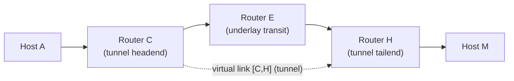
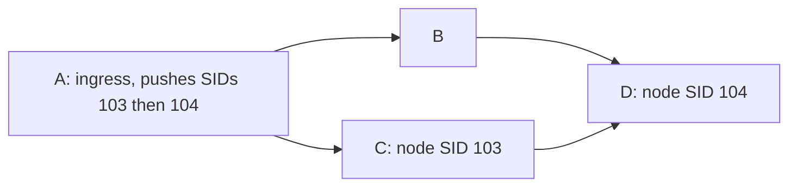

# 2.17 Overlays: tunnels, VXLAN, EVPN, segment routing and SD-WAN

| | |
|---|---|
| Level | Advanced |
| Priority tier | 0 |
| Lab venue | Linux VM with namespaces; containerlab + FRR for EVPN |
| Part | Part 2: Networking, from first principles to AI fabrics |
| Status | Drafted, labs **untested** |

## Why this matters for AI infrastructure

Picture a multi-tenant GPU cloud where several customers share one physical fabric. Each customer must see only its own network, and none may see the traffic of another. One customer might even choose the same private addresses as its neighbour, and both must still work. You cannot rack separate switches for every tenant, so the isolation has to be built out of software on shared hardware. Overlays make that possible. An overlay turns one physical fabric into many logical networks. A GPU cloud isolates customers with VXLAN and EVPN VRFs. Kubernetes CNIs (Flannel, Calico VXLAN or IPIP, Cilium and Antrea) build pod networks as overlays. Cross-site links run over WireGuard, IPsec or SD-WAN, and segment routing and SRv6 are being proposed to steer AI traffic over chosen paths.

The price is that an overlay hides the physical topology from tenants, and it also hides tenant traffic from the physical network. That is powerful and dangerous at once. It is like sending letters inside sealed envelopes: the post office can deliver them without reading them, but it also cannot tell which ones are urgent. MTU shrinks, ECMP hashing loses entropy, and troubleshooting needs two views, one of the overlay and one of the underlay. A failure in the underlay can show up as mysterious loss in the overlay, and you will only find it if you know to look underneath.

The story starts with the simplest question, which is what a virtual network actually is and how one packet crosses it. From there the chapter grows to VXLAN, then to EVPN, the control plane that makes VXLAN practical at scale, and finally to the places where overlays meet AI clusters, containers and wide-area links.

## Prerequisites and outcomes

The rest of this chapter builds on routing (2.5, 2.13) and BGP (2.15, 2.16). If you have ever read a routing table and understood why one route won over another, you are ready for the first section. VLANs (2.11), MTU (2.7) and ECMP hashing (2.12) matter as well, so read those first if they are rusty, because the overlay story keeps coming back to them. In particular, keep in mind that a VLAN is a way to split one switch into separate Layer-2 networks, that the MTU is the biggest packet a link will carry, and that ECMP spreads flows across equal paths by hashing fields of the packet header.

Everything else is introduced where it first appears. We will meet tunnels, VRFs, encapsulation and the recursive lookup in the first section, with one packet as our guide, and the EVPN vocabulary only after VXLAN has shown why it is needed.

## 1. What is a virtual network?

Suppose two groups of users share one physical network, and each group must stay separate from the other. Finance must not see engineering, and engineering must not see finance. You could buy more cables and more switches, or you could create separate logical paths on the same hardware. Network virtualization does the second. It builds logical topologies on top of a physical topology.

A single logical link across a bigger network is a **tunnel**. A group of virtual links that together look like a complete network is an **overlay**. The physical network, or lower-layer network, that carries the tunnels is the **underlay**. A simple way to hold these three words in your head is a road map and a bus route map laid on top of it. The roads are the underlay, the bus routes are the overlay, and each bus line is a tunnel. Passengers think in bus stops and never need to know which streets the bus took.

Why accept the extra complexity? The aim is to separate multiple traffic flows, or reachability domains, across one physical network. Virtualization is another form of multiplexing, which means sharing one resource among many users. It has two distinguishing properties. Different control planes can run with different reachability information on one topology, and different sets of destinations can coexist without interacting.

### A packet through a tunnel

The easiest way to understand a tunnel is to follow one packet through it. Read the diagram first, then the numbered steps that describe what each router actually does.



Follow one packet from Host A to Host M. The routing table of Router C says the best path to M goes through a tunnel, a virtual interface, toward H. To Router C, the tunnel looks like any other interface, with a single router on the far end.

1. Host A sends a packet to M, and Router C sends it into the tunnel interface toward H.
2. The virtual interface adds a new outer header, destined for H, to the inner packet, which is destined for M. Think of putting a letter inside a second envelope with a different address on it.
3. Router C then looks up the outer destination, H. This is a recursive lookup, because the router has to run a second lookup to find out how to reach the tunnel's far end. It finds that H is reached via E, and it builds the link-local (Ethernet) header toward E.
4. Router E strips the link header and forwards using only the outer header. It never examines the original packet from A. For E, this is just another packet going to H.
5. Router H removes the link header and sees that the outer header is destined for itself. It removes that header and processes the inner packet. Since M is locally attached, H forwards the packet to M.

VRFs change the picture in a few places. A VRF is a separate routing table on the same router, so one box can behave like several. If VRFs are used instead of tunnel interfaces, the first lookup happens in the VRF tied to the ingress link, and that result points into a tunnel. After encapsulation, the outer packet is looked up in the base routing table of the underlay. At the tailend, the egress VRF is chosen from the encapsulation, using a VNI or a label.

**Definition used here.** A tunnel is a virtual link. An outer header wraps an inner header, and two conditions hold. The inner header sits at the same layer or a lower one than the outer, for example Ethernet inside IPv6 and UDP. At least some devices on the path forward on the outer header alone. The terms underlay and overlay usually describe a full virtual topology, not a single VPN session.

Before you add a tunnel, decide whether you need a separate control plane, a separate table, or both. That single question tends to separate a clean design from a tangled one.

### Two classic use cases

Two needs drive most overlays in practice, and they look very different.

**1. Ethernet services over an IP network.** Some applications assume Layer-2 adjacency, which means they expect their peers to be on the same Ethernet segment. Storage and database products may use proprietary Ethernet protocols. Hypervisors assume the ARP and ND cache of the default gateway is reliable. Clusters need to see each other in neighbour discovery. Virtual machines must move during live migration without changing their IP or gateway. Some operators simply prefer one large flat Ethernet.

To serve these needs, the IP network must provide an Ethernet-like service, and it must do three things. It carries Ethernet frames inside an IP-routable encapsulation between edge routers or hypervisors. It learns which MAC addresses sit at which edge, and it draws traffic into the tunnel. It can optionally copy QoS markings, DSCP and PCP, from the inner header to the outer one. The MAC reachability can ride on a second control plane, or on one that already exists. This service is VXLAN with EVPN.

**2. Virtual private access.** Remote workers and branch offices need corporate resources that the Internet must not see. The traffic must stay confidential, both its contents and its addresses, and real-time traffic also needs acceptable quality. The solution has three parts. The tunnel is usually encrypted, and it runs from the remote host or site to the corporate edge. Reachability is advertised both ways, so traffic is drawn into the tunnels. Path and quality control come from SD-WAN. Together, this is an IPsec or WireGuard VPN with SD-WAN.

### What every virtualization solution must solve

Whatever the technology, a virtualization solution has to answer two questions, and it may also have to meet one optional requirement. If you ever have to judge an unfamiliar product, these are the questions to ask it.

The first question is encapsulation. How do you place traffic inside the tunnel, so that packets and control-plane information stay separate from the underlay? Two things matter. The underlay hardware must support the encapsulation, so the ASICs can parse and hash it. Every encapsulation also adds overhead, which shrinks the payload. PMTUD, which is the mechanism that lets two hosts discover the largest packet that fits, handles encapsulated packets poorly, so you must tune the MTU by hand at the encapsulation point. Chapter 2.7 covers the MTU.

The second question is reachability advertisement. How does the headend learn which destinations sit behind which tunnel endpoint? There are two models. In the integrated model, the tunnel is just another link in one routing table, and recursive lookups resolve it. In the overlay, or over-the-top, model, a separate control plane, database or VRF carries the overlay reachability, and a classifier then decides which table a packet uses, for example by ingress interface or by VNI.

The optional third requirement is QoS. You can copy markings, such as DSCP, PCP and ECN, between the inner and outer headers, and you can also traffic-engineer the tunnel's path. Chapter 2.19 covers that.

Before you pick an encapsulation, check whether the underlay hardware can parse it and hash it.

## 2. Encapsulation options

Picture two parcel services that both promise delivery across the same country. One sticks a long tracking label on each parcel, and the sorting centre reads that label at every hub to choose a lane. The other seals everything inside an unlabelled envelope, so every parcel looks identical from outside. The first service spreads its parcels across many lanes. The second sends them all down one lane, however many lanes exist. That comparison is the whole story of encapsulation and hashing. Keep it in mind as the table below lists the options one by one.

Imagine buying a plain envelope and discovering that the label you wanted to stick on it no longer fits. Each encapsulation adds a different amount of overhead, and each hides different headers from the network. When the header grows, the payload you can carry shrinks. Compare the options in the table before you choose one.

| Encapsulation | Layer carried | Overhead (IPv4 underlay) | Notes |
|---|---|---|---|
| **GRE** | L3 (or L2 as gretap) | 24 bytes (+ key option) | Simple, no built-in security or entropy (IP proto 47) |
| **IPIP / SIT / ip6tnl** | L3 in L3 | 20 / 40 | Minimal; used by Calico IPIP mode |
| **VXLAN** (RFC 7348) | L2 over UDP/4789 | 50 bytes: outer Ethernet 14, IP 20, UDP 8, VXLAN 8 | 24-bit VNI (16M segments); UDP source port is a hash of inner flow → ECMP entropy |
| **GENEVE** (RFC 8926) | L2/L3 over UDP/6081 | 50+ (options) | Extensible TLV options; used by OVN, Antrea, AWS; successor to VXLAN/NVGRE |
| **MPLS** | Label stack | 4 per label | Used for L3VPN/EVPN in carriers; SR-MPLS |
| **SRv6** | IPv6 + SRH | 40 + 8 + 16/SID (less with uSID) | Segment routing over IPv6 |
| **WireGuard** | L3 over UDP | 60 (IPv4) / 80 (IPv6) | Modern, fast, small codebase |
| **IPsec ESP** | L3 (tunnel mode) | ~50 to 73 | Standard VPN; NAT-T uses UDP/4500 |

Two effects matter most to you. Encapsulation hides the inner headers from the underlay, so ECMP and ACLs see only the outer headers. UDP-based encapsulations, such as VXLAN, GENEVE and WireGuard, set the outer source port from a hash of the inner flow, and that gives the underlay something to spread traffic across ECMP links with. In effect, the tunnel endpoint does the hashing work on the inner packet and writes the result into a field the underlay can read.

GRE, IPIP and ESP have no ports. All traffic between two endpoints therefore hashes to one path, unless the hardware inspects the inner headers. Picture a hundred conversations that all look identical from outside, since they share the same two addresses and the same protocol. The switch has nothing to tell them apart with, so they all pick the same road. Linux can look inside with the `encap3+4` bonding policy or `fib_multipath_hash_policy=2`. Chapters 2.5 and 2.12 cover both.

Choose a UDP-based encapsulation, or enable inner-header hashing, when you need traffic spread across ECMP links.

## 3. VXLAN

Picture hypervisors spread across a routed network. Each virtual machine must sit on the same Layer-2 segment as its peers, even though the network between them is routed. A virtual machine can move from one rack to another while it is running, and it expects to keep its address and its neighbours. VXLAN solves this. Virtual eXtensible LAN carries Ethernet frames over UDP, so a routed L3 network can provide L2 segments to hosts and VMs.

```text
| Outer Eth | Outer IP (VTEP src → VTEP dst) | UDP (src=hash, dst 4789) | VXLAN hdr (flags, VNI 24b) | Inner Ethernet frame | payload |
```

Read the frame from left to right. The outer headers carry the packet across the underlay, the VXLAN header carries the VNI, and the inner frame is the original Ethernet frame. It is the two-envelope picture again, with the inner envelope being a complete Ethernet frame.

The VNI, the VXLAN Network Identifier, is a 24-bit segment ID. That space holds far more segments than the 4094 VLANs you may be used to, which matters when each tenant needs several segments of its own.

A VTEP, the VXLAN Tunnel Endpoint, encapsulates frames into UDP and IP, and decapsulates them. It is the place where the overlay meets the underlay. It can be a hypervisor vSwitch, a leaf switch, a Linux `vxlan` device or a DPU. Each VTEP has an underlay IP address, usually a loopback `/32`.

A local VLAN, port or bridge maps to a VNI, and frames on that VLAN then travel as VXLAN with that VNI.

Some frames need special care. Unknown-unicast, broadcast and multicast frames, known together as BUM traffic, have no single destination, so the network must decide who receives them. Think of someone shouting a question in a large office: it has to reach everyone who might know the answer. Original VXLAN used flood-and-learn. BUM frames go to a multicast group per VNI, which needs PIM in the underlay. Alternatively, the VTEP replicates them at the head end, to a configured list of remote VTEPs. Remote MACs are learned from the source of decapsulated frames, the way a switch learns them. This is simple, but it floods and scales poorly. Modern deployments use a control plane, EVPN, to distribute MAC and IP reachability and to suppress flooding.

VXLAN adds 50 bytes to every packet. Set jumbo frames on the underlay, for example 9216, so tenants can keep 1500. With a 9100 or larger underlay, tenants can use 9000 instead. The extra room on the underlay absorbs the cost of the extra headers, so tenants never notice.

Data-centre switches and many NICs handle VXLAN encapsulation and decapsulation at line rate. You can check the offloads with `ethtool -k`, which shows `tx-udp_tnl-segmentation` and checksum offload for tunnels.

### Linux VXLAN

On a Linux host you can build all of this by hand with `ip`, and doing it once is the best way to see that there is no magic. The commands below start with a point-to-point link, add multi-peer replication, and attach the segment to a bridge. The last command is the EVPN and FRR variant.

```bash
# Point-to-point VXLAN between two hosts (static), VNI 42
sudo ip link add vxlan42 type vxlan id 42 local 10.0.0.1 remote 10.0.0.2 dstport 4789 dev eth0
sudo ip addr add 192.168.42.1/24 dev vxlan42 ; sudo ip link set vxlan42 up mtu 1450
# Multi-peer with head-end replication using the all-zero FDB entry
sudo ip link add vxlan100 type vxlan id 100 local 10.0.0.1 dstport 4789 nolearning
sudo bridge fdb append 00:00:00:00:00:00 dev vxlan100 dst 10.0.0.2
sudo bridge fdb append 00:00:00:00:00:00 dev vxlan100 dst 10.0.0.3
# Attach to a bridge so VMs/containers on the bridge share the segment
sudo ip link add br100 type bridge ; sudo ip link set vxlan100 master br100 ; sudo ip link set br100 up ; sudo ip link set vxlan100 up
bridge fdb show dev vxlan100 ; ip -d link show vxlan100 ; tcpdump -ni eth0 udp port 4789
# Scalable "external/metadata" mode for EVPN/FRR: one device, many VNIs via bridge vlan_tunnel
sudo ip link add vxlan0 type vxlan dstport 4789 local 10.255.0.11 nolearning external vnifilter
```

To debug, run `tcpdump -ni eth0 -vv udp port 4789`. Wireshark decodes the VXLAN header and the inner frame. Check the MTU with `ping -M do`. Test the underlay path between the VTEP loopbacks separately from the overlay, so you know which layer has the fault.

## 4. EVPN: a control plane for Ethernet and IP overlays

Suppose a virtual machine is live-migrated from one rack to another during a busy afternoon. Its users notice a pause of a few seconds, and the network team wants to know why. Without a control plane, the new leaf has to wait for traffic to flood, or for an ARP timeout, before the rest of the fabric learns where the machine now sits. With EVPN, the new leaf announces the machine's MAC and IP to every other leaf as soon as the machine appears. Read the rest of this section as the answer to that afternoon: what the announcement looks like, which route types carry it, and how the other leaves act on it.

A large VXLAN fabric cannot afford to flood every address it has not yet learned. With thousands of hosts, the shouting in the office never stops. EVPN fixes this by letting BGP tell every VTEP where each MAC and IP address lives, so a switch can look up the answer instead of asking everybody. EVPN, BGP Ethernet VPN, is defined in RFC 7432, and RFC 8365 applies it to VXLAN. It uses MP-BGP with the address family `l2vpn evpn`, and it is the standard overlay control plane in data centres.

The underlay gives IP reachability between the VTEP loopbacks. An eBGP, OSPF or IS-IS ECMP fabric does this, as chapter 2.16 describes.

The overlay BGP sessions usually run as eBGP between leaves and spines, over the same links, so EVPN is just an extra address family on those sessions. The spines act as route servers, not as tunnel endpoints. Alternatively, the sessions can run as iBGP to route reflectors. Either way the next hops are VTEP IPs, and the spine must not rewrite them. That is what `next-hop-unchanged` and route-server behaviour are for. If the spine rewrote the next hop to itself, leaves would send tunnel traffic to the spine rather than to the real far-end VTEP.

Two names come up constantly. An EVI, or EVPN instance, is the MAC-VRF for an L2 segment, and the IP-VRF handles L3 routing. Two values make the routes work. The route distinguisher, RD, makes routes unique across VRFs, so two tenants with the same prefix do not collide. The route target, RT, is an extended community that selects which VRFs import a route. If the RD is the name on the envelope, the RT is the mailing list it is sent to.

### Route types

EVPN uses five route types. The table lists them. Type 2 is the heart of host reachability for both L2 and L3.

| Type | Name | Purpose |
|---|---|---|
| **1** | Ethernet Auto-Discovery | Multihoming: per-Ethernet-Segment (ES) and per-EVI fast convergence and aliasing |
| **2** | MAC/IP Advertisement | Advertises a host MAC (and optionally its IP) with the VNI and VTEP next hop; the heart of L2/L3 host reachability; also carries MAC mobility sequence numbers |
| **3** | Inclusive Multicast Ethernet Tag | Builds the BUM replication list: each VTEP announces "I am in VNI x" |
| **4** | Ethernet Segment | Designated-forwarder election among multihomed leaves of the same ES |
| **5** | IP Prefix | Advertises IP prefixes (routing between tenants/outside, host /32s) into IP-VRFs |

Types 1 and 4 handle multihoming, where one server connects to two leaves. Type 3 builds the BUM replication list, and type 5 carries IP prefixes into the tenant VRFs.

### Behaviours that make EVPN practical

The route types are the vocabulary. The behaviours below are what you actually notice when you run a fabric, so we take them as a series of small stories.

A host boots on a leaf and sends its first frame. The leaf learns the host MAC from the data plane, or from ARP or ND. It then originates a type 2 route, and every other VTEP installs that route. If the host later moves, which is what live migration does, the new leaf advertises the same MAC again. MAC mobility uses a sequence number so that the latest location wins, and the old leaf gives up its claim.

Next, a host somewhere asks "who has this IP?". Leaves know the MAC-to-IP bindings from type 2 routes, so a leaf answers ARP requests locally instead of flooding them. That reduces BUM traffic massively.

Now a packet has to cross from one subnet to another. Integrated routing and bridging, IRB, lets the leaf route between VNIs and VRFs. Asymmetric IRB routes at the ingress leaf, then bridges, and it needs every VNI on every leaf. Symmetric IRB is preferred. Both the ingress and the egress leaf route, using an L3 VNI for each tenant VRF. Each leaf then needs only the VNIs of its local hosts plus the tenant L3 VNI, which scales better. Type 2 routes carry two labels or VNIs, an L2 VNI and an L3 VNI, along with two route targets.

What about the default gateway? Every leaf holds the same gateway IP and MAC for a subnet. A host therefore has a first-hop gateway on its own leaf, wherever it sits, and when a VM moves, no ARP change is needed. The gateway is effectively always next door.

A server can attach to two leaves with an LACP bond, which replaces MLAG. EVPN represents that bond with a 10-byte Ethernet Segment Identifier, ESI. Type 4 routes elect the designated forwarder for BUM traffic toward the server, so one of the two leaves, and not both, delivers each flooded frame. Type 1 routes give fast withdrawal when a link fails, and they provide aliasing, which means the other leaves load-balance to both attached VTEPs.

Each tenant gets an IP-VRF with an L3 VNI and import and export route targets. Type 5 routes carry the prefixes, including the default route from a border leaf toward external networks. Route leaking between VRFs happens by importing route targets.

Group-based policy (GBP) tags in VXLAN headers allow microsegmentation inside one VNI. Chapter 2.16 covers this.

### FRR EVPN leaf (VXLAN with symmetric IRB, sketch)

The sketch below sets up a VXLAN leaf with symmetric IRB. Linux holds the bridge and the VXLAN device, and FRR holds the BGP sessions and the tenant VRF. Notice the division of labour: the kernel moves the packets, and the routing daemon tells it where they should go.

```text
! Linux side: VLAN-aware bridge + single VXLAN device mapping VLAN 100 -> VNI 10100; VRF tenant1 with L3VNI 5001
ip link add br0 type bridge vlan_filtering 1 vlan_default_pvid 0
ip link add vxlan0 type vxlan dstport 4789 local 10.255.0.11 nolearning external vnifilter
ip link set vxlan0 master br0 ; bridge vlan add dev vxlan0 vid 100 ; bridge vni add dev vxlan0 vni 10100
! FRR
router bgp 65101
 neighbor swp1 interface remote-as external
 address-family l2vpn evpn
  neighbor swp1 activate
  advertise-all-vni
 exit-address-family
vrf tenant1
 vni 5001
router bgp 65101 vrf tenant1
 address-family ipv4 unicast
  redistribute connected
 address-family l2vpn evpn
  advertise ipv4 unicast
vtysh -c 'show evpn vni' -c 'show bgp l2vpn evpn route' -c 'show bgp l2vpn evpn summary' -c 'show evpn mac vni all' -c 'show evpn arp-cache vni all'
```

As you verify the fabric, work in this order, from the bottom layer up. Confirm that the VTEP loopbacks are reachable over the ECMP underlay. Confirm that the BGP EVPN sessions are established. Check that every VTEP appears in the type 3 routes for each VNI, and that the type 2 routes of each host reach all VTEPs. Confirm the MAC and ARP tables are populated, and that `bridge fdb show` lists the entries toward remote VTEPs. Ping across tenants on different leaves to test symmetric IRB. Finally, check the MTU with `ping -M do -s 8900`.

### Common EVPN/VXLAN pitfalls

Most EVPN faults come from a short list:

- The underlay MTU is too small.
- VTEP loopbacks are not advertised.
- Route targets are mismatched, so routes arrive but are never imported.
- Two leaves share a duplicate anycast gateway MAC, which causes conflicts.
- A spine rewrites next hops.
- Asymmetric IRB in a large fabric forces every leaf to carry every VNI.
- ARP suppression is disabled, which triggers BUM storms.
- ECMP polarization happens when the hash ignores the outer UDP source port.
- Missing resilient hashing, or split brain from MLAG mixed with EVPN multihoming, causes further trouble.
- A default import of `any` lets tenant routes leak.

Before you turn on EVPN, check that the route targets match at both ends and that the underlay MTU is large enough.

## 5. Overlays for AI clusters and containers

Consider a GPU cluster with two traffic paths. The GPU-to-GPU path carries the heavy collective traffic of training. The Kubernetes pod network carries service calls, logs and control traffic. They do not face the same trade-offs, so each needs its own overlay decision.

RDMA fabrics for GPU-to-GPU traffic are normally routed IP or Ethernet, without VXLAN. The reason is easy to see once you remember what an overlay costs. Encapsulation costs MTU, adds hardware complexity and complicates lossless-queue mapping. So overlay-based multi-tenancy is usually applied at the front end, for storage, inference and management. On the back end, it tends to rely on NIC or DPU offload instead. If VXLAN does carry RoCE, make sure the ECN and PFC markings are copied from the inner DSCP to the outer one, keep the queue mappings intact, and verify ASIC and NIC support.

If you run multi-tenant clusters, give each tenant its own EVPN-VXLAN VRF or MAC-VRF. Add GBP or ACLs for microsegmentation, and pair that with performance isolation, which chapter 2.16 section 7 and chapter 2.19 cover.

Inside Kubernetes, every pod needs an IP that other pods can reach, and the CNI plugin decides how that happens. CNIs offer several modes. Flannel runs VXLAN. Calico runs IPIP or VXLAN, or native BGP. Cilium runs VXLAN or Geneve, or native routing with eBPF. Antrea runs Geneve. Overlay mode lowers the pod MTU, adds CPU cost and hides pod IPs from the fabric. Native BGP routing is preferred for performance-critical clusters, as chapter 5 and chapter 2.25 explain. To debug, run `ip -d link show flannel.1`, `bridge fdb`, and `tcpdump -ni eth0 udp port 8472`, which is the Flannel and Cilium default, or `4789`.

Between clouds and on-prem, use WireGuard or IPsec tunnels and run BGP over them. Mind the MTU, the key rotation, and the throughput limit of single-flow encryption, which is bound to one core. One busy flow cannot spread its encryption work over many processors, so a single large transfer may top out below the line rate.

Monitor both layers. For the overlay, watch VNI counters, MAC tables and EVPN routes. For the underlay, watch BFD and interface errors. Run synthetic probes between VTEPs, and also between workloads. A probe between VTEPs tells you the underlay is fine, and a probe between workloads tells you the overlay is fine, so the pair together tells you where to look.

Before you choose overlay mode for a performance-critical cluster, weigh the MTU and CPU cost against native routing.

## 6. Segment routing and SD-WAN in brief

Suppose you want traffic to take a particular route through a chosen list of routers, maybe because one path is cheaper, or has less delay, or is reserved for a tenant. Normal routing picks the shortest path, and steering it otherwise needs state on every flow. Segment routing, SR, lets the ingress node write the path into the packet instead, so transit nodes keep no per-flow state. It is the difference between a taxi driver who asks the dispatcher at every junction and a passenger who hands the driver a written list of turns. This matters mostly in carrier networks, and its role in AI fabrics is still under study, for example controller-driven path pinning, which chapter 2.16 covers.

The path is a list of segments, and each segment has a SID. A node SID is a globally unique label for one router, advertised by the IGP together with the loopback of the router. It means go to that router by the shortest path. An adjacency SID is locally significant and names one specific link. You need it when two parallel links join the same pair of routers and you must choose one. Prefix, binding and anycast SIDs exist for prefixes, policies and groups.

The diagram shows a diamond of four routers. The ingress router A wants to reach D through C, not through B. It pushes the node SIDs for C and D, and the transit router C removes its own SID.



SR-MPLS carries segments as MPLS labels. Each MPLS header is 32 bits: a 20-bit label, a 3-bit traffic class, a bottom-of-stack bit and an 8-bit TTL. PUSH adds a label, POP removes the top one, and SWAP replaces it. The ingress imposes the stack with PUSH. Transit routers on the way to a node SID perform CONTINUE, which swaps in the same label, and the owner of the top label pops it. Labels come from the SR Global Block, and the IGP distributes them through IS-IS or OSPF extensions, or through BGP-LS.

SRv6 uses IPv6 addresses as segments. Each segment is a 128-bit SID placed in a Segment Routing Header, an IPv6 routing extension header. The active segment is copied into the IPv6 destination address, and a segments-left counter counts down. A SID has a locator, which is the routable prefix of the node, a function such as `End`, `End.X` for an adjacency, `End.DT4` and `End.DT6` for VRF decapsulation, and an argument for the rest. A uSID, or micro-segment, packs several 16-bit SIDs into one 128-bit address, for example six with a 32-bit block, which shrinks the headers. SRv6 provides VPN services, such as L3VPN and EVPN, without MPLS.

The IGP floods the SIDs and the topology. Paths are computed on the headend, or by a controller called a PCE, which learns the topology through BGP-LS. PCEP or BGP SR-TE installs the policies, and TI-LFA gives sub-50 ms protection, as chapter 2.13 covers.

SD-WAN applies the same overlay ideas to the wide area. Imagine a company whose branch offices connect over MPLS, broadband and LTE at once, and each path performs differently. Each site edge builds encrypted tunnels, using IPsec, WireGuard or vendor protocols, over every transport. A central controller distributes policy and reachability. The edges measure loss, latency and jitter with probes and steer each application by policy, so voice takes the best path and bulk traffic takes the cheap one. Zero-touch provisioning brings the edges up. For this handbook, the relevance is that multi-site GPU clouds, hybrid connectivity and edge inference sites often use SD-WAN or cloud-native equivalents such as cloud routers, transit gateways and Cloud Interconnect.

**Adopt segment routing or SD-WAN only when you need controller-driven paths or managed multi-transport links, because the shortest path and a plain tunnel suffice for most clusters.** Whichever you use, measure throughput per tunnel, the MTU, key management and failure behaviour.

## 7. Complexity and virtualization

Imagine a Friday evening. An underlay link between two spines starts to flap every few seconds. The routing protocol reconverges, but the overlay tunnels that rode over that link time out at a different speed. Traffic that should have moved to a backup tunnel loops for a short while, then falls into a black hole. The on-call engineer sees tenant complaints about random packet loss, while the overlay dashboards look healthy. This is what the section means by two control planes disturbing each other. The paragraphs below explain each layer of that risk, so you can recognise the pattern before the pager goes off.

Virtualization is a trade. You simplify endpoints and policy, and you pay with more state, more layers and more failure modes. Consider what happens when an underlay link fails, and what you would see first. The overlay reacts, and the two control planes must recover together. If one of them is slower than the other, or faster, the two can disagree for a short but painful time.

Where two systems touch, such as the underlay and overlay control planes or two tunnels, each can disturb the other. If the overlay reacts to an underlay event faster or slower than the underlay reconverges, flapping and blackholes can occur. If the overlay reroutes traffic into a tunnel carried over the failed path, you get loops or oscillation. Keep these interactions few, narrow and documented, and tune the timers so the underlay converges with BFD and ECMP before the overlay times out.

Two overlay paths may run over the same physical link, conduit or switch. Imagine ordering a primary and a backup internet line from two providers, and then discovering that both come up the same trench. A single physical failure then kills both "redundant" paths. This is shared fate, and a shared risk link group, SRLG, describes it. Map overlay redundancy to the real diversity of the underlay, meaning separate switches, racks, power and fibre routes. Model SRLGs in the controller, and verify them with topology data and tests.

Each extra control plane adds convergence dependencies and operational skills. EVPN over BGP over IS-IS is one example. The failure of one control plane can look like the failure of another, so run explicit end-to-end tests at each layer.

State grows too. Tunnel meshes scale with the number of endpoints, and per-tenant VRFs multiply the tables. Hardware limits, such as VNIs, VTEPs, and MAC and route scale, bind the design.

Every encapsulation shrinks the usable MTU, and PMTUD is unreliable. Set the MTU at the encapsulation point.

Visibility suffers as well. You need tools that show inner and outer headers, such as tcpdump or Wireshark with decoders. You also need overlay path tracing: ping and traceroute in the VRF, VXLAN OAM, and the EVPN show commands. And you need to correlate the layers with each other.

Tunnels hide traffic from underlay inspection. Encryption protects confidentiality, but it blinds firewalls. Enforce segment boundaries at the VRF or ACL layer, not only by placing traffic in another VNI.

Encapsulation and encryption use CPU unless they are offloaded. ECMP entropy can fall, and latency adds a little per hop. Check the NIC tunnel offloads.

Rule of thumb: virtualize only where isolation, mobility or policy benefit justifies the added complexity. Prefer simpler options, such as routed hosts, VRF-lite or native routing, where they suffice.

## 8. Hands-on lab: tunnels, VXLAN, and EVPN

The lab has two parts, one that runs anywhere and one that needs a small virtual machine. Start with the self-checking Python lab, `code/part02/overlays_vxlan_evpn_lab.py`, and run it locally. It verifies EVPN route types 1 to 5. It checks per-leaf VNI state under asymmetric and symmetric IRB, which is 200 VNIs versus 6. It walks the SR-MPLS label stack POP progression, `[101, 104, 105, 107]`. It also runs the SRLG overlay fate-sharing checks.

```bash
python3 code/part02/overlays_vxlan_evpn_lab.py
```

The second part runs on a disposable Linux VM, using network namespaces and containerlab with FRR. The interactive commands below were not run on live hardware. Work through these steps, and let each one build on what the previous one showed you.

1. GRE and IPIP with namespaces. Build the diamond topology from chapter 2.5, and create a GRE tunnel between the end routers. Observe the recursive lookup with `ip route get`, and capture the outer and inner headers at the transit router. Compute the MTU. Break PMTUD with an ICMP drop, then fix it with MSS clamping.
2. VXLAN point-to-point. Use two namespaces or VMs, and set up VXLAN with a static remote. Capture UDP/4789, and show how the source port varies across flows. Inspect `bridge fdb`, change the MTU, and test with large pings.
3. Head-end replication. Set up three VTEPs with all-zero FDB entries, and send ARP across them. Observe the BUM replication count. Then enable proxy ARP and `nolearning`, and compare the two runs.
4. Bridge and VXLAN segment. Attach namespaces to a bridge with VXLAN. Move an IP between hosts to simulate migration, and watch how MAC learning follows it.
5. EVPN in containerlab. Build 2 spines, 3 leaves and FRR. Use the underlay eBGP unnumbered setup from the chapter 2.16 lab. Enable `l2vpn evpn` and `advertise-all-vni`, and create VNI 10100 across the leaves. Inspect the type 3 and type 2 routes, and check ARP suppression. Test MAC mobility by moving a host container between leaves. Add symmetric IRB with an L3VNI and an anycast gateway. Ping between subnets, and check `show bgp l2vpn evpn route type prefix`.
6. Multihoming (optional). Dual-attach a host with an ESI and LACP to two leaves. Fail one of them, then observe the type 1 and type 4 routes and the convergence.
7. Tenant isolation. Build two VRFs with overlapping IP ranges, and show that they stay isolated. Leak a route with an RT import. Then add GBP or ACL microsegmentation, at the conceptual level.
8. WireGuard. Build a site-to-site tunnel between namespaces. Measure throughput and MTU, then add BGP over the tunnel.
9. Segment routing demo. Use Linux `ip route add ... encap mpls` or `encap seg6` (SRv6) in namespaces to build a two-segment path across a diamond topology. Observe which transit routers see the packets.
10. Troubleshooting drill. Introduce faults: a wrong RT, an underlay MTU of 1500, a missing VTEP route, and a duplicate gateway MAC. Diagnose each one with the layered method.
11. Clean up.

## 9. Common mistakes

The most common trap is forgetting the MTU tax. Tunnels look fine for small pings, then hang on real traffic. The small packets fit inside the reduced limit, and the big ones quietly do not. Non-UDP encapsulations give you no ECMP entropy if you hash only on the outer addresses. Do not treat the overlay as independent of the underlay. Monitor both.

Configuration mismatches cause many faults. Mismatched route targets or VNI maps break reachability, and non-unique RDs do the same. So does failing to plan VNIs and VRFs in advance.

Two design mistakes are easy to make, and you should watch for both. Using EVPN or VXLAN where plain routing would do adds complexity for nothing, and stretching L2 widely for convenience does the same. Believing that VNI separation equals security, without ACL and VRF discipline, is a third mistake.

Ignoring shared risk groups breaks any claim of path redundancy. Running RoCE through an overlay without checking lossless queue handling is a mistake too.

Before you go live, check the route targets, the MTU and the shared risk groups.

## 10. Interview angles

Practise these questions aloud, and answer each one in your own words, as you would to a colleague. If an answer needs more than a minute, you probably have not yet found the simple version.

- "What are underlay and overlay? What happens to a packet in a tunnel hop by hop?"
- "How does VXLAN differ from a VLAN; what is a VTEP; how is BUM traffic handled?"
- "What does EVPN add to VXLAN? Name the route types and their purposes."
- "Symmetric versus asymmetric IRB; what is an anycast gateway?"
- "How do you handle MTU in an overlay?"
- "How does the underlay get entropy for ECMP with VXLAN?"
- "Explain segment routing node and adjacency SIDs; what are PUSH/POP/CONTINUE?"
- "What are SD-WAN's building blocks?"
- "What is an SRLG and why does it matter for overlay redundancy?"
- "Why do GPU back-end fabrics usually avoid overlays?"

## Exercises

Write down your answer to each exercise before you check it. They test whether you can follow a packet, compare encapsulations, read EVPN route types, and reason about shared failure.

1. A packet from Host A to Host M crosses a tunnel. Trace its five steps through tunnel headend Router C and underlay transit Router E to tunnel tailend Router H. Explain the recursive lookup at Router C.
2. A router uses VRFs instead of tunnel interfaces. Explain how that changes the lookup tables. Then state the two mandatory questions every network virtualization solution must answer, and the optional QoS question.
3. You must choose an encapsulation among GRE, IPIP, VXLAN, Geneve, MPLS, SRv6, WireGuard and IPsec. Compare the byte overhead and the outer header of each. GRE adds 24 bytes, IPIP adds 20, VXLAN adds 50 on UDP port 4789, Geneve adds 50 or more on UDP port 6081, and MPLS adds 4 bytes per label.
4. A fabric carries both VXLAN and GRE traffic across ECMP links. Explain why VXLAN and Geneve balance across underlay ECMP links automatically, while GRE and IPIP pin to a single link unless inner-header hashing is enabled.
5. A colleague asks how VXLAN learns MAC addresses. Contrast data-plane flood-and-learn, using multicast or head-end replication with `00:00:00:00:00:00` FDB entries, with the BGP `l2vpn evpn` control plane in RFC 7432 and RFC 8365. Then distinguish a route distinguisher (RD) from a route target (RT).
6. You are asked to name the EVPN route types. Name each type from 1 to 5 and state its exact role. The reference is `EVPN_ROUTE_TYPES` in `code/part02/overlays_vxlan_evpn.py`.
7. Explain how a distributed anycast gateway works on leaf switches. Then use `compute_irb_vni_scaling_per_leaf()` to compare how many VNIs a leaf must configure when the cluster has 200 tenant L2 subnets and 5 of them are present locally on that leaf. Under Asymmetric IRB the leaf needs 200 VNIs, and under Symmetric IRB, using an L3 VNI, it needs 6.
8. A team wants to steer traffic with segment routing. Distinguish a node SID from an adjacency SID. Then trace `simulate_sr_mpls_label_stack([101, 104, 105, 107], [101, 104, 105, 107])`, and explain the MPLS PUSH, POP and CONTINUE (SWAP) operations along the way.
9. A colleague asks what an SRv6 SID contains. Describe its three parts, which are Locator, Function and Argument, in the form `Locator : Function : Argument`, and describe the 16-bit uSIDs. Then summarize the core building blocks of SD-WAN.
10. Two overlay tunnels look separate but fail together. Use `check_overlay_srlg_diversity()` to explain why they fail at the same time when their underlay paths share a shared risk link group (SRLG), such as `conduit-north`. Also explain what happens if the overlay failure detection timers are faster than underlay BFD and ECMP convergence.
11. A GPU cluster runs RoCEv2 and InfiniBand on the back end. Give four reasons these fabrics avoid VXLAN overlays on the collective path.

## Checkpoint questions (20)

<details>
<summary>1. Define a Tunnel, an Overlay, an Underlay, and a Recursive Lookup.</summary>

A tunnel is a virtual point-to-point link. An outer header wraps an inner packet, and the devices in between forward on the outer header alone. An overlay is a complete virtual network built from tunnels. The underlay is the physical or routed network that carries the tunnel packets. A recursive lookup happens when a headend routes an inner packet into a tunnel interface. The router then looks up the tunnel tailend's IP address, which is the VTEP address, in the underlay routing table. That lookup gives the next hop and the outgoing interface toward the tailend.
</details>

<details>
<summary>2. What two fundamental questions (plus one optional question) must every network virtualization technology answer?</summary>

The first question is how packets are encapsulated. The wrapping has to isolate virtual traffic from the underlay, and it has to account for the MTU tax and for hash support in the ASICs and ECMP. The second question is how reachability is advertised. Tunnel headends must learn which inner MAC and IP destinations sit behind which tailend. The answer is either one integrated routing table or a separate overlay control plane or VRF. The optional third question is QoS. Inner markings, DSCP, PCP and ECN, must be copied to the outer header and mapped onto underlay queues.
</details>

<details>
<summary>3. Compare `VXLAN` (RFC 7348), Geneve (RFC 8926), GRE, and IPIP across header overhead, UDP ports, and underlay ECMP entropy.</summary>

- VXLAN adds 50 bytes of overhead on IPv4. That is 14 bytes of outer Ethernet, 20 bytes of IP, 8 bytes of UDP and 8 bytes of VXLAN. Its UDP destination port is 4789, while legacy Linux and Flannel default to 8472. The fixed 8-byte header carries a 24-bit VNI, which gives 16,777,216 segments.
- Geneve adds 50 bytes or more. Its UDP destination port is 6081. It has a 24-bit VNI plus variable-length TLV options, and OVN-Kubernetes, Cilium and Antrea use it.
- GRE adds 24 bytes. It uses IP protocol 47 and has no UDP port.
- IPIP adds 20 bytes. It uses IP protocol 4 and has no UDP port.

VXLAN and Geneve wrap packets in UDP, and they set the outer UDP source port to a hash of the inner packet's 5-tuple. Standard underlay switches then spread flows across ECMP links automatically.
</details>

<details>
<summary>4. What are a `VNI` and a `VTEP` in VXLAN, and how does VXLAN handle `BUM` (*Broadcast, Unknown-unicast, Multicast*) traffic without EVPN?</summary>

The VNI, the VXLAN Network Identifier, is a 24-bit segment ID that names a virtual L2 or L3 domain. The VTEP, the VXLAN Tunnel Endpoint, is whatever encapsulates and decapsulates VXLAN packets. That can be a switch, a hypervisor, a DPU or the Linux `vxlan0` interface, and it uses an underlay IP, usually a loopback `/32`. Without a control plane, VXLAN uses flood-and-learn. BUM frames go either to an underlay multicast group per VNI, or they are replicated at the head end. Head-end replication sends one unicast copy to each remote VTEP listed in the `00:00:00:00:00:00` FDB entry. The VTEP learns remote MACs from incoming data packets.
</details>

<details>
<summary>5. What does `BGP EVPN` (RFC 7432 / RFC 8365, address family `l2vpn evpn`) replace in VXLAN?</summary>

BGP EVPN replaces data-plane flood-and-learn with a proactive MP-BGP control plane. Each leaf VTEP learns its attached hosts' MAC and IP addresses, from the port, ARP or ND. It then advertises them to every other VTEP in `l2vpn evpn` BGP updates. Unknown-unicast flooding stops, and leaves can answer ARP and ND locally. Bridging and routing, which is IRB, also end up in one protocol.
</details>

<details>
<summary>6. Match all five `BGP EVPN` Route Types (1 through 5) to their exact functions.</summary>

- Route Type 1, Ethernet Auto-Discovery: advertises reachability per Ethernet Segment and per EVI. It supports active-active multihoming aliasing and fast mass withdrawal when a link fails.
- Route Type 2, MAC/IP Advertisement: advertises a host MAC, and optionally its IPv4 or IPv6 address, with the L2 VNI, the L3 VNI, the VTEP next hop and the MAC mobility sequence number.
- Route Type 3, Inclusive Multicast Ethernet Tag (IMET): announces that a VTEP is in a given VNI. That builds the head-end replication list for BUM traffic.
- Route Type 4, Ethernet Segment: finds the VTEPs attached to the same multihomed 10-byte ESI. It then elects the Designated Forwarder (DF) for BUM traffic toward the server.
- Route Type 5, IP Prefix: advertises IPv4 and IPv6 subnet prefixes, as RFC 9136 defines, and external routes into tenant IP-VRFs.
</details>

<details>
<summary>7. What is the difference between a Route Distinguisher (`RD`) and a Route Target (`RT`) in EVPN / VPNs?</summary>

- Route Distinguisher (RD): a 64-bit value, for example 10.255.0.11:100. It is prepended to a MAC or IP prefix so that overlapping tenant addresses stay unique inside BGP updates. Without it, route reflectors or spines would overwrite one tenant's 10.0.0.0/24 with another tenant's 10.0.0.0/24.
- Route Target (RT): a BGP extended community, for example 65000:10100. It controls import and export policy, deciding which MAC-VRFs and IP-VRFs on a receiving VTEP import the route.
</details>

<details>
<summary>8. How does EVPN `ARP/ND Suppression` work, and how does EVPN handle VM/container live migration (`MAC Mobility`)?</summary>

EVPN Route Type 2 gives every leaf in the VNI the (MAC, IP) bindings. So when a leaf receives an ARP request, or an IPv6 Neighbor Solicitation, for a remote host, it answers from its own EVPN ARP cache. It does not flood the broadcast across the fabric. That is ARP/ND suppression. When a VM or container live-migrates to a new leaf, the new leaf originates a Type 2 route with a higher MAC Mobility sequence number. Every VTEP then updates its FDB to point to the new VTEP.
</details>

<details>
<summary>9. Contrast `Asymmetric IRB` and `Symmetric IRB` (*Integrated Routing and Bridging*), and explain why Symmetric IRB scales better.</summary>

In asymmetric IRB, the ingress leaf routes the packet straight into the destination subnet's L2 VNI, and the egress leaf only bridges it. So every leaf in the data centre must configure every L2 VNI and subnet, even if it hosts none of them. In symmetric IRB, the ingress leaf routes the packet into a per-tenant L3 VNI, which is an IP-VRF. The egress leaf routes from that L3 VNI into the local L2 VNI. Each leaf needs only its locally attached L2 VNIs plus one L3 VNI per tenant, so it scales better.
</details>

<details>
<summary>10. What is a Distributed Anycast Gateway in an EVPN fabric, and what must match across all leaf switches?</summary>

Every leaf that serves a subnet configures the same default gateway IP and the same virtual MAC on its local VLAN SVI. A host always reaches its gateway on its own top-of-rack leaf, in one hop. If a VM live-migrates to another rack, its cached gateway IP and MAC stay valid on the new leaf, so it does not need to ARP again.
</details>

<details>
<summary>11. Why must spine switches acting as EVPN route servers set `next-hop-unchanged` on `l2vpn evpn` eBGP sessions?</summary>

In an EVPN overlay, the BGP `NEXT_HOP` of a Type 2, Type 3 or Type 5 route is the originating leaf's VTEP loopback IP. Remote leaves use that address as the outer VXLAN destination. By default, eBGP rewrites the next hop to the spine's own IP. Unless the spine leaves the next hop unchanged, or terminates and re-originates the VXLAN tunnels itself, it would attract encapsulated packets it cannot bridge. So the spine must set `next-hop-unchanged` on the `l2vpn evpn` eBGP sessions.
</details>

<details>
<summary>12. How do you configure a scalable Single-VXLAN-Device (`vxlan0` with `external` / `vnifilter`) on Linux for FRR EVPN?</summary>

Instead of separate `vxlanN` netdevs and `brN` bridges, one per VNI, create one VLAN-aware bridge and one VXLAN device. Run `ip link add br0 type bridge vlan_filtering 1` for the bridge. Run `ip link add vxlan0 type vxlan dstport 4789 local 10.255.0.11 nolearning external vnifilter` for the device, and enslave `vxlan0` to `br0`. Then map VLANs to VNIs with `bridge vlan add dev vxlan0 vid 100` and `bridge vni add dev vxlan0 vni 10100`.
</details>

<details>
<summary>13. What are a `Node SID` and an `Adjacency SID` in Segment Routing (RFC 8402)?</summary>

- Node SID: a globally unique segment ID, advertised in the IGP (OSPF or IS-IS), that represents one router's loopback. Any router forwards a packet carrying it along the shortest IGP path toward that node, including ECMP paths.
- Adjacency SID: a locally significant segment ID for one outgoing interface to one neighbour. It forces traffic onto that specific link, without ECMP hashing.
</details>

<details>
<summary>14. How do `PUSH`, `POP`, and `CONTINUE` work in `SR-MPLS`?</summary>

An SR-MPLS label is a 32-bit shim header. It holds a 20-bit label from the SR Global Block (SRGB), a 3-bit Traffic Class, a 1-bit Bottom-of-Stack flag and an 8-bit TTL. At the ingress router, PUSH imposes an ordered stack of Node and Adjacency SIDs, for example [103, 107]. Transit routers on the shortest path to 103 perform CONTINUE, which is an MPLS SWAP with the same label 103. When the packet reaches node 103, or its penultimate hop via PHP, label 103 is popped. That exposes 107 as the new top label, toward node 107.
</details>

<details>
<summary>15. How does `SRv6` (RFC 8754 / RFC 8986) encode segments without MPLS, and what are `Locator`, `Function`, `Argument`, and `uSID`?</summary>

SRv6 encodes each segment as a 128-bit IPv6 address. These addresses sit in a Segment Routing Header (SRH), or, with uSIDs, directly in the IPv6 destination address. Each SRv6 SID has the form Locator : Function : Argument. The Locator is the routable IPv6 prefix of the target node. The Function is the local action taken on arrival. End advances the segment, End.X cross-connects out an adjacency, and End.DT4 and End.DT6 decapsulate and look up in an IPv4 or IPv6 VRF. The Argument passes optional parameters. A uSID packs several 16-bit micro-segments into one 128-bit IPv6 address, for example six with a 32-bit block.
</details>

<details>
<summary>16. What are the core architectural components of an `SD-WAN` solution?</summary>

An SD-WAN has four main parts. First, edge appliances, vEdge or cEdge, terminate several different underlay transports, such as MPLS, broadband Internet, and 5G or LTE. Second, encrypted IPsec or WireGuard overlay tunnels run across all of those transports. Third, a central control plane or orchestrator, using OMP or BGP over TLS, distributes routes, keys and security policies, so you avoid a full mesh of IKE sessions. Fourth, the edges run continuous active and passive probing of loss, latency and jitter, and steer each application onto a transport that meets its SLA.
</details>

<details>
<summary>17. What are "Interaction Surfaces" and "Shared Risk Link Groups" (SRLGs) in virtualized networks?</summary>

Interaction surfaces are the points where the overlay and underlay control planes touch. For example, if an overlay BFD or keepalive timer is shorter than the underlay's ECMP or BFD convergence time, a single underlay link flap can tear the whole overlay down and cause churn. A Shared Risk Link Group (SRLG) is a set of logically separate overlay links that share one physical failure domain in the underlay, such as a fibre trench, a patch panel, a line card or a spine switch. When that domain fails, the "redundant" overlay paths fail together. This is called fate sharing.
</details>

<details>
<summary>18. Why do high-performance AI GPU back-end fabrics (RoCE v2 and InfiniBand) generally avoid running VXLAN overlays on the collective path?</summary>

There are four reasons. First, every packet pays the MTU and goodput tax of 50 bytes. Second, lossless QoS gets complicated. Inner DSCP and ECN bits must be copied to the outer header on encapsulation and restored on decapsulation, and PFC pause frames act on the physical link. Third, NICs must support stateless RDMA together with VXLAN encapsulation and decapsulation, and with BTH UDP source-port entropy. Fourth, troubleshooting spans two layers when a collective stalls.
</details>

<details>
<summary>19. If RoCE v2 traffic MUST traverse a VXLAN overlay, what three QoS/hardware requirements must be verified?</summary>

The first requirement is that the VTEP copies the inner DSCP and ECN bits to the outer VXLAN IP header on encapsulation. On decapsulation, it copies the outer ECN marking, CE equal to 11, back to the inner header, so that DCQCN congestion control still works end to end. The second is that the outer UDP source ports keep per-QP hash entropy. The third is that underlay switches map the outer DSCP or PCP into lossless PFC queues, with an MTU of 9216.
</details>

<details>
<summary>20. Walk through the layered troubleshooting sequence when Host A in VNI `10100` on Leaf 1 cannot ping Host B in VNI `10100` on Leaf 3.</summary>

Start with the underlay. From Leaf 1, run `ping -M do -s 8900` to the Leaf 3 VTEP loopback. That confirms underlay reachability and jumbo MTU between the VTEPs. Next, run `show bgp l2vpn evpn summary` to check whether the EVPN sessions are Established. Then run `show evpn vni 10100`. Does Leaf 1 see Leaf 3's VTEP IP in the Type 3 replication list, and do the route targets match? Next, run `show evpn mac vni 10100` and `show bgp l2vpn evpn route type macip`. Was Host A learned locally on `br0` and advertised? Was Host B's Type 2 route received and installed in `bridge fdb show dev vxlan0`? Last, capture on the underlay with `tcpdump -ni swp1 udp port 4789` to confirm that encapsulated packets leave and arrive.
</details>

## Sources and review notes

- **Sources read in full:**
  - `computer-networking-problems-and-solutions` — Russ White and Ethan Banks, *Computer Networking Problems and Solutions*, **Chapter 9: Network Virtualization** (understanding virtual networks, tunnels vs overlays vs underlays, VRFs and recursive lookups, Ethernet services over IP, virtual private access, segment routing with MPLS and IPv6, signaling, SD-WAN, complexity and virtualization, interaction surfaces, Shared Risk Link Groups `SRLG`s, and overlaid control planes).
  - `ai-data-center-network-design-and-technologies` — Dinakaran Setty et al., *AI Data Center Network Design and Technologies*, **Chapter 8: IP Routing for AI/ML Fabrics** (EVPN-VXLAN multi-tenancy, VXLAN Group-Based Policy `GBP` microsegmentation, and SRv6/uSID).
  - `networking-and-kubernetes` — James Strong and Vallery Lancey, *Networking and Kubernetes*, **Chapter 3: Container Networking Basics** (container networking overlays, VXLAN, Geneve, and IPIP; Linux `veth` and CNI plugin mechanics are covered in full in Chapter 2.25).
  - `how-linux-works-3rd-edition` — Brian Ward, *How Linux Works*, 3rd ed., **Chapter 9: Understanding Your Network and Its Configuration** (Linux `iproute2` interface and bridge fundamentals).
- **Run here:** `python3 code/part02/overlays_vxlan_evpn_lab.py` (10 passed, 0 failed).
- **Explicitly labelled inferences:** The Linux `ip link add type vxlan` (`external vnifilter`) and FRR `l2vpn evpn` Symmetric IRB (`L3VNI 5001`) configurations, EVPN Route Types `1`–`5` table, and layered VTEP-to-VTEP troubleshooting sequence synthesize RFCs 7348 (VXLAN), 7432 (EVPN), 8365 (EVPN Overlay), 8402 (Segment Routing), 8926 (Geneve), 8986 (SRv6), and 9136 (EVPN IP Prefix Route) and the FRR/containerlab documentation (cross-referenced with Chapters 2.5, 2.7, 2.11–2.16, 2.19, 2.25, and 2.27, plus original study items 21, 22, 23, 24, 25, 26, 27, 28, 29, 30, 31, 32, 33, 34, 35, 36, 37, 38, 39, and 40).
- **Not verified on live hardware:** All interactive VM and FRR commands (`ip link add type vxlan`, `bridge fdb`, `bridge vni`, `vtysh`, `show evpn vni`, `show bgp l2vpn evpn`, `tcpdump udp port 4789`) were not run on live hardware and must be executed on a disposable Linux VM or containerlab topology.
