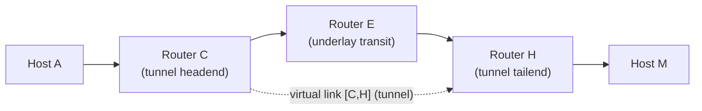

# 2.17 Overlays: tunnels, VXLAN, EVPN, segment routing and SD-WAN

| | |
|---|---|
| Level | Advanced |
| Priority tier | 0 |
| Lab venue | Linux VM with namespaces; containerlab + FRR for EVPN |
| Part | Part 2: Networking, from first principles to AI fabrics |
| Status | Drafted, labs **untested** |

## Why this matters for AI infrastructure

Overlays are how one physical fabric becomes many logical networks. A multi-tenant GPU cloud isolates customers with VXLAN/EVPN VRFs; Kubernetes CNIs (Flannel, Calico VXLAN/IPIP, Cilium, Antrea) build pod networks as overlays; cross-site connectivity runs over WireGuard, IPsec or SD-WAN; segment routing and SRv6 are being proposed to steer AI traffic over chosen paths. An overlay hides the physical topology from tenants and, at the same time, hides the tenants' traffic from the physical network, which is powerful and dangerous: MTU shrinks, ECMP hashing loses entropy, troubleshooting needs two views (overlay and underlay), and failures in the underlay appear as mysterious overlay loss. This chapter explains virtual networks in general (tunnels, VRFs, underlay/overlay), the two classic use cases (Ethernet over IP and private access), the requirements any virtualization must meet, VXLAN, EVPN, segment routing (MPLS and IPv6), SD-WAN, and the complexity that virtualization adds, with Linux and FRR labs.

## Prerequisites and outcomes

You should know routing (2.5, 2.13), BGP (2.15, 2.16), VLANs (2.11), MTU (2.7) and ECMP hashing (2.12).

After this chapter you can:

- Define tunnel, overlay, underlay, VRF, virtual interface, encapsulation and recursive lookup, and trace a packet through a tunnel hop by hop.
- State the two questions every virtualization solution answers (how is traffic encapsulated; how is reachability through the tunnel advertised) and the optional QoS requirement.
- Compare GRE, IPIP, GENEVE, VXLAN, MPLS, WireGuard and IPsec encapsulations, their overheads and ECMP entropy.
- Explain VXLAN (VNI, VTEP, flood-and-learn versus control plane) and EVPN (route types 1 to 5, RD/RT, IRB, anycast gateway, ARP suppression, multihoming) and configure a VXLAN overlay on Linux and an EVPN fabric in FRR.
- Explain segment routing: node and adjacency SIDs, SR-MPLS label stack operations (PUSH/POP/CONTINUE), SRv6, signalling.
- Explain SD-WAN's building blocks and when it is used.
- Reason about virtualization complexity: interaction surfaces, shared risk link groups, overlaid control planes, MTU and observability.
- Design and troubleshoot overlays for AI clusters and Kubernetes.

## 1. What is a virtual network?

Network virtualization creates **logical topologies on top of a physical topology**. A single logical link across a bigger network is a **tunnel**; a collection of virtual links that look like a complete network is an **overlay**; the physical (or lower-layer) network that carries the tunnels is the **underlay**. Why accept the complexity? Because the aim is to separate multiple traffic flows, or reachability domains, across one physical network. It is another kind of multiplexing, with two distinguishing properties: different **control planes** can operate with different reachability information on one topology, and different **sets of destinations** can coexist without interacting.

### A packet through a tunnel



1. A sends a packet to M. C's routing table says the best path to M is through a **tunnel (virtual) interface** toward H.
2. The virtual interface has rewrite instructions: add a new **outer header** (destination H) to the **inner** packet (destination M).
3. C now looks up the *outer* destination H, a **recursive lookup**, finds it is reached via E, and builds the link-local (Ethernet) header toward E.
4. E strips the link header and forwards based on the *outer* header only; it never examines A's original packet.
5. H removes the link header, sees the outer header is destined for itself, removes it, and processes the inner packet: M is locally attached, so it forwards to M.

If **VRFs** are used instead of tunnel interfaces, the first lookup occurs in the VRF associated with the ingress link; the result points into a tunnel; after encapsulation, the outer packet is looked up in the base (underlay) routing table; at the tailend, the egress VRF is selected from the encapsulation (a VNI or label).

**Definition used here.** A tunnel is a virtual link where an outer header encapsulates an inner header and (a) the inner is at the same or a lower layer than the outer (e.g. Ethernet inside IPv6/UDP), and (b) at least some devices on the path forward on the outer header alone. Terms like underlay/overlay are normally used when there is a full virtual topology, not a single VPN session. Don't let edge cases ("platypus" definitions) distract: keep the general case clear and note the exceptions.

### Two classic use cases

**1. Ethernet services over an IP network.** Some applications assume Layer-2 adjacency: storage and database products with proprietary Ethernet protocols, hypervisors that assume the default-gateway ARP/ND cache is reliable, clusters that need to see each other in neighbour discovery, or VMs that must *move* (live migration) without changing IP/gateway. Some operators also prefer one large flat Ethernet. The IP network must provide an Ethernet-like service: (1) carry Ethernet frames inside an IP-routable encapsulation between edge routers/hypervisors; (2) learn which MAC addresses are reachable at which edge and draw traffic into the tunnel (a second control plane, or MAC reachability carried in an existing one); (3) optionally copy QoS markings (DSCP/PCP) from the inner to the outer header. This is VXLAN/EVPN.

**2. Virtual private access.** Remote workers and branch offices need access to corporate resources that can't be exposed to the Internet, with confidentiality of both contents and addresses and acceptable quality for real-time traffic. Solution: an (usually encrypted) tunnel from the remote host or site to the corporate edge, plus advertising reachability both ways so traffic is drawn into the tunnels, and path/quality control (SD-WAN). This is IPsec/WireGuard VPN and SD-WAN.

### What every virtualization solution must solve

1. **Encapsulation**: how is traffic placed inside the tunnel so packets and control-plane information are separated from the underlay? Considerations: **hardware forwarding support** in the underlay (can ASICs parse and hash the encapsulation?), and **overhead** (every added byte reduces payload; PMTUD handles encapsulated packets poorly, so MTUs must be tuned manually at the encapsulation point, chapter 2.7).
2. **Reachability advertisement**: how does the headend learn which destinations are behind which tunnel endpoint? Two models: *integrated* (the tunnel is "just another link" in the one routing table; recursive lookups) and *overlay/over-the-top* (a separate control plane or separate database/VRF carries overlay reachability; a classifier decides which table a packet uses, e.g. by ingress interface or VNI).
3. **Optionally QoS**: copy markings (DSCP, PCP, ECN) between inner and outer, or traffic-engineer the tunnel's path (chapter 2.19).

## 2. Encapsulation options

| Encapsulation | Layer carried | Overhead (IPv4 underlay) | Notes |
|---|---|---|---|
| **GRE** | L3 (or L2 as gretap) | 24 bytes (+ key option) | Simple, no built-in security or entropy (IP proto 47) |
| **IPIP / SIT / ip6tnl** | L3 in L3 | 20 / 40 | Minimal; used by Calico IPIP mode |
| **VXLAN** (RFC 7348) | L2 over UDP/4789 | 50 bytes (14 inner Ethernet header not counted: outer IP 20 + UDP 8 + VXLAN 8 + outer Ethernet 14) | 24-bit VNI (16M segments); UDP source port is a hash of inner flow → ECMP entropy |
| **GENEVE** (RFC 8926) | L2/L3 over UDP/6081 | 50+ (options) | Extensible TLV options; used by OVN, Antrea, AWS; successor to VXLAN/NVGRE |
| **MPLS** | Label stack | 4 per label | Used for L3VPN/EVPN in carriers; SR-MPLS |
| **SRv6** | IPv6 + SRH | 40 + 8 + 16/SID (less with uSID) | Segment routing over IPv6 |
| **WireGuard** | L3 over UDP | 60 (IPv4) / 80 (IPv6) | Modern, fast, small codebase |
| **IPsec ESP** | L3 (tunnel mode) | ~50 to 73 | Standard VPN; NAT-T uses UDP/4500 |

Notes: *encapsulation hides inner headers from the underlay*, so ECMP and ACLs see only outer headers. UDP-based encapsulations (VXLAN, GENEVE, WireGuard) derive the outer **source port from a hash of the inner flow**, giving the underlay ECMP entropy; GRE/IPIP/ESP have no ports so all traffic between two endpoints hashes to one path unless the hardware inspects inner headers (`encap3+4` bonding policy, `fib_multipath_hash_policy=2` for Linux, chapters 2.5, 2.12).

## 3. VXLAN

**Virtual eXtensible LAN** carries Ethernet frames over UDP so a routed L3 network provides L2 segments to hosts and VMs.

```text
| Outer Eth | Outer IP (VTEP src → VTEP dst) | UDP (src=hash, dst 4789) | VXLAN hdr (flags, VNI 24b) | Inner Ethernet frame | payload |
```

- **VNI** (VXLAN Network Identifier): 24-bit segment ID (versus 4094 VLANs).
- **VTEP** (VXLAN Tunnel Endpoint): the device (hypervisor vSwitch, leaf switch, Linux `vxlan` device, DPU) that encapsulates frames into UDP/IP and decapsulates them; has an underlay IP address (usually a loopback /32).
- **Mapping**: a local VLAN (or port, or bridge) maps to a VNI; frames with that VLAN become VXLAN with that VNI.
- **Forwarding of unknown/broadcast/multicast (BUM)**: original VXLAN used **flood-and-learn**: BUM frames are sent to a multicast group per VNI (needs PIM in the underlay) or replicated by **head-end replication** to a configured list of remote VTEPs; remote MACs are learned from the source of decapsulated frames (like a switch). This is simple but floods and scales poorly. Modern deployments use a **control plane** (EVPN) to distribute MAC/IP reachability and suppress flooding.
- **MTU**: add 50 bytes; use jumbo on the underlay (e.g. 9216) so tenants keep 1500 (or 9000 with 9100+ underlay).
- **Hardware**: ASIC support for VXLAN encap/decap at line rate is standard on data-centre switches and many NICs (offloads: `ethtool -k` `tx-udp_tnl-segmentation`, checksum offload for tunnels).

### Linux VXLAN

```bash
# Point-to-point VXLAN between two hosts (static), VNI 42
sudo ip link add vxlan42 type vxlan id 42 local 10.0.0.1 remote 10.0.0.2 dstport 4789 dev eth0
sudo ip addr add 192.168.42.1/24 dev vxlan42 ; sudo ip link set vxlan42 up mtu 1450
# Multi-peer with head-end replication using the all-zero FDB entry
sudo ip link add vxlan100 type vxlan id 100 local 10.0.0.1 dstport 4789 nolearning
sudo bridge fdb append 00:00:00:00:00:00 dev vxlan100 dst 10.0.0.2
sudo bridge fdb append 00:00:00:00:00:00 dev vxlan100 dst 10.0.0.3
# Attach to a bridge so VMs/containers on the bridge share the segment
sudo ip link add br100 type bridge ; sudo ip link set vxlan100 master br100 ; sudo ip link set br100 up ; sudo ip link set vxlan100 up
bridge fdb show dev vxlan100 ; ip -d link show vxlan100 ; tcpdump -ni eth0 udp port 4789
# Scalable "external/metadata" mode for EVPN/FRR: one device, many VNIs via bridge vlan_tunnel
sudo ip link add vxlan0 type vxlan dstport 4789 local 10.255.0.11 nolearning external vnifilter
```

Debug with `tcpdump -ni eth0 -vv udp port 4789` (Wireshark decodes the VXLAN header and inner frame), check MTU with `ping -M do`, and check the underlay path between VTEP loopbacks separately from the overlay.

## 4. EVPN: a control plane for Ethernet and IP overlays

**EVPN** (BGP Ethernet VPN, RFC 7432; for VXLAN RFC 8365) uses **MP-BGP** (address family `l2vpn evpn`) to advertise MAC and IP reachability between VTEPs, replacing flood-and-learn. It is the standard data-centre overlay control plane. Components:

- **Underlay**: IP reachability between VTEP loopbacks (eBGP/OSPF/IS-IS ECMP fabric, chapter 2.16).
- **Overlay BGP sessions**: typically eBGP between leaf and spine over the same links (an extra address family on the existing sessions), with spines as route servers (not tunnel endpoints), or iBGP to route reflectors. Next hops are VTEP IPs and must not be rewritten at the spine (`next-hop-unchanged` and route-server behaviour).
- **EVI** (EVPN instance) / **MAC-VRF** for L2 segments and **IP-VRF** for L3 routing; **RD** (route distinguisher, makes routes unique across VRFs) and **RT** (route target, an extended community selecting which VRFs import a route).

### Route types

| Type | Name | Purpose |
|---|---|---|
| **1** | Ethernet Auto-Discovery | Multihoming: per-Ethernet-Segment (ES) and per-EVI fast convergence and aliasing |
| **2** | MAC/IP Advertisement | Advertises a host MAC (and optionally its IP) with the VNI and VTEP next hop; the heart of L2/L3 host reachability; also carries MAC mobility sequence numbers |
| **3** | Inclusive Multicast Ethernet Tag | Builds the BUM replication list: each VTEP announces "I am in VNI x" |
| **4** | Ethernet Segment | Designated-forwarder election among multihomed leaves of the same ES |
| **5** | IP Prefix | Advertises IP prefixes (routing between tenants/outside, host /32s) into IP-VRFs |

### Behaviours that make EVPN practical

- **Host learning is local, advertisement is BGP**: a leaf learns a host MAC from the data plane or ARP/ND, originates a type 2 route, and all other VTEPs install it. **MAC mobility** (live migration) is handled by a sequence number so the latest location wins.
- **ARP/ND suppression**: since leaves know MAC-to-IP bindings from type 2 routes, they answer ARP requests locally and don't flood them. Reduces BUM traffic massively.
- **Integrated routing and bridging (IRB)**: the leaf routes between VNIs/VRFs. *Asymmetric IRB*: ingress leaf routes then bridges (needs all VNIs on all leaves). *Symmetric IRB* (preferred): ingress and egress both route, using an **L3 VNI** per tenant VRF; each leaf only needs the VNIs of its local hosts plus the tenant L3 VNI; scales better. Type 2 routes carry two labels/VNIs (L2 VNI and L3 VNI) and two route targets.
- **Distributed anycast gateway**: every leaf holds the same gateway IP/MAC for a subnet, so hosts have a first-hop gateway on their own leaf at any location (VM moves need no ARP change).
- **Multihoming (ESI-LAG)**: a server's LACP bond to two leaves (MLAG replacement) is represented by a 10-byte Ethernet Segment Identifier; type 4 routes elect the **designated forwarder** for BUM traffic, and type 1 routes provide fast withdrawal on link failure and **aliasing** (other leaves load-balance to both attached VTEPs).
- **Tenancy**: each tenant gets an IP-VRF (L3 VNI) with import/export route targets; type 5 routes carry prefixes (including the default route from a border leaf toward external networks). Route leaking between VRFs is by importing RTs.
- **Group-based policy (GBP)** tags in VXLAN headers allow microsegmentation within a VNI (chapter 2.16).

### FRR EVPN leaf (VXLAN with symmetric IRB, sketch)

```text
! Linux side: VLAN-aware bridge + single VXLAN device mapping VLAN 100 -> VNI 10100; VRF tenant1 with L3VNI 5001
ip link add br0 type bridge vlan_filtering 1 vlan_default_pvid 0
ip link add vxlan0 type vxlan dstport 4789 local 10.255.0.11 nolearning external vnifilter
ip link set vxlan0 master br0 ; bridge vlan add dev vxlan0 vid 100 ; bridge vni add dev vxlan0 vni 10100
! FRR
router bgp 65101
 neighbor swp1 interface remote-as external
 address-family l2vpn evpn
  neighbor swp1 activate
  advertise-all-vni
 exit-address-family
vrf tenant1
 vni 5001
router bgp 65101 vrf tenant1
 address-family ipv4 unicast
  redistribute connected
 address-family l2vpn evpn
  advertise ipv4 unicast
vtysh -c 'show evpn vni' -c 'show bgp l2vpn evpn route' -c 'show bgp l2vpn evpn summary' -c 'show evpn mac vni all' -c 'show evpn arp-cache vni all'
```

Verification: VTEP loopbacks reachable (underlay ECMP), BGP EVPN sessions established, every VTEP present in type-3 routes for each VNI, hosts' type-2 routes in all VTEPs, MAC/ARP tables populated, `bridge fdb show` entries toward remote VTEPs, symmetric IRB path ping between tenants on different leaves, and MTU (`ping -M do -s 8900`).

### Common EVPN/VXLAN pitfalls

Underlay MTU too small; VTEP loopbacks not advertised; route targets mismatched (routes arrive but are not imported); duplicate anycast gateway MAC conflicts; spine rewriting next hops; asymmetric IRB in a large fabric (every leaf needs every VNI); ARP suppression disabled and BUM storms; ECMP polarization because the hash ignores the outer UDP source port; missing resilient hashing; split brain on MLAG mixed with EVPN multihoming; tenant routes leaking due to default import `any`.

## 5. Overlays for AI clusters and containers

- **RoCE and overlays**: RDMA fabrics for GPU-to-GPU traffic are normally routed IP/Ethernet *without* VXLAN (native IP), because encapsulation costs MTU, hardware complexity and lossless-queue mapping; overlay-based multi-tenancy tends to be applied at the front end (storage, inference, management) or with NIC/DPU offload for the back end. When VXLAN carries RoCE, ensure ECN/PFC markings are copied (DSCP inner → outer) and queue mappings preserved; verify ASIC and NIC support.
- **Tenant isolation**: EVPN-VXLAN VRFs/MAC-VRFs per tenant, with GBP or ACLs for microsegmentation, combined with performance isolation (chapter 2.16 section 7, chapter 2.19).
- **Kubernetes CNIs**: Flannel (VXLAN mode), Calico (IPIP/VXLAN or native BGP), Cilium (VXLAN/Geneve or native routing, eBPF), Antrea (Geneve). Overlay mode lowers pod MTU, adds CPU cost, and hides pod IPs from the fabric; native routing (BGP) is preferred for performance-critical clusters (chapter 5 and 2.25). Debug with `ip -d link show flannel.1`, `bridge fdb`, `tcpdump -ni eth0 udp port 8472` (Flannel/Cilium default) or `4789`.
- **Site-to-site and hybrid**: WireGuard/IPsec tunnels between clouds and on-prem; BGP over the tunnel; mind MTU, key rotation, and throughput limits of single-flow encryption (single-core bound).
- **Observability**: monitor both layers: overlay (VNI counters, MAC tables, EVPN routes) and underlay (BFD, interface errors); synthetic probes between VTEPs *and* between workloads.

## 6. Segment routing

**Segment routing (SR)** is source routing with a twist: the ingress node encodes the path as a list of **segments**, each identified by a **SID**, and the network follows the instructions with no per-flow state in transit nodes. It may or may not count as a tunnel, depending on implementation (MPLS labels or IPv6 headers).

- **Node SID**: a globally unique label/identifier for each router (e.g. A=101, B=102 ... K=107), advertised with the router's loopback by the IGP. A path is a label stack of node SIDs: A to K via [B,E,F,H] = [101,104,105,107] (illustrative numbers), via [B,D,G,H] = [101,103,106,107]. Specifying fewer labels leaves the intermediate routing to the normal shortest path (so [103,107] means "go to D by shortest path, then to H").
- **Adjacency SID**: locally significant label for a specific link (needed to choose one of two parallel links between D and H).
- **Prefix SID / binding SID / anycast SID** exist for prefixes, policies, and groups.

### SR-MPLS

Uses MPLS labels: a 32-bit header with a 20-bit label, 3-bit traffic class, bottom-of-stack bit, and 8-bit TTL. MPLS operations: **PUSH** a label, **POP** the top label, **SWAP** the top label. SR maps these as PUSH (ingress imposes the stack), POP (each node removes its own label as the packet passes) and **CONTINUE** (swap with the same label so processing of this segment continues until the node SID's owner is reached). Labels come from the **SR Global Block (SRGB)** and are distributed in the IGP (IS-IS/OSPF extensions) or BGP-LS. Example forwarding of stack [103,104,202,105,106,109,110]: each hop pops the top label that names it or its adjacency and forwards. Packet recycling in ASICs makes multi-label processing possible.

### SRv6

Segments are 128-bit IPv6 addresses (SIDs) listed in a **Segment Routing Header (SRH)**, an IPv6 routing extension header; the active segment is copied into the IPv6 destination address, `segments left` counts down. A SID = **locator** (routable prefix of the node) + **function** (End, End.X adjacency, End.DT4/DT6 for VRF decap, End.DX2 for L2VPN...) + **argument**. **uSID** (micro-segment) packs several 16-bit SIDs into one 128-bit address to shrink headers. SRv6 can carry IPv4 or IPv6 and provides VPN services (L3VPN, EVPN) without MPLS.

### Signalling and control

SIDs and topology are flooded by the IGP; paths are computed on the headend or by a controller (PCE) using BGP-LS for topology and PCEP/BGP SR-TE for installing policies; **TI-LFA** gives sub-50 ms protection (chapter 2.13). Segment routing is common in carrier networks; its role in AI fabrics is under study (controller-driven path pinning, chapter 2.16).

## 7. SD-WAN

**Software-Defined WAN** applies overlay + central control to the wide-area problem: sites connect over multiple underlay transports (MPLS, broadband, LTE/5G), each site's edge builds encrypted tunnels (IPsec/WireGuard or vendor protocols) over every transport, a **central controller/orchestrator** distributes policy and reachability, edges measure path quality (loss, latency, jitter) with probes and steer applications per policy (voice on the best path, bulk on the cheap one), and zero-touch provisioning brings edges up. Underneath, it is the same ideas: encapsulation, a reachability control plane (often an overlay BGP/OMP), and policy-driven path selection. Relevance here: multi-site GPU clouds, hybrid cloud connectivity and edge inference sites often use SD-WAN or its cloud-native equivalents (cloud routers, transit gateways, Cloud Interconnect). Evaluate throughput per tunnel, MTU, key management, and failure behaviour.

## 8. Complexity and virtualization

Virtualization is a trade: simplified endpoints and policy at the price of more state, more layers and more failure modes.

- **Interaction surfaces**: where two systems (the underlay and overlay control planes, or two tunnels) touch, the behaviour of each can disturb the other. If the overlay reacts to an underlay event faster or slower than the underlay reconverges, flapping and blackholes can occur; if the overlay reroutes traffic into a tunnel that is itself carried over the failed path, you get loops or oscillation. Keep interactions few, narrow and documented; tune timers so the underlay converges (BFD, ECMP) before the overlay times out.
- **Shared fate and shared risk link groups (SRLGs)**: two logically separate overlay paths might traverse the same physical link, conduit or switch, so a single physical failure kills both "redundant" paths. Map overlay redundancy to the underlay's real diversity: separate switches/racks/power/fibre routes; model SRLGs in the controller; verify with topology data and tests.
- **Overlaid control planes**: each additional control plane (EVPN over BGP over IS-IS) adds convergence dependencies and operational skills; the failure of one can look like a failure of another. Run explicit end-to-end tests at each layer.
- **State**: tunnel meshes scale with endpoints; per-tenant VRFs multiply tables; hardware limits (VNIs, VTEPs, MAC/route scale) bind the design.
- **MTU and fragmentation**: every encapsulation shrinks the usable MTU; PMTUD is unreliable; set MTU at the encapsulation point.
- **Observability and troubleshooting**: you need tools that show inner and outer headers (tcpdump/Wireshark with decoders), overlay path tracing (`ping`/`traceroute` in the VRF, VXLAN OAM, `evpn` show commands), and correlation between layers.
- **Security**: tunnels hide traffic from underlay inspection; encryption protects confidentiality but blinds firewalls; segment boundaries must be enforced at the VRF/ACL layer, not only by "being in another VNI".
- **Performance**: encapsulation and encryption use CPU unless offloaded; ECMP entropy can fall; latency adds a little per hop; check NIC tunnel offloads.

Rule of thumb: virtualize only where the isolation, mobility or policy benefit justifies the added complexity, and prefer simpler options (routed hosts, VRF-lite, native routing) where they suffice.

## 9. Lab: tunnels, VXLAN and EVPN (untested)

1. **GRE and IPIP with namespaces**: build the diamond topology from chapter 2.5; create a GRE tunnel between the end routers; observe the recursive lookup with `ip route get`, packet capture of outer and inner headers at the transit router; compute MTU; break PMTUD with an ICMP drop and fix with MSS clamping.
2. **VXLAN point-to-point**: two namespaces/VMs; VXLAN with static remote; capture UDP/4789; show source port variation across flows; inspect `bridge fdb`; change MTU and test large pings.
3. **Head-end replication**: three VTEPs with all-zero FDB entries; ARP across them; observe BUM replication count; then enable proxy ARP/`nolearning` and compare.
4. **Bridge + VXLAN segment**: attach namespaces to a bridge with VXLAN; move an IP between hosts (simulate migration) and watch MAC learning.
5. **EVPN in containerlab**: 2 spines, 3 leaves, FRR; underlay eBGP unnumbered (chapter 2.16 lab); enable `l2vpn evpn`, `advertise-all-vni`; create VNI 10100 across leaves; inspect type 3 and type 2 routes, ARP suppression, MAC mobility (move a host container between leaves); add symmetric IRB with L3VNI and anycast gateway; ping between subnets and check `show bgp l2vpn evpn route type prefix`.
6. **Multihoming (optional)**: dual-attach a host with an ESI and LACP to two leaves; fail one; observe type 1/4 routes and convergence.
7. **Tenant isolation**: two VRFs with overlapping IP ranges; show isolation; leak a route with RT import; add GBP/ACL microsegmentation conceptually.
8. **WireGuard**: a site-to-site tunnel between namespaces; measure throughput and MTU; add BGP over the tunnel.
9. **Segment routing demo**: use Linux `ip route add ... encap mpls` or `encap seg6` (SRv6) in namespaces to implement a two-segment path across a diamond topology; observe which transit routers see packets.
10. **Troubleshooting drill**: introduce faults (wrong RT, MTU 1500 underlay, missing VTEP route, duplicate gateway MAC) and diagnose with the layered method.
11. **Clean up**.

Mark tested only after execution.

## 10. Common mistakes

- Forgetting the MTU tax; tunnels working for small pings but hanging for real traffic.
- No ECMP entropy for non-UDP encapsulations; hashing only on outer addresses.
- Treating the overlay as independent of the underlay (and not monitoring both).
- Mismatched route targets/VNI maps; non-unique RDs; not planning VNIs and VRFs.
- Using EVPN/VXLAN where routing would do; stretching L2 widely for convenience.
- Believing VNI separation equals security without ACL/VRF discipline.
- Ignoring shared risk groups when claiming path redundancy.
- Running RoCE through an overlay without verifying lossless queue handling.

## 11. Interview angles

- "What are underlay and overlay? What happens to a packet in a tunnel hop by hop?"
- "How does VXLAN differ from a VLAN; what is a VTEP; how is BUM traffic handled?"
- "What does EVPN add to VXLAN? Name the route types and their purposes."
- "Symmetric versus asymmetric IRB; what is an anycast gateway?"
- "How do you handle MTU in an overlay?"
- "How does the underlay get entropy for ECMP with VXLAN?"
- "Explain segment routing node and adjacency SIDs; what are PUSH/POP/CONTINUE?"
- "What are SD-WAN's building blocks?"
- "What is an SRLG and why does it matter for overlay redundancy?"
- "Why do GPU back-end fabrics usually avoid overlays?"

## 12. Checkpoint questions (40)

1. Define a tunnel (in this chapter's sense). **A:** A virtual link where an outer header encapsulates an inner header and some devices forward on the outer header alone.
2. Overlay versus underlay? **A:** The virtual topology versus the physical/logical network carrying it.
3. What is a recursive lookup? **A:** Looking up the outer destination after encapsulation to find the path to the tunnel endpoint.
4. What do VRFs add? **A:** Separate routing tables for separate reachability domains.
5. Two questions every virtualization solves? **A:** How traffic is encapsulated; how reachability through the tunnel is advertised.
6. Why is MTU an issue? **A:** Encapsulation reduces payload and PMTUD often fails.
7. VXLAN header overhead? **A:** About 50 bytes.
8. VXLAN VNI size? **A:** 24 bits.
9. VXLAN UDP port? **A:** 4789.
10. What is a VTEP? **A:** Tunnel endpoint that encapsulates/decapsulates.
11. How does VXLAN give underlay ECMP entropy? **A:** Hash-derived outer UDP source port.
12. Flood-and-learn vs EVPN? **A:** Data-plane learning with BUM flooding vs BGP-distributed MAC/IP reachability.
13. BUM stands for? **A:** Broadcast, unknown unicast, multicast.
14. Head-end replication? **A:** The ingress VTEP unicasts BUM copies to each remote VTEP.
15. Which BGP address family carries EVPN? **A:** l2vpn evpn.
16. EVPN route type 2? **A:** MAC/IP advertisement.
17. Type 3? **A:** Inclusive multicast (BUM membership).
18. Type 5? **A:** IP prefix.
19. Types 1 and 4? **A:** Ethernet auto-discovery and Ethernet segment (multihoming).
20. What is RD vs RT? **A:** RD makes routes unique; RT controls import/export.
21. What is ARP suppression? **A:** Leaf answers ARP locally using EVPN-learned bindings.
22. Symmetric IRB advantage? **A:** Leaves need only local VNIs plus an L3 VNI; scales better.
23. Anycast gateway? **A:** Same gateway IP/MAC on every leaf.
24. What is an ESI? **A:** Identifier of a multihomed Ethernet segment (MLAG replacement).
25. MAC mobility handled how? **A:** Sequence numbers in type 2 routes.
26. Why prefer native routing to overlays in K8s? **A:** Less overhead and MTU loss, visible pod IPs.
27. Flannel VXLAN default port? **A:** 8472 (Linux kernel default for VXLAN vs IANA 4789).
28. Define SR node SID. **A:** A globally unique label/ID for a router, advertised by the IGP.
29. Adjacency SID? **A:** Local label for a specific link.
30. MPLS label size? **A:** 20 bits (32-bit header).
31. What are MPLS operations? **A:** PUSH, POP, SWAP.
32. SR equivalent of SWAP? **A:** CONTINUE.
33. SRv6 SID parts? **A:** Locator, function, argument.
34. What is uSID? **A:** Compressed micro-segment packing 16-bit SIDs.
35. What does the SRH hold? **A:** The list of segments and segments-left.
36. SD-WAN in one sentence. **A:** Overlay tunnels across multiple transports with central policy and path-quality-based steering.
37. What are interaction surfaces? **A:** Points where two systems/control planes touch and can disturb each other.
38. What is an SRLG? **A:** Set of links sharing a failure risk.
39. Why do AI back-ends usually avoid VXLAN? **A:** MTU, hardware complexity, lossless queue mapping, entropy.
40. First troubleshooting step for an overlay issue? **A:** Test the underlay path between VTEPs (reachability, MTU), then the overlay.

## 13. Sources and review notes

**Written in original words.** Principal sources:

- Russ White and Jeff Tantsura (with co-authors), *Computer Networking Problems and Solutions*, chapter 9 (network virtualization: understanding virtual networks, Ethernet services over an IP network, virtual private access, summary of problems and solutions, segment routing with MPLS and IPv6, signalling, SD-WAN, complexity and virtualization, interaction surfaces and shared risk link groups, overlaid control planes).
- *AI Data Center Network Design and Technologies*, chapter 8 sections on EVPN-VXLAN multi-tenancy, GBP and SRv6 (summarised here for the overlay context).
- Brian Ward, *How Linux Works*, 3rd ed., chapter 9 and Linux iproute2 documentation for the tunnel and bridge commands; container-network overlay mechanics (veth, bridges, CNI) are expanded in chapter 2.25 together with *Networking and Kubernetes* (chapter 3).
- EVPN/VXLAN and FRR specifics are the author's synthesis from RFCs 7348, 7432, 8365, 9136, 8926, 8402 (SR), 8986 (SRv6) and the FRR/containerlab documentation.

**Flagged for verification before publishing:** FRR EVPN/VXLAN command syntax and Linux `vnifilter` support per kernel/version, Flannel/Cilium default UDP ports, exact overhead numbers per encapsulation, IRB behaviour per vendor, and SR numbering in the illustrative example; all labs are **untested**.
