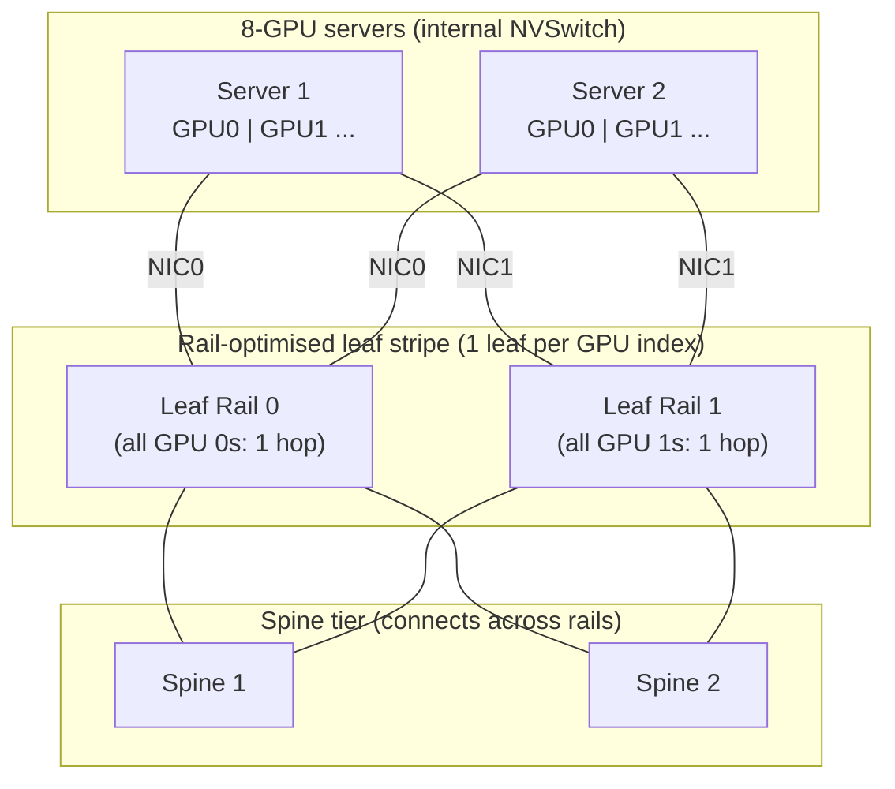

# 2.18 Data-center topologies: Clos, leaf-spine, oversubscription, failure domains and resilience

| | |
|---|---|
| Level | Advanced |
| Priority tier | 0 |
| Lab venue | Paper design + containerlab for validation |
| Part | Part 2: Networking, from first principles to AI fabrics |
| Status | Drafted, labs **untested** |

## Why this matters for AI infrastructure

The topology is the one decision that is hard to change after racks are cabled. It fixes how many GPUs a cluster can hold, the latency between any two of them, how much bandwidth survives a failure, whether collectives run at line rate or stall behind a hot link, and how much the whole thing costs in switches, optics and cables. NVIDIA, Meta, Google, Microsoft and others publish reference designs (rail-optimised leaf-spine, multi-plane Clos, dragonfly variants); you need to read them, size them (ports, switches, oversubscription), and defend or critique them in a design review or interview. This chapter covers general network design patterns, what makes a network a fabric, leaf-spine and Clos scaling math, oversubscription and contention, the AI-specific variants (rail-optimised, rail-unified, rail-only, scheduled fabrics, dragonfly, torus, multi-planar), rack and cabling layout, failure domains and information hiding examples, and resilience (redundancy, SRLGs, graceful restart, multi-plane cores).

## Prerequisites and outcomes

You should know ECMP/LAG (2.12), routing (2.13 to 2.16), overlays (2.17) and how a switch moves a packet (2.11).

After this chapter you can:

- Translate business requirements into network requirements and judge a design by cost, performance, resilience, operability and growth.
- Describe hierarchical designs and ring, mesh, hub-and-spoke, planar/nonplanar and regular topologies with their trade-offs.
- Define a fabric (regular topology, scale-out, specific performance goals) and distinguish it from a hierarchical network; define leaf, spine, super-spine, stage count, oversubscription, non-blocking versus non-contending.
- Size a 3-stage and 5-stage Clos (radix, number of leaves/spines, GPUs supported, links, optics) and compute oversubscription and failure-case capacity.
- Describe rail-optimised, rail-unified and rail-only designs, intra-rail versus inter-rail traffic, ToR/MoR/EoR rack layouts.
- Describe scheduled/cell-based fabrics with VOQ, dragonfly (and sparse dragonfly), torus, and multi-planar architectures and their trade-offs for AI.
- Apply information hiding (summarisation, aggregation, layering, exponential backoff, flooding reduction) as examples and design failure domains.
- Define MTBF, MTTR, availability ("nines"), single points of failure, SRLGs, ISSU, graceful restart, dual/multi-plane cores and modularity.
- Produce and critique a topology design for a given GPU count.

## 1. Network design patterns

### From business needs to a network

Networks exist to support applications, which support the business; design starts with *requirements*, not products. A workable translation:

| Business statement | Technical requirement |
|---|---|
| "Training a 70B model must finish in N days" | Sustained collective bandwidth per GPU, tail latency of all-reduce, job-completion-time SLO |
| "We sell GPU time to three customers" | Tenant isolation, per-tenant bandwidth, auditability |
| "Outage costs $X per minute" | Availability target (nines), failure-recovery time, redundancy, maintenance without downtime |
| "Budget is fixed; plan 3-year growth" | Cost per port, oversubscription decisions, expansion by adding pods without recabling |
| "Run in two regions" | Inter-site bandwidth, latency, failure domains, replication |

A **good network design** satisfies the requirements at acceptable cost while being *operable* (simple enough to understand, automate, troubleshoot and upgrade), *scalable* (grows by adding repeatable units), *resilient* (failure handled automatically and locally), *secure*, and *measurable*. The recurring theme is trade-offs among **state, optimality, surface and cost**: more optimal paths need more state; more resilience needs more redundancy and complexity; simple designs may waste capacity. Avoid designs only the author can operate.

### Hierarchical design

The classic campus/enterprise model: **access** (hosts attach), **distribution/aggregation** (policy, summarisation, L2/L3 boundary), **core** (fast transport). Benefits: summarisation points limit failure domains, policy is applied at known layers, modular growth, and a clear mental model. Costs: capacity must grow *up* (bigger core links and boxes), oversubscription compounds layer by layer, and east-west traffic hairpins through upper layers.

### Common topologies

- **Ring**: each node has two neighbours; cheap, simple; survives one cut (traffic reverses direction) but latency grows with ring size and a second failure partitions. Metro/transport networks and some campus backbones. **Torus** extends rings into multiple dimensions.
- **Mesh**: full mesh gives direct paths between every pair (n(n-1)/2 links; not scalable); **partial mesh** links selected pairs. Great for small cores and for the groups inside a dragonfly.
- **Hub-and-spoke**: sites connect to a hub; cheap and easy to control (policy at the hub) but the hub is a bottleneck/single point of failure and spoke-to-spoke traffic hairpins; typical WAN/branch designs; dual-hub mitigates.
- **Planar vs non-planar, regular**: a planar topology can be drawn without crossing links (rings, trees); non-planar ones (meshes, hypercubes, Clos) cannot. **Regular** topologies repeat identical units, which simplifies configuration, automation and spares.

## 2. What makes a fabric?

"Fabric" is overused in marketing. The useful definition has three parts:

1. **Topological regularity**: the topology consists of many identical, interchangeable sub-topologies (every pod, every leaf-spine block looks the same), designed for replicable hardware, software and configuration.
2. **Scale-out growth**: bandwidth and port count grow by adding more equipment of the same kind (another pod, another spine), not by replacing devices with bigger ones. (Hierarchical networks scale *up*: bigger aggregation/core boxes and links; fabrics scale *out*, within the port-count limit of each device.)
3. **Specific performance goals**: failures are measured and handled at pod/rack/link granularity (applications tolerate being moved); workload mobility must converge very quickly; the metric of interest is **oversubscription** (edge bandwidth versus fabric bandwidth), and the goal is low *jitter* and low queueing delay as well as low latency, usually by avoiding contention rather than elaborate QoS.

Not a fabric by themselves: any overlay, any high-bandwidth network, any network with lots of ECMP, any network treated as one "thing". The disaggregation trend (below) is why fabrics became important: storage, memory and compute became network-attached or distributed, so *east-west* traffic dwarfs north-south.

### East-west, disaggregation and the jitter problem

In converged servers, all component traffic runs on an internal bus and the network sees mostly north-south traffic. With disaggregated storage, virtualised services, microservices and distributed training, processors fetch data across the network: hyperscale operators see roughly ten bits of east-west traffic per bit of north-south. Consequently application performance becomes tied to network **delay and jitter**: congestion that adds fractions of a second to data transfer slows the whole application, and one slow service cascades. AI training is an extreme case: synchronous collectives make every step wait for the slowest transfer. The network is part of the computer.

Terms: *converged* (all resources in one server), *disaggregated* (storage/memory/network reachable as virtual resources across the network; white-box hardware, because standardised virtual interfaces make brands interchangeable), *hyperconverged* (resources stay with the compute node but are virtualised and shared across nodes), *composable* (resources assembled on demand). Disaggregation also reached networking (white-box switches running open NOS such as SONiC or Cumulus on merchant silicon, separating hardware, NOS and applications) and enables the "network as software" operating models discussed in chapters 2.28 and 2.29.

## 3. Leaf-spine (folded Clos)

A **Clos network** (Charles Clos, 1953, for telephone switching) builds a large non-blocking switch from stages of smaller ones. Data-centre **leaf-spine** is a folded Clos:

- **Leaf / ToR** switches: servers and other devices attach here; all external connectivity enters through leaves.
- **Spine** switches: connect leaves; **no connections between spines** and **no devices attached to spines** (standard rule; cross-links add complexity).
- Every leaf connects to every spine (in a 3-stage fabric). Any two leaves are exactly two hops apart via any of S spines: S equal-cost paths.
- **Stages**: a leaf-spine counted unfolded is a 3-stage Clos (leaf-spine-leaf); adding a super-spine tier gives a **5-stage** fabric (leaf-spine-superspine-spine-leaf); 7-stage adds another tier. More stages give more ports but more hops and latency.

The control plane need not be complex (equal paths, no loops by construction); the complexity in real fabrics comes from compensating for cross-links, overlays and traffic engineering.

### Sizing a 3-stage fabric

Let switches have R ports (radix) of equal speed. For a non-oversubscribed (1:1) leaf: R/2 ports down (servers), R/2 up (spines). Then:

- Number of spines = R/2 (one uplink to each spine per leaf).
- Each spine has R ports; one to each leaf, so the maximum number of leaves = R.
- Maximum servers (endpoints) = R leaves × R/2 = **R²/2**.

For 64-port 400G switches: 32 downlinks + 32 uplinks per leaf; 32 spines; up to 64 leaves; up to 2,048 endpoint ports. In AI terms, each GPU NIC is an endpoint, so 2,048 GPUs (256 eight-GPU servers) with 2,048 spine-facing links, 64 leaves + 32 spines = 96 switches. Cabling: 2,048 server cables + 2,048 leaf-spine links.

Oversubscription changes the split: a leaf with d downlinks and u uplinks has ratio d:u (e.g. 48 down, 16 up = 3:1). Hyperscale general compute often runs 3:1; AI back-ends target **1:1** (no oversubscription) at the leaf-spine tier because collectives saturate NICs simultaneously.

### Five-stage fabrics

Beyond R²/2, build **pods** (a 3-stage fabric each) and connect pods with **super-spines**. With R-port switches, each pod uses half the spine ports downward (to leaves) and half upward (to super-spines). Maximum endpoints for a 1:1 5-stage Clos is R³/4 (for R=64: 65,536 endpoints). Intermediate sizes use partial pods and fewer super-spines. Illustrative sizing from a design reference (64 × 400G switches, rail-optimised):

| Config | GPUs | Leaves | Spines | Super-spines | Oversubscription |
|---|---|---|---|---|---|
| 1 row (one rail group) | 256 | 8 | 4 | none | 1:1 |
| 2 rows | 512 | 16 | 8 | none | 1:1 |
| 8 rows (3-stage, 64-port) | 2,048 | 64 | 32 | none | 1:1 |
| 5-stage, 1K-GPU blocks | 2,048 | 64 | 64 | 32 | 1:1 |
| 5-stage, 4 blocks | 4,096 | 128 | 128 | 32 | 2:1 at super-spine |
| 5-stage, 8 blocks | 8,192 | 256 | 256 | 32 | 4:1 at super-spine |

Observations: (a) beyond one 3-stage fabric you must either add stages, use **chassis** spines/super-spines (e.g. 256×400G chassis reduces the number of spines to a quarter), or oversubscribe the upper tier; (b) some operators evaluate **oversubscription up to 7:1** at the super-spine because most collectives are scheduled to stay inside a block, but higher ratios raise congestion probability, which then requires DCQCN/ECN/PFC and adaptive load balancing (chapter 2.19); (c) a 32K-GPU cluster at one NIC per GPU needs thousands of leaves, so multi-stage or multi-plane designs are unavoidable (section 7); (d) everything scales by adding the same unit. Treat these figures as arithmetic you should be able to reproduce, not as vendor guarantees.

### Oversubscription and contention

**Oversubscription ratio** = (aggregate bandwidth offered to endpoints) / (aggregate bandwidth into the fabric); equivalently, worst-case contention if all endpoints transmit at line rate across the tier. Example: a ToR with 320 Gb/s of server ports and 180 Gb/s of uplinks is 1.78:1 (about 2:1) oversubscribed.

**Non-blocking vs non-contending.**

- A **non-blocking** fabric has enough internal capacity that no *connection pattern* is blocked by fabric internals; packet-switched networks cannot be truly non-blocking, because several sources can send to one destination and the destination's link is the bottleneck even if the fabric is rich.
- A **non-contending** fabric (a stronger scheduling property) avoids any two flows competing for a link at the same time, as in circuit-switched networks where scheduling on the inbound side prevents conflicts.

For packet-switched fabrics one resolves *incast* either by scheduling (source-side admission, credit-based or request-grant flow control) or by adequate buffers, congestion signalling (ECN/DCQCN, PFC) and load balancing. Collectives create deterministic, synchronous, many-to-one patterns, so AI fabrics combine a 1:1 topology with congestion control and load balancing; and they exploit the fact that all-reduce algorithms (ring, tree) are designed to use bandwidth-optimal patterns.

### Capacity under failure

Always size for the failure case. With S spines and one spine failure, remaining uplink capacity per leaf is (S-1)/S (for 32 spines, 96.9%; for 4 spines, 75%). Since 1:1 designs have no slack, a failure makes the fabric oversubscribed until repaired; therefore: spare capacity (N+1 spines or rails), fast detection (BFD), rerouting, and job-level resilience (checkpointing, elastic training) are part of the design. Compute: "what fraction of leaf-to-leaf bandwidth survives losing a spine, a leaf, a link, a whole rail group, a power domain?"

## 4. AI back-end designs: rails

A server such as DGX/HGX H100 has 8 GPUs, an internal NVSwitch fabric for GPU-to-GPU traffic within the server, and typically one NIC per GPU (compute fabric) plus storage and management NICs. Inside the server communication is fastest; once a job spans servers, traffic crosses the network. How NICs attach to leaves defines the topology:

### Rail-optimised design (ROD)



GPU i of every server connects to leaf i of a group of 8 leaves (a **stripe** or **row**). All GPUs with the same index in different servers are *one hop apart* via the shared leaf: this is a **rail**. Collective algorithms (NCCL) are written to exploit it: reduce inside the server over NVLink first, then communicate across servers along rails, minimising inter-rail traffic.

- **Intra-rail** traffic (same GPU index on different servers) goes through one leaf: minimal latency.
- **Inter-rail** traffic (different GPU index) goes leaf → spine → leaf: twice the hops/latency; it should be rare (PXN, a NCCL feature, uses NVLink to send via the GPU on the destination's rail to avoid inter-rail hops).
- **Sizing example**: 64×400G leaf, 1:1: 32 down + 32 up ⇒ 32 servers per rail group; 8 leaves + 4 spines (if each leaf's 32 uplinks go to 4 spines with 8 links each) support 32 servers = 256 GPUs; two rows (16 leaves, 8 spines) support 64 servers = 512 GPUs; scale further with more spines, chassis spines or a super-spine.
- **Failure**: a leaf failure removes one rail for all servers in the stripe (each server loses 1/8 of its bandwidth, a degraded but functioning job, or the job restarts depending on library behaviour); a server NIC/cable failure removes one rail of one server.

### Rail-only design

If inter-rail traffic can be carried inside the servers over NVLink/NVSwitch (reach the target rail's GPU in-server, then go out its NIC), the fabric need not connect rails to each other at all: rails are independent networks, cheaper, simpler to troubleshoot (a fault in one rail doesn't affect others). The trade-off is dependence on in-server forwarding capacity and software, and less flexibility for non-collective traffic; adoption is still being evaluated.

### Rail-unified design (RUD)

Multiple GPUs of a server connect to the same leaf (all 8 to one leaf, or 4+4 to two leaves). Advantages: simple cabling, easy scaling, well-understood (a classic ToR design), copper DAC/AEC for short reaches, one-hop communication among up to a handful of servers (e.g. four servers on one leaf), potentially using the external leaf instead of the internal NVSwitch for in-server traffic if a higher-throughput switch is available. Disadvantages: a leaf failure isolates whole servers; per-rail traffic isolation inside the leaf needs additional features (e.g. deterministic path forwarding/colored fabrics, chapter 2.16); latency between servers on different leaves is two hops for everything.

### Rack and cable layout

| Layout | Description | Pros | Cons |
|---|---|---|---|
| **Top-of-rack (ToR)** | Leaf in each rack | Shortest server cables (DAC/AEC copper), simple; ideal for rail-unified | Needs more rack space/power/cooling in server racks; rail-optimised needs one server connected to 8 different leaves, so not natural |
| **Middle-of-row (MoR)** | Leaves in the middle racks of the row | Leaves do not add to server rack power; cable spans ~6 racks | More rack space; longer, varied cable lengths; no in-rack cabling |
| **End-of-row (EoR)** | Leaves in racks at the end | Same as MoR; can group leaves in 1+ racks for failure isolation | Longest cables (~10 racks) → optics or AOC; more space |

For rail-optimised builds, MoR/EoR is common because each server needs 8 leaf connections; cabling plans (pre-terminated MPO trunks, patch panels, labelling schemes, length standardisation) are a first-class design output. Power (each 8-GPU server draws ~10 kW; racks 20 to 40+ kW; liquid cooling), cooling and weight constraints often determine servers per rack more than the network does; the network is built around the physical plan.

## 5. Scheduled (cell-based) fabrics

Instead of per-packet hashing across equal paths, a **scheduled fabric** treats leaves as line cards and spines as the backplane of a giant chassis: packets arriving at the ingress leaf are cut into small **cells** (64 to 256 bytes) that are sprayed evenly across all fabric links, reassembled at the egress leaf, and forwarded. Implementations: Broadcom Jericho3-AI with Ramon3 fabric elements; Cisco Silicon One. Advantages: near-perfect link utilisation (cell spraying removes ECMP imbalance), **virtual output queues across the fabric** (the ingress holds packets per egress port, and a scheduler grants credits so the fabric is not oversubscribed: contention is avoided before it occurs, approaching non-contending behaviour), reduced tail latency, and simpler congestion handling than DCQCN alone. Constraints to evaluate: scale limits of the scheduled domain, behaviour on link/node failure (cell loss, reassembly), latency under congestion, vendor lock-in for the pod ("brick"), and operations model.

**VOQ** recap: each input keeps a virtual queue per output port, so congestion at one output does not block traffic to others (head-of-line blocking removed); with a fabric-wide VOQ the principle extends across the whole network.

## 6. Dragonfly, torus and other low-diameter topologies

Clos has diameter 2 (3-stage) or 4 (5-stage) switch hops. For cluster sizes in the tens of thousands, each extra stage adds latency and cost. Low-diameter topologies reduce hops and long links:

- **Dragonfly (DF, DF+)**: groups (also called blocks, bricks, pods) of switches, each group internally richly connected (full mesh, or a small Clos in DF+/sparse variants), and groups connected to every other group by global links, often all-to-all at the group level. Diameter is about three hops regardless of size. Benefits: fewer hops and lower latency, fewer spine layers and links, modular growth by adding groups, tolerant of group/component failures at reduced capacity. Costs: complex cabling between groups, **non-shortest-path routing** (valiant/UCMP) and adaptive routing needed for uniform traffic, uneven bandwidth for adversarial traffic patterns (all nodes in a group talking to another group over limited global links); applications/collectives should communicate mostly inside groups. A **sparse dragonfly** keeps each group as a leaf-spine Clos and connects only the top-of-group spines between groups.
- **Torus (1D/2D/3D, with wraparound)**: nodes connect to neighbours in each dimension. Diameter = sum over dimensions of ⌊size/2⌋. Cost-effective at very large scale (low port count per node), easy to scale out, excellent when applications use nearest-neighbour communication (stencils, some model-parallel layouts); poor for random all-to-all. Google's TPU pods use 3D torus interconnects (with optical circuit switching); in Ethernet fabrics a 1D torus of leaves can provide inter-rail connectivity instead of spines.
- **Hypercube, fat tree (see Clos), Slim Fly, HyperX**: other low-diameter topologies from HPC literature; relevant for comparison and papers.
- **Hybrid**: Clos inside a pod, dragonfly between pods; NVLink "scale-up" domains (NVL72) as a separate very-high-bandwidth tier inside the rack, with IP/IB scale-out above.

Trade-off table:

| Topology | Diameter | Cabling | Routing | Best for | Risk |
|---|---|---|---|---|---|
| 3-stage Clos | 2 | Moderate | ECMP (simple) | ≤ R²/2 endpoints; general AI | Port-count limit |
| 5-stage Clos | 4 | High | ECMP | Large clusters | Latency, super-spine oversubscription |
| Multi-plane Clos | 2 per plane | High (breakouts) | NIC spraying | 100K+ GPUs, reliability | NIC complexity |
| Dragonfly | ~3 | Group-to-group optics | Adaptive/non-minimal | Very large, low latency | Routing complexity, hot global links |
| Torus | Σ⌊n/2⌋ | Neighbour links | Dimension-ordered | Nearest-neighbour workloads | Poor bisection for all-to-all |
| Rail-only | 2 within a rail | Simple | ECMP per rail | Collectives w/ NVLink forwarding | Dependence on in-server routing |

## 7. Multi-planar scale-out

A single 3-tier Clos has one control plane and one data plane: a bug or failure can affect the entire fabric, and a 5-stage path adds a hop for jobs that span blocks. **Multi-planar** architectures replace one deep fabric with **several independent 2-tier planes**: each GPU NIC breaks out (400G/800G ports split into 2 or 4 lower-speed links) and connects to 2 or 4 planes simultaneously; the NIC (hardware and firmware) **sprays packets of a single queue pair across all planes** and reorders at the receiver so the application sees a single in-order flow. Properties:

- **Fault isolation**: planes have disjoint control and data planes; if one plane is down, a path to the GPU still exists at reduced capacity.
- **Latency**: two-tier planes keep inter-leaf traffic at spine depth; large jobs can be placed within a plane or across planes with only NIC spraying, while super-spines remain only to interconnect plane sets.
- **Complexity moves to the host**: packet spraying, reordering, and failure handling are NIC and library features (this is also the direction of Ultra Ethernet and vendor "multi-plane" NICs). Bridging on the server side must avoid Ethernet loops (EVPN-VXLAN MAC-VRF bridging over the IP underlay, or pure IP planes with ACL/RADIUS-based tenant control).
- **Example**: two planes with two rails each; a server's NIC1..8 connect to Rail A/B leaves in both planes; GPU-to-GPU traffic between servers in the same rail stays in the leaf; across rails uses plane spines; super-spines connect plane sets only for the largest jobs.

## 8. Inference data centres and the front-end

Inference does not usually need rail alignment: a model fits on one GPU or a few GPUs in a server, and traffic is client-server (north-south) plus storage and model-weight loading. The design is a conventional collapsed 3-stage or 5-stage Clos like an enterprise/cloud DC, with load balancers and Kubernetes ingress (chapter 2.20). Multi-node inference (very large models, expert parallelism) is the exception: RDMA traffic returns and rail-based or Clos back-end designs must be considered. Storage fabrics are separate networks (or logically separated) sized for checkpoint bursts and dataset reads. Overall, a server connects to three fabrics: **front-end** (inference/clients, management), **storage**, and **back-end/training** (compute collectives); each has its own topology and SLO.

## 9. Information hiding and failure domains: worked examples

Chapter 2.16 introduced the techniques; here are concrete instances.

- **Summarising topology**: IS-IS levels hide an area's internal topology behind L1/L2 routers; OSPF areas hide intra-area links behind ABRs (type 3 summaries). The price: suboptimal inter-area routing and blindness to detail (a TE controller needs BGP-LS or a hierarchical view).
- **Aggregation**: advertise `10.10.0.0/16` for 256 racks; inside, specifics are used. Failure of one rack's /24 doesn't ripple outward; the cost is blackholing if the aggregate is advertised while a specific is unreachable.
- **Layering**: BGP as a *reachability overlay*: the IGP carries only loopbacks and link reachability, BGP carries the bulk (customer, service or server prefixes). A change in a server prefix never triggers IGP SPF. EVPN is the same idea for MAC/IP. **Segment routing with a controller overlay**: the network's own control plane provides only node/adjacency SIDs; a controller computes and installs paths for policies, so the number of states in the network remains small while policy richness is centralised.
- **Slowing down state velocity**: **exponential backoff** (delay each successive recomputation or advertisement after repeated events: the first change is handled immediately, the next after 50 ms, then 100, 200 ... up to a cap; resets after quiet time) prevents flapping from saturating the control plane. **Link-state flooding reduction**: elect a subset of links for flooding in dense topologies (IS-IS distributed optimised flooding, OSPF flood reduction RFC 8099/mesh groups) so each LSA is not re-received dozens of times; essential in dense Clos link-state fabrics.
- **Design rule**: define a scope for every piece of state (who must know?), define a rate limit for every source of change, and verify these in failure tests.

## 10. Resilience and redundancy

### What failures look like to applications

A link failure can cause (not just "down"): complete flow failure (if filters or policy block the alternate path), a step change in **delay** (more hops, queues and serialisation), a burst of **jitter**, **dropped** packets (in flight at the failure moment), **duplicate** packets (microloops combined with short retransmit timers), and **reordering** (a microloop resolving as a later packet passes an earlier one). These can't be fully eliminated in packet networks; technologies that try often add complexity that hurts more than it helps. Tools: fast reroute, exponential backoff, graceful restart, ECMP, and application tolerance (retries, idempotency, checkpointing).

### Measures

- **MTBF** (mean time between failures) = total time / number of failures; **MTTR** (mean time to repair) = total outage time / number of outages; **Availability** = MTBF / (MTBF + MTTR) = uptime / (uptime + downtime).
- "Nines": 99.9% (three nines) ≈ 8.8 h/year downtime; 99.99% ≈ 52.6 min/year (the source describes about an hour); 99.999% ≈ 5.3 min/year. Define *what* counts as down: whole network, a service, a tenant, a rail, or a percentage of capacity; for AI a degraded fabric (e.g. 7/8 rails) may be "available" for a job but not for the SLO.
- **Informal measures**: **MTBM** (mean time between mistakes: driven by configuration complexity and change processes; the "2 a.m. rule" says don't build what you can't fix at 2 a.m.), **MTTI** (mean time to innocence: how long to prove the network isn't at fault; requires before/after telemetry).

### Redundancy as a tool

Redundancy creates resilience only if there is **no hidden single point of failure**: two paths that share a middle switch, a power feed, a fibre conduit or a control-plane process are not redundant. Rules: eliminate single points (device, link, power, cooling, software/config), then map **shared risk link groups (SRLGs)**: sets of links that fail together (same cable bundle, same line card, same ASIC, same optical amplifier, same data-hall breaker). Overlays and LAGs can hide SRLGs; verify with the physical plan.

Further tools:

- **In-service software upgrade (ISSU)** and **graceful restart** (forwarding continues while the control plane restarts; neighbours keep stale routes for a while) reduce maintenance downtime, but carry risk (stale routes, bugs); data-centre practice often prefers *drain, upgrade, undrain* with ECMP rather than ISSU, using graceful shutdown (chapter 2.16).
- **Dual and multi-planar cores** (A/B fabrics, planes) give independent failure domains and control planes; the cost is double hardware and host connectivity.
- **Modularity and resilience**: modules (pods, blocks) limit blast radius and enable independent upgrades, but the *interfaces* between modules are where failures interact; keep interfaces simple and well-tested. Over-modularising increases the number of interfaces and operational overhead.
- **Application-level resilience**: for training, checkpoint frequency and elastic/fault-tolerant frameworks shape how much network failure costs: a 5-minute fabric incident with checkpoints every 30 minutes can waste up to 30 minutes of cluster time; so network resilience, job resilience and checkpoint cost are one design.

## 11. A design exercise and calculator

**Task**: design a back-end fabric for 4,096 H100 GPUs (512 servers × 8 GPUs, one 400G NIC per GPU), 1:1 at the leaf-spine tier, rail-optimised, with a target of surviving the loss of any single spine with ≤ 5% capacity loss.

Worked arithmetic with 64×400G switches:

1. **Leaves.** Each rail leaf serves 32 servers (32 downlinks, 32 uplinks). 512 servers / 32 = 16 server groups ("rows"), each with 8 rail leaves, so 16 × 8 = **128 leaves**. A single 3-stage fabric with R = 64 supports at most 64 leaves, so a 3-stage design does not fit: use a 5-stage design (or chassis spines).
2. **Blocks.** Split into 4 blocks of 1,024 GPUs. A block has 32 leaves and 32 spines; each leaf has 32 uplinks, one to each of the block's 32 spines.
3. **Spines.** Each spine uses 32 ports down (one per leaf) and 32 up, so 4 blocks × 32 spines = **128 spines** with 128 × 32 = 4,096 uplinks toward the super-spine tier.
4. **Super-spines.** At 1:1 they would need 4,096 / 64 = 64 switches; at 2:1 they receive 2,048 links and need **32 super-spines** (this is the oversubscription decision: acceptable only if most jobs are placed inside one block).
5. **Totals.** 128 + 128 + 32 = **288 switches**; cables: 4,096 server links, 4,096 leaf-spine links, 2,048 spine-super-spine links (server side usually DAC/AEC copper or short AOC; switch-to-switch tiers need optics or AOC).
6. **Failure check.** Losing one spine removes 1 of 32 uplinks per leaf, 1/32 = 3.1% capacity (within the 5% target); add BFD and fast ECMP rerouting so the loss is a few hundred milliseconds. Also tabulate leaf, rail-group, super-spine and power-domain failures and the expansion path (add blocks, super-spines, or move to a multi-plane design).

A small calculator (use in the lab):

```python
def clos3(R, gpus_per_leaf_down=None, oversub=1.0):
    """3-stage Clos: R-port switches; returns (leaves, spines, endpoints)."""
    down = int(R * oversub / (1 + oversub)) if gpus_per_leaf_down is None else gpus_per_leaf_down
    up = R - down
    spines = up                    # one uplink to each spine
    leaves = R                     # each spine port connects one leaf
    return leaves, spines, leaves * down

for R in (32, 64, 128):
    print(R, clos3(R))             # (leaves, spines, endpoints) at 1:1
def survive_spine_loss(spines): return (spines - 1) / spines
```

## 12. Hands-on lab: validate topologies and Clos sizing

First, run the self-checking Python lab (`code/part02/dc_topologies_clos_lab.py`) locally. It verifies 3-stage (`R^2 / 2 = 2,048` endpoints for `R = 64`) and 5-stage (`R^3 / 4 = 65,536`) non-blocking Clos math, oversubscription (`1.78:1`) and single-spine loss capacity (`96.9%` with `32` spines), `k`-D torus diameter (`sum(n_i // 2)`), MTBF/MTTR availability nines (`99.99%` = `52.6 min/year`), and the 4,096-GPU 288-switch BOM.

```bash
python3 code/part02/dc_topologies_clos_lab.py
```

Next, on a disposable Linux VM using containerlab and network namespaces (all interactive VM commands below are `untested here`), work through these steps:

1. **Paper**: complete the design exercise above; produce a bill of materials (switches, optics, cables) and a failure table (spine, leaf, link, rail group, power domain) with the percentage of bandwidth surviving.
2. **Build a 2-spine × 4-leaf Clos in containerlab** with FRR (reuse the lab in chapter 2.16); run `iperf3` all-to-all with 16 flows and measure per-link utilisation; fail a spine and measure the throughput and recovery time.
3. **Rail emulation**: create 8 rail namespaces per "server" and 8 leaf bridges (or an FRR leaf per rail); show intra-rail one-hop vs inter-rail two-hop with `traceroute` and latency (`netem` delays per hop).
4. **Oversubscription**: configure uplink shaping (`tc tbf`) to 2:1 and run synchronized iperf bursts (incast) to see drops/queueing; add ECN marking with `fq_codel`/`red` and observe the effect.
5. **Shared risk**: model two "redundant" paths that traverse the same intermediate bridge/namespace and show a double failure from one fault; fix and re-test.
6. **Availability math**: compute availability for a component list (series/parallel) using MTBF/MTTR values in a spreadsheet or script; relate to downtime per year.
7. **Torus/dragonfly toy**: create a 4×4 torus of namespaces with static/OSPF routes, measure hops and latency distribution; compare with a 2-spine Clos of the same node count.
8. **Clean up.**

## 13. Common mistakes

- Choosing a topology from a diagram without computing ports, switches, optics, power and failure-case capacity.
- Calling a hierarchical network a fabric; scaling up when scale-out was available.
- Oversubscription decided by habit (3:1) for collectives that need 1:1; ignoring oversubscription at the top tier.
- Connecting devices to spines or cross-linking spines without understanding control-plane consequences.
- Forgetting shared risk (power feed, cable tray, line card, optic vendor/firmware bug) behind "redundant" links.
- Rail-optimised cabling errors that put two rails on one leaf or swap rails between servers (check with LLDP, `ibnetdiscover`, NCCL tests).
- Treating inter-rail traffic as unimportant without measuring it (PXN, all-to-all in MoE).
- Ignoring MTU, optics reach and breakout rules; ordering the wrong cable types.
- Designing for the average, not the failure case; no maintenance and drain plan.

## 14. Interview angles

- "Why leaf-spine? How many servers can you attach with R-port switches at 1:1?"
- "What is oversubscription? What would you choose for an AI back-end and why?"
- "Rail-optimised versus rail-unified: pros, cons, failure impact."
- "How do you scale to 32K GPUs? What are the trade-offs of 5-stage, multi-plane, dragonfly?"
- "What is a scheduled fabric / VOQ and why does it help incast?"
- "Define availability; compute downtime for four nines. What hides single points of failure?"
- "What is an SRLG? Give examples in a data centre."
- "What distinguishes a fabric from a hierarchical network?"
- "Where would you place leaves: ToR, MoR or EoR, and why?"

## Exercises

1. **What Makes a Network a Fabric, Scale-Out vs. Scale-Up, and Non-Blocking vs. Non-Contending (`CN` Chapters 22 & 25):** (a) State the three defining properties of a packet-switched **fabric** and contrast it with a classic 3-tier hierarchical campus network (`access -> distribution -> core`); (b) distinguish a **non-blocking** Clos from a **non-contending** scheduled fabric, and explain why hyperscale data centers see `~10` bits of east-west traffic for every `1` bit of north-south traffic.
2. **3-Stage and 5-Stage Clos Sizing Math, Oversubscription, and Spine-Failure Capacity:** Using `size_clos3_fabric()`, `compute_5stage_max_endpoints_1to1()`, and `compute_oversubscription_and_spine_loss()` in `code/part02/dc_topologies_clos.py`: (a) calculate the number of leaves, spines, total switches, maximum `1:1` endpoints, and cables for a 3-stage Clos built from `64`-port switches (`2,048` endpoints) and `32`-port switches (`512` endpoints), plus the `1:1` 5-stage ceiling for `R = 64` (`65,536`); (b) calculate the oversubscription ratio of a leaf with `320 Gb/s` downlinks and `180 Gb/s` uplinks (`1.78:1`), and the surviving capacity when `1` of `32` spines fails (`96.9%`).
3. **AI Back-End Rail Topologies (`ROD`, Rail-Only, `RUD`) and `ToR`/`MoR`/`EoR` Rack Layouts (`ADC` Chapter 3):** Compare **Rail-Optimized (`ROD`)**, **Rail-Only**, and **Rail-Unified (`RUD`)** GPU cluster topologies across intra-rail vs inter-rail hop counts, `NCCL PXN` NVLink forwarding, failure blast radius when one leaf switch dies, and physical cabling layout (**Top-of-Rack `ToR`**, **Middle-of-Row `MoR`**, and **End-of-Row `EoR`**).
4. **Scheduled Cell-Based Fabrics (`VOQ`), Dragonfly, Torus, and Multi-Planar Scale-Out (`ADC` Chapter 3):** (a) Explain how a **scheduled cell-based fabric** (`64–256` B cells + credit-scheduled fabric-wide `VOQ`s) eliminates ECMP elephant collisions; (b) compare **Dragonfly / Sparse Dragonfly** (`~3`-hop diameter, non-minimal routing), `k`-D **Torus** (`compute_torus_diameter([4, 4, 4]) = 6` hops), and **Multi-Planar** scale-out (NIC port breakouts spraying packets across independent 2-tier planes with receiver NIC reordering).
5. **Information-Hiding Examples and Failure Domains (`CN` Chapters 19 & 20):** Give concrete protocol examples of the five information-hiding and rate-limiting mechanisms in Section 9: (a) summarizing topology (`OSPF` ABRs / `IS-IS` levels), (b) aggregating reachability (`10.10.0.0/16` for `256` racks), (c) layering control planes (`BGP`/`EVPN` or `SR` controller over an IGP loopback underlay), (d) **exponential backoff** (`50, 100, 200 ms`), and (e) **link-state flooding reduction** (`RFC 8099`).
6. **`MTBF`, `MTTR`, Availability \"Nines\", `SRLG`s, and the 4,096-GPU Design Calculator:** (a) Using `compute_availability_and_downtime()`, calculate the availability percentage and allowed annual downtime in minutes for `MTBF = 9,999 h, MTTR = 1 h` (`99.99%`, `52.6 min/yr`) and `MTBF = 99,999 h, MTTR = 1 h` (`99.999%`, `5.3 min/yr`), and define `MTBM` ("2 a.m. rule") and `MTTI`; (b) reproduce the full 4,096-GPU (`512` servers x `8` GPUs) 5-stage Clos bill of materials from Section 11 (`128` leaves, `128` spines, `32` super-spines = `288` switches; `4,096` + `4,096` + `2,048` cables).

## Checkpoint questions (20)

<details>
<summary>1. What three characteristics define a network \"fabric\", and how does scale-out differ from scale-up (`CN` Chapter 25)?</summary>
A **fabric** is defined by: (1) **topological regularity** (built from many identical, interchangeable sub-topologies), (2) **scale-out growth** (adding capacity by adding more switches/pods of the same kind rather than replacing core switches with bigger chassis—**scale-up**), and (3) **specific east-west performance goals** (bounded oversubscription, fast convergence, and low queueing delay / jitter).
</details>

<details>
<summary>2. State the two fundamental rules of a standard 3-stage folded Clos (leaf-spine) topology.</summary>
(1) **Every leaf switch connects to every spine switch** (making every leaf-to-leaf path exactly **2 switch hops**—`leaf -> spine -> leaf`—across `S` equal-cost paths);\n(2) **Spines connect ONLY to leaves**—there are no spine-to-spine cross-links and no servers/endpoints attached directly to spines.
</details>

<details>
<summary>3. For a 3-stage folded Clos built from `R`-port switches at `1:1` (non-oversubscribed), derive the maximum number of spines, leaves, and endpoints (`R^2 / 2`), and evaluate for `R = 64`.</summary>
At `1:1` non-oversubscribed, each `R`-port leaf uses **`R / 2` ports downward** to endpoints and **`R / 2` ports upward** to spines (1 uplink per spine -> **`S = R / 2` spines**). Each `R`-port spine has `R` ports, connecting to at most **`L = R` leaves**. Total endpoints = `L * (R / 2) =` **`R^2 / 2`**. For `R = 64`: **`32` spines, `64` leaves (`96` switches total), and `64^2 / 2 = 2,048` endpoint ports** (`256` 8-GPU servers), with `2,048` server cables and `2,048` leaf-spine cables.
</details>

<details>
<summary>4. What is the maximum number of `1:1` endpoints in a 5-stage Clos of `R`-port switches (`R^3 / 4`), and what is the hop count across a 5-stage Clos?</summary>
In a 5-stage Clos (`leaf -> spine -> super-spine -> spine -> leaf`, **4 switch hops** end-to-end), each pod spine uses `R / 2` ports down to pod leaves and `R / 2` ports up to super-spines, supporting up to **`R^3 / 4` endpoints at `1:1`** (for `R = 64`: **`65,536` endpoints**).
</details>

<details>
<summary>5. Define Oversubscription Ratio, why AI training back-end fabrics use `1:1` at the leaf tier, and what fraction of capacity survives losing 1 of `S` spines.</summary>
**Oversubscription ratio** is `(aggregate downlink bandwidth to servers) / (aggregate uplink bandwidth to spines)` (e.g., `48` down : `16` up = `3:1`). While general cloud compute uses `2:1` or `3:1` because VMs rarely burst simultaneously, distributed AI training collectives (`AllReduce`, `AllToAll`) drive all GPU NICs at 100% line rate simultaneously—requiring **`1:1` (non-oversubscribed)** leaf-to-spine bandwidth. When `1` of `S` spines fails, surviving capacity is **`(S - 1) / S`** (`31/32 = 96.9%` for `32` spines, a `3.1%` loss).
</details>

<details>
<summary>6. What is the difference between a Non-Blocking fabric and a Non-Contending fabric (`CN` Chapter 25)?</summary>
A **non-blocking** fabric (`1:1` Clos) has enough internal bisection bandwidth that any permutation of 1-to-1 sender-to-receiver pairs can transmit at full line rate if routed along disjoint links. However, a packet-switched Clos is still **contending**: two flows can hash onto the same spine uplink (`ECMP collision`), or multiple senders can transmit to the **same single receiver** at once (**incast**). A **non-contending** fabric (such as a credit-scheduled cell fabric with fabric-wide VOQs) arbitrates grants before transmission so two flows never contend for the same link simultaneously.
</details>

<details>
<summary>7. Explain a Rail-Optimized Design (`ROD`) for 8-GPU servers, including Intra-Rail vs. Inter-Rail traffic and `NCCL PXN` (`ADC` Chapter 3).</summary>
In a **Rail-Optimized** fabric, NIC `i` (`0..7`, paired with GPU `i`) on every server connects to **Leaf `i`** of an 8-leaf rail group ("stripe"). All `GPU i`s across all 32 servers in the stripe sit on the **same leaf switch** (**1 hop apart: intra-rail traffic**). Traffic between different GPU indices (`GPU 0` -> `GPU 3`, **inter-rail**) would normally take 2 hops (`leaf -> spine -> leaf`); **`NCCL PXN`** avoids inter-rail spine hops by forwarding the data inside the source server over **NVLink/NVSwitch** to the local GPU sitting on the destination's rail, then exiting onto that rail's leaf switch in 1 hop.
</details>

<details>
<summary>8. Compare Rail-Optimized (`ROD`), Rail-Only, and Rail-Unified (`RUD`) topologies.</summary>
- **Rail-Optimized (`ROD`)**: 1 NIC per GPU goes to its corresponding rail leaf (`Leaf 0..7`), with spines connecting rails/pods; 1-hop intra-rail latency, and a single leaf failure loses only `1/8` of bandwidth.\n- **Rail-Only**: 8 independent rail networks with **no spine switches connecting different rails**; all inter-rail traffic is routed inside the servers over high-speed **NVLink/NVSwitch** domains—eliminating inter-rail spine cost and isolating faults per rail.\n- **Rail-Unified (`RUD`)**: all 8 NICs of a server connect to the **same local ToR leaf switch**; enables short in-rack copper DAC cabling, but a single ToR leaf failure takes down the entire server (`8/8` GPUs).
</details>

<details>
<summary>9. Compare `ToR` (*Top-of-Rack*), `MoR` (*Middle-of-Row*), and `EoR` (*End-of-Row*) switch placements for GPU clusters (`ADC` Chapter 3).</summary>
- **`ToR` (*Top-of-Rack*)**: leaf switches sit inside each server rack—shortest server cables (passive/active copper `DAC`/`AEC`), ideal for rail-unified designs, but consumes rack U-space and power inside high-density (`20–40+ kW`) GPU racks.\n- **`MoR` (*Middle-of-Row*)**: leaf switches for all 8 rails are grouped in dedicated network racks in the middle of the row (spanning `~6` racks each way), keeping switch heat/power out of GPU racks and letting each server cable its 8 NICs to the 8 rail leaves.\n- **`EoR` (*End-of-Row*)**: leaf switches sit in dedicated racks at the end of the row (longest cables spanning `~10` racks, requiring `AOC` or optical transceivers).
</details>

<details>
<summary>10. How does a Scheduled (Cell-Based) Fabric with Fabric-Wide `VOQ`s work (`ADC` Chapter 3)?</summary>
In a scheduled cell fabric (`Broadcom Jericho3-AI / Ramon3`, `Cisco Silicon One`), the ingress leaf slices arriving packets into fixed-size **`64` to `256`-byte cells**, holds them in **Virtual Output Queues (`VOQ`s)** per destination egress port across the entire fabric, waits for the egress leaf's credit scheduler to grant bandwidth, and **sprays the cells evenly across every spine link in parallel**, reassembling the packet in order at the egress leaf. This achieves ~100% link utilization without ECMP elephant-flow collisions or incast buffer drops.
</details>

<details>
<summary>11. Compare a **Dragonfly** (and **Sparse Dragonfly**) topology with a 5-stage Clos (`ADC` Chapter 3).</summary>
A 5-stage Clos requires 4 switch hops and a full layer of super-spine switches and optics. A **Dragonfly** connects local switch groups (internally full-meshed in canonical dragonfly, or a 2-tier leaf-spine Clos in **sparse dragonfly**) directly to every other group via global links, keeping network diameter at **`~3` hops** with fewer switches and optical transceivers—at the cost of requiring **adaptive / non-minimal (Valiant) routing** when direct inter-group links saturate.
</details>

<details>
<summary>12. What is the diameter formula for a `k`-dimensional Torus, and why is a Torus well-suited to nearest-neighbor workloads but poor for random all-to-all?</summary>
In a `k`-dimensional torus with side lengths `n_1, n_2, ..., n_k` and wraparound links, the maximum shortest-path hop count (diameter) is **`sum(floor(n_i / 2))`** (for example, a `4 x 4 x 4` 3D torus has diameter `2 + 2 + 2 = 6` hops). Each node needs only `2k` ports (no separate spine switches!) and neighbor-to-neighbor hops (stencil, pipeline/tensor rings) are 1 hop away, but random all-to-all traffic crosses many intermediate nodes and has lower bisection bandwidth than a Clos.
</details>

<details>
<summary>13. How does a **Multi-Planar** GPU fabric work (`ADC` Chapter 3)?</summary>
Instead of building one giant 5-stage Clos with a single shared failure domain, a **multi-planar** design splits each GPU's high-speed NIC (`400G`/`800G`) via breakout cables across **`2` or `4` completely independent 2-tier fabrics (planes)**, each with its own separate leaf switches, spine switches, and control plane. The GPU NIC hardware **sprays packets of a single flow across all planes in parallel** and reorders them at the receiving NIC—keeping hop count at 2 tiers while surviving the complete loss of an entire plane.
</details>

<details>
<summary>14. How do an AI **Inference** data center and the three server fabrics (*Front-End*, *Storage*, *Back-End*) differ in topology (`ADC` Chapter 3)?</summary>
Every training server connects to three distinct networks: (1) the **Back-End Compute Fabric** (`1:1` rail-optimized/multi-plane RoCEv2 or InfiniBand for GPU-to-GPU collectives), (2) the **Storage Fabric** (sized for parallel dataset reads and synchronous checkpoint bursts), and (3) the **Front-End / Management Fabric** (north-south client ingress, SSH, Kubernetes control). Dedicated **Inference data centers** (where models fit inside one server or NVLink domain) are dominated by north-south client/API traffic and use a conventional 3- or 5-stage Clos with L4/L7 load balancers rather than rail-aligned fabrics.
</details>

<details>
<summary>15. Explain how Exponential Backoff and Link-State Flooding Reduction (`RFC 8099`) protect a dense fabric control plane (`CN` Chapter 20).</summary>
- **Exponential Backoff** (`timers throttle spf 50 100 5000`): runs the first SPF/update immediately (`50 ms`) for fast single-failure convergence, but doubles the wait time (`100 ms, 200 ms, 400 ms...` up to `5,000 ms`) if a link keeps flapping—slowing down state velocity before CPU overload occurs.\n- **Link-State Flooding Reduction (`RFC 8099` / `distoptflood`)**: in a dense Clos where `64` leaves each connect to `32` spines, naive flooding sends `64 * 32 = 2,048` copies of every LSA; electing a minimal flooding tree over the mesh eliminates `> 95%` of duplicate LSA transmissions.
</details>

<details>
<summary>16. List the five ways a single physical link failure manifests to an application (`CN` Chapter 23).</summary>
Beyond a hard outage, a link failure causes: (1) **complete flow failure** (if an ACL/NAT blocks the backup path), (2) a **step increase in baseline delay** (longer backup path or higher serialization delay), (3) a **burst of jitter** (queueing transient during reroute), (4) **packet loss** (packets in flight on the failed link before BFD/carrier detection), and (5) **out-of-order and duplicate packets** (transient micro-loops during FIB convergence).
</details>

<details>
<summary>17. State the formulas for `MTBF`, `MTTR`, and `Availability`, and state the allowed annual downtime for Three, Four, and Five Nines.</summary>
- **`MTBF`** (*Mean Time Between Failures*) = `total_operating_time / number_of_failures`\n- **`MTTR`** (*Mean Time To Repair*) = `total_downtime / number_of_failures`\n- **`Availability`** = **`MTBF / (MTBF + MTTR)`**\nAnnual downtime (`365` days = `525,600` minutes):\n- **`99.9%` ("Three Nines")**: **`8.76 hours / year`** (`525.6` minutes)\n- **`99.99%` ("Four Nines")**: **`52.6 minutes / year`** (`~1` hour)\n- **`99.999%` ("Five Nines")**: **`5.26 minutes / year`**.
</details>

<details>
<summary>18. What are `MTBM` (and the \"2 a.m. rule\") and `MTTI` (`CN` Chapter 23)?</summary>
- **`MTBM` (*Mean Time Between Mistakes*)**: how often human/automation operational errors cause an outage—directly proportional to design complexity. The **"2 a.m. rule"** states: *never deploy a clever network design that the on-call engineer cannot understand and troubleshoot at 2 a.m.*\n- **`MTTI` (*Mean Time To Innocence*)**: how quickly the network team can prove with objective telemetry (`BFD`, queue counters, synthetic probes) whether a slow training job is caused by the network or by the application/storage.
</details>

<details>
<summary>19. Why do data-center operators prefer \"Drain -> Upgrade -> Undrain\" over `ISSU` (*In-Service Software Upgrade*)?</summary>
`ISSU` attempts to upgrade a switch's NOS while keeping its data plane forwarding via stateful control-plane handoffs (`Graceful Restart`); in practice, complex ISSU state handoffs frequently hit software bugs that drop the switch anyway. Because a Clos fabric has `N`-way ECMP redundancy, **draining** the switch first (`bgp graceful-shutdown` / IS-IS `overload` / OSPF `max-metric`), verifying zero traffic on its ports, performing a clean reboot upgrade, and undraining is far simpler and safer.
</details>

<details>
<summary>20. Reproduce the switch and cable counts for the Section 11 4,096-GPU (`512` servers x `8` GPUs) 5-stage Clos fabric using `64 x 400G` switches.</summary>
- **Leaves**: `32` downlinks + `32` uplinks per leaf -> `4,096 GPUs / 32 = 128` leaf switches (grouped into `4` 1,024-GPU pods of `32` leaves each).\n- **Spines**: `32` spines per pod x `4` pods = **`128` spine switches** (`32` ports down to pod leaves, `32` ports up toward super-spines = `4,096` spine uplinks capacity).\n- **Super-spines**: at `2:1` inter-pod oversubscription (`2,048` links upward), `2,048 / 64 =` **`32` super-spine switches** (`64` at `1:1`).\n- **Total**: `128 + 128 + 32 =` **`288` switches**, with `4,096` server cables, `4,096` leaf-spine cables, and `2,048` spine-superspine cables; losing 1 spine in a pod costs `1/32 = 3.1%` capacity (`<= 5%` target).
</details>

## Sources and review notes

- **Sources read in full:**
  - `ai-data-center-network-design-and-technologies` — Dinakaran Setty et al., *AI Data Center Network Design and Technologies*, **Chapter 3: Network Design Considerations** (AI workload stages and fabrics, training data-center architecture, rail-optimized / rail-only / rail-unified designs and scale tables `256` to `8,192` GPUs, rack layouts `ToR`/`MoR`/`EoR`, scheduled cell-based fabrics `64–256` B cells and fabric-wide VOQ, dragonfly and torus topologies, inference data-center architecture, and multi-planar scale-out).
  - `computer-networking-problems-and-solutions` — Russ White and Ethan Banks, *Computer Networking Problems and Solutions*, **Chapter 19: Failure Domains** (information hiding), **Chapter 20: Examples of Information Hiding** (summarizing topology in IS-IS and OSPF, aggregation `10.10.0.0/16` for `256` racks, layering with BGP and SR controllers, exponential backoff `50, 100, 200 ms`, and link-state flooding reduction RFC `8099`), **Chapter 22: Network Design Patterns** (translating business problems to technical requirements, hierarchical access/distribution/core design, ring, mesh `n(n-1)/2`, hub-and-spoke, planar vs nonplanar, and regular topologies), **Chapter 23: Resilience** (failures as seen by applications, `MTBF`/`MTTR`/`Availability` nines `99.9%` `8.8 h/yr` / `99.99%` `52.6 min/yr` / `99.999%` `5.3 min/yr`, `MTBM` 2 a.m. rule, `MTTI`, redundancy, `SRLG`s, `ISSU` and graceful restart, dual/multi-planar cores, and modularity), and **Chapter 25: Disaggregation, Hyperconvergence, and Spine-and-Leaf** (`10:1` east-west vs north-south traffic, jitter, Charles Clos `1953` folded Clos, `320 Gb/s` vs `180 Gb/s` = `1.78:1` oversubscription, non-blocking vs non-contending, and network disaggregation SONiC/Cumulus).
- **Run here:** `python3 code/part02/dc_topologies_clos_lab.py` (14 passed, 0 failed).
- **Explicitly labelled inferences:** The rail-optimized Mermaid topology diagram, 3-stage (`R^2/2`) and 5-stage (`R^3/4`) Clos sizing derivations, and the 4,096-GPU (`288`-switch) worked design calculator connect Clos and low-diameter topology theory to Part 8 and Part 9 GPU cluster design (cross-referenced with Chapters 2.11–2.17, 2.19, 2.20, 2.27–2.29, and 2.31, plus original study items 21, 22, 23, 24, 25, 26, 27, 28, 29, 30, 31, 32, 33, 34, 35, 36, 37, 38, 39, and 40).
- **Not verified on live hardware:** All interactive containerlab and namespace commands (`iperf3`, `traceroute`, `tc tbf`, `fq_codel`, `netem`) are marked (untested here) and must be executed on a disposable Linux VM.
