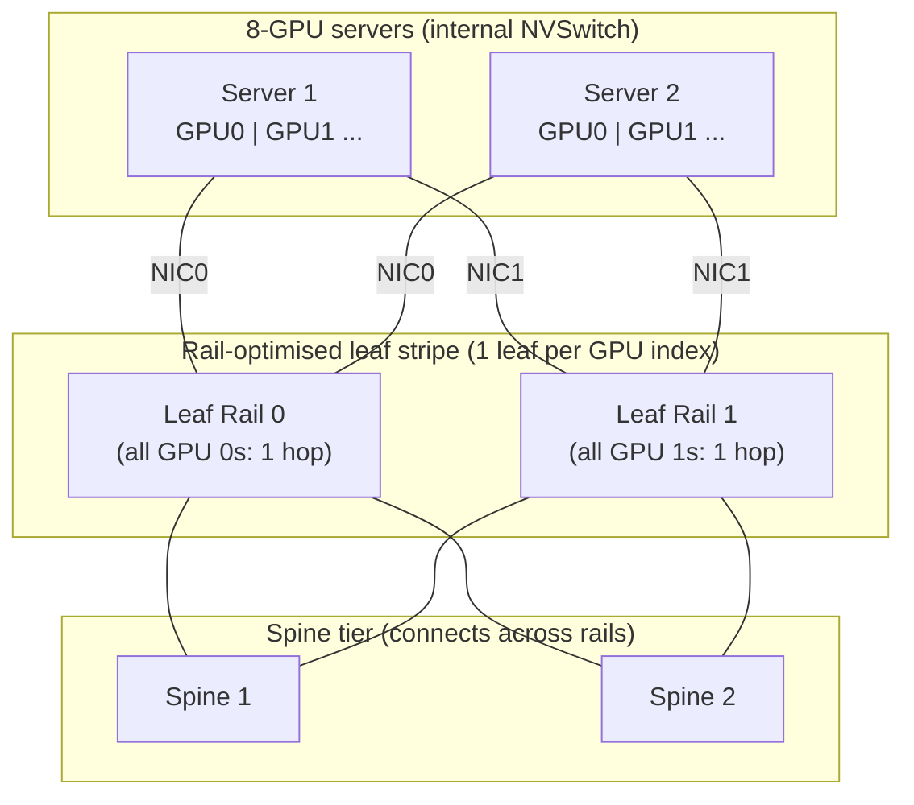

# 2.18 Data-center topologies: Clos, leaf-spine, oversubscription, failure domains and resilience

| | |
|---|---|
| Level | Advanced |
| Priority tier | 0 |
| Lab venue | Paper design + containerlab for validation |
| Part | Part 2: Networking, from first principles to AI fabrics |
| Status | Drafted, labs **untested** |

## Why this matters for AI infrastructure

Picture a design review where someone asks why the back-end network is built the way it is. You need a real answer, and it starts with the topology. The topology is the one decision that is hard to change after racks are cabled. It fixes how many GPUs a cluster can hold and the latency between any two of them. It also sets how much bandwidth survives a failure, whether collectives run at line rate or stall behind a hot link, and what the whole thing costs in switches, optics and cables.

NVIDIA, Meta, Google, Microsoft and others publish reference designs, such as rail-optimised leaf-spine, multi-plane Clos and dragonfly variants. You need to read them, size them in ports, switches and oversubscription, and then defend or critique them in a design review or interview. This chapter follows that path. It starts with general network design patterns and what makes a network a fabric. Next come the leaf-spine and Clos scaling math, and oversubscription with contention. After that it covers the AI-specific variants: rail-optimised, rail-unified, rail-only, scheduled fabrics, dragonfly, torus and multi-planar. The chapter ends with rack and cabling layout, failure domains with information hiding examples, and resilience, which covers redundancy, SRLGs, graceful restart and multi-plane cores.

## Prerequisites and outcomes

You should already know ECMP and LAG (2.12), routing (2.13 to 2.16), overlays (2.17) and how a switch moves a packet (2.11). The trade-offs in this chapter build on those topics.

After this chapter you can:

- Turn business requirements into network requirements, and judge a design by cost, performance, resilience, operability and growth.
- Describe hierarchical designs, and ring, mesh, hub-and-spoke, planar and nonplanar, and regular topologies, along with their trade-offs.
- Define a fabric as a regular topology that scales out toward specific performance goals, and tell it apart from a hierarchical network. Define leaf, spine, super-spine, stage count, oversubscription, and non-blocking versus non-contending.
- Size a 3-stage and a 5-stage Clos, covering radix, the number of leaves and spines, GPUs supported, links and optics. Then compute oversubscription and failure-case capacity.
- Describe rail-optimised, rail-unified and rail-only designs, intra-rail versus inter-rail traffic, and ToR, MoR and EoR rack layouts.
- Describe scheduled, cell-based fabrics with VOQ, dragonfly (and sparse dragonfly), torus and multi-planar architectures, and their trade-offs for AI.
- Apply information hiding (summarisation, aggregation, layering, exponential backoff and flooding reduction), and use it to design failure domains.
- Define MTBF, MTTR, availability ("nines"), single points of failure, SRLGs, ISSU, graceful restart, dual and multi-plane cores, and modularity.
- Produce and critique a topology design for a given GPU count.

## 1. Network design patterns

Networks exist to support applications, and applications support the business. A design that starts from a product list tends to miss what the business needs. Start from the requirements instead. Suppose a manager says a training run must finish in a fixed number of days. You need to know what that means for the network, and the table below shows one workable translation.

### From business needs to a network

| Business statement | Technical requirement |
|---|---|
| "Training a 70B model must finish in N days" | Sustained collective bandwidth per GPU, tail latency of all-reduce, job-completion-time SLO |
| "We sell GPU time to three customers" | Tenant isolation, per-tenant bandwidth, auditability |
| "Outage costs $X per minute" | Availability target (nines), failure-recovery time, redundancy, maintenance without downtime |
| "Budget is fixed; plan 3-year growth" | Cost per port, oversubscription decisions, expansion by adding pods without recabling |
| "Run in two regions" | Inter-site bandwidth, latency, failure domains, replication |

Read each row as a question the network must answer. The left column is what the business says, and the right column is what you measure.

A **good network design** meets the requirements at an acceptable cost. It also has to be operable, which means simple enough to understand, automate, troubleshoot and upgrade. It should be scalable, growing by adding repeatable units. It should be resilient, handling failures automatically and locally. It must also be secure and measurable. The recurring theme is a set of trade-offs among state, optimality, surface and cost. More optimal paths need more state. More resilience needs more redundancy and complexity. Simple designs may waste capacity. Avoid any design that only its author can operate.

### Hierarchical design

The classic campus and enterprise model has three layers. Access is where hosts attach. Distribution, also called aggregation, applies policy, summarisation and the L2/L3 boundary. Core provides fast transport.

The benefits are real. Summarisation points limit failure domains, policy is applied at known layers, growth is modular, and the mental model stays clear. The costs are just as real. Capacity has to grow up, with bigger core links and boxes. Oversubscription compounds layer by layer. East-west traffic hairpins through the upper layers.

### Common topologies

Each shape below suits a different job, and each has a cost you must accept.

- Ring: each node has two neighbours. A ring is cheap and simple. It survives one cut, because traffic reverses direction. Latency grows with ring size, though, and a second failure splits the ring in two. You find rings in metro and transport networks and in some campus backbones. A torus extends the ring into several dimensions.
- Mesh: a full mesh gives every pair of nodes a direct path, but it needs n(n-1)/2 links, so it does not scale. A partial mesh links only selected pairs. Meshes suit small cores and the groups inside a dragonfly.
- Hub-and-spoke: sites connect to a hub. This design is cheap and easy to control, because policy lives at the hub. The hub is also a bottleneck and a single point of failure, and spoke-to-spoke traffic hairpins through it. Typical WAN and branch networks use this design, and a dual hub reduces the risk.
- Planar, non-planar and regular: a planar topology can be drawn without crossing links, as rings and trees can. Meshes, hypercubes and Clos networks are non-planar, so they cannot. Regular topologies repeat identical units, which simplifies configuration, automation and spare parts.

Keep the requirement table in front of you as you read the shapes. Each one answers a different part of it. Pick the shape whose failure and cost trade-offs your business can accept, and write those trade-offs down.

## 2. What makes a fabric?

"Fabric" is overused in marketing, so it helps to pin down the useful definition. A fabric has three parts.

1. Topological regularity. The topology is built from many identical, interchangeable sub-topologies, such as pods or leaf-spine blocks that all look the same. That sameness lets you replicate hardware, software and configuration.

2. Scale-out growth. Bandwidth and port count grow by adding more of the same equipment, such as another pod or another spine. You do not replace devices with bigger ones. A hierarchical network scales up, using bigger aggregation or core boxes and links. A fabric scales out, within the port-count limit of each device.

3. Specific performance goals. Failures are measured and handled at the pod, rack or link level, because applications can tolerate being moved. Workload mobility has to converge very quickly. The metric to watch is oversubscription, which compares edge bandwidth with fabric bandwidth. The goal is low jitter and low queueing delay as well as low latency. You usually reach it by avoiding contention, not by elaborate QoS.

An overlay alone does not make a fabric. Neither does a high-bandwidth network, a network full of ECMP, or any network treated as one single thing. The disaggregation trend explains why fabrics became important. Storage, memory and compute became network-attached or distributed, so east-west traffic now dwarfs north-south traffic.

### East-west, disaggregation and the jitter problem

In converged servers, all component traffic runs on an internal bus, so the network sees mostly north-south traffic. Disaggregated storage, virtualised services, microservices and distributed training change that. Processors fetch data across the network. Hyperscale operators see roughly ten bits of east-west traffic for every bit of north-south traffic.

As a result, application performance depends on network delay and jitter. Congestion that adds a fraction of a second to a transfer slows the whole application, and one slow service can cascade into others. AI training is an extreme case. Synchronous collectives make every step wait for the slowest transfer.

A few terms come up here. Converged means all resources sit in one server. Disaggregated means storage, memory and network resources are reachable as virtual resources across the network, and standard virtual interfaces make brands interchangeable, so the hardware can be white-box. Hyperconverged means resources stay with the compute node but are virtualised and shared across nodes. Composable means resources are assembled on demand. Disaggregation reached networking too. White-box switches run open NOS such as SONiC or Cumulus on merchant silicon, which separates hardware, NOS and applications. It also enables the network-as-software operating models discussed in chapters 2.28 and 2.29.

For any AI design, treat the network as part of the computer, and size it with jitter in mind.

## 3. Leaf-spine (folded Clos)

Picture a data center that needs more ports than any single switch can offer. A Clos network solves that by building one large non-blocking switch out of stages of smaller switches. Charles Clos described the idea in 1953, for telephone switching. A data center leaf-spine is a folded Clos.

Leaves, also called ToR switches, are where servers and other devices attach. All external connectivity enters through the leaves. Spines connect the leaves to each other. Two standard rules keep the design simple. Spines never connect to other spines, and no devices attach to spines. Cross-links would add complexity, so the design avoids them.

In a 3-stage fabric, every leaf connects to every spine. Any two leaves are therefore exactly two hops apart, through any one of the S spines. That gives you S equal-cost paths. The control plane stays simple, because equal paths and loop-free connectivity come built in. The complexity in real fabrics comes from cross-links, overlays and traffic engineering.

The number of stages decides how far the fabric can grow. Counted unfolded, a leaf-spine is a 3-stage Clos: leaf, spine, leaf. Add a super-spine tier and you get a 5-stage fabric: leaf, spine, super-spine, spine, leaf. A 7-stage fabric adds another tier. More stages give you more ports, but also more hops and more latency.

### Sizing a 3-stage fabric

Start with switches that have R ports, all at the same speed. In a non-oversubscribed (1:1) leaf, half the ports face servers and half face spines. The arithmetic follows from that split.

- The number of spines is R/2, with one uplink from each leaf to each spine.
- Each spine has R ports, one to each leaf, so the maximum number of leaves is R.
- The maximum number of servers, or endpoints, is R leaves × R/2 = **R²/2**.

Take 64-port, 400G switches as a worked example. Each leaf uses 32 downlinks and 32 uplinks, so the fabric has 32 spines and up to 64 leaves. That gives up to 2,048 endpoint ports. In AI terms, each GPU NIC is one endpoint, so 2,048 endpoints means 256 servers with eight GPUs each. The leaves carry 2,048 spine-facing links. The fabric needs 64 leaves plus 32 spines, which is 96 switches. The cabling comes to 2,048 server cables and 2,048 leaf-spine links.

Oversubscription changes that split. A leaf with d downlinks and u uplinks runs at a ratio of d:u. For example, 48 downlinks and 16 uplinks give 3:1. Hyperscale general compute often runs at 3:1. AI back-end networks target 1:1 at the leaf-spine tier, meaning no oversubscription, because collectives saturate every NIC at the same time.

### Five-stage fabrics

Beyond R²/2 endpoints, build pods. Each pod is a 3-stage fabric, and super-spines connect the pods. With R-port switches, each pod spine uses half its ports downward to leaves and half upward to super-spines. A 1:1 5-stage Clos reaches R³/4 endpoints. For R = 64, that is 65,536 endpoints. Smaller sizes use partial pods and fewer super-spines. The table below is an illustrative sizing from a design reference, built from 64 × 400G switches in a rail-optimised layout.

| Config | GPUs | Leaves | Spines | Super-spines | Oversubscription |
|---|---|---|---|---|---|
| 1 row (one rail group) | 256 | 8 | 4 | none | 1:1 |
| 2 rows | 512 | 16 | 8 | none | 1:1 |
| 8 rows (3-stage, 64-port) | 2,048 | 64 | 32 | none | 1:1 |
| 5-stage, 1K-GPU blocks | 2,048 | 64 | 64 | 32 | 1:1 |
| 5-stage, 4 blocks | 4,096 | 128 | 128 | 32 | 2:1 at super-spine |
| 5-stage, 8 blocks | 8,192 | 256 | 256 | 32 | 4:1 at super-spine |

Three lessons follow from the table. First, once a fabric grows beyond one 3-stage build, you must add stages, use chassis spines or super-spines, or oversubscribe the upper tier. Chassis spines help: 256 × 400G chassis reduce the number of spines to a quarter. Second, some operators evaluate oversubscription up to 7:1 at the super-spine, because most collectives are scheduled to stay inside a block. Higher ratios raise the chance of congestion, which calls for DCQCN, ECN, PFC and adaptive load balancing, covered in chapter 2.19. Third, a 32K-GPU cluster with one NIC per GPU needs thousands of leaves, so multi-stage or multi-plane designs are unavoidable. Every step in this family scales by adding the same unit. Treat the figures as arithmetic you should be able to reproduce, not as vendor guarantees.

### Oversubscription and contention

Oversubscription is the ratio of the bandwidth offered to endpoints over the bandwidth into the fabric. Put another way, it is the worst-case contention when every endpoint sends at line rate across the tier. Take a ToR with 320 Gb/s of server ports and 180 Gb/s of uplinks. The ratio is 1.78:1, or about 2:1 oversubscribed.

Non-blocking and non-contending are different properties. A non-blocking fabric has enough internal capacity that no connection pattern is blocked by the fabric's internals. Packet-switched networks cannot be truly non-blocking, though. Several sources can send to one destination, and that destination's link becomes the bottleneck, even when the fabric itself is rich. A non-contending fabric is a stronger scheduling property. It avoids any two flows competing for a link at the same time, much as circuit-switched networks do when scheduling on the inbound side prevents conflicts.

Packet-switched fabrics handle incast in one of two ways. One is scheduling, through source-side admission or credit-based or request-grant flow control. The other is adequate buffers, congestion signalling with ECN, DCQCN or PFC, and load balancing. Collectives create deterministic, synchronous, many-to-one patterns, so AI fabrics combine a 1:1 topology with congestion control and load balancing. They also rely on all-reduce algorithms, such as ring and tree, which are designed to use bandwidth-optimal patterns.

### Capacity under failure

Always size the fabric for the failure case, because a 1:1 design has no slack. With S spines and one spine down, each leaf keeps (S-1)/S of its uplink capacity. For 32 spines that is 96.9%. For 4 spines it is 75%. A 1:1 design stays oversubscribed until the failure is repaired. Spare capacity, such as N+1 spines or rails, belongs in the design. So do fast detection with BFD, rerouting, and job-level resilience such as checkpointing and elastic training. The question to answer is concrete: what fraction of leaf-to-leaf bandwidth survives losing a spine, a leaf, a link, a whole rail group or a power domain?

Before you commit to a 1:1 leaf tier, work out what survives losing one spine, one leaf and one rail group.

## 4. AI back-end designs: rails

A server such as a DGX or HGX H100 holds 8 GPUs. An internal NVSwitch fabric moves data between those GPUs inside the server, which is the fastest path you have. Each GPU typically gets its own NIC for the compute fabric, and the server adds storage and management NICs. Once a job spans servers, its traffic crosses the network. How the NICs attach to the leaves decides the topology.

### Rail-optimised design (ROD)



In this design, GPU i of every server connects to leaf i of a group of 8 leaves. That group is called a stripe or a row. All GPUs with the same index, across different servers, sit one hop apart through their shared leaf. Each such set is a rail. Collective algorithms in NCCL are written to use this. They reduce inside the server over NVLink first, then communicate across servers along the rails, which keeps traffic between rails to a minimum.

Intra-rail traffic is the cheap case. It means the same GPU index on different servers, and it goes through one leaf, so latency is minimal. Inter-rail traffic, with different GPU indices, goes leaf to spine to leaf. That doubles the hops and the latency, so it should be rare. PXN is an NCCL feature that helps here. It uses NVLink to send data through the GPU on the destination's rail, which avoids the inter-rail hops.

Read the sizing example slowly, because later designs in this chapter use the same steps. Here is the sizing arithmetic for a 64 × 400G leaf at 1:1, so you can check each step. Each leaf has 32 ports down and 32 up, so one rail group holds 32 servers. An arrow points upwards from the leaf toward the spine, labeled as 32 uplink ports. Another arrow points downwards toward the servers, labeled as 32 downlink ports. A label beside the leaf gives its total of 64 x 400 Gbps. Eight leaves plus four spines support those 32 servers, which is 256 GPUs. That works if each leaf's 32 uplinks go to four spines with eight links each. Two rows, with 16 leaves and 8 spines, support 64 servers, or 512 GPUs. Scaling further means more spines, chassis spines or a super-spine.

A leaf failure removes one rail for every server in its stripe, so each server loses 1/8 of its bandwidth. The job may keep running in a degraded state, or it may restart, depending on library behaviour. A server NIC or cable failure removes one rail for that server alone.

### Rail-only design

If inter-rail traffic can be carried inside the servers over NVLink and NVSwitch, the fabric does not need to connect rails to each other at all. Traffic first reaches the target rail's GPU inside the server, then leaves through that GPU's NIC. Each rail becomes an independent network. Rails are cheaper and simpler to troubleshoot, because a fault in one rail does not touch the others. The trade-off is dependence on in-server forwarding capacity and software, and less flexibility for non-collective traffic. Adoption is still being evaluated.

### Extending rail-only across a stripe

Rail-only design can also extend rails across the stripe. In that case the spine layer connects different stripes, not different rails. The spine also follows the rail pattern. Spine-to-leaf links need to be 32 × 400 Gbps for a 1:1 ratio. The scaling limits stay the same as in the earlier designs.

Take a rail-only example with 16 leaves. Servers 1 and 32 connect their NICs to leaf1 through leaf8. Servers 33 and 64 connect theirs to leaf9 through leaf16. Eight spines then link the leaves in a cross-connected pattern, so the spine layer carries rail traffic across the stripe.

The payoff is simplicity. When rails never talk to each other, a fault in one rail stays in that rail, and troubleshooting gets simpler. Adoption is still being evaluated, so check current vendor guidance before you commit.

### Rail-unified design (RUD)

In a rail-unified design, several GPUs in one server connect to the same leaf. All eight might go to one leaf, or four to each of two leaves. The advantages are simple cabling, easy scaling and a well-understood classic ToR design. The design can use copper DAC or AEC cables for short reaches. Servers on one leaf reach each other in a single hop, so a handful of servers works well. The design can even use the external leaf for in-server traffic instead of the internal NVSwitch, if that leaf offers higher throughput.

The disadvantages are real, though. A leaf failure isolates whole servers. Per-rail traffic isolation inside the leaf needs extra features, such as deterministic path forwarding or colored fabrics, which chapter 2.16 covers. Latency between servers on different leaves is two hops for everything.

### Rail-unified placement, hop counts and intra-server options

In short, packing several GPUs from one server onto one leaf simplifies cabling and can cut costs. The trade-off is risk: a single leaf failure can isolate every GPU in that server. Scaling is easier on the cabling side, but it is less optimal for performance and fault isolation than rail-optimized design (ROD).

Which leaf a server sits on sets its hop count. Four servers on the same leaf reach each other in one hop. That holds for traffic within a rail and across rails. The GPU traffic inside a server uses the internal switch, so it never touches the leaf-to-server link. Servers on other leaves are two hops away, because the traffic crosses the spine.

Take a concrete layout with 16 leaves and 8 spines. Some servers attach to Leaf1 through Leaf8, and others attach to Leaf9 through Leaf16. Each leaf connects to all spines, which forms a fully meshed fabric. Server 1 and Server X join the first group, while Server 4 and Server X plus 4 join the second. That gives two independent fabric planes.

Each leaf now carries several rails, so it must keep rail traffic apart. Deterministic path forwarding does that job. It makes each rail follow a predictable path through the leaf.

Some builders skip the internal switch and send in-server GPU traffic through a leaf instead. The NVSwitch moves GPU-to-GPU traffic at 900 Gbps. An external leaf can take over that role if it offers higher throughput. The external switch costs more than the internal one, so compare prices before you choose.

### Rack and cable layout

Where the leaves sit decides how much cable you buy and how much rack space you spend. Three placements are common.

| Layout | Description | Pros | Cons |
|---|---|---|---|
| **Top-of-rack (ToR)** | Leaf in each rack | Shortest server cables (DAC/AEC copper), simple; ideal for rail-unified | Needs more rack space/power/cooling in server racks; rail-optimised needs one server connected to 8 different leaves, so not natural |
| **Middle-of-row (MoR)** | Leaves in the middle racks of the row | Leaves do not add to server rack power; cable spans ~6 racks | More rack space; longer, varied cable lengths; no in-rack cabling |
| **End-of-row (EoR)** | Leaves in racks at the end | Same as MoR; can group leaves in 1+ racks for failure isolation | Longest cables (~10 racks) → optics or AOC; more space |

Rail-optimised builds usually end up with MoR or EoR leaves, because each server needs 8 leaf connections. Cabling plans are a first-class design output. They include pre-terminated MPO trunks, patch panels, labelling schemes and length standardisation. Power, cooling and weight often decide how many servers fit in a rack, more than the network does. Each 8-GPU server draws about 10 kW, and racks draw 20 to 40+ kW, with liquid cooling in the picture. The network is built around that physical plan.

Before you pick a rail design, work out the cabling plan and the power per rack, because those often decide the layout.

### Leaves in their own racks: ToR, MoR and EoR layouts

Picture a row of eight server racks, with four servers in each rack. That row holds 32 servers and 256 GPUs. Where you place the leaves in that row decides the cable plan.

In a top-of-rack diagram, each rack is labeled Rack at the top. Each rack holds one component labeled Switch, and four servers labeled Server sit stacked below it. A dashed line above the racks marks all eight as one rail-optimized row. The top-of-rack setup has eight distinct racks arranged horizontally. Below each leaf switch, four components are stacked vertically, each labeled Server.

In the top-of-rack example, each rack holds one leaf switch at the top and four servers below it. Eight such racks form one rail-optimized row, and a dashed line marks the row. The spines can sit in two spine racks above the row. Each spine rack in the example holds seven spine switches, and a dashed line marks more spines the figure leaves out. Each spine rack feeds one line down to the leaf layer, and all eight leaf racks join that line. The overall structure has two spine racks at the top, each labeled Rack and holding seven rectangular components labeled Spine. A dashed line shows more spine components between the top four and the bottom two. Below them sit eight racks of leaf switches and servers, so the spine racks act as the aggregation layer.

Spines can also share the leaf racks. In that layout each rack holds one leaf, one spine and four servers, so the spine and leaf counts match. Cable runs now cross the rack and span all eight racks. The power and cooling needs of each rack also go up. This layout suits a rail-unified design, because the cables are easier and copper DAC or AEC cables can be used to cut cost.

In the middle-of-row example, the leaf racks sit in the middle of the row. Four server racks come first, then two switch racks with eight switch units each, then four more server racks. Each server connects to eight leaf switches in those middle racks. The leaves can spread over more than one rack for better failure handling. Cable runs from servers to leaves cross a maximum of five or six racks. Think of the middle-of-row layout as ten tall racks in a line, each labeled Rack at the top. The first four racks each contain four rectangular server units, stacked vertically and labeled Server. The fifth and sixth racks each contain eight rectangular switch units, stacked vertically and labeled Switch. The last four racks hold servers again. Switches in the middle racks add nothing to the power budget of a server rack, but the layout needs more rack space.

In the end-of-row example, eight server racks come first, with four servers each. The ninth rack holds eight leaf switches. The tenth rack holds the spine switches, and a dashed line encloses all ten racks as one rail-optimized row. Each server connects to eight leaves in racks at the end of the row. Cable runs can cross a maximum of 10 racks, so the cabling costs more. Picture the end-of-row layout as ten racks in a horizontal row. The first eight racks are identical in structure, each labeled Rack at the top. Each of those eight racks contains four rectangular shapes, vertically stacked and labeled Server, for 32 servers in all. The ninth rack holds eight leaf switches, and the tenth holds the spine switches inside a dashed line. The leaves can also spread across more than one rack for failure isolation.

Pick the placement from the cable length, rack power and rack space you can afford. Count each of those before you draw the rows.

## 5. Scheduled (cell-based) fabrics

Instead of hashing each packet onto one of several equal paths, a scheduled fabric works like one large chassis. It treats leaves as line cards and spines as the backplane. Packets arriving at the ingress leaf are cut into small cells, 64 to 256 bytes each. The cells are sprayed evenly across all fabric links, reassembled at the egress leaf and then forwarded. Broadcom Jericho3-AI with Ramon3 fabric elements and Cisco Silicon One are two implementations.

The benefits follow from that design. Link utilisation stays near perfect, because cell spraying removes ECMP imbalance. The ingress keeps a virtual output queue for each egress port, and it holds those queues across the whole fabric. A scheduler grants credits, so the fabric is never oversubscribed, and contention is avoided before it happens. That approaches non-contending behaviour. Tail latency drops, and congestion is simpler to handle than with DCQCN alone.

Evaluate the constraints before you adopt one. Check the scale limits of the scheduled domain. Check what happens on a link or node failure, including cell loss and reassembly. Check latency under congestion, the vendor lock-in for the pod, which this chapter calls a brick, and your operations model.

A quick recap of VOQ helps here, because the rest of the section depends on it. Each input keeps a virtual queue for each output port. Congestion at one output therefore does not block traffic headed to the others, which removes head-of-line blocking. With a fabric-wide VOQ, the same principle extends across the whole network.

Evaluate the failure behaviour and the operations model before you commit to a scheduled fabric.

## 6. Dragonfly, torus and other low-diameter topologies

A Clos has a diameter of 2 switch hops in a 3-stage build and 4 in a 5-stage build. When you size a cluster in the tens of thousands of GPUs, each extra stage adds latency and cost. Low-diameter topologies cut the number of hops and the long links.

A dragonfly splits the network into groups, which this chapter also calls blocks, bricks or pods. Each group is richly connected inside, as a full mesh or, in the DF+ and sparse variants, as a small Clos. Every group also connects to every other group through global links, often all-to-all at the group level. The diameter stays at about three hops, whatever the size. The benefits are fewer hops, lower latency, fewer spine layers and links, modular growth by adding groups, and tolerance of group or component failures at reduced capacity. The costs are complex cabling between groups and routing that is not shortest-path. Routing such as Valiant or UCMP, plus adaptive routing, is needed for uniform traffic. Uneven bandwidth also appears with adversarial patterns. If every node in one group talks to another group over limited global links, bandwidth becomes uneven. So applications and collectives should communicate mostly inside their groups. A sparse dragonfly keeps each group as a leaf-spine Clos and connects only the top-of-group spines between groups.

A torus connects nodes to their neighbours in each dimension, with wraparound links. It can be 1D, 2D or 3D. Its diameter is the sum over dimensions of ⌊size/2⌋. Each node needs few ports, so a torus is cost-effective at very large scale and easy to scale out. It fits applications that talk to nearest neighbours, such as stencils and some model-parallel layouts. It is poor for random all-to-all traffic. Google's TPU pods use 3D torus interconnects with optical circuit switching. In an Ethernet fabric, a 1D torus of leaves can provide inter-rail connectivity instead of spines.

Hypercube, fat tree (see Clos), Slim Fly and HyperX are other low-diameter topologies from the HPC literature. They matter for comparison and for reading the papers. Designs often mix these shapes. Clos can sit inside a pod, with dragonfly between pods. An NVLink scale-up domain, such as NVL72, can act as a separate, very-high-bandwidth tier inside the rack, with IP or InfiniBand scale-out above it.

Compare the options in the table before you pick one, because diameter, cabling and routing each push the design in a different direction.

| Topology | Diameter | Cabling | Routing | Best for | Risk |
|---|---|---|---|---|---|
| 3-stage Clos | 2 | Moderate | ECMP (simple) | ≤ R²/2 endpoints; general AI | Port-count limit |
| 5-stage Clos | 4 | High | ECMP | Large clusters | Latency, super-spine oversubscription |
| Multi-plane Clos | 2 per plane | High (breakouts) | NIC spraying | 100K+ GPUs, reliability | NIC complexity |
| Dragonfly | ~3 | Group-to-group optics | Adaptive/non-minimal | Very large, low latency | Routing complexity, hot global links |
| Torus | Σ⌊n/2⌋ | Neighbour links | Dimension-ordered | Nearest-neighbour workloads | Poor bisection for all-to-all |
| Rail-only | 2 within a rail | Simple | ECMP per rail | Collectives w/ NVLink forwarding | Dependence on in-server routing |

Look at the risk column. Each option buys fewer hops or cheaper links, and each brings a specific risk, such as NIC complexity or hot global links. Choose the topology from the traffic pattern first. Nearest-neighbour jobs suit a torus, while all-to-all jobs need a Clos or a well-routed dragonfly.

If you pick a torus for an all-to-all job, expect poor bisection bandwidth.

### Torus connections in one, two and three dimensions

The number of connections per node shows how a torus grows. In a one-dimensional torus, each node links to its neighbor on either side. The edge nodes link to each other as well, so the layout forms a ring. Every node has two connections.

A two-dimensional torus adds links up and down. Each node links to its neighbor on the left, right, up and down. Nodes on one edge wrap around to the opposite edge, so every node has four connections. A three-dimensional torus adds a third axis. Each node links to neighbors along the x, y and z axes, so it has six connections.

The one-dimensional form can also build a rail topology. Each server's NIC1 connects to leaf1, NIC2 to leaf2, and so on for every server. The leaves link to each other in a shared ring, which carries inter-rail traffic in place of spines. To connect many rails, a two-dimensional or three-dimensional torus fits better.

A torus has three strengths. It is cost-effective at high scale, because each node needs few ports. It is relatively easy to scale out. It performs best when applications talk to their nearest nodes, so pick it only for that traffic pattern.

## 7. Multi-planar scale-out

Suppose a single 3-tier Clos fails. It has one control plane and one data plane, so a bug or failure can affect the entire fabric. A 5-stage path also adds a hop for any job that spans blocks. Multi-planar architectures address both problems. They replace one deep fabric with several independent 2-tier planes.

Each GPU NIC breaks out, so its 400G or 800G port splits into 2 or 4 lower-speed links. Each of those links connects to 2 or 4 planes at once. The NIC, through its hardware and firmware, sprays the packets of a single queue pair across all planes. The receiver then reorders them, so the application sees one in-order flow.

Fault isolation comes first. Planes have disjoint control and data planes. If one plane goes down, a path to the GPU still exists, at reduced capacity.

Latency stays low too. Two-tier planes keep inter-leaf traffic at spine depth. A large job can be placed within one plane, or spread across planes with only NIC spraying. Super-spines remain only to connect plane sets.

The complexity moves to the host. Packet spraying, reordering and failure handling become NIC and library features. This is also the direction of Ultra Ethernet and vendor multi-plane NICs. Bridging on the server side must avoid Ethernet loops. Designs use EVPN-VXLAN MAC-VRF bridging over the IP underlay, or pure IP planes with ACL and RADIUS-based tenant control.

Here is a concrete case. Take two planes with two rails each. A server's NIC1..8 connect to the Rail A and Rail B leaves in both planes. GPU-to-GPU traffic between servers on the same rail stays in the leaf. Traffic across rails uses the plane spines. Super-spines connect plane sets only for the largest jobs.

Before you adopt multi-planar cabling, settle how the server side will bridge the planes without creating Ethernet loops.

### One NIC, four planes: breakouts and packet spraying

Consider how one GPU server joins a multi-plane design. Its NIC does not use one 400G or 800G link into one switch. Breakout cables split each port, and each piece goes to a different plane. With four planes, FP1 through FP4, each NIC has four links. An 800G port can break out into four 200G links, one for each plane.

Server 1 reaches Leaf 1 in each of the four planes. Server 2 reaches Leaf 8 in each plane. The gain shows up at the leaf. A ToR switch with 64 ports at 800G offers 128 × 200G links to GPU servers. It keeps 64 × 400G or 32 × 800G ports for the spines. Each plane therefore serves more GPU connections per leaf. Software still sees 800 GB of capacity, because reordering happens lower in the stack.

The NIC firmware and host libraries handle the traffic work. A single queue pair sprays its packets across all planes at once. The receiving NIC collects them and coalesces them before the application sees them. Packets can take different paths, so they may arrive out of order. The NIC or host software holds completion until the data is in order. RDMA applications need that in-order delivery.

### Dual-plane and four-plane domains with super-spines

Larger clusters can use two domains. Each domain holds two planes, such as Fabric Plane 1a and Fabric Plane 2a. Each plane has two rail groups, Rail A and Rail B. Every server NIC connects to two different planes, so the reliability of each GPU goes up.

In the upper domain, Rail A uses Spine 1 and Spine 2, and Rail B uses Spine 3 and Spine 4. Server 1 and server 4 can talk without crossing the super spines. Server 4 reaching server 8 does cross them. In the two-plane, two-rail example, when server 4 GPU 1 needs to reach server 2 GPU 1, the traffic does not need spine devices. Reaching server 1 GPU 1 in Rail A means forwarding packets across the Fabric Plane 1 spine devices. A scheduled collective may hide that extra latency, while the reliability gain stays. Four super spines in the middle interconnect in a high-bandwidth mesh, and the lower domain repeats the same structure. Both domains connect upward to the same super-spine layer. In a larger-scale GPU cluster, the super spines may still have to interconnect two different sets of multi-planar fabrics. A dual-planar design, with two rails per plane, has each GPU server NIC connect to two different planes.

A four-plane design follows the same idea with four planes per domain. GPU server 1 sprays its packets across all four planes. The spines and super spines must deliver them efficiently to server 8. Server 8 reassembles the packets before passing them to the RDMA application layer. Shuffle cables and LPO or LRO optics can cut the cabling and power for designs like this.

## 8. Inference data centres and the front-end

Inference rarely needs rail alignment. A model often fits on one GPU or a few GPUs in a single server, and its traffic is client-server, or north-south, plus storage and model-weight loading. The design is a conventional collapsed 3-stage or 5-stage Clos, like an enterprise or cloud data center. Load balancers and Kubernetes ingress sit on top, as chapter 2.20 explains.

Multi-node inference is the exception. Very large models and expert parallelism bring RDMA traffic back, so rail-based or Clos back-end designs must be considered. Storage fabrics stay separate networks, or logically separated ones, sized for checkpoint bursts and dataset reads.

Overall, a server connects to three fabrics. The front-end serves inference clients and management. The storage fabric carries data. The back-end handles training and compute collectives. Each has its own topology and its own SLO.

For a single-server model, a conventional Clos is enough. Multi-node inference is the point where you move toward the back-end designs.

### Storage, training and inference data centers

Most AI sites hold three kinds of data center, and each one has its own network job. Keep them apart in your mind before you draw any fabric.

The storage data center holds all the gathered data. Small data sets may sit in the training cluster, but large volumes usually go to a storage data center. Its main need is a low-latency, lossless network. InfiniBand and Ethernet are the two choices. InfiniBand gives superior performance with a lossless, low-latency network. Ethernet reaches lossless behavior through a three-stage or five-stage Clos with RoCEv2 features.

The training data center, also called the backend data center, does the learning. Research clusters hold many GPUs. They work through a broad list of models, then narrow the list to a focused set of trained models. An enterprise GPU cluster is much smaller and runs focused models on focused data sets. Its network needs are similar to those of a storage data center.

The inference data center is the production site, where a trained model answers outside requests. Its design resembles an enterprise, cloud or telco data center. In most cases it looks like a collapsed three-stage or five-stage Clos. The storage fabric can be distributed or dedicated to the data center. The inference fabric is the front end for user traffic, and the training fabric is the back end for learning traffic.

## 9. Information hiding and failure domains: worked examples

Chapter 2.16 introduced these techniques. This section shows concrete instances, so you can see what each one hides and what it costs you in return.

Summarising topology is the first. IS-IS levels hide an area's internal topology behind L1 and L2 routers. OSPF areas hide intra-area links behind ABRs, which send type 3 summaries. The price is suboptimal inter-area routing and less visibility. A traffic-engineering controller needs BGP-LS or a hierarchical view to see the detail.

Aggregation hides failures too. Advertise 10.10.0.0/16 for 256 racks, and use the specifics inside. A failure of one rack's /24 does not ripple outward, because the aggregate hides it. The cost is blackholing. If the aggregate is advertised while a specific route is unreachable, traffic sent into that gap is dropped.

Layering separates the planes. BGP acts as a reachability overlay. The IGP carries only loopbacks and link reachability, while BGP carries the bulk: customer, service or server prefixes. A change in a server prefix therefore never triggers an IGP SPF run. EVPN applies the same idea to MAC and IP. Segment routing with a controller overlay goes further. The network's own control plane provides only node and adjacency SIDs. A controller computes and installs paths for policies, so the number of states stays small while policy richness stays centralised.

Slowing down state velocity keeps the control plane calm. Exponential backoff delays each successive recomputation or advertisement after repeated events. The first change is handled at once, the next after 50 ms, then 100 ms and 200 ms, up to a cap. The delay resets after a quiet period. This keeps flapping from saturating the control plane. Link-state flooding reduction takes the same idea to the flooding itself. In dense topologies, you elect a subset of links for flooding, as IS-IS distributed optimised flooding and OSPF flood reduction (RFC 8099 and mesh groups) do. That way each LSA is not re-received dozens of times. This is essential in dense Clos link-state fabrics.

Every piece of state needs a scope and every source of change needs a rate limit. Define both, and then verify them in failure tests.

## 10. Resilience and redundancy

Picture a link that fails in the middle of a training run. The link is down, but a clean outage is only the simplest outcome. Applications feel a failure in several other ways.

### What failures look like to applications

A link failure can cause complete flow failure, if filters or policy block the alternate path. It can cause a step change in delay, from more hops, queues and serialisation. A burst of jitter is possible. Packets in flight at the failure moment are dropped. Duplicate packets can appear when microloops combine with short retransmit timers. Reordering happens when a microloop resolves while a later packet passes an earlier one. Packet networks cannot eliminate these fully, and technologies that try often add complexity that hurts more than it helps. The tools you have are fast reroute, exponential backoff, graceful restart, ECMP, and application tolerance, meaning retries, idempotency and checkpointing.

### Measures

MTBF, the mean time between failures, equals total time divided by the number of failures. MTTR, the mean time to repair, equals total outage time divided by the number of outages. Availability equals MTBF divided by MTBF plus MTTR, which is uptime divided by uptime plus downtime.

Availability is usually stated in nines. 99.9%, three nines, allows about 8.8 hours of downtime per year. 99.99% allows about 52.6 minutes per year. The source describes this as about an hour. 99.999% allows about 5.3 minutes per year. Define what counts as down before you quote a number. It might be the whole network, a service, a tenant, a rail, or a percentage of capacity. For AI, a degraded fabric such as 7/8 rails may be available for a job but still fail the SLO.

Two informal measures help too. MTBM, the mean time between mistakes, depends on configuration complexity and change processes. The 2 a.m. rule says not to build what you cannot fix at 2 a.m. MTTI, the mean time to innocence, measures how long it takes to prove the network is not at fault. That requires before-and-after telemetry.

### Redundancy as a tool

Redundancy creates resilience only when no hidden single point of failure remains. Two paths that share a middle switch, a power feed, a fibre conduit or a control-plane process are not really redundant. Start by removing single points of failure in devices, links, power, cooling, and software or configuration. Then map the shared risk link groups, or SRLGs. An SRLG is a set of links that fail together, such as links in the same cable bundle, on the same line card or ASIC, on the same optical amplifier, or behind the same data-hall breaker. Overlays and LAGs can hide SRLGs, so verify them against the physical plan.

In-service software upgrade, or ISSU, and graceful restart reduce maintenance downtime. With graceful restart, forwarding continues while the control plane restarts, and neighbours keep stale routes for a while. Both carry risk, such as stale routes and bugs. Data center practice often prefers drain, upgrade, undrain with ECMP, using graceful shutdown from chapter 2.16, rather than ISSU.

Dual and multi-planar cores, such as A/B fabrics or planes, give independent failure domains and control planes. The cost is double hardware and double host connectivity.

Modularity limits the blast radius. Modules such as pods and blocks allow independent upgrades. The interfaces between modules are where failures interact, though, so keep those interfaces simple and well tested. Over-modularising increases the number of interfaces and the operational overhead.

Application-level resilience matters for training too. Checkpoint frequency and elastic or fault-tolerant frameworks shape how much a network failure costs. Take a 5-minute fabric incident with checkpoints every 30 minutes. The job can waste up to 30 minutes of cluster time. Network resilience, job resilience and checkpoint cost therefore belong to one design.

Before you sign off a design, list every shared risk and decide which ones the design accepts.

## 11. A design exercise and calculator

Suppose you are asked to design the back-end fabric for 4,096 H100 GPUs. That is 512 servers with eight GPUs each, and each GPU has one 400G NIC. The target is 1:1 at the leaf-spine tier, rail-optimised. The design must survive the loss of any single spine with at most a 5% capacity loss.

Work the arithmetic with 64 × 400G switches.

1. Leaves. Each rail leaf serves 32 servers, with 32 downlinks and 32 uplinks. 512 servers divided by 32 gives 16 server groups, or rows. Each row has 8 rail leaves, so 16 × 8 gives **128 leaves**. A single 3-stage fabric with R = 64 supports at most 64 leaves, so a 3-stage design does not fit. Use a 5-stage design or chassis spines.
2. Blocks. Split the fabric into 4 blocks of 1,024 GPUs. Each block has 32 leaves and 32 spines. Each leaf has 32 uplinks, one to each of the block's 32 spines.
3. Spines. Each spine uses 32 ports down, one per leaf, and 32 up. So 4 blocks × 32 spines gives **128 spines**, with 128 × 32 = 4,096 uplinks toward the super-spine tier.
4. Super-spines. At 1:1, the super-spine tier would need 4,096 / 64 = 64 switches. At 2:1 it receives 2,048 links and needs **32 super-spines**. That is the oversubscription decision, and it is acceptable only if most jobs are placed inside one block.
5. Totals. 128 + 128 + 32 gives **288 switches**. The cables are 4,096 server links, 4,096 leaf-spine links and 2,048 spine-to-super-spine links. Server links usually use DAC or AEC copper, or short AOC. Switch-to-switch tiers need optics or AOC.
6. Failure check. Losing one spine removes 1 of 32 uplinks per leaf, which is 1/32 or 3.1% of capacity. That is within the 5% target. Add BFD and fast ECMP rerouting, so the loss lasts a few hundred milliseconds. Also tabulate leaf, rail-group, super-spine and power-domain failures, and the expansion path: add blocks, add super-spines, or move to a multi-plane design.

A small calculator helps in the lab. Read every line of it before you run it.

```python
def clos3(R, gpus_per_leaf_down=None, oversub=1.0):
    """3-stage Clos: R-port switches; returns (leaves, spines, endpoints)."""
    down = int(R * oversub / (1 + oversub)) if gpus_per_leaf_down is None else gpus_per_leaf_down
    up = R - down
    spines = up                    # one uplink to each spine
    leaves = R                     # each spine port connects one leaf
    return leaves, spines, leaves * down

for R in (32, 64, 128):
    print(R, clos3(R))             # (leaves, spines, endpoints) at 1:1
def survive_spine_loss(spines): return (spines - 1) / spines
```

Check each total against the switch and cable counts, then compare the spine-loss figure with your own target.

## 12. Hands-on lab: validate topologies and Clos sizing

Start by running the self-checking Python lab on your own machine, so you can see each result pass. It checks the 3-stage Clos math, where R^2 / 2 gives 2,048 endpoints for R = 64. It checks the 5-stage math, where R^3 / 4 gives 65,536. It also checks oversubscription at 1.78:1, single-spine loss capacity at 96.9% with 32 spines, and the k-D torus diameter, sum(n_i // 2). The lab covers availability nines, where 99.99% equals 52.6 min/year, and the 288-switch bill of materials for 4,096 GPUs.

```bash
python3 code/part02/dc_topologies_clos_lab.py
```

Next, use a disposable Linux VM with containerlab and network namespaces. All interactive VM commands below are `untested here`. Work through these steps in order.

1. Paper. Complete the design exercise above. Produce a bill of materials for switches, optics and cables. Build a failure table covering spine, leaf, link, rail group and power domain, with the percentage of bandwidth that survives each case.
2. Build a 2-spine × 4-leaf Clos in containerlab with FRR, reusing the lab in chapter 2.16. Run `iperf3` all-to-all with 16 flows and measure per-link utilisation. Then fail a spine and measure the throughput and the recovery time.
3. Rail emulation. Create 8 rail namespaces per "server" and 8 leaf bridges, or one FRR leaf per rail. Show intra-rail traffic at one hop and inter-rail traffic at two hops, using `traceroute` and latency measurements, with `netem` delays per hop.
4. Oversubscription. Configure uplink shaping with `tc tbf` to 2:1. Run synchronized `iperf` bursts to simulate incast, and watch for drops and queueing. Then add ECN marking with `fq_codel` or `red`, and observe the effect.
5. Shared risk. Model two "redundant" paths that traverse the same intermediate bridge or namespace. Show how one fault causes a double failure. Then fix the design and test it again.
6. Availability math. Compute availability for a list of components, in series and in parallel, using MTBF and MTTR values in a spreadsheet or script. Relate the result to downtime per year.
7. Torus and dragonfly toy. Create a 4×4 torus of namespaces with static or OSPF routes. Measure hops and the latency distribution. Compare the result with a 2-spine Clos of the same node count.
8. Clean up when you finish.

Keep the lab results next to the paper design, and note every place where they disagree.

## 13. Common mistakes

Check your design against each of the mistakes below before you show it to anyone, and note which ones your draft already avoids.

Do not choose a topology from a diagram alone. Compute ports, switches, optics, power and failure-case capacity first. Do not call a hierarchical network a fabric, and do not scale up when scale-out was available.

Do not set oversubscription by habit. Using 3:1 for collectives that need 1:1 is a common error, and so is ignoring oversubscription at the top tier. Also avoid connecting devices to spines, or cross-linking spines, without understanding the control-plane consequences.

Watch for shared risk behind redundant links. A power feed, a cable tray, a line card or an optic vendor's firmware bug can take down links that look independent.

Rail cabling errors are easy to make. Two rails can land on one leaf, or rails can be swapped between servers. Check the cabling with LLDP, `ibnetdiscover` and NCCL tests.

Measure inter-rail traffic before you dismiss it. PXN and all-to-all traffic in MoE can make it matter. Also check MTU, optics reach and breakout rules, and order the right cable types.

Design for the failure case, not the average, and write a maintenance and drain plan before the build starts.

Put the failure-case check and the drain plan into the review before anyone approves the cabling.

## 14. Interview angles

Interviewers use these questions to test whether you can defend a design, not just draw one. Practise answering each one in plain words, with the numbers. Say the answer out loud, because an interview answer has to sound clear when spoken.

- "Why leaf-spine? How many servers can you attach with R-port switches at 1:1?"
- "What is oversubscription? What would you choose for an AI back-end and why?"
- "Rail-optimised versus rail-unified: pros, cons, failure impact."
- "How do you scale to 32K GPUs? What are the trade-offs of 5-stage, multi-plane, dragonfly?"
- "What is a scheduled fabric / VOQ and why does it help incast?"
- "Define availability; compute downtime for four nines. What hides single points of failure?"
- "What is an SRLG? Give examples in a data centre."
- "What distinguishes a fabric from a hierarchical network?"
- "Where would you place leaves: ToR, MoR or EoR, and why?"

Pick the three questions you find hardest, and write a two-minute answer for each, with the arithmetic.

## Exercises

Work through these in order. Each one asks for arithmetic you can check against the lab.

1. Start with what makes a network a fabric, scale-out versus scale-up, and non-blocking versus non-contending, using Computer Networking Problems and Solutions, chapters 22 and 25. (a) State the three defining properties of a packet-switched fabric, and contrast it with a classic 3-tier hierarchical campus network (`access -> distribution -> core`). (b) Distinguish a non-blocking Clos from a non-contending scheduled fabric. Then explain why hyperscale data centers see ~10 bits of east-west traffic for every 1 bit of north-south traffic.
2. Use `size_clos3_fabric()`, `compute_5stage_max_endpoints_1to1()` and `compute_oversubscription_and_spine_loss()` in `code/part02/dc_topologies_clos.py` for the Clos sizing math. (a) Calculate the leaves, spines, total switches, maximum 1:1 endpoints and cables for a 3-stage Clos built from 64-port switches (2,048 endpoints), and from 32-port switches (512 endpoints). Add the 1:1 5-stage ceiling for R = 64 (65,536). (b) Calculate the oversubscription of a leaf with 320 Gb/s of downlinks and 180 Gb/s of uplinks (1.78:1). Then calculate the surviving capacity when 1 of 32 spines fails (96.9%).
3. Compare rail-optimised (ROD), rail-only and rail-unified (RUD) GPU cluster topologies. Look at intra-rail versus inter-rail hop counts, NCCL PXN NVLink forwarding, the blast radius when one leaf switch dies, and the physical cabling layout. Cover top-of-rack (ToR), middle-of-row (MoR) and end-of-row (EoR) placements. Use AI Data Center Network Design and Technologies, chapter 3, as your reference.
4. Work through scheduled cell-based fabrics, dragonfly, torus and multi-planar scale-out, using AI Data Center Network Design and Technologies, chapter 3. (a) Explain how a scheduled cell-based fabric, with 64 to 256 B cells and credit-scheduled fabric-wide VOQs, removes ECMP elephant-flow collisions. (b) Compare dragonfly and sparse dragonfly (about 3 hops of diameter, with non-minimal routing), the k-D torus (`compute_torus_diameter([4, 4, 4]) = 6` hops), and multi-planar scale-out. Multi-planar uses NIC port breakouts that spray packets across independent 2-tier planes, with reordering at the receiving NIC.
5. Give concrete protocol examples of the five information-hiding and rate-limiting mechanisms in section 9 of this chapter, using Computer Networking Problems and Solutions, chapters 19 and 20. (a) Summarising topology, with OSPF ABRs or IS-IS levels. (b) Aggregating reachability, such as 10.10.0.0/16 for 256 racks. (c) Layering control planes, with BGP, EVPN or an SR controller over an IGP loopback underlay. (d) Exponential backoff, at 50, 100 and 200 ms. (e) Link-state flooding reduction, as in RFC 8099.
6. Work through MTBF, MTTR, availability nines and SRLGs, and use the 4,096-GPU design calculator. (a) Using `compute_availability_and_downtime()`, calculate availability and allowed annual downtime in minutes for MTBF = 9,999 h with MTTR = 1 h (99.99%, 52.6 min/yr), and for MTBF = 99,999 h with MTTR = 1 h (99.999%, 5.3 min/yr). Define MTBM with the 2 a.m. rule, and define MTTI. (b) Reproduce the full 4,096-GPU (512 servers x 8 GPUs) bill of materials from section 11: 128 leaves, 128 spines and 32 super-spines, for 288 switches, with 4,096 + 4,096 + 2,048 cables.

Run the lab code for exercises 2 and 6 before you rely on the numbers in your answers. Write each answer in your own words, and show the arithmetic step by step.

## Checkpoint questions (20)

<details>
<summary>1. What three characteristics define a network \"fabric\", and how does scale-out differ from scale-up (Computer Networking Problems and Solutions, chapter 25)?</summary>

A fabric has three defining traits. First, its topology is regular, built from many identical, interchangeable sub-topologies. Second, it grows by scale-out: you add more switches or pods of the same kind, instead of replacing core switches with bigger chassis, which is scale-up. Third, it has specific east-west performance goals, including bounded oversubscription, fast convergence, and low queueing delay and jitter.
</details>

<details>
<summary>2. State the two fundamental rules of a standard 3-stage folded Clos (leaf-spine) topology.</summary>

The first rule is that every leaf connects to every spine. That makes every leaf-to-leaf path exactly 2 switch hops, leaf to spine to leaf, across S equal-cost paths. The second rule is that spines connect only to leaves. No spine-to-spine cross-links exist, and no servers attach directly to spines.
</details>

<details>
<summary>3. For a 3-stage folded Clos built from R-port switches at 1:1 (non-oversubscribed), derive the maximum number of spines, leaves, and endpoints (R^2 / 2), and evaluate for R = 64.</summary>

At 1:1, each R-port leaf uses R / 2 ports down to endpoints and R / 2 ports up to spines, with one uplink per spine. So there are S = R / 2 spines. Each R-port spine has R ports, so it connects to at most L = R leaves. Total endpoints equal L times R / 2, which is R^2 / 2. For R = 64, that gives 32 spines, 64 leaves (96 switches in total), and 64^2 / 2 = 2,048 endpoint ports. Those ports serve 256 eight-GPU servers, with 2,048 server cables and 2,048 leaf-spine cables.
</details>

<details>
<summary>4. What is the maximum number of 1:1 endpoints in a 5-stage Clos of R-port switches (R^3 / 4), and what is the hop count across a 5-stage Clos?</summary>

A 5-stage Clos runs leaf, spine, super-spine, spine, leaf. That is 4 switch hops end to end. Each pod spine uses R / 2 ports down to pod leaves and R / 2 ports up to super-spines. That supports up to R^3 / 4 endpoints at 1:1. For R = 64, the figure is 65,536 endpoints.
</details>

<details>
<summary>5. Define Oversubscription Ratio, why AI training back-end fabrics use 1:1 at the leaf tier, and what fraction of capacity survives losing 1 of S spines.</summary>

The oversubscription ratio is aggregate downlink bandwidth to servers divided by aggregate uplink bandwidth to spines. For example, 48 downlinks and 16 uplinks give 3:1. General cloud compute can run at 2:1 or 3:1, because VMs rarely burst at the same time. Distributed AI training collectives, such as `AllReduce` and `AllToAll`, drive every GPU NIC at 100% line rate together, so they need 1:1 leaf-to-spine bandwidth. When 1 of S spines fails, the surviving capacity is (S - 1) / S. With 32 spines, that is 31/32, or 96.9%, which is a 3.1% loss.
</details>

<details>
<summary>6. What is the difference between a Non-Blocking fabric and a Non-Contending fabric (Computer Networking Problems and Solutions, chapter 25)?</summary>

A non-blocking fabric, such as a 1:1 Clos, has enough internal bisection bandwidth that any permutation of one-to-one sender and receiver pairs can run at full line rate, if they route over disjoint links. A packet-switched Clos is still contending, though. Two flows can hash onto the same spine uplink, which is an ECMP collision. Several senders can also transmit to one receiver at once, which is incast. A non-contending fabric, such as a credit-scheduled cell fabric with fabric-wide VOQs, arbitrates grants before transmission. So two flows never contend for the same link at the same time.
</details>

<details>
<summary>7. Explain a Rail-Optimized Design (ROD) for 8-GPU servers, including intra-rail vs. inter-rail traffic and NCCL PXN (AI Data Center Network Design and Technologies, chapter 3).</summary>

In a rail-optimised fabric, NIC i, numbered 0..7 and paired with GPU i, on every server connects to leaf i of an 8-leaf rail group, called a stripe. All the GPU i's across the 32 servers in the stripe sit on the same leaf, one hop apart. That is intra-rail traffic. Traffic between different GPU indices, such as GPU 0 to GPU 3, is inter-rail. It would normally take 2 hops, leaf to spine to leaf. NCCL PXN avoids those spine hops. It forwards the data inside the source server over NVLink or NVSwitch to the local GPU on the destination's rail. From there, it leaves on that rail's leaf in one hop.
</details>

<details>
<summary>8. Compare Rail-Optimized (ROD), Rail-Only, and Rail-Unified (RUD) topologies.</summary>

- Rail-optimised (ROD): one NIC per GPU goes to its matching rail leaf, Leaf 0..7, and spines connect the rails and pods. Intra-rail latency is one hop. A single leaf failure loses only 1/8 of the bandwidth.
- Rail-only: eight independent rail networks have no spines connecting different rails. All inter-rail traffic is routed inside the servers over NVLink and NVSwitch. That removes the inter-rail spine cost and isolates faults per rail.
- Rail-unified (RUD): all eight NICs of a server connect to the same local ToR leaf. This allows short in-rack copper DAC cabling. A single ToR leaf failure, however, takes down the whole server, which is 8/8 GPUs.
</details>

<details>
<summary>9. Compare ToR (Top-of-Rack), MoR (Middle-of-Row), and EoR (End-of-Row) switch placements for GPU clusters (AI Data Center Network Design and Technologies, chapter 3).</summary>

- ToR (Top-of-Rack): leaf switches sit inside each server rack. Server cables are the shortest, using copper DAC or AEC. This suits rail-unified designs. It does use rack space and power inside dense GPU racks, which run at 20 to 40+ kW.
- MoR (Middle-of-Row): leaves for all 8 rails sit in network racks in the middle of the row, spanning about 6 racks each way. Switch heat and power stay out of the GPU racks. Each server cables its 8 NICs to the 8 rail leaves.
- EoR (End-of-Row): leaves sit in dedicated racks at the end of the row. The cables are the longest, spanning about 10 racks, so they need AOC or optical transceivers.
</details>

<details>
<summary>10. How does a Scheduled (Cell-Based) Fabric with Fabric-Wide VOQs work (AI Data Center Network Design and Technologies, chapter 3)?</summary>

In a scheduled cell fabric, such as Broadcom Jericho3-AI with Ramon3, or Cisco Silicon One, the ingress leaf slices arriving packets into fixed-size cells of 64 to 256 bytes. It holds them in virtual output queues, one per destination egress port across the whole fabric. The egress leaf's credit scheduler grants bandwidth. Then the cells spray evenly across every spine link in parallel. The egress leaf reassembles the packet in order. The result is about 100% link utilisation, with no ECMP elephant-flow collisions and no incast buffer drops.
</details>

<details>
<summary>11. Compare a Dragonfly (and Sparse Dragonfly) topology with a 5-stage Clos (AI Data Center Network Design and Technologies, chapter 3).</summary>

A 5-stage Clos needs 4 switch hops, plus a full layer of super-spine switches and their optics. A dragonfly groups local switches. They are fully meshed in a canonical dragonfly, or form a 2-tier leaf-spine Clos in a sparse dragonfly. Each group links directly to every other group through global links. The diameter stays at about 3 hops, with fewer switches and optical transceivers. The cost is adaptive or non-minimal Valiant routing, which you need when direct inter-group links saturate.
</details>

<details>
<summary>12. What is the diameter formula for a k-dimensional Torus, and why is a Torus well-suited to nearest-neighbor workloads but poor for random all-to-all?</summary>

In a k-dimensional torus with side lengths n_1 through n_k and wraparound links, the diameter is the sum of floor(n_i / 2) over the dimensions. For example, a 4 × 4 × 4 3D torus has diameter 2 + 2 + 2 = 6 hops. Each node needs only 2k ports, and no spine switches are required. Neighbour-to-neighbour hops, used in stencil and pipeline or tensor rings, are one hop away. Random all-to-all traffic, however, crosses many intermediate nodes and has lower bisection bandwidth than a Clos.
</details>

<details>
<summary>13. How does a Multi-Planar GPU fabric work (AI Data Center Network Design and Technologies, chapter 3)?</summary>

Instead of one giant 5-stage Clos with a single shared failure domain, a multi-planar design splits each GPU's high-speed NIC, 400G or 800G, through breakout cables. That feeds 2 or 4 completely independent 2-tier fabrics, called planes. Each plane has its own leaf switches, spine switches and control plane. The NIC sprays packets of a single flow across all planes in parallel. The receiving NIC reorders them. The hop count stays at 2 tiers, and the fabric survives the complete loss of one plane.
</details>

<details>
<summary>14. How do an AI Inference data center and the three server fabrics (Front-End, Storage, Back-End) differ in topology (AI Data Center Network Design and Technologies, chapter 3)?</summary>

Every training server connects to three networks. The first is the back-end compute fabric, which runs at 1:1 as a rail-optimised or multi-plane RoCEv2 or InfiniBand fabric for GPU-to-GPU collectives. The second is the storage fabric, sized for parallel dataset reads and synchronous checkpoint bursts. The third is the front-end and management fabric, which handles north-south client ingress, SSH and Kubernetes control. Dedicated inference data centers, where a model fits inside one server or NVLink domain, carry mostly north-south client and API traffic. They use a conventional 3- or 5-stage Clos with L4 and L7 load balancers, not rail-aligned fabrics.
</details>

<details>
<summary>15. Explain how Exponential Backoff and Link-State Flooding Reduction (RFC 8099) protect a dense fabric control plane (Computer Networking Problems and Solutions, chapter 20).</summary>

- Exponential backoff, configured with `timers throttle spf 50 100 5000`, runs the first SPF and update at once, after 50 ms, for fast convergence after a single failure. If a link keeps flapping, the wait doubles: 100 ms, 200 ms, 400 ms, up to 5,000 ms. That slows the rate of state change before the CPU overloads.
- Link-state flooding reduction, through RFC 8099 or `distoptflood`, matters in dense Clos fabrics. Take 64 leaves that each connect to 32 spines. Naive flooding sends 64 × 32 = 2,048 copies of every LSA. Electing a minimal flooding tree over the mesh removes more than 95% of the duplicate LSA transmissions.
</details>

<details>
<summary>16. List the five ways a single physical link failure manifests to an application (Computer Networking Problems and Solutions, chapter 23).</summary>

Beyond a hard outage, a link failure can cause five effects. First, complete flow failure, if an ACL or NAT blocks the backup path. Second, a step increase in baseline delay, from a longer backup path or higher serialisation delay. Third, a burst of jitter from queueing during the reroute. Fourth, packet loss for packets in flight on the failed link, before BFD or carrier detection. Fifth, out-of-order and duplicate packets from micro-loops during FIB convergence.
</details>

<details>
<summary>17. State the formulas for MTBF, MTTR, and Availability, and state the allowed annual downtime for Three, Four, and Five Nines.</summary>

MTBF, the mean time between failures, equals total operating time divided by the number of failures. MTTR, the mean time to repair, equals total downtime divided by the number of failures. Availability equals MTBF divided by MTBF plus MTTR. A year has 365 days, or 525,600 minutes. Three nines, at 99.9%, allows 8.76 hours a year, or 525.6 minutes. Four nines, at 99.99%, allows 52.6 minutes a year, about one hour. Five nines, at 99.999%, allows 5.26 minutes a year.
</details>

<details>
<summary>18. What are MTBM (and the \"2 a.m. rule\") and MTTI (Computer Networking Problems and Solutions, chapter 23)?</summary>

MTBM, the mean time between mistakes, measures how often human or automation errors cause an outage. It is directly proportional to design complexity. The 2 a.m. rule says never to deploy a clever network design that the on-call engineer cannot understand and troubleshoot at 2 a.m.

MTTI, the mean time to innocence, measures how quickly the network team can prove, with objective telemetry such as BFD, queue counters and synthetic probes, whether a slow training job is caused by the network or by the application or storage.
</details>

<details>
<summary>19. Why do data-center operators prefer \"Drain -> Upgrade -> Undrain\" over ISSU (In-Service Software Upgrade)?</summary>

ISSU tries to upgrade a switch's NOS while the data plane keeps forwarding, using stateful control-plane handoffs through graceful restart. In practice, those complex handoffs often hit software bugs that drop the switch anyway. A Clos fabric has N-way ECMP redundancy. So operators drain the switch first, using `bgp graceful-shutdown`, IS-IS `overload`, or OSPF `max-metric`. They verify that no traffic remains on its ports, perform a clean reboot upgrade, and undrain. That is far simpler and safer.
</details>

<details>
<summary>20. Reproduce the switch and cable counts for the Section 11 4,096-GPU (512 servers x 8 GPUs) 5-stage Clos fabric using 64 x 400G switches.</summary>

- Leaves: 32 downlinks and 32 uplinks per leaf give 4,096 GPUs / 32 = 128 leaf switches, grouped into 4 pods of 1,024 GPUs with 32 leaves each.
- Spines: 32 spines per pod times 4 pods gives 128 spine switches, with 32 ports down to pod leaves and 32 ports up toward super-spines. That is 4,096 spine uplinks.
- Super-spines: at 2:1 inter-pod oversubscription, 2,048 links go upward. 2,048 / 64 gives 32 super-spine switches, versus 64 at 1:1.
- Total: 128 + 128 + 32 gives 288 switches. There are 4,096 server cables, 4,096 leaf-spine cables and 2,048 spine-to-super-spine cables. Losing 1 spine in a pod costs 1/32 = 3.1% of capacity, which is within the 5% target.
</details>

## Sources and review notes

- **Sources read in full:**
  - `ai-data-center-network-design-and-technologies` — Dinakaran Setty et al., *AI Data Center Network Design and Technologies*, **Chapter 3: Network Design Considerations** (AI workload stages and fabrics, training data-center architecture, rail-optimized / rail-only / rail-unified designs and scale tables `256` to `8,192` GPUs, rack layouts ToR/MoR/EoR, scheduled cell-based fabrics 64–256 B cells and fabric-wide VOQ, dragonfly and torus topologies, inference data-center architecture, and multi-planar scale-out).
  - `computer-networking-problems-and-solutions` — Russ White and Ethan Banks, *Computer Networking Problems and Solutions*, **Chapter 19: Failure Domains** (information hiding), **Chapter 20: Examples of Information Hiding** (summarizing topology in IS-IS and OSPF, aggregation `10.10.0.0/16` for `256` racks, layering with BGP and SR controllers, exponential backoff `50, 100, 200 ms`, and link-state flooding reduction RFC 8099), **Chapter 22: Network Design Patterns** (translating business problems to technical requirements, hierarchical access/distribution/core design, ring, mesh n(n-1)/2, hub-and-spoke, planar vs nonplanar, and regular topologies), **Chapter 23: Resilience** (failures as seen by applications, MTBF/MTTR/Availability nines 99.9% 8.8 h/yr / 99.99% 52.6 min/yr / 99.999% 5.3 min/yr, MTBM 2 a.m. rule, MTTI, redundancy, SRLGs, ISSU and graceful restart, dual/multi-planar cores, and modularity), and **Chapter 25: Disaggregation, Hyperconvergence, and Spine-and-Leaf** (10:1 east-west vs north-south traffic, jitter, Charles Clos 1953 folded Clos, 320 Gb/s vs 180 Gb/s = 1.78:1 oversubscription, non-blocking vs non-contending, and network disaggregation SONiC/Cumulus).
- **Run here:** `python3 code/part02/dc_topologies_clos_lab.py` (14 passed, 0 failed).
- **Explicitly labelled inferences:** The rail-optimized Mermaid topology diagram, 3-stage (R^2/2) and 5-stage (R^3/4) Clos sizing derivations, and the 4,096-GPU (288-switch) worked design calculator connect Clos and low-diameter topology theory to Part 8 and Part 9 GPU cluster design (cross-referenced with Chapters 2.11–2.17, 2.19, 2.20, 2.27–2.29, and 2.31, plus original study items 21, 22, 23, 24, 25, 26, 27, 28, 29, 30, 31, 32, 33, 34, 35, 36, 37, 38, 39, and 40).
- **Not verified on live hardware:** All interactive containerlab and namespace commands (`iperf3`, `traceroute`, `tc tbf`, `fq_codel`, `netem`) are marked (untested here) and must be executed on a disposable Linux VM.
