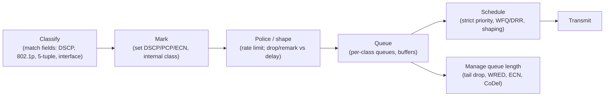
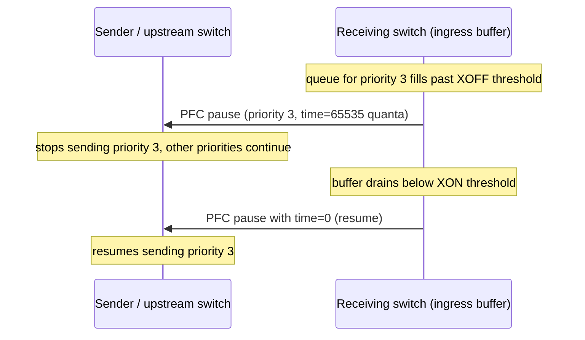
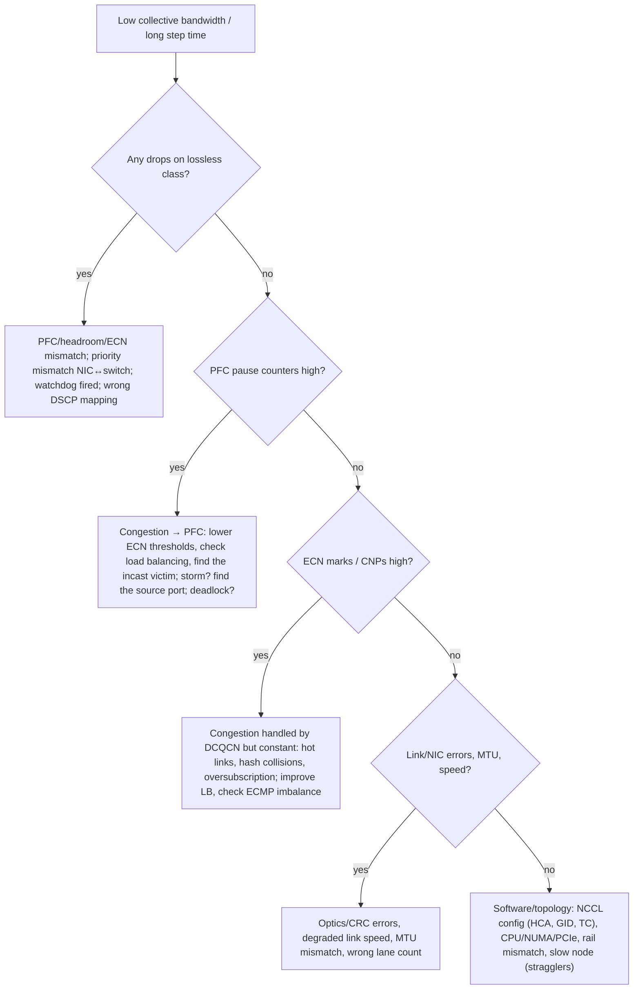

# 2.19 Queuing, QoS, ECN, PFC and DCB: congestion management for AI fabrics

| | |
|---|---|
| Level | Advanced |
| Priority tier | 0 |
| Lab venue | Linux VM (`tc`, netem); RoCE parts need hardware (untested here) |
| Part | Part 2: Networking, from first principles to AI fabrics |
| Status | Drafted, labs **untested** |

## Why this matters for AI infrastructure

Distributed training sends synchronized bursts at line rate between thousands of NICs. Even in a 1:1 non-oversubscribed fabric, several senders target one receiver port at the same instant (incast), hash collisions put two elephant flows on one link, and a single dropped RoCE packet can stall a whole collective. RoCEv2 relies on a nearly lossless Ethernet, so the discipline of **queueing, classification, ECN marking, Priority Flow Control and DCQCN** is the difference between 95% and 40% of line-rate all-reduce. These are also the topics where interview questions get specific: why PFC can cause head-of-line blocking and storms, why ECN thresholds sit below PFC thresholds, what a PFC watchdog does, and what DSCP/priority a RoCE class should use. This chapter starts with general QoS (why not just add bandwidth, classification, marking, queueing disciplines, AQM) and then covers the data-centre/RoCE congestion toolkit and its configuration.

## Prerequisites and outcomes

You should know TCP congestion control and ECN (2.6), switching internals and buffers (2.11), ECMP/LAG hashing (2.12) and AI-fabric topologies (2.18).

After this chapter you can:

- Explain why QoS is needed even when links are large, the four problems it solves (delay, jitter, loss, bandwidth share), and the difference between classification, marking, policing/shaping and queue scheduling.
- Describe DSCP/IP precedence/802.1p marking, trust boundaries, preserving markings across tunnels, and the "unmarked Internet" problem.
- Explain FIFO, strict priority/low-latency queueing, CBWFQ/DRR/WFQ, overcongestion, policers vs shapers, and Linux `tc` equivalents (`prio`, `htb`, `fq_codel`, `cake`).
- Explain buffer management: tail drop, RED/WRED, bufferbloat, CoDel/PIE, ECN-based AQM.
- Describe congestion points in a Clos fabric and why they arise even at 1:1.
- Explain ECN (bits, marking thresholds, CNP), PFC (pause frames, XON/XOFF, headroom, storms, deadlocks, watchdog), ETS/DCBX, DCQCN, and newer proposals (SFC, CSIG), and how they interact.
- Design and verify a lossless RoCEv2 class (DSCP/priority, buffers, thresholds, trust mode) and troubleshoot PFC/ECN issues with counters.
- Decide when to use ECN-only versus ECN+PFC versus adaptive routing.

## 1. Why QoS exists

If links were infinitely fast, there would be no queues and no QoS. Real networks have bottlenecks: speed changes (100G to 10G), many-to-one fan-in, bursts, and shared uplinks. Queues absorb bursts but add delay; when queues overflow, packets drop. Applications differ: voice and RPC need low delay and jitter, bulk transfers need throughput, RDMA needs (nearly) zero loss, control traffic must always get through. **Quality of Service** is the set of mechanisms that treat traffic classes differently under contention.

**"Why not just buy bigger links?"** Because (1) bursts and fan-in make congestion a statistical certainty even at low average utilisation; (2) bandwidth costs money and takes time, whereas needs change in milliseconds; (3) latency-sensitive packets stuck behind large packets suffer serialization delay no matter how fast the average is (a 9000-byte packet on a 100 Mb/s link occupies it for 0.72 ms; a 64-byte packet queued behind it waits 14 times its own serialization time, which shows up as jitter); (4) *adding capacity moves the bottleneck*, it doesn't remove contention. Overprovisioning reduces the need for QoS but never eliminates it, and some paths (WAN, interconnects, host NICs) cannot be overprovisioned economically. In AI fabrics, overprovisioning (1:1) is the baseline, and the residual contention (incast, hash collisions, microbursts) is handled by congestion control.

## 2. The QoS toolbox



### Classification and marking

**Classification** decides which class a packet belongs to; **marking** records that decision in the packet so downstream devices don't need to repeat deep inspection. Fields:

- **IPv4/IPv6 header**: the 8-bit ToS / Traffic Class byte = **DSCP** (6 bits, 64 values: CS0..CS7, AF11..AF43, EF=46, DF=0) + **ECN** (2 bits). Legacy IP precedence uses the top 3 bits.
- **Ethernet 802.1Q tag**: 3-bit **PCP** (802.1p class of service, 0 to 7) and DEI.
- **MPLS** traffic-class bits (3), **VXLAN/GENEVE** inherit from inner/outer by configuration.
- **Layer 4/application**: ports, protocol (RoCEv2 = UDP 4791), or deep inspection.

Common DSCP behaviours: **EF (46)** low-latency expedited forwarding (voice); **AF** classes (assured forwarding, 4 classes × 3 drop precedences); **CS6/CS7** network control; **CS3/CS4** signalling and streaming; **DF/CS0** best effort. AI fabrics typically define their own plan: e.g. a lossless RoCE data class (commonly DSCP 26 mapped to priority 3), a CNP class (DSCP 48 mapped to a strict-priority or high-weight queue), a control/management class, and best-effort for everything else; the specific numbers are conventions, not standards, and must match on NICs and switches (verify with vendor guides).

**Trust boundaries.** Hosts can mark any DSCP they like, so a network must decide where to *trust* markings (from known servers/switches) and where to *re-mark* (from untrusted tenants, the Internet). **Preserving classification** across tunnels and hops requires explicit mapping: copy inner DSCP to the outer header on encapsulation (VXLAN/GRE/IPsec/MPLS "uniform" vs "pipe" modes), map DSCP ↔ 802.1p at L2/L3 boundaries, and ensure marking survives NAT, proxies and DPUs. **The unmarked Internet:** ISPs usually ignore or rewrite DSCP, so end-to-end QoS across the public Internet is not available; QoS is a *domain* tool, and applications that need quality across the Internet use different means (CDNs, SD-WAN path selection, adaptive codecs, QUIC).

### Policing and shaping

- A **policer** measures a traffic rate (token bucket: committed rate CIR, burst CBS/EBS) and drops or re-marks excess immediately. No buffering; protects a downstream resource or enforces a contract; can cause TCP sawtooth because drops are abrupt.
- A **shaper** buffers excess and releases it at the configured rate: smooths bursts, adds delay, needs buffer. Use to match a slower downstream link or provider rate.
- Both use token buckets; the burst size (bucket depth) matters as much as the rate.

### Queueing and scheduling

Each egress port has several queues (per class), a scheduler that decides which queue sends next, and a buffer-management policy that decides who loses when buffers fill.

- **FIFO / tail drop**: one queue, drops when full; no differentiation; causes global synchronization of TCP flows and unfair loss.
- **Strict priority / low-latency queueing (LLQ)**: a priority queue is always served first; ideal for latency-sensitive classes (voice, CNP, control), but must be **policed** (rate-limited) or it starves all else; used sparingly.
- **Weighted fair queueing** and its class-based variants (**CBWFQ**, **DRR** deficit round robin, WRR): classes get a guaranteed share of the link in proportion to weights; unused share is redistributed (work-conserving). This is the *fairness* tool. In DCB it is standardised as **ETS** (Enhanced Transmission Selection, 802.1Qaz): assign each priority group a bandwidth percentage.
- **Overcongestion**: when more traffic than capacity arrives in *every* class, scheduling alone can't help; guarantee only what you can deliver, and use admission control, policing, and capacity planning.
- **Other tools**: hierarchical QoS (parent shaper with child policies per tenant), per-flow fair queueing (fq_codel, CAKE) for host-level fairness, traffic engineering to move flows, rate limiting of control-plane traffic (CoPP), and application back-off.

### Queue management (AQM)

Dropping only when a buffer is completely full ("tail drop") has two defects: the buffer stays full (high latency) and many TCP flows lose packets simultaneously and back off together. **Active queue management** acts earlier:

- **RED / WRED** (Random Early Detection, weighted): once average queue length exceeds a minimum threshold, drop (or ECN-mark) packets with increasing probability up to a maximum threshold, beyond which all packets are dropped; weights give different thresholds per class or drop precedence. Spreads losses over time and across flows, keeps queues short.
- **Bufferbloat**: oversized buffers combined with loss-based congestion control produce queues of hundreds of milliseconds ("latency under load"). Cure: smaller/adaptive buffers and AQM. **CoDel** (controlled delay) measures packet sojourn time in the queue and starts dropping when the minimum delay over an interval stays above a target (5 ms over 100 ms), self-tuning without per-link parameters; **PIE** is a similar controller; **fq_codel** combines flow queueing with CoDel (Linux default qdisc on many distributions); **CAKE** adds shaping, per-host fairness and DSCP handling.
- **ECN-based AQM**: instead of dropping, mark the packet's ECN bits (CE) at the same thresholds; ECN-capable transports slow down without loss (section 5).

### Linux `tc` quick reference

```bash
tc qdisc show dev eth0 ; tc -s qdisc show dev eth0 ; tc -s class show dev eth0       # state + counters (drops, overlimits, backlog)
tc qdisc replace dev eth0 root fq_codel                       # per-flow fair queueing + CoDel (good default)
tc qdisc replace dev eth0 root cake bandwidth 900mbit         # shaper + AQM (home/edge)
tc qdisc add dev eth0 root handle 1: htb default 30
tc class add dev eth0 parent 1: classid 1:1 htb rate 10gbit
tc class add dev eth0 parent 1:1 classid 1:10 htb rate 2gbit ceil 10gbit prio 0       # priority class
tc class add dev eth0 parent 1:1 classid 1:30 htb rate 8gbit ceil 10gbit prio 1
tc filter add dev eth0 parent 1: protocol ip prio 1 u32 match ip dscp 0x2e 0xfc flowid 1:10   # EF -> class 1:10
tc qdisc add dev eth0 parent 1:30 fq_codel
tc qdisc add dev eth0 root tbf rate 100mbit burst 32kbit latency 50ms                 # shaper (token bucket)
tc qdisc add dev eth0 root netem delay 20ms 5ms loss 0.1% rate 1gbit                 # emulate a bad link
tc qdisc add dev eth0 root red limit 400000 min 30000 max 90000 avpkt 1000 burst 55 ecn bandwidth 10gbit   # RED with ECN marking
```

Linux NICs also have hardware queues (`ethtool -l`), driver rings (`ethtool -g`), BQL (byte queue limits) and DCB/PFC controls on supported NICs (`dcb` tool in iproute2, `lldptool`, vendor tools such as `mlnx_qos`).

## 3. Data-centre congestion points

In a Clos with line-rate servers, congestion can occur at several places even at 1:1:

| Point | Cause |
|---|---|
| **Leaf downlink (leaf → server)** | Incast: many senders to one receiver exceed the receiver's NIC bandwidth |
| **Local leaf switching** | Two servers on one leaf sending to a third on the same leaf (no load balancing involved) |
| **Leaf → spine uplink** | Hash collisions put several elephant flows on one uplink while others are idle |
| **Spine → leaf downlink** | Flows from several leaves hash to the same spine, which sends them to one destination leaf over one link |
| **Spine ↔ super-spine** | Same effects one tier up, plus oversubscription |
| **Microbursts** | Sub-millisecond bursts exceed buffer; invisible to average counters |

Load balancing improvements (packet spraying, dynamic and global load balancing, adaptive routing, chapter 2.12, 2.16) reduce hash-collision congestion but do not remove incast or local congestion, so congestion *control* is still needed. Congestion control choices differ by transport: TCP uses window/rate-based algorithms (chapter 2.6); RoCEv2 (RDMA over UDP, destination port 4791) has no TCP; it needs the network and NIC to provide near-lossless delivery. Ethernet by default is lossy, hence the combination of ECN, PFC and DCQCN.

## 4. RoCEv2 and why it needs lossless behaviour

RoCEv2 encapsulates InfiniBand transport (BTH header, queue pairs, opcodes) in UDP/IP/Ethernet. The NIC implements reliability: sequence numbers, ACK/NAK, retransmission. Classic RoCE NICs use **go-back-N** recovery: one lost packet forces retransmission of everything after it, which is catastrophic at 400 Gb/s (and stalls the QP). Newer NICs add selective repeat and out-of-order handling, but vendors still recommend (near-)lossless fabrics for performance. RoCEv2 does not engage the host CPU, which is why it scales far better than TCP for collectives, but its flows have poor ECMP entropy (few long-lived flows with one UDP source port per QP) and bursty, synchronized behaviour. Net effect: the fabric must (a) avoid loss, via PFC or very reliable congestion control; (b) signal congestion early (ECN) so senders slow down before buffers overflow; (c) load balance well.

## 5. ECN and CNPs

**ECN (Explicit Congestion Notification)** lets a congested switch *mark* a packet instead of dropping it. It uses the low two bits of the IP ToS byte:

| ECT | CE | Meaning |
|---|---|---|
| 0 | 0 | Not ECN-capable; congestion causes a drop |
| 0 | 1 | ECT(1): ECN-capable (treated like 10 by most) |
| 1 | 0 | ECT(0): ECN-capable transport; set by the sender |
| 1 | 1 | **CE**: Congestion Experienced (set by a switch) |

Operation in RoCEv2 (end-to-end, sender-switch-receiver):

1. The sender marks packets ECT(0).
2. A switch whose egress queue exceeds the **ECN threshold** marks packets CE (the path doesn't change; no packet lost). Between a minimum and maximum threshold the marking probability ramps up (WRED-style: Kmin, Kmax, Pmax); above Kmax all packets are marked.
3. The receiver sees CE-marked packets and sends a **Congestion Notification Packet (CNP)** back to the sender: a RoCEv2 packet (BTH opcode 0x81 = 129) carrying the QP to identify the flow, typically sent in a high-priority class and rate-limited (e.g. at most one per N microseconds per flow).
4. On receiving CNPs the sender **reduces its rate** for that QP; absence of CNPs makes it recover rate (additive/multiplicative increase).

ECN must be enabled end to end: on the sending NIC, every transit switch, and the receiving NIC; any device that doesn't mark or drops ECN bits breaks the loop. ECN is *flow-granular* (only the QPs causing congestion are slowed) but **slow**: the marked packet has to reach the receiver and the CNP return before the sender reacts (a round trip plus NIC processing); in the meantime, queues can keep growing and overflow. So an ECN-only queue is **lossy** (packets can still drop if the burst outruns the control loop).

Threshold tuning: thresholds are in bytes or cells of queue occupancy (per queue, per port, or shared-buffer based). Too low: needless throttling; too high: ECN reacts too late and the buffer overflows (or PFC fires). Dynamic thresholds exist in some products.

## 6. PFC: lossless links by backpressure

**Priority Flow Control** (IEEE 802.1Qbb) is per-priority pause. A congested receiver sends a **PFC pause frame** (MAC control frame, EtherType 0x8808, opcode 0x0101, destination 01:80:C2:00:00:01) upstream; it carries a *class-enable vector* (which of the 8 priorities) and a 16-bit pause time per priority (units of 512 bit-times; 65535 is the maximum; 0 means resume). The upstream sender stops transmitting that **priority** (not the whole link) for the pause time.



- **XOFF** is the occupancy at which a pause is sent; **XON** (lower) is where resume is sent (hysteresis avoids oscillation). Between XOFF being crossed and the sender actually stopping, packets keep arriving (propagation delay + the time to process the frame + packets already in flight), so the switch must reserve **headroom** above XOFF to absorb them: headroom ≈ 2 × (propagation delay × bandwidth) + MTU-sized packets in flight at each end + pause processing time. Longer cables (500 m optics) need much more headroom; buffer budgeting per lossless priority and per port is a core design step.
- A queue with PFC enabled is a **lossless queue**; the rest remain lossy. Only one or two classes should be lossless (RoCE data, sometimes storage) so that buffers aren't exhausted.
- The pause propagates hop by hop toward the source: switch → upstream switch → … → the sending NIC, which stops the flows in that priority.

### The problems with PFC

1. **Class-level, not flow-level**: pausing a priority stops *every* flow in it, including innocent ones sharing the link: **head-of-line blocking and unfairness**. A victim flow to an idle destination stalls because it shares a class with congested flows.
2. **PFC storms**: a faulty NIC/port that continuously sends pauses (stuck receiver, firmware bug, broken endpoint) pushes backpressure upstream; every upstream queue fills and pauses its own upstream; congestion spreads across the entire fabric (**congestion spreading**) and the network can freeze.
3. **PFC deadlock**: in topologies with cyclic buffer dependencies (loops caused by failures, routing misconfiguration, or non-up-down paths), switches pause each other in a cycle and none can drain; traffic stops even though no link is actually congested. Prevent with loop-free (Clos up-down) routing, avoiding PFC over rerouted paths, TTL/lossless-class rules, and watchdogs.
4. **Operational fragility**: misconfigured priorities (a mismatch between NIC and switch) make traffic fall into a lossy queue unexpectedly (silent drops), or make pause frames useless.

### PFC watchdog

The **PFC watchdog** (also called PFC storm prevention) has three steps:

1. **Detection**: monitor each port/queue; if a lossless queue stays paused (or keeps receiving pause frames) beyond a configured interval (e.g. 100 ms to 200 ms), declare a storm.
2. **Mitigation**: either **drop** (flush the queue, discard new packets for that queue and ignore/drop incoming pause frames so the stall doesn't propagate) or **forward** (ignore pause frames and keep transmitting). Dropping is the most common.
3. **Restoration**: when pause frames fall below a threshold for a restoration interval, re-enable normal lossless behaviour.

The watchdog trades losing some packets for keeping the rest of the fabric alive; the application (RoCE retransmission or job restart) sees the loss. Alert on watchdog triggers: each one is a fabric-level incident marker.

## 7. DCQCN: ECN and PFC together

**DCQCN** (Data Center Quantized Congestion Notification; Microsoft/Mellanox, SIGCOMM 2015) is the standard congestion control for RoCEv2. It combines:

- **ECN** as the primary, early, flow-level signal (switch marking → receiver CNP → sender rate reduction, using a quantized, QCN-style rate decrease and multi-stage rate recovery on the NIC), and
- **PFC** as the last-resort safety net to prevent loss if queues rise further.

The thresholds are ordered in the queue: **XON < ECN (Kmin/Kmax) < XOFF**. ECN marking starts well before PFC so that senders slow down first; only when congestion worsens faster than ECN can respond does the buffer cross XOFF and PFC pauses the priority. If ECN resolves the congestion, other flows in the queue are unaffected; PFC fires rarely, so its side effects stay rare. If PFC triggers frequently, it harms throughput; in some fabrics it is configured only on leaves and NICs, in others on all nodes; some deployments run **ECN-only** (no PFC) with excellent load balancing and rely on NIC loss recovery, especially with newer NICs that tolerate loss. The right answer depends on the SLA, hardware and measurements.

NIC-side parameters (vendor-specific): initial rate, rate-increase timers and steps, alpha update gain, rate-decrease factor, CNP generation interval (e.g. 50 µs), minimum time between CNPs, ECN marking trust (DSCP), CNP priority/DSCP. Misconfigured NIC parameters are a classic reason for poor performance with a correct switch configuration.

## 8. Newer mechanisms: SFC and CSIG

- **Source Flow Control (SFC)**, being specified as an IETF/IEEE-style standard (802.1Qdw "source PFC"): instead of pausing hop by hop, a congested switch sends the signal **directly to the source** by trimming the packet payload and reversing the source/destination addresses; the first-hop leaf can pause the flow's queue, forward the signal to the NIC if supported, or translate it into PFC. Advantages: no ECN's long loop (the signal does not travel to the receiver and back), and **flow-level** rather than class-level action, avoiding head-of-line blocking.
- **Congestion Signaling (CSIG)**: an emerging in-band mechanism where each hop updates a small tag in the data packet (signal type such as minimum available bandwidth ratio or maximum path delay, a quantized value, and locator metadata: capacity of the bottleneck, stage, device ID, uplink/downlink), the receiver reflects the aggregated signal to the sender, and senders get path-aware, multi-bit congestion information rather than the single ECN bit. It can feed rate control and adaptive routing decisions.
- **Related**: Ultra Ethernet Consortium transport (packet spraying, selective retransmission, new congestion control), in-band network telemetry (INT) and trimming, credit-based or receiver-driven schemes (NDP, HPCC using INT), switch-level adaptive routing/packet spraying, and fabric-wide VOQ (scheduled fabrics, chapter 2.18).

Treat SFC and CSIG as in-progress standards; know the ideas and the problem each solves.

## 9. DCB: the Ethernet toolbox

**Data Center Bridging** is the IEEE bundle that makes Ethernet suitable for storage and RDMA:

| Standard | Name | Purpose |
|---|---|---|
| 802.1Qbb | PFC | Per-priority pause (lossless classes) |
| 802.1Qaz | ETS | Bandwidth allocation per priority group |
| 802.1Qaz | DCBX | Exchange and negotiation of DCB settings (PFC, ETS, application priority) over LLDP |
| 802.1Qau | QCN | Layer-2 congestion notification (rarely deployed; DCQCN uses ECN instead) |
| 802.1Qdw | SFC/source PFC | See above |

Apply as: define 8 priorities; assign traffic types to priorities by DSCP/PCP/port; mark which priorities are lossless (PFC enabled); set ETS weights; enable DCBX willing/non-willing modes consistently, or disable DCBX and push configuration explicitly via automation (common in AI clusters to avoid surprises).

## 10. Configuring a lossless RoCE class (conceptual, verify per vendor)

Pieces to configure and keep consistent from NIC to NIC across all switches:

1. **Classification**: trust DSCP at the host-facing and switch-to-switch ports; map DSCP 26 (RoCE data) → internal class / priority 3; map CNP DSCP (e.g. 48) → priority 6 (strict priority or high weight); everything else → default.
2. **Queues and scheduling**: a lossless queue for priority 3 with ETS weight (e.g. 50 to 90%); CNP queue strict priority with a small rate cap; default queue for the rest.
3. **PFC**: enabled only on priority 3, with correct headroom, XOFF and XON for the port speed and cable length; PFC watchdog on with sensible intervals.
4. **ECN**: ECN marking on priority 3's queue with Kmin/Kmax/Pmax (for example, Kmin = a few hundred KB, Kmax = a few MB at 400G; tune with measurements); ensure the switch preserves the ECN bits.
5. **NIC**: trust DSCP; set the RoCE traffic class/ToS for the QP (e.g. `NCCL_IB_TC`/`NCCL_IB_SL` environment, `cma_roce_tos` or `rdma_cm` settings); enable DCQCN and set parameters; enable PFC for the same priority; keep MTU and RoCE MTU consistent (e.g. 9000 Ethernet, RoCE MTU 4096).
6. **Verification**: send traffic with `ib_write_bw`, `nccl-tests all_reduce_perf`, watch counters: PFC pause frames sent/received per priority, ECN-marked packets, CNPs sent/handled, buffer watermarks, queue drops (must be 0 on the lossless class), out-of-sequence/retransmit counters on the NIC (`ethtool -S`, `rdma statistic`, `mlnx_qos`, vendor telemetry).

```bash
# Host side (NVIDIA ConnectX example; verify tool names and versions in the NIC documentation)
mlnx_qos -i eth2                                   # show trust mode, PFC, ETS
sudo mlnx_qos -i eth2 --trust dscp --pfc 0,0,0,1,0,0,0,0      # lossless on priority 3
ethtool -S eth2 | egrep 'prio3_pause|rx_prio3_pause|tx_prio3_pause|ecn_marked|np_cnp_sent|rp_cnp_handled|out_of_sequence|rx_discards'
rdma statistic show                                # per-device counters (NP/RP CNP, retransmissions)
dcb pfc show dev eth2 ; dcb ets show dev eth2 ; dcb app show dev eth2    # iproute2 dcb tool
ip -s link show eth2 ; ethtool -g eth2             # drops, ring sizes
# Fabric side (SONiC-style examples)
show pfc counters ; show queue counters ; show priority-group watermark headroom ; show pfcwd stats
```

Treat these as pointers; the exact commands, DSCP values and threshold numbers vary by vendor, ASIC and firmware, and must be taken from the validated design guide for your hardware.

## 11. Troubleshooting congestion in AI fabrics



Practical hints: look for the *straggler* (one slow node or link can slow the whole job); compare per-port counters across identical ports (outlier = bad cable/optic); correlate PFC bursts with job phases; confirm ECN is actually marking (counter increments) before tuning thresholds; check that **CNP packets are not themselves queued behind data**; verify DSCP end to end with a capture on the NIC and switch (`tcpdump` shows DSCP/ECN bits; Wireshark decodes BTH opcodes); run `nccl-tests` per rail and across rails to localise; verify `rp_filter`/routing for the RoCE subnets (chapter 2.5).

## 12. Lab: queueing, AQM and ECN with Linux (untested; RoCE parts need hardware)

1. **Bufferbloat**: two namespaces joined by a veth pair; limit rate with `tbf`/`netem rate 50mbit`; run a bulk `iperf3` and a `ping` simultaneously; record latency; replace the qdisc with `fq_codel` or `cake` and compare.
2. **Priority and fairness**: `htb` with a high-priority class for DSCP EF and a bulk class; show a latency flow staying low during saturation; remove the policing on the priority class and show starvation; try `drr`/`wrr` weights.
3. **Policer vs shaper**: `tc filter ... police rate 10mbit burst 10k drop` vs `tbf`; observe TCP throughput sawtooth and drops vs delay.
4. **RED/ECN**: `tc qdisc add ... red ecn` with thresholds; run `iperf3` with `sysctl net.ipv4.tcp_ecn=1`; read `tc -s qdisc` marks vs drops; compare ECN on/off for latency and throughput; try DCTCP (`sysctl net.ipv4.tcp_congestion_control=dctcp`, ECN threshold marking with a very low K) as the TCP analogue of DCQCN.
5. **Incast**: N sender namespaces sending synchronized bursts to one receiver through a small-buffer bridge; measure goodput versus N; add ECN and DCTCP; observe collapse and recovery.
6. **Microburst visibility**: sample queue depth at 1 ms intervals with `tc -s` in a loop or an eBPF tool (`bpftrace` on `qdisc` tracepoints) while sending a burst; show that the 1 s average hides it.
7. **DSCP preservation**: create a VXLAN tunnel (chapter 2.17) and show DSCP copying (`tos inherit`) and the effect on the underlay queue assignment.
8. **Hardware lab (optional)**: with two RoCE-capable NICs and an Ethernet switch (or a SONiC-VS/virtual switch for config practice), configure trust-DSCP, a lossless priority, PFC and ECN; run `ib_write_bw` with competing traffic; read PFC/ECN/CNP counters; trigger a PFC watchdog event by pausing a receiver.
9. **Clean up.**

Mark tested only after execution.

## 13. Design guidance for AI back-ends

- Prefer **1:1** with good load balancing (adaptive/dynamic/global LB or packet spraying) so congestion is rare; treat congestion control as the safety net.
- Use **ECN with DCQCN as the primary control**; add **PFC** on the RoCE class only where the NIC/transport needs it; always run the **PFC watchdog**; keep the lossless class count at one or two.
- Size **headroom** and buffers for the longest cable; keep ECN thresholds below XOFF; validate with incast tests at the target scale.
- Give **CNPs** a high-priority path so feedback isn't delayed by the congestion it reports.
- Monitor continuously: PFC pause durations/rates, ECN marks, CNPs, queue watermarks, drops on lossless classes (should be zero), watchdog events, link errors; set alerts on trends, not only thresholds.
- Document the DSCP/priority plan and enforce it by automation (NIC and switch templates generated from one source of truth) with continuous compliance checks (chapters 2.28, 2.29).
- When PFC fires often in a given design, prefer fixing the cause (load balancing, topology, incast shaping at the job level) over adding more PFC tuning; in some designs an ECN-only fabric with better LB and loss-tolerant NICs outperforms an ECN+PFC fabric.

## 14. Common mistakes

- Treating QoS as bandwidth guarantees without admission control; strict priority without a policer.
- Trusting host-set DSCP from untrusted tenants; DSCP lost on tunnels/NAT; DSCP/priority mismatch NIC vs switch.
- Enabling PFC on many classes or across the whole cluster without headroom/watchdog; no deadlock analysis for rerouted paths.
- ECN thresholds above PFC thresholds (ECN never fires first); thresholds copied from another speed/cable length.
- Judging fabric health from average utilisation (microbursts hidden).
- Forgetting CNP handling and NIC DCQCN parameters.
- Not testing failure cases (link down → rerouted loops → PFC deadlock).

## 15. Interview angles

- "Why can't you fix congestion by just adding bandwidth?"
- "Explain classification, marking, policing, shaping, queueing and scheduling."
- "LLQ vs CBWFQ; when does strict priority starve others?"
- "What is bufferbloat and how does CoDel work?"
- "How does ECN work end to end in RoCEv2? What is a CNP?"
- "Explain PFC. What are XON/XOFF and headroom? What problems does PFC cause? What is a PFC storm / deadlock / watchdog?"
- "What is DCQCN? Why must ECN threshold be lower than PFC threshold?"
- "How do SFC and CSIG improve on ECN and PFC?"
- "A training job is slow; how would you tell whether it's congestion, a bad link or software?"
- "Where do you enable PFC in a leaf-spine fabric and why?"

## 16. Checkpoint questions (40)

1. Why isn't more bandwidth always the answer? **A:** Bursts/fan-in, serialization delay, cost and moving bottlenecks.
2. What fields hold DSCP and ECN? **A:** The IP ToS/Traffic Class byte: 6 bits DSCP, 2 bits ECN.
3. What is PCP? **A:** 3-bit 802.1p priority in the VLAN tag.
4. What is EF? **A:** DSCP 46, expedited forwarding for low-latency traffic.
5. What is a trust boundary? **A:** Where markings are accepted vs re-marked.
6. Why is the Internet "unmarked"? **A:** Providers ignore/rewrite DSCP.
7. Policer vs shaper? **A:** Drops/re-marks excess vs buffers and delays it.
8. What does a token bucket define? **A:** Rate and allowed burst.
9. What is LLQ? **A:** Strict-priority queue for latency-sensitive traffic, policed.
10. What is CBWFQ/ETS? **A:** Weighted bandwidth shares per class/priority group.
11. What happens with tail drop? **A:** Buffers stay full; synchronized loss.
12. What does RED do? **A:** Probabilistic early drop/mark as queue grows.
13. Define bufferbloat. **A:** Excess queueing delay from oversized buffers.
14. How does CoDel decide to drop? **A:** When queue sojourn time stays above a target (5 ms) over an interval.
15. What is fq_codel? **A:** Per-flow fair queueing with CoDel AQM.
16. UDP port of RoCEv2? **A:** 4791.
17. Why does RoCE want a lossless fabric? **A:** Go-back-N recovery makes loss very costly.
18. Name three congestion points in leaf-spine. **A:** Leaf downlink incast, leaf-spine hash collision, spine-leaf downlink, super-spine links.
19. ECN codepoints for CE? **A:** 11.
20. Who sets CE? **A:** The congested switch.
21. Who sends the CNP and with what opcode? **A:** The receiver; BTH opcode 129 (0x81).
22. What does a CNP identify? **A:** The QP/flow to slow down.
23. Why is ECN "slow"? **A:** Marked packet must reach the receiver and the CNP return.
24. Is an ECN-only queue lossless? **A:** No (lossy).
25. PFC ethertype/opcode? **A:** 0x8808 / 0x0101.
26. What do XOFF and XON mean? **A:** Thresholds to send pause and resume.
27. What is headroom? **A:** Buffer reserved to absorb in-flight packets after XOFF.
28. What does PFC pause? **A:** A priority (class), not a flow.
29. Main problems of PFC? **A:** HOL blocking/unfairness, storms, deadlocks.
30. What is a PFC watchdog? **A:** Detects stuck pause storms, drops/ignores to restore flow.
31. What is DCQCN? **A:** ECN-based rate control with PFC as backstop for RoCEv2.
32. Threshold order in DCQCN? **A:** XON < ECN < XOFF.
33. Which queue should carry CNPs? **A:** A high-priority/strict queue.
34. SFC difference vs PFC? **A:** Flow-level, signal sent directly to the source.
35. What does CSIG carry? **A:** In-band multi-bit congestion info reflected to the sender.
36. DCB standards list. **A:** PFC (Qbb), ETS/DCBX (Qaz), QCN (Qau).
37. Which counter must stay zero on the lossless class? **A:** Drops.
38. Why look for stragglers? **A:** Collectives wait for the slowest participant.
39. When ECN-only? **A:** If PFC triggers often and LB can minimise congestion; NICs tolerate loss.
40. First check if throughput is low and PFC counters are high? **A:** Find the congested queue/incast and why ECN didn't act earlier (thresholds/LB).

## 17. Sources and review notes

**Written in original words.** Principal sources:

- Russ White and Jeff Tantsura (with co-authors), *Computer Networking Problems and Solutions*, chapter 8 (quality of service: why not just size links large enough, classification, preserving classification, the unmarked Internet, congestion management with low-latency queueing and class-based weighted fair queueing, overcongestion, other tools, queue management with WRED and bufferbloat/CoDel).
- *AI Data Center Network Design and Technologies*, chapter 7 (RoCEv2 transport and congestion management: congestion points, ECN, PFC, PFC watchdog, DCQCN, Source Flow Control, Congestion Signaling).
- Linux `tc` and DCB tooling, NIC counters and the design guidance are the author's synthesis from RFCs 3168 (ECN), 8289, 7567 (AQM), 8290 (CoDel), the IEEE 802.1Q standards, the DCQCN paper (SIGCOMM 2015) and vendor documentation.

**Flagged for verification before publishing:** all vendor command names and DSCP/priority numbers (26/3/48/6 are common conventions, not standards), headroom and threshold formulas for your ASIC, SFC and CSIG standardisation status, and NIC DCQCN parameter names; all labs are **untested**.
