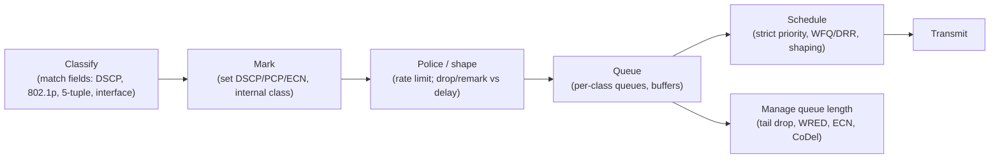
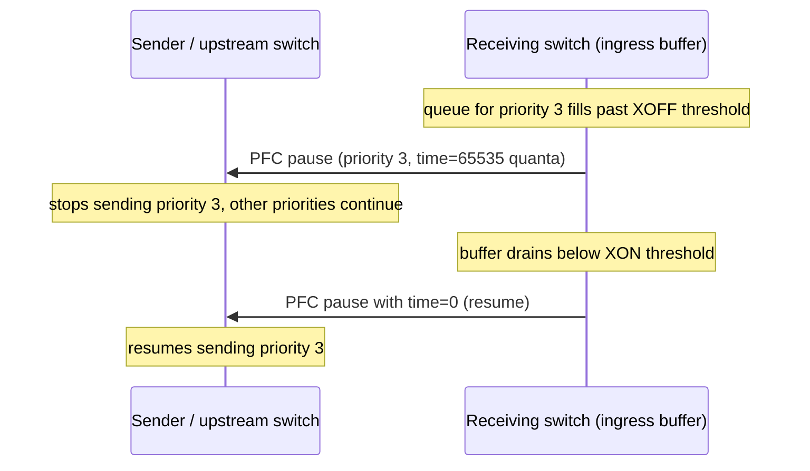
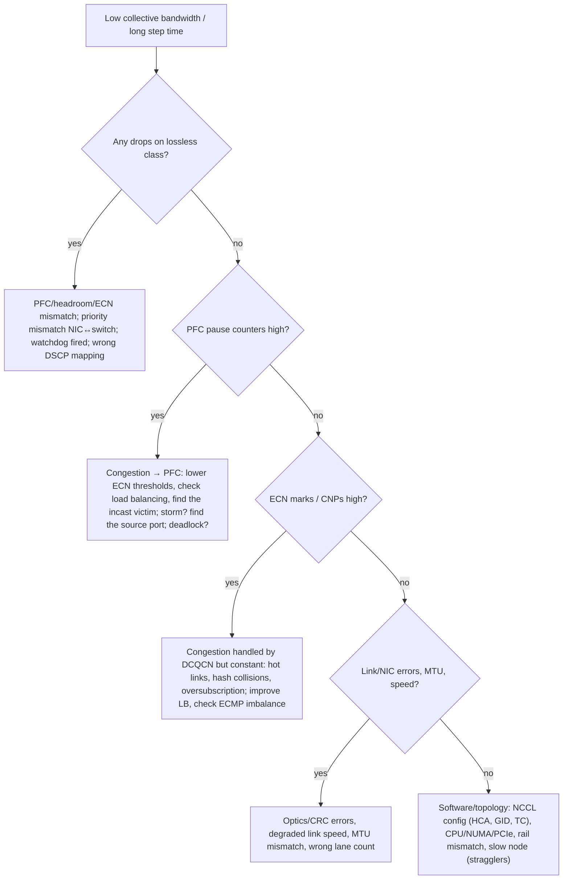

# 2.19 Queuing, QoS, ECN, PFC and DCB: congestion management for AI fabrics

| | |
|---|---|
| Level | Advanced |
| Priority tier | 0 |
| Lab venue | Linux VM (`tc`, netem); RoCE parts need hardware (untested here) |
| Part | Part 2: Networking, from first principles to AI fabrics |
| Status | Drafted, labs **untested** |

## Why this matters for AI infrastructure

Distributed training sends synchronized bursts at line rate between thousands of NICs. Even in a 1:1 non-oversubscribed fabric, several senders can target one receiver port at the same instant. That event is called incast. Two elephant flows, which are very large transfers, can also land on one link through a hash collision. A single dropped RoCE packet can stall a whole collective.

RoCEv2 relies on a nearly lossless Ethernet. The gap between 95% and 40% of line-rate all-reduce comes down to how well the network uses queueing, classification, ECN marking, Priority Flow Control and DCQCN. Interviewers tend to ask about the details. Why can PFC cause head-of-line blocking and storms? Why do ECN thresholds sit below PFC thresholds? What does a PFC watchdog do? Which DSCP and priority should a RoCE class use?

This chapter starts with general QoS. It asks why you cannot just add bandwidth, and it covers classification, marking, queueing disciplines and active queue management (AQM). Then it moves to the data-centre and RoCE congestion toolkit and its configuration. Before you tune any queue, decide which traffic truly must never drop.

## Prerequisites and outcomes

Before you start, you should know TCP congestion control and ECN (2.6), switching internals and buffers (2.11), ECMP/LAG hashing (2.12) and AI-fabric topologies (2.18). This chapter builds directly on those four.

When you finish, you should be able to:

- Explain why QoS is still needed when links are large. Cover the four problems it solves (delay, jitter, loss, bandwidth share) and the difference between classification, marking, policing/shaping and queue scheduling.
- Describe DSCP, IP precedence and 802.1p marking, trust boundaries, preserving markings across tunnels, and the "unmarked Internet" problem.
- Explain FIFO, strict priority/low-latency queueing, CBWFQ, DRR, WFQ, overcongestion, policers vs shapers, and the Linux `tc` equivalents `prio`, `htb`, `fq_codel` and `cake`.
- Explain buffer management: tail drop, RED/WRED, bufferbloat, CoDel/PIE, and ECN-based AQM.
- Describe the congestion points in a Clos fabric, and why they arise even at 1:1.
- Explain ECN (its bits, marking thresholds and CNPs), PFC (pause frames, XON/XOFF, headroom, storms, deadlocks and the watchdog), ETS/DCBX, DCQCN, and the newer proposals SFC and CSIG, and how they interact.
- Design and verify a lossless RoCEv2 class (DSCP/priority, buffers, thresholds, trust mode), and troubleshoot PFC and ECN issues with counters.
- Decide when to use ECN-only, ECN plus PFC, or adaptive routing.

## 1. Why QoS exists

Suppose your links were infinitely fast. Then nothing would ever wait in a queue, and QoS would have no job to do. Real networks have bottlenecks, though. A link can drop from 100G to 10G, many senders can fan in to one port, traffic arrives in bursts, and uplinks get shared. Queues absorb those bursts, but they add delay. When a queue overflows, packets drop.

Applications care about different things. Voice and RPC need low delay and jitter. Bulk transfers need throughput. RDMA needs nearly zero loss, and control traffic must always get through. **Quality of Service** is the set of mechanisms that treat these traffic classes differently when they compete for the same link.

**"Why not just buy bigger links?"** Bigger links do not remove contention, and you can give four reasons why.

1. Bursts and fan-in make congestion a statistical certainty, even when average utilisation is low.
2. Bandwidth costs money and takes time, while needs change in milliseconds.
3. A latency-sensitive packet stuck behind large packets suffers serialization delay, however fast the average link is. Take a 9000-byte packet on a 100 Mb/s link. It occupies the link for 0.72 ms. A 64-byte packet queued behind it waits 14 times its own serialization time, and that shows up as jitter.
4. Adding capacity moves the bottleneck instead of removing the contention. Overprovisioning lowers the need for QoS, but it never eliminates it. Some paths, such as WAN links, interconnects and host NICs, cannot be overprovisioned economically. In AI fabrics, 1:1 overprovisioning is the baseline. The leftover contention, from incast, hash collisions and microbursts, is handled by congestion control.

Do not treat extra bandwidth as the fix for congestion. Plan for the contention that remains.

## 2. The QoS toolbox

Imagine a packet arriving at a busy switch port. Before it can leave, the switch has to decide what the packet is, what to do with it, whether to delay it, and where to queue it. The toolbox below is the set of steps that does that. You can read the diagram as a pipeline, where each stage hands the packet to the next.



### Classification and marking

Classification decides which class a packet belongs to. Marking writes that decision into the packet, so downstream devices do not have to inspect it again. Several fields can carry a marking.

- IPv4 and IPv6 headers: the 8-bit ToS or Traffic Class byte holds DSCP (6 bits, 64 values: CS0..CS7, AF11..AF43, EF=46, DF=0) and ECN (2 bits). Legacy IP precedence uses the top 3 bits.
- Ethernet 802.1Q tag: a 3-bit PCP (802.1p class of service, 0 to 7) and a DEI bit.
- MPLS traffic-class bits are 3 bits wide. VXLAN and GENEVE inherit markings from the inner or outer header, depending on configuration.
- Layer 4 and application data: ports, the protocol (RoCEv2 runs on UDP 4791), or deep inspection.

Several common DSCP values have a familiar job. EF (46) is expedited forwarding for low-latency traffic such as voice. The AF classes are assured forwarding, with 4 classes and 3 drop precedences each. CS6 and CS7 carry network control. CS3 and CS4 carry signalling and streaming. DF or CS0 is best effort.

AI fabrics usually define their own plan. A lossless RoCE data class is commonly set to DSCP 26 and mapped to priority 3. A CNP class uses DSCP 48, mapped to a strict-priority or high-weight queue. A control or management class and a best-effort class cover the rest. These numbers are conventions rather than standards, so they must match on the NICs and the switches. When you deploy, check them against the vendor guides.

A host can set any DSCP value it likes, so the network has to decide whom to trust. Markings from known servers and switches can be trusted. Markings from untrusted tenants or from the Internet should be re-marked at the edge. That edge is the trust boundary.

Markings also need explicit handling as traffic crosses tunnels and hops. When a packet is encapsulated, the inner DSCP must be copied to the outer header, using either the uniform or the pipe mode for VXLAN, GRE, IPsec or MPLS. At L2 and L3 boundaries, DSCP must map to 802.1p. Markings must also survive NAT, proxies and DPUs.

The unmarked Internet is a different problem. ISPs usually ignore or rewrite DSCP, so end-to-end QoS across the public Internet is not available. QoS is a domain tool. Applications that need quality across the Internet rely on other means, such as CDNs, SD-WAN path selection, adaptive codecs and QUIC.

### Policing and shaping

- A policer measures the traffic rate with a token bucket, which has a committed rate (CIR) and a burst size (CBS/EBS). It has no buffering, so it drops or re-marks the excess immediately. It protects a downstream resource or enforces a contract. Its drops are abrupt, and they can cause a TCP sawtooth.
- A shaper buffers the excess and releases it at the configured rate. It smooths bursts, but it adds delay and needs buffer space. Use one to match a slower downstream link or a provider rate.

Both use token buckets. The burst size, which is the bucket depth, matters as much as the rate.

### Queueing and scheduling

Each egress port keeps several queues, one per class. A scheduler picks which queue sends next. A buffer-management policy decides who loses packets when the buffers fill.

- FIFO with tail drop uses one queue and drops packets when it is full. It treats every class the same, and it causes global synchronization of TCP flows and unfair loss.
- Strict priority, also called low-latency queueing (LLQ), always serves its priority queue first. That suits latency-sensitive classes such as voice, CNP and control traffic. But the class must be policed, or rate-limited, because otherwise it starves everything else. Use it sparingly.
- Weighted fair queueing is the fairness tool. Its class-based variants are CBWFQ, DRR (deficit round robin) and WRR. Each class gets a share of the link in proportion to its weight. Share that a class does not use goes to the others, so the scheduler stays work-conserving. In DCB, the same idea is standardised as ETS (Enhanced Transmission Selection, 802.1Qaz). You assign each priority group a bandwidth percentage.
- Overcongestion happens when more traffic than capacity arrives in every class. You cannot fix that with scheduling alone. Guarantee only what you can deliver, and use admission control, policing and capacity planning.
- Other tools include hierarchical QoS, which puts a parent shaper above child policies for each tenant. Per-flow fair queueing, such as `fq_codel` or `cake`, gives host-level fairness. Traffic engineering moves flows to other paths. Rate limiting of control-plane traffic (CoPP) and application back-off round out the list.

### Queue management (AQM)

Dropping only when a buffer is completely full has two defects. The buffer stays full, so latency stays high. Many TCP flows also lose packets at the same moment and back off together. Active queue management (AQM) acts earlier:

- RED and WRED (Random Early Detection, weighted) start dropping or ECN-marking packets once the average queue length passes a minimum threshold. The chance of a drop rises with the queue length, until a maximum threshold, beyond which every packet is dropped. Weights let you give each class or drop precedence its own thresholds. The losses spread over time and across flows, which keeps queues short.
- Bufferbloat happens when oversized buffers meet loss-based congestion control. The queues then grow to hundreds of milliseconds, which is called latency under load. The cure is smaller or adaptive buffers, plus AQM. CoDel (controlled delay) measures how long each packet sits in the queue, which is its sojourn time. It starts dropping when the minimum delay stays above a 5 ms target for 100 ms. It needs no per-link parameters, so it tunes itself. PIE is a similar controller. `fq_codel` combines per-flow queueing with CoDel, and it is the default qdisc on many Linux distributions. CAKE adds shaping, per-host fairness and DSCP handling.
- ECN-based AQM marks the packet's ECN bits as CE at the same thresholds, instead of dropping the packet. ECN-capable transports slow down without losing anything. Section 5 covers how that works.

### Linux `tc` quick reference

The first line of the block below shows the state and counters, such as drops, overlimits and backlog. The later lines build queues, shapers and filters, and the comments explain the ones that need it.

```bash
tc qdisc show dev eth0 ; tc -s qdisc show dev eth0 ; tc -s class show dev eth0       # state + counters (drops, overlimits, backlog)
tc qdisc replace dev eth0 root fq_codel                       # per-flow fair queueing + CoDel (good default)
tc qdisc replace dev eth0 root cake bandwidth 900mbit         # shaper + AQM (home/edge)
tc qdisc add dev eth0 root handle 1: htb default 30
tc class add dev eth0 parent 1: classid 1:1 htb rate 10gbit
tc class add dev eth0 parent 1:1 classid 1:10 htb rate 2gbit ceil 10gbit prio 0       # priority class
tc class add dev eth0 parent 1:1 classid 1:30 htb rate 8gbit ceil 10gbit prio 1
tc filter add dev eth0 parent 1: protocol ip prio 1 u32 match ip dscp 0x2e 0xfc flowid 1:10   # EF -> class 1:10
tc qdisc add dev eth0 parent 1:30 fq_codel
tc qdisc add dev eth0 root tbf rate 100mbit burst 32kbit latency 50ms                 # shaper (token bucket)
tc qdisc add dev eth0 root netem delay 20ms 5ms loss 0.1% rate 1gbit                 # emulate a bad link
tc qdisc add dev eth0 root red limit 400000 min 30000 max 90000 avpkt 1000 burst 55 ecn bandwidth 10gbit   # RED with ECN marking
```

Beyond `tc`, the NIC has queues of its own. Hardware queues are read with `ethtool -l`, and driver rings with `ethtool -g`. BQL (byte queue limits) is there too. On supported NICs, DCB and PFC are controlled with the `dcb` tool in iproute2, with `lldptool`, or with vendor tools such as `mlnx_qos`.

Pick the qdisc for each interface based on what you need it to protect, and check its counters after every change.

## 3. Data-centre congestion points

Suppose you run a Clos fabric with line-rate servers. Congestion can still appear in several places, even when the fabric is 1:1. The table shows where each one appears and what causes it.

| Point | Cause |
|---|---|
| **Leaf downlink (leaf → server)** | Incast: many senders to one receiver exceed the receiver's NIC bandwidth |
| **Local leaf switching** | Two servers on one leaf sending to a third on the same leaf (no load balancing involved) |
| **Leaf → spine uplink** | Hash collisions put several elephant flows on one uplink while others are idle |
| **Spine → leaf downlink** | Flows from several leaves hash to the same spine, which sends them to one destination leaf over one link |
| **Spine ↔ super-spine** | Same effects one tier up, plus oversubscription |
| **Microbursts** | Sub-millisecond bursts exceed buffer; invisible to average counters |

Load balancing removes some of this. Packet spraying, dynamic and global load balancing, and adaptive routing (chapters 2.12 and 2.16) reduce hash-collision congestion. They do not remove incast or local congestion, so you still need congestion control. The right control depends on the transport. TCP uses window- or rate-based algorithms (chapter 2.6). RoCEv2 is RDMA over UDP on destination port 4791, so it has no TCP underneath. The network and the NIC must deliver it nearly losslessly. Ethernet is lossy by default, which is why ECN, PFC and DCQCN are combined.

Before you tune load balancing, find out which of these points is actually congested.

## 4. RoCEv2 and why it needs lossless behaviour

One dropped RoCE packet can stall an entire collective. To see why, look at how RoCEv2 recovers from loss. RoCEv2 wraps InfiniBand transport, with its BTH header, queue pairs and opcodes, in UDP, IP and Ethernet. The NIC does the reliability work itself, using sequence numbers, ACK and NAK, and retransmission.

Classic RoCE NICs use go-back-N recovery. One lost packet forces a retransmission of everything after it. At 400 Gb/s that is catastrophic, and it stalls the QP (queue pair). Newer NICs add selective repeat and out-of-order handling. Vendors still recommend near-lossless fabrics, though, for performance.

RoCEv2 does not involve the host CPU. That is why it scales far better than TCP for collectives. Its flows, however, have poor ECMP entropy. They are few and long-lived, with one UDP source port per QP. They also behave in a bursty, synchronized way.

The fabric therefore has three jobs that you can check one at a time. It must avoid loss, through PFC or very reliable congestion control. It must signal congestion early with ECN, so senders slow down before buffers overflow. And it must load balance well. Before you pick a fix for loss, decide which of these three jobs the fabric is failing at.

## 5. ECN and CNPs

Dropping packets is the old response to a filling queue. ECN offers a gentler option. It marks the packet, and the sender slows down before anything is lost. ECN uses the low two bits of the IP ToS byte:

| ECT | CE | Meaning |
|---|---|---|
| 0 | 0 | Not ECN-capable; congestion causes a drop |
| 0 | 1 | ECT(1): ECN-capable (treated like 10 by most) |
| 1 | 0 | ECT(0): ECN-capable transport; set by the sender |
| 1 | 1 | **CE**: Congestion Experienced (set by a switch) |

Here is how the loop runs in RoCEv2, so you can follow it from sender to switch to receiver.

1. The sender marks packets ECT(0).
2. A switch whose egress queue exceeds the ECN threshold marks packets CE. The path does not change, and no packet is lost. Between a minimum and a maximum threshold, the marking probability ramps up, WRED-style, using Kmin, Kmax and Pmax. Above Kmax, all packets are marked.
3. The receiver sees the CE-marked packets and sends a Congestion Notification Packet (CNP) back to the sender. A CNP is a RoCEv2 packet. Its BTH opcode is 0x81 = 129, and it carries the QP so the flow can be identified. CNPs are typically sent in a high-priority class and rate-limited, for example to at most one per N microseconds per flow.
4. When CNPs arrive, the sender reduces its rate for that QP. When CNPs stop, the sender recovers rate through additive or multiplicative increase.

ECN has to be enabled end to end. That means the sending NIC, every transit switch and the receiving NIC. A device that does not mark, or that drops the ECN bits, breaks the loop. ECN works per flow, so only the QPs that cause congestion are slowed. It is slow, though. The marked packet must reach the receiver, and the CNP must return, before the sender reacts. That takes a round trip plus NIC processing. Queues can keep growing and overflow in the meantime. So an ECN-only queue is still lossy, because packets can drop if a burst outruns the control loop.

Thresholds are set in bytes or cells of queue occupancy. They can apply per queue, per port or to a shared buffer. If you set a threshold too low, the sender is throttled for no reason. If it is too high, ECN reacts too late, and the buffer overflows or PFC fires. Some products offer dynamic thresholds. Confirm that ECN marks are increasing before you trust a threshold setting.

## 6. PFC: lossless links by backpressure

PFC keeps RoCE traffic from dropping, but you should know that it pauses whole priorities. That trade-off shapes everything in this section. Priority Flow Control (PFC, IEEE 802.1Qbb) pauses traffic one priority at a time. A congested receiver sends a PFC pause frame upstream. This is a MAC control frame with EtherType 0x8808, opcode 0x0101, and destination 01:80:C2:00:00:01. The frame carries a class-enable vector, which says which of the 8 priorities it covers. It also carries a 16-bit pause time for each priority, counted in units of 512 bit-times. The maximum is 65535, and 0 means resume. The upstream sender stops transmitting that priority, not the whole link, for the pause time.



XOFF is the occupancy at which a pause is sent. XON is lower, and it is where resume is sent. The gap between them, called hysteresis, stops the pause from flapping on and off. Packets keep arriving after XOFF is crossed, because the sender takes time to stop. The switch therefore reserves headroom above XOFF to absorb them. If you want a rough budget, use this: headroom ≈ 2 × (propagation delay × bandwidth) + MTU-sized packets in flight at each end + pause processing time. Longer cables, such as 500 m optics, need much more headroom. You budget buffer for each lossless priority and each port, and that is a core design step.

A queue with PFC enabled is a lossless queue. The other queues stay lossy. You should keep only one or two classes lossless, such as RoCE data and sometimes storage, so the buffers do not run out. The pause spreads hop by hop toward the source. It runs from a switch to its upstream switch, and onward, until it reaches the sending NIC. The NIC then stops the flows in that priority.

### The problems with PFC

1. Pausing acts on a whole class, not on one flow. Every flow in that priority stops, including innocent ones that share the link. This causes head-of-line blocking and unfairness. A victim flow heading to an idle destination still stalls, because it shares a class with congested flows.
2. A PFC storm starts when a faulty NIC or port keeps sending pauses. A stuck receiver, a firmware bug or a broken endpoint can cause one. The backpressure moves upstream, and every upstream queue fills and pauses its own upstream. This is congestion spreading. It can cover the entire fabric and freeze the network.
3. A PFC deadlock forms when buffers depend on each other in a cycle. Loops from failures, routing misconfiguration or non-up-down paths can create that cycle. Switches then pause each other around the cycle, and none of them can drain. Traffic stops even though no link is actually congested. To prevent it, use loop-free (Clos up-down) routing, avoid PFC over rerouted paths, apply TTL and lossless-class rules, and run watchdogs.
4. Operational mistakes are easy to make. If the priorities on the NIC and the switch do not match, traffic can fall into a lossy queue without warning and drop silently. Pause frames can also become useless.

### PFC watchdog

The PFC watchdog, also called PFC storm prevention, works in three stages.

1. Detection: the watchdog monitors each port and queue. If a lossless queue stays paused, or keeps receiving pause frames, beyond a configured interval, it declares a storm. The interval is configurable, for example 100 ms to 200 ms.
2. Mitigation: the watchdog either drops or forwards. Drop flushes the queue, discards new packets for that queue, and ignores or drops incoming pause frames, so the stall cannot spread. Forward ignores the pause frames and keeps transmitting. Dropping is the most common choice.
3. Restoration: once pause frames fall below a threshold for a restoration interval, normal lossless behaviour returns.

The watchdog trades a few lost packets for keeping the rest of the fabric alive. Your application sees that loss, either through RoCE retransmission or a job restart. Treat every watchdog trigger as a fabric-level incident marker, and alert on it.

## 7. DCQCN: ECN and PFC together

Picture a fabric that uses ECN for most congestion, and PFC only when ECN falls behind. That arrangement is what DCQCN sets up. DCQCN (Data Center Quantized Congestion Notification, from Microsoft and Mellanox, SIGCOMM 2015) is the standard congestion control for RoCEv2. It combines two signals.

The first is ECN. It is the primary, early, flow-level signal. A switch marks packets, the receiver sends a CNP, and the sender reduces its rate. The NIC uses a QCN-style rate decrease, followed by multi-stage rate recovery.

The second is PFC. It is the last-resort safety net that prevents loss when queues keep rising.

The thresholds must sit in a fixed order: XON < ECN (Kmin/Kmax) < XOFF. ECN marking starts well before PFC, so senders slow down first. Only when congestion grows faster than ECN can respond does the buffer cross XOFF, and PFC pauses the priority. If ECN clears the congestion, the other flows in the queue are unaffected. PFC fires rarely, so its side effects stay rare too. If PFC fires often, it harms throughput.

Deployments differ on where PFC runs. Some configure it only on leaves and NICs, and others configure it on all nodes. Some run ECN-only, with no PFC, and rely on good load balancing and NIC loss recovery. The ECN-only option depends especially on newer NICs that tolerate loss. The right answer depends on the SLA, the hardware and your measurements.

NIC-side parameters are vendor-specific. They include the initial rate, the rate-increase timers and steps, the alpha update gain, the rate-decrease factor, the CNP generation interval (for example 50 µs), the minimum time between CNPs, the ECN marking trust (DSCP), and the CNP priority or DSCP. Misconfigured NIC parameters are a classic cause of poor performance, even when the switch configuration is correct. Check the NIC parameters with the same care as the switch settings.

## 8. Newer mechanisms: SFC and CSIG

If you look at ECN, it takes a long loop to slow a sender, and PFC pauses whole classes. Two newer mechanisms try to fix one or the other.

- Source Flow Control (SFC) is being specified as an IETF- and IEEE-style standard, known as 802.1Qdw or source PFC. Instead of pausing hop by hop, a congested switch sends the signal directly to the source. It does this by trimming the packet payload and reversing the source and destination addresses. The first-hop leaf can pause the flow's queue. It can forward the signal to the NIC if the NIC supports it, or translate it into PFC. SFC avoids the long loop of ECN, because the signal never travels to the receiver and back. It also acts on the flow rather than the class, so it avoids head-of-line blocking.
- Congestion Signaling (CSIG) is an emerging in-band mechanism. Each hop updates a small tag in the data packet. The tag holds a signal type, such as minimum available bandwidth ratio or maximum path delay, and a quantized value. It also holds locator metadata: the capacity of the bottleneck, the stage, the device ID, and whether the port is an uplink or a downlink. The receiver reflects the aggregated signal back to the sender. The sender gets path-aware, multi-bit information rather than the single ECN bit. That signal can feed rate control and adaptive routing decisions.
- Related work includes the Ultra Ethernet Consortium transport, with packet spraying, selective retransmission and new congestion control. It also includes in-band network telemetry (INT) and trimming, and credit-based or receiver-driven schemes such as NDP and HPCC, which uses INT. Switch-level adaptive routing and packet spraying belong here too. So does fabric-wide VOQ in scheduled fabrics (chapter 2.18).

You should treat SFC and CSIG as in-progress standards. Know the idea behind each one and the problem it solves.

## 9. DCB: the Ethernet toolbox

Data Center Bridging (DCB) is an IEEE bundle of standards. It makes Ethernet suitable for storage and RDMA. The table lists each standard and what it does.

| Standard | Name | Purpose |
|---|---|---|
| 802.1Qbb | PFC | Per-priority pause (lossless classes) |
| 802.1Qaz | ETS | Bandwidth allocation per priority group |
| 802.1Qaz | DCBX | Exchange and negotiation of DCB settings (PFC, ETS, application priority) over LLDP |
| 802.1Qau | QCN | Layer-2 congestion notification (rarely deployed; DCQCN uses ECN instead) |
| 802.1Qdw | SFC/source PFC | See above |

To apply DCB, start by defining 8 priorities. Next, assign each traffic type to a priority by DSCP, PCP or port. Then mark which priorities are lossless, with PFC enabled, and set the ETS weights. Last, choose how DCBX runs. You can set willing or non-willing modes consistently. Or you can disable DCBX and push the configuration explicitly through automation. The second option is common in AI clusters, where it avoids surprises.

Pick a single DCBX approach for the cluster, and enforce it the same way on every NIC and switch.

## 10. Configuring a lossless RoCE class (conceptual, verify per vendor)

Suppose you are bringing up one RoCE class from scratch. Several pieces must agree, from the NIC to the last switch. A mismatch in any one of them can turn lossless traffic into lossy traffic. Configure the pieces below, and keep them consistent across every NIC and switch.

1. Classification: trust DSCP on the host-facing and switch-to-switch ports. Map DSCP 26, which is RoCE data, to an internal class at priority 3. Map the CNP DSCP, for example 48, to priority 6, using strict priority or a high weight. Everything else goes to the default class.
2. Queues and scheduling: give priority 3 a lossless queue with an ETS weight, for example 50 to 90%. Run the CNP queue as strict priority with a small rate cap. The default queue takes the rest.
3. PFC: enable it only on priority 3. Set the headroom, XOFF and XON for the port speed and cable length. Turn the PFC watchdog on, with sensible intervals.
4. ECN: turn on ECN marking for priority 3's queue, with Kmin, Kmax and Pmax. For example, Kmin might be a few hundred KB and Kmax a few MB at 400G. Tune these with measurements. Make sure the switch preserves the ECN bits.
5. NIC: trust DSCP, and set the RoCE traffic class or ToS for the QP. You can do that through the `NCCL_IB_TC`/`NCCL_IB_SL` environment, or through `cma_roce_tos` or `rdma_cm` settings. Enable DCQCN and set its parameters. Enable PFC on the same priority. Keep the MTU and the RoCE MTU consistent, for example 9000 for Ethernet and 4096 for RoCE.
6. Verification: send traffic with `ib_write_bw` and `nccl-tests all_reduce_perf`, then watch the counters. Look at PFC pause frames sent and received per priority, ECN-marked packets, CNPs sent and handled, and buffer watermarks. Queue drops must be 0 on the lossless class. Also check the out-of-sequence and retransmit counters on the NIC, using `ethtool -S`, `rdma statistic`, `mlnx_qos` or vendor telemetry.

These commands show the host side and the fabric side of the configuration above.

```bash
# Host side (NVIDIA ConnectX example; verify tool names and versions in the NIC documentation)
mlnx_qos -i eth2                                   # show trust mode, PFC, ETS
sudo mlnx_qos -i eth2 --trust dscp --pfc 0,0,0,1,0,0,0,0      # lossless on priority 3
ethtool -S eth2 | egrep 'prio3_pause|rx_prio3_pause|tx_prio3_pause|ecn_marked|np_cnp_sent|rp_cnp_handled|out_of_sequence|rx_discards'
rdma statistic show                                # per-device counters (NP/RP CNP, retransmissions)
dcb pfc show dev eth2 ; dcb ets show dev eth2 ; dcb app show dev eth2    # iproute2 dcb tool
ip -s link show eth2 ; ethtool -g eth2             # drops, ring sizes
# Fabric side (SONiC-style examples)
show pfc counters ; show queue counters ; show priority-group watermark headroom ; show pfcwd stats
```

Treat these as pointers. The exact commands, DSCP values and threshold numbers vary by vendor, ASIC and firmware. Take them from the validated design guide for your hardware.

## 11. Troubleshooting congestion in AI fabrics

Start from the symptom in the top box, and follow the arrows one branch at a time. Each branch names what to check next.



A few habits make this faster. Look for the straggler, because one slow node or link can slow the whole job. Compare per-port counters across identical ports, since an outlier often means a bad cable or optic. Correlate PFC bursts with the job phases. Confirm that ECN is actually marking, by watching the counter increase, before you tune thresholds.

Check that CNP packets are not themselves queued behind data. Verify DSCP end to end with a capture on the NIC and on the switch. `tcpdump` shows the DSCP and ECN bits, and Wireshark decodes the BTH opcodes. Run `nccl-tests` per rail and across rails to localise the problem. Finally, verify `rp_filter` and routing for the RoCE subnets (chapter 2.5).

Follow the flowchart from the top, and change one setting at a time.

## 12. Hands-on lab: queueing, AQM, and ECN with Linux

Start with the self-checking Python lab, which runs on your own machine with no hardware. The script is `code/part02/qos_ecn_pfc_dcqcn_lab.py`. It checks the IP ToS byte encoding, where 6 bits of DSCP and 2 bits of ECN share one byte. For example, `0x6a` becomes `0x6b` when the packet is marked CE. It also checks that DCQCN thresholds stay in order (`XON < Kmin < Kmax < XOFF`), that the linear WRED/ECN marking probability behaves, and that PFC headroom grows on a 500 m optical link compared with a 10 m link at 400G.

```bash
python3 code/part02/qos_ecn_pfc_dcqcn_lab.py
```

Next, work through these steps on a disposable Linux VM. Step 8 also needs optional RoCE NIC and switch hardware. All interactive VM commands below are `untested here`.

1. Watch bufferbloat happen. Join two namespaces with a veth pair. Limit the rate with `tbf` or `netem rate 50mbit`. Run a bulk `iperf3` and a `ping` at the same time, and record the latency. Then replace the qdisc with `fq_codel` or `cake` and compare.
2. Test priority and fairness. Build an `htb` setup with a high-priority class for DSCP EF and a bulk class. Show that a latency flow stays low during saturation. Then remove the policing on the priority class and show starvation. Finally, try `drr`/`wrr` weights.
3. Compare a policer with a shaper. Set `tc filter ... police rate 10mbit burst 10k drop` against `tbf`. Watch the TCP throughput sawtooth. Note the drops in one case and the delay in the other.
4. Try RED with ECN. Add `tc qdisc add ... red ecn` with thresholds, and run `iperf3` with `sysctl net.ipv4.tcp_ecn=1`. Read the marks against the drops in `tc -s qdisc`. Compare ECN on and off for latency and throughput. Then try DCTCP as the TCP analogue of DCQCN. Set `sysctl net.ipv4.tcp_congestion_control=dctcp`, and use ECN threshold marking with a very low K.
5. Reproduce incast. Start N sender namespaces, and have them send synchronized bursts to one receiver through a small-buffer bridge. Measure goodput against N. Add ECN and DCTCP, then watch for collapse and recovery.
6. See microbursts. Sample queue depth every 1 ms, either with `tc -s` in a loop or with an eBPF tool such as `bpftrace` on `qdisc` tracepoints. Send a burst while you sample. Then show that the 1 s average hides it.
7. Check DSCP preservation. Create a VXLAN tunnel (chapter 2.17). Show DSCP copying with `tos inherit`, and see how it changes the queue assignment on the underlay.
8. Work in the hardware lab, which is optional. You need two RoCE-capable NICs and an Ethernet switch, or a SONiC-VS virtual switch for config practice. Configure trust-DSCP, a lossless priority, PFC and ECN. Run `ib_write_bw` with competing traffic, and read the PFC, ECN and CNP counters. Then trigger a PFC watchdog event by pausing a receiver.
9. Clean up when you finish.

## 13. Design guidance for AI back-ends

Prefer 1:1 fabrics with good load balancing, such as adaptive, dynamic or global load balancing, or packet spraying. With those in place, congestion is rare, and congestion control becomes the safety net. Use ECN with DCQCN as the primary control. Add PFC only on the RoCE class where the NIC or transport needs it. Always run the PFC watchdog, and keep the number of lossless classes at one or two.

Size the headroom and buffers for the longest cable you run, and keep ECN thresholds below XOFF. Validate both with incast tests at the target scale. Give CNPs a high-priority path, so the feedback is not delayed by the congestion it reports.

Monitor the fabric continuously. Track PFC pause durations and rates, ECN marks, CNPs, queue watermarks, drops on lossless classes, watchdog events and link errors. Set alerts on trends as well as on thresholds. Document the DSCP and priority plan, and enforce it with automation. Generate NIC and switch templates from one source of truth, and run continuous compliance checks (chapters 2.28 and 2.29).

When PFC fires often in a design, fix the cause before you add more PFC tuning. Better load balancing, a different topology or incast shaping at the job level are the options to consider. In some designs, an ECN-only fabric with better load balancing and loss-tolerant NICs outperforms an ECN plus PFC fabric.

Write down the DSCP and priority plan before you touch any switch.

## 14. Common mistakes

Treating QoS as a bandwidth guarantee, without admission control, is one. So is strict priority without a policer. Trusting host-set DSCP from untrusted tenants is another, and so is losing DSCP on tunnels or NAT. A DSCP or priority mismatch between NIC and switch is one more.

Others involve PFC and thresholds. Enabling PFC on many classes without headroom or a watchdog is a common error. So is skipping deadlock analysis for rerouted paths. ECN thresholds above PFC thresholds mean ECN never fires first, and so is copying thresholds from another speed or cable length.

Two more are about visibility and testing. Judging fabric health from average utilisation hides microbursts. Forgetting CNP handling and the NIC DCQCN parameters is another. Not testing failure cases is the last. A link down can cause rerouted loops and a PFC deadlock.

Before you go live, test the failure cases as well as the normal path.

## 15. Interview angles

These questions come up often in interviews. Use them to check whether you can explain the mechanisms, not just recite the terms.

- "Why can't you fix congestion by just adding bandwidth?"
- "Explain classification, marking, policing, shaping, queueing and scheduling."
- "LLQ vs CBWFQ; when does strict priority starve others?"
- "What is bufferbloat and how does CoDel work?"
- "How does ECN work end to end in RoCEv2? What is a CNP?"
- "Explain PFC. What are XON/XOFF and headroom? What problems does PFC cause? What is a PFC storm / deadlock / watchdog?"
- "What is DCQCN? Why must ECN threshold be lower than PFC threshold?"
- "How do SFC and CSIG improve on ECN and PFC?"
- "A training job is slow; how would you tell whether it's congestion, a bad link or software?"
- "Where do you enable PFC in a leaf-spine fabric and why?"

Practise answering each one in two or three sentences, and start with the mechanism.

## Exercises

Work through these six exercises in order. Each one ties back to a section above, so you can check your answer against it.

1. Start with why buying faster links does not remove the need for QoS. The source is Computer Networking Problems and Solutions, chapter 8.
   a. Give four reasons why simply buying faster links does not eliminate the need for QoS.
   b. Using `encode_decode_ip_tos_byte()` in `code/part02/qos_ecn_pfc_dcqcn.py`, encode `DSCP = 26`, the RoCE data class, with `ECN = 2` (`ECT(0)`) and `ECN = 3` (`CE`). Also encode `DSCP = 48` (`CS6` for CNPs). If you need a head start, the toolbox section covers these terms. Then explain trust boundaries, tunnel DSCP preservation, and why the public Internet is "unmarked".
2. Compare a token-bucket policer with a shaper. Then compare strict priority (LLQ) with weighted fair queueing (CBWFQ, DRR and ETS 802.1Qaz).
   a. Contrast a token-bucket policer with a shaper, and contrast strict priority (LLQ) with weighted fair queueing (CBWFQ, DRR and ETS 802.1Qaz).
   b. Explain why tail drop causes global TCP synchronization and bufferbloat. Then compare WRED with `CoDel` (RFC 8290, with a 5 ms target sojourn delay over 100 ms).
3. List the six congestion points in a 3-stage or 5-stage Clos fabric, even at 1:1 non-oversubscribed. The source is AI Data Center Network Design and Technologies, chapter 7. Then trace the four-step ECN and CNP feedback loop in RoCEv2. Start from `UDP 4791` and `ECT(0)`, follow the switch's CE mark, then the receiver's CNP with `BTH opcode 0x81`, and end with the sender's QP rate cut. Why is an ECN-only queue still considered lossy?
4. Work through PFC in two parts.
   a. Describe the IEEE 802.1Qbb PFC pause frame: `EtherType 0x8808`, opcode `0x0101`, destination `01:80:C2:00:00:01`, and `65535` quanta of `512` bit-times. Then use `compute_pfc_headroom_bytes()` to compare the headroom buffer required at `400 Gb/s` for a `10 m` DAC or AOC cable with a `500 m` optical cable.
   b. Explain the three hazards of PFC: class-level head-of-line blocking, PFC pause storms, and cyclic PFC deadlocks. Then describe the three stages of the PFC watchdog, which runs at `100–200 ms`.
5. Check the DCQCN threshold ordering, which is XON < ECN < XOFF. Then cover SFC and CSIG.
   a. Using `evaluate_dcqcn_queue_action()` with `XON = 50 KB, Kmin = 100 KB, Kmax = 500 KB, Pmax = 0.20, XOFF = 1000 KB`, compute the ECN marking probability and the PFC state at queue depths of `30 KB`, `300 KB`, `600 KB` and `1100 KB`. Then explain why ECN thresholds must sit strictly below XOFF.
   b. Explain how Source Flow Control (SFC, 802.1Qdw) and Congestion Signaling (CSIG) improve on ECN and PFC.
6. Write a six-step checklist for a lossless RoCEv2 priority, with DSCP 26 mapped to priority 3 and CNP DSCP 48 mapped to priority 6. Cover ConnectX NICs and switches, using `mlnx_qos`, `ethtool -S` and SONiC where they apply. Then walk through the Section 11 diagnostic flowchart for a distributed training job that shows low collective bandwidth.

## Checkpoint questions (20)

<details>
<summary>1. Give four reasons why "just adding more bandwidth" does not eliminate the need for QoS (Computer Networking Problems and Solutions, chapter 8).</summary>

Here are four reasons you can give.

- Fan-in and microbursts make a momentary queue build-up a certainty, even when the one-minute average link utilization is low.
- Serialization delay and jitter matter here. A 9,000-byte jumbo packet takes 0.72 ms on a 100 Mb/s link. A 64-byte packet (0.05 ms) queued behind it waits 14x its own transmission time.
- Adding bandwidth at one link only moves the bottleneck to the next hop or to the receiver NIC.
- WAN, inter-pod and host PCIe or NIC links have economic and physical limits.
</details>

<details>
<summary>2. How are the 8 bits of the IPv4 `ToS` / IPv6 `Traffic Class` byte divided between DSCP and ECN, and how does DSCP relate to Ethernet 802.1p PCP?</summary>

You can read the byte as two fields. The upper 6 bits are DSCP (Differentiated Services Code Point, RFC 2474). They run from 0 to 63 and include the Class Selectors CS0 to CS7, the Assured Forwarding classes AF11 to AF43, and Expedited Forwarding, EF = 46, from RFC 3246. The lower 2 bits are ECN (Explicit Congestion Notification, RFC 3168). Inside an 802.1Q VLAN tag, PCP (Priority Code Point, 802.1p) is 3 bits wide and takes values from 0 to 7. Switches and NICs map the 6-bit L3 DSCP to the 3-bit L2 priority. For example, RoCE data at DSCP 26 maps to priority 3, and RoCE CNPs at DSCP 48 map to priority 6.
</details>

<details>
<summary>3. What is a QoS "trust boundary", how are markings preserved across VXLAN tunnels, and why is the public Internet called "the unmarked Internet" (Computer Networking Problems and Solutions, chapter 8)?</summary>

A trust boundary is the point where the network decides which DSCP markings to believe. You can only trust a marking once the network has decided to trust it. Any host or container can set any DSCP value, so the first trusted switch or DPU port either accepts markings from managed cluster nodes or re-marks packets from untrusted tenants. Across VXLAN, GRE or IPsec tunnels, the encapsulating VTEP copies the inner DSCP and ECN bits to the outer IP header. This is the `uniform` or `tos inherit` mode, so the underlay switches place the packet in the right queue. The public Internet is called unmarked because ISPs bleach DSCP to 0 or rewrite it at peering boundaries, since there is no cross-provider settlement for QoS classes.
</details>

<details>
<summary>4. Contrast Traffic Policing and Traffic Shaping.</summary>

Both measure traffic against a token bucket, so you can compare them on the same terms. The bucket has a CIR rate and a CBS burst size. A policer has no buffer. Packets that exceed the bucket are dropped right away, or remarked down. That adds no queueing delay, but it can cause sharp TCP retransmission sawtooths. A shaper buffers the excess and clocks it out smoothly at the target rate. That smooths bursts and avoids drops, at the cost of extra queueing latency and memory.
</details>

<details>
<summary>5. Compare Strict Priority (LLQ) with Weighted Fair Queueing (CBWFQ, DRR, and DCB ETS 802.1Qaz), and state the danger of unpoliced Strict Priority.</summary>

Strict priority (LLQ) always serves its high-priority queue first, as long as that queue has even one packet waiting. That keeps latency and jitter low for critical traffic such as voice, routing keepalives and RoCE CNPs. But if you leave the strict-priority class unpoliced or uncapped, a burst in that class can completely starve the lower-priority queues. Weighted fair queueing, through CBWFQ, DRR or IEEE 802.1Qaz ETS (Enhanced Transmission Selection), divides link bandwidth across priority groups by configured percentage weights. Unused bandwidth is redistributed, so the scheduler stays work-conserving.
</details>

<details>
<summary>6. What is "tail drop", how does `WRED` improve on it, and how does `CoDel` (RFC 8290) solve bufferbloat?</summary>

If you picture tail drop, a queue accepts packets until it is 100% full, and then drops every arriving packet. The buffer stays full, which is bufferbloat, and it adds hundreds of milliseconds of latency. All competing TCP flows also drop and back off at the same time, which is global synchronization. WRED, or Weighted Random Early Detection, drops or ECN-marks packets with a probability that rises linearly between a minimum queue depth, Kmin, and a maximum depth, Kmax. `CoDel` (Controlled Delay, RFC 8290) measures each packet's sojourn time, which is how long it waits in the queue, rather than the byte count. It starts dropping or marking when the minimum sojourn delay over a 100 ms window stays above a 5 ms target. `fq_codel` pairs this with per-flow fair queues.
</details>

<details>
<summary>7. Name the six congestion points in a 3-stage or 5-stage leaf-spine AI fabric (AI Data Center Network Design and Technologies Chapter 7).</summary>

Even when leaf-to-spine bandwidth is 1:1, congestion appears in six places.

- Leaf downlink, from leaf to server, where many senders hit one receiver NIC at once. This is incast.
- Local switching inside one leaf, where two servers on Leaf A send to a third server on Leaf A.
- Leaf-to-spine uplink, where ECMP hash collisions put two 400G elephant flows on one link.
- Spine-to-leaf downlink, where flows from different leaves hash through one spine toward the same destination leaf.
- Spine-to-super-spine links, which add pressure through 2:1 or 4:1 oversubscription.
- Sub-millisecond microbursts at collective barriers.
</details>

<details>
<summary>8. Why does classic RoCEv2 (UDP port 4791) suffer severe throughput collapse on packet loss?</summary>

Think about what happens when you lose one packet. RoCEv2 handles reliability in NIC hardware, using queue pairs, with no help from the host CPU. Classic RoCE NICs have only a small reorder window and use go-back-N recovery. One dropped packet in a multi-megabyte burst makes the sending NIC rewind. It then retransmits the lost packet and every later packet that was already in flight. That stalls the whole collective barrier across all GPUs.
</details>

<details>
<summary>9. Trace the four steps of ECN + CNP congestion notification in RoCEv2 (AI Data Center Network Design and Technologies Chapter 7).</summary>

First, the sending RoCE NIC marks outgoing IP headers as ECT(0), which is ECN = 10b. Second, when a transit switch's egress queue crosses its ECN threshold, between Kmin..Kmax, the switch rewrites the ECN bits to CE, Congestion Experienced, which is 11b. It forwards the packet without dropping it. Third, the receiving NIC sees the CE mark and sends a Congestion Notification Packet (CNP) back to the sender. A CNP is a RoCEv2 packet with BTH opcode 0x81 = 129. It identifies the congested QP and is marked with high priority, DSCP 48. Fourth, the sending NIC throttles the injection rate of that specific QP. It recovers the rate gradually, through timers and byte counters, once CNPs stop.
</details>

<details>
<summary>10. Why is an ECN-only queue still considered "lossy", and why must CNP packets be placed in a strict-priority / high-weight queue?</summary>

Consider a sudden incast burst at 400 Gb/s. ECN is an end-to-end feedback loop. A CE-marked packet must travel from the congested switch to the receiver. Then the CNP must travel back to the sender, and that takes at least one round-trip time before the sender slows down. In that gap, the switch buffer can overflow and drop packets before the sender ever sees a CNP. If CNPs were queued behind bulk data on the return path, the feedback would arrive even later. That is why CNPs, marked DSCP 48, go into a dedicated high-priority queue, priority 6.
</details>

<details>
<summary>11. How does IEEE 802.1Qbb Priority Flow Control (PFC) work on the wire (`EtherType`, `opcode`, destination MAC, quanta, `XOFF`/`XON`)?</summary>

When a receiving switch or NIC fills its ingress buffer for a lossless priority P past the XOFF threshold, it sends a PFC pause frame. P runs from 0 to 7, and is typically 3. The frame has EtherType 0x8808 and opcode 0x0101. It goes to the link-local multicast address 01:80:C2:00:00:01, and straight to the upstream neighbor on that link. The frame holds an 8-bit class-enable vector and eight 16-bit pause timers, in units of 512 bit-times. The maximum pause is 65535. The upstream neighbor stops sending only priority P, while the other priorities keep flowing. When the buffer drains below XON, the receiver sends a PFC frame with time 0 to resume.
</details>

<details>
<summary>12. What is PFC Headroom, and why does a 500 m optical link at 400 Gb/s require much more headroom buffer than a 10 m link?</summary>

Headroom is the buffer you reserve above XOFF. Packets keep arriving after the receiver crosses XOFF, because they are still in flight. Several delays add up. The XOFF frame needs one one-way propagation delay, about 5 ns per metre, to reach the sender. The sender then needs its reaction time plus one MTU of serialization to stop. The bits already on the wire need another one-way delay to arrive. Headroom must be at least 2 × propagation delay × bandwidth, plus 2 × MTU, plus the reaction bytes. For example, at 400 Gb/s, which is 50 bytes per ns, 500 m of fiber has a 5,000 ns round trip. That leaves 250 KB of data in flight on the glass alone.
</details>

<details>
<summary>13. Explain the three major failure modes of PFC: Head-of-Line Blocking, PFC Storms (Congestion Spreading), and PFC Deadlocks.</summary>

First is class-level head-of-line blocking. PFC pauses a whole priority class, from 0 to 7, on a link, not one flow or QP. An innocent flow on priority 3 that heads to an idle destination still stalls, because it shares the link with a flow aimed at a congested port. Second, PFC storms spread congestion. A wedged NIC or a firmware bug keeps sending XOFF frames. That freezes the leaf port, fills the leaf's ingress buffer, and makes the leaf pause all the spines, so backpressure reaches the whole cluster. Third is PFC deadlock. Routing transients, link failures or non-Clos topologies can create a cyclic buffer dependency, such as switch A pausing B, B pausing C, and C pausing A. Every switch in the cycle then waits on the next one, and traffic halts permanently.
</details>

<details>
<summary>14. What are the three stages of a PFC Watchdog?</summary>

Detection comes first, and you set the timer that drives it. The watchdog monitors each lossless queue. If a queue stays paused, unable to drain, or keeps receiving XOFF frames for longer than the watchdog timer, it declares a storm or hang. The timer is typically 100 to 200 ms. The second stage is mitigation. The stuck queue enters drop mode. It flushes queued packets, drops new arrivals for that queue, and ignores incoming PFC pauses on that port, so backpressure cannot spread upstream. The third stage is restoration. Once pause frames stop for a clean recovery interval, normal lossless operation returns, and a high-priority operator alert fires.
</details>

<details>
<summary>15. How does DCQCN (SIGCOMM 2015) combine ECN and PFC, and what is the mandatory ordering of queue thresholds?</summary>

DCQCN (Data Center Quantized Congestion Notification) uses ECN and CNPs as the primary, fine-grained, per-QP rate controller. PFC is only the last-resort safety net against buffer overflow. So the thresholds must be strictly ordered: XON < ECN Kmin < ECN Kmax < PFC XOFF, plus headroom. As a queue grows, it crosses the ECN Kmin..Kmax range first. Packets get marked CE, and senders throttle their QPs smoothly. PFC at XOFF fires only if an abrupt incast burst outruns the one-RTT ECN control loop.
</details>

<details>
<summary>16. How does Source Flow Control (SFC, IEEE 802.1Qdw) improve on both ECN and PFC (AI Data Center Network Design and Technologies Chapter 7)?</summary>

When a switch sees congestion on an egress link, such as from Spine A to Leaf D, SFC trims the congested packet's payload. It then reverses the source and destination addresses, and sends an SFC notification straight back toward the source, which is Leaf A or the sending NIC. ECN has to send the signal forward to the receiver and wait for a CNP to come back. SFC does not, so it cuts the reaction latency in half. PFC pauses the whole priority. SFC identifies the specific flow, by its 5-tuple or QP, so the ingress leaf or NIC pauses or throttles only the culprit flow.
</details>

<details>
<summary>17. How does Congestion Signaling (CSIG) improve on ECN's single 2-bit flag (AI Data Center Network Design and Technologies Chapter 7)?</summary>

ECN gives a single 1-bit CE mark, which only says that some hop was congested. CSIG carries a small in-band telemetry tag in the packet header. Each transit switch updates it with quantized, multi-bit bottleneck metrics, such as the minimum available bandwidth ratio or the maximum queue delay. It also records bottleneck locator metadata, such as the tier or stage, the switch ID, and whether the port is an uplink or a downlink. The receiver reflects the CSIG summary back to the sender. The NIC can then adjust its sending rate and its path choice in one step, in proportion to how severe the bottleneck is.
</details>

<details>
<summary>18. Name the IEEE standards that make up the Data Center Bridging (DCB) suite.</summary>

- IEEE 802.1Qbb: PFC (Priority-based Flow Control)
- IEEE 802.1Qaz: ETS (Enhanced Transmission Selection bandwidth sharing) and DCBX (Data Center Bridging Capability Exchange Protocol, over LLDP)
- IEEE 802.1Qau: QCN (Quantized Congestion Notification), the layer-2 predecessor of DCQCN
- IEEE 802.1Qdw: SFC (Source Flow Control)
</details>

<details>
<summary>19. Which host and switch commands verify DSCP trust, PFC pause counts, ECN marks, CNP packets, and lossless queue drops on an NVIDIA ConnectX + SONiC fabric?</summary>

On the GPU host, you run `mlnx_qos -i eth2` to check that `--trust dscp` and `--pfc 0,0,0,1,0,0,0,0` are set. `dcb pfc show dev eth2` shows the PFC state, and `rdma statistic show` shows the CNP and retransmission counters, such as `np_cnp_sent` and `rp_cnp_handled`. `ethtool -S eth2 | egrep 'prio3_pause|ecn_marked|cnp|out_of_sequence|discards'` filters the NIC counters for pauses, ECN marks, CNPs and discards.

On the SONiC switch, you use `show pfc counters`, `show queue counters` (queue 3 should show 0 drops), `show priority-group watermark headroom`, and `show pfcwd stats`.
</details>

<details>
<summary>20. Walk through the Section 11 diagnostic flow when an AI training job shows low AllReduce bandwidth.</summary>

Start by checking for lossless queue drops on the switches and NICs. If you find any, fix the DSCP trust or mapping, the PFC priority mismatch, or the headroom. You can also check whether the PFC watchdog fired. If drops are zero, check the PFC pause counters. If pauses are high, congestion is outrunning ECN. Then you lower the ECN Kmin and Kmax thresholds, check load balancing (ECMP or adaptive routing), or find the incast receiver or the stuck NIC. If pauses are zero, check ECN marks and CNPs. If they are constantly high, DCQCN is holding off PFC, but flows are colliding on hot links. Fix the ECMP entropy, the QP count, or the oversubscription. If ECN and PFC are both zero, check physical link health, such as FEC or CRC errors, downtrained speed or width, and MTU. Then check host and NCCL software, including `NCCL_IB_TC`, NUMA and PCIe locality, and CPU stragglers.
</details>

## Sources and review notes

- **Sources read in full:**
  - `computer-networking-problems-and-solutions` — Russ White and Ethan Banks, *Computer Networking Problems and Solutions*, **Chapter 8: Quality of Service** (why not just size links large enough, `9000`-byte `0.72 ms` vs `64`-byte `0.05 ms` serialization jitter on `100 Mb/s`, classification and DSCP Class Selectors `CS0`–`CS7` RFC `2474` and `EF` `46` RFC `3246`, preserving classification across tunnels, the unmarked Internet, congestion management with Low-Latency Queueing `LLQ` and Class-Based Weighted Fair Queueing `CBWFQ`, overcongestion, policing vs shaping, WRED, bufferbloat, and CoDel RFC `8290`).
  - `ai-data-center-network-design-and-technologies` — Dinakaran Setty et al., *AI Data Center Network Design and Technologies*, **Chapter 7: RoCEv2 Transport and Congestion Management** (Clos congestion points, RoCEv2 go-back-N loss sensitivity, ECN RFC `3168` `ECT(0)`/`CE` and CNP BTH opcode `0x81` = `129`, PFC IEEE `802.1Qbb` `XOFF`/`XON` and headroom, PFC HOL blocking / storms / deadlocks / watchdog `100–200 ms`, DCQCN SIGCOMM `2015`, Source Flow Control `SFC` `802.1Qdw`, and Congestion Signaling `CSIG`).
- **Run here:** `python3 code/part02/qos_ecn_pfc_dcqcn_lab.py` (13 passed, 0 failed).
- **Explicitly labelled inferences:** The Linux `tc` (`fq_codel`, `cake`, `htb`, `tbf`, `red ecn`) and ConnectX/SONiC RoCEv2 verification commands (`mlnx_qos`, `rdma statistic`, `dcb pfc`, `show pfcwd stats`) and the Section 11 troubleshooting flowchart synthesize RFCs 2474, 3168, 3246, 7567, 8289, and 8290, IEEE 802.1Qbb/Qaz/Qau/Qdw, and the DCQCN paper (SIGCOMM 2015) (cross-referenced with Chapters 2.5, 2.6, 2.11, 2.12, 2.16–2.18, and 2.28–2.29, plus original study items 21, 22, 23, 24, 25, 26, 27, 28, 29, 30, 31, 32, 33, 34, 35, 36, 37, 38, 39, and 40).
- **Not verified on live hardware:** All interactive VM, `tc`, `mlnx_qos`, `dcb`, and SONiC commands are marked (untested here) and must be executed on a disposable Linux VM or lab switch/NIC testbed.
