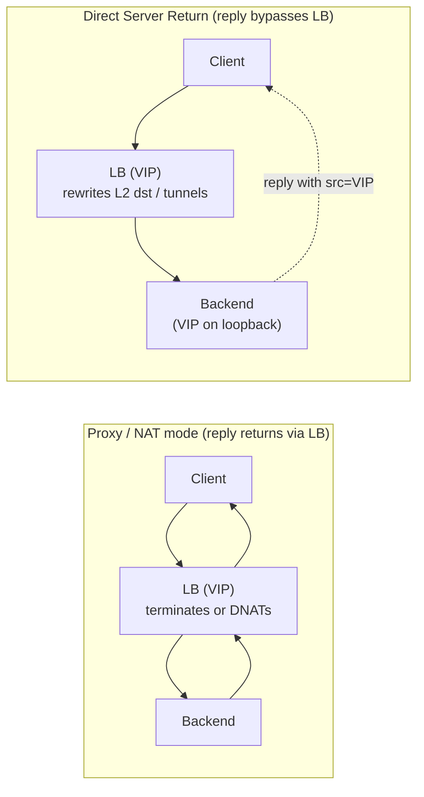

# 2.20 Load balancing: L4, L7, ECMP hashing, proxies and inference traffic

| | |
|---|---|
| Level | Intermediate to advanced |
| Priority tier | 0 |
| Lab venue | Linux VM with HAProxy/nginx/Envoy, IPVS, FRR for ECMP VIPs |
| Part | Part 2: Networking, from first principles to AI fabrics |
| Status | Drafted, labs **untested** |

## Why this matters for AI infrastructure

Inference endpoints are only as good as the layer that spreads requests across GPUs. A generic round-robin load balancer in front of long-lived gRPC or Server-Sent-Event token streams can leave one GPU at 100% and nine idle; a proxy reload can sever hour-long generations; an HTTP/2 connection pinned to one backend turns a "balanced" cluster into a hot spot; a health check that only tests TCP routes traffic to a server whose GPU has an Xid error. Beyond inference, load balancing is everywhere in the platform: ECMP and anycast VIPs at the fabric edge, Kubernetes Services (kube-proxy/IPVS/eBPF), ingress and gateways, cloud load balancers, DNS-based steering, and service meshes. This chapter builds the general theory (what a load balancer is, layers, algorithms, state, failure handling), the practical tools (IPVS, HAProxy, nginx, Envoy, cloud LBs), and the AI-specific problems (streaming, pinning, load-aware and cache-aware routing).

## Prerequisites and outcomes

You should know TCP/TLS/HTTP (2.6, 2.10), ECMP hashing (2.12), BGP (2.15, 2.16), NAT (2.9) and conntrack basics.

After this chapter you can:

- Classify load balancers by layer (DNS, L3/ECMP, L4, L7), topology (NAT/proxy, DSR, tunnel) and deployment (appliance, software, cloud-managed, in-cluster).
- Explain the algorithms: round robin, weighted, least connections, least response time, hash and consistent hashing (ring, rendezvous, Maglev), power-of-two-choices, EWMA, and when each fits.
- Explain ECMP and anycast as load balancing for VIPs, resilient hashing, and how L4 LBs scale out behind ECMP with connection consistency.
- Configure HAProxy, nginx and Envoy for HTTP, TLS termination/passthrough, gRPC, health checks, retries, timeouts, draining; set up IPVS.
- Diagnose problems: uneven load, connection pinning, hot backends, slow health detection, reload-induced stream loss, SNAT port exhaustion, sticky sessions, idle-timeout resets, client IP loss.
- Design inference load balancing: streaming, long-lived connections, queue/token-aware routing, prefix-cache-aware routing, autoscaling and drain, multi-tenant fairness.
- Choose between cloud load balancer types and Kubernetes patterns (Service, Ingress, Gateway API, mesh) at a high level (details in Part 5).

## 1. What a load balancer does

A **load balancer (LB)** presents one stable address (a **virtual IP**, VIP, or a name) and distributes incoming work across a pool of **backends** (real servers), providing: **scale** (more capacity than one server), **availability** (health checks remove failed backends), **maintainability** (drain one backend, upgrade it, return it), and often **security and policy** (TLS termination, rate limiting, WAF, authentication). Every LB must answer five design questions:

1. **Where is the decision made?** (client-side, DNS, the network (ECMP), a dedicated L4 device, an L7 proxy, the server.)
2. **What identifies a unit of work?** (packet, flow/connection, HTTP request, gRPC stream, token-generation job.)
3. **How is a backend chosen?** (algorithm and state.)
4. **How does the reply return?** (through the LB (proxy/NAT) or directly (DSR).)
5. **How are failures detected and handled?** (health checks, outlier detection, retries, draining.)

### Layers and families

| Family | Decision on | Examples | Notes |
|---|---|---|---|
| **DNS / GSLB** | Name resolution (round-robin records, weighted/geo/latency/health-checked answers) | Route 53, Cloud DNS routing policies, NS1 | Coarse; TTL and client caching limit agility; no connection awareness |
| **L3 ECMP / anycast** | Packet/flow hash across equal-cost next hops | Router ECMP, BGP-announced VIPs from many servers | Stateless, line rate; no health awareness beyond routing; flow remap on change |
| **L4 (transport)** | TCP/UDP connections (5-tuple) | IPVS/LVS, Maglev, AWS NLB, GCP Network LB, Katran (XDP), HAProxy `mode tcp`, nginx `stream` | Fast, protocol-agnostic; cannot see requests inside a connection |
| **L7 (application)** | HTTP/gRPC requests, headers, paths, cookies | HAProxy `mode http`, nginx, Envoy, Traefik, AWS ALB, GCP HTTP(S) LB, Istio gateway | Rich routing, retries, TLS, observability; more CPU, protocol-specific |
| **Client-side** | The client library | gRPC `round_robin`/`pick_first` with xDS, Finagle, Ribbon | No LB hop; needs service discovery and smart clients |
| **In-cluster / mesh** | Per-pod sidecars or node proxies | kube-proxy, Cilium eBPF, Envoy sidecar, Linkerd | Service-to-service balancing |

### Packet paths



- **Proxy mode (L4 or L7)**: the LB terminates the client connection and opens a separate one to the backend (a full proxy), so it can modify, buffer, retry and inspect; the backend sees the LB's address (so preserve the client IP via `X-Forwarded-For`, `Forwarded` header, or PROXY protocol). Stateful, costs CPU and memory, bounded by the LB's capacity.
- **NAT mode**: the LB rewrites the destination IP (DNAT) to the backend and the source if needed (SNAT/masquerade); the replies must come back through the LB (backend's default gateway is the LB, or SNAT is used, hiding the client IP).
- **DSR (Direct Server Return, "DR" in IPVS)**: the LB forwards the packet to the backend by rewriting only the destination MAC (same L2 segment) or by tunnelling (IPIP/GRE/GUE); the backend holds the VIP on a non-ARPing interface (`lo` with `arp_ignore=1`, `arp_announce=2`, chapter 2.3) and replies **directly** to the client with source = VIP. Replies (usually much larger than requests) skip the LB, giving huge throughput; the backend sees the real client IP. Limitations: L2 adjacency (or tunnels), no L7 features, health checking must be careful, and asymmetric flows complicate firewalls.
- **Tunnel/encapsulation (e.g. Maglev, Katran)**: L4 LB encapsulates the original packet toward the backend (GRE/IPIP/GUE), and the backend decapsulates and replies directly (DSR).

## 2. Algorithms

| Algorithm | How it chooses | Good for | Pitfall |
|---|---|---|---|
| **Round robin** (RR) / weighted RR | Rotate through backends (weights for unequal capacity) | Homogeneous, short, stateless requests | Ignores request cost and backend load |
| **Least connections** / weighted | Backend with fewest active connections | Variable-length requests, long-lived connections | Counts connections, not work; needs shared state across LB instances |
| **Least outstanding requests / least request** | Fewest in-flight requests | HTTP/gRPC | Same as above but request-granular |
| **Least response time / EWMA / peak-EWMA** | Lowest recent latency × in-flight | Heterogeneous backends | Needs measurement; can oscillate (herding) |
| **Power of two random choices (P2C)** | Pick two random backends, send to the less loaded | Large pools with imperfect load info; scalable | Needs load info per backend |
| **Source/URL/header hash** | `hash(key) mod N` | Session affinity, cache locality | Remaps most keys when N changes |
| **Consistent hashing (ring, rendezvous/HRW, jump hash)** | Map keys and backends onto a ring/score space; adding/removing one backend moves only ~1/N of keys | Caches, sticky sessions, sharded stores, stateful backends | Load imbalance (virtual nodes help); hot keys |
| **Maglev hashing** | Lookup table built from backend preference permutations; near-uniform load with minimal disruption | L4 LBs behind ECMP (Google Maglev) | Table rebuild cost; small disruption on change |
| **Random** | Uniform random | Simple | Variance |
| **Locality-aware / zone-aware** | Prefer same zone/rack | Cost, latency | Capacity imbalance across zones |
| **Priority/failover groups** | Use group 2 only if group 1 unhealthy | DR, spillover | Cold backups |
| **Load-aware custom (GPU/queue/KV-cache)** | Use backend-reported metrics | LLM inference | Needs telemetry, careful staleness handling |

Principles: (1) **choose the metric that represents work** (connections ≠ requests ≠ tokens ≠ GPU-seconds); (2) with multiple LB instances, local least-connections **herds**; P2C or randomised choice reduces synchronised stampedes; (3) **hash-based affinity** is for cache locality and state, but accept uneven load and plan for reshuffling (use consistent/resilient hashing); (4) **slow start** (ramp weight up for newly added or recovered backends) avoids flooding a cold server (JIT, caches, GPU warm-up).

## 3. Health checks, failure handling and draining

- **Active checks**: the LB probes backends periodically (TCP connect, HTTP `GET /healthz` expecting 200, gRPC health protocol `grpc.health.v1`, custom script). Parameters: interval, timeout, rise (successes to mark up), fall (failures to mark down). Detection time ≈ interval × fall; too aggressive causes flapping under load; too lax keeps sending traffic to dead nodes.
- **Passive checks / outlier detection**: observe real traffic: eject a backend after N consecutive 5xx or connection failures for a period (Envoy outlier detection, HAProxy `observe layer7`, nginx `max_fails`); catches failures the probe misses and brownouts.
- **What to check**: liveness (process up) versus **readiness** (can serve now: model loaded, GPU healthy, queue not full). For inference, `ready` should reflect model load state; extended checks might consult GPU health (DCGM, Xid errors) so that a failing GPU is removed (requires integration).
- **Retries**: only for idempotent requests or failures before any bytes were sent; use retry budgets and per-try timeouts to avoid retry storms (amplification during outages); hedged requests carefully.
- **Timeouts**: connect, request/stream idle, total; LLM streams need generous read timeouts and heartbeats; mismatch between client, LB, and server idle timeouts causes mysterious resets (chapter 2.10).
- **Circuit breaking / overload protection**: cap concurrent connections/requests/pending queue per backend; shed load with 503 + `Retry-After` instead of queueing indefinitely.
- **Connection draining**: when removing a backend (deploy, scale-in), stop new requests but let existing ones finish up to a deadline. Essential for long streams; coordinate with the orchestrator (Kubernetes `terminationGracePeriodSeconds`, `preStop` hook, readiness going false before shutdown).
- **Graceful reload**: proxies like nginx/HAProxy keep old workers until old connections end; for long streams that means workers can live for hours; use dynamic config APIs (Envoy xDS, HAProxy runtime API, nginx Plus/resolver variables) to avoid reloads on endpoint changes.

## 4. ECMP, anycast and scaling out the L4 tier

A single LB node is a throughput limit and a single point of failure. The standard scale-out is to put the L4 tier **behind ECMP**:

1. Each L4 LB node announces the **VIP** to the upstream router (or leaf) via BGP (FRR/BIRD/ExaBGP); the router sees N equal-cost next hops and spreads flows across them by 5-tuple hash.
2. A node fails or is drained: its BGP session drops (BFD makes this sub-second) and the router removes it from the ECMP set; flows that hashed to it get remapped. With plain modulo hashing **all** flows may be rehashed (existing connections break); with **resilient/consistent hashing** in the router, only the flows of the failed node move.
3. Surviving nodes receive flows they have no state for. To avoid breaking established connections, L4 LBs use **consistent hashing keyed on the 5-tuple** (Maglev-style) so any node computes the *same* backend for the same flow without synchronised state; or they share/replicate connection state. Google Maglev and Meta Katran work this way.
4. The L4 node forwards to the backend by DSR/encapsulation or proxying.

This is "anycast within a data centre": the same VIP from many nodes. The same mechanism serves DNS anycast and global anycast across data centres (nearest healthy site wins by BGP path). Caveats: BGP convergence time determines failover; flows can shift to a different site on a route change (long-lived TCP breaks); asymmetric routing and `rp_filter` (chapter 2.5); path MTU and ICMP (chapter 2.7); the hash must be stable across the tier; health coupling between the LB's backend health and the VIP announcement (withdraw the VIP if the node cannot serve).

Also from AI-fabric context (chapter 2.12): ECMP hashing at fabric tiers is itself a form of load balancing for *flows*, with the same caveats: few elephant flows → imbalance; RoCE varies UDP source ports per QP for entropy; inner-header hashing for tunnels; adaptive routing to react to load.

## 5. L4 tools: IPVS and friends

**Linux IPVS (LVS)** is a kernel L4 load balancer (netfilter-based, used by kube-proxy IPVS mode and keepalived):

```bash
sudo modprobe ip_vs ip_vs_rr ip_vs_wlc ip_vs_sh
sudo ipvsadm -A -t 10.0.0.100:443 -s wlc                       # virtual service, weighted least-connection
sudo ipvsadm -a -t 10.0.0.100:443 -r 10.1.0.11:443 -g -w 1     # -g direct routing (DSR), -m masquerade (NAT), -i tunnel
sudo ipvsadm -a -t 10.0.0.100:443 -r 10.1.0.12:443 -g -w 1
sudo ipvsadm -Ln --stats --rate ; sudo ipvsadm -Lcn             # services, per-connection table
# DR mode backend prerequisites (on each real server):
sudo ip addr add 10.0.0.100/32 dev lo
sudo sysctl -w net.ipv4.conf.all.arp_ignore=1 net.ipv4.conf.all.arp_announce=2
```

Schedulers: `rr`, `wrr`, `lc`, `wlc`, `sh` (source hash), `dh`, `mh` (Maglev hashing), `sed`, `nq`. **keepalived** adds VRRP (active/passive VIP failover) and health checks that add/remove IPVS real servers. Other L4 options: HAProxy/nginx in TCP mode, eBPF/XDP balancers (Katran, Cilium's kube-proxy replacement), cloud network LBs. NAT-mode IPVS depends on conntrack (state, `nf_conntrack_max`), DR mode does not.

## 6. L7 tools: HAProxy, nginx, Envoy

### HAProxy (HTTP and TCP)

```text
global
  maxconn 100000
  nbthread 8
defaults
  mode http
  timeout connect 3s
  timeout client  300s        # long for streaming
  timeout server  300s
  timeout tunnel  1h          # websocket/gRPC streams
  option httplog
frontend fe_https
  bind :443 ssl crt /etc/haproxy/certs/ alpn h2,http/1.1
  http-request set-header X-Forwarded-Proto https
  acl is_grpc hdr(content-type) -i application/grpc
  use_backend be_infer if is_grpc
  default_backend be_web
backend be_infer
  balance leastconn
  option httpchk
  http-check send meth GET uri /v2/health/ready
  default-server check inter 2s fall 3 rise 2 slowstart 30s maxconn 64
  server triton1 10.1.0.11:8001 proto h2
  server triton2 10.1.0.12:8001 proto h2
backend be_web
  balance roundrobin
  cookie SRV insert indirect nocache
  server web1 10.1.1.11:8080 check cookie w1
frontend fe_pg
  mode tcp
  bind :5432
  default_backend be_pg
backend be_pg
  mode tcp
  balance leastconn
  server pg1 10.1.2.11:5432 check
# runtime API: echo "set server be_infer/triton1 state drain" | socat stdio /var/run/haproxy.sock
```

### nginx

```nginx
upstream triton_grpc { least_conn; keepalive 32; server 10.1.0.11:8001; server 10.1.0.12:8001; }
server {
  listen 443 ssl http2;
  ssl_certificate     /etc/nginx/certs/api.pem; ssl_certificate_key /etc/nginx/certs/api.key;
  location / {
    grpc_pass grpc://triton_grpc;
    grpc_read_timeout 300s; grpc_send_timeout 300s;
    grpc_buffer_size 4k;                 # small buffers: tokens are small, buffering adds latency
  }
  location /v1/ {                         # SSE token streaming over HTTP/1.1
    proxy_pass http://vllm_pool; proxy_http_version 1.1; proxy_set_header Connection "";
    proxy_buffering off; proxy_cache off; proxy_read_timeout 600s;
  }
}
stream { upstream pg { server 10.1.2.11:5432; } server { listen 5432; proxy_pass pg; } }   # L4
```

Notes: open-source nginx resolves upstream hostnames at config load, so new endpoints need a reload (or `resolver` + variables, or nginx Plus dynamic upstreams); reload starts new workers while old ones live until their connections end; `worker_shutdown_timeout` can cap them but cuts streams.

### Envoy

Envoy is a modern L4/L7 proxy built around dynamic configuration (**xDS** APIs: listeners, routes, clusters, endpoints, secrets), first-class HTTP/2 and gRPC, rich observability (stats, access logs, tracing), and advanced load balancing and resilience.

```yaml
static_resources:
  listeners:
  - name: ingress
    address: { socket_address: { address: 0.0.0.0, port_value: 8443 } }
    filter_chains:
    - filters:
      - name: envoy.filters.network.http_connection_manager
        typed_config:
          "@type": type.googleapis.com/envoy.extensions.filters.network.http_connection_manager.v3.HttpConnectionManager
          stat_prefix: ingress
          stream_idle_timeout: 600s
          route_config:
            virtual_hosts:
            - name: infer
              domains: ["*"]
              routes:
              - match: { prefix: "/" }
                route: { cluster: triton, timeout: 0s, retry_policy: { retry_on: "connect-failure,refused-stream", num_retries: 2 } }
          http_filters: [{ name: envoy.filters.http.router, typed_config: { "@type": type.googleapis.com/envoy.extensions.filters.http.router.v3.Router } }]
  clusters:
  - name: triton
    type: STRICT_DNS
    lb_policy: LEAST_REQUEST            # P2C over least-request; also ROUND_ROBIN, RING_HASH, MAGLEV, RANDOM
    typed_extension_protocol_options:
      envoy.extensions.upstreams.http.v3.HttpProtocolOptions:
        "@type": type.googleapis.com/envoy.extensions.upstreams.http.v3.HttpProtocolOptions
        explicit_http_config: { http2_protocol_options: {} }
    health_checks: [{ timeout: 1s, interval: 2s, unhealthy_threshold: 3, healthy_threshold: 2, grpc_health_check: {} }]
    outlier_detection: { consecutive_5xx: 5, interval: 5s, base_ejection_time: 30s }
    circuit_breakers: { thresholds: [{ max_connections: 1024, max_pending_requests: 256, max_requests: 4096 }] }
    load_assignment: { cluster_name: triton, endpoints: [{ lb_endpoints: [ { endpoint: { address: { socket_address: { address: triton-svc, port_value: 8001 } } } } ] }] }
```

Features worth knowing: least-request with P2C, ring-hash and Maglev for affinity, **slow start** windows, **outlier detection**, **locality-weighted** load balancing, panic thresholds (when too many hosts are unhealthy, spread to all rather than overloading the few), retry budgets, hedging, rate limiting, **connection draining on listener updates**, the admin interface (`/clusters`, `/stats`), and use as the data plane for Istio, Contour, Envoy Gateway, Gloo, Ambassador and many cloud edges.

## 7. TLS, client identity and L4/L7 interplay

- **TLS termination at the LB** (decrypt, inspect/route at L7, re-encrypt or plaintext to backends) enables routing on headers and WAF; **passthrough** (L4 on SNI) keeps end-to-end encryption and mTLS but loses L7 features; **re-encryption** keeps encryption inside the data centre. Certificate management is covered in chapter 2.10.
- **Preserving client IP**: L7: `X-Forwarded-For`/`Forwarded` (trust only from known proxies to avoid spoofing); L4: **PROXY protocol** (v1/v2) header prefixed by the LB so the backend can learn the original client address and TLS info; DSR and `externalTrafficPolicy: Local` in Kubernetes avoid SNAT; cloud LBs differ on whether they preserve source IP.
- **HTTP/2 and gRPC multiplexing**: many requests share one connection. **At L4, balancing is per connection**: all streams of a client connection go to one backend (connection pinning). Fix with L7 proxies that balance per request/stream (nginx `grpc_pass`, Envoy, HAProxy with `proto h2`, ALB for gRPC), client-side balancing (`round_robin` across resolved addresses, xDS), or by capping connection age (`MAX_CONNECTION_AGE`) so clients periodically reconnect and rebalance.
- **WebSockets/SSE**: long-lived; configure idle timeouts and heartbeats, disable response buffering.
- **HTTP/3/QUIC**: UDP-based; L4 LBs must hash on QUIC connection IDs (not 5-tuple) to survive client IP/port changes; check support.
- **Rate limiting and fairness**: per-client/token-bucket limits at the gateway, concurrency limits per tenant, priority queues, and 429 with `Retry-After`.

## 8. Cloud and Kubernetes load balancing (overview)

- **Cloud**: GCP offers external/internal **Application LBs** (L7 HTTP(S), global or regional, built on Envoy/GFE), **Network LBs** (L4 pass-through or proxy), and **internal TCP/UDP** LBs; AWS has ALB (L7), NLB (L4), GLB (L3 gateway for appliances), CLB (legacy); Azure has Application Gateway, Load Balancer, Front Door. Differences to check: source IP preservation, idle timeouts (often 60 s for HTTP LBs; 350 s for some L4), supported protocols (gRPC, WebSockets, HTTP/2 end to end), connection draining settings, health check semantics, quotas, cross-zone behaviour, and cost per GB. Chapter 2.32 covers GCP specifics.
- **Kubernetes** (details in Part 5): a **Service** (ClusterIP/NodePort/LoadBalancer/Headless) gives a stable virtual IP; **kube-proxy** implements it with iptables rules (random probability chain), IPVS (real L4 scheduler) or eBPF replacement (Cilium); **EndpointSlices** list ready pods; readiness probes control membership; **Ingress** and **Gateway API** provide L7 HTTP routing and TLS via controllers (nginx, HAProxy, Envoy-based Contour/Emissary/Envoy Gateway, Traefik, cloud controllers); **service meshes** add per-pod proxies for mTLS, retries and L7 balancing between services; **MetalLB/kube-vip/Cilium** provide LoadBalancer VIPs on bare metal via ARP or BGP (ECMP). Remember: kube-proxy's iptables mode balances **connections** randomly, not load-aware, and long-lived gRPC connections need L7 or client-side balancing.

## 9. Load balancing for AI inference

LLM serving breaks several assumptions of web load balancing:

1. **Requests are long, variable and stateful-ish.** A request may stream tokens for minutes; cost varies with prompt and output length by orders of magnitude; a backend's real load is its **queue depth, number of running sequences, and KV-cache occupancy**, not its connection count.
2. **Connections are long-lived.** HTTP/2/gRPC streams and SSE hold resources; reloads, scale-in and deploys must drain gracefully; idle timeouts at any hop can cut a slow generation.
3. **Cache locality matters.** Prefix caching (system prompts, RAG context, multi-turn chat) makes a request cheaper on the replica that already holds the prefix KV blocks; routing the same session/prefix to the same replica raises hit rates, but pure affinity can create hot spots.
4. **Backends are expensive and heterogeneous.** GPU types, tensor-parallel group sizes, disaggregated prefill/decode pools, LoRA adapters loaded per replica, and quantised variants.
5. **Autoscaling is slow.** GPU nodes and model loads take minutes, so the router must absorb bursts (queueing/shedding) rather than rely on instant scale-out.

Practices:

- **Balance per request, not per connection**: use L7 (Envoy, HAProxy, nginx `grpc_pass`, Gateway API inference extensions) or client-side balancing; avoid pure L4 for multiplexed gRPC (symptom: servers 1 and 2 overloaded while 3 to 10 idle; mitigations: periodic reconnect via max connection age, then true L7 balancing).
- **Choose a load signal**: least-outstanding-requests as a baseline; better, backend-reported metrics (running + waiting requests, KV-cache usage, estimated tokens) exposed via Prometheus or response headers/ORCA-style load reports; use **P2C over load** to avoid herding; consider token-count-aware estimates (prompt length known at admission, output length predicted).
- **Cache- and session-aware routing**: consistent hashing on a session ID or prompt-prefix hash with **bounded loads** (spill to the next replica when one exceeds its share), or a router that tracks which replica holds which prefix blocks (the approach of LLM-specific routers and "gateway API inference extension" endpoint pickers).
- **Disaggregated serving**: route prefill and decode to separate pools, handle KV transfer between them, and keep the two pools' autoscaling and admission coupled (Part on inference).
- **Health and readiness**: health checks hit the serving framework's readiness endpoint (e.g. Triton `/v2/health/ready`, vLLM `/health`), and optionally integrate GPU health (DCGM Xid/ECC); mark not-ready during model load; use `slowstart` for cold replicas.
- **Streaming hygiene**: disable proxy buffering for SSE; set read/stream-idle timeouts above the maximum generation time; send heartbeats; avoid `Connection: close`; use HTTP/2 end to end where possible; measure time-to-first-token (TTFT) and inter-token latency at the proxy (access logs with `$upstream_response_time`, Envoy stats).
- **Drain on deploy/scale-in**: readiness false → stop new → wait for in-flight streams up to the grace period → terminate; align `terminationGracePeriodSeconds`, `preStop`, LB deregistration delay, and proxy shutdown timeouts; reloads should be hot (xDS/runtime API) so old workers don't linger for hours.
- **Overload control and fairness**: per-tenant concurrency and token-rate limits; priority queues (interactive vs batch); return 429/503 early rather than building unbounded queues; admission control that considers KV-cache headroom.
- **Observability**: per-backend request counts, in-flight, queue time, error and retry rates, TTFT/ITL percentiles, ejection events, hot-backend alerts; trace requests across gateway → router → engine.

Whiteboard framing for interviews: client → anycast/ECMP to a fleet of L4/L7 gateways (BGP VIP, BFD) → TLS termination and L7 routing (per-request, per-tenant policy) → load/cache-aware endpoint picker → inference pods (readiness, drain) with GPU health integration; show where pinning happens at L4 and how L7/client-side fixes it. In enterprise environments you may meet appliance or software ADCs (for example VMware Avi, F5, Citrix) that scale out service engines behind BGP/ECMP VIPs, understand HTTP/2 and gRPC at L7, and support custom health monitors; the architectural ideas are the same, and any specific product capability claim must be validated against current vendor documentation and a load test.

## 10. Troubleshooting

| Symptom | Likely cause | Check/fix |
|---|---|---|
| One backend hot, others idle | L4 pinning of multiplexed connections; hash-based affinity; slow start missing; stale weights | Switch to L7/per-request; `max_connection_age`; `ss -tn` per backend; LB stats |
| Intermittent 502/504 | Backend timeouts shorter than LB; backend resets idle connection; keepalive mismatch | Align idle/keepalive timers; `upstream_response_time`; retry only idempotent |
| Streams cut during deploy | Reload/scale-in without drain; shutdown timeout | Hot reload; drain; larger grace; `terminationGracePeriodSeconds` |
| Client IP missing in logs | SNAT/proxy | `X-Forwarded-For`, PROXY protocol, DSR, `externalTrafficPolicy: Local` |
| Connection resets after N seconds idle | LB/NAT idle timeout | Keepalives below the timeout; raise timeout |
| New backend gets no traffic | Health check failing, wrong port/path, readiness false, not registered | Health status; `curl` from the LB host; service discovery |
| Existing connections break after LB change | ECMP rehash without consistent hashing; state not shared | Resilient hashing; Maglev-style hashing; connection draining |
| Source port exhaustion at LB | Many connections to few backends from one IP | More SNAT IPs, connection reuse/keepalive, DSR |
| High p99 only on some requests | Head-of-line blocking at HTTP/1.1 backend; slow backend not ejected; retry storms | Outlier detection; per-try timeouts; least-request |
| Health flapping | Aggressive interval; overloaded backend failing probes | Tune rise/fall; separate health endpoint; lighter check |

Tools: `ss -s`, `ss -tni`, `conntrack -L`, `ipvsadm -Ln --stats`, HAProxy `show stat`/`show servers state`, Envoy `/clusters` and `/stats`, nginx `stub_status`/`$upstream_*` log variables, `curl -w` timing, `tcpdump` on LB and backend, `wrk`/`hey`/`ghz` (gRPC load generator)/`vegeta` for load tests, and application metrics.

## 11. Hands-on lab: build and break load balancers

First, run the self-checking Python lab (`code/part02/load_balancing_l4_l7_lab.py`) locally. It verifies Power-of-Two-Choices (`P2C`) backend selection, Rendezvous (`HRW`) consistent hashing (`~1/N` key movement) with bounded-load spillover for LLM prefix-cache affinity, L4 vs L7 gRPC HTTP/2 connection pinning (`[100, 0, 0, 0]` vs `[25, 25, 25, 25]`), and active health-check detection times (`inter 2s fall 3 = 6.0 s`).

```bash
python3 code/part02/load_balancing_l4_l7_lab.py
```

Next, on a disposable Linux VM with `ipvsadm`, `haproxy`, `nginx`, `envoy`, and `frr` (all interactive VM commands below are `untested here`), work through these steps:

1. **L4 IPVS DR**: three namespaces (lb, rs1, rs2) on a bridge; configure the VIP on `lo` of the real servers with `arp_ignore/arp_announce`; IPVS in DR mode; verify distribution with `ipvsadm -Lcn`; capture to show replies bypass the LB; switch to NAT mode and observe conntrack and the return path.
2. **Algorithms**: run `hey`/`wrk` against RR, least-connection, source-hash, Maglev (`mh`); add a slow backend (`tc netem delay`) and compare distributions and tail latency; change a weight.
3. **HAProxy L7**: two HTTP backends; configure active health checks (`check inter 1s fall 2 rise 2`); stop one backend and measure detection time; add `slowstart`; use the runtime API to drain.
4. **gRPC pinning**: a simple gRPC server that returns its hostname (or Triton/`grpcbin`); front with (a) nginx `stream` (L4) and (b) nginx `grpc_pass`/Envoy; one client with one channel sending many calls via `ghz`; show all go to one backend in L4 and spread in L7; apply `MAX_CONNECTION_AGE` and observe periodic rebalancing.
5. **Reload vs streams**: start a long SSE/gRPC stream through nginx; `nginx -s reload`; see old worker lingering (`ps`), set `worker_shutdown_timeout` and watch the stream get cut; compare Envoy dynamic update (file-based xDS) with no cut.
6. **Consistent hashing**: Envoy `RING_HASH`/`MAGLEV` or HAProxy `balance hdr()`+`hash-type consistent`; map session IDs; remove a backend and count how many sessions remapped versus plain modulo hash.
7. **ECMP VIP**: two LB namespaces announcing the same VIP to a router namespace via FRR/BGP; verify ECMP; fail one LB; measure convergence with and without BFD; observe which flows break (consistent hashing vs not); test resilient hashing if supported.
8. **Inference-aware routing (simulation)**: write a tiny Python backend with variable service time and an exposed `queue_depth` metric; implement round-robin vs least-outstanding vs P2C-on-queue-depth in a minimal proxy (`asyncio`) and compare p99 latency under a heavy-tailed job-size distribution; add prefix-hash affinity with bounded load and measure cache-hit proxy metric.
9. **Overload and retries**: add a retry policy without budget and trigger a retry storm by killing a backend; add circuit breaking and a retry budget and compare.
10. **Clean up.**

## 12. Common mistakes

- L4 balancing multiplexed HTTP/2 or gRPC and expecting even load.
- Using connection count as the load signal for long, heterogeneous requests; synchronised least-connection herding across many LB instances.
- Health checks that test only TCP, or that are too aggressive; no slow start; no outlier detection.
- Retries without budgets; non-idempotent retries; timeouts shorter than the longest legitimate generation.
- Reloading proxies to update endpoints in long-stream workloads; no drain in deploys.
- Trusting `X-Forwarded-For` from the Internet; losing client IP behind SNAT.
- Plain modulo hashing behind ECMP/anycast (mass remapping); VIP announced while the node cannot serve.
- Treating the LB as infinitely scalable: no capacity limits, no overload shedding.

## 13. Interview angles

- "L4 versus L7 load balancing: when and why? What's DSR?"
- "Walk me through scaling a load balancer horizontally behind ECMP/anycast. What breaks on a change?"
- "Consistent hashing: how does it work and why use it? What's Maglev?"
- "Why does round-robin L4 in front of gRPC give uneven load? How do you fix it?"
- "Design load balancing for an LLM inference service with streaming responses."
- "How do health checks, outlier detection and circuit breaking differ?"
- "How do you do a zero-downtime deploy for long-lived streaming connections?"
- "How do you preserve the client IP through a load balancer?"
- "What does kube-proxy do and what are its limits for load balancing?"

## Exercises

1. **Load Balancer Families, Proxy/NAT vs. Direct Server Return (`DSR`), and Preserving Client Identity:** (a) State the five design questions every load balancer answers, and compare DNS/GSLB, L3 ECMP/Anycast, L4 transport (`IPVS`, `Maglev`, `Katran`), and L7 application proxies (`Envoy`, `HAProxy`, `nginx`); (b) explain how **Direct Server Return (`DSR` / IPVS `-g`)** works, why the backend must configure the VIP on `lo` with `arp_ignore=1` and `arp_announce=2`, and how client IPs are preserved across L4 (`PROXY protocol`) and L7 (`X-Forwarded-For`) proxies.
2. **Load-Balancing Algorithms: `Round Robin`, `Least Connections`, `P2C`, and Consistent Hashing / `Maglev`:** (a) Why does naive Least Connections herd requests onto a single server when multiple independent load-balancer instances make decisions, and how does **Power of Two Choices (`P2C`, `select_backend_p2c()`)** solve it? (b) Using `select_backend_rendezvous_bounded()` in `code/part02/load_balancing_l4_l7.py`, explain why **Consistent Hashing** (`Ring Hash`, `Rendezvous HRW`, `Maglev`) moves only `~1 / N` of keys when a backend leaves the pool versus `(N - 1) / N` under `hash(key) mod N`.
3. **Scaling the L4 Tier Horizontally Behind `ECMP` Anycast VIPs:** Walk through the 4-layer architecture of a cloud-scale L4 load balancer (`Router ECMP + BFD -> Stateless L4 Maglev/Katran tier -> DSR/IPIP tunnel -> L7 Envoy/HAProxy tier`), and explain what two hashing mechanisms prevent existing TCP connections from resetting when one L4 load-balancer node is drained.
4. **The `gRPC` / `HTTP/2` L4 Connection-Pinning Trap and Fixes:** Using `simulate_grpc_l4_vs_l7_distribution(4, 1, 100)`, explain why placing an L4 load balancer (`kube-proxy` `iptables`/`IPVS`, `nginx stream`, AWS NLB) in front of 4 Triton/vLLM gRPC pods causes 1 pod to run at 100% GPU utilization while 3 sit at 0% when a client opens a single HTTP/2 channel. State three ways to fix it.
5. **Health Checks, Outlier Detection, Circuit Breaking, and Zero-Downtime Streaming Drains:** (a) Distinguish **active readiness checks** (`compute_health_check_detection_sec(2.0, 3) = 6.0 s` on `/v2/health/ready`) from **passive outlier detection** (`consecutive_5xx: 5`), **slow start** (`30 s`), and **circuit breakers** (`max_pending_requests`); (b) why does `nginx -s reload` cause worker accumulation or severed streams on long SSE/gRPC generations, and how does Envoy's **`xDS`** API avoid it?
6. **Designing an LLM Inference Router (`KV-Cache` Prefix Affinity, Queue Signals, and Disaggregated Prefill/Decode):** Design an L7 inference routing tier that balances variable-length streaming requests across GPU replicas using (a) backend-reported **running/waiting queue depth and KV-cache occupancy**, (b) **bounded-load consistent hashing** on prompt prefixes (`select_backend_rendezvous_bounded()`) to maximize prefix-cache hits without overloading a single GPU, and (c) separated **prefill** and **decode** pools.

## Checkpoint questions (20)

<details>
<summary>1. What five questions must every load-balancer architecture answer, and what is the core difference between an L4 and an L7 load balancer?</summary>

The five questions are: (1) **Where** is the routing decision made? (2) **What** is the unit of work? (3) **How** is the backend chosen (algorithm/state)? (4) **How** does the return traffic flow (via LB vs DSR)? and (5) **How** are backend failures detected and drained?\nAn **L4 load balancer** (`IPVS`, `Maglev`, `Katran`, AWS `NLB`) operates on **TCP/UDP connections (5-tuples)**—forwarding packets at very high speed without inspecting application payloads. An **L7 load balancer** (`Envoy`, `HAProxy mode http`, `nginx`, AWS `ALB`) terminates the client TCP/TLS connection and parses **individual HTTP/1.1, HTTP/2, or gRPC requests**, enabling per-request balancing, header/path routing, and retries.
</details>

<details>
<summary>2. How does Direct Server Return (`DSR` / IPVS `-g`) work, why must backends set `arp_ignore=1` and `arp_announce=2`, and what is DSR's main advantage?</summary>

In **DSR**, the L4 load balancer receives the client packet addressed to the `VIP` and forwards it to the chosen backend **without changing the destination IP (`VIP`)**—either by rewriting only the outer **Destination MAC** (on the same L2 VLAN) or by encapsulating it in an **IPIP/GRE/GUE tunnel**. Each backend configures the `VIP/32` on its own **`lo` (loopback)** interface (with `arp_ignore=1` and `arp_announce=2` so backends never answer ARP for the `VIP` on the LAN), accepts the packet locally, and sends the response **directly back to the client (`src = VIP`)**, bypassing the load balancer on the return path. Because responses (model weights, video, token streams) are much larger than requests, DSR multiplies outbound throughput and preserves the true client IP.
</details>

<details>
<summary>3. How do you preserve the original client IP address when using an L4 Proxy/SNAT load balancer versus an L7 HTTP reverse proxy?</summary>

- **At Layer 7 (HTTP/HTTPS)**: the proxy inserts the **`X-Forwarded-For`** (or RFC 7239 **`Forwarded`**) HTTP header; backends must be configured to trust `X-Forwarded-For` **only** when the TCP connection arrives from known proxy IPs.\n- **At Layer 4 (TCP proxy/SNAT)**: prepend HAProxy's **`PROXY protocol` (v1 text or v2 binary)** header at the start of the backend TCP connection (or use `DSR` / Kubernetes `externalTrafficPolicy: Local` to avoid SNAT altogether).
</details>

<details>
<summary>4. Why does Round-Robin fail for heterogeneous AI requests, why can Least-Connections \"herd\" across multiple LBs, and how does Power of Two Choices (`P2C`) fix it?</summary>

**Round-Robin** assumes every request costs the same time, which fails when one prompt generates 20 tokens (`200 ms`) and the next generates 4,000 tokens (`60 s`). **Least-Connections** (or Least-Requests) works well on a single LB, but when dozens of independent LB instances observe that Backend 5 just became idle (`0` active requests), all of them simultaneously dump their next burst of requests onto Backend 5 (**herding**). **Power of Two Choices (`P2C`, used by Envoy `LEAST_REQUEST`)** picks **two backends at random** and sends the request to the less loaded of the two—exponentially suppressing max-load tail spikes while avoiding synchronized herding.
</details>

<details>
<summary>5. How do Ring Consistent Hashing, Rendezvous (`HRW`) Hashing, and `Maglev` Hashing work, and why do they move only `~1 / N` of keys when a backend changes?</summary>

With naive `hash(key) % N`, changing `N` from `10` to `9` remaps **`90%` of all keys**, invalidating caches and breaking stateful sessions. **Ring Consistent Hashing** places backends (with virtual nodes) and keys on a `2^32` ring; **Rendezvous (*Highest Random Weight*, `HRW`) Hashing** computes `score = hash(key, backend)` for each backend and picks the highest score; and **Google's `Maglev` Hashing** generates a permutation preference list per backend to fill a fixed-size lookup table (`M = 65537` prime slots) with near-perfect uniformity. In all three, adding or removing 1 of `N` backends disturbs only **`~1 / N`** of keys.
</details>

<details>
<summary>6. How do you scale out an L4 load-balancer tier horizontally using `eBGP`, `ECMP`, and `Maglev` consistent hashing?</summary>

Deploy `K` stateless L4 load-balancer nodes (`IPVS` / `Katran` / `Maglev`), each advertising the **exact same `/32` VIP** to the leaf/border routers over **eBGP + BFD**. The routers spread incoming client TCP flows across the `K` L4 nodes via **resilient 5-tuple ECMP**. Because every L4 node runs **Maglev consistent hashing** on the packet's 5-tuple over the same backend list, even if a router ECMP-rehashes an established TCP flow from L4 Node 1 to L4 Node 2, L4 Node 2 deterministically maps the packet to the **exact same backend server** without needing a shared cross-node connection table.
</details>

<details>
<summary>7. Explain the `gRPC` / `HTTP/2` L4 Connection-Pinning problem and state three ways to solve it (`PK` Chapter 6 / `NK` Chapter 2).</summary>

`gRPC` runs over **`HTTP/2`**, which multiplexes hundreds of concurrent RPC calls as streams inside a **single long-lived TCP connection**. If a client (or microservice pod) opens one gRPC channel through an **L4 load balancer** (`kube-proxy` default `iptables` or `IPVS` mode, `nginx stream`, or AWS NLB), the L4 balancer makes a single decision at `SYN` time and pins **100% of all future RPCs on that channel to a single backend pod** while sibling pods sit idle. Fix it by:\n(1) Placing an **L7 HTTP/2-aware proxy** (`Envoy`, `HAProxy proto h2`, `nginx grpc_pass`, or a service mesh) in the path to balance per RPC request;\n(2) Using **client-side gRPC load balancing** (`round_robin` policy resolving a **Headless Service** `clusterIP: None` or via **`xDS`**); or\n(3) Configuring **`MAX_CONNECTION_AGE`** on the server so clients periodically reconnect and rebalance.
</details>

<details>
<summary>8. Compare Active Health Checks (`liveness` vs. `readiness`), Passive Outlier Detection, and Slow Start.</summary>

- **Active Health Checks**: periodic synthetic probes (`GET /v2/health/ready`, `grpc.health.v1`, or TCP connect) controlled by `interval`, `timeout`, `fall` (consecutive failures to mark down), and `rise` (successes to mark up). **Liveness** checks if the process is stuck and needs a restart; **Readiness** checks if the replica has finished loading model weights into VRAM and has healthy GPUs to accept traffic.\n- **Passive Outlier Detection**: monitors **real client traffic** (`consecutive_5xx: 5` in Envoy) and temporarily ejects a backend that returns fast 500s or timeouts even if its `/healthz` endpoint still returns 200.\n- **Slow Start (`slowstart 30s`)**: linearly ramps traffic weight from 0% to 100% when a new or recovered backend joins the pool so cold caches/JIT/CUDA contexts are not overwhelmed.
</details>

<details>
<summary>9. Why are unbudgeted retries dangerous during a partial outage, and how do Retry Budgets and Circuit Breakers prevent cascading failure?</summary>

If 50% of requests time out when a backend pool is overloaded and every client retries `3` times immediately, applied load **quadruples (`4x`)** (**retry storm / traffic amplification**), knocking over the remaining healthy replicas. Prevent this by: (1) retrying **only idempotent requests or connection failures before bytes are sent**, (2) enforcing a cluster-wide **Retry Budget** (e.g., at most `10%–20%` of active requests may be retries), and (3) configuring **Circuit Breakers** (`max_connections`, `max_pending_requests`, `max_requests`) that fail fast (`503 Service Unavailable`) instead of queueing forever.
</details>

<details>
<summary>10. Why does `nginx -s reload` cause problems for long-lived LLM token streams (`SSE` / `gRPC`), and how do Envoy (`xDS`) and HAProxy solve it?</summary>

When open-source `nginx` reloads its configuration (`nginx -s reload`) to pick up new backend pod IPs, the master process spawns a brand-new set of worker processes and tells the old workers to shut down once their active connections close. With long-lived HTTP/2, gRPC, or WebSocket/SSE streams, old workers linger in memory for hours (exhausting RAM) or abruptly sever active token streams when `worker_shutdown_timeout` expires. **Envoy** updates endpoints dynamically in memory via its **`xDS` (`EDS`) API** (and **HAProxy** via its runtime Unix socket / DNS SRV) without spawning new processes or dropping connections.
</details>

<details>
<summary>11. Compare the three `kube-proxy` modes in Kubernetes (`iptables`, `IPVS`, and Cilium `eBPF`, `PK` Chapter 6).</summary>

- **`iptables` mode (legacy default)**: programs sequential chain rules (`KUBE-SERVICES` -> `KUBE-SVC-*` -> `KUBE-SEP-*`) using `--mode random --probability` to pick a pod on `SYN`. Rule evaluation scales as **`O(N)`** with the number of Services (slowing packet processing above a few thousand Services) and supports only random L4 connection selection.\n- **`IPVS` mode**: uses in-kernel Linux Virtual Server hash tables (**`O(1)`** lookup at 10,000+ Services) and supports real L4 schedulers (`rr`, `lc`, `wlc`, `sh`, `mh` Maglev).\n- **Cilium `eBPF` kube-proxy replacement**: intercepts `connect()` / `sendmsg()` directly at the **socket layer** (`sockmap`/cgroup eBPF), rewriting the destination `ClusterIP` to the pod IP once at connection setup with zero per-packet `iptables`/DNAT traversal.
</details>

<details>
<summary>12. What does `externalTrafficPolicy: Local` vs. `Cluster` do on a Kubernetes `NodePort` or `LoadBalancer` Service (`PK` Chapter 6)?</summary>

- **`Cluster` (default)**: any node receiving external traffic `DNAT`s it across all ready pods cluster-wide (potentially adding an extra node-to-node network hop) and **`SNAT`s the source IP to the node's own IP** so return traffic comes back to that node (**losing the original client IP**).\n- **`Local`**: each node routes traffic **only to pods running locally on that same node** (eliminating the extra hop and **preserving the original client source IP** without SNAT), and fails the cloud load balancer's health-check probe on nodes that have zero local ready pods.
</details>

<details>
<summary>13. Why is active TCP connection count (`leastconn`) a poor load metric for LLM inference backends, and what metrics should an inference router use instead?</summary>

In LLM serving, one request with a `32,000`-token prompt or `4,000`-token reasoning chain consumes **`100x` more GPU compute and HBM KV-cache memory** than a short `50`-token prompt, yet both count as "`1` active connection/request". An LLM-aware router (`Gateway API Inference Extension`, `vLLM`/`SGLang`/`Triton` router) routes based on real-time engine telemetry: **(1) number of running + waiting sequences in the batch scheduler queue**, **(2) GPU KV-cache block occupancy percentage**, and **(3) estimated prompt/decode token load**.
</details>

<details>
<summary>14. What is Prefix-Cache-Aware Routing in LLM serving, and why must it be paired with Bounded Load?</summary>

Modern inference engines (`vLLM` Automatic Prefix Caching, `SGLang` RadixAttention, `TensorRT-LLM`) cache the **KV-cache blocks** of shared prompt prefixes (system prompts, few-shot examples, long RAG documents, multi-turn chat history) in GPU HBM or host DRAM. Routing requests that share a conversation or system-prompt prefix to the **same replica** avoids recomputing the expensive prefill phase (cutting `TTFT` dramatically). However, if a popular prefix hashes to one replica, pure affinity overloads that single GPU; **Bounded-Load Consistent Hashing** routes to the affinity replica only while its queue/KV load is below a threshold (`<= 1.25x` average load), spilling excess requests to the next candidate.
</details>

<details>
<summary>15. How does Disaggregated Prefill/Decode Serving change the inference load-balancing architecture?</summary>

Because **Prefill** is compute-bound (high parallel FLOPs, determines `TTFT`) and **Decode** is memory-bandwidth-bound (low batch FLOPs, determines inter-token latency `TPOT`), mixing long prefills and decodes on the same GPU stalls ongoing decode token streams. A **disaggregated router** sends incoming prompts first to a **Prefill pool** (optimized for compute throughput), coordinates transferring the resulting KV-cache blocks over **RDMA (`NVLink` / `RoCEv2` / `InfiniBand` via `Mooncake` / `NIXL`)** to a selected **Decode pool** replica (chosen by available KV-cache memory), and streams the decoded tokens from the Decode replica.
</details>

<details>
<summary>16. What specific proxy configuration settings are required in `nginx`, `HAProxy`, and `Envoy` for Server-Sent Events (`SSE`) token streaming?</summary>

(1) **Disable response buffering** (`proxy_buffering off; proxy_cache off;` in nginx, small `grpc_buffer_size 4k`) so each generated token is flushed to the client the millisecond it leaves the model;\n(2) **Raise read/stream-idle timeouts** (`proxy_read_timeout 600s;`, HAProxy `timeout server 300s` / `timeout tunnel 1h`, Envoy `stream_idle_timeout: 600s`) above the longest reasoning/thinking pause;\n(3) **Keep upstream connections alive** (`proxy_http_version 1.1; proxy_set_header Connection "";` or `HTTP/2`).
</details>

<details>
<summary>17. Walk through the exact sequence of a zero-downtime rolling deployment for an LLM inference pod with 5-minute streaming responses.</summary>

(1) Kubernetes sends `SIGTERM` to the terminating pod and removes it from `EndpointSlices` (or a `preStop` hook flips `/health/ready` to `503` and sleeps `5–10 s` so the L7 Ingress/Envoy finishes propagating the endpoint removal before the app stops accepting connections);\n(2) The L7 proxy stops sending **new** requests to the pod while keeping existing **in-flight streaming connections** open;\n(3) `terminationGracePeriodSeconds` on the Pod spec (and the LB's deregistration/drain timeout) is set to **`>= 360` seconds** (longer than the 5-minute max generation time);\n(4) Once in-flight streams reach `[DONE]`, the server exits cleanly before `SIGKILL`.
</details>

<details>
<summary>18. What is Envoy's \"Panic Threshold\" (default `50%`), and why does it exist?</summary>

Normally, Envoy routes traffic only to endpoints marked **healthy** by active health checks. However, if a network blip, bad health-check dependency, or partial overload causes the percentage of healthy endpoints in a cluster to drop **below the Panic Threshold (default `50%`)**, routing 100% of cluster traffic onto the remaining `< 50%` of backends would instantly crush them in a cascading failure. Below the panic threshold, Envoy enters **panic mode** and distributes traffic across **all** endpoints (healthy and unhealthy alike) to survive the brownout.
</details>

<details>
<summary>19. Why does `HTTP/3` (`QUIC` over UDP) require special support at the L4 load-balancer tier?</summary>

A core feature of `QUIC` (`RFC 9000`) is **connection migration**: when a mobile or roaming client switches from Wi-Fi to 5G or rebinds its NAT port, its **source IP and UDP source port change** while its **QUIC Connection ID (`CID`)** in the packet header stays the same. A naive L4 load balancer hashing only on the UDP 5-tuple will route the migrated packet to a **different** backend server, breaking the connection; QUIC-aware L4 load balancers (`Envoy`, `Cloudflare`, `Katran` CID routing) coordinate and route using the server-generated **Connection ID**.
</details>

<details>
<summary>20. Give the end-to-end reference architecture for a production multi-tenant LLM inference ingress and load-balancing stack.</summary>

`Client` -> **Anycast / DNS GSLB** -> **L3 ECMP (`eBGP + BFD`, resilient hashing)** -> **Stateless L4 tier (`Maglev` / `Katran` / Cloud NLB)** -> **L7 Gateway tier (`Envoy` / `Gateway API` terminating TLS 1.3, authenticating JWT/API keys, enforcing per-tenant token-bucket rate limits, and disabling SSE buffering)** -> **LLM-Aware Endpoint Picker (`P2C` over queue depth + KV-cache occupancy + bounded-load prefix-hash affinity)** -> **Inference Pods (`vLLM` / `SGLang` / `Triton` / `NIM` with `/v2/health/ready`, DCGM GPU health gate, and 600s graceful drain)**.
</details>

## Sources and review notes

- **Sources read in full:**
  - `production-kubernetes` — Josh Rosso, Rich Lander, Alexander Brand, and John Harris, *Production Kubernetes*, **Chapter 6: Service Routing** (Services `ClusterIP`/`NodePort`/`LoadBalancer`, `Endpoints`/`EndpointSlices`, `kube-proxy` `iptables` vs `IPVS`, `externalTrafficPolicy: Local`, Ingress controllers, and service meshes).
  - `networking-and-kubernetes` — James Strong and Vallery Lancey, *Networking and Kubernetes*, **Chapters 2 and 6** (`IPVS`, gRPC HTTP/2 connection pinning, and cloud load balancers).
  - `ai-data-center-network-design-and-technologies` — Dinakaran Setty et al., *AI Data Center Network Design and Technologies*, **Chapters 6 and 8** (ECMP and fabric load balancing).
  - `computer-networking-problems-and-solutions` — Russ White and Ethan Banks, *Computer Networking Problems and Solutions*, **Chapters 2 and 7** (multiplexing, anycast, and ECMP hashing).
  - `how-linux-works-3rd-edition` — Brian Ward, *How Linux Works*, 3rd ed., **Chapter 9**.
  - `nvidia-devops/volume-09`, `volume-12`, and `volume-01` — migrated the inference load-balancing conundrum (gRPC/HTTP-2 connection pinning, NGINX baseline configuration and reload behavior, enterprise ADC scale-out behind BGP/ECMP VIPs, GPU-aware health monitors, and proxy buffering of token streams).
- **Run here:** `python3 code/part02/load_balancing_l4_l7_lab.py` (10 passed, 0 failed).
- **Explicitly labelled inferences:** The `IPVS` Direct Server Return (`-g`), `HAProxy` (`proto h2`, `/v2/health/ready`), `nginx` (`grpc_pass`, `proxy_buffering off`), and `Envoy` (`LEAST_REQUEST` P2C, `outlier_detection`, `circuit_breakers`) configurations and the Section 9 LLM-aware routing patterns (KV-cache prefix affinity with bounded load, prefill/decode disaggregation) synthesize the product manuals, the Maglev paper, and the Kubernetes Gateway API Inference Extension design (cross-referenced with Chapters 2.3, 2.5, 2.6, 2.7, 2.9, 2.10, 2.12, 2.15, 2.16, and 2.32, plus original study items 21, 22, 23, 24, 25, 26, 27, 28, 29, 30, 31, 32, 33, 34, 35, 36, 37, 38, 39, and 40).
- **Not verified on live hardware:** All interactive VM commands (`ipvsadm`, `haproxy`, `nginx`, `envoy`, `wrk`, `hey`, `ghz`) are marked (untested here) and must be executed on a disposable Linux VM.
