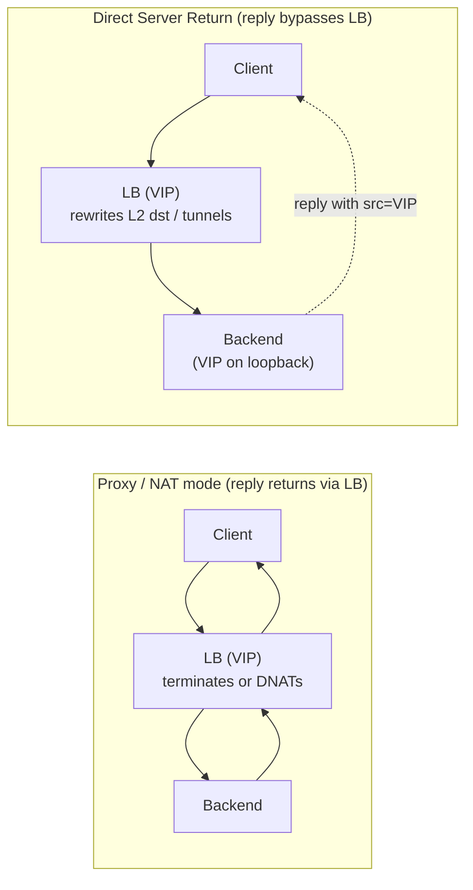

# 2.20 Load balancing: L4, L7, ECMP hashing, proxies and inference traffic

| | |
|---|---|
| Level | Intermediate to advanced |
| Priority tier | 0 |
| Lab venue | Linux VM with HAProxy/nginx/Envoy, IPVS, FRR for ECMP VIPs |
| Part | Part 2: Networking, from first principles to AI fabrics |
| Status | Drafted, labs **untested** |

## Why this matters for AI infrastructure

Suppose an inference endpoint is slow while most of its GPUs sit idle. The cause can sit in the load balancer, the layer that spreads requests across the GPUs. A generic round-robin balancer in front of long-lived gRPC or Server-Sent-Event token streams can leave one GPU at 100% and nine idle. Round robin deals requests in turn and ignores how long each one runs.

Other failures look different but share the same root. A proxy reload can sever hour-long generations. An HTTP/2 connection pinned to one backend turns a balanced cluster into a hot spot. A health check that only tests TCP routes traffic to a server whose GPU has an Xid error.

Load balancing is not only an inference problem. It shows up across the platform: ECMP and anycast VIPs at the fabric edge, Kubernetes Services built on kube-proxy, IPVS or eBPF, ingress and gateways, cloud load balancers, DNS-based steering and service meshes. Each of them decides where work goes. This chapter builds the general theory first: what a load balancer is, its layers, its algorithms, the state it keeps, and how it handles failure. It then covers the tools, IPVS, HAProxy, nginx, Envoy and cloud load balancers. Last come the AI-specific problems: streaming, pinning, and load-aware and cache-aware routing. Decide which layer you are working on first, because each layer sees a different unit of work.

## Prerequisites and outcomes

Before you start, make sure the foundations from earlier chapters are in place. You should know TCP, TLS and HTTP (2.6, 2.10), ECMP hashing (2.12), BGP (2.15, 2.16), NAT (2.9) and the basics of conntrack.

When you finish this chapter, you will be able to:

- Classify a load balancer by layer (DNS, L3/ECMP, L4, L7), by topology (NAT/proxy, DSR, tunnel) and by deployment (appliance, software, cloud-managed, in-cluster).
- Explain the algorithms: round robin, least connections, consistent hashing (ring, rendezvous, Maglev), power-of-two-choices and EWMA, and when each one fits.
- Explain ECMP and anycast as load balancing for VIPs, including resilient hashing and how L4 balancers scale out behind ECMP while keeping connections consistent.
- Configure HAProxy, nginx and Envoy for HTTP, TLS termination and passthrough, gRPC, health checks, retries, timeouts and draining, and set up IPVS.
- Diagnose uneven load, connection pinning, hot backends, slow health detection, reload-induced stream loss, SNAT port exhaustion, sticky sessions, idle-timeout resets and client IP loss.
- Design inference load balancing for streaming, long-lived connections, queue- and token-aware routing, prefix-cache-aware routing, autoscaling and drain, and multi-tenant fairness.
- Choose between cloud load balancer types and Kubernetes patterns (Service, Ingress, Gateway API, mesh) at a high level. Part 5 has the details.

Skip any outcome you already have, and focus on the ones your workloads need.

## 1. What a load balancer does

Suppose one server can no longer handle the traffic for a service, but clients should still use one address. A **load balancer (LB)** solves that. It presents one stable address, a virtual IP (VIP) or a name, and spreads incoming work across a pool of backends, which are the real servers.

A load balancer gives you three things. It adds scale, because the pool holds more capacity than one server. It adds availability, because health checks remove failed backends. It adds maintainability, because you can drain a backend, upgrade it and return it to the pool. Often it also adds security and policy, such as TLS termination, rate limiting, a WAF or authentication.

Every load balancer must answer five design questions:

1. Where is the decision made: on the client, in DNS, in the network with ECMP, on a dedicated L4 device, on an L7 proxy, or on the server?
2. What identifies a unit of work: a packet, a flow or connection, an HTTP request, a gRPC stream, or a token-generation job?
3. How is a backend chosen, by which algorithm and with what state?
4. How does the reply return: through the LB as a proxy or NAT, or directly as DSR?
5. How are failures detected and handled, through health checks, outlier detection, retries and draining?

### Layers and families

The table groups the common families by the decision each one makes, with examples and the trade-offs to know.

| Family | Decision on | Examples | Notes |
|---|---|---|---|
| **DNS / GSLB** | Name resolution (round-robin records, weighted/geo/latency/health-checked answers) | Route 53, Cloud DNS routing policies, NS1 | Coarse; TTL and client caching limit agility; no connection awareness |
| **L3 ECMP / anycast** | Packet/flow hash across equal-cost next hops | Router ECMP, BGP-announced VIPs from many servers | Stateless, line rate; no health awareness beyond routing; flow remap on change |
| **L4 (transport)** | TCP/UDP connections (5-tuple) | IPVS/LVS, Maglev, AWS NLB, GCP Network LB, Katran (XDP), HAProxy `mode tcp`, nginx `stream` | Fast, protocol-agnostic; cannot see requests inside a connection |
| **L7 (application)** | HTTP/gRPC requests, headers, paths, cookies | HAProxy `mode http`, nginx, Envoy, Traefik, AWS ALB, GCP HTTP(S) LB, Istio gateway | Rich routing, retries, TLS, observability; more CPU, protocol-specific |
| **Client-side** | The client library | gRPC `round_robin`/`pick_first` with xDS, Finagle, Ribbon | No LB hop; needs service discovery and smart clients |
| **In-cluster / mesh** | Per-pod sidecars or node proxies | kube-proxy, Cilium eBPF, Envoy sidecar, Linkerd | Service-to-service balancing |

Lower layers decide faster but see less. An L4 balancer sees connections, so it cannot read a request inside one. An L7 balancer reads requests, which gives rich routing and retries, but it costs more CPU.

### Packet paths

The two diagrams show where the reply goes. That path decides throughput and what the backend can see.



In proxy mode, at L4 or L7, the balancer terminates the client connection and opens a separate one to the backend. That lets it modify, buffer, retry and inspect traffic. The backend sees the balancer's address, so you must preserve the client IP with `X-Forwarded-For`, the `Forwarded` header or PROXY protocol. Proxy mode is stateful, costs CPU and memory, and is bounded by the balancer's capacity.

In NAT mode, the balancer rewrites the destination IP (DNAT) to the backend, and the source too if needed (SNAT/masquerade). The replies must then come back through the balancer. Either the backend's default gateway is the balancer, or SNAT is used, which hides the client IP.

Direct Server Return, called `DR` in IPVS, sends the reply straight to the client. The balancer forwards the packet by rewriting only the destination MAC on the same L2 segment, or by tunnelling it with IPIP, GRE or GUE. The backend holds the VIP on a non-ARPing interface, `lo` with `arp_ignore=1` and `arp_announce=2`, which chapter 2.3 covers. It replies with the VIP as its source. Replies are usually much larger than requests, so skipping the balancer gives huge throughput, and the backend sees the real client IP. The limits are real, though. You need L2 adjacency or tunnels, L7 features are unavailable, health checking needs care, and asymmetric flows complicate firewalls.

Tunnel and encapsulation, as in Maglev or Katran, wrap the original packet in GRE, IPIP or GUE for the backend. The backend unwraps it and replies directly to the client, so this is DSR as well.

Pick the packet path before anything else, because it decides whether replies pass through your balancer and what your backends can see.

## 2. Algorithms

Picture two backends behind one address and a stream of requests of very different sizes. The balancer must choose a backend for each request, and the rule it uses decides how evenly the work spreads. The table compares the common rules, what each one looks at, and where each one breaks.

| Algorithm | How it chooses | Good for | Pitfall |
|---|---|---|---|
| **Round robin** (RR) / weighted RR | Rotate through backends (weights for unequal capacity) | Homogeneous, short, stateless requests | Ignores request cost and backend load |
| **Least connections** / weighted | Backend with fewest active connections | Variable-length requests, long-lived connections | Counts connections, not work; needs shared state across LB instances |
| **Least outstanding requests / least request** | Fewest in-flight requests | HTTP/gRPC | Same as above but request-granular |
| **Least response time / EWMA / peak-EWMA** | Lowest recent latency × in-flight | Heterogeneous backends | Needs measurement; can oscillate (herding) |
| **Power of two random choices (P2C)** | Pick two random backends, send to the less loaded | Large pools with imperfect load info; scalable | Needs load info per backend |
| **Source/URL/header hash** | `hash(key) mod N` | Session affinity, cache locality | Remaps most keys when N changes |
| **Consistent hashing (ring, rendezvous/HRW, jump hash)** | Map keys and backends onto a ring/score space; adding/removing one backend moves only ~1/N of keys | Caches, sticky sessions, sharded stores, stateful backends | Load imbalance (virtual nodes help); hot keys |
| **Maglev hashing** | Lookup table built from backend preference permutations; near-uniform load with minimal disruption | L4 LBs behind ECMP (Google Maglev) | Table rebuild cost; small disruption on change |
| **Random** | Uniform random | Simple | Variance |
| **Locality-aware / zone-aware** | Prefer same zone/rack | Cost, latency | Capacity imbalance across zones |
| **Priority/failover groups** | Use group 2 only if group 1 unhealthy | DR, spillover | Cold backups |
| **Load-aware custom (GPU/queue/KV-cache)** | Use backend-reported metrics | LLM inference | Needs telemetry, careful staleness handling |

Every rule trades something away, so notice what you give up. Round robin is simple, but it ignores request cost and backend load. Least connections adapts better, yet a connection is not the same as work, and several balancer instances must share that count. For LLM inference, the table points toward load-aware routing, because connections say little about tokens or GPU time.

Principles 1, 2, 3 and 4 follow from the table. First, choose the metric that represents work, since connections, requests, tokens and GPU-seconds are different things. Second, when several balancer instances each use local least connections, they herd onto the same backend. Power of two choices, or any randomised pick, breaks up those synchronised stampedes. Third, hash-based affinity serves cache locality and state, but it accepts uneven load, so plan for reshuffling with consistent or resilient hashing. Fourth, slow start ramps up the weight of a newly added or recovered backend. That avoids flooding a cold server while its JIT, caches and GPU warm up.

Name the unit of work first, then pick the algorithm that counts it, so you know exactly what your balancer measures.

## 3. Health checks, failure handling and draining

A backend can stop answering yet keep its address. Without a health check, the balancer keeps sending it traffic. Health checks come in two kinds.

Active checks are probes the balancer sends on a schedule. It can open a TCP connection, call `GET /healthz` and expect a 200, use the gRPC health protocol `grpc.health.v1`, or run a custom script. Four parameters control them: the interval, the timeout, rise (the successes needed to mark a backend up) and fall (the failures needed to mark it down). Detection takes about the interval multiplied by fall. If you set the checks too aggressively, a loaded backend flaps. If you set them too lax, dead nodes keep receiving traffic.

Passive checks watch real traffic instead of probing. The balancer ejects a backend after N consecutive 5xx responses or connection failures, for a period. Envoy calls this outlier detection, HAProxy uses `observe layer7`, and nginx uses `max_fails`. Passive checks catch the failures a probe misses, along with brownouts.

A health check should separate liveness from readiness. Liveness asks whether the process is up. Readiness asks whether the backend can serve right now: the model is loaded, the GPU is healthy and the queue is not full. For inference, `ready` should reflect the model load state. An extended check can also consult GPU health through DCGM or Xid errors, so a failing GPU is removed, but that needs integration work.

Retries help only with idempotent requests, or with failures that happen before any bytes were sent. Use retry budgets and per-try timeouts so retries do not amplify load during an outage. Use hedged requests carefully.

Set timeouts for the connect step, for request or stream idle time, and for the total. LLM streams need generous read timeouts and heartbeats. When the client, the balancer and the server use mismatched idle timeouts, connections reset with no obvious cause, as chapter 2.10 explains.

Circuit breaking protects a backend from overload. Cap the concurrent connections, requests and pending queue for each backend. When a cap is reached, shed the load with a 503 and `Retry-After` instead of queueing without limit.

Draining matters when you remove a backend during a deploy or a scale-in. The balancer stops sending it new requests but lets existing ones finish until a deadline. That is essential for long streams. Coordinate with the orchestrator. In Kubernetes, `terminationGracePeriodSeconds`, a `preStop` hook, and readiness turning false before shutdown all play a part.

Proxies such as nginx and HAProxy keep old workers alive until their connections end. For long streams, a worker can live for hours. Dynamic configuration APIs avoid that problem: Envoy xDS, the HAProxy runtime API, and nginx Plus or resolver variables let endpoints change without a reload.

Set the drain deadline with your longest stream in mind, because a deadline shorter than a generation cuts that generation off.

## 4. ECMP, anycast and scaling out the L4 tier

Suppose a single L4 node serves a VIP. You get a throughput limit and a single point of failure. The standard fix is to put the L4 tier behind ECMP, which works in four steps.

In step 1, each L4 node announces the VIP to the upstream router, or leaf, over BGP using FRR, BIRD or ExaBGP. The router now sees N equal-cost next hops, and it spreads flows across them by a 5-tuple hash.

In step 2, a node fails or is drained. Its BGP session drops, and BFD makes that happen in under a second. The router removes the node from the ECMP set, so flows that hashed to it get remapped. With plain modulo hashing, all flows may be rehashed, and existing connections break. With resilient or consistent hashing in the router, only the flows of the failed node move.

In step 3, surviving nodes receive flows they hold no state for. To avoid breaking established connections, L4 balancers use consistent hashing keyed on the 5-tuple, in the Maglev style. Any node then computes the same backend for the same flow, without synchronised state. Google Maglev and Meta Katran work this way. Alternatively, nodes can share or replicate connection state.

In step 4, the L4 node forwards to the backend by DSR, by encapsulation, or by proxying.

This is anycast within a data centre: the same VIP announced from many nodes. The same mechanism serves DNS anycast and global anycast across data centres, where BGP path selection picks the nearest healthy site. Several caveats apply. BGP convergence time sets how fast failover happens. A route change can move a flow to a different site, which breaks long-lived TCP. Asymmetric routing and `rp_filter` (chapter 2.5) need attention, as do path MTU and ICMP (chapter 2.7). The hash must stay stable across the whole tier. Finally, health and announcement must be coupled, so the VIP is withdrawn when a node cannot serve.

The same ideas apply inside the AI fabric, as chapter 2.12 describes. ECMP hashing at fabric tiers balances flows, and it carries the same caveats. A few elephant flows cause imbalance. RoCE varies UDP source ports per QP for entropy. Tunnels need hashing on the inner header. Adaptive routing reacts to load.

Decide your failover budget first, because BGP convergence sets how quickly a failed node's traffic moves.

## 5. L4 tools: IPVS and friends

On plain Linux, you can use the kernel itself as an L4 balancer. Linux IPVS (LVS) is built on netfilter, and kube-proxy's IPVS mode and keepalived both use it.

```bash
sudo modprobe ip_vs ip_vs_rr ip_vs_wlc ip_vs_sh
sudo ipvsadm -A -t 10.0.0.100:443 -s wlc                       # virtual service, weighted least-connection
sudo ipvsadm -a -t 10.0.0.100:443 -r 10.1.0.11:443 -g -w 1     # -g direct routing (DSR), -m masquerade (NAT), -i tunnel
sudo ipvsadm -a -t 10.0.0.100:443 -r 10.1.0.12:443 -g -w 1
sudo ipvsadm -Ln --stats --rate ; sudo ipvsadm -Lcn             # services, per-connection table
# DR mode backend prerequisites (on each real server):
sudo ip addr add 10.0.0.100/32 dev lo
sudo sysctl -w net.ipv4.conf.all.arp_ignore=1 net.ipv4.conf.all.arp_announce=2
```

The `-g` flag selects direct routing, which is DSR. The `-m` flag would select NAT masquerading instead, and `-i` selects tunnelling. The last two lines prepare each real server. It holds the VIP on loopback and stops answering ARP for it.

IPVS offers these schedulers: `rr`, `wrr`, `lc`, `wlc`, `sh` (source hash), `dh`, `mh` (Maglev hashing), `sed` and `nq`. keepalived adds VRRP for active/passive VIP failover, along with health checks that add or remove IPVS real servers. Other L4 options include HAProxy or nginx in TCP mode, eBPF and XDP balancers such as Katran and Cilium's kube-proxy replacement, and cloud network load balancers. NAT-mode IPVS depends on conntrack, which tracks state and is capped by `nf_conntrack_max`. DR mode does not.

Pick the mode by asking whether replies skip the balancer, because that choice decides whether conntrack matters for you.

## 6. L7 tools: HAProxy, nginx, Envoy

An L7 proxy reads every request, so its configuration decides how streams behave. Start with HAProxy, which routes gRPC and plain HTTP traffic from the same frontend.

### HAProxy (HTTP and TCP)

```text
global
  maxconn 100000
  nbthread 8
defaults
  mode http
  timeout connect 3s
  timeout client  300s        # long for streaming
  timeout server  300s
  timeout tunnel  1h          # websocket/gRPC streams
  option httplog
frontend fe_https
  bind :443 ssl crt /etc/haproxy/certs/ alpn h2,http/1.1
  http-request set-header X-Forwarded-Proto https
  acl is_grpc hdr(content-type) -i application/grpc
  use_backend be_infer if is_grpc
  default_backend be_web
backend be_infer
  balance leastconn
  option httpchk
  http-check send meth GET uri /v2/health/ready
  default-server check inter 2s fall 3 rise 2 slowstart 30s maxconn 64
  server triton1 10.1.0.11:8001 proto h2
  server triton2 10.1.0.12:8001 proto h2
backend be_web
  balance roundrobin
  cookie SRV insert indirect nocache
  server web1 10.1.1.11:8080 check cookie w1
frontend fe_pg
  mode tcp
  bind :5432
  default_backend be_pg
backend be_pg
  mode tcp
  balance leastconn
  server pg1 10.1.2.11:5432 check
# runtime API: echo "set server be_infer/triton1 state drain" | socat stdio /var/run/haproxy.sock
```

The `timeout tunnel 1h` line is the one to watch for streams, since it covers websocket and gRPC connections. The `be_infer` backend balances with `leastconn`, while `be_web` uses round robin and a cookie.

### nginx

```nginx
upstream triton_grpc { least_conn; keepalive 32; server 10.1.0.11:8001; server 10.1.0.12:8001; }
server {
  listen 443 ssl http2;
  ssl_certificate     /etc/nginx/certs/api.pem; ssl_certificate_key /etc/nginx/certs/api.key;
  location / {
    grpc_pass grpc://triton_grpc;
    grpc_read_timeout 300s; grpc_send_timeout 300s;
    grpc_buffer_size 4k;                 # small buffers: tokens are small, buffering adds latency
  }
  location /v1/ {                         # SSE token streaming over HTTP/1.1
    proxy_pass http://vllm_pool; proxy_http_version 1.1; proxy_set_header Connection "";
    proxy_buffering off; proxy_cache off; proxy_read_timeout 600s;
  }
}
stream { upstream pg { server 10.1.2.11:5432; } server { listen 5432; proxy_pass pg; } }   # L4
```

Open-source nginx resolves upstream hostnames when the configuration loads, so new endpoints need a reload. You can avoid that with `resolver` and variables, or with dynamic upstreams in nginx Plus. A reload starts new workers, and the old ones live until their connections end. `worker_shutdown_timeout` can cap them, but it cuts streams short.

### Envoy

Envoy is a modern L4 and L7 proxy. Its design centres on dynamic configuration through the **xDS** APIs for listeners, routes, clusters, endpoints and secrets. It handles HTTP/2 and gRPC natively, and it offers rich observability through stats, access logs and tracing, plus advanced load balancing and resilience.

```yaml
static_resources:
  listeners:
  - name: ingress
    address: { socket_address: { address: 0.0.0.0, port_value: 8443 } }
    filter_chains:
    - filters:
      - name: envoy.filters.network.http_connection_manager
        typed_config:
          "@type": type.googleapis.com/envoy.extensions.filters.network.http_connection_manager.v3.HttpConnectionManager
          stat_prefix: ingress
          stream_idle_timeout: 600s
          route_config:
            virtual_hosts:
            - name: infer
              domains: ["*"]
              routes:
              - match: { prefix: "/" }
                route: { cluster: triton, timeout: 0s, retry_policy: { retry_on: "connect-failure,refused-stream", num_retries: 2 } }
          http_filters: [{ name: envoy.filters.http.router, typed_config: { "@type": type.googleapis.com/envoy.extensions.filters.http.router.v3.Router } }]
  clusters:
  - name: triton
    type: STRICT_DNS
    lb_policy: LEAST_REQUEST            # P2C over least-request; also ROUND_ROBIN, RING_HASH, MAGLEV, RANDOM
    typed_extension_protocol_options:
      envoy.extensions.upstreams.http.v3.HttpProtocolOptions:
        "@type": type.googleapis.com/envoy.extensions.upstreams.http.v3.HttpProtocolOptions
        explicit_http_config: { http2_protocol_options: {} }
    health_checks: [{ timeout: 1s, interval: 2s, unhealthy_threshold: 3, healthy_threshold: 2, grpc_health_check: {} }]
    outlier_detection: { consecutive_5xx: 5, interval: 5s, base_ejection_time: 30s }
    circuit_breakers: { thresholds: [{ max_connections: 1024, max_pending_requests: 256, max_requests: 4096 }] }
    load_assignment: { cluster_name: triton, endpoints: [{ lb_endpoints: [ { endpoint: { address: { socket_address: { address: triton-svc, port_value: 8001 } } } } ] }] }
```

Read the cluster block as the balancing policy. `lb_policy` picks the algorithm, and the health, outlier and circuit-breaker settings decide how failures are handled.

Envoy has several features worth knowing. It offers least-request with P2C, ring-hash and Maglev for affinity, along with **slow start** windows for new hosts. **Outlier detection** ejects misbehaving hosts, and **locality-weighted** load balancing favours some hosts over others. Panic thresholds cover the case where too many hosts are unhealthy: traffic spreads to all of them rather than overloading the few that remain. You also get retry budgets, hedging, rate limiting and **connection draining on listener updates**. The admin interface (`/clusters`, `/stats`) shows the live state. Envoy is also the data plane for Istio, Contour, Envoy Gateway, Gloo, Ambassador and many cloud edges.

Pick the proxy whose xDS and drain behaviour matches your streams, because a reload that cuts streams is the failure this section warns about.

## 7. TLS, client identity and L4/L7 interplay

Picture a request that arrives over TLS. Where the balancer decrypts it decides what the balancer can read, which shapes routing, WAF rules and mTLS. Three placements are available.

With TLS termination at the LB, the balancer decrypts traffic, can inspect and route it at L7, and then re-encrypts it or sends plaintext to the backends. That enables routing on headers and a WAF. With passthrough, an L4 balancer routes on SNI and keeps encryption end to end, including mTLS, but it loses L7 features. With re-encryption, traffic stays encrypted inside the data centre. Certificate management is covered in chapter 2.10.

Preserving the client IP depends on the layer. At L7, use `X-Forwarded-For` or `Forwarded`, and trust them only from known proxies to avoid spoofing. At L4, the PROXY protocol (v1 or v2) adds a header in front of the connection, so the backend can learn the original client address and TLS information. DSR and `externalTrafficPolicy: Local` in Kubernetes avoid SNAT. Cloud load balancers differ on preserving source IP.

HTTP/2 and gRPC put many requests on one connection. At L4, balancing happens per connection, so all streams from one client connection go to one backend. That is connection pinning. You can fix it in three ways. Use an L7 proxy that balances per request or per stream, such as nginx `grpc_pass`, Envoy, HAProxy with `proto h2`, or ALB for gRPC. Balance on the client side with `round_robin` across resolved addresses, or with xDS. Or cap the connection age with `MAX_CONNECTION_AGE`, so clients reconnect and rebalance.

WebSockets and SSE are long-lived. Configure idle timeouts and heartbeats, and disable response buffering.

HTTP/3 and QUIC run over UDP. An L4 balancer must hash on QUIC connection IDs rather than the 5-tuple, so a connection survives a change in the client IP or port.

Rate limiting and fairness belong at the gateway. Use per-client token-bucket limits, concurrency limits per tenant and priority queues. When a client goes over its limit, return 429 with `Retry-After`.

Decide where TLS ends before anything else, because that choice sets what the balancer can route on.

## 8. Cloud and Kubernetes load balancing (overview)

Most teams do not build their own balancers from scratch. They rent one from a cloud provider or get one from Kubernetes. Both come with defaults you should check before you depend on them.

On the cloud side, GCP offers external and internal Application LBs, which are L7 HTTP(S) balancers that are global or regional and built on Envoy and GFE. It also offers Network LBs, which are L4 pass-through or proxy, and internal TCP/UDP LBs. AWS has ALB (L7), NLB (L4), GLB (L3 gateway for appliances) and CLB (legacy). Azure has Application Gateway, Load Balancer and Front Door. The differences that matter are source IP preservation, idle timeouts, supported protocols such as gRPC, WebSockets and HTTP/2 end to end, connection draining, health check semantics, quotas, cross-zone behaviour and cost per GB. Idle timeouts are often 60 s for HTTP LBs, while some L4 services use 350 s. Chapter 2.32 covers the GCP specifics.

In Kubernetes, the details sit in Part 5. A Service (ClusterIP, NodePort, LoadBalancer or Headless) gives a stable virtual IP. kube-proxy implements it with iptables rules (a random probability chain), with IPVS (a real L4 scheduler), or with an eBPF replacement such as Cilium. EndpointSlices list the ready pods, and readiness probes control membership. Ingress and Gateway API provide L7 HTTP routing and TLS through controllers. Those controllers include nginx, HAProxy, Envoy-based Contour, Emissary and Envoy Gateway, Traefik and cloud controllers. Service meshes add per-pod proxies for mTLS, retries and L7 balancing between services. MetalLB, kube-vip and Cilium provide LoadBalancer VIPs on bare metal, using ARP or BGP (ECMP).

One warning applies to the Kubernetes side. kube-proxy's iptables mode balances connections randomly and is not load-aware. Long-lived gRPC connections therefore need L7 or client-side balancing to spread load evenly.

## 9. Load balancing for AI inference

Picture an LLM endpoint that looks healthy on a dashboard while one replica is overloaded. The usual web assumptions break for LLM serving, and the balancer has to account for that. Five differences matter most.

First, requests are long, variable and somewhat stateful. A request may stream tokens for minutes. Its cost varies with prompt and output length by orders of magnitude. A backend's real load is its queue depth, its number of running sequences and its KV-cache occupancy, not its connection count.

Second, connections are long-lived. HTTP/2 and gRPC streams and SSE hold resources, so reloads, scale-in and deploys must drain gracefully. An idle timeout at any hop can cut a slow generation.

Third, cache locality matters. Prefix caching, for system prompts, RAG context and multi-turn chat, makes a request cheaper on the replica that already holds its prefix KV blocks. Routing the same session or prefix to the same replica raises hit rates, but pure affinity can create hot spots.

Fourth, backends are expensive and heterogeneous. GPU types differ, tensor-parallel group sizes differ, disaggregated prefill and decode pools exist, LoRA adapters load per replica, and quantised variants come in many forms.

Fifth, autoscaling is slow. GPU nodes and model loads take minutes, so the router must absorb bursts by queueing or shedding, rather than rely on instant scale-out.

These differences shape the practices below, which work through the same concerns.

Balance per request, not per connection. Use L7 proxies such as Envoy, HAProxy or nginx `grpc_pass`, or the Gateway API inference extensions, or use client-side balancing. Avoid pure L4 for multiplexed gRPC. The symptom is servers 1 and 2 overloaded while 3 to 10 sit idle. The mitigations are periodic reconnects through max connection age, and then true L7 balancing.

Choose a load signal with care. Least-outstanding-requests is a sound baseline. Better still are backend-reported metrics, such as running and waiting requests, KV-cache usage and estimated tokens, exposed through Prometheus, response headers or ORCA-style load reports. Use P2C over load to avoid herding. Token-count-aware estimates also help, since the prompt length is known at admission and the output length can be predicted.

For cache- and session-aware routing, use consistent hashing on a session ID or prompt-prefix hash, with bounded loads that spill to the next replica when one exceeds its share. Another option is a router that tracks which replica holds which prefix blocks. This is the approach of LLM-specific routers and of the Gateway API inference extension's endpoint pickers.

Disaggregated serving routes prefill and decode to separate pools. You must handle the KV transfer between them, and keep the two pools' autoscaling and admission coupled (see the part on inference).

Health checks should hit the serving framework's readiness endpoint, such as Triton `/v2/health/ready` or vLLM `/health`. You can also integrate GPU health through DCGM Xid or ECC data. Mark a replica not-ready during model load, and use `slowstart` for cold replicas.

Streaming needs its own hygiene. Disable proxy buffering for SSE. Set read and stream-idle timeouts above the maximum generation time, and send heartbeats. Avoid `Connection: close`, and use HTTP/2 end to end where possible. Measure time-to-first-token (TTFT) and inter-token latency at the proxy, using access logs with `$upstream_response_time` or Envoy stats.

Draining on deploy or scale-in follows a fixed order. Set readiness to false, stop new requests, wait for in-flight streams up to the grace period, and then terminate. Align `terminationGracePeriodSeconds`, `preStop`, the load balancer's deregistration delay and the proxy's shutdown timeouts. Reloads should be hot, through xDS or the runtime API, so old workers do not linger for hours.

For overload and fairness, set per-tenant concurrency and token-rate limits, and use priority queues that separate interactive traffic from batch. Return 429 or 503 early rather than building unbounded queues. Admission control should also consider KV-cache headroom.

Watch the per-backend request counts, in-flight requests, queue time, error and retry rates, TTFT and ITL percentiles, ejection events and hot-backend alerts. Trace each request across the gateway, the router and the engine.

For an interview, a whiteboard answer can run in this order: client, then anycast or ECMP to a fleet of L4 and L7 gateways (BGP VIP, BFD), then TLS termination and L7 routing with per-request, per-tenant policy, then a load- and cache-aware endpoint picker, then inference pods with readiness, drain and GPU health integration. Show where pinning happens at L4, and how L7 or client-side balancing fixes it. Enterprise environments may use appliance or software ADCs, such as VMware Avi, F5 or Citrix. They scale out service engines behind BGP or ECMP VIPs, understand HTTP/2 and gRPC at L7, and support custom health monitors. The architecture is the same, but validate any product-specific capability claim against current vendor documentation and a load test.

Measure first, and choose the load signal before you choose the algorithm.

## 10. Troubleshooting

When a balancer misbehaves, the symptom usually points to a short list of causes. Find the row that matches what you see, then run the check in the third column.

| Symptom | Likely cause | Check/fix |
|---|---|---|
| One backend hot, others idle | L4 pinning of multiplexed connections; hash-based affinity; slow start missing; stale weights | Switch to L7/per-request; `max_connection_age`; `ss -tn` per backend; LB stats |
| Intermittent 502/504 | Backend timeouts shorter than LB; backend resets idle connection; keepalive mismatch | Align idle/keepalive timers; `upstream_response_time`; retry only idempotent |
| Streams cut during deploy | Reload/scale-in without drain; shutdown timeout | Hot reload; drain; larger grace; `terminationGracePeriodSeconds` |
| Client IP missing in logs | SNAT/proxy | `X-Forwarded-For`, PROXY protocol, DSR, `externalTrafficPolicy: Local` |
| Connection resets after N seconds idle | LB/NAT idle timeout | Keepalives below the timeout; raise timeout |
| New backend gets no traffic | Health check failing, wrong port/path, readiness false, not registered | Health status; `curl` from the LB host; service discovery |
| Existing connections break after LB change | ECMP rehash without consistent hashing; state not shared | Resilient hashing; Maglev-style hashing; connection draining |
| Source port exhaustion at LB | Many connections to few backends from one IP | More SNAT IPs, connection reuse/keepalive, DSR |
| High p99 only on some requests | Head-of-line blocking at HTTP/1.1 backend; slow backend not ejected; retry storms | Outlier detection; per-try timeouts; least-request |
| Health flapping | Aggressive interval; overloaded backend failing probes | Tune rise/fall; separate health endpoint; lighter check |

When you need evidence, reach for these tools. Use `ss -s`, `ss -tni`, `conntrack -L` and `ipvsadm -Ln --stats` to read the kernel's view. Use HAProxy `show stat` or `show servers state`, Envoy `/clusters` and `/stats`, and nginx `stub_status` with its `$upstream_*` log variables for the proxies. Use `curl -w` for timing and `tcpdump` on the LB and the backend to see the packets. For load tests, `wrk`, `hey`, `ghz` (a gRPC load generator) and `vegeta` all work. Application metrics complete the picture.

Start with the row that matches your symptom, and only then change the configuration.

## 11. Hands-on lab: build and break load balancers

Start on your own machine, because the first part needs only Python. Run the self-checking script at `code/part02/load_balancing_l4_l7_lab.py`. It verifies Power-of-Two-Choices (`P2C`) backend selection, and Rendezvous (`HRW`) consistent hashing, which moves about `~1/N` of keys. It also checks bounded-load spillover for LLM prefix-cache affinity. The script compares L4 and L7 gRPC HTTP/2 connection pinning, where the counts are `[100, 0, 0, 0]` against `[25, 25, 25, 25]`. Finally, it checks active health-check detection, which takes `inter 2s fall 3 = 6.0 s`.

```bash
python3 code/part02/load_balancing_l4_l7_lab.py
```

The rest of the lab needs a disposable Linux VM with `ipvsadm`, `haproxy`, `nginx`, `envoy` and `frr`. Every interactive VM command below is `untested here`, so treat each step as a first attempt. Work through these steps in order.

1. L4 IPVS DR: build three namespaces (lb, rs1, rs2) on a bridge. Configure the VIP on `lo` of the real servers with `arp_ignore/arp_announce`, and run IPVS in DR mode. Verify the distribution with `ipvsadm -Lcn`. Capture traffic to show that replies bypass the LB. Then switch to NAT mode and observe conntrack and the return path.
2. Algorithms: run `hey` or `wrk` against round robin, least-connection, source-hash and Maglev (`mh`). Add a slow backend with `tc netem delay`, then compare the distributions and tail latency. Finally, change a weight.
3. HAProxy L7: start with two HTTP backends and configure active health checks with `check inter 1s fall 2 rise 2`. Stop one backend and measure how long detection takes. Add `slowstart`, and use the runtime API to drain.
4. gRPC pinning: run a simple gRPC server that returns its hostname, or use Triton or `grpcbin`. Front it with (a) nginx `stream` for L4, and with (b) nginx `grpc_pass` or Envoy. Send many calls from one client on one channel, using `ghz`. Show that all calls go to one backend in L4 and spread out in L7. Then apply `MAX_CONNECTION_AGE` and observe the periodic rebalancing.
5. Reload versus streams: start a long SSE or gRPC stream through nginx, then run `nginx -s reload`. Use `ps` to see the old worker lingering. Set `worker_shutdown_timeout` and watch the stream get cut. Then you can compare that with an Envoy dynamic update, using file-based xDS, which cuts nothing.
6. Consistent hashing: configure Envoy `RING_HASH` or `MAGLEV`, or HAProxy `balance hdr()` with `hash-type consistent`. Map session IDs to backends. Remove a backend, and count how many sessions remap, compared with a plain modulo hash.
7. ECMP VIP: set up two LB namespaces that announce the same VIP to a router namespace through FRR and BGP. Verify ECMP, then fail one LB. Measure convergence with and without BFD, and observe which flows break with and without consistent hashing. Test resilient hashing if your platform supports it.
8. Inference-aware routing (simulation): write a tiny Python backend with variable service time and an exposed `queue_depth` metric. In a minimal `asyncio` proxy, implement round robin, least-outstanding and P2C on queue depth, then compare p99 latency under a heavy-tailed job-size distribution. Add prefix-hash affinity with bounded load, and measure the cache-hit proxy metric.
9. Overload and retries: add a retry policy with no budget, then trigger a retry storm by killing a backend. Add circuit breaking and a retry budget, and compare the two runs.
10. Clean up.

Run step 9 last, since it deliberately kills a backend and you want the other steps finished first.

## 12. Common mistakes

Most of these mistakes come from treating connections as if they were requests. Watch for them when you review a design.

- Running L4 balancing over multiplexed HTTP/2 or gRPC traffic, then expecting even load.
- Using connection count as the load signal for long, heterogeneous requests, and letting many LB instances herd with synchronised least-connection choices.
- Writing health checks that test only TCP or that are too aggressive, and skipping slow start and outlier detection.
- Retrying without budgets, retrying non-idempotent requests, and setting timeouts shorter than the longest legitimate generation.
- Reloading proxies to update endpoints in long-stream workloads, and skipping drain during deploys.
- Trusting `X-Forwarded-For` from the Internet, and losing the client IP behind SNAT.
- Using plain modulo hashing behind ECMP or anycast, which remaps keys en masse, and announcing a VIP while the node cannot serve.
- Treating the LB as infinitely scalable, with no capacity limits and no overload shedding.

## 13. Interview angles

Be ready to answer these questions out loud.

- "L4 versus L7 load balancing: when and why? What's DSR?"
- "Walk me through scaling a load balancer horizontally behind ECMP/anycast. What breaks on a change?"
- "Consistent hashing: how does it work and why use it? What's Maglev?"
- "Why does round-robin L4 in front of gRPC give uneven load? How do you fix it?"
- "Design load balancing for an LLM inference service with streaming responses."
- "How do health checks, outlier detection and circuit breaking differ?"
- "How do you do a zero-downtime deploy for long-lived streaming connections?"
- "How do you preserve the client IP through a load balancer?"
- "What does kube-proxy do and what are its limits for load balancing?"

## Exercises

1. Compare the load balancer families. State the five design questions every load balancer answers, and compare DNS/GSLB, L3 ECMP/Anycast, L4 transport (`IPVS`, `Maglev`, `Katran`) and L7 application proxies (`Envoy`, `HAProxy`, `nginx`). Then (a) explain how Direct Server Return (`DSR` / IPVS `-g`) works, and why the backend must configure the VIP on `lo` with `arp_ignore=1` and `arp_announce=2`. (b) Explain how client IPs are preserved across L4 (`PROXY protocol`) and L7 (`X-Forwarded-For`) proxies.
2. Work through the algorithms: `Round Robin`, `Least Connections`, `P2C`, and consistent hashing with `Maglev`. (a) Why does naive Least Connections herd requests onto a single server when multiple independent load-balancer instances make decisions, and how does Power of Two Choices (`P2C`, `select_backend_p2c()`) solve it? (b) Using `select_backend_rendezvous_bounded()` in `code/part02/load_balancing_l4_l7.py`, explain why Consistent Hashing (`Ring Hash`, `Rendezvous HRW`, `Maglev`) moves only `~1 / N` of keys when a backend leaves the pool. Compare that with `(N - 1) / N` under `hash(key) mod N`.
3. Scale the L4 tier horizontally behind `ECMP` anycast VIPs. Walk through the four-layer architecture of a cloud-scale L4 load balancer: `Router ECMP + BFD -> Stateless L4 Maglev/Katran tier -> DSR/IPIP tunnel -> L7 Envoy/HAProxy tier`. Then explain which two hashing mechanisms keep existing TCP connections from resetting when one L4 load-balancer node is drained.
4. Study the `gRPC` / `HTTP/2` L4 connection-pinning trap and its fixes. Using `simulate_grpc_l4_vs_l7_distribution(4, 1, 100)`, explain why placing an L4 load balancer (`kube-proxy` `iptables`/`IPVS`, `nginx stream`, AWS NLB) in front of 4 Triton/vLLM gRPC pods causes 1 pod to run at 100% GPU utilization while 3 sit at 0%. This happens when a client opens a single HTTP/2 channel. State three ways to fix it.
5. Work through health checks, outlier detection, circuit breaking and zero-downtime streaming drains. (a) Distinguish active readiness checks (`compute_health_check_detection_sec(2.0, 3) = 6.0 s` on `/v2/health/ready`) from passive outlier detection (`consecutive_5xx: 5`), slow start (`30 s`) and circuit breakers (`max_pending_requests`). (b) Explain why `nginx -s reload` causes worker accumulation or severed streams on long SSE or gRPC generations, and how Envoy's `xDS` API avoids it.
6. Design an LLM inference router. Build an L7 inference routing tier that balances variable-length streaming requests across GPU replicas. Use (a) backend-reported running and waiting queue depth and KV-cache occupancy, (b) bounded-load consistent hashing on prompt prefixes (`select_backend_rendezvous_bounded()`) to maximize prefix-cache hits without overloading a single GPU, and (c) separated prefill and decode pools.

## Checkpoint questions (20)

<details>
<summary>1. What five questions must every load-balancer architecture answer, and what is the core difference between an L4 and an L7 load balancer?</summary>

The five questions are these. (1) **Where** is the routing decision made? (2) **What** is the unit of work? (3) **How** is the backend chosen, by algorithm and state? (4) **How** does the return traffic flow, via the LB or via DSR? (5) **How** are backend failures detected and drained?

An **L4 load balancer** (`IPVS`, `Maglev`, `Katran`, AWS `NLB`) works on **TCP/UDP connections**, identified by 5-tuples. It forwards packets at very high speed without inspecting application payloads. An **L7 load balancer** (`Envoy`, `HAProxy mode http`, `nginx`, AWS `ALB`) terminates the client's TCP and TLS connection. It parses **individual HTTP/1.1, HTTP/2 or gRPC requests**, which enables per-request balancing, header and path routing, and retries.
</details>

<details>
<summary>2. How does Direct Server Return (`DSR` / IPVS `-g`) work, why must backends set `arp_ignore=1` and `arp_announce=2`, and what is DSR's main advantage?</summary>

In **DSR**, the L4 load balancer receives the client packet addressed to the `VIP`. It forwards that packet to the chosen backend **without changing the destination IP**, which stays `VIP`. It does this either by rewriting only the outer **destination MAC** on the same L2 VLAN, or by wrapping the packet in an **IPIP, GRE or GUE tunnel**.

Each backend puts `VIP/32` on its own **`lo` (loopback)** interface. It sets `arp_ignore=1` and `arp_announce=2`, so it never answers ARP for the `VIP` on the LAN. The backend then accepts the packet locally and sends the reply straight to the client, with `src = VIP`. That bypasses the load balancer on the return path. Responses such as model weights, video and token streams are much larger than requests. So if you run DSR, it multiplies outbound throughput, and it preserves the true client IP.
</details>

<details>
<summary>3. How do you preserve the original client IP address when using an L4 Proxy/SNAT load balancer versus an L7 HTTP reverse proxy?</summary>

- **At Layer 7 (HTTP/HTTPS)**: the proxy inserts the **`X-Forwarded-For`** header, or the RFC 7239 **`Forwarded`** header. Backends should trust `X-Forwarded-For` **only** when the TCP connection comes from known proxy IPs.
- **At Layer 4 (TCP proxy/SNAT)**: prepend HAProxy's **`PROXY protocol`** header, in v1 text or v2 binary form, at the start of the backend TCP connection. Alternatively, use `DSR`, or Kubernetes `externalTrafficPolicy: Local`, to avoid SNAT altogether.
</details>

<details>
<summary>4. Why does Round-Robin fail for heterogeneous AI requests, why can Least-Connections "herd" across multiple LBs, and how does Power of Two Choices (`P2C`) fix it?</summary>

**Round-Robin** assumes every request costs the same time. You see that break when one prompt generates 20 tokens (`200 ms`) and the next generates 4,000 tokens (`60 s`). **Least-Connections** (or Least-Requests) works well on a single LB. But when dozens of independent LB instances see that Backend 5 just became idle, with `0` active requests, all of them send their next burst to Backend 5 at once. That is **herding**.

**Power of Two Choices (`P2C`, used by Envoy `LEAST_REQUEST`)** picks **two backends at random**, then sends the request to the less loaded of the two. This exponentially suppresses max-load tail spikes, and it avoids synchronised herding.
</details>

<details>
<summary>5. How do Ring Consistent Hashing, Rendezvous (`HRW`) Hashing, and `Maglev` Hashing work, and why do they move only `~1 / N` of keys when a backend changes?</summary>

With naive `hash(key) % N`, changing `N` from `10` to `9` remaps **`90%` of all keys**. That invalidates caches and breaks stateful sessions. **Ring Consistent Hashing** places backends, with virtual nodes, and keys on a `2^32` ring. **Rendezvous (*Highest Random Weight*, `HRW`) Hashing** computes `score = hash(key, backend)` for each backend and picks the highest score. **Google's `Maglev` Hashing** generates a permutation preference list per backend, then fills a fixed-size lookup table of `M = 65537` prime slots with near-perfect uniformity.

In all three, adding or removing one of `N` backends disturbs only **`~1 / N`** of keys.
</details>

<details>
<summary>6. How do you scale out an L4 load-balancer tier horizontally using `eBGP`, `ECMP`, and `Maglev` consistent hashing?</summary>

Deploy `K` stateless L4 load-balancer nodes (`IPVS` / `Katran` / `Maglev`). Each one advertises the **exact same `/32` VIP** to the leaf or border routers over **eBGP + BFD**. The routers spread incoming client TCP flows across the `K` nodes using **resilient 5-tuple ECMP**.

Every L4 node runs **Maglev consistent hashing** on the packet's 5-tuple, over the same backend list. So if a router ECMP-rehashes an established TCP flow from L4 Node 1 to L4 Node 2, Node 2 still maps the packet to the **exact same backend server**. It needs no shared cross-node connection table to do that.
</details>

<details>
<summary>7. Explain the `gRPC` / `HTTP/2` L4 Connection-Pinning problem and state three ways to solve it (`PK` Chapter 6 / `NK` Chapter 2).</summary>

`gRPC` runs over **`HTTP/2`**, which multiplexes hundreds of concurrent RPC calls as streams inside a **single long-lived TCP connection**. Suppose a client opens one gRPC channel through an **L4 load balancer**, such as `kube-proxy` in its default `iptables` or `IPVS` mode, `nginx stream`, or AWS NLB. The L4 balancer makes one decision at `SYN` time. From then on, **100% of the RPCs on that channel go to a single backend pod**, while sibling pods sit idle.

You can fix it in three ways. (1) Place an **L7 HTTP/2-aware proxy** in the path, such as `Envoy`, `HAProxy proto h2`, `nginx grpc_pass` or a service mesh, to balance each RPC. (2) Use **client-side gRPC load balancing**, with a `round_robin` policy that resolves a **Headless Service** (`clusterIP: None`) or uses **`xDS`**. (3) Configure **`MAX_CONNECTION_AGE`** on the server, so clients reconnect and rebalance periodically.
</details>

<details>
<summary>8. Compare Active Health Checks (`liveness` vs. `readiness`), Passive Outlier Detection, and Slow Start.</summary>

- **Active Health Checks** are periodic synthetic probes, such as `GET /v2/health/ready`, `grpc.health.v1` or a TCP connect. They are controlled by `interval`, `timeout`, `fall` (the consecutive failures that mark a backend down) and `rise` (the successes that mark it up). **Liveness** asks whether the process is stuck and needs a restart. **Readiness** asks whether the replica has finished loading model weights into VRAM and has healthy GPUs to take traffic.
- **Passive Outlier Detection** watches real client traffic, for example `consecutive_5xx: 5` in Envoy. It temporarily ejects a backend that returns fast 500s or timeouts, even if its `/healthz` endpoint still returns 200.
- **Slow Start (`slowstart 30s`)** ramps traffic weight linearly from 0% to 100% when a new or recovered backend joins the pool. That keeps cold caches, JIT and CUDA contexts from being overwhelmed.
</details>

<details>
<summary>9. Why are unbudgeted retries dangerous during a partial outage, and how do Retry Budgets and Circuit Breakers prevent cascading failure?</summary>

If 50% of requests time out when a backend pool is overloaded, and every client retries `3` times immediately, the applied load quadruples (`4x`). That is a **retry storm**, or **traffic amplification**, and it can knock over the remaining healthy replicas. Three measures help you prevent it. (1) Retry only **idempotent requests** or connection failures that happen before any bytes are sent. (2) Enforce a cluster-wide **Retry Budget**, for example at most `10%–20%` of active requests as retries. (3) Configure **Circuit Breakers** (`max_connections`, `max_pending_requests`, `max_requests`) that fail fast with `503 Service Unavailable` instead of queueing forever.
</details>

<details>
<summary>10. Why does `nginx -s reload` cause problems for long-lived LLM token streams (`SSE` / `gRPC`), and how do Envoy (`xDS`) and HAProxy solve it?</summary>

When open-source `nginx` reloads (`nginx -s reload`) to pick up new backend pod IPs, the master process starts a fresh set of workers. It tells the old workers to shut down once their active connections close. With long-lived HTTP/2, gRPC or WebSocket/SSE streams, the old workers can linger in memory for hours and exhaust RAM. Or, when `worker_shutdown_timeout` expires, they abruptly cut active token streams.

If you run **Envoy**, it updates endpoints in memory through its **`xDS` (`EDS`) API**. **HAProxy** does so through its runtime Unix socket or DNS SRV. Neither spawns new processes or drops connections to make the change.
</details>

<details>
<summary>11. Compare the three `kube-proxy` modes in Kubernetes (`iptables`, `IPVS`, and Cilium `eBPF`, `PK` Chapter 6).</summary>

- **`iptables` mode (legacy default)** programs sequential chain rules: `KUBE-SERVICES`, then `KUBE-SVC-*`, then `KUBE-SEP-*`. It uses `--mode random --probability` to pick a pod on `SYN`. Rule evaluation scales as **`O(N)`** with the number of Services, which slows packet processing above a few thousand Services. It supports only random L4 connection selection.
- **`IPVS` mode** uses in-kernel Linux Virtual Server hash tables, which give **`O(1)`** lookup at 10,000+ Services. It supports real L4 schedulers: `rr`, `lc`, `wlc`, `sh`, and `mh` (Maglev).
- **Cilium `eBPF` kube-proxy replacement** intercepts `connect()` and `sendmsg()` directly at the **socket layer** (`sockmap` / cgroup eBPF). It rewrites the destination `ClusterIP` to the pod IP once, at connection setup. Packets then skip per-packet `iptables` and DNAT traversal entirely.
</details>

<details>
<summary>12. What does `externalTrafficPolicy: Local` vs. `Cluster` do on a Kubernetes `NodePort` or `LoadBalancer` Service (`PK` Chapter 6)?</summary>

- **`Cluster` (default)**: a node that receives external traffic DNATs it to any ready pod in the cluster. That can add an extra node-to-node hop. It also SNATs the source IP to the node's own IP, so return traffic comes back to that node. The original client IP is lost.
- **`Local`**: each node sends traffic only to pods running on that same node. That removes the extra hop and preserves the original client source IP without SNAT. A node with zero local ready pods fails the cloud load balancer's health-check probe.
</details>

<details>
<summary>13. Why is active TCP connection count (`leastconn`) a poor load metric for LLM inference backends, and what metrics should an inference router use instead?</summary>

A request with a `32,000`-token prompt, or a `4,000`-token reasoning chain, consumes **`100x` more GPU compute and HBM KV-cache memory** than a short `50`-token prompt. Yet both count as "`1` active connection/request". If you run an LLM-aware router, such as the `Gateway API Inference Extension` or a `vLLM`, `SGLang` or `Triton` router, it makes its decisions from real-time engine telemetry.

The signals are **(1) the number of running and waiting sequences in the batch scheduler queue**, **(2) the GPU KV-cache block occupancy percentage**, and **(3) the estimated prompt and decode token load**.
</details>

<details>
<summary>14. What is Prefix-Cache-Aware Routing in LLM serving, and why must it be paired with Bounded Load?</summary>

Modern engines, such as `vLLM` with Automatic Prefix Caching, `SGLang` with RadixAttention and `TensorRT-LLM`, cache the **KV-cache blocks** of shared prompt prefixes. Those prefixes include system prompts, few-shot examples, long RAG documents and multi-turn chat history. The cache lives in GPU HBM or host DRAM.

If you route requests that share a prefix to the **same replica**, you avoid recomputing the expensive prefill phase, which cuts `TTFT` dramatically. But pure affinity has a catch. If a popular prefix hashes to one replica, that single GPU overloads. **Bounded-Load Consistent Hashing** fixes this. It routes to the affinity replica only while its queue and KV load stay below a threshold, `<= 1.25x` the average load. Excess requests spill to the next candidate.
</details>

<details>
<summary>15. How does Disaggregated Prefill/Decode Serving change the inference load-balancing architecture?</summary>

Prefill is compute-bound, with high parallel FLOPs, and it determines `TTFT`. Decode is memory-bandwidth-bound, with low batch FLOPs, and it determines the inter-token latency, `TPOT`. Mixing long prefills and decodes on the same GPU stalls the decode token streams that are already running.

A **disaggregated router** therefore sends incoming prompts first to a **Prefill pool**, which is optimized for compute throughput. It then coordinates moving the resulting KV-cache blocks over **RDMA (`NVLink` / `RoCEv2` / `InfiniBand` via `Mooncake` / `NIXL`)** to a selected **Decode pool** replica, chosen by available KV-cache memory. The decoded tokens stream out from that Decode replica.
</details>

<details>
<summary>16. What specific proxy configuration settings are required in `nginx`, `HAProxy`, and `Envoy` for Server-Sent Events (`SSE`) token streaming?</summary>

(1) **Disable response buffering** with `proxy_buffering off; proxy_cache off;` in nginx, plus a small `grpc_buffer_size 4k`. Each generated token then flushes to the client as soon as it leaves the model.

(2) **Raise read and stream-idle timeouts** above the longest reasoning or thinking pause. Use `proxy_read_timeout 600s;` in nginx, `timeout server 300s` and `timeout tunnel 1h` in HAProxy, and `stream_idle_timeout: 600s` in Envoy.

(3) **Keep upstream connections alive** with `proxy_http_version 1.1; proxy_set_header Connection "";`, or use `HTTP/2`.
</details>

<details>
<summary>17. Walk through the exact sequence of a zero-downtime rolling deployment for an LLM inference pod with 5-minute streaming responses.</summary>

(1) When you roll a pod out, Kubernetes sends `SIGTERM` to the terminating pod and removes it from `EndpointSlices`. A `preStop` hook can also flip `/health/ready` to `503` and sleep for `5–10 s`. That gives the L7 Ingress or Envoy time to propagate the endpoint removal before the app stops accepting connections.

(2) The L7 proxy stops sending **new** requests to the pod, but it keeps existing **in-flight streaming connections** open.

(3) Set `terminationGracePeriodSeconds` on the Pod spec, and the LB's deregistration or drain timeout, to **`>= 360` seconds**. That is longer than the 5-minute maximum generation time.

(4) Once the in-flight streams reach `[DONE]`, the server exits cleanly before `SIGKILL`.
</details>

<details>
<summary>18. What is Envoy's "Panic Threshold" (default `50%`), and why does it exist?</summary>

Normally, if you run Envoy with active health checks, it routes traffic only to endpoints those checks mark **healthy**. But suppose a network blip, a bad health-check dependency or a partial overload pushes the share of healthy endpoints in a cluster **below the Panic Threshold (default `50%`)**. Sending 100% of the traffic to the remaining `< 50%` of backends would crush them at once, in a cascading failure.

Below that threshold, Envoy enters **panic mode**. It spreads traffic across **all** endpoints, healthy and unhealthy alike, so the cluster can survive the brownout.
</details>

<details>
<summary>19. Why does `HTTP/3` (`QUIC` over UDP) require special support at the L4 load-balancer tier?</summary>

A core feature of `QUIC` (`RFC 9000`) is **connection migration**. When a mobile or roaming client switches from Wi-Fi to 5G, or rebinds its NAT port, its **source IP and UDP source port change**. Its **QUIC Connection ID (`CID`)** in the packet header stays the same.

If you use a naive L4 load balancer that hashes only on the UDP 5-tuple, it sends the migrated packet to a **different** backend, which breaks the connection. QUIC-aware L4 load balancers, such as `Envoy`, `Cloudflare` or `Katran` with CID routing, coordinate and route by the server-generated **Connection ID**.
</details>

<details>
<summary>20. Give the end-to-end reference architecture for a production multi-tenant LLM inference ingress and load-balancing stack.</summary>

You can read the chain from the client to the pods, one tier at a time. `Client` -> **Anycast / DNS GSLB** -> **L3 ECMP (`eBGP + BFD`, resilient hashing)** -> **Stateless L4 tier (`Maglev` / `Katran` / Cloud NLB)** -> **L7 Gateway tier (`Envoy` / `Gateway API` terminating TLS 1.3, authenticating JWT/API keys, enforcing per-tenant token-bucket rate limits, and disabling SSE buffering)** -> **LLM-Aware Endpoint Picker (`P2C` over queue depth + KV-cache occupancy + bounded-load prefix-hash affinity)** -> **Inference Pods (`vLLM` / `SGLang` / `Triton` / `NIM` with `/v2/health/ready`, DCGM GPU health gate, and 600s graceful drain)**.
</details>

## Sources and review notes

- **Sources read in full:**
  - `production-kubernetes` — Josh Rosso, Rich Lander, Alexander Brand, and John Harris, *Production Kubernetes*, **Chapter 6: Service Routing** (Services `ClusterIP`/`NodePort`/`LoadBalancer`, `Endpoints`/`EndpointSlices`, `kube-proxy` `iptables` vs `IPVS`, `externalTrafficPolicy: Local`, Ingress controllers, and service meshes).
  - `networking-and-kubernetes` — James Strong and Vallery Lancey, *Networking and Kubernetes*, **Chapters 2 and 6** (`IPVS`, gRPC HTTP/2 connection pinning, and cloud load balancers).
  - `ai-data-center-network-design-and-technologies` — Dinakaran Setty et al., *AI Data Center Network Design and Technologies*, **Chapters 6 and 8** (ECMP and fabric load balancing).
  - `computer-networking-problems-and-solutions` — Russ White and Ethan Banks, *Computer Networking Problems and Solutions*, **Chapters 2 and 7** (multiplexing, anycast, and ECMP hashing).
  - `how-linux-works-3rd-edition` — Brian Ward, *How Linux Works*, 3rd ed., **Chapter 9**.
  - `nvidia-devops/volume-09`, `volume-12`, and `volume-01` — migrated the inference load-balancing conundrum (gRPC/HTTP-2 connection pinning, NGINX baseline configuration and reload behavior, enterprise ADC scale-out behind BGP/ECMP VIPs, GPU-aware health monitors, and proxy buffering of token streams).
- **Run here:** `python3 code/part02/load_balancing_l4_l7_lab.py` (10 passed, 0 failed).
- **Explicitly labelled inferences:** The `IPVS` Direct Server Return (`-g`), `HAProxy` (`proto h2`, `/v2/health/ready`), `nginx` (`grpc_pass`, `proxy_buffering off`), and `Envoy` (`LEAST_REQUEST` P2C, `outlier_detection`, `circuit_breakers`) configurations and the Section 9 LLM-aware routing patterns (KV-cache prefix affinity with bounded load, prefill/decode disaggregation) synthesize the product manuals, the Maglev paper, and the Kubernetes Gateway API Inference Extension design (cross-referenced with Chapters 2.3, 2.5, 2.6, 2.7, 2.9, 2.10, 2.12, 2.15, 2.16, and 2.32, plus original study items 21, 22, 23, 24, 25, 26, 27, 28, 29, 30, 31, 32, 33, 34, 35, 36, 37, 38, 39, and 40).
- **Not verified on live hardware:** All interactive VM commands (`ipvsadm`, `haproxy`, `nginx`, `envoy`, `wrk`, `hey`, `ghz`) are marked (untested here) and must be executed on a disposable Linux VM.
