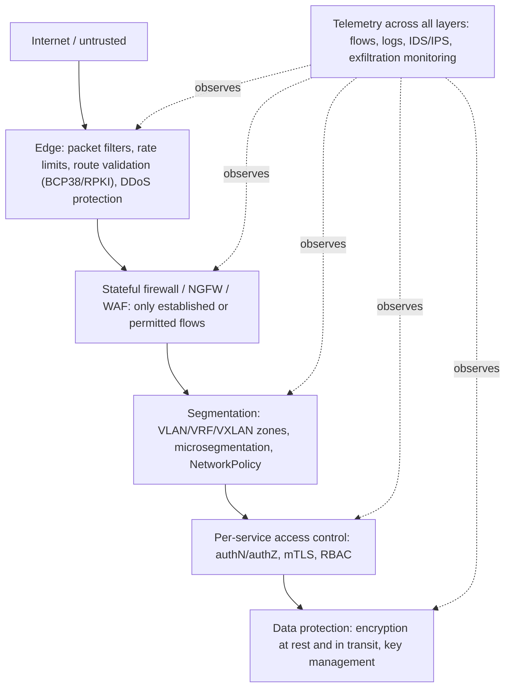

# 2.21 Network security: threat models, firewalls, SSH, zero trust and securing AI clusters

| | |
|---|---|
| Level | Intermediate |
| Priority tier | 0 |
| Lab venue | Linux VMs / namespaces; Kubernetes for NetworkPolicy |
| Part | Part 2: Networking, from first principles to AI fabrics |
| Status | Drafted, labs **untested** |

## Why this matters for AI infrastructure

GPU clusters concentrate three things attackers want: very expensive compute (cryptomining, resale), very valuable data (training sets, model weights, customer prompts), and privileged access paths (BMCs, schedulers, registries, CI). They are also unusual networks: flat high-speed RDMA fabrics that bypass the host kernel, management planes with out-of-band controllers that run their own firmware, multi-tenant environments where tenants share switches, and fast-moving software stacks (drivers, container runtimes, serving frameworks) with a steady stream of CVEs. Network security here is not only firewalls; it is segmentation, identity, key management, least privilege, monitoring, and the discipline to apply them without strangling performance. This chapter covers the security model (definitions, defense in depth, access control, data protection, availability, the OODA loop), the practical network toolkit (packet filters, stateful firewalls, SSH hardening, scanning, DDoS and control-plane protections, L2 security), and what changes in AI clusters (BMC and management isolation, RDMA/IB partitioning, tenant isolation, secrets, zero trust). Linux firewall mechanics (nftables, conntrack) are in chapter 2.23; TLS/PKI in chapter 2.10; kernel-level hardening in chapter 1.21.

## Prerequisites and outcomes

You should know TCP/IP (2.4 to 2.7), TLS and PKI (2.10), NAT and DHCP (2.9) and Linux user/permission basics.

After this chapter you can:

- Define threat actor, exploit, attack, vulnerability, attack surface, asset and risk, and build a simple threat model for a network or a cluster.
- Apply defense in depth: layered filters, route validation, telemetry, stateful inspection, exfiltration monitoring, per-service access control.
- Explain AAA (authentication, authorisation, accounting), RADIUS/TACACS+, 802.1X, MFA, and where access control is enforced (before network, before service, per resource).
- Explain data protection (encryption in transit/at rest, key management) and the limits of biometrics and data-exhaust privacy.
- Explain DoS/DDoS types and mitigations (rate limiting, SYN cookies, anycast and scrubbing, RTBH, BCP38/uRPF, capacity).
- Harden SSH (keys, certificates, `sshd_config`, bastions/ProxyJump, agent forwarding, tunnels, fail2ban), explain host key verification and MITM warnings.
- Use nmap and related tools responsibly to audit exposure; interpret results; reduce attack surface (run few services, firewall by default).
- Secure the control plane and L2 (routing protocol authentication, CoPP, GTSM, DHCP snooping, DAI, port security, 802.1X).
- Apply zero-trust and segmentation (VLAN/VRF/VXLAN, Kubernetes NetworkPolicy, mTLS, microsegmentation) and secure AI-specific surfaces (BMC/Redfish, IB partition keys, RoCE tenancy, registries, model artifacts).
- Use the OODA loop for detection and response and know basic incident handling.

## 1. Vocabulary and threat modelling

| Term | Meaning |
|---|---|
| **Threat actor** | Who attacks: individual, criminal group, insider, state actor; identity hints at motive, skill and likely plan |
| **Vulnerability** | A weakness: missing filter, default password, unpatched service, misconfiguration, a social-engineerable person |
| **Exploit** | The method/tool that uses a vulnerability |
| **Attack / threat** | The potential or actual use of an exploit by an actor |
| **Attack surface** | Everything reachable by an attacker: hosts, ports, services, APIs, people, supply chain |
| **Asset** | What matters: data, models, credentials, compute, availability |
| **Risk** | Likelihood × impact of a negative outcome (breach, downtime, reputational damage) |

Three problem areas from a network perspective: (1) **access**: how users and processes legitimately reach the data they need while others can't; (2) **confidentiality/integrity**: how data in transit and at rest stays private and unmodified; (3) **availability**: how the network and services stay usable against denial-of-service. Threat modelling asks, for a given system: What are we protecting? Who might attack and why? How could they get in (entry points, trust boundaries)? What would the impact be? What controls reduce likelihood or impact? Use a simple data-flow diagram and the STRIDE categories (spoofing, tampering, repudiation, information disclosure, denial of service, elevation of privilege) as a checklist; revisit when architecture changes.

**A caution on biometrics and "secrets you cannot change".** Fingerprints and other biometrics are convenient but are not secret (left on every surface) and, once digitised and stored online, they are a permanent credential that cannot be rotated after a breach. Use them as a convenience factor on a device (local, hardware-protected), not as a sole, remotely verifiable identity. Likewise, treat **data exhaust** (metadata such as who talks to whom, when, how much) as sensitive: it can reveal behaviour even when payloads are encrypted (chapter 2.10).

## 2. Defense in depth

No single control stops a determined attacker; layered, overlapping controls give multiple chances to detect and contain an intrusion and make attacks costly.



Examples of layers: packet filters/ACLs and rate limits at the routed edge; route validation (prefix filters, RPKI) against hijacked space; telemetry for top talkers and anomalies; stateful packet filters allowing only responses to internal connections; exfiltration monitoring (alert on large unusual transfers out of sensitive databases); access control on each service/server. The time an attacker needs to cross each layer is time for defenders to notice; the "layers of grids" an attacker must pass also let each layer apply more specific controls. Think of the *whole network as a defensive system*: routers, switches, load balancers, hosts and applications each contribute controls.

## 3. Access control and AAA

Access control ensures that users and processes are who they claim to be (**authentication**), may do what they request (**authorisation**), and that their actions are recorded (**accounting**). Together: **AAA**.

- **Where enforced**: before connecting to the network (port-based access control with **802.1X**, Wi-Fi WPA-Enterprise, VPN login); after connecting but before reaching any service (network ACLs, segmentation); before each service (application auth, mTLS); before sensitive resources (privileged access management). Combine these, with stronger factors for more sensitive resources.
- **Protocols**: **RADIUS** (UDP 1812/1813; network access AAA; shared secret; encrypts only the password field, so protect with IPsec/RadSec), **TACACS+** (TCP 49; device administration; encrypts the whole body; per-command authorisation and accounting), **LDAP/AD/Kerberos** for directory-backed identity, **SAML/OIDC/OAuth2** for web/API identity, **SPIFFE/SPIRE** for workload identity.
- **MFA** (something you know + have + are) for administrative access and VPNs; hardware keys (FIDO2) resist phishing.
- **Least privilege and just-in-time access**; separate admin accounts; session recording for privileged access; no shared accounts; break-glass procedures with audit.
- **Accounting and logging**: central logs (syslog, journald forwarding), command accounting on network devices, immutable storage, time sync (NTP) so logs correlate.

## 4. Firewalls and filtering (overview)

| Type | What it does | Notes |
|---|---|---|
| **Stateless ACL / packet filter** | Matches header fields per packet (src/dst IP, ports, flags) | Fast, in switch hardware; no memory of connections; use at edges and between zones |
| **Stateful firewall** | Tracks connections (conntrack); allows return traffic of permitted flows automatically; drops unsolicited inbound | Linux nftables/iptables with `ct state`; default for host and perimeter firewalls |
| **NGFW / proxy / WAF** | Application awareness, IPS signatures, TLS inspection, URL filtering; WAF protects web apps from injection | More CPU, TLS-inspection privacy/operational trade-offs |
| **Host-based firewall** | Policy on each server (nftables, firewalld, ufw), cloud security groups | Protects against lateral movement; enforce by configuration management |
| **Microsegmentation / NetworkPolicy** | Per-workload policies enforced in the data plane (Kubernetes NetworkPolicy via Calico/Cilium, VXLAN GBP, NSX) | Identity-based rather than IP-based rules |

**Strategy**: default-deny inbound; explicitly allow required services; restrict outbound too (egress filtering limits exfiltration and command-and-control); log drops of interest; separate zones (user, server, management, storage, fabric); put management interfaces (SSH, BMC, switch consoles) only on a dedicated management network; review rules regularly and remove unused ones; test with scans from outside and inside. Detailed mechanics and rule examples: chapter 2.23.

## 5. Data protection: encryption and keys

Systems and access controls fail; encryption is the last line of defence. Use **encryption in transit** (TLS/mTLS, SSH, IPsec/WireGuard, MACsec for links) and **at rest** (disk/volume encryption, object-store encryption, database encryption), and manage keys properly: generate on the device or in an HSM/KMS, rotate, separate duties, restrict access, never embed in images or repositories, and audit use. Protect model weights and datasets like source code and credentials: signed artifacts, access-controlled registries, immutable versions, and provenance (supply-chain security: software bill of materials, signature verification of containers and packages).

For performance-sensitive AI traffic: encryption of RDMA fabrics is a trade-off. Options: MACsec on links (line-rate in hardware on some switches/NICs), IPsec offload on NICs/DPUs, or logical isolation plus physical security. Do not assume TLS inside the fabric is feasible for GPUDirect traffic; make the threat-model decision explicitly (shared tenants → stronger isolation and encryption; single-tenant locked cage → segmentation and physical controls).

## 6. Availability: denial of service

A **denial-of-service (DoS)** attack tries to make a service or network unusable; **distributed (DDoS)** uses many sources. Classes:

| Type | Mechanism | Mitigation |
|---|---|---|
| **Volumetric** | Saturate bandwidth (UDP floods, amplification via DNS/NTP/memcached reflection) | Upstream scrubbing/anycast absorb, ISP/CDN protection, BCP38 anti-spoofing, RTBH |
| **Protocol/state exhaustion** | SYN floods, connection table exhaustion, fragment attacks | SYN cookies, connection limits, stateless filtering, larger tables, proxies |
| **Application layer** | HTTP floods, slow-loris, expensive queries, API abuse | Rate limiting, WAF, caching, CAPTCHA/auth, request cost limits, autoscaling with caps |
| **Control-plane** | Flood routers' CPUs with ICMP/ARP/routing packets | CoPP, ICMP rate limiting, routing protocol authentication |

Defensive techniques: **rate limiting and policing**, **SYN cookies** and sensible backlogs (chapter 2.6), **anycast** to spread load across sites, **blackhole routing (RTBH)** of attacked destinations via BGP community, **BCP 38 / uRPF** (drop packets with spoofed sources, preventing reflection), **traffic scrubbing services**, **overprovisioning** and autoscaling with budget caps, **separating critical services** (management plane on its own network), and **runbooks** rehearsed in advance. Inference APIs are attractive targets because each request can consume GPU seconds (resource-exhaustion DoS): use authentication, per-key quotas, token-based rate limits, and admission control (chapter 2.20).

## 7. SSH in depth (and hardening)

SSH is the de facto remote-administration protocol: encrypted shell and command execution, file transfer (scp/sftp), port forwarding and tunnelling (including X11), and key-based authentication, replacing telnet/rlogin. Understanding it is non-negotiable for infrastructure engineers.

### Public-key cryptography in a paragraph

Symmetric ciphers need both sides to share a secret key; stealing it breaks everything. In public-key schemes each party has a **key pair**: the public key may be shared freely; only the holder of the private key can decrypt what was encrypted to the public key, or produce a signature the public key verifies. SSH uses public keys to authenticate the server to the client (host keys) and the client to the server (user keys), then negotiates a symmetric session key for bulk encryption. The private key must never be exposed.

### Host keys and trust

- Each server has host key pairs (`/etc/ssh/ssh_host_ed25519_key`, `_rsa_key`, `_ecdsa_key`; `.pub` public parts), generated at install (`ssh-keygen -A`). On first connection the client receives the server's public key and stores it in `~/.ssh/known_hosts` (**trust on first use**); on later connections a mismatch triggers the **"REMOTE HOST IDENTIFICATION HAS CHANGED"** warning: it can be benign (reinstall, cloud instance replaced, keys regenerated) or a **man-in-the-middle** attack. Verify the fingerprint out of band (`ssh-keygen -lf`; cloud serial console output; configuration-managed `known_hosts`), then remove the stale line (`ssh-keygen -R host`). When replacing a machine, copy the old host keys so users see no mismatch; in clouds, publish host keys via metadata or use **SSH host certificates** (below).
- Prefer **ed25519** keys (and ECDSA/RSA ≥ 3072 where necessary); disable DSA (obsolete).

### Client

```bash
ssh user@host                          # login ; use -p for another port ; -i key ; -J jump
ssh user@host 'uptime'                 # run a command
tar zcf - dir | ssh host 'tar zxf -'   # pipeline over SSH
scp file user@host:/path ; sftp user@host ; rsync -a -e ssh dir/ host:/dest/
ssh -L 8888:localhost:8888 user@gpu01  # local forward (e.g. Jupyter on a GPU node): browse http://localhost:8888
ssh -R 2222:localhost:22 user@pub      # remote forward ; -D 1080 SOCKS proxy
ssh -J bastion.example.com user@10.0.0.45        # ProxyJump through a bastion
ssh-keygen -t ed25519 -a 100 -C "alice@laptop"    # create a key (use a passphrase)
ssh-copy-id -i ~/.ssh/id_ed25519.pub user@host    # install public key into authorized_keys
ssh-add ~/.ssh/id_ed25519 ; ssh-add -l            # use ssh-agent so the passphrase is entered once
```

`~/.ssh/config` example:

```text
Host bastion
  HostName bastion.example.com
  User alice
  IdentityFile ~/.ssh/id_ed25519
Host gpu-*
  ProxyJump bastion
  User alice
  ControlMaster auto
  ControlPath ~/.ssh/cm-%r@%h:%p
  ControlPersist 10m
  ServerAliveInterval 30
```

### Server (`sshd_config`) hardening

Note `sshd_config` (server) versus `ssh_config` (client). Key directives (verify with `man sshd_config`; apply via `/etc/ssh/sshd_config.d/*.conf` and test with `sshd -t` and a second session open):

```text
Port 22
PermitRootLogin no                 # or prohibit-password for break-glass
PasswordAuthentication no          # keys (or certificates) only
KbdInteractiveAuthentication no
PubkeyAuthentication yes
AuthenticationMethods publickey    # or publickey,keyboard-interactive for MFA
AllowGroups ssh-users              # explicit allow-list
MaxAuthTries 3
LoginGraceTime 20
X11Forwarding no
AllowAgentForwarding no            # agent forwarding lets a compromised host use your keys
AllowTcpForwarding no              # enable selectively per Match block
ClientAliveInterval 300
ClientAliveCountMax 2
LogLevel VERBOSE                   # logs key fingerprints used
HostKey /etc/ssh/ssh_host_ed25519_key
KexAlgorithms ...                  # use the distro's modern defaults; only remove weak legacy items
```

Operational practices:

- Restrict by network: SSH only from bastions/management networks (security groups, nftables, `ListenAddress`), never expose to the Internet unless required; if exposed, rate limit and use fail2ban.
- **Bastion/jump host** design: single audited entry point, MFA, session logging; use `ProxyJump` rather than agent forwarding.
- **SSH certificates** (`ssh-keygen -s ca -I id -n user -V +1d key.pub`): a trusted SSH CA signs short-lived user and host certificates; servers trust the CA (`TrustedUserCAKeys`, `@cert-authority` in `known_hosts`), eliminating per-key distribution and TOFU. Strong pattern for clusters (HashiCorp Vault SSH, Smallstep step-ca, Teleport, cloud-native OS Login/IAP).
- Rotate and revoke keys (`RevokedKeys`), prefer hardware-backed keys (FIDO2 `ed25519-sk`, YubiKey), protect private keys with passphrases and agent timeouts, audit `authorized_keys`.
- Configuration management for `sshd_config`, `known_hosts`, and authorised keys; monitor logins (`last`, `journalctl -u ssh`, auditd, central logs).
- Remember `sshd` is a prime target: keep OpenSSH updated, limit versions/algorithms, consider moving it behind a VPN/zero-trust proxy.
- Standalone sshd is the norm; socket-activated sshd (`ssh.socket`) can delay first logins while keys are generated; handle systemd units per distribution.

### fail2ban

On an Internet-facing host, SSH brute force is constant. `fail2ban` watches logs (journald/auth.log), and after N failures from an address within a window adds a firewall rule banning it for a period, then removes it. Configure jails in `/etc/fail2ban/jail.d/*.local` (`[sshd] enabled = true`, `maxretry`, `findtime`, `bantime`), prefer nftables actions; it reduces log noise and CPU load but is not a substitute for keys-only authentication and network restriction (it only slows brute force, and shared NAT addresses can lock out legitimate users). Check with `fail2ban-client status sshd`.

### Legacy services

`inetd/xinetd` (superservers that listened on many ports and spawned handlers) and TCP wrappers (`/etc/hosts.allow`, `/etc/hosts.deny`, `tcpd`) are largely replaced by systemd socket units and firewalls; you will meet them on old systems. Avoid exposing `telnetd`, `rlogind`, `rexecd` and FTP (cleartext credentials, chronic vulnerabilities); replace with SSH/SFTP/rsync, or wrap legacy cleartext services in TLS (Stunnel) if unavoidable.

## 8. Scanning and auditing exposure

Know what you expose. **nmap** discovers hosts and ports and fingerprints services:

```bash
nmap -sn 10.0.0.0/24                  # host discovery only (ping/ARP sweep)
nmap -p- -T4 10.0.0.45                # all TCP ports
nmap -sV -O 10.0.0.45                 # service versions, OS guess
nmap -sU --top-ports 50 10.0.0.45     # common UDP ports
nmap -6 fe80::1%eth0                  # IPv6
nmap --script ssl-enum-ciphers -p 443 host     # TLS protocol/cipher audit
ss -tulpn                             # compare with what the host itself says it listens on
```

Run scans from at least two vantage points (the host itself and another network, ideally outside your perimeter) to see what the firewall actually blocks. **Only scan networks you own or have written permission to test**; scans are logged, can disrupt fragile devices, and may violate policy or law. Complement with vulnerability scanners (OpenVAS/Nessus, Trivy for images), configuration baselines (CIS benchmarks, Lynis), and continuous asset inventory. `rpcbind` (port 111) and NFS/NIS are common unwanted exposures: disable if unused. Typical findings: forgotten dev servers, default credentials, management ports (BMC 623/443, Redis 6379, Docker API 2375, Kubernetes kubelet 10250, etcd 2379, Jupyter 8888, TensorBoard 6006, Triton 8000-8002, Ray dashboard 8265, MLflow 5000) exposed beyond need.

## 9. Basic rules and typical vulnerabilities

Rules of thumb: **run as few services as possible**; **block everything you do not need** with a firewall at the host and the perimeter; **track and patch every service you expose** (subscribe to security advisories; use LTS releases for servers); **give accounts only to those who need them** (local access makes privilege escalation far easier than remote attack); **don't install dubious binaries**; verify signatures and hashes of downloads.

Attack classes: **full compromise** (root via service exploit or a poorly protected account plus a privilege-escalation bug; mitigated by ASLR, stack protections, least privilege, SELinux/AppArmor, containers/seccomp), **denial of service**, **malware** (Linux malware exists: cryptominers, botnet agents; common entry: exposed Docker/Kubernetes/Jupyter APIs and stolen cloud keys). **Cleartext password sniffing** and credential reuse from breach databases: use MFA and unique secrets. Resources: SANS newsletters, CISA/US-CERT and national CERT advisories, vendor security bulletins (NVIDIA Security Bulletins for drivers/DCGM/Triton/Container Toolkit), distro security trackers, NVD/CVE feeds, MITRE ATT&CK.

## 10. Securing routing and the control plane

Data-plane security is useless if the control plane can be hijacked. Controls:

- **Authenticate routing protocols**: OSPF/IS-IS HMAC-SHA, BGP TCP-AO/MD5; GTSM (TTL 255) for eBGP; restrict BGP/OSPF to specific interfaces and peers (passive-interface default).
- **Filter routes**: prefix-lists/max-prefix on every peer; RPKI origin validation; reject bogons, default routes from the wrong peer, overly specific prefixes; no accidental transit.
- **Control-plane policing (CoPP)** and hardware rate limits for traffic punted to the CPU (ARP, ICMP, routing, SSH, SNMP, NTP); restrict management protocols by ACL; disable unused services on network devices (HTTP management, SNMPv1/2c, CDP/LLDP on untrusted ports, IP source routing, redirects).
- **Anti-spoofing**: BCP 38 ingress filtering, uRPF (strict at edges, loose on transit), DHCP snooping + IP source guard.
- **Management plane isolation**: out-of-band management network, jump hosts, SSH/NETCONF/gNMI with strong auth, AAA/TACACS+, config backups with diffs, signed images, secure boot where available.
- **Logging and change control**: all changes via automation with review (chapters 2.28, 2.29); config drift detection.

## 11. Layer-2 security

| Attack | Control |
|---|---|
| MAC flooding / CAM overflow | Port security (limit MACs per port), storm control |
| Rogue DHCP server | **DHCP snooping** (trust only uplink/server ports), IP source guard |
| ARP/ND spoofing | **Dynamic ARP Inspection**, ND inspection/RA guard, static entries for critical gateways |
| Rogue switch / STP manipulation | BPDU guard, root guard, disable unused ports |
| VLAN hopping (double tagging, DTP) | Disable DTP, no VLAN 1 native, set native VLAN to an unused ID, prune trunks |
| Unauthorised device attach | **802.1X** (EAP-TLS) or MAB, per-port authentication, dynamic VLAN assignment |
| Link eavesdropping | **MACsec (802.1AE)** on sensitive links |

## 12. Zero trust and segmentation

**Zero trust** replaces "inside the perimeter is trusted" with: authenticate and authorise every request based on identity, device posture and context; assume breach; least privilege; encrypt everywhere; continuous verification and logging. Practical building blocks:

- **Identity-aware access** (IAP/ZTNA proxies, Teleport, Tailscale/WireGuard meshes, cloud IAP) instead of broad VPNs.
- **Service identity** with mTLS and short-lived certificates (SPIFFE/SPIRE, service mesh, cert-manager; chapter 2.10).
- **Microsegmentation**: restrict east-west traffic to what workloads need; Kubernetes **NetworkPolicy** (default-deny ingress/egress per namespace, then allow rules by labels), Calico/Cilium policies (L3/L4/L7 and DNS-based egress), eBPF enforcement; VRFs/VXLAN tenants and GBP in the fabric (chapter 2.16/2.17); cloud security groups and firewall tags.
- **Policy as code**: version-controlled policies, tested in CI, deployed by GitOps, with drift detection.

```yaml
# Kubernetes: default deny, then allow only the inference gateway to reach the model server
apiVersion: networking.k8s.io/v1
kind: NetworkPolicy
metadata: { name: default-deny, namespace: inference }
spec: { podSelector: {}, policyTypes: [Ingress, Egress] }
---
apiVersion: networking.k8s.io/v1
kind: NetworkPolicy
metadata: { name: allow-gateway-to-triton, namespace: inference }
spec:
  podSelector: { matchLabels: { app: triton } }
  policyTypes: [Ingress]
  ingress:
  - from: [ { podSelector: { matchLabels: { app: gateway } } } ]
    ports: [ { protocol: TCP, port: 8001 } ]
```

(Remember to allow DNS egress and metrics scraping when you enforce default-deny egress; test enforcement, as policies only work if the CNI implements them.)

## 13. Security specifics for AI clusters

- **BMC / out-of-band management** (IPMI, Redfish, iDRAC, iLO, XClarity, DGX BMC): historically weak (default credentials, old IPMI 2.0 cipher-zero, exposed web UIs, unauthenticated firmware vectors). Put BMCs on an isolated management network with strict ACLs, unique strong credentials, disabled IPMI-over-LAN if unused, current firmware, HTTPS with real certificates, access only via jump hosts; monitor for Redfish events and firmware changes.
- **Provisioning network**: PXE/DHCP/TFTP and image servers are trust anchors for every node; protect them (signed images, HTTPS boot, secure boot, TPM measured boot where used), isolate the VLAN, and treat compromise as fleet-wide.
- **InfiniBand**: partition keys (**P_Key**) segment the fabric per tenant (managed by the Subnet Manager), M_Key/SM key protect management, Q_Key for datagram queue pairs, secure the SM and UFM; RoCE tenancy relies on VRFs/VLANs and QoS isolation; GPU-to-GPU RDMA traffic is generally unencrypted, so physical and logical isolation matter; NIC firmware and DPU (BlueField) provide isolation features (ARM-side network policy, host isolation modes).
- **Multi-tenant isolation**: network (VRF/VXLAN/IB partitions), compute (MIG, separate nodes, confidential computing), storage (per-tenant namespaces and encryption keys), schedulers (Slurm/K8s quotas, cgroups, user namespaces), side channels; define which tenants can share what.
- **Inference APIs**: authentication (API keys/OIDC), TLS, rate limits/quotas, request size limits, prompt injection/data exfiltration controls at the application layer, logging without leaking sensitive prompts, WAF, egress controls for tool-calling agents.
- **Supply chain**: container image provenance (sign with cosign, verify in admission), pinned base images, scanning (Trivy/Grype), curated model registries, checksum verification of weights, private package mirrors; NVIDIA driver and Container Toolkit CVEs (container escape risks) require rapid patching; do not run privileged containers casually.
- **Secrets**: no secrets in images or environment dumps; use Kubernetes Secrets with encryption at rest + external secret stores (Vault, KMS) and short-lived credentials; rotate tokens; avoid long-lived cloud keys on nodes (use workload identity).
- **Data exfiltration**: egress filtering from GPU nodes (allow-list package mirrors/registries only), DNS monitoring, flow logs, alerting on large outbound transfers.
- **Monitoring**: per-node anomaly detection (unexpected processes using GPUs: cryptominers), audit logs of schedulers and K8s API, flow logs from fabric edges, host IDS (auditd, Falco), centralised SIEM.

## 14. The OODA loop for security operations

Security is a continuous cycle, not a state: **Observe, Orient, Decide, Act** (Boyd's OODA loop), where the side that cycles faster wins.

1. **Observe**: collect telemetry: flow records, logs, packet captures on demand, IDS alerts, authentication events, vulnerability scans, threat intelligence. Without observation there's no detection. Be wary of data overload; tune what you collect.
2. **Orient**: put the observations in context: what is normal, which asset is affected, what the attacker's likely goal/technique is (ATT&CK), what the business impact is. Orientation is where experience and good inventory pay off; bias and assumptions are the main enemies.
3. **Decide**: choose a response: contain (isolate a host/VLAN, block an IP, revoke credentials), eradicate, recover, or monitor further. Predefined playbooks speed decisions.
4. **Act**: execute (automation preferred), then observe the results and loop again. Improve defences afterwards (lessons learned, post-incident review).

Design for fast loops: automated isolation hooks (move a port to a quarantine VLAN, apply a K8s deny policy, disable an account), runbooks, rehearsals (game days), and clear ownership. Keep forensic readiness: preserve logs and memory, avoid destroying evidence, record timelines.

## 15. Lab: harden and probe (untested)

Use two or three VMs or network namespaces in a lab you own.

1. **Exposure audit**: on a fresh VM run `ss -tulpn`, `nmap -p- -sV localhost` and from a second host; list unnecessary services; disable them; re-scan.
2. **Firewall default-deny**: with nftables allow only SSH from the management subnet and established flows (chapter 2.23); verify with nmap from inside/outside; log drops.
3. **SSH hardening**: set keys-only auth, `AllowGroups`, no root login, disable forwarding; test with `sshd -t` and a second session; try password login (should fail); use `ssh -vvv` to read the negotiation; enable `LogLevel VERBOSE`.
4. **Bastion + ProxyJump + certificates**: create an SSH CA with `ssh-keygen`; issue a user certificate valid 1 hour and a host certificate; configure `TrustedUserCAKeys` and `@cert-authority`; connect through a bastion with `ProxyJump`; wait for expiry and see denial.
5. **Host key mismatch**: regenerate a server's host keys and observe the client warning; fix properly (verify fingerprint, `ssh-keygen -R`).
6. **fail2ban**: install, enable the sshd jail with `maxretry=3`, attempt failures from a second host with a wrong key/password, watch the ban in `fail2ban-client status sshd` and `nft list ruleset`, then unban.
7. **L2 attack/defence**: in namespaces with a Linux bridge, run a rogue DHCP server and observe clients taking its lease; apply a bridge-level/ebtables or nft rule dropping DHCP offers from untrusted ports; ARP-spoof (`arpspoof`/scapy) in the lab and mitigate with static ARP entries and `arp_filter`/`arptables`.
8. **SYN flood**: `hping3 --flood -S -p 80` against a lab web server (lab only); watch `nstat` ListenOverflows/SYN cookies; tune `tcp_syncookies`, `somaxconn`, rate-limit with nft `limit`/`meter`.
9. **K8s NetworkPolicy**: in kind with Calico/Cilium, apply default-deny and the allow policy above; verify with `kubectl exec ... curl`; test DNS egress.
10. **Threat model**: draw a data-flow diagram of your training+inference platform, enumerate trust boundaries and STRIDE threats, assign controls, and decide detection signals (OODA).
11. **Clean up** keys and test CAs.

Mark tested only after execution.

## 16. Common mistakes

- Password SSH on Internet hosts; agent forwarding to untrusted hosts; long-lived unprotected keys; `StrictHostKeyChecking no` everywhere.
- Flat networks with management interfaces reachable from workloads; exposed BMCs and dashboards.
- Firewall rules with "allow any" convenience holes; no egress filtering; rules never reviewed.
- Relying on a single control (perimeter) instead of layers; trusting east-west traffic implicitly.
- No logging or time sync, so incidents can't be reconstructed.
- Treating TLS/mTLS as optional inside the cluster; no certificate lifecycle management.
- Delaying driver/runtime/CVE patches; running privileged containers by default.
- Scanning or testing networks without authorisation.

## 17. Interview angles

- "Explain defense in depth with a concrete example for a GPU cluster."
- "How does SSH authentication work; what is a host key; what does 'remote host identification has changed' mean; how would you scale key management?" (SSH certificates.)
- "How would you harden an Internet-facing SSH bastion?"
- "What is zero trust and how do you implement microsegmentation in Kubernetes?"
- "How do you mitigate a SYN flood / DNS amplification / HTTP flood?"
- "What are DHCP snooping, DAI and 802.1X?"
- "What is the OODA loop and how does it apply to incident response?"
- "How do you isolate tenants on a shared InfiniBand/RoCE fabric?"
- "What would you check on an exposed BMC?"
- "How do you secure the BGP control plane?"

## 18. Checkpoint questions (40)

1. Define attack surface. **A:** Everything an attacker can reach or interact with.
2. Risk formula? **A:** Likelihood × impact.
3. Three areas of the network security problem space? **A:** Access, confidentiality/integrity, availability.
4. What is STRIDE? **A:** Spoofing, tampering, repudiation, information disclosure, DoS, elevation of privilege.
5. Why not rely on biometrics alone? **A:** Not secret, cannot be rotated after breach.
6. What is defense in depth? **A:** Multiple overlapping layers of controls.
7. What does AAA stand for? **A:** Authentication, authorisation, accounting.
8. RADIUS vs TACACS+? **A:** UDP network access AAA vs TCP device administration with full encryption/per-command authorisation.
9. What does 802.1X do? **A:** Port-based network access control with EAP authentication.
10. Stateless vs stateful firewall? **A:** Per-packet matching vs connection tracking.
11. Default firewall stance? **A:** Default deny inbound (and egress where possible).
12. Why egress filtering? **A:** Limits exfiltration and C2.
13. Last line of defence for data? **A:** Encryption.
14. DoS classes? **A:** Volumetric, state exhaustion, application layer, control plane.
15. What is BCP 38? **A:** Ingress filtering to prevent spoofed source addresses.
16. What is RTBH? **A:** Remote-triggered blackhole routing of attacked destinations.
17. What do SYN cookies do? **A:** Withstand SYN floods without storing half-open state.
18. Why can inference endpoints be DoS targets? **A:** Each request consumes expensive GPU time.
19. SSH host key purpose? **A:** Authenticates the server to the client.
20. What is TOFU? **A:** Trust on first use of a host key.
21. First action on a host-key-changed warning? **A:** Verify out of band before accepting.
22. Preferred SSH key type? **A:** ed25519.
23. `sshd_config` vs `ssh_config`? **A:** Server vs client configuration.
24. Why disable agent forwarding by default? **A:** A compromised host can use your forwarded keys.
25. What is ProxyJump? **A:** Connect via a bastion without exposing keys.
26. What are SSH certificates? **A:** CA-signed short-lived keys for users/hosts, removing per-key distribution and TOFU.
27. What does fail2ban do? **A:** Bans addresses after repeated failed logins by adding firewall rules.
28. Is fail2ban a substitute for key-only auth? **A:** No.
29. Why avoid telnet/rlogin/FTP? **A:** Cleartext credentials and chronic vulnerabilities.
30. What is nmap used for? **A:** Host/port discovery, service/OS fingerprinting, scripts.
31. When may you scan? **A:** Only with ownership or written permission.
32. Name three L2 protections. **A:** DHCP snooping, DAI, port security, BPDU guard, 802.1X, MACsec.
33. What is CoPP? **A:** Control-plane policing to protect the CPU.
34. Name routing-protocol protections. **A:** Authentication, GTSM, prefix filters, max-prefix, RPKI.
35. What is zero trust? **A:** No implicit trust; authenticate and authorise every request.
36. Kubernetes tool for pod-level segmentation? **A:** NetworkPolicy (via a supporting CNI).
37. IB mechanism for tenant partitioning? **A:** Partition keys (P_Key).
38. Why isolate BMCs? **A:** Powerful, historically weak, firmware-level access.
39. OODA stands for? **A:** Observe, Orient, Decide, Act.
40. Which step depends most on experience and context? **A:** Orient.

## 19. Sources and review notes

**Written in original words.** Principal sources:

- Russ White and Jeff Tantsura (with co-authors), *Computer Networking Problems and Solutions*: chapter 10 (transport security: problem space, solution space, encryption, key exchange, hashes, TLS; developed in chapter 2.10) and chapter 21 (security: a broader sweep: the biometric identity conundrum, definitions, problem space, defense in depth, access control, data protection, service availability, the OODA loop as a security model).
- Brian Ward, *How Linux Works*, 3rd ed., chapter 10: network servers and Secure Shell (public-key cryptography, sshd configuration and host keys, starting the server, fail2ban, the SSH client and known-hosts warnings, scp/sftp), inetd/xinetd and TCP wrappers, diagnostic tools (port scanning with nmap), remote procedure calls, network security rules of thumb, typical vulnerabilities, security resources, and chapter 9 firewall strategy (mechanics in 2.23).
- AI-cluster security notes are the author's synthesis from vendor security documentation (NVIDIA, BMC vendors), OpenSSH manuals, CIS benchmarks, NIST SP 800-207 (zero trust), and Kubernetes documentation.

**Flagged for verification before publishing:** `sshd_config` option names and defaults per OpenSSH version, fail2ban jail syntax, exposed-port list, BMC/IPMI guidance for specific vendors, InfiniBand security feature details, and NetworkPolicy behaviour per CNI; all labs are **untested**.
