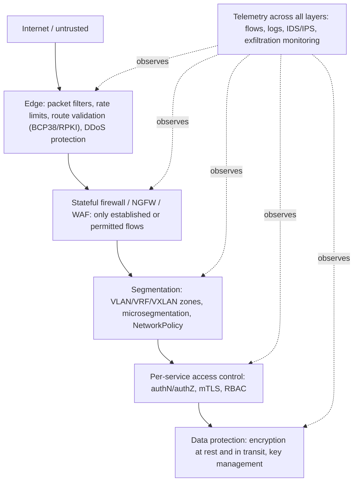

# 2.21 Network security: threat models, firewalls, SSH, zero trust and securing AI clusters

| | |
|---|---|
| Level | Intermediate |
| Priority tier | 0 |
| Lab venue | Linux VMs / namespaces; Kubernetes for NetworkPolicy |
| Part | Part 2: Networking, from first principles to AI fabrics |
| Status | Drafted, labs **untested** |

## Why this matters for AI infrastructure

What would an attacker want from a GPU cluster? The answer is more than one thing, and that is why these clusters draw attention. Compute is valuable on its own, because it can be used for cryptomining or resold. Data is valuable too, including training sets, model weights and customer prompts. Privileged access paths such as BMCs, schedulers, registries and CI let an attacker reach everything else.

The networks are unusual as well. Flat, high-speed RDMA fabrics bypass the host kernel. Management planes use out-of-band controllers that run their own firmware. Multi-tenant environments let tenants share switches. Fast-moving software stacks, such as drivers, container runtimes and serving frameworks, bring a steady stream of CVEs.

Network security here is not only firewalls. It is also segmentation, identity, key management, least privilege and monitoring. The hard part is applying all of them without strangling performance.

This chapter works through the problem in three steps. First comes the security model: definitions, defense in depth, access control, data protection, availability and the OODA loop. Next comes the practical network toolkit: packet filters, stateful firewalls, SSH hardening, scanning, DDoS and control-plane protections, and L2 security. Last, the chapter looks at what changes in AI clusters: BMC and management isolation, RDMA and InfiniBand partitioning, tenant isolation, secrets and zero trust. Linux firewall mechanics, nftables and conntrack, are in chapter 2.23. TLS and PKI are in chapter 2.10, and kernel-level hardening is in chapter 1.21.

Decide early which of these assets you are protecting, because that choice changes the controls you need.

## Prerequisites and outcomes

Before you start, you should be comfortable with a few earlier topics: TCP/IP (2.4 to 2.7), TLS and PKI (2.10), NAT and DHCP (2.9), and Linux user and permission basics.

When you finish this chapter, you should be able to do the following.

- Define threat actor, exploit, attack, vulnerability, attack surface, asset and risk, and build a simple threat model for a network or a cluster.
- Apply defense in depth with layered filters, route validation, telemetry, stateful inspection, exfiltration monitoring and per-service access control.
- Explain AAA (authentication, authorisation, accounting), RADIUS and TACACS+, 802.1X and MFA, and say where access control is enforced.
- Explain data protection, meaning encryption in transit and at rest and key management, and the limits of biometrics and data-exhaust privacy.
- Explain DoS and DDoS types and their mitigations: rate limiting, SYN cookies, anycast and scrubbing, RTBH, BCP38/uRPF and capacity.
- Harden SSH, including keys, certificates, `sshd_config`, bastions with `ProxyJump`, agent forwarding, tunnels and fail2ban.
- Explain host key verification and MITM warnings in SSH.
- Use `nmap` and related tools responsibly to audit exposure, interpret the results, and reduce the attack surface by running few services and firewalling by default.
- Secure the control plane and L2: routing protocol authentication, CoPP, GTSM, DHCP snooping, DAI, port security and 802.1X.
- Apply zero trust and segmentation with VLAN, VRF, VXLAN, Kubernetes NetworkPolicy, mTLS and microsegmentation.
- Secure AI-specific surfaces such as BMC/Redfish, IB partition keys, RoCE tenancy, registries and model artifacts.
- Use the OODA loop for detection and response, and know basic incident handling.

Check these prerequisites first, because the SSH and threat-model sections assume them.

## 1. Vocabulary and threat modelling

Security conversations go wrong fast when people use words loosely. Before you can protect anything, you need to know who might attack, where the weak points are, and what is worth protecting. The table defines the terms this chapter uses.

| Term | Meaning |
|---|---|
| **Threat actor** | Who attacks: individual, criminal group, insider, state actor; identity hints at motive, skill and likely plan |
| **Vulnerability** | A weakness: missing filter, default password, unpatched service, misconfiguration, a social-engineerable person |
| **Exploit** | The method/tool that uses a vulnerability |
| **Attack / threat** | The potential or actual use of an exploit by an actor |
| **Attack surface** | Everything reachable by an attacker: hosts, ports, services, APIs, people, supply chain |
| **Asset** | What matters: data, models, credentials, compute, availability |
| **Risk** | Likelihood × impact of a negative outcome (breach, downtime, reputational damage) |

The terms link together. A vulnerability is the weakness, an exploit is the method that uses it, and an attack is the actual use of that exploit by an actor. Risk combines how likely a bad outcome is with how much it would hurt.

Three problem areas come up from a network point of view. Area 1 is access: how legitimate users and processes reach the data they need while others cannot. Area 2 is confidentiality and integrity: whether data in transit and at rest stays private and unmodified. Area 3 is availability: whether the network and its services stay usable under denial-of-service attack.

Threat modelling turns those areas into questions you can answer for one system. What are you protecting? Who might attack, and why? How could they get in, and where are the trust boundaries? What would the impact be, and which controls reduce the likelihood or the impact? A simple data-flow diagram helps. The STRIDE categories (spoofing, tampering, repudiation, information disclosure, denial of service, elevation of privilege) work as a checklist. Revisit the model whenever the architecture changes.

**A caution on biometrics and "secrets you cannot change".** Fingerprints are convenient, but they are not secret, because you leave them on almost every surface you touch. Once a biometric is digitised and stored online, it becomes a permanent credential. After a breach, you cannot rotate it. Use biometrics as a convenience factor on a device, where the check stays local and hardware-protected. Do not rely on them as your only remote identity. Treat data exhaust with the same care. That means metadata such as who talks to whom, when, and how much. It can reveal behaviour even when the payloads are encrypted (chapter 2.10).

Decide which assets matter most before you draw the data-flow diagram, because the threat model depends on that answer.

## 2. Defense in depth

Picture a network protected by one firewall and nothing else. If that single control fails, nothing else stands in the way. Defense in depth avoids that trap by stacking overlapping controls. No single control stops a determined attacker, but layered controls give you several chances to detect and contain an intrusion, and they make every attack more costly.



Each layer does a different job. At the edge, packet filters and rate limits control what arrives, and route validation guards against hijacked address space. Behind the edge, a stateful packet filter lets in only responses to connections that started inside. Each service adds access control of its own. Telemetry watches all of these layers together, looking for top talkers, anomalies and large, unusual transfers out of sensitive databases.

The time an attacker needs to cross each layer is time for your defenders to notice. More layers also mean more places to apply specific controls. Think of the whole network as one defensive system. Routers, switches, load balancers, hosts and applications each contribute controls.

When you review a design, count the layers an attacker must cross, not just the perimeter.

## 3. Access control and AAA

Who gets in, and what can they do once they are in? Access control answers both questions. It checks that users and processes are who they claim to be (authentication). It checks that they may do what they request (authorisation). It records what they did (accounting). Together, these three are called AAA.

Access is checked at several points, and you should combine them. Before a device joins the network, port-based access control with 802.1X, Wi-Fi WPA-Enterprise or VPN login can check it. After it connects, network ACLs and segmentation limit where it can go. Before each service, application authentication or mTLS checks the caller. Before the most sensitive resources, privileged access management adds the strongest check. Use stronger factors for more sensitive resources.

The protocols divide this work. RADIUS (UDP 1812 and 1813) handles network access. It uses a shared secret and encrypts only the password field, so protect it with IPsec or RadSec. TACACS+ (TCP 49) handles device administration. It encrypts the whole packet body and supports per-command authorisation and accounting. LDAP, Active Directory and Kerberos back directory-based identity. SAML, OIDC and OAuth2 handle web and API identity, and SPIFFE and SPIRE give workloads their own identity.

Use MFA for administrative access and VPNs, because it combines something you know, something you have and something you are. Hardware keys (FIDO2) resist phishing well. Pair MFA with least privilege and just-in-time access. Keep admin accounts separate, and avoid shared accounts.

Logging closes the loop. Send central logs through syslog or journald, account for commands on network devices, store logs in immutable storage, and sync time with NTP.

Start with administrative access and VPNs when you add MFA, because the chapter names them first for that control.

## 4. Firewalls and filtering (overview)

Not every firewall works the same way. The table shows the main types, and each one fits a different place in the network.

| Type | What it does | Notes |
|---|---|---|
| **Stateless ACL / packet filter** | Matches header fields per packet (src/dst IP, ports, flags) | Fast, in switch hardware; no memory of connections; use at edges and between zones |
| **Stateful firewall** | Tracks connections (conntrack); allows return traffic of permitted flows automatically; drops unsolicited inbound | Linux nftables/iptables with `ct state`; default for host and perimeter firewalls |
| **NGFW / proxy / WAF** | Application awareness, IPS signatures, TLS inspection, URL filtering; WAF protects web apps from injection | More CPU, TLS-inspection privacy/operational trade-offs |
| **Host-based firewall** | Policy on each server (nftables, firewalld, ufw), cloud security groups | Protects against lateral movement; enforce by configuration management |
| **Microsegmentation / NetworkPolicy** | Per-workload policies enforced in the data plane (Kubernetes NetworkPolicy via Calico/Cilium, VXLAN GBP, NSX) | Identity-based rather than IP-based rules |

Stateless filters are fast, because they run in switch hardware, but they have no memory of connections. Stateful firewalls track each connection and let return traffic back in automatically, which makes them the default for hosts and perimeters. NGFWs, proxies and WAFs look deeper into the application, at the cost of CPU and TLS inspection trade-offs. Host-based firewalls and microsegmentation protect against lateral movement.

Your default stance should be deny. Block all inbound traffic by default, then explicitly allow the services you need. Restrict outbound traffic too, because egress filtering limits exfiltration and command-and-control. Log the drops that matter. Split the network into zones for users, servers, management, storage and the fabric. Place management interfaces such as SSH, BMCs and switch consoles only on a dedicated management network. Review rules regularly, remove unused ones, and test from outside and inside. Chapter 2.23 covers the detailed mechanics and rule examples.

Before you open any port, decide which zone and which management network it belongs to.

## 5. Data protection: encryption and keys

Access controls and systems fail, and when they do, encryption is the last line of defense. Use encryption in transit, meaning TLS and mTLS, SSH, IPsec, WireGuard and MACsec on links. Use encryption at rest for disks and volumes, object stores and databases. Keys need the same care. Generate them on the device or in an HSM or KMS, rotate them, separate duties, restrict access, never embed them in images or repositories, and audit their use.

Model weights and datasets deserve the care you give source code and credentials. Sign your artifacts, control who can reach the registry, keep versions immutable, and record where each artifact came from. That last part is supply-chain security. It uses a software bill of materials and signature checks on containers and packages.

AI traffic is fast, so encrypting it has a cost. For RDMA fabrics you have three options: MACsec on links (line rate in hardware on some switches and NICs), IPsec offload on NICs and DPUs, or logical isolation combined with physical security. Do not assume TLS inside the fabric is feasible for GPUDirect traffic. Make that threat-model decision on purpose instead. Shared tenants need stronger isolation and encryption. A single tenant in a locked cage can rely on segmentation and physical controls.

Make the encryption decision for each fabric explicitly, based on whether tenants share it.

## 6. Availability: denial of service

Picture a service that is healthy in every way except one: nobody can reach it. That is what a denial-of-service (DoS) attack does. A distributed attack (DDoS) does the same thing with many sources at once. The table lists four classes, and each one needs a different defense.

| Type | Mechanism | Mitigation |
|---|---|---|
| **Volumetric** | Saturate bandwidth (UDP floods, amplification via DNS/NTP/memcached reflection) | Upstream scrubbing/anycast absorb, ISP/CDN protection, BCP38 anti-spoofing, RTBH |
| **Protocol/state exhaustion** | SYN floods, connection table exhaustion, fragment attacks | SYN cookies, connection limits, stateless filtering, larger tables, proxies |
| **Application layer** | HTTP floods, slow-loris, expensive queries, API abuse | Rate limiting, WAF, caching, CAPTCHA/auth, request cost limits, autoscaling with caps |
| **Control-plane** | Flood routers' CPUs with ICMP/ARP/routing packets | CoPP, ICMP rate limiting, routing protocol authentication |

Volumetric attacks saturate bandwidth, so you absorb them upstream with scrubbing or anycast, and you stop spoofed sources with BCP38. Protocol attacks exhaust connection state, which SYN cookies and connection limits address. Application-layer attacks go after expensive requests, so rate limiting, a WAF, caching and request cost limits help. Control-plane floods hit the router CPU, so CoPP and routing authentication protect it.

The main techniques are rate limiting and policing, SYN cookies with sensible backlogs (chapter 2.6), and anycast to spread load across sites. Blackhole routing (RTBH) drops traffic bound for an attacked destination. Selective BGP traffic diversion uses the `NO_PEER` and `NO_ADVERTISE` communities to steer traffic away from saturated peering links (Computer Networking Problems and Solutions, chapter 21). BCP 38 and uRPF drop packets with spoofed sources, which prevents reflection. Traffic scrubbing services, overprovisioning and autoscaling with budget caps add capacity. Separating critical services, such as putting management on its own network, limits the damage. Finally, rehearse your runbooks before you need them.

Inference APIs are attractive targets, because each request can consume GPU seconds. That makes them a resource-exhaustion target. Use authentication, per-key quotas, token-based rate limits and admission control (chapter 2.20).

Set your rate limits and quotas before traffic spikes, not during an attack.

## 7. SSH in depth (and hardening)

SSH is the tool you reach for on a Linux fleet. It gives you an encrypted shell, command execution, file transfer with scp and sftp, port forwarding and tunnelling (including X11), and key-based authentication. It is the de facto remote-administration protocol, and it replaced telnet and rlogin for good reason. Infrastructure engineers cannot skip understanding it.

### Public-key cryptography in a paragraph

Symmetric ciphers need both sides to share one secret key. If someone steals that key, everything it protects falls with it. Public-key schemes solve this with a key pair. You can share the public key freely. Only the holder of the private key can decrypt what was encrypted to the public key, or produce a signature that the public key verifies. SSH uses public keys in both directions. Host keys let the client verify the server, and user keys let the server verify the client. Both sides then agree on a symmetric session key for the bulk of the traffic. The private key must never be exposed.

### Host keys and trust

Every server has host key pairs. The private halves live at `/etc/ssh/ssh_host_ed25519_key`, `_rsa_key` and `_ecdsa_key`, and the `.pub` files hold the public parts. The install process creates them with `ssh-keygen -A`. On your first connection, the client receives the server's public key and stores it in `~/.ssh/known_hosts`. This is called trust on first use. On later connections, a mismatch triggers the "REMOTE HOST IDENTIFICATION HAS CHANGED" warning. That warning can be harmless, for example after a reinstall, a replaced cloud instance or regenerated keys. It can also be a man-in-the-middle attack, so the warning alone does not tell you which one you face.

Verify the new fingerprint through a second channel before you trust it. Use `ssh-keygen -lf`, the cloud serial console output, or a configuration-managed `known_hosts` file. Then remove the stale line with `ssh-keygen -R host`. When you replace a machine, copy the old host keys so that users see no mismatch. In clouds, publish host keys through metadata, or use SSH host certificates, covered below.

Prefer ed25519 keys. Use ECDSA or RSA of at least 3072 bits only where you must. Disable DSA, which is obsolete.

### Where SSH falls short

SSH has one weak spot, and it comes at the start. Before you connect, your client needs the server's public host key. You do not always receive that key through a safe channel. You can check it by hand, comparing fingerprints, so that a spoofed server does not fool you. Books such as Jean-Philippe Aumasson's *Serious Cryptography* and Michael W. Lucas's *SSH Mastery* explain the methods in more depth.

### Client

The block below shows the everyday client commands. The comments show the flags that change each command's behaviour.

```bash
ssh user@host                          # login ; use -p for another port ; -i key ; -J jump
ssh user@host 'uptime'                 # run a command
tar zcf - dir | ssh host 'tar zxf -'   # pipeline over SSH
scp file user@host:/path ; sftp user@host ; rsync -a -e ssh dir/ host:/dest/
ssh -L 8888:localhost:8888 user@gpu01  # local forward (e.g. Jupyter on a GPU node): browse http://localhost:8888
ssh -R 2222:localhost:22 user@pub      # remote forward ; -D 1080 SOCKS proxy
ssh -J bastion.example.com user@10.0.0.45        # ProxyJump through a bastion
ssh-keygen -t ed25519 -a 100 -C "alice@laptop"    # create a key (use a passphrase)
ssh-copy-id -i ~/.ssh/id_ed25519.pub user@host    # install public key into authorized_keys
ssh-add ~/.ssh/id_ed25519 ; ssh-add -l            # use ssh-agent so the passphrase is entered once
```

The first line opens a login shell, and the next runs one command remotely. The pipeline streams a directory across in a single connection. The forwarding examples are the ones to remember. The `-L` line lets you open a Jupyter notebook on a GPU node in your local browser, and `-J` jumps through a bastion. Next, the `~/.ssh/config` example shows how to avoid typing the bastion route every time:

```text
Host bastion
  HostName bastion.example.com
  User alice
  IdentityFile ~/.ssh/id_ed25519
Host gpu-*
  ProxyJump bastion
  User alice
  ControlMaster auto
  ControlPath ~/.ssh/cm-%r@%h:%p
  ControlPersist 10m
  ServerAliveInterval 30
```

This config sends every `gpu-*` host through the bastion. It also reuses one connection, which `ControlPersist 10m` keeps open for 10 minutes.

### Server (`sshd_config`) hardening

Remember that `sshd_config` configures the server, while `ssh_config` configures the client. Verify each directive with `man sshd_config`. Apply them through `/etc/ssh/sshd_config.d/*.conf`, and test with `sshd -t` while a second session stays open. The key directives look like this:

```text
Port 22
PermitRootLogin no                 # or prohibit-password for break-glass
PasswordAuthentication no          # keys (or certificates) only
KbdInteractiveAuthentication no
PubkeyAuthentication yes
AuthenticationMethods publickey    # or publickey,keyboard-interactive for MFA
AllowGroups ssh-users              # explicit allow-list
MaxAuthTries 3
LoginGraceTime 20
X11Forwarding no
AllowAgentForwarding no            # agent forwarding lets a compromised host use your keys
AllowTcpForwarding no              # enable selectively per Match block
ClientAliveInterval 300
ClientAliveCountMax 2
LogLevel VERBOSE                   # logs key fingerprints used
HostKey /etc/ssh/ssh_host_ed25519_key
KexAlgorithms ...                  # use the distro's modern defaults; only remove weak legacy items
```

Restrict SSH by network. Allow it only from bastions and management networks, using security groups, nftables or `ListenAddress`. Do not expose it to the Internet unless you must. If you do expose it, rate limit it and run fail2ban.

A bastion, or jump host, gives you one audited entry point with MFA and session logging. Use `ProxyJump` rather than agent forwarding, so your keys never sit on the intermediate host.

SSH certificates remove most of the per-key work. A trusted SSH CA signs short-lived user and host certificates, using a command such as `ssh-keygen -s ca -I id -n user -V +1d key.pub`. Servers trust the CA through `TrustedUserCAKeys`, and clients trust host certificates through `@cert-authority` in `known_hosts`. That ends per-key distribution and trust on first use. Clusters often adopt this pattern with tools such as HashiCorp Vault SSH, Smallstep step-ca, Teleport, or cloud-native OS Login and IAP.

Rotate and revoke keys with `RevokedKeys`. Prefer hardware-backed keys, such as FIDO2 `ed25519-sk` or a YubiKey. Protect private keys with passphrases and agent timeouts, and audit your `authorized_keys` files. Manage `sshd_config`, `known_hosts` and authorised keys through configuration management, and watch logins with `last`, `journalctl -u ssh`, auditd or central logs.

The sshd daemon is a prime target. Keep OpenSSH updated, limit the versions and algorithms it accepts, and consider putting it behind a VPN or a zero-trust proxy. A standalone sshd is the norm. Socket-activated sshd (`ssh.socket`) can delay first logins while keys are generated, so handle the systemd units according to your distribution.

### fail2ban

On an Internet-facing host, SSH brute-force attempts never stop. fail2ban watches the logs, either journald or `/var/log/auth.log`. After a set number of failures from one address within a window, it adds a firewall rule that bans that address for a period, then removes the rule. You configure jails in `/etc/fail2ban/jail.d/*.local`, with `[sshd] enabled = true`, `maxretry`, `findtime` and `bantime`. Prefer nftables actions. fail2ban cuts log noise and CPU load, but it does not replace keys-only logins or network restriction. It only slows a brute-force attack, and a shared NAT address can lock out legitimate users. Check its state with `fail2ban-client status sshd`.

### Legacy services

inetd/xinetd were superservers that listened on many ports and spawned handlers. TCP wrappers (`/etc/hosts.allow`, `/etc/hosts.deny`, `tcpd`) controlled access to them. Systemd socket units and firewalls have largely replaced both, but you will still meet them on old systems. Avoid exposing `telnetd`, `rlogind`, `rexecd` and FTP, because they send credentials in cleartext and have chronic vulnerabilities. Replace them with SSH, SFTP or rsync. If a cleartext service cannot be replaced, wrap it in TLS with Stunnel.

Replace cleartext services with SSH, SFTP or rsync wherever you can.

## 8. Scanning and auditing exposure

Before an attacker finds an open port, you should find it yourself. `nmap` discovers hosts and ports, and it fingerprints the services behind them.

```bash
nmap -sn 10.0.0.0/24                  # host discovery only (ping/ARP sweep)
nmap -p- -T4 10.0.0.45                # all TCP ports
nmap -sV -O 10.0.0.45                 # service versions, OS guess
nmap -sU --top-ports 50 10.0.0.45     # common UDP ports
nmap -6 fe80::1%eth0                  # IPv6
nmap --script ssl-enum-ciphers -p 443 host     # TLS protocol/cipher audit
ss -tulpn                             # compare with what the host itself says it listens on
```

Run scans from at least two vantage points, the host itself and another network, ideally one outside your perimeter. That shows what the firewall really blocks. Scan only networks you own or have written permission to test. Scans get logged, they can disrupt fragile devices, and they may break policy or the law.

Add vulnerability scanners such as OpenVAS, Nessus and Trivy for images. Add configuration baselines such as CIS benchmarks and Lynis, and keep a continuous asset inventory. The `rpcbind` service on port 111, along with NFS and NIS, is a common unwanted exposure, so disable it if you do not use it. Typical findings are forgotten dev servers, default credentials and management ports exposed beyond need. Watch for BMC on 623 and 443, Redis on 6379, the Docker API on 2375, and kubelet on 10250. Also watch etcd on 2379, Jupyter on 8888, TensorBoard on 6006, Triton on 8000-8002, the Ray dashboard on 8265, and MLflow on 5000.

Scan from outside, compare the result with `ss`, and close every port you cannot justify.

## 9. Basic rules and typical vulnerabilities

A few habits shrink your exposure. Run as few services as possible. Block everything you do not need with a firewall, both on the host and at the perimeter. Track and patch every service you expose. Subscribe to security advisories, and use LTS releases on servers. Give accounts only to people who need them, because local access makes privilege escalation far easier than a remote attack. Do not install dubious binaries, and verify signatures and hashes on every download.

Attackers pursue a few main outcomes. A full compromise means gaining root, either through a service exploit or through a poorly protected account combined with a privilege-escalation bug. ASLR, stack protections, least privilege, SELinux or AppArmor, and containers with seccomp make that harder. Denial of service is the second outcome. Malware is the third. Linux malware exists, including cryptominers and botnet agents. Exposed Docker, Kubernetes or Jupyter APIs and stolen cloud keys are common entry points. Cleartext password sniffing and credential reuse from breach databases also work, so use MFA and unique secrets.

For advisories, read the SANS newsletters, CISA and national CERT advisories, and vendor bulletins. For GPU stacks, that means the NVIDIA Security Bulletins for drivers, DCGM, Triton and Container Toolkit. Also follow your distribution's security tracker, the NVD and CVE feeds, and MITRE ATT&CK.

Track and patch every service you expose, using the advisory sources above.

### Why the rules of thumb work

Patching matters most for the services you expose. If you run an SSH server, Postfix or a similar service, keep its software up to date and watch for its security alerts. Security teams concentrate their work on stable, supported releases. Development and testing releases, such as Debian Unstable and Fedora Rawhide, get much less attention. That is why servers should run long-term support releases.

Local accounts deserve the same care. Gaining superuser access from a local account is much easier than breaking in from outside. A large base of software means bugs and design flaws are common, so a shell prompt alone can offer a path to root. Do not hand out accounts casually. Do not assume that your friends protect their passwords or choose good ones.

Dubious binary packages are a final trap. They can contain Trojan horses, so install software only from sources you trust.

### Why Linux draws attackers

Linux is a popular Unix on the PC, and it runs many web servers. That popularity attracts people who want to break into systems, some for fun and some for money. Firewalls help, but they do not tell the whole story. You do not need deep expertise to stay safe, though. A few rules of thumb cover most of the risk.

There are three basic kinds of network attack. A full compromise gives an intruder superuser access, which means full control of the machine. A denial-of-service attack stops a machine from doing its network work, usually with a flood of requests. It can also exploit a flaw that crashes a server program. Denial-of-service attacks are harder to prevent, but they are easier to respond to.

Malware is the third kind. Linux users are mostly immune to email worms and viruses, because mail clients do not run programs sent as attachments. Linux malware does exist, though. Avoid downloading and installing executable software from places you have never heard of.

### Two basic kinds of vulnerability

There are two main types of vulnerability: direct attacks and cleartext password sniffing. A direct attack tries to take over a machine without subtlety. A common start is an unprotected service, such as an administrator account with no password. Once an intruder controls one service, the intruder can try to compromise the whole system.

Buffer overflows were a classic direct attack. A careless programmer does not check the bounds of a buffer array, so extra data overruns it. Address Space Layout Randomization (ASLR) in the kernel, along with other protections, has mitigated the problem somewhat.

Cleartext sniffing captures passwords sent across the network in plain text. An attacker can also use a password database built from one of many data breaches. Once an attacker has your password, the game is over. The attacker will then try to gain superuser access locally, which is much easier than a remote attack. The attacker may also use your machine to attack other hosts.

### Security resources

Three resources make a good starting point. The SANS Institute offers training, services, sample security policies and a free weekly newsletter that lists the top current vulnerabilities. The CERT Division of Carnegie Mellon University's Software Engineering Institute is a good place to find the most severe problems.

Insecure.org is run by Gordon "Fyodor" Lyon, the creator of Nmap. It points you to Nmap and to many network exploit-testing tools. It is more open and specific about exploits than many other sites.

If you want to understand network security, learn Transport Layer Security (TLS) and its predecessor, Secure Socket Layer (SSL). Both add public-key encryption and certificates to network clients and servers. Davies' *Implementing SSL/TLS Using Cryptography and PKI* is a good guide, as is Aumasson's *Serious Cryptography*.

## 10. Securing routing and the control plane

Strong data-plane security does not help if someone can hijack the control plane. Routing protocols decide where traffic goes, so they need protection of their own. Start by authenticating them. OSPF and IS-IS use HMAC-SHA, and BGP uses TCP-AO or MD5. For eBGP, use GTSM with TTL 255. Restrict BGP and OSPF to specific interfaces and peers, and make `passive-interface` the default.

Filter the routes that come in. On every peer, apply prefix lists and max-prefix limits, and use RPKI origin validation. Reject bogons, default routes from the wrong peer and overly specific prefixes. Make sure you never carry transit traffic by accident.

Control-plane policing (CoPP) and hardware rate limits protect the CPU from traffic punted to it, such as ARP, ICMP, routing, SSH, SNMP and NTP. Restrict management protocols with ACLs. Disable the services you do not use on network devices. That includes HTTP management, SNMPv1 and SNMPv2c, CDP and LLDP on untrusted ports, IP source routing and redirects.

Stop spoofing at the edge. Apply BCP 38 ingress filtering, and use uRPF in strict mode at edges and loose mode on transit. Add DHCP snooping and IP source guard to the same design.

Put management on an out-of-band network, reached through jump hosts. Use SSH, NETCONF or gNMI with strong authentication, AAA with TACACS+, config backups with diffs, signed images and secure boot where the platform supports it.

Route every change through automation with review (chapters 2.28 and 2.29), and watch for configuration drift.

Decide which of these controls you will enforce before you add a new BGP peer.

## 11. Layer-2 security

Each attack below targets the local network itself. The table pairs every attack with its control.

| Attack | Control |
|---|---|
| MAC flooding / CAM overflow | Port security (limit MACs per port), storm control |
| Rogue DHCP server | **DHCP snooping** (trust only uplink/server ports), IP source guard |
| ARP/ND spoofing | **Dynamic ARP Inspection**, ND inspection/RA guard, static entries for critical gateways |
| Rogue switch / STP manipulation | BPDU guard, root guard, disable unused ports |
| VLAN hopping (double tagging, DTP) | Disable DTP, no VLAN 1 native, set native VLAN to an unused ID, prune trunks |
| Unauthorised device attach | **802.1X** (EAP-TLS) or MAB, per-port authentication, dynamic VLAN assignment |
| Link eavesdropping | **MACsec (802.1AE)** on sensitive links |

Use the table as a checklist for each switch you manage. 802.1X decides which devices may attach to a port, and MACsec protects the traffic on the link itself.

Check each row against the switches on your own network first.

## 12. Zero trust and segmentation

Zero trust replaces the old rule that anything inside the perimeter is trusted. Instead, you authenticate and authorise every request based on identity, device posture and context. You assume a breach has already happened. You apply least privilege, encrypt everywhere, and verify continuously while you log. Four building blocks make that practical.

Identity-aware access comes first. Identity-aware proxies, ZTNA, Teleport, Tailscale or WireGuard meshes, and cloud IAP replace broad VPNs. Service identity comes next. Services use mTLS and short-lived certificates, issued through SPIFFE or SPIRE, a service mesh or cert-manager (chapter 2.10).

Microsegmentation restricts east-west traffic to what each workload needs. In Kubernetes, NetworkPolicy gives you default-deny ingress and egress per namespace, then allow rules by label. Calico and Cilium add L3, L4 and L7 policies, DNS-based egress and eBPF enforcement. In the fabric, VRFs, VXLAN tenants and GBP do the same job, which chapters 2.16 and 2.17 cover. Cloud security groups and firewall tags finish the picture.

Policy as code ties it together. Keep policies under version control, test them in CI, deploy them through GitOps, and watch for drift.

The manifest below applies that pattern to an inference namespace. It starts by denying all traffic, then allows only the gateway to reach the Triton model server.

```yaml
# Kubernetes: default deny, then allow only the inference gateway to reach the model server
apiVersion: networking.k8s.io/v1
kind: NetworkPolicy
metadata: { name: default-deny, namespace: inference }
spec: { podSelector: {}, policyTypes: [Ingress, Egress] }
---
apiVersion: networking.k8s.io/v1
kind: NetworkPolicy
metadata: { name: allow-gateway-to-triton, namespace: inference }
spec:
  podSelector: { matchLabels: { app: triton } }
  policyTypes: [Ingress]
  ingress:
  - from: [ { podSelector: { matchLabels: { app: gateway } } } ]
    ports: [ { protocol: TCP, port: 8001 } ]
```

Only the gateway may reach the Triton pod, and only on TCP port 8001. Remember to allow DNS egress and metrics scraping when you enforce default-deny egress. Then test enforcement, because a policy does nothing unless the CNI implements it.

Test enforcement before you rely on the default-deny policy, because a policy does nothing unless the CNI enforces it.

## 13. Security specifics for AI clusters

Picture a bare-metal GPU cluster that several tenants share. Their traffic crosses shared switches, and each node has a management controller.

Start with the BMC. Out-of-band management, through IPMI, Redfish, iDRAC, iLO, XClarity or the DGX BMC, has a weak history. Default credentials, the old IPMI 2.0 cipher-zero, exposed web UIs and unauthenticated firmware vectors have all caused trouble. Put BMCs on an isolated management network with strict ACLs. Give each one a unique, strong credential, and disable IPMI-over-LAN if you do not use it. Keep firmware current, serve HTTPS with real certificates, and allow access only through jump hosts. Watch for Redfish events and firmware changes.

Next comes provisioning. PXE, DHCP, TFTP and image servers are trust anchors for every node. Protect them with signed images, HTTPS boot, secure boot and TPM measured boot where you use them. Isolate their VLAN, and treat a compromise there as a fleet-wide problem.

InfiniBand has its own keys. Partition keys (P_Key) segment the fabric per tenant, and the Subnet Manager programs them. M_Key and the SM key protect management, and Q_Key applies to datagram queue pairs. Secure the SM and UFM. RoCE tenancy relies on VRFs, VLANs and QoS isolation instead. GPU-to-GPU RDMA traffic is generally unencrypted, so physical and logical isolation both matter. NIC firmware and DPUs such as BlueField add isolation features, including ARM-side network policy and host isolation modes.

Take one port with P_Key 0x8042 and another with 0x0042. Bits 0 to 14 hold the Partition ID, and both ports share the ID 0x0042. The 0x8000 bit is the membership bit, and only 0x8042 has it set, so that port is a full member. Two ports that both show 0x0042 are limited members, and they cannot communicate with each other.

Isolation has to cover every layer: network (VRFs, VXLAN or IB partitions), compute (MIG, separate nodes or confidential computing), and storage (per-tenant namespaces and encryption keys). Schedulers such as Slurm/K8s enforce quotas, cgroups and user namespaces.

Inference APIs need authentication (API keys or OIDC), TLS, rate limits, quotas and request size limits. At the application layer, add controls for prompt injection and data exfiltration. Log requests without leaking sensitive prompts, add a WAF, and control egress for tool-calling agents.

Supply-chain controls start with image provenance. Sign images with cosign and verify them at admission. Pin base images, scan them with Trivy or Grype, and use curated model registries. Verify checksums of weights, and use private package mirrors. NVIDIA driver and Container Toolkit CVEs can lead to container escape, so patch them quickly and do not run privileged containers casually.

Keep secrets out of images and environment dumps. Use Kubernetes Secrets with encryption at rest, backed by an external store such as Vault or KMS, and issue short-lived credentials. Rotate tokens, and use workload identity in place of long-lived cloud keys on nodes.

Egress filtering from GPU nodes should allow only the package mirrors and registries on an allow-list. Watch DNS, keep flow logs, and alert on large outbound transfers.

Finally, monitor each node. Per-node anomaly detection can catch unexpected GPU processes, such as cryptominers. Collect audit logs from schedulers and the Kubernetes API, flow logs from fabric edges, and host IDS data from auditd and Falco. Send everything to a central SIEM.

Decide which tenants may share each fabric, and write that decision down before you put them on the same hardware.

## 14. The OODA loop for security operations

An alert fires, and the clock starts. Security work is a cycle you repeat, not a state you reach. Colonel John Boyd's OODA loop describes that cycle in four steps: Observe, Orient, Decide and Act. The side that completes the loop faster usually wins.

1. **Observe**: Collect telemetry such as flow records, logs, packet captures on demand, IDS alerts, authentication events, vulnerability scans and threat intelligence. Without observation there is no detection. Tune what you collect, because data overload hides the signal.
2. **Orient**: Put the observations in context. Ask what is normal, which asset is affected, what the attacker is likely after (MITRE ATT&CK technique), and what the business impact would be. Orientation is where experience and a good inventory pay off, and bias and assumptions are its main enemies.
3. **Decide**: Choose a response. You can contain (isolate a host or VLAN, block an IP, revoke credentials), eradicate, recover, or keep monitoring. Predefined playbooks speed up the decision.
4. **Act**: Execute the response, preferably automatically. Then observe the result and loop again. Afterwards, improve your defenses through lessons learned and a post-incident review.

Build fast loops on purpose. Automate isolation hooks, such as moving a port to a quarantine VLAN, applying a K8s deny policy or disabling an account. Write runbooks, rehearse them in game days, and assign clear ownership. Keep forensic readiness too. Preserve logs and memory, avoid destroying evidence, and record timelines.

Decide now which containment steps you can automate, because those are the steps that shorten your loop.

## 15. Hands-on lab: harden and probe

Reading about hardening is not enough, so this lab asks you to try it. Start with the self-checking Python lab, which you run on your own machine:

```bash
python3 code/part02/network_security_zerotrust_lab.py
```

The lab checks four things. It verifies `sshd_config` hardening compliance, meaning `PermitRootLogin no`, `PasswordAuthentication no` and `AllowAgentForwarding no`. It checks InfiniBand 16-bit Partition Key (`P_Key`) isolation between full and limited members, using `0x8042`, `0x0042` and `0x8043`. It evaluates a Kubernetes `NetworkPolicy` with default-deny and label-based ingress. It also simulates fail2ban sliding-window bans.

Next, use two or three disposable VMs or network namespaces in a lab you own. Every interactive VM command below is untested here, so run them only on disposable VMs or namespaces.

1. **Exposure audit**: On a fresh VM, run `ss -tulpn` and `nmap -p- -sV localhost`, then scan from a second host. List any service you do not need, disable it, and scan again.
2. **Firewall default-deny**: With nftables, allow SSH only from the management subnet, plus established flows (chapter 2.23). Verify with nmap from inside and outside, and log the drops.
3. **SSH hardening**: Set keys-only authentication, `AllowGroups`, no root login, and no forwarding. Test with `sshd -t` while a second session stays open. Try a password login, which should fail. Use `ssh -vvv` to read the negotiation, and set `LogLevel VERBOSE`.
4. **Bastion, ProxyJump and certificates**: Create an SSH CA with `ssh-keygen`. Issue a user certificate valid for 1 hour and a host certificate. Configure `TrustedUserCAKeys` and `@cert-authority`, then connect through a bastion with `ProxyJump`. Wait for the certificate to expire and confirm that access is denied.
5. **Host key mismatch**: Regenerate a server's host keys and watch the client warning appear. Then fix it the right way: verify the fingerprint, and run `ssh-keygen -R`.
6. **fail2ban**: Install fail2ban and enable the sshd jail with `maxretry=3`. Attempt failures from a second host with a wrong key or password. Watch the ban in `fail2ban-client status sshd` and `nft list ruleset`, then unban the address.
7. **L2 attack and defense**: In namespaces with a Linux bridge, run a rogue DHCP server and watch clients take its lease. Apply a bridge-level ebtables or nft rule that drops DHCP offers from untrusted ports. ARP-spoof inside the lab with `arpspoof` or scapy, then mitigate it with static ARP entries and `arp_filter` or `arptables`.
8. **SYN flood**: Run `hping3 --flood -S -p 80` against a lab web server, and only in the lab. Watch the ListenOverflows and SYN cookie counters with `nstat`. Tune `tcp_syncookies` and `somaxconn`, and rate-limit with the nft `limit` or `meter` options.
9. **Kubernetes NetworkPolicy**: In kind with Calico or Cilium, apply the default-deny policy and the allow policy from the section above. Verify with `kubectl exec ... curl`, and test DNS egress.
10. **Threat model**: Draw a data-flow diagram of your training and inference platform. List its trust boundaries and the STRIDE threats at each one, assign controls, and choose the detection signals you will use for the OODA loop.
11. **Clean up** the keys and test CAs when you finish.

Keep the step 10 threat model in view while you work through the firewall and SSH steps.

## 16. Common mistakes

These mistakes show up on clusters again and again. Check your setup against them.

Start with SSH. Password logins on Internet-facing hosts, agent forwarding to untrusted hosts, and long-lived unprotected keys all cause trouble. So does `StrictHostKeyChecking no` everywhere.

Network layout and firewalls cause the next group. A flat network where workloads can reach management interfaces, or BMCs and dashboards left exposed, is a common mistake. So are "allow any" rules, missing egress filtering and rules nobody reviews.

Relying on the perimeter alone, or trusting east-west traffic implicitly, leaves the layers behind it unprotected. Treating TLS and mTLS as optional inside the cluster is another mistake. Without logs and time sync, you cannot reconstruct an incident. Delayed driver, runtime or CVE patches are one problem, and running privileged containers by default is another.

Scanning or testing a network without authorisation is the final mistake.

## 17. Interview angles

These questions test whether you can explain a control, not just name it. Practise each answer aloud in a few sentences.

- "Explain defense in depth with a concrete example for a GPU cluster."
- "How does SSH authentication work; what is a host key; what does 'remote host identification has changed' mean; how would you scale key management?" (SSH certificates.)
- "How would you harden an Internet-facing SSH bastion?"
- "What is zero trust and how do you implement microsegmentation in Kubernetes?"
- "How do you mitigate a SYN flood / DNS amplification / HTTP flood?"
- "What are DHCP snooping, DAI and 802.1X?"
- "What is the OODA loop and how does it apply to incident response?"
- "How do you isolate tenants on a shared InfiniBand/RoCE fabric?"
- "What would you check on an exposed BMC?"
- "How do you secure the BGP control plane?"

Each question maps to a section above, so use the section headings to check your answer.

## Exercises

Each exercise below asks you to use one of the chapter's code functions, or to apply an idea from a section. Work through them in order.

1. Start with threat modelling, STRIDE, biometrics and defense in depth. (a) Define threat actor, vulnerability, exploit, attack surface, asset and risk, where risk is likelihood times impact. Then apply STRIDE across an AI training and inference cluster. (b) Explain why fingerprints and biometrics make a poor sole remote credential (Computer Networking Problems and Solutions, chapter 21). Then trace the six defense-in-depth layers in section 2.
2. Compare AAA protocols, 802.1X and Layer-2 switch security. (a) Contrast RADIUS (UDP 1812 and 1813) with TACACS+ (TCP 49) across transport, packet encryption and per-command router authorisation. (b) Match the six Layer-2 attacks, which are MAC flooding, rogue DHCP, ARP and ND spoofing, a rogue STP switch, VLAN hopping and link eavesdropping, to their switch controls. The controls are Port Security, DHCP Snooping, DAI with RA Guard, BPDU and Root Guard, native VLAN pruning, 802.1X, and MACsec 802.1AE.
3. Work through DoS and DDoS mitigation, BGP traffic diversion and control-plane protection. Compare the four DoS classes: volumetric, protocol and state exhaustion, application and GPU exhaustion, and control-plane CPU floods. For each class, name its mitigations: BCP 38 and uRPF, `tcp_syncookies`, RTBH with community `65535:666`, `NO_PEER` and `NO_ADVERTISE` BGP steering, CoPP, GTSM with `TTL 255`, and `TCP-AO` or `HMAC-SHA`.
4. Study SSH cryptography, host-key verification, `ProxyJump` against agent forwarding, `sshd_config` hardening and SSH certificates. (a) Using `audit_sshd_config()` in `code/part02/network_security_zerotrust.py`, audit a server's `sshd_config`. Then explain why `ProxyJump` (`-J`) must replace `AllowAgentForwarding yes` when you jump through a bastion. (b) Explain what `REMOTE HOST IDENTIFICATION HAS CHANGED` means. Explain how SSH CA certificates (`ssh-keygen -s ca`, `TrustedUserCAKeys`, `@cert-authority`) remove TOFU at scale. Finally, explain how `simulate_fail2ban_window()` models fail2ban.
5. Audit exposure with nmap and `ss -tulpn`, then look at zero-trust microsegmentation with Kubernetes NetworkPolicy. (a) Why must you run nmap from outside a host and compare the result with local `ss -tulpn` output? Which high-risk AI and infrastructure ports are common? They are 111, 623, 2375, 2379, 6379, 8000–8002, 8265, 8888 and 10250. (b) Using `evaluate_k8s_ingress_network_policy()`, explain how the section 12 `default-deny` and `allow-gateway-to-triton` `NetworkPolicy` enforces zero trust (NIST SP 800-207). Explain also why you must permit DNS (UDP and TCP 53) egress when you default-deny egress.
6. Secure the AI-specific surfaces, meaning BMCs, InfiniBand `P_Keys` and the supply chain, and then apply Boyd's OODA loop. (a) Using `evaluate_ib_pkey_communication()`, decide whether InfiniBand ports with 16-bit Partition Keys can communicate. Test the pairs (0x8042, 0x8042), (0x8042, 0x8043), (0x0042, 0x0042) and (0x0042, 0x8042). Then state the hardening rules for out-of-band BMCs, which use IPMI on 623 and Redfish on 443. (b) Apply Colonel John Boyd's OODA loop (Observe, Orient, Decide, Act) to an alert that shows unexpected outbound traffic from a GPU training node.

## Checkpoint questions (20)

<details>
<summary>1. Define `Attack Surface`, `Vulnerability`, `Exploit`, and `Risk`, and state the six categories of STRIDE.</summary>

- **Attack surface**: every reachable entry point an attacker can interact with, such as open ports, APIs, BMCs, the supply chain and users.
- **Vulnerability**: a weakness in design, implementation, configuration or operations.
- **Exploit**: the specific tool or technique that uses a vulnerability.
- **Risk**: likelihood times impact of an adverse event.
- **STRIDE**: Spoofing identity, Tampering with data, Repudiation, Information disclosure, Denial of service, and Elevation of privilege.
</details>

<details>
<summary>2. Why does Computer Networking Problems and Solutions, chapter 21 warn against using biometrics as a standalone remote authentication credential?</summary>

Biometrics, such as fingerprints, face scans and iris patterns, break two properties that a cryptographic secret needs. First, they are not secret. You leave fingerprints on surfaces and your face on cameras everywhere. Second, once a biometric is stored in a backend database and stolen, you cannot rotate it or revoke it. So use biometrics only to unlock a local hardware enclave, such as a TPM, a Secure Enclave or a FIDO2 key. That enclave then signs challenges with a private key you can rotate.
</details>

<details>
<summary>3. What are the three network security problem areas, and how does Defense in Depth work across them (Computer Networking Problems and Solutions, chapter 21)?</summary>

The three problem areas are access control (only authorised principals reach data), data confidentiality and integrity (in transit and at rest), and service availability (resisting DoS). Any single layer can be bypassed or misconfigured, and deep inspection at line rate is expensive. So defense in depth places overlapping controls at every boundary. For example, edge ACLs with RPKI and BCP38 come first, then a stateful firewall or WAF, then VRF, VLAN and NetworkPolicy segmentation, then mTLS and RBAC service authentication, and finally encryption at rest with continuous telemetry and exfiltration monitoring. An attacker must cross several independent layers, which gives defenders time to detect and contain the intrusion.
</details>

<details>
<summary>4. Compare RADIUS and TACACS+ in AAA (Authentication, Authorization, Accounting).</summary>

- **RADIUS (UDP ports 1812 and 1813, RFC 2866)**: built for network access authentication, such as 802.1X switch ports, WPA-Enterprise Wi-Fi and VPNs. It combines authentication and authorisation in one reply. It encrypts only the password attribute, so protect it with RadSec, TLS or IPsec.
- **TACACS+ (TCP port 49)**: built for network device administration, such as SSH into switches and routers. It keeps authentication, authorisation and accounting separate. It encrypts the entire packet body and supports per-command authorisation and audit logging. That lets you control exactly which CLI commands an engineer may run.
</details>

<details>
<summary>5. Compare a Stateless Packet Filter (ACL), a Stateful Firewall (conntrack), an NGFW / WAF, and Microsegmentation (NetworkPolicy).</summary>

- **Stateless ACL**: checks each packet's headers (source and destination IP, protocol, L4 ports, and the TCP `SYN` and `ACK` flags) in switch TCAM at line rate. It keeps no connection memory.
- **Stateful firewall (nftables or iptables with `ct state`)**: tracks active connections in conntrack by their 5-tuples. It permits `ESTABLISHED,RELATED` return packets automatically and drops unsolicited inbound traffic.
- **NGFW and WAF**: inspect Layer 7 payloads for SQL injection, SSRF, prompt and API abuse, and IPS signatures.
- **Microsegmentation (Kubernetes NetworkPolicy, Cilium eBPF, VXLAN GBP)**: enforces rules between individual pods and containers. It uses identity labels from the orchestrator, not static IP subnets.
</details>

<details>
<summary>6. Why is Egress Filtering just as important as Ingress Filtering on GPU cluster nodes?</summary>

If an attacker compromises a container or a dependency through a supply-chain CVE or remote code execution, the next steps are command-and-control (C2) callbacks, downloads of stage-2 payloads, and exfiltration of model weights or training data. Default-deny egress filtering stops those steps. GPU nodes can then reach only internal storage, internal DNS and an approved private artifact mirror. That breaks reverse shells and blocks data exfiltration.
</details>

<details>
<summary>7. Match the four DoS/DDoS classes to their primary mitigations, including BCP 38, RTBH, and NO_PEER / NO_ADVERTISE (Computer Networking Problems and Solutions, chapter 21).</summary>

- **Volumetric floods** (UDP reflection and amplification through DNS or NTP): BCP 38 and uRPF at the network edge, anycast with upstream scrubbing centres, Remote-Triggered Black Hole (`RTBH`, community `65535:666`), and the BGP `NO_PEER` and `NO_ADVERTISE` communities to divert traffic off congested peering links.
- **Protocol and state exhaustion** (TCP SYN floods and conntrack exhaustion): `tcp_syncookies = 1`, SYN rate limits, and stateless edge ACLs.
- **Application and GPU exhaustion** (expensive LLM prompts): API authentication, per-tenant token-bucket rate limits, `max_tokens` caps and admission control.
- **Control-plane CPU floods** (ARP, ICMP and BGP punts): Control-Plane Policing (`CoPP`), GTSM (`TTL = 255`), and `TCP-AO` or `HMAC-SHA`.
</details>

<details>
<summary>8. How does SSH authenticate both the server and the user, and what does the `REMOTE HOST IDENTIFICATION HAS CHANGED` warning mean (How Linux Works, chapter 10)?</summary>

First, the server proves its identity with its host key pair, such as `/etc/ssh/ssh_host_ed25519_key`. On the first connection, which is trust on first use (`TOFU`), the client records the server's public key in `~/.ssh/known_hosts`. Next, over an ephemeral Diffie-Hellman encrypted channel, the user proves possession of a private key, such as `~/.ssh/id_ed25519`. The server checks that proof against `~/.ssh/authorized_keys`. If the server's host key ever differs from the one in `~/.ssh/known_hosts`, SSH aborts with `REMOTE HOST IDENTIFICATION HAS CHANGED`. The server may have been reinstalled or re-keyed. An attacker may also be running a man-in-the-middle (MitM) attack. Verify the new fingerprint out of band, for example at the console with `ssh-keygen -lf`, before you run `ssh-keygen -R <host>`.
</details>

<details>
<summary>9. Why is `AllowAgentForwarding yes` dangerous when connecting through a bastion or jump host, and why should you use `ProxyJump` (`ssh -J`) instead?</summary>

With SSH agent forwarding (`ssh -A`), sshd creates a Unix domain socket on the intermediate host. That socket points back to the ssh-agent on your laptop. Anyone with root access on the intermediate host can hijack the socket and use your keys to log in to every other server you can reach. With `ProxyJump` (`ssh -J bastion user@gpu01`), SSH opens a TCP port forward through the bastion. The end-to-end SSH handshake then happens directly between your laptop and `gpu01`, so your private key and agent socket never reach the bastion.
</details>

<details>
<summary>10. How do `SSH Certificates` (`ssh-keygen -s`) solve `known_hosts` TOFU and `authorized_keys` sprawl across a 1,000-node GPU cluster?</summary>

Copying static public keys into `~/.ssh/authorized_keys` on 1,000 nodes, and keeping 1,000 host keys in every engineer's `known_hosts`, does not scale. Certificates fix both problems. First, a host CA signs each node's host public key, which produces a `HostCertificate`. Engineers add one `@cert-authority *.cluster.example.com <CA-pub-key>` line to `known_hosts`, and then they trust any node the host CA signed, with no TOFU prompt. Second, a user CA, such as Vault, step-ca or Teleport, issues a short-lived user certificate after the engineer logs in with SSO and MFA. The example uses 8 hours, with `-V +8h`. Each node sets `TrustedUserCAKeys /etc/ssh/user_ca.pub`, so nodes need no per-user `authorized_keys` files, and access expires on its own.
</details>

<details>
<summary>11. List the eight essential `sshd_config` hardening directives for production Linux servers.</summary>

The eight are as follows. Start with `PermitRootLogin no` (or `prohibit-password`). Then add `PasswordAuthentication no` and `KbdInteractiveAuthentication no`, so only keys or certificates work. Third, `PubkeyAuthentication yes` with `AuthenticationMethods publickey`. Fourth, `AllowGroups ssh-users`, which gives you an explicit allow-list. Fifth, `AllowAgentForwarding no`. Sixth, `X11Forwarding no` and `AllowTcpForwarding no`, unless a Match block allows them. Seventh, `MaxAuthTries 3` with `LoginGraceTime 20`. The eighth is `LogLevel VERBOSE`, which logs the key fingerprint that authenticated. Always test with `sudo sshd -t` before you reload, and keep an existing root session open.
</details>

<details>
<summary>12. What does `fail2ban` do, and why is it NOT a substitute for `PasswordAuthentication no` (How Linux Works, chapter 10)?</summary>

fail2ban tails `/var/log/auth.log` or journald. When an IP exceeds `maxretry` failed logins within `findtime`, it adds a temporary nftables or iptables drop rule. fail2ban cuts log spam and brute-force CPU load. It does not stop a distributed botnet, though. A botnet of 50,000 IPs can guess weak passwords at 2 attempts per IP without triggering a single ban. A shared corporate NAT IP can also lock out an entire office. That is why `PasswordAuthentication no` and network allow-listing remain mandatory.
</details>

<details>
<summary>13. Why should you compare local `ss -tulpn` output against an external nmap scan (`nmap -p- -sV`), and what AI and cluster ports are most frequently exposed by mistake?</summary>

`ss -tulpn` shows every socket bound on the host, such as `0.0.0.0:*` and `127.0.0.1:*`. An external nmap scan from another subnet or zone shows what really passes through the host and perimeter firewalls, so the difference between the two is the finding. Common high-risk exposures on AI clusters include an unauthenticated Docker daemon on 2375, and kubelet on 10250 with etcd on 2379. The Ray dashboard on 8265 allows arbitrary job submission. Jupyter Notebook on 8888, Triton on 8000–8002 and MLflow on 5000 are often left open. Redis on 6379, rpcbind and NFS on 111 and 2049, and BMC IPMI on UDP 623 with Redfish on 443 complete the list.
</details>

<details>
<summary>14. What are the seven classic Layer-2 LAN attacks and their corresponding switch defenses?</summary>

MAC table flooding is stopped by port security, which limits the MACs per port, and by storm control. A rogue DHCP server is stopped by DHCP snooping, which drops `DHCPOFFER` and `DHCPACK` on untrusted ports, together with IP Source Guard. ARP spoofing and poisoning are stopped by Dynamic ARP Inspection (DAI), which checks ARP packets against the DHCP snooping binding table. An IPv6 rogue router advertisement is stopped by IPv6 RA Guard and ND inspection. A rogue switch or STP root hijack is stopped by BPDU Guard and Root Guard. VLAN hopping through double tagging or DTP is stopped by disabling `DTP`, setting the native VLAN to an unused ID, and pruning the trunk VLANs. Physical link wiretapping is stopped by IEEE 802.1AE MACsec line-rate encryption.
</details>

<details>
<summary>15. Define Zero Trust (`NIST SP 800-207`) and explain how Kubernetes NetworkPolicy enforces east-west microsegmentation.</summary>

Zero trust removes implicit trust based on network location. Being inside the cluster VLAN does not make a request trusted. Every request between users, devices and workloads must be strongly authenticated, for example with mTLS or SPIFFE, then authorised by least-privilege policy and encrypted. In Kubernetes, pods can talk to every other pod by default. A namespace-wide default-deny `NetworkPolicy` (`podSelector: {}, policyTypes: [Ingress, Egress]`) blocks all unsolicited east-west traffic. You then add label-based allow rules. For example, only `app: gateway` may reach `app: triton` on TCP 8001, plus DNS egress on 53. The CNI, such as Cilium or Calico, must enforce those rules.
</details>

<details>
<summary>16. Why are out-of-band BMCs (IPMI / Redfish) and the PXE provisioning network the highest-value targets in a bare-metal GPU cluster, and how do you secure them?</summary>

The BMC has total hardware control over the server, whatever OS runs on the host. It can mount virtual media, read console memory, reflash BIOS or BMC firmware, and reboot the machine. BMCs also have a long history of critical vulnerabilities, including `IPMI 2.0 RAKP` hash disclosure and `Cipher 0` authentication bypass. Compromising the PXE, DHCP or HTTP provisioning server is just as serious, because it compromises the boot image of every node in the fleet. To secure both, place BMCs on a strictly air-gapped OOB management VLAN or VRF that only hardened jump hosts can reach. Disable legacy IPMI-over-LAN (UDP 623) and use authenticated Redfish over HTTPS (TLS). Set a unique password for each BMC, patch BMC firmware, and enforce UEFI Secure Boot with signed OS images.
</details>

<details>
<summary>17. How does InfiniBand partitioning (`P_Key`) isolate tenants in hardware, and how do Full (0x8000) and Limited (0x0000) memberships work?</summary>

The Subnet Manager (OpenSM or UFM) programs a table of 16-bit Partition Keys (`P_Keys`) into every Host Channel Adapter (HCA) port. `M_Key` protects management SMPs. Each key has two parts:
- Bits 0 to 14 (15 bits) hold the Partition ID, from 0x0001 to 0x7FFF. The default partition is 0x7FFF.
- Bit 15, the most significant bit (MSB, 0x8000), is the membership bit. A 1 means full member, and a 0 means limited member.

Every packet carries its `P_Key` in the Base Transport Header (BTH). The HCA silicon lets two ports communicate only if they share the exact same 15-bit Partition ID and at least one of them is a full member. Several untrusted tenants can therefore be limited members of a shared storage partition. They can reach a full-member storage server, while the hardware blocks them from reaching each other.
</details>

<details>
<summary>18. How do NVIDIA BlueField DPUs strengthen multi-tenant security on bare-metal GPU servers?</summary>

When a tenant has root access on a bare-metal GPU host, that tenant can disable any agent, iptables rule or CNI running inside the host kernel. A BlueField DPU runs its own Linux OS and a hardware-offloaded firewall pipeline built from Open vSwitch, eBPF, IPsec and RDMA. That pipeline sits on a separate Arm complex in front of the physical network ports, in host-isolated (zero-trust) mode. It enforces tenant VRF and EVPN isolation, firewall ACLs, storage authentication and line-rate encryption, all outside the tenant's reach.
</details>

<details>
<summary>19. What are the unique security threats to LLM inference APIs and AI supply chains?</summary>

- **Inference APIs**: GPU resource-exhaustion DoS through long-context prompts, unauthorised model or weight extraction, prompt injection, and SSRF and data exfiltration through tool-calling agents. Counter these with strict egress allow-lists on agent sandboxes, per-key token quotas and prompt-redacted logging.
- **AI supply chain**: malicious pickle weights, where `torch.load` can run arbitrary code. Prefer `safetensors` plus SHA-256 signature verification. Unverified container images are a risk too, so sign them with `cosign` and enforce the signatures in Kubernetes admission. Container-escape CVEs in GPU drivers and `nvidia-container-toolkit` matter as well. Patch them promptly, and avoid `--privileged`.
</details>

<details>
<summary>20. Explain Colonel John Boyd's OODA loop (Observe, Orient, Decide, Act) as a network security operations model (Computer Networking Problems and Solutions, chapter 21).</summary>

Colonel John Boyd of the USAF first developed the OODA loop for air combat. It models security operations as a race of decision cycles against the attacker.
1. **Observe**: collect high-signal telemetry, such as NetFlow or IPFIX, DNS logs, auditd and Falco alerts for GPU processes, SSH and API auth logs, and BGP and RPKI monitors, without drowning in noise.
2. **Orient**: correlate what you saw with the asset inventory, baseline behaviour and threat models (MITRE ATT&CK). Get past bias and ask whether this is real and what the blast radius is.
3. **Decide**: pick a rehearsed playbook, such as quarantining a VLAN or applying a NetworkPolicy, revoking an SSH or SPIFFE certificate, or triggering a BGP RTBH.
4. **Act**: contain the threat, ideally automatically. Then observe the effect, and feed the lessons back into hardening.
</details>

## Sources and review notes

- **Sources read in full:**
  - `computer-networking-problems-and-solutions` — Russ White and Ethan Banks, *Computer Networking Problems and Solutions*, **Chapter 10: Transport Security** (developed in Chapter 2.10) and **Chapter 21: Security: A Broader Sweep** (the biometric identity conundrum, vocabulary threat actor / exploit / vulnerability / attack surface, the 3 problem areas access / confidentiality / availability, defense in depth and filtering cost, AAA RADIUS / TACACS+ / 802.1X, data protection, DoS/DDoS and BGP `NO_PEER` / `NO_ADVERTISE` / `RTBH` traffic diversion, and Colonel John Boyd's OODA loop).
  - `how-linux-works-3rd-edition` — Brian Ward, *How Linux Works*, 3rd ed., **Chapter 9** (firewall strategy) and **Chapter 10: Network Applications and Services** (Secure Shell public-key cryptography, `sshd_config` and host keys, `fail2ban`, `known_hosts` warnings, `scp`/`sftp`, `inetd`/`xinetd` and TCP wrappers, port scanning with `nmap`, RPC `rpcbind`, network security rules of thumb, typical vulnerabilities, and security resources).
  - `production-kubernetes` — Josh Rosso et al., *Production Kubernetes*, **Chapters 7 and 8**, and `networking-and-kubernetes` — James Strong and Vallery Lancey, *Networking and Kubernetes*, **Chapters 4 and 6** (Kubernetes `NetworkPolicy` microsegmentation and secret management).
- **Run here:** `python3 code/part02/network_security_zerotrust_lab.py` (12 passed, 0 failed).
- **Explicitly labelled inferences:** The `sshd_config` hardening snippet, SSH CA certificate workflow, Kubernetes `NetworkPolicy` YAML (`default-deny` + `allow-gateway-to-triton`), and AI-cluster security checklist (BMC/Redfish OOB isolation, InfiniBand 16-bit `P_Key` full/limited membership, `safetensors`/`cosign` supply-chain controls, and BlueField DPU host isolation) synthesize NIST SP 800-207 (Zero Trust), RFC 2866, OpenSSH manuals, and NVIDIA security documentation (cross-referenced with Chapters 1.21, 2.6, 2.9, 2.10, 2.15–2.17, 2.20, 2.23, and 2.28–2.29, plus original study items 21, 22, 23, 24, 25, 26, 27, 28, 29, 30, 31, 32, 33, 34, 35, 36, 37, 38, 39, and 40).
- **Not verified on live hardware:** All interactive VM and Kubernetes commands (`ssh`, `ssh-keygen`, `sshd -t`, `fail2ban-client`, `nmap`, `hping3`, `kubectl`) are marked (untested here) and must be executed ONLY on disposable lab VMs or networks you own or have written authorization to test.
