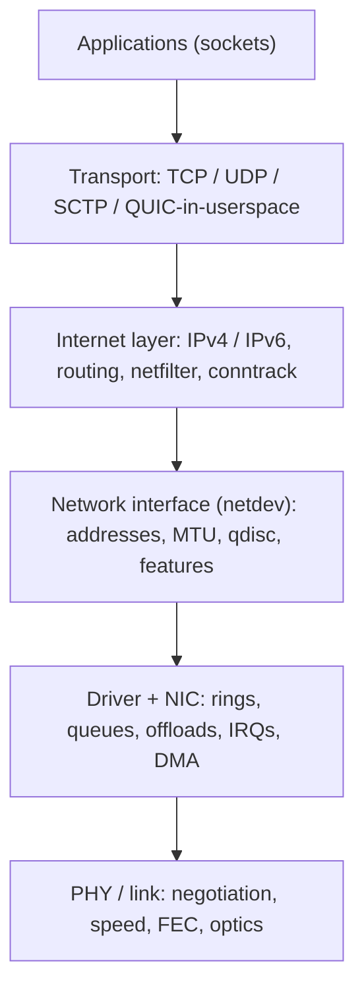
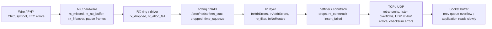

# 2.22 Linux networking I: inspecting state with ip, ss, counters and the observability toolkit

| | |
|---|---|
| Level | Intermediate |
| Priority tier | 0 |
| Lab venue | Any Linux VM (root); BCC/bpftrace tools need a recent kernel |
| Part | Part 2: Networking, from first principles to AI fabrics |
| Status | Drafted, labs **untested** |

## Why this matters for AI infrastructure

A GPU server can lose its network in the middle of a training run. The job logs show a timeout, the other nodes are waiting, and someone has to go and look at the machine. When that happens, the first questions are always the same. Which interface is up, which address does it hold, which route does traffic take, which sockets are open, which counters are moving, and at which layer are packets being dropped? This chapter gives you the Linux operator's toolkit for answering those questions quickly, in roughly the order you would ask them.

You start at the bottom, with what the kernel calls a network interface, and the `ip` command that shows it. The story then moves to the configuration managers that decide what the interfaces look like at boot, because a fix that vanishes at the next reboot is not a fix. After that, it climbs to sockets, which are how every application actually uses the network, and to the counters that show where packets disappear. The last sections give you a method for using all of this without wandering at random, and the eBPF-based tools for the cases where counters are not enough. Keep the opening questions in mind as you read, because each section answers one of them. Later chapters cover the filtering layer (2.23), policy routing, bonding and tuning (2.24), namespaces and containers (2.25), packet capture (2.26) and monitoring systems (2.31).

## Prerequisites and outcomes

You should know the IP, routing and TCP/UDP basics covered in chapters 2.4 to 2.7. You should also know Linux processes and systemd from Part 1. The rest of the chapter builds on both. If you can explain what a default gateway does, what a port number identifies, and how to restart a service under systemd, you are ready.

Everything else is explained when it first appears, whether it is netlink, a qdisc, a ring buffer or a limiter flag. The commands are meant to be typed on a disposable machine as you read.

## 1. The kernel's view: network interfaces

Picture a GPU server that loses its network in the middle of a training run. The job log shows a timeout, and the other nodes are waiting. The first question is always the same: is the interface even there? This section gives you the model that answers it, starting from the kernel's view of an interface rather than from the cable.

A network card can be working perfectly while its traffic still goes the wrong way. To debug that, you first need the model of networking that the kernel uses. The Linux kernel deliberately keeps hardware and protocol apart. A **network interface** (netdev) is the object that connects the **physical layer** (driver, NIC and link) to the **internet layer** (IP addresses and routes). Configuring an interface means binding IP addressing to a device, and that device can be real hardware or a virtual one. You can think of the interface as a socket in a wall: the IP layer plugs into it, and it does not care whether the other side is a copper cable, a virtual cable inside a container host, or a tunnel.

Interface names tell you where a device came from. `lo` is the loopback interface. `eth0` is the legacy name. Predictable names such as `enp0s31f6` encode the PCI bus and slot. `eno1` is the firmware name for an onboard NIC, `ens3` is a hotplug slot, and `wlp3s0` is a wireless device. Interface index 1 is almost always `lo`.

Many interfaces are virtual. The list includes `bridge`, `bond`, `vlan` (`eth0.100`), `veth`, `vxlan`, `tun/tap`, `wireguard`, `dummy`, `macvlan`, `ipvlan`, `gre`, `ib0` for IPoIB, `docker0`, `cni0`, `flannel.1`, `cali*`, `lxc*` and `br-*`. Virtual interfaces behave like physical ones to the IP layer. That is why overlays, containers and VPNs can work at all.



Keep this stack in mind when you read the rest of the chapter. Each tool you use looks at one of these layers, and knowing the layer tells you which tool to reach for first.

## 2. The `ip` command family

Suppose a server has lost connectivity, and you need to see what the kernel thinks is configured. The `ip` command from the iproute2 package is where you start. It replaced `ifconfig`, `route`, `arp` and `netstat -r`. It talks to the kernel over netlink, which is the kernel's channel for configuration messages, and it handles IPv4, IPv6 and every virtual device type.

The commands below cover the views you will use most. The `-br` flag prints one line per interface, `-c` adds colour, and `-j` prints JSON for scripts.

```bash
ip -br addr                 # brief: interface, state, addresses       (ip -c for colour, ip -j for JSON)
ip -br link                 # link state and MAC
ip addr show dev enp0s31f6  # full details of one interface
ip -d link show vxlan0      # -d: type-specific details (bond mode, vlan id, vxlan params)
ip -s link show eth0        # RX/TX counters: bytes, packets, errors, dropped, overrun, carrier, collisions
ip -s -s link show eth0     # extra detail on errors
ip route ; ip route get 10.30.7.8 ; ip -6 route
ip neigh                    # ARP/NDP cache and states (REACHABLE, STALE, DELAY, PROBE, FAILED, INCOMPLETE)
ip rule ; ip route show table all
ip maddr                    # multicast memberships
ip netns list ; ip -n ns1 addr   # namespaces
ip monitor                  # live netlink events: link, addr, route, neigh changes
ip -j addr | jq '.[] | {ifname, addr_info}'     # machine-readable output for scripts
```

Picture a job that reports its interface as up, while the training nodes cannot reach it. An engineer runs `ip -br addr` and sees the name, the state and an address, and the job still fails. The brief view is a good first filter, because it answers whether the interface exists and holds the expected address. The full view, shown next, answers whether the link has carrier, which MTU it uses, and where each address came from. Work through the two views in that order, so the cheap check settles the easy cases before you read the detail.

Read the `ip addr` output from top to bottom. The first line describes the link, and the indented lines describe its addresses.

```text
2: enp0s31f6: <BROADCAST,MULTICAST,UP,LOWER_UP> mtu 1500 qdisc fq_codel state UP group default qlen 1000
    link/ether 40:8d:5c:fc:24:1f brd ff:ff:ff:ff:ff:ff
    inet 10.23.2.4/24 brd 10.23.2.255 scope global noprefixroute enp0s31f6
       valid_lft forever preferred_lft forever
    inet6 2001:db8:8500:e:52b6:59cc:74e9:8b6e/64 scope global dynamic noprefixroute
       valid_lft 86054sec preferred_lft 86054sec
    inet6 fe80::d05c:97f9:7be8:bca/64 scope link noprefixroute
```

The flags in the first line tell you the state of the link. `UP` means the interface is administratively enabled in software. `LOWER_UP` means carrier is detected, and `NO-CARRIER` means there is no link. The difference matters in practice: `UP` without `LOWER_UP` is what you see when you have enabled the port but nobody has plugged in the cable, or the switch on the far side is down. You will also see `BROADCAST`, `MULTICAST`, `PROMISC`, and `SLAVE` or `MASTER` for bond and bridge relationships. The `state` field reads `UP`, `DOWN`, `UNKNOWN` or `LOWERLAYERDOWN`.

The same line carries `mtu`, the largest packet size the interface accepts. It also carries `qdisc`, the egress scheduler, which is `fq_codel`, `mq` or `noqueue` for virtual devices. `qlen` is the txqueuelen.

The indented lines show the MAC address on the `link/ether` line and the addresses on the `inet` and `inet6` lines, each with its prefix length. The `scope`, `dynamic`, `secondary` and `noprefixroute` markers, along with the lifetimes, tell you where an address came from. DHCP and SLAAC addresses expire, so their lifetimes matter.

The commands below change the configuration temporarily. Those changes are lost on reboot or when a manager reconfigures the interface.

```bash
sudo ip link set eth1 up ; sudo ip link set eth1 mtu 9000
sudo ip addr add 10.100.0.45/24 dev eth1 ; sudo ip addr del 10.100.0.45/24 dev eth1
sudo ip route add default via 10.100.0.1 dev eth1
sudo ip link add link eth0 name eth0.100 type vlan id 100
sudo ip link set eth1 down ; sudo ip addr flush dev eth1
```

Picture a fix made at two in the morning. An engineer adds a route by hand, the job starts, and everyone goes to bed. At the next reboot the route is gone, and the job fails again at the same hour. The manual command did what it said, but nothing recorded it anywhere the boot process reads. The commands above are fine for finding out what works. The result then has to move into the configuration file of the manager that owns the interface, or the fix will disappear.

Manual configuration is useful for experiments and emergencies, but it is fragile. It disappears on reboot. It also conflicts with the manager that owns the interface, because a running DHCP client or NetworkManager will undo or fight your change. The legacy tools (`ifconfig`, `route`, `arp`, `netstat`) come from the `net-tools` package. They may not be installed, and they miss newer features, but you will still see them in old documentation.

### `ethtool`: the hardware side

Where `ip` shows the kernel's view, `ethtool` shows the NIC itself. Use it to check link speed, driver, ring buffers, queues, offloads and optics. A ring buffer is the queue of packet slots shared between the NIC and the driver, and an offload is a job, such as checksumming, that the NIC does so the CPU does not have to.

```bash
ethtool eth0                  # link status, speed/duplex, auto-negotiation, supported/advertised modes, port
ethtool -i eth0               # driver, firmware, bus info
ethtool -S eth0               # driver/NIC statistics (per-queue, rx_missed, rx_no_buffer, tx_timeouts, pause frames, ecn marks)
ethtool -g eth0 ; sudo ethtool -G eth0 rx 4096 tx 4096    # ring buffer sizes
ethtool -l eth0 ; sudo ethtool -L eth0 combined 16        # queue/channel counts (RSS)
ethtool -k eth0 ; sudo ethtool -K eth0 gro off            # offloads: tso gso gro lro rxhash, checksums, tunnel segmentation
ethtool -c eth0 ; sudo ethtool -C eth0 adaptive-rx on     # interrupt coalescing
ethtool -a eth0                                          # pause frame (802.3x) settings
ethtool -x eth0 ; ethtool -n eth0                        # RSS indirection table, flow classification rules
ethtool -m eth0                                          # transceiver/optics diagnostics (power, temperature, vendor)
ethtool --show-fec eth0 ; ethtool -T eth0                # forward error correction ; timestamping/PTP capabilities
```

Walk through a common ethtool case. A server is moved to a new rack, and its training job runs at a fraction of the expected rate. The first check is the link speed in the ethtool output. It shows a lower speed than the NIC supports, and the second check is the optics. The `ethtool -m` output shows that the receive power is low, which points to a dirty connector. Cleaning the connector restores the speed. The order matters here, because the speed line alone could suggest a switch setting, while the optics line points at the cable.

A cable that has been pulled, or a switch port that is down, shows `Link detected: no`. A 100 GbE NIC that negotiates 25 GbE shows the lower figure in `Speed:`. A half-duplex link or a wrong-speed link is a classic cause of mystery throughput loss. `ethtool -m` reveals dirty optics, such as low RX power, before they cause CRC errors. Check `ethtool` first whenever a link is slower than you expect.

## 3. Persistent configuration: managers and files

Why not just run a boot script? Because networks change all the time. A laptop moves between wired, Wi-Fi and VPN. Servers get their addresses from DHCP. Clouds assign addresses and routes through metadata. Interfaces also appear and disappear through hotplug, containers and SR-IOV VFs. A configuration manager has to decide which interface to use. It brings up the physical layer and configures the IP layer, either static or DHCP/SLAAC. It lets users change connectivity without being root, and it decides what to do when connectivity is lost.

The table lists the common tools and where each keeps its files. Use it to find which manager a given machine runs.

| Tool | Where used | Config location | Notes |
|---|---|---|---|
| **NetworkManager** | Desktops, many servers (RHEL/Fedora/SUSE), some Ubuntu setups | `/etc/NetworkManager/`, connections in `/etc/NetworkManager/system-connections/` (keyfiles) | Daemon with connections (profile = device + settings); `nmcli`, `nmtui`, `nm-online`; plugins for legacy formats (`ifupdown`, `ifcfg-rh`); `unmanaged-devices`; dispatcher scripts in `/etc/NetworkManager/dispatcher.d/` |
| **systemd-networkd** | Servers, minimal systems, containers | `/etc/systemd/network/*.network\|.netdev\|.link` | Static or DHCP; bonds, VLANs, bridges, VXLAN; `networkctl`; pairs with `systemd-resolved` |
| **Netplan** | Ubuntu (and others) | `/etc/netplan/*.yaml` | YAML front-end; renders for NetworkManager or networkd; `netplan try/apply/generate`; cloud-init writes it |
| **ifupdown** | Debian (older) | `/etc/network/interfaces`, `/etc/network/if-up.d/` | `ifup/ifdown` |
| **cloud-init** | Cloud images, bare-metal provisioning | `/etc/cloud/`, `network-config` | Generates Netplan/NM/networkd config from metadata |
| **dhclient / dhcpcd / NM internal DHCP** | DHCP clients | `/var/lib/dhcp/*.leases` | Chapter 2.9 |
| **wpa_supplicant / iwd** | Wi-Fi | | Wireless authentication |
| **udev `.link` files** | Interface naming | `/etc/systemd/network/*.link`, kernel cmdline `net.ifnames=0` | Predictable names and MAC/name pinning |

The Netplan file below gives one server three different kinds of interface. One is a DHCP link, one is a static fabric NIC with a 9000 MTU, and the third is a VLAN on top of the first link. Apply it with `sudo netplan try`, as the comment in the file says. The `try` form waits for you to confirm, and it rolls the change back by itself if you lose the connection, which is a safety net when you are connected over the very interface you are changing.

```yaml
# /etc/netplan/50-gpu.yaml  (apply with: sudo netplan try)
network:
  version: 2
  renderer: networkd
  ethernets:
    eno1: { dhcp4: true, dhcp4-overrides: { use-routes: true } }
    ens1f0:
      addresses: [10.100.0.45/24]
      mtu: 9000
      dhcp4: false
      optional: true            # don't wait for this link at boot
  vlans:
    vlan200: { id: 200, link: eno1, addresses: [10.200.0.45/24] }
```

The same job can be done with NetworkManager or systemd-networkd, and the commands below show both. Use `nmcli` to inspect and create connections, and `networkctl` to inspect systemd-networkd. The `nm-online` command returns an exit code, so a script can wait for the network before it continues.

```bash
nmcli device status ; nmcli connection show ; nmcli -p connection show "Wired connection 1"
sudo nmcli connection add type ethernet ifname ens1f0 con-name fabric0 ipv4.method manual ipv4.addresses 10.100.0.45/24 802-3-ethernet.mtu 9000 ipv4.never-default yes
sudo nmcli connection up fabric0 ; sudo nmcli device reapply ens1f0
nm-online -q && echo network-up          # exit code usable in scripts
networkctl status ; networkctl list ; sudo networkctl reload   # systemd-networkd
```

Several rules govern how you use these tools. Choose one manager per interface, and keep fabric and storage NICs `unmanaged` or `never-default`. Make the configuration idempotent and declarative, so it is rendered from inventory (chapter 2.28/2.29). Idempotent means that running it twice gives the same result as running it once. Test with `netplan try`, or with console or serial access, before you cut the link you are connected over. Mark non-critical NICs `optional` so boot does not hang, and verify the state after boot with an audit script (chapter 1.28). The localhost interface is normally excluded from managers. Its configuration never changes, and basic services need it early.

Before you change a manager on a remote server, confirm that you have console access.

### Why boot scripts fall short

For years, administrators ran `ip` commands from a boot script to set up each interface. That worked when machines were big fixed boxes wired together. It breaks down on modern systems. Laptops change networks, Wi-Fi needs passwords, and most clients get addresses from DHCP. A boot script also cannot answer questions such as "which interface should I use if two are up?" or "what happens when the cable is pulled?"

Distributions tried to standardize boot-time networking files. The tools `ifup` and `ifdown` were one attempt. In theory, a boot script runs `ifup eth0` and the right `ip` commands follow. In practice, each distribution implemented them differently, with different files. Network setup also spreads across kernel and user-space tools written by different developers. Linux tools generally avoid sharing configuration files, because a change for one tool could break another.

Netplan offers a different approach. It does not manage the network itself. It is a unified YAML format plus a tool that turns that format into the files used by NetworkManager or systemd-networkd. Netplan files live in `/etc/netplan`.

### How NetworkManager chooses a connection

NetworkManager is a daemon that starts at boot, and it does not need a desktop to run. It listens to events from the system and from users, and it changes the network configuration based on rules. It tracks two levels of configuration: the hardware devices it learns from the kernel through udev over D-Bus, and the connections that describe how each device should be used. A wireless network can be a connection.

To activate a connection, NetworkManager often asks a tool such as `dhclient` to fetch IP settings from the local network. Distributions format their settings differently, so NetworkManager uses plug-ins rather than forcing its own standard.

On startup, it picks an Ethernet connection with this logic:

1. If a wired connection is available, use it. Otherwise, try the wireless connections.
2. Scan the wireless networks. If one you connected to before is in range, try it again.
3. If several known networks are available, select the most recently used one.
4. Keep the connection until it is lost, a better network appears, or the user changes it.

systemd-networkd is simpler. It suits servers that need little flexibility, but it lacks the dynamic features of NetworkManager. Other managers, such as `netifd` on OpenWRT, ConnectivityManager on Android, ConnMan and Wicd, target small embedded systems. The settings are described in the systemd.network(5) manual page, and the directory is `/etc/systemd/network`.

### Talking to NetworkManager with nmcli

Most desktop users click the network applet. From the shell, `nmcli` with no arguments gives a quick summary of interfaces and their settings. It is like `ip`, with more detail for wireless. The `nmcli` command also controls NetworkManager, and its manual page has examples in nmcli-examples(5).

The utility `nm-online` reports whether the network is up. It returns exit code `0` when the network is up and a nonzero code otherwise, which makes it handy in shell scripts.

### NetworkManager configuration and unmanaged interfaces

The main file is `NetworkManager.conf` in `/etc/NetworkManager`. Its format resembles `.desktop` and `.ini` files, with key-value settings in sections. Most files have a `[main]` section that lists plug-ins. For example, `plugins=ifupdown,keyfile` enables the ifupdown plug-in used by Ubuntu and Debian. The keyfile plug-in supports the native connection files of NetworkManager, which live in `/etc/NetworkManager/system-connections`.

Some interfaces should stay unmanaged. The localhost interface is a good example, because its configuration never changes and basic services need it early in boot. To ignore an interface under ifupdown, list it in `/etc/network/interfaces` and set `managed=false` in the `[ifupdown]` section of `NetworkManager.conf`. Under the ifcfg-rh plug-in used by Fedora and Red Hat, set `NM_CONTROLLED=no` in the file of the interface in `/etc/sysconfig/network-scripts`. You can also ignore a device by its MAC address:

```
[keyfile]
unmanaged-devices=mac:10:78:d2:eb:76:97;mac:1c:65:9d:cc:ff:b9
```

### Dispatcher scripts

When an interface goes up or down, NetworkManager runs the scripts in `/etc/NetworkManager/dispatcher.d`, passing an argument such as `up` or `down`. Some daemons need this signal. An SSH server, for example, must start or stop listening when an interface changes. Many distributions keep their own control scripts instead. Ubuntu uses one script, `01ifupdown`, that runs the scripts in `/etc/network/if-up.d`. If you use Netplan, let it find the right location for you.

## 4. Sockets: how processes use the network

Picture a web server handling thousands of clients at the same time, each with its own conversation. The server cannot hold every conversation in its head at once, and it cannot start a new server for every client. Sockets are the handles that let one process keep many conversations open together. The section explains how a server uses them, and what the kernel keeps for it.

Picture a web server that accepts thousands of clients at once. Each connection needs its own handle, and the process needs a way to read and write it. That handle is a **socket**. It is the kernel interface through which a process reads and writes network data, and it sits on the boundary between user-space applications and the transport layer of the kernel. If the interface is a socket in the wall, a network socket is the phone handset: each call gets its own.

Sockets come in several types. **Stream** (`SOCK_STREAM`, TCP) carries a two-way byte stream. **Datagram** (`SOCK_DGRAM`, UDP) sends messages. **Raw** (`SOCK_RAW`) serves ICMP tools and packet crafting. **Packet** (`AF_PACKET`) is what tcpdump uses. **Netlink** (`AF_NETLINK`) handles kernel configuration. **Unix domain** (`AF_UNIX`) handles local inter-process communication, and **vsock** handles communication between a VM host and its guests.

A typical TCP server follows a fixed life cycle. It calls `socket()`, then `bind(addr:port)`, then `listen(backlog)`. After that it loops. Each `accept()` returns a *new* connected socket, the server calls `read/recv` and `write/send` on it, and then it calls `close()`. The server therefore holds two kinds of sockets. The **listening socket** stays with the master process, and each **per-connection socket** carries the reads and writes of one client. A receptionist who answers the front desk phone and then transfers each caller to a different extension is a good picture: the front desk line stays free for the next caller. Traditional servers `fork()` a process per connection or use pre-fork worker pools. Modern servers use event loops (`epoll`, `io_uring`) to handle thousands of connections per thread.

Sockets are file descriptors. They show up in `/proc/<pid>/fd`, they are limited by `ulimit -n` and `fs.file-max`, and they are inherited across `fork`. The address you bind to decides who can reach the service. Binding to `0.0.0.0` or `::` listens on all addresses. `127.0.0.1` accepts only local clients, and a specific address listens only on that interface. `SO_REUSEADDR` and `SO_REUSEPORT` allow restarts and multi-process load sharing. `SO_KEEPALIVE`, `TCP_NODELAY` and `SO_RCVBUF/SO_SNDBUF` tune how the connection behaves, as chapter 2.6 explains.

**Unix domain sockets** give you local communication through the socket API, with no network involved. They can be bound to a filesystem path, such as `/var/run/docker.sock`, `/run/dbus/system_bus_socket` or `/var/run/mysqld/mysqld.sock`. Ordinary file permissions then control who can connect, and the socket stays off the network. They also skip the IP stack, so they are faster than loopback TCP. Programs use them to pass file descriptors and credentials (`SCM_RIGHTS`, `SO_PEERCRED`). Access to `docker.sock` is equivalent to root, so protect it. `ss -xlp` and `lsof -U` list them.

### Inspecting sockets

The commands below show listening ports, established connections, per-socket TCP internals and the Unix sockets on a host.

```bash
ss -tulpn                     # listening TCP/UDP sockets with owning processes (root for -p of others)
ss -tan state established     # established TCP; states: listen, syn-sent, syn-recv, fin-wait-1/2, time-wait, close-wait, last-ack...
ss -tn dst 10.0.0.5           # filter: dst/src, sport/dport (e.g. 'sport = :443')
ss -ti                        # TCP internals per socket (rtt, cwnd, retrans, delivery_rate, bytes_acked, limits)
ss -tiepm                     # + extended info, processes, memory
ss -s                         # summary: totals per state
ss -xlp                       # Unix domain listeners
ss -K dst 10.0.0.5 dport = 22 # kill matching sockets (CONFIG_INET_DIAG_DESTROY)
sudo lsof -iTCP -sTCP:LISTEN -nP          # which process listens on which port
sudo lsof -i :443 -nP                     # who uses port 443 ; lsof -i@10.0.0.5 ; lsof -U for Unix sockets
sudo lsof -p <pid> -a -i -nP              # a process's network sockets
netstat -tulpn ; netstat -s                # legacy equivalents (netstat -s = protocol statistics)
nc -zv 10.0.0.5 22 443 ; nc -l 5000 ; echo hi | nc -u host 5000    # netcat: connect/listen/test (-z scan, -u UDP)
telnet example.org 80          # raw TCP client: type GET / HTTP/1.1 / Host: example.org
curl -v --trace-ascii trace.txt http://example.org/    # protocol-level view: connect, headers, body
```

The `telnet` and `curl` exercises show something useful. A TCP service is an uninterrupted two-way byte stream. The split between an HTTP header and its data exists only inside the user-space program, and the kernel and the network treat the two identically. That is why you can debug any text protocol by hand.

Read `Recv-Q` and `Send-Q` together with the state of the socket. On a listening socket, they show the accept queue length and its limit. On an established socket, they count unread and unsent bytes. A `Recv-Q` that stays above zero means the application is not reading. A `Send-Q` that keeps growing means the network or the peer is slow or stalled. Many `CLOSE-WAIT` sockets mean the application is not closing its connections. Many `SYN-SENT` sockets mean the peer or the path is blocking. Many `TIME-WAIT` sockets are normal churn, as chapter 2.6 explains.

### Remote procedure calls and `rpcbind`

**RPC** lets a client call functions on a remote server, identified by program numbers. The **rpcbind** service (the portmapper, on TCP/UDP 111) maps those program numbers to ports. NFS (v3) and NIS depend on it, but NFSv4 does not need rpcbind. `rpcinfo -p host` lists the services a host offers. Rpcbind is a common unwanted exposure, as chapter 2.21 explains, so disable it on any machine that does not need NFS v3 or NIS.

### Learning the socket interface

If you write network programs, the socket interface is the tool you must learn. A process needs only a few system calls to read and write a connection, and the manual pages `recv(2)` and `send(2)` describe them. The classic guide is W. Richard Stevens' *Unix Network Programming*, Volume 1, third edition, written with Bill Fenner and Andrew M. Rudoff. Volume 2 also covers interprocess communication.

### Unix domain sockets

Two programs on one machine often need to talk. They could send data through the loopback addresses `127.0.0.1` or `::1`, but they usually use a Unix domain socket instead. It behaves almost like a network socket. A process can listen, accept connections, and even pick a TCP-like or UDP-like socket type.

Keep one idea in mind: a Unix domain socket is not a network socket. No network stands behind it, so you do not need networking configured to use one. It also does not have to live at a file path. A process can create an unnamed Unix domain socket and share its address with another process.

Developers choose Unix domain sockets for two reasons. First, a socket file in the filesystem controls access, so a process without permission to that file cannot connect. Second, the kernel skips many layers of its networking subsystem, so performance is usually much better. You will usually find the D-Bus socket file in `/var/run/dbus`:

```bash
$ ls -l /var/run/dbus/system_bus_socket
srwxrwxrwx 1 root root 0 Nov 9 08:52 /var/run/dbus/system_bus_socket
```

Daemons such as systemd and NetworkManager use D-Bus to watch and react to system events. Some network servers offer a Unix domain socket too. The MySQL server, `mysqld`, accepts clients from remote hosts, and it also offers a Unix domain socket at `/var/run/mysqld/mysqld.sock`. To list the Unix domain sockets in use, run `lsof -U` as root:

```bash
# lsof -U
COMMAND PID USER FD TYPE DEVICE SIZE/OFF NODE NAME
mysqld 19701 mysql 12u unix 0xe4defcc0 0t0 35201227 /var/run/mysqld/mysqld.sock
chromium- 26534 juser 5u unix 0xeeac9b00 0t0 42445141 socket
tlsmgr 30480 postfix 5u unix 0xc3384240 0t0 17009106 socket
tlsmgr 30480 postfix 6u unix 0xe20161c0 0t0 10965 private/tlsmgr
...
```

Read the `NAME` column first. A path such as `/var/run/mysqld/mysqld.sock` names a socket file. The word `socket` marks an unnamed socket. Many applications use unnamed sockets, so the list can be long. Look for the program name you care about.

### Who is using a port: `lsof -i`

You have seen `lsof` track open files. It can also list the programs that use or listen on network ports. Run `sudo lsof -i` to see them all. As a regular user you see only your own processes, while as root you see the whole system:

```bash
# lsof -i
COMMAND PID USER FD TYPE DEVICE SIZE/OFF NODE NAME
rpcbind 700 root 6u IPv4 10492 0t0 UDP *:sunrpc
rpcbind 700 root 8u IPv4 10508 0t0 TCP *:sunrpc (LISTEN)
avahi-dae 872 avahi 13u IPv4 21736375 0t0 UDP *:mdns
cupsd 1010 root 9u IPv6 42321174 0t0 TCP ip6-localhost:ipp (LISTEN)
ssh 14366 juser 3u IPv4 38995911 0t0 TCP thishost.local:55457->somehost.example.com:ssh (ESTABLISHED)
chromium- 26534 juser 8r IPv4 42525253 0t0 TCP thishost.local:41551->anotherhost.example.com:https (ESTABLISHED)
```

Read the output from the top. The first rows are old-style RPC services. The `avahi` service provides multicast DNS, and `cupsd` is an IPv6-ready printer service. The last two rows are client connections: an SSH session, and a secure web connection from the Chromium browser. Long output is hard to scan, so filter it when you know the port you want.

By default, `lsof` tries to turn every IP address into a hostname, and that slows the output. Add `-n` to skip the lookup. Add `-P` to skip the port-name lookup in `/etc/services`. Use `sudo lsof -n -i` on a busy host.

## 5. Counters: where packets disappear

Many network problems are packets that never arrived, or that arrived late. Nobody sees the packet vanish, so you need the evidence it leaves behind. Counters tell you which layer lost it. The diagram follows a received packet from the wire up to the application, and it marks where each layer records its drops.



The table lists the tools that read those counters. Start with the tool closest to the symptom you see.

| Tool | What it shows |
|---|---|
| `ip -s link` | Per-interface RX/TX bytes, packets, **errors**, **dropped**, **overrun**, carrier errors (kernel/driver view) |
| `ethtool -S eth0` | NIC/driver counters: `rx_crc_errors`, `rx_missed_errors`, `rx_no_buffer`, `tx_timeout`, per-queue stats, pause and ECN/CNP counters on RDMA NICs |
| `nstat -az` / `nstat -d 1` | Kernel SNMP/netstat counters as deltas: `TcpRetransSegs`, `TcpExtListenOverflows`, `TcpExtTCPTimeouts`, `IpInDiscards`, `UdpRcvbufErrors`, `IpExtInNoRoutes`, etc. |
| `netstat -s` | The same counters, grouped by protocol (verbose) |
| `cat /proc/net/dev` | Raw per-interface counters used by many exporters |
| `cat /proc/net/softnet_stat` | Per-CPU softirq packet processing: column 2 `dropped` (backlog full), column 3 `time_squeeze` (budget exhausted) |
| `cat /proc/net/snmp` / `/proc/net/netstat` | Raw protocol counters (source for nstat) |
| `sar -n DEV,EDEV,TCP,ETCP,SOCK 1` | Time series: throughput, packet rates, errors, TCP connection rates, retransmits |
| `nicstat 1` | Per-interface **utilisation** and **saturation** (rare among tools) with throughput |
| `tc -s qdisc show dev eth0` | Egress queue drops, requeues, backlog (qdisc-level saturation) |
| `conntrack -S`, `dmesg` | Connection tracking failures: `insert_failed`, `drop`, `table full` messages |
| `cat /sys/class/net/eth0/statistics/*` ; `cat /sys/class/net/eth0/speed` | Same as ip -s; negotiated speed |

Read each counter by its type. **Errors** with CRC, frame or length labels point to the physical layer, such as a cable, the optics, FEC, or a speed or duplex mismatch. **Dropped**, **missed** and **no_buffer** counters mean the host could not keep up. The fixes there are larger rings, more RSS queues, correct IRQ affinity, lower per-packet cost, more CPU, or XDP. Softnet `dropped` and `time_squeeze` point to softirq starvation, which you tune with `net.core.netdev_budget` and `netdev_max_backlog`, or with RPS and RFS. TCP retransmits point to loss somewhere on the path. Compare them with a baseline, because Internet-facing flows retransmit more than rack-local ones. `ListenOverflows` means the accept queue is full, and `UdpRcvbufErrors` means socket buffers overflowed. Pause and PFC counters show backpressure, which chapter 2.19 covers.

Picture a host whose receive drop counter has a large number, and an engineer who wants to know whether the drops are happening now. The counter has been climbing since the machine was installed, so the number says nothing about today. The engineer reads it once, waits a short time with the workload running, reads it again, and subtracts. If the difference is zero, the drops are old history, and the team can look elsewhere. If the difference keeps rising during the job, the drops are live, and the team starts at the layer where the counter lives.

Always work with deltas over an interval, because counters only grow. A counter that reads a million drops tells you nothing by itself, since those drops might have happened last year. `nstat` and `sar` do this for you. Take two readings a few seconds apart, and act on the difference rather than the running total.

The script below runs a quick first pass over links, speeds, errors, TCP, softnet and conntrack.

```bash
echo "== links ==";   ip -br link; ip -br addr
echo "== speeds ==";  for i in /sys/class/net/*/speed; do echo "$i: $(cat $i 2>/dev/null)"; done
echo "== errors ==";  ip -s link | awk '/^[0-9]+:/{n=$2} /RX:/{getline; rx=$3" err,"$4" drop,"$5" over"} /TX:/{getline; print n, "RX", rx, " TX", $3" err,"$4" drop,"$5" carr"}'
echo "== tcp ==";     nstat -az | egrep 'TcpRetransSegs|TcpExtListenOverflows|TcpExtTCPTimeouts|TcpExtTCPSynRetrans|IpInDiscards|UdpRcvbufErrors'
echo "== softnet =="; awk '{print NR-1, "dropped="strtonum("0x"$2), "squeezed="strtonum("0x"$3)}' /proc/net/softnet_stat
echo "== conntrack =="; conntrack -C 2>/dev/null; sysctl -n net.netfilter.nf_conntrack_max 2>/dev/null
```

Run the script when you first reach a host, and compare its output with the counters you saw before.

## 6. Performance methodology

Picture a colleague who opens every monitoring tool they know, reads a hundred numbers, and cannot say which one matters. The result is a long meeting and no fix. A method prevents that. It tells you which numbers to read first, and which question each number answers. This section describes the method the rest of the chapter depends on.

Use a method, not random tool-running. Without one, you run every tool you know, collect a hundred numbers, and cannot tell which of them matter. A method tells you which numbers to read first. For network analysis, the recommended order is performance monitoring (a baseline over time), then the USE method, then static performance tuning, then workload characterization. Latency analysis, TCP analysis and packet sniffing answer specific questions. Micro-benchmarking then confirms your hypotheses.

### Tools method (checklist)

The tools method walks through the available tools and looks at the key metric in each. Check `nstat` or `netstat -s` for retransmits and out-of-order packets. Check `ip -s link` for errors, drops and overruns. Check `ss -tiepm` for limiter flags on each socket, such as rwnd-limited, cwnd-limited or app-limited. Compare `nicstat` or `ip -s link` throughput with the negotiated speed. Use `tcplife` and `tcptop` for sessions and throughput by process, `tcpdump` for short targeted captures, and `perf`, BCC or bpftrace for selected packets and kernel state. The weakness of this method is that it finds only what the tools show. A problem that no tool measures stays invisible.

### USE method

For each interface and each direction (RX and TX), check three things. The first is **utilization**: the busy fraction, which is throughput divided by the negotiated speed, counting all headers. With cloud caps, use the limit the cloud imposes. The second is **saturation**, which means queueing. Look at the qdisc backlog and drops, application threads blocked on send, TCP retransmits as a symptom, and NIC ring overruns. The third is **errors**. On RX, look for bad checksums and frames that are too short or too long. On TX, look for late collisions and carrier errors. Check errors first.

Apply the same method to the NIC controller and the bus. Sum the port throughputs, and compare the total with the PCIe bandwidth. Here is a worked example. A PCIe Gen4 x16 slot delivers about 252 Gb/s usable. A single 400G NIC in that slot therefore reaches only about 63 percent of its line rate, because 252 divided by 400 is 0.63. A Gen5 x16 slot provides about 504 Gb/s, which is enough for a 400G port. Apply the method to the kernel stack too, covering softirq CPU, memory for socket buffers and the conntrack table.

### Workload characterization

Measure what the system is being asked to do before you judge how it performs. Track interface throughput in bytes per second for RX and TX, packet rates in frames per second, and TCP connection rates for active and passive opens. Also record average packet sizes, flows by protocol, port and peer, burstiness, and how all of these change over the time of day. Then ask some direct questions. Who are the top talkers? Is the traffic mostly small packets, which makes it packet-rate bound, or large packets, which makes it bandwidth bound? Is some of the traffic unnecessary, such as chatty protocols, repeated DNS lookups or uncached fetches? Removing unnecessary work is often the biggest win.

### Latency analysis

Picture a user who says that the internal app is slow, but only from one office. The team does not start by changing servers. They split the wait into parts. The name lookup is the first part, and a `dig` with statistics shows whether it takes too long. The handshake is the second, and the connection time from `curl -w` shows whether it is slow. The first-byte time is the third, and it shows whether the server is slow once the connection is open. Each part has its own cause, so the team learns which one grows before it changes anything.

Break latency into parts, and find the part that grows. A slow page load is a sum of many small waits, and only one of them is usually the culprit. Name resolution (DNS) can time out for tens of seconds. Ping and RTT show the path. TCP connection latency is the handshake, and first-byte latency is the think time of the server plus the RTT. Connection life span matters too, because short-lived connections multiply the handshake cost. Per-request latency comes from the application itself. The tools for this are `curl -w` timing variables, `dig +stats`, `tcpconnlat`, `tcpdump` timestamps, the `rtt` field from `ss -ti`, `mtr`, and application tracing. Compare what you measure against expected values. Rack-local 100G traffic should take tens of microseconds, same-DC traffic 0.2 to 0.6 ms, and cross-continent traffic 40 to 180 ms.

### TCP analysis

Picture a large file copy that starts fast, then sits at a fixed speed no matter how much bandwidth is free. The `ss -ti` output for that connection shows `rwnd_limited` as a large share of its time. That label means the receiver's window is the thing holding the sender back. The sender has data and congestion room, but the receiver has not opened its window enough. The fix is on the receiving side, for example a larger receive buffer, or an application that reads faster. Changing the sender does nothing, because the sender is already waiting on the other end.

Look at the TCP-specific behaviour. Check the send and receive buffer sizes and their limits, the window sizes, the congestion control state, retransmits and timeouts, the listen queue, duplicate ACKs, zero windows, the SYN backlog and TIME_WAIT. The `ss -ti` limiter flags (`rwnd_limited`, `cwnd_limited`, `sndbuf_limited`, `app_limited`) tell you which factor bounds each connection. `nstat` explains loss, and `tcpretrans` shows which flows retransmit and where. `tcpdump` and Wireshark give the ground truth, as chapters 2.6 and 2.26 cover.

### Static performance tuning

Picture a rack of identical servers that run one job. Nineteen show the expected throughput, and one runs much slower on the same workload. The team does not start by profiling the job. They compare the configuration of the slow node with the others: the negotiated speed, the MTU, the offloads, the driver version. In most cases one line differs, and that line explains the whole gap. A systematic check across the fleet finds the difference in minutes, while a hunt for a mysterious cause can take days.

Check the configuration for deviations from best practice before any load arrives. Look at the negotiated link speed, duplex and FEC. Confirm that the MTU is consistent end to end, that offloads are on, and that ring sizes and queue counts are right. Check IRQ affinity, the NUMA locality of the NIC and the GPU, interrupt coalescing, the qdisc, TCP buffer limits and congestion control. Also check `somaxconn` and the backlog, conntrack limits, firewall rule counts, routing correctness, bonding and LACP state, DNS configuration, the NIC firmware and driver versions, and the kernel version. Most real problems are configuration drift, such as one node with a 1 GbE negotiated link, a wrong MTU, a disabled offload or a different driver. One odd machine among a hundred identical ones is a configuration problem far more often than a mystery.

### Resource controls

Picture a pod that downloads model weights and takes the whole node's bandwidth. Other pods on the node slow down, and their health checks start to fail. The fix is to give the download pod a cap, so the others keep their share. Before blaming the network, the team checks which limit is in force. A cap set by the cloud, an SR-IOV rate, and a Kubernetes annotation each look like a slow network from inside the pod, so the question of which one applies comes first.

You can limit network bandwidth per cgroup, per process or per interface. The tools are `tc` (qdiscs and classes, `htb`, `tbf`, and `fq` with `SO_MAX_PACING_RATE`), cgroup v2 with eBPF (`net_cls` and `net_prio` in the legacy setup, and `bpf` rate limiting), and Kubernetes bandwidth annotations (`kubernetes.io/ingress-bandwidth`). Cloud instance caps, NIC SR-IOV VF rate limits and switch policing can also limit traffic. Know which limit is active before you blame the network.

### Micro-benchmarking

Measure isolated components to confirm what they can do. Use `iperf3` for TCP and UDP throughput, and `netperf` for request and response work, with `TCP_RR` for latency. `ping -f`, `ib_write_bw/ib_write_lat` (RDMA) and `nccl-tests` (collectives) cover the rest of the network. `fio` runs over NFS or S3, `wrk/hey/ghz` tests HTTP and gRPC, and `pktgen`, `trafgen` and TRex test packet rates.

Walk through a throughput test on a 100G link from the start. First run a single stream and record the number. Then run several parallel streams with the same tool, which fills the link better. If the single stream reaches only part of the link while the parallel streams reach much more, the limit is per flow, not per link. Only after that comparison does the test look at the CPU placement, because each step narrows the cause before you spend time on the next one.

Pin the CPUs to the same NUMA node as the NIC, and run long enough to smooth out noise. Record the kernel, driver and firmware versions, then compare the result with theory. At a 1500 MTU, expect about 94 percent of the nominal rate, which is the line rate minus overhead.

## 7. Observability tools in practice

### `ss -ti` fields

The output below comes from one established connection to `10.0.0.5:443`. Each field tells you something about how that connection is doing.

```text
$ ss -ti dst 10.0.0.5
ESTAB 0 0 10.0.0.2:51234 10.0.0.5:443
  cubic wscale:7,7 rto:204 rtt:0.31/0.12 mss:1448 pmtu:1500 cwnd:10 ssthresh:7 bytes_sent:2.1M bytes_acked:2.1M
  bytes_retrans:12K segs_out:1500 segs_in:900 send 373Mbps pacing_rate 746Mbps delivery_rate 330Mbps
  busy:2300ms rwnd_limited:100ms(4.3%) app_limited retrans:0/9 reordering:3 rcv_space:14480
```

Read the example line from left to right, as one story. The connection is established, and it uses cubic congestion control. The round-trip time is about 0.31 ms. The congestion window has 10 segments, and the sender has pushed out about 2 MB with almost no retransmits. The delivery rate is well below the pacing rate, so the connection is not using all it is allowed. The limiter column answers why. The receive window was the limit for a small share of the time, and the application limit is flagged as well. Each field answers one question, and reading them in order gives the full picture.

The field `rtt:avg/var` gives the round-trip time, and `cwnd` and `ssthresh` give the congestion window state. The `retrans:current/total` field counts retransmits. `delivery_rate` is what the connection actually achieves, and `pacing_rate` is what it aims for. The limiter times, `busy`, `rwnd_limited`, `sndbuf_limited` and `cwnd_limited`, are shown as percentages. `app_limited` means the application is not providing data fast enough. `reordering` and `minrtt` complete the picture.

### BCC and bpftrace tools

eBPF tools observe the kernel with low overhead. They run small, verified programs inside the kernel and report back, so you can watch events that no counter records. Install `bcc-tools` or `bpftrace`, run them as root, and use a kernel with BTF enabled for the CO-RE tools.

```bash
sudo tcplife           # one line per TCP session: PID, comm, local/remote, TX_KB, RX_KB, duration (MS)
sudo tcptop            # top TCP senders/receivers by process, refreshed
sudo tcpconnect        # trace outbound connect() calls (who connects where)
sudo tcpaccept         # trace accept() (inbound)
sudo tcpconnlat        # time from connect() to established (handshake latency) by process
sudo tcpretrans        # retransmits with the kernel state (flow, state, type: RETRANS/TLP)
sudo tcpdrop           # packets dropped by the kernel TCP stack with a stack trace (why)
sudo tcpstates         # TCP state transitions with durations
sudo sockstat ; sudo solisten ; sudo udpconnect ; sudo softirqs ; sudo hardirqs ; sudo runqlat
sudo bpftrace -e 'tracepoint:tcp:tcp_retransmit_skb { @[comm, args->daddr] = count(); }'
sudo bpftrace -e 'kprobe:tcp_sendmsg { @bytes[comm] = hist(arg2); }'                       # send size distribution per process
sudo bpftrace -e 'tracepoint:skb:kfree_skb { @[args->location] = count(); }'               # where packets are dropped (kernel address -> use ksym)
sudo bpftrace -e 'kprobe:__dev_queue_xmit { @[comm] = count(); } interval:s:5 { exit(); }'
```

These tools answer questions that counters cannot. They show which process is retransmitting, and which function dropped a packet. The `kfree_skb` tracepoint reports drop reasons on newer kernels, which gives you tcpdump-like visibility without a capture. They also show how long connections last and how much they transferred, and who connects to what.

### `perf`, `tcpdump` and Wireshark

`perf record -g -a -- sleep 10`, combined with flame graphs, shows the CPU time spent in the network stack, including softirq `net_rx_action`, `tcp_v4_rcv` and the driver poll. `perf trace -e 'net:*,skb:*'` and `perf top` are the other entry points. Use `tcpdump` for ground-truth packets, and chapter 2.26 covers it in full. Wireshark helps with analysis, through its Expert Information and TCP stream graphs.

Capturing at full line rate is impractical on a fast network. Filter narrowly, and truncate the packets with `-s 128`. Use ring buffers (`-C`, `-W`), capture on the NIC with hardware timestamps, or sample with sFlow, IPFIX or `tcpdump -c`.

### Experimentation tools

`ping`, `traceroute`, `mtr` and `tracepath` cover the path, and chapter 2.7 explains them. `iperf3 -c host -P 8 -t 30` uses several parallel streams, which you need to fill a 100G link. `netperf -t TCP_RR` measures request and response latency. `tc qdisc ... netem` injects delay, loss, reordering or rate limits, so your tests are repeatable. `nping` and `hping3` craft packets, and the `pktgen` kernel module runs packet-rate tests.

Pick the tool that matches the question, and keep the test repeatable.

## 8. Putting it together: a top-down and bottom-up checklist

Work from the symptom inward. When a service is unreachable, you can start at the application and move down toward the wire. Or you can start at the hardware and move up toward the application. Both directions end at the same place, and the table at the end maps common symptoms to their first checks.

**Picture a monitoring alert that says the batch job cannot reach a service, while the same service works from an engineer's laptop. The laptop test proves that the service runs, so the team starts at the top of the checklist and moves down one question at a time. The job's logs show a timeout rather than a refusal, which already rules out a closed port. The next questions are about DNS, the route the job takes, and the firewall. The list is long, but each answer removes a whole group of causes.

Top-down (application symptom to wire).**

1. Is the process running and listening (`ss -tulpn`, `systemctl status`)? Is it listening on the expected address and port, loopback or all addresses? Is the accept queue (`ss -ltn` Recv-Q) full?
2. Can a local client connect (`nc -zv localhost port`)? Can a peer connect (`nc -zv host port`)? Is the failure a refusal or a timeout (chapter 2.6)?
3. Is DNS correct (`getent hosts`, `dig`, chapter 2.8)? Are proxy variables set (`env | grep -i proxy`)?
4. Which route and source address does the kernel choose (`ip route get <dst>`, chapter 2.5)? Is policy routing (`ip rule`) involved, and is rp_filter in the way?
5. Does the firewall allow the traffic (`nft list ruleset`, `iptables -S`, cloud security groups)? Check conntrack too (`conntrack -L | grep ...`, chapter 2.23).
6. Does neighbour resolution work? Does `ip neigh` show FAILED or INCOMPLETE? Is the link-layer reachable (`arping`)?
7. Is the interface healthy (`ip -s link`, `ethtool`, `ethtool -S`, optics, MTU, speed)?
8. Capture packets at the interface and at the peer, to confirm what is sent and received (chapter 2.26).

**Bottom-up (hardware symptom to application).** Is the link up? Are the speed and FEC correct? Are errors rising? Are the ring buffers dropping? Is an IRQ or CPU saturated (`mpstat -P ALL 1`, `/proc/interrupts`, `softirqs`)? Is there a known driver or firmware issue? Are qdisc drops occurring? What do the IP-layer counters show? Are TCP retransmits rising? Is the application reading its data?

**Common root causes by symptom.**

| Symptom | First checks | Typical causes |
|---|---|---|
| Interface up but no connectivity | `ip route get`, `ip neigh`, `arping`, `tcpdump` | Wrong VLAN, gateway ARP failing, firewall, rp_filter, duplicate IP, wrong MTU/jumbo |
| Throughput lower than line rate | `ethtool` speed, `ss -ti` limiter, `iperf3 -P`, CPU/IRQ, MTU | Negotiated 10G on 100G NIC, single flow limits, no offloads, IRQ on wrong NUMA node, RSS queues=1 |
| Drops with low utilisation | `ethtool -S`, `softnet_stat`, `tc -s` | Ring too small, microbursts, softirq budget, qdisc limits |
| Intermittent latency spikes | `tcpretrans`, `nstat`, `ss -ti`, `perf` | RTO retransmits, conntrack full, DNS timeouts, CPU scheduling, GC pauses |
| Connections refused/reset | `ss -ltn`, firewall logs, `tcpdump` RST | Not listening, backlog, firewall reject, idle-timeout resets from middleboxes |
| "Works for small, hangs for large" | `ping -M do -s`, `tracepath` | MTU black hole (chapter 2.7) |
| After reboot config lost | manager, `ip` vs persistent files | Manual config not persisted; manager overriding |

Choose the direction based on what you know. If the application reports the failure, go top-down. If the counters are already rising, go bottom-up. The table then tells you where to look first.

## 9. Hands-on lab: a guided tour with deliberate faults

Start with the self-checking Python lab, which runs on your own machine. It checks the parsing of the hexadecimal counters in `/proc/net/softnet_stat` (`processed`, `dropped`, `time_squeeze`). It also classifies `ss -ti` bottlenecks (`rwnd_limited`, `sndbuf_limited`, `cwnd_limited`, `app_limited`). Finally, it applies the USE method to a `400G` NIC, once in a PCIe Gen4 x16 slot (`252 Gb/s`) and once in a Gen5 x16 slot (`504 Gb/s`).

```bash
python3 code/part02/linux_ip_ss_counters_lab.py
```

The rest of the lab needs a disposable Linux VM with `root`. The interactive VM commands below were not run on live hardware, so treat each result as something to verify on your own machine. Work through the steps in order, because later faults depend on the baseline you build early.

1. Take an inventory. On a fresh VM, run the commands in sections 2 to 5, and write a one-page "network state report" covering interfaces, MTU, routes, neighbours, sockets and counters. Save it as your baseline.
2. Test the interface lifecycle. Create `dummy0` and a `veth` pair with `ip`, and assign addresses to them. Watch `ip monitor` in a second terminal. Then delete them, and note what gets printed.
3. Test persistence. Write a Netplan (or networkd or NM) configuration for a dummy or VLAN interface, then run `netplan try`. Reboot, or run `systemctl restart systemd-networkd`, and check the result. Then remove the configuration. Show that a manual `ip addr add` disappears, and that a DHCP client can overwrite a manual route.
4. Test sockets. Run `python3 -m http.server 8000`, then find the server with `ss -tulpn` and `lsof -i :8000`. Connect with `nc`, `telnet` and `curl --trace-ascii`. Start a listener bound to `127.0.0.1`, then another bound to `0.0.0.0`, and test each from another namespace. Finally, create a Unix domain socket server with `socat UNIX-LISTEN:/tmp/s.sock,fork -`, and inspect it with `ss -xlp` and `lsof -U`.
5. Test the accept queue. Write a server with `listen(1)` that never calls `accept`. Open many clients against it, then observe the Recv-Q and Send-Q values in `ss -ltn`, and the ListenOverflows and ListenDrops counters in `nstat`.
6. Test the counters. Generate load with `iperf3`, and watch `ip -s link`, `sar -n DEV 1`, `nicstat 1` and `nstat -d 1`. Next, inject loss with `tc qdisc add dev lo root netem loss 1%`. Watch the retransmits in `nstat`, `ss -ti` and `tcpretrans`, then remove the qdisc.
7. Try the eBPF tools. Run `tcplife`, `tcpconnect`, `tcpretrans` and `tcpdrop` during a download and during an induced drop. Use the bpftrace one-liners too, and compare what they show with the `tcpdump` evidence.
8. Introduce faults. Create (a) a wrong MTU on one side, (b) a blocking nft rule, (c) a missing return route, (d) a full conntrack table, made by lowering `nf_conntrack_max`, and (e) a mismatched speed, set with `ethtool -s` on a veth if your kernel supports it. Diagnose each one with the checklist, and record the evidence that tells the faults apart.
9. Produce a USE report. During a stress test, build a utilisation, saturation and errors table for each interface.
10. Clean up when you finish.

## 10. Common mistakes

Most of these mistakes come from trusting a tool that shows only one layer.

- Using `ifconfig`, `route` or `netstat` knowledge from old guides, and missing the modern fields in `ip -s` and `ss -ti`.
- Making manual `ip` changes and expecting them to persist. Two managers fighting over one interface is the same trap in another form.
- Reading cumulative counters without taking deltas. Another is ignoring physical errors while you look only at host drops.
- Blaming "the network" before checking the socket (Recv-Q and Send-Q), the application, DNS or the firewall.
- Testing throughput with one TCP flow on a 100G link, and not pinning the test to the NUMA node of the NIC.
- Capturing at a high rate on the same host you are testing, which perturbs the results.
- Forgetting that `lsof` and `ss` without root show only your own processes.
- Assuming loopback tests prove external reachability. The kernel short-circuits local traffic, so it never reaches the NIC.

## 11. Interview angles

Interviewers ask these to test your reasoning, not your memory of commands. Practise each one out loud.

- "A service on this server is unreachable. Walk me through your debugging, top-down and bottom-up."
- "Difference between `ip addr`, `ip link`, `ip route`, `ip neigh`; what are the flags `UP` and `LOWER_UP`?"
- "How do you find which process owns a port? Which connections are stuck? What does Recv-Q mean?"
- "How do you tell whether packet drops are in the NIC, the kernel or the application?"
- "NetworkManager vs systemd-networkd vs Netplan: how do they relate? How do you persist a static IP?"
- "What is a Unix domain socket; why is it faster; how is it secured?"
- "Explain the USE method for a network interface."
- "How would you find which process is causing TCP retransmits on a host?" (`tcpretrans`, bpftrace.)
- "Why can a 400G NIC underperform on a Gen4 PCIe slot?"

## Exercises

Each exercise asks you to explain a mechanism first, and then to show it with commands. Work through them in order. Write your answers in your own words, and check each command against the sections above.

1. A server's link looks wrong. Explain how the kernel separates physical hardware from the L3 protocols through `netdev` interfaces. Then contrast the `UP` and `LOWER_UP` (`NO-CARRIER`) flags in `ip link` output.
2. You need to inspect an interface in detail. Write the `ip` and `ethtool` commands that inspect type-specific interface details (`-d`), produce JSON output (`-j`), watch live netlink events (`ip monitor`), show NIC ring sizes (`-g`), show RSS queue counts (`-l`), show offloads (`-k`) and read optical transceiver DOM power (`-m`).
3. Compare Netplan, NetworkManager (`nmcli`, `nm-online`) and systemd-networkd (`networkctl`). Explain why manual `ip addr` and `ip route` commands vanish or get overwritten. Then explain why non-management NICs on a GPU server must set `optional: true` and `ipv4.never-default yes`.
4. A web server accepts clients one after another. Trace the system calls of a TCP server (`socket -> bind -> listen -> accept -> recv/send -> close`). Explain what `Recv-Q` and `Send-Q` mean in `ss -ltn` for listening sockets, and in `ss -tn` for established sockets.
5. Two local daemons need to talk. Explain how Unix domain sockets (`AF_UNIX`, `ss -xlp`) differ from loopback TCP sockets in performance and security. Then explain why `/var/run/docker.sock` is root-equivalent.
6. Decode a counter line with `parse_softnet_stat_line()` in `code/part02/linux_ip_ss_counters.py`. Decode the `/proc/net/softnet_stat` line `"000186a0 0000000f 00000100 00000000 00000000"`, which gives `processed = 100,000`, `dropped = 15` and `time_squeeze = 256`. Then map each of the 7 receive-path layers (Wire/PHY, NIC hardware, RX ring/driver, NAPI softirq, IP layer, netfilter/conntrack, and TCP/UDP socket buffer) to the exact counter and tool that proves drops at that layer.
7. A 400G NIC reaches only part of its line rate. Apply the USE method to bus bottlenecks. Using `evaluate_interface_and_pcie_use()`, explain why a `400 Gb/s` NIC installed in a **PCIe Gen4 x16** slot (`~252 Gb/s` usable) saturates the PCIe bus at **`63.0%` link utilization**, and why it needs a **PCIe Gen5 x16** slot (`~504 Gb/s`).
8. A connection is slow and you suspect the receiver. Using `classify_ss_ti_bottleneck()`, interpret the `ss -ti` sample in Section 7 (`rwnd_limited:100ms(4.3%)`, `cwnd:10`, `retrans:0/9`, `app_limited`).
9. Match each operational question to the BCC or bpftrace tool that answers it. The questions are: which PID or process opens short-lived TCP connections, which process causes TCP retransmits, what the TCP handshake latency is per process, and which exact kernel function called `kfree_skb` to drop a packet. The tools are `tcplife`, `tcptop`, `tcpconnect`, `tcpaccept`, `tcpconnlat`, `tcpretrans` and `tcpdrop`.

## Checkpoint questions (20)

<details>
<summary>1. How does the Linux kernel separate hardware from network protocols (*How Linux Works*, chapter 9), and what do predictable interface names (`eno1`, `ens3`, `enp0s31f6`) mean?</summary>

The kernel wraps every physical NIC, and every virtual tunnel or bridge, in a **network device** (`struct net_device`, or `netdev`). The driver moves frames between the hardware and that `netdev`. The IPv4 and IPv6 stack then binds addresses and routes to the `netdev` name. The loopback interface `lo` is always interface index `1`. Predictable names encode where the hardware sits. `eno1` is the motherboard's onboard NIC, index 1. `ens3` is PCIe hotplug slot 3. `enp0s31f6` is PCI bus `0`, slot `31`, function `6`.
</details>

<details>
<summary>2. In `ip link` / `ip addr` output, what is the difference between `UP` and `LOWER_UP` (`NO-CARRIER`)?</summary>

`UP` in the flags list means the interface is administratively enabled in software, which you do with `ip link set dev eth0 up`. `LOWER_UP` means the transceiver (the PHY) has detected a valid layer-1 carrier signal from the switch, such as light or an electrical link pulse. If you see `UP` with `state DOWN` and `NO-CARRIER`, the interface is enabled in the OS, yet something physical is wrong. The cable may be unplugged, the transceiver may be dead, or the switch port may be shut down or have a FEC mismatch.
</details>

<details>
<summary>3. What do `ip -br`, `ip -d`, `ip -s -s`, `ip -j`, and `ip monitor` do?</summary>

- `ip -br addr` and `ip -br link` print a compact table with one line per interface, showing its name, state and addresses or MAC.
- `ip -d link show <dev>` prints details specific to the device type, such as the VLAN ID, the VXLAN VNI, local and remote addresses and port, the bond mode and hash policy, or the bridge STP and VLAN state.
- `ip -s -s link show <dev>` prints the detailed RX and TX sub-counters for errors, drops and overruns.
- `ip -j ...` prints machine-readable JSON for `jq` and automation scripts.
- `ip monitor` subscribes to kernel `netlink` broadcasts and streams link, address, route and neighbor changes as they happen.
</details>

<details>
<summary>4. Match the key `ethtool` flags (`<none>`, `-i`, `-S`, `-g/-G`, `-l/-L`, `-k/-K`, `-m`, `--show-fec`) to what they inspect or tune.</summary>

- `ethtool eth0` shows the negotiated link speed, the duplex, auto-negotiation, and `Link detected: yes/no`.
- `ethtool -i eth0` shows the kernel driver name, the NIC firmware version, and the PCI bus address (`0000:c1:00.0`).
- `ethtool -S eth0` shows hardware and driver per-queue statistics, such as `rx_crc_errors`, `rx_missed_errors`, `rx_no_buffer`, pause or PFC frames, and ECN or CNP marks.
- `ethtool -g` and `-G` read and set the RX and TX DMA ring buffer sizes, such as `4096`.
- `ethtool -l` and `-L` read and set the RSS channel or queue count, such as `combined 16`.
- `ethtool -k` and `-K` read and set the hardware offload features, such as `tso`, `gso`, `gro` and checksums.
- `ethtool -m eth0` shows optical transceiver DOM diagnostics, including laser TX and RX power in dBm, temperature, voltage and part number.
- `ethtool --show-fec eth0` shows the active Forward Error Correction mode, which is `RS-FEC`, `BaseR`/`Firecode` or `Off`.
</details>

<details>
<summary>5. How do `Netplan`, `NetworkManager` (`nmcli`), and `systemd-networkd` (`networkctl`) relate to each other, and why are manual `ip` changes dangerous on production servers?</summary>

`NetworkManager`, controlled with `nmcli` and storing its profiles in `/etc/NetworkManager/system-connections/`, and `systemd-networkd`, controlled with `networkctl` and reading `/etc/systemd/network/*.network`, are the two main daemons that configure interfaces at boot and react to link events. `Netplan` is a declarative YAML front-end, read from `/etc/netplan/*.yaml` on Ubuntu. It compiles its configuration into backend files for either `systemd-networkd` or `NetworkManager`. Run `sudo netplan try` to apply a change, because it rolls back automatically if you lose SSH. Manual `ip addr` and `ip route` commands are not saved to disk. They are wiped on reboot, or overwritten mid-run when DHCP renews or the manager reapplies its profile.
</details>

<details>
<summary>6. Why should secondary storage and GPU fabric NICs set `optional: true` (Netplan) and `ipv4.never-default yes` (NetworkManager)?</summary>

For example, `optional: true` tells `systemd-networkd-wait-online.service` not to block the boot sequence while it waits for that NIC to get carrier. The server can then boot and accept SSH on its management NIC, even if a back-end fabric switch is powered off. `ipv4.never-default yes`, or `use-routes: false`, stops that NIC from ever installing a competing `0.0.0.0/0` default route in the `main` routing table.
</details>

<details>
<summary>7. Trace the system calls of a TCP server and explain the difference between a Listening Socket and a Connected Socket (*How Linux Works*, chapter 10).</summary>

A TCP server calls `socket(AF_INET, SOCK_STREAM, 0)`, then `bind(addr, port)`, then `listen(backlog)`. That creates one **listening socket** in state `LISTEN`. When a client completes the three-way handshake, the kernel places the connection on the accept queue of the listening socket. When the server calls **`accept()`**, the kernel returns a **new file descriptor** for that one connection, a **connected socket** in state `ESTAB`, which handles `recv()` and `send()`. The listening socket stays open on the port, ready for the next client.
</details>

<details>
<summary>8. What do the `Recv-Q` and `Send-Q` columns in `ss` output mean for a `LISTEN` socket versus an `ESTAB` socket?</summary>

On a `LISTEN` socket (`ss -ltn`), `Recv-Q` is the number of completed connections waiting in the accept queue for the application to call `accept()`. `Send-Q` is the maximum capacity of that queue, `min(backlog, somaxconn)`. When `Recv-Q` reaches `Send-Q`, the queue is full, and new connections are dropped and counted in `TcpExtListenOverflows`.

On an `ESTAB` socket (`ss -tn`), `Recv-Q` is the number of received bytes that sit unread in the kernel receive buffer. When you run `ss`, a `Recv-Q` that stays high proves the application is stalled or reading too slowly. `Send-Q` is the number of bytes in the kernel send buffer that the remote peer has not yet acknowledged.
</details>

<details>
<summary>9. What is a Unix Domain Socket (`AF_UNIX`), how do you inspect it, and why is `/var/run/docker.sock` security-critical?</summary>

A **Unix domain socket** (`SOCK_STREAM` or `SOCK_DGRAM` under `AF_UNIX`) is listed with **`ss -xlp`** or **`lsof -U`**. It uses a filesystem path, not an IP address and port, for communication between processes on the same host. Data moves directly between kernel socket buffers, with no TCP/IP headers, checksums or routing. That makes it faster and lower-latency than `127.0.0.1` loopback TCP. Access is controlled by ordinary POSIX file permissions (`chmod` and `chown`) and by `SO_PEERCRED`. Anyone with write access to `/var/run/docker.sock` can tell the Docker daemon to mount `/` into a privileged container. That makes access to `docker.sock` 100% equivalent to `root`.
</details>

<details>
<summary>10. What does `rpcbind` (`TCP/UDP port 111`) do, and when should it be disabled (*How Linux Works*, chapter 10)?</summary>

`rpcbind`, formerly `portmap`, is a directory service for Sun ONC RPC. RPC daemons, such as the legacy NFSv3 `mountd`, `statd` and `lockd`, and NIS, bind to dynamic ports at startup. They register their RPC program number, version and port with `rpcbind` on port `111`. You can query the registrations with `rpcinfo -p`. Modern NFSv4 uses a single static port, `TCP 2049`, and does not need `rpcbind`. Unless the host actively uses NFSv3 or NIS, disable and mask `rpcbind.service` and `rpcbind.socket`. Doing so removes a frequent DDoS amplification and enumeration target.
</details>

<details>
<summary>11. How do you distinguish Physical Link Errors, NIC Ring Buffer Drops, SoftIRQ Backlog Drops, and Socket Buffer Drops across Linux counters?</summary>

- **Physical layer** (a bad cable, a dirty optic, or the wrong FEC): look at `rx_crc_errors` and `rx_frame_errors` in `ethtool -S`, and at the `RX errors` in `ip -s link`.
- **NIC hardware and DMA ring exhaustion** (the NIC received frames faster than the driver replenished its descriptors): look at `rx_missed_errors` and `rx_no_buffer` in `ethtool -S`, and at `RX overruns` and `dropped` in `ip -s link`. The fixes are a larger ring with `ethtool -G`, more RSS queues with `ethtool -L`, and IRQ or NUMA pinning.
- **Kernel SoftIRQ and NAPI starvation**: look at column 2 (`dropped`) and column 3 (`time_squeeze`) in `/proc/net/softnet_stat`. The fixes are `net.core.netdev_budget`, `netdev_max_backlog` and RPS.
- **Transport socket buffer overflow** (a slow application): look at `UdpRcvbufErrors`, `TcpExtListenOverflows` and `TCPRcvPruned` in `nstat -az`.
</details>

<details>
<summary>12. What are the three columns of `/proc/net/softnet_stat` that matter most, and how are they formatted?</summary>

`/proc/net/softnet_stat` has one row per CPU core, and every value is a 32-bit hexadecimal integer. Column 1 is the total number of packets processed by `NET_RX_SOFTIRQ` on that CPU. Column 2, `dropped`, counts packets dropped because that CPU's `input_pkt_queue` exceeded `net.core.netdev_max_backlog`. Column 3, `time_squeeze`, counts how often the NAPI poll loop ran out of its budget before it drained all the queued packets. That budget is set by `net.core.netdev_budget`, which defaults to `300` packets, and by `netdev_budget_usecs`, which is `2000 µs`. Watch column 2 over time, and you can see the drops grow.
</details>

<details>
<summary>13. Explain Brendan Gregg's `USE` Method (`Utilization, Saturation, Errors`) applied to a network interface and its PCIe bus (*Systems Performance*, chapter 10).</summary>

Apply the method to every hardware and software resource on the data path. These include the NIC port RX and TX, the NIC controller ASIC, the PCIe bus, the softirq CPU cores and the socket buffers.

1. **Errors** come first, because they are fast and unambiguous. Check CRC errors, symbol or FEC uncorrectable errors, and TX carrier or timeout errors.
2. **Utilization** is `measured_throughput / negotiated_link_speed`. Also compare it with the PCIe slot bandwidth. A PCIe Gen4 x16 slot delivers only about `252 Gb/s` of usable payload, so it bottlenecks a single `400 Gb/s` NIC at `63%` link utilization. A `400G` NIC needs a PCIe Gen5 x16 slot, at about `504 Gb/s`.
3. **Saturation** shows up in the qdisc backlog and drops (`tc -s qdisc`), the NIC `rx_missed_errors`, the softnet `time_squeeze`, and TCP retransmits.
</details>

<details>
<summary>14. How do you decompose end-to-end request latency in Network Latency Analysis (*Systems Performance*, chapter 10)?</summary>

Break every network call into five measurable intervals, using `curl -w` timing variables and `tcpconnlat`.

1. **DNS resolution time** is `time_namelookup`. Watch for `5 s` resolver timeouts.
2. **TCP three-way handshake time** is `time_connect - time_namelookup`. It takes about `1 RTT`, or `1 s` or `3 s` if SYN retransmits or a backlog overflow occur.
3. **TLS handshake time** is `time_appconnect - time_connect`, which takes about `1` to `2 RTTs`.
4. **Server processing and first-byte latency** (`TTFB` or `TTFT`) is `time_starttransfer - time_appconnect`.
5. **Content transfer duration** is `time_total - time_starttransfer`.
</details>

<details>
<summary>15. How do you read `ss -ti` limiter percentages (`rwnd_limited`, `cwnd_limited`, `sndbuf_limited`, `app_limited`)?</summary>

The Linux TCP stack tracks the fraction of active transmission time, shown as `busy:2300ms`, that a socket spent held back by each constraint.

- **`rwnd_limited`** means the remote receiver's advertised window throttled the socket. The cause is usually a slow receiving application or a small peer `tcp_rmem`.
- **`sndbuf_limited`** means the local send buffer throttled the socket. The `tcp_wmem` setting may be too small for the path's BDP.
- **`cwnd_limited`** means the network congestion window throttled the socket. Packet loss or congestion along the path is the usual cause. A high `retrans:cur/total` points the same way.
- **`app_limited`** means the local application is not feeding data fast enough to fill the pipe.
</details>

<details>
<summary>16. Match the `BCC` / `eBPF` network tools (`tcplife`, `tcptop`, `tcpconnect`, `tcpaccept`, `tcpconnlat`, `tcpretrans`, `tcpdrop`) to what they trace (*Systems Performance*, chapter 10).</summary>

- **`tcplife`** logs one summary line per closed TCP session, with the `PID`, the process `COMM`, the `LADDR:LPORT` and `RADDR:RPORT` pairs, `TX_KB`, `RX_KB` and the `MS` duration. It has low overhead, because it hooks only state changes.
- **`tcptop`** is a live, `top`-style view of TCP send and receive rates in KB/s, grouped by `PID` and process.
- **`tcpconnect`** and **`tcpaccept`** trace every outbound active `connect()` and every inbound passive `accept()`.
- **`tcpconnlat`** measures the time from the `SYN` being sent by `connect()` to the `SYN-ACK` arriving, per process.
- **`tcpretrans`** prints every TCP retransmission and every Tail Loss Probe (`TLP`), with the `PID`, the flow 4-tuple and the TCP state.
- **`tcpdrop`**, or `tracepoint:skb:kfree_skb`, prints the exact kernel stack trace and drop reason whenever the kernel frees or drops a packet.
</details>

<details>
<summary>17. What is Static Performance Tuning (*Systems Performance*, chapter 10), and what configuration items should be audited on a GPU server before running benchmarks?</summary>

Static Performance Tuning checks the configured state of the hardware and the OS against best practice, before any load is applied. On a GPU node, you should verify the negotiated link speed (`400000Mb/s`), the duplex and the FEC with `ethtool`. Confirm an end-to-end jumbo MTU of `9000`. Check the PCIe slot generation and link width with `lspci -vv`, which should show `Speed 32GT/s` for Gen5 and `Width x16`. Confirm that each GPU and its paired NIC share a NUMA node, using `nvidia-smi topo -m` and `/sys/class/net/<if>/device/numa_node`. Audit the NIC ring sizes (`-G`), the RSS queue counts (`-L`), the hardware offloads (`-k`) and the IRQ CPU affinity. Finally, check the `sysctl` socket buffer limits (`rmem_max` and `wmem_max`) and `somaxconn`.
</details>

<details>
<summary>18. What rules must you follow when micro-benchmarking network throughput with `iperf3` or `ib_write_bw` on `100G`–`400G` links?</summary>

Follow four rules. First, pin the benchmark process to CPU cores on the same NUMA node as the NIC, with `numactl --cpunodebind=...` or `taskset -c`. Second, use several parallel streams, such as `iperf3 -P 8` or `-P 16`, or multiple QPs in `ib_write_bw -q 4`, because a single CPU core cannot saturate a 100G to 400G link. Third, test outside loopback. A test to `127.0.0.1`, or to a local IP on the same host, short-circuits the physical NIC and the wire completely. Fourth, calculate the expected goodput first. A `1500` MTU TCPv4 flow gives `1460 / 1538 ≈ 94.9%` of the wire rate. A `9000` MTU flow gives `8960 / 9038 ≈ 99.1%`.
</details>

<details>
<summary>19. Why does running `lsof -i` or `ss -tulpn` as an unprivileged user hide process names (`-p`), and how can you forcibly close a stuck TCP socket without killing the daemon?</summary>

Reading `/proc/<pid>/fd/*` for other users' processes requires `root`, or the `CAP_SYS_PTRACE` or `CAP_DAC_READ_SEARCH` capability. For example, run **`sudo ss -tulpn`** or **`sudo lsof -i -nP`**. The `-nP` flags skip slow DNS and `/etc/services` port-name lookups. To tear down one stuck TCP connection without restarting the server, run **`sudo ss -K dst <peer_ip> dport = <port>`**. That command needs `CONFIG_INET_DIAG_DESTROY`.
</details>

<details>
<summary>20. Walk through the 8-step Top-Down checklist when a remote client cannot connect to a service on a Linux host.</summary>

1. **Process and socket:** run `sudo ss -tulpn`. Is the daemon listening on `0.0.0.0` or `::`, or only on `127.0.0.1`? Is `Recv-Q` smaller than `Send-Q`?
2. **Local versus remote connect:** run `nc -zv 127.0.0.1 <port>` locally, and `nc -zv <host_ip> <port>` from a peer. If you get `Connection refused`, that means a RST. A `timed out` result means a drop.
3. **DNS and proxy environment:** run `getent hosts <name>` and `env | grep -i proxy`.
4. **Routing and `rp_filter`:** run `ip route get <client_ip>` and `ip rule show`.
5. **Firewall and conntrack:** run `sudo nft list ruleset`, check the cloud security groups, and run `conntrack -S`.
6. **Layer 2 neighbor:** run `ip neigh show`. Is the entry `REACHABLE` or `FAILED`?
7. **NIC and counters:** run `ip -br link`, `ethtool <dev>`, `ip -s link` and `nstat -az`.
8. **Packet capture:** run `sudo tcpdump -ni <dev> host <client_ip> and port <port>`.
</details>

## Sources and review notes

- **Sources read in full:**
  - `how-linux-works-3rd-edition` — Brian Ward, *How Linux Works*, 3rd ed., **Chapter 9: Understanding Your Network and Its Configuration** (kernel network interfaces, interface configuration with `ip`, manually adding routes, boot-activated configuration, problems with manual configuration, Netplan, network configuration managers, NetworkManager operation, `nmcli`, `nm-online`, unmanaged interfaces, and dispatcher scripts) and **Chapter 10: Network Applications and Services** (basics of services with `telnet` and `curl`, network servers, diagnostic tools `lsof`, `tcpdump`, `netcat`, port scanning, RPC `rpcbind` port `111`, network sockets, and Unix domain sockets `/var/run/docker.sock`).
  - `systems-performance-2nd-edition` — Brendan Gregg, *Systems Performance: Enterprise and the Cloud*, 2nd ed., **Chapter 2: Methodologies** and **Chapter 10: Network** (terminology and models, concepts latency / packet size / buffering / backlog / interface negotiation / congestion avoidance / utilization, architecture, methodologies tools method / USE method / workload characterization / latency analysis / performance monitoring / packet sniffing / TCP analysis / static performance tuning / resource controls / micro-benchmarking, observability tools `ss`, `ip`, `nstat`, `netstat`, `sar`, `nicstat`, `ethtool`, `tcplife`, `tcptop`, `tcpretrans`, `bpftrace`, `tcpdump`, and experimentation tools).
  - `networking-and-kubernetes` — James Strong and Vallery Lancey, *Networking and Kubernetes*, **Chapter 2: Linux Networking**.
- **Run here:** `python3 code/part02/linux_ip_ss_counters_lab.py` (10 passed, 0 failed).
- **Explicitly labelled inferences:** The Section 5 7-layer packet-drop Mermaid diagram and health-check one-liner script, PCIe Gen4 (`252 Gb/s`) vs Gen5 (`504 Gb/s`) 400G NIC USE calculation, and the Section 8 top-down/bottom-up symptom table synthesize the `iproute2`, `ethtool`, `bcc-tools` (`tcplife-bpfcc`), and `bpftrace` documentation and the `nvidia-devops` networking masterclass (cross-referenced with Chapters 1.28, 2.5–2.9, 2.19, 2.21, 2.23–2.26, and 2.31, plus original study items 21, 22, 23, 24, 25, 26, 27, 28, 29, 30, 31, 32, 33, 34, 35, 36, 37, 38, 39, and 40).
- **Not verified on live hardware:** All interactive VM and eBPF commands (`ip`, `ss`, `ethtool`, `nmcli`, `netplan`, `networkctl`, `nstat`, `sar`, `nicstat`, `tcplife`, `tcptop`, `tcpretrans`, `tcpdrop`, `bpftrace`, `perf`) are marked (untested here) and must be executed on a disposable Linux VM with `root`.
