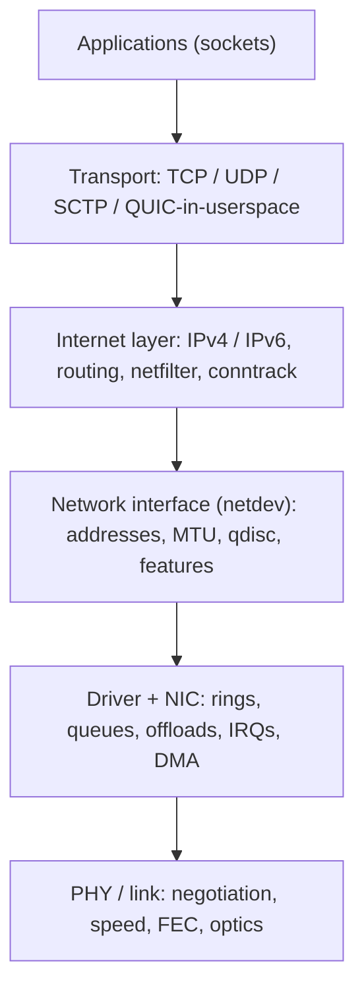
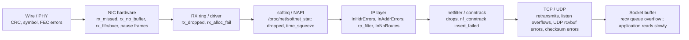

# 2.22 Linux networking I: inspecting state with ip, ss, counters and the observability toolkit

| | |
|---|---|
| Level | Intermediate |
| Priority tier | 0 |
| Lab venue | Any Linux VM (root); BCC/bpftrace tools need a recent kernel |
| Part | Part 2: Networking, from first principles to AI fabrics |
| Status | Drafted, labs **untested** |

## Why this matters for AI infrastructure

Every network incident on a GPU server starts with the same questions: which interface, which address, which route, which sockets, which counters are moving, and where in the stack packets are being dropped. This chapter is the Linux operator's toolkit for answering those questions fast and correctly: the kernel's view of interfaces, the `ip` command family, `ss` for sockets, `ethtool`/`nstat`/`sar`/`nicstat` for counters, the network configuration managers (NetworkManager, systemd-networkd, Netplan, cloud-init) that decide what the interfaces look like at boot, the socket API behind every application, and a performance methodology (tools method, USE, workload characterization, latency analysis, TCP analysis) with eBPF-based tools for deeper visibility. Later chapters cover the filtering layer (2.23), policy routing, bonding and tuning (2.24), namespaces and containers (2.25), packet capture (2.26) and monitoring systems (2.31).

## Prerequisites and outcomes

You should know IP, routing and TCP/UDP basics (2.4 to 2.7), plus Linux processes and systemd (Part 1).

After this chapter you can:

- Describe how the kernel separates the physical layer from the internet layer with network interfaces, and read `ip addr`, `ip link`, `ip route`, `ip neigh`, `ip rule`, `ip -s`, `ip -d`, `ip -j` output.
- Configure interfaces temporarily with `ip` and persistently with Netplan, NetworkManager (`nmcli`), systemd-networkd and cloud-init; explain unmanaged interfaces, dispatcher scripts and why manual configuration is fragile.
- Explain sockets (stream, datagram, listening vs connected, `accept`, Unix domain sockets) and inspect them with `ss`, `lsof -i`, `netstat`, `nc`, `telnet`, `curl --trace`.
- Read interface and protocol counters (`ip -s link`, `ethtool -S`, `nstat`, `/proc/net/*`, `sar -n`, `nicstat`) and tell errors, drops, overruns and retransmits apart.
- Apply network performance methodology: tools method, USE, workload characterization, latency analysis, TCP analysis, static performance tuning, resource controls, micro-benchmarking.
- Use `tcplife`, `tcptop`, `tcpretrans`, `tcpconnect`, `tcpaccept`, `bpftrace`, `tcpdump` and `perf` for application-to-wire tracing.
- Diagnose systematically from the application down to the NIC and back up from the wire.

## 1. The kernel's view: network interfaces

The Linux kernel keeps a deliberate division between hardware and protocol: a **network interface** (netdev) is the object that connects the **physical layer** (driver, NIC, link) to the **internet layer** (IP addresses, routes). Configuring an interface means binding IP addressing to a hardware-backed (or virtual) device. Interface names indicate origin: `lo` (loopback), `eth0` (legacy), predictable names such as `enp0s31f6` (PCI bus/slot), `eno1` (firmware onboard), `ens3` (hotplug slot), `wlp3s0` (wireless), and virtual types: `bridge`, `bond`, `vlan` (`eth0.100`), `veth`, `vxlan`, `tun/tap`, `wireguard`, `dummy`, `macvlan`, `ipvlan`, `gre`, `ib0` (IPoIB), `docker0`, `cni0`, `flannel.1`, `cali*`, `lxc*`, `br-*`. Interface index 1 is almost always `lo`. Virtual interfaces behave like physical ones to the IP layer, which is why overlays, containers and VPNs are possible.



## 2. The `ip` command family

`ip` (iproute2) replaced `ifconfig`, `route`, `arp` and `netstat -r`. It speaks netlink to the kernel and handles IPv4/IPv6 and all virtual device types.

```bash
ip -br addr                 # brief: interface, state, addresses       (ip -c for colour, ip -j for JSON)
ip -br link                 # link state and MAC
ip addr show dev enp0s31f6  # full details of one interface
ip -d link show vxlan0      # -d: type-specific details (bond mode, vlan id, vxlan params)
ip -s link show eth0        # RX/TX counters: bytes, packets, errors, dropped, overrun, carrier, collisions
ip -s -s link show eth0     # extra detail on errors
ip route ; ip route get 10.30.7.8 ; ip -6 route
ip neigh                    # ARP/NDP cache and states (REACHABLE, STALE, DELAY, PROBE, FAILED, INCOMPLETE)
ip rule ; ip route show table all
ip maddr                    # multicast memberships
ip netns list ; ip -n ns1 addr   # namespaces
ip monitor                  # live netlink events: link, addr, route, neigh changes
ip -j addr | jq '.[] | {ifname, addr_info}'     # machine-readable output for scripts
```

Reading `ip addr` output:

```text
2: enp0s31f6: <BROADCAST,MULTICAST,UP,LOWER_UP> mtu 1500 qdisc fq_codel state UP group default qlen 1000
    link/ether 40:8d:5c:fc:24:1f brd ff:ff:ff:ff:ff:ff
    inet 10.23.2.4/24 brd 10.23.2.255 scope global noprefixroute enp0s31f6
       valid_lft forever preferred_lft forever
    inet6 2001:db8:8500:e:52b6:59cc:74e9:8b6e/64 scope global dynamic noprefixroute
       valid_lft 86054sec preferred_lft 86054sec
    inet6 fe80::d05c:97f9:7be8:bca/64 scope link noprefixroute
```

- Flags: `UP` (administratively enabled), `LOWER_UP` (carrier detected; `NO-CARRIER` means no link), `BROADCAST`, `MULTICAST`, `PROMISC`, `SLAVE`/`MASTER` (bond/bridge relationships). `state UP/DOWN/UNKNOWN/LOWERLAYERDOWN`.
- `mtu`, `qdisc` (egress scheduler: `fq_codel`, `mq`, `noqueue` for virtual devices), `qlen` (txqueuelen).
- `link/ether` MAC; `inet`/`inet6` addresses with prefix lengths; `scope` (global/link/host); `dynamic`/`secondary`/`noprefixroute` and lifetimes (DHCP and SLAAC addresses expire).

Temporary configuration (lost on reboot or manager reconfiguration):

```bash
sudo ip link set eth1 up ; sudo ip link set eth1 mtu 9000
sudo ip addr add 10.100.0.45/24 dev eth1 ; sudo ip addr del 10.100.0.45/24 dev eth1
sudo ip route add default via 10.100.0.1 dev eth1
sudo ip link add link eth0 name eth0.100 type vlan id 100
sudo ip link set eth1 down ; sudo ip addr flush dev eth1
```

Manual configuration is useful for experiments and emergencies, but fragile: it disappears on reboot and conflicts with managers that "own" the interface (a running DHCP client or NetworkManager will undo or fight your changes). Legacy tools (`ifconfig`, `route`, `arp`, `netstat`) are from the `net-tools` package, may not be installed, and miss newer features, but you will see them in old documentation.

### `ethtool`: the hardware side

```bash
ethtool eth0                  # link status, speed/duplex, auto-negotiation, supported/advertised modes, port
ethtool -i eth0               # driver, firmware, bus info
ethtool -S eth0               # driver/NIC statistics (per-queue, rx_missed, rx_no_buffer, tx_timeouts, pause frames, ecn marks)
ethtool -g eth0 ; sudo ethtool -G eth0 rx 4096 tx 4096    # ring buffer sizes
ethtool -l eth0 ; sudo ethtool -L eth0 combined 16        # queue/channel counts (RSS)
ethtool -k eth0 ; sudo ethtool -K eth0 gro off            # offloads: tso gso gro lro rxhash, checksums, tunnel segmentation
ethtool -c eth0 ; sudo ethtool -C eth0 adaptive-rx on     # interrupt coalescing
ethtool -a eth0                                          # pause frame (802.3x) settings
ethtool -x eth0 ; ethtool -n eth0                        # RSS indirection table, flow classification rules
ethtool -m eth0                                          # transceiver/optics diagnostics (power, temperature, vendor)
ethtool --show-fec eth0 ; ethtool -T eth0                # forward error correction ; timestamping/PTP capabilities
```

A cable pulled or a switch port down shows `Link detected: no`. A 100 GbE NIC negotiating 25 GbE shows in `Speed:`; a half-duplex or wrong-speed link is a classic cause of mystery throughput loss. `ethtool -m` reveals dirty optics (low RX power) before they cause CRC errors.

## 3. Persistent configuration: managers and files

Why simple boot scripts are not enough: networks are dynamic. A laptop switches among wired, Wi-Fi and VPN; servers get addresses by DHCP; clouds assign addresses and routes via metadata; interfaces appear and disappear (hotplug, containers, SR-IOV VFs). A configuration manager must decide which interface to use, how to bring up the physical layer, how to configure the IP layer (static or DHCP/SLAAC), how users change connectivity without being root, and what to do when connectivity is lost.

| Tool | Where used | Config location | Notes |
|---|---|---|---|
| **NetworkManager** | Desktops, many servers (RHEL/Fedora/SUSE), some Ubuntu setups | `/etc/NetworkManager/`, connections in `/etc/NetworkManager/system-connections/` (keyfiles) | Daemon with connections (profile = device + settings); `nmcli`, `nmtui`, `nm-online`; plugins for legacy formats (`ifupdown`, `ifcfg-rh`); `unmanaged-devices`; dispatcher scripts in `/etc/NetworkManager/dispatcher.d/` |
| **systemd-networkd** | Servers, minimal systems, containers | `/etc/systemd/network/*.network\|.netdev\|.link` | Static or DHCP; bonds, VLANs, bridges, VXLAN; `networkctl`; pairs with `systemd-resolved` |
| **Netplan** | Ubuntu (and others) | `/etc/netplan/*.yaml` | YAML front-end; renders for NetworkManager or networkd; `netplan try/apply/generate`; cloud-init writes it |
| **ifupdown** | Debian (older) | `/etc/network/interfaces`, `/etc/network/if-up.d/` | `ifup/ifdown` |
| **cloud-init** | Cloud images, bare-metal provisioning | `/etc/cloud/`, `network-config` | Generates Netplan/NM/networkd config from metadata |
| **dhclient / dhcpcd / NM internal DHCP** | DHCP clients | `/var/lib/dhcp/*.leases` | Chapter 2.9 |
| **wpa_supplicant / iwd** | Wi-Fi | | Wireless authentication |
| **udev `.link` files** | Interface naming | `/etc/systemd/network/*.link`, kernel cmdline `net.ifnames=0` | Predictable names and MAC/name pinning |

Examples:

```yaml
# /etc/netplan/50-gpu.yaml  (apply with: sudo netplan try)
network:
  version: 2
  renderer: networkd
  ethernets:
    eno1: { dhcp4: true, dhcp4-overrides: { use-routes: true } }
    ens1f0:
      addresses: [10.100.0.45/24]
      mtu: 9000
      dhcp4: false
      optional: true            # don't wait for this link at boot
  vlans:
    vlan200: { id: 200, link: eno1, addresses: [10.200.0.45/24] }
```

```bash
nmcli device status ; nmcli connection show ; nmcli -p connection show "Wired connection 1"
sudo nmcli connection add type ethernet ifname ens1f0 con-name fabric0 ipv4.method manual ipv4.addresses 10.100.0.45/24 802-3-ethernet.mtu 9000 ipv4.never-default yes
sudo nmcli connection up fabric0 ; sudo nmcli device reapply ens1f0
nm-online -q && echo network-up          # exit code usable in scripts
networkctl status ; networkctl list ; sudo networkctl reload   # systemd-networkd
```

Operational rules: choose **one** manager per interface; keep fabric and storage NICs `unmanaged` or `never-default`; make sure configuration is **idempotent and declarative** (rendered from inventory, chapter 2.28/2.29); test with `netplan try` or a console/serial access before cutting the link you are connected over; mark non-critical NICs `optional` so boot does not hang; verify after boot with an audit script (chapter 1.28). The localhost interface is normally excluded from managers because its configuration never changes and basic services need it early.

## 4. Sockets: how processes use the network

A **socket** is the kernel interface through which a process reads and writes network data; it is the boundary between user-space applications and the kernel's transport layer. Socket types: **stream** (`SOCK_STREAM`, TCP), **datagram** (`SOCK_DGRAM`, UDP), **raw** (`SOCK_RAW`, ICMP tools, packet crafting), **packet** (`AF_PACKET`, tcpdump), **netlink** (`AF_NETLINK`, kernel config), **Unix domain** (`AF_UNIX`, local IPC), **vsock** (VM host-guest).

A typical TCP server's life cycle: `socket()` → `bind(addr:port)` → `listen(backlog)` → a loop of: `accept()` returns a *new* connected socket → `read/recv` and `write/send` → `close()`. Two kinds of sockets exist: the **listening socket** (kept by the master process) and a **per-connection socket** (read/write). Traditional servers `fork()` per connection or pre-fork worker pools; modern ones use event loops (`epoll`, `io_uring`) to handle thousands of connections per thread. Sockets are file descriptors: they show up in `/proc/<pid>/fd`, are limited by `ulimit -n`/`fs.file-max`, and are inherited across `fork`. Binding to `0.0.0.0`/`::` listens on all addresses; `127.0.0.1` only local; a specific address only that interface; `SO_REUSEADDR/SO_REUSEPORT` allow restarts and multi-process load sharing; `SO_KEEPALIVE`, `TCP_NODELAY`, `SO_RCVBUF/SO_SNDBUF` tune behaviour (chapter 2.6).

**Unix domain sockets** provide local IPC with the socket API but no network: they may be bound to a filesystem path (`/var/run/docker.sock`, `/run/dbus/system_bus_socket`, `/var/run/mysqld/mysqld.sock`) so that ordinary file permissions control access (and keep it off the network), and they avoid the IP stack's overhead so are faster than loopback TCP. They are also used for passing file descriptors and credentials (`SCM_RIGHTS`, `SO_PEERCRED`). Access to `docker.sock` is equivalent to root: protect it. `ss -xlp` and `lsof -U` list them.

### Inspecting sockets

```bash
ss -tulpn                     # listening TCP/UDP sockets with owning processes (root for -p of others)
ss -tan state established     # established TCP; states: listen, syn-sent, syn-recv, fin-wait-1/2, time-wait, close-wait, last-ack...
ss -tn dst 10.0.0.5           # filter: dst/src, sport/dport (e.g. 'sport = :443')
ss -ti                        # TCP internals per socket (rtt, cwnd, retrans, delivery_rate, bytes_acked, limits)
ss -tiepm                     # + extended info, processes, memory
ss -s                         # summary: totals per state
ss -xlp                       # Unix domain listeners
ss -K dst 10.0.0.5 dport = 22 # kill matching sockets (CONFIG_INET_DIAG_DESTROY)
sudo lsof -iTCP -sTCP:LISTEN -nP          # which process listens on which port
sudo lsof -i :443 -nP                     # who uses port 443 ; lsof -i@10.0.0.5 ; lsof -U for Unix sockets
sudo lsof -p <pid> -a -i -nP              # a process's network sockets
netstat -tulpn ; netstat -s                # legacy equivalents (netstat -s = protocol statistics)
nc -zv 10.0.0.5 22 443 ; nc -l 5000 ; echo hi | nc -u host 5000    # netcat: connect/listen/test (-z scan, -u UDP)
telnet example.org 80          # raw TCP client: type GET / HTTP/1.1 / Host: example.org
curl -v --trace-ascii trace.txt http://example.org/    # protocol-level view: connect, headers, body
```

What the telnet/curl exercises show: a TCP service is just an uninterrupted two-way byte stream; the HTTP "header" versus "data" distinction exists only in the user-space program: the kernel and the network treat them identically. That is why you can debug any text protocol by hand.

Interpretations: `Recv-Q`/`Send-Q` for listening sockets are the accept queue length/limit; for established sockets they are unread/unsent bytes (a persistently non-zero `Recv-Q` means the application isn't reading; a growing `Send-Q` means the network or peer is slow or stalled). Many `CLOSE-WAIT` sockets mean the application isn't closing; many `SYN-SENT` mean the peer or path is blocking; many `TIME-WAIT` are normal churn (chapter 2.6).

### Remote procedure calls and `rpcbind`

**RPC** lets a client call functions on a remote server, using assigned program numbers; the **rpcbind** (portmapper, TCP/UDP 111) service maps program numbers to ports. NFS (v3) and NIS depend on it; NFSv4 does not need rpcbind. `rpcinfo -p host` lists services. On a machine that doesn't need them, disable `rpcbind` (it is a common unwanted exposure, chapter 2.21).

## 5. Counters: where packets disappear

Network problems are about packets that did not arrive or arrived late; counters tell you at which layer. The path of a received packet and where each layer counts drops:



| Tool | What it shows |
|---|---|
| `ip -s link` | Per-interface RX/TX bytes, packets, **errors**, **dropped**, **overrun**, carrier errors (kernel/driver view) |
| `ethtool -S eth0` | NIC/driver counters: `rx_crc_errors`, `rx_missed_errors`, `rx_no_buffer`, `tx_timeout`, per-queue stats, pause and ECN/CNP counters on RDMA NICs |
| `nstat -az` / `nstat -d 1` | Kernel SNMP/netstat counters as deltas: `TcpRetransSegs`, `TcpExtListenOverflows`, `TcpExtTCPTimeouts`, `IpInDiscards`, `UdpRcvbufErrors`, `IpExtInNoRoutes`, etc. |
| `netstat -s` | The same counters, grouped by protocol (verbose) |
| `cat /proc/net/dev` | Raw per-interface counters used by many exporters |
| `cat /proc/net/softnet_stat` | Per-CPU softirq packet processing: column 2 `dropped` (backlog full), column 3 `time_squeeze` (budget exhausted) |
| `cat /proc/net/snmp` / `/proc/net/netstat` | Raw protocol counters (source for nstat) |
| `sar -n DEV,EDEV,TCP,ETCP,SOCK 1` | Time series: throughput, packet rates, errors, TCP connection rates, retransmits |
| `nicstat 1` | Per-interface **utilisation** and **saturation** (rare among tools) with throughput |
| `tc -s qdisc show dev eth0` | Egress queue drops, requeues, backlog (qdisc-level saturation) |
| `conntrack -S`, `dmesg` | Connection tracking failures: `insert_failed`, `drop`, `table full` messages |
| `cat /sys/class/net/eth0/statistics/*` ; `cat /sys/class/net/eth0/speed` | Same as ip -s; negotiated speed |

Reading them: **errors** with CRC/frame/length indicate physical-layer problems (cable, optics, FEC, speed/duplex mismatch); **dropped/missed/no_buffer** indicate the host couldn't keep up (increase rings, enable RSS/more queues, fix IRQ affinity, reduce per-packet cost, add CPU, use XDP); **softnet dropped/time_squeeze** indicates softirq starvation (`net.core.netdev_budget`, `netdev_max_backlog`, RPS/RFS); **TCP retransmits** point to loss somewhere on the path (compare against the baseline: Internet-facing flows retransmit more than rack-local ones); **ListenOverflows** means the accept queue is full; **UdpRcvbufErrors** means socket buffers overflowed; **pause/PFC** counters show backpressure (chapter 2.19). Always take **deltas over an interval** (counters are cumulative; `nstat` and `sar` do this) and relate to throughput.

Quick health check script:

```bash
echo "== links ==";   ip -br link; ip -br addr
echo "== speeds ==";  for i in /sys/class/net/*/speed; do echo "$i: $(cat $i 2>/dev/null)"; done
echo "== errors ==";  ip -s link | awk '/^[0-9]+:/{n=$2} /RX:/{getline; rx=$3" err,"$4" drop,"$5" over"} /TX:/{getline; print n, "RX", rx, " TX", $3" err,"$4" drop,"$5" carr"}'
echo "== tcp ==";     nstat -az | egrep 'TcpRetransSegs|TcpExtListenOverflows|TcpExtTCPTimeouts|TcpExtTCPSynRetrans|IpInDiscards|UdpRcvbufErrors'
echo "== softnet =="; awk '{print NR-1, "dropped="strtonum("0x"$2), "squeezed="strtonum("0x"$3)}' /proc/net/softnet_stat
echo "== conntrack =="; conntrack -C 2>/dev/null; sysctl -n net.netfilter.nf_conntrack_max 2>/dev/null
```

## 6. Performance methodology

Use a method, not random tool-running. The recommended order for network analysis: **performance monitoring** (baseline over time), **USE method**, **static performance tuning**, then **workload characterization**; use latency analysis, TCP analysis and packet sniffing for specific issues, and micro-benchmarking to validate hypotheses.

### Tools method (checklist)

Iterate over the tools and look at the key metrics: `nstat`/`netstat -s` (retransmits, out-of-order), `ip -s link` (errors, drops, overruns), `ss -tiepm` (per-socket limiter flags such as rwnd-limited, cwnd-limited, app-limited), `nicstat`/`ip -s link` (throughput versus negotiated speed), `tcplife`/`tcptop` (sessions, throughput by process), `tcpdump` (short targeted captures), `perf`/BCC/bpftrace (selected packets, kernel state). Weakness: only finds what the tools show.

### USE method

For each interface and direction (RX, TX) check **Utilization** (busy fraction = throughput / negotiated speed, including all headers; with cloud caps use the imposed limit), **Saturation** (queueing: qdisc backlog and drops, application threads blocked on send, TCP retransmits as a symptom, NIC ring overruns), **Errors** (RX: bad checksum, too short/long, CRC; TX: late collisions, carrier). Check errors first (cheap and clear). Apply also to NICs/controllers and the bus (sum port throughputs; compare to PCIe bandwidth for 400G NICs: a PCIe Gen4 x16 slot (about 252 Gb/s usable) cannot feed a single 400G port; Gen5 x16 is required), and to the kernel stack (softirq CPU, memory for socket buffers, conntrack table).

### Workload characterization

Measure what is applied before judging the system: interface throughput (bytes/s RX/TX), packet rates (frames/s), TCP connection rates (active vs passive), average packet sizes, flows by protocol/port/peer, burstiness, over time of day. Questions: Who are the top talkers? Is traffic mostly small packets (PPS-bound) or large (bandwidth-bound)? Is it unnecessary (chatty protocols, repeated DNS, uncached fetches)? Eliminating unnecessary work is often the biggest win.

### Latency analysis

Break latency into parts and find which grows: **name resolution** (DNS; timeouts of tens of seconds), **ping/RTT** (path), **TCP connection (handshake) latency**, **first-byte latency** (server think time + RTT), **connection life span** (short-lived connections multiply handshake costs), **per-request latency** at the application. Tools: `curl -w` timing variables, `dig +stats`, `tcpconnlat`, `tcpdump` timestamps, `ss -ti` rtt, `mtr`, application tracing. Compare against expected values (rack-local 100G: tens of microseconds; same-DC 0.2 to 0.6 ms; cross-continent 40 to 180 ms).

### TCP analysis

Look at TCP-specific behaviour: send/receive buffer sizes and limits, window sizes, congestion control state, retransmits and timeouts, listen queue, duplicate ACKs, zero windows, SYN backlog, TIME_WAIT. `ss -ti` limiter flags (`rwnd_limited`, `cwnd_limited`, `sndbuf_limited`, `app_limited`) tell which factor bounds each connection; `nstat` explains loss; `tcpretrans` shows which flows retransmit and where; `tcpdump`/Wireshark give the ground truth (chapters 2.6 and 2.26).

### Static performance tuning

Check the configuration for deviations from best practice, *before* load: negotiated link speed/duplex/FEC, MTU consistent end to end, offloads on, ring sizes and queue counts, IRQ affinity and NUMA locality of NIC vs GPU, interrupt coalescing, qdisc, TCP buffer limits and congestion control, `somaxconn`/backlog, conntrack limits, firewall rule counts, routing correctness, NIC firmware/driver versions, kernel version, bonding/LACP state, DNS config. Most real problems are configuration drift (one node with a 1 GbE negotiated link, wrong MTU, a disabled offload, a different driver).

### Resource controls

Network bandwidth can be limited per cgroup/process/interface: `tc` (qdiscs/classes, `htb`, `tbf`, `fq` with `SO_MAX_PACING_RATE`), cgroup v2 + eBPF (`net_cls`/`net_prio` legacy; `bpf` rate limiting), Kubernetes bandwidth annotations (`kubernetes.io/ingress-bandwidth`), cloud instance caps, NIC SR-IOV VF rate limits, switch policing. Know which limit is active before blaming the network.

### Micro-benchmarking

Measure isolated components to confirm capacity: `iperf3` (TCP/UDP throughput), `netperf` (request/response, TCP_RR for latency), `ping -f`, `ib_write_bw/ib_write_lat` (RDMA), `nccl-tests` (collectives), `fio` over NFS/S3, `wrk/hey/ghz` (HTTP/gRPC), `pktgen`/`trafgen`/TRex (packet rates). Rules: control variables (pin CPUs, same NUMA node as the NIC), run long enough, record kernel/driver/firmware versions, compare against theory (line rate minus overhead: 94% of nominal at 1500 MTU).

## 7. Observability tools in practice

### `ss -ti` fields

```text
$ ss -ti dst 10.0.0.5
ESTAB 0 0 10.0.0.2:51234 10.0.0.5:443
  cubic wscale:7,7 rto:204 rtt:0.31/0.12 mss:1448 pmtu:1500 cwnd:10 ssthresh:7 bytes_sent:2.1M bytes_acked:2.1M
  bytes_retrans:12K segs_out:1500 segs_in:900 send 373Mbps pacing_rate 746Mbps delivery_rate 330Mbps
  busy:2300ms rwnd_limited:100ms(4.3%) app_limited retrans:0/9 reordering:3 rcv_space:14480
```

`rtt:avg/var`, `cwnd`, `ssthresh`, `retrans:current/total`, `delivery_rate` (achieved), `pacing_rate`, limiter times (`busy`, `rwnd_limited`, `sndbuf_limited`, `cwnd_limited` as percentages), `app_limited` (the application isn't providing data), `reordering`, `minrtt`.

### BCC / bpftrace tools

eBPF tools observe the kernel with low overhead (install `bcc-tools`/`bpftrace`; run as root; need BTF-enabled kernels for CO-RE tools):

```bash
sudo tcplife           # one line per TCP session: PID, comm, local/remote, TX_KB, RX_KB, duration (MS)
sudo tcptop            # top TCP senders/receivers by process, refreshed
sudo tcpconnect        # trace outbound connect() calls (who connects where)
sudo tcpaccept         # trace accept() (inbound)
sudo tcpconnlat        # time from connect() to established (handshake latency) by process
sudo tcpretrans        # retransmits with the kernel state (flow, state, type: RETRANS/TLP)
sudo tcpdrop           # packets dropped by the kernel TCP stack with a stack trace (why)
sudo tcpstates         # TCP state transitions with durations
sudo sockstat ; sudo solisten ; sudo udpconnect ; sudo softirqs ; sudo hardirqs ; sudo runqlat
sudo bpftrace -e 'tracepoint:tcp:tcp_retransmit_skb { @[comm, args->daddr] = count(); }'
sudo bpftrace -e 'kprobe:tcp_sendmsg { @bytes[comm] = hist(arg2); }'                       # send size distribution per process
sudo bpftrace -e 'tracepoint:skb:kfree_skb { @[args->location] = count(); }'               # where packets are dropped (kernel address -> use ksym)
sudo bpftrace -e 'kprobe:__dev_queue_xmit { @[comm] = count(); } interval:s:5 { exit(); }'
```

These answer questions counters cannot: *which process* is retransmitting, *which function* dropped a packet (kfree_skb with drop reasons on newer kernels: `tcpdump`-like visibility without capturing), *how long* connections last and how much they transferred, *who* connects to what.

### `perf`, `tcpdump`, Wireshark

`perf record -g -a -- sleep 10` + flame graphs show CPU in the network stack (softirq `net_rx_action`, `tcp_v4_rcv`, driver poll); `perf trace -e 'net:*,skb:*'`/`perf top`; `tcpdump` for ground-truth packets (full treatment in chapter 2.26); Wireshark for analysis (Expert Information, TCP stream graphs). For high-rate networks, capturing at full line rate is impractical: filter narrowly, truncate (`-s 128`), use ring buffers (`-C`, `-W`), capture on the NIC with hardware timestamps, or sample (sFlow/IPFIX, `tcpdump` + `-c`).

### Experimentation tools

`ping`, `traceroute`/`mtr`/`tracepath` (chapter 2.7), `iperf3 -c host -P 8 -t 30` (use multiple parallel streams for 100G), `netperf -t TCP_RR`, `tc qdisc ... netem` to inject delay/loss/reorder/rate for repeatable tests, `nping`/`hping3`, `pktgen` kernel module for packet-rate tests.

## 8. Putting it together: a top-down and bottom-up checklist

**Top-down (application symptom → wire).**

1. Is the process running and listening (`ss -tulpn`, `systemctl status`)? On the expected address/port (loopback vs all)? Accept queue (`ss -ltn` Recv-Q) full?
2. Can a local client connect (`nc -zv localhost port`)? From a peer (`nc -zv host port`)? Refused vs timeout (chapter 2.6).
3. DNS correct? (`getent hosts`, `dig`, chapter 2.8.) Proxy variables (`env | grep -i proxy`)?
4. Route and source address: `ip route get <dst>` (chapter 2.5). Policy routing (`ip rule`)? rp_filter?
5. Firewall: `nft list ruleset`, `iptables -S`, cloud security groups, conntrack (`conntrack -L | grep ...`, chapter 2.23).
6. Neighbour resolution: `ip neigh` shows FAILED/INCOMPLETE? Link-layer reachability (`arping`).
7. Interface health: `ip -s link`, `ethtool`, `ethtool -S`, optics, MTU, speed.
8. Packet capture at the interface (and at the peer) to confirm what is sent/received (chapter 2.26).

**Bottom-up (hardware symptom → application).** Link up? Speed/FEC correct? Errors rising? Ring drops? IRQ/CPU saturation (`mpstat -P ALL 1`, `/proc/interrupts`, `softirqs`)? Driver/firmware known issues? qdisc drops? IP-layer counters? TCP retransmits? Application reading?

**Common root causes by symptom.**

| Symptom | First checks | Typical causes |
|---|---|---|
| Interface up but no connectivity | `ip route get`, `ip neigh`, `arping`, `tcpdump` | Wrong VLAN, gateway ARP failing, firewall, rp_filter, duplicate IP, wrong MTU/jumbo |
| Throughput lower than line rate | `ethtool` speed, `ss -ti` limiter, `iperf3 -P`, CPU/IRQ, MTU | Negotiated 10G on 100G NIC, single flow limits, no offloads, IRQ on wrong NUMA node, RSS queues=1 |
| Drops with low utilisation | `ethtool -S`, `softnet_stat`, `tc -s` | Ring too small, microbursts, softirq budget, qdisc limits |
| Intermittent latency spikes | `tcpretrans`, `nstat`, `ss -ti`, `perf` | RTO retransmits, conntrack full, DNS timeouts, CPU scheduling, GC pauses |
| Connections refused/reset | `ss -ltn`, firewall logs, `tcpdump` RST | Not listening, backlog, firewall reject, idle-timeout resets from middleboxes |
| "Works for small, hangs for large" | `ping -M do -s`, `tracepath` | MTU black hole (chapter 2.7) |
| After reboot config lost | manager, `ip` vs persistent files | Manual config not persisted; manager overriding |

## 9. Hands-on lab: a guided tour with deliberate faults

First, run the self-checking Python lab (`code/part02/linux_ip_ss_counters_lab.py`) locally. It verifies `/proc/net/softnet_stat` hexadecimal counter parsing (`processed`, `dropped`, `time_squeeze`), `ss -ti` bottleneck classification (`rwnd_limited`, `sndbuf_limited`, `cwnd_limited`, `app_limited`), and the USE method for a `400G` NIC in a PCIe Gen4 x16 (`252 Gb/s`) vs Gen5 x16 (`504 Gb/s`) slot.

```bash
python3 code/part02/linux_ip_ss_counters_lab.py
```

Next, on a disposable Linux VM with `root` (all interactive VM commands below are `untested here`), work through these steps:

1. **Inventory**: on a fresh VM run the commands in sections 2 to 5 and write a one-page "network state report" (interfaces, MTU, routes, neighbours, sockets, counters). Save it as a baseline.
2. **Interface lifecycle**: create `dummy0` and a `veth` pair with `ip`; assign addresses; watch `ip monitor` in another terminal; delete them; note what's printed.
3. **Persistence**: write a Netplan (or networkd/NM) config for a dummy/VLAN interface; `netplan try`; reboot (or `systemctl restart systemd-networkd`) and verify; then remove it. Show that a manual `ip addr add` disappears and that a DHCP client can overwrite a manual route.
4. **Sockets**: run `python3 -m http.server 8000`; find it with `ss -tulpn`, `lsof -i :8000`; connect with `nc`, `telnet` and `curl --trace-ascii`; start a listener bound to `127.0.0.1` vs `0.0.0.0` and test from another namespace; create a Unix domain socket server (`socat UNIX-LISTEN:/tmp/s.sock,fork -`) and inspect with `ss -xlp`/`lsof -U`.
5. **Accept queue**: write a server with `listen(1)` that never calls `accept`; open many clients; observe `ss -ltn` Recv-Q/Send-Q and `nstat` ListenOverflows/ListenDrops.
6. **Counters**: generate load with `iperf3`; watch `ip -s link`, `sar -n DEV 1`, `nicstat 1`, `nstat -d 1`; inject loss with `tc qdisc add dev lo root netem loss 1%` and watch retransmits in `nstat`, `ss -ti`, `tcpretrans`; remove the qdisc.
7. **eBPF tools**: run `tcplife`, `tcpconnect`, `tcpretrans`, `tcpdrop` during a download and an induced drop; use the bpftrace one-liners; compare with `tcpdump` evidence.
8. **Faults**: introduce (a) wrong MTU on one side, (b) a blocking nft rule, (c) a missing return route, (d) a full conntrack table (lower `nf_conntrack_max`), (e) a mismatched speed (`ethtool -s` on a veth if supported) and diagnose each with the checklist, recording the evidence that distinguishes them.
9. **USE report**: produce a utilisation/saturation/errors table for each interface during a stress test.
10. **Clean up.**

## 10. Common mistakes

- Using `ifconfig`/`route`/`netstat` knowledge from old guides and missing modern fields (`ip -s`, `ss -ti`).
- Making manual `ip` changes and expecting persistence; two managers fighting over one interface.
- Reading cumulative counters without deltas; ignoring errors (physical) when looking at drops (host).
- Blaming "the network" before checking the socket (Recv-Q/Send-Q), the application, DNS or the firewall.
- Testing throughput with one TCP flow on a 100G link; not pinning to the NIC's NUMA node.
- Capturing at a high rate on the same host being tested and perturbing results.
- Forgetting that `lsof`/`ss` without root show only your processes.
- Assuming loopback tests prove external reachability (kernel short-circuits local traffic).

## 11. Interview angles

- "A service on this server is unreachable. Walk me through your debugging, top-down and bottom-up."
- "Difference between `ip addr`, `ip link`, `ip route`, `ip neigh`; what are the flags `UP` and `LOWER_UP`?"
- "How do you find which process owns a port? Which connections are stuck? What does Recv-Q mean?"
- "How do you tell whether packet drops are in the NIC, the kernel or the application?"
- "NetworkManager vs systemd-networkd vs Netplan: how do they relate? How do you persist a static IP?"
- "What is a Unix domain socket; why is it faster; how is it secured?"
- "Explain the USE method for a network interface."
- "How would you find which process is causing TCP retransmits on a host?" (`tcpretrans`, bpftrace.)
- "Why can a 400G NIC underperform on a Gen4 PCIe slot?"

## Exercises

1. **Kernel `netdev` Abstraction, `ip` Command Family, `UP` vs. `LOWER_UP`, and `ethtool`:** (a) Explain how the Linux kernel separates physical hardware from L3 protocols via `netdev` interfaces, and contrast the flags `UP` and `LOWER_UP` (`NO-CARRIER`) in `ip link` output; (b) write the `ip` and `ethtool` commands to inspect interface type-specific details (`-d`), JSON output (`-j`), live netlink events (`ip monitor`), NIC ring sizes (`-g`), RSS queue counts (`-l`), offloads (`-k`), and optical transceiver DOM power (`-m`).
2. **Persistent Network Managers (`Netplan`, `NetworkManager`, `systemd-networkd`):** Compare `Netplan`, `NetworkManager` (`nmcli`, `nm-online`), and `systemd-networkd` (`networkctl`). Why do manual `ip addr` / `ip route` commands vanish or get overwritten, and why must non-management NICs on a GPU server set `optional: true` and `ipv4.never-default yes`?
3. **Sockets, `Recv-Q` / `Send-Q` on Listening vs. Established Sockets, and Unix Domain Sockets (`HLW` Chapter 10):** (a) Trace the system calls of a TCP server (`socket -> bind -> listen -> accept -> recv/send -> close`), and explain what `Recv-Q` and `Send-Q` mean in `ss -ltn` (listening sockets) versus `ss -tn` (established sockets); (b) how do **Unix domain sockets** (`AF_UNIX`, `ss -xlp`) differ from loopback TCP sockets in performance and security, and why is `/var/run/docker.sock` root-equivalent?
4. **Where Packets Disappear: Tracing Drops Across the 7 Kernel Layers:** Using `parse_softnet_stat_line()` in `code/part02/linux_ip_ss_counters.py`, decode the `/proc/net/softnet_stat` line `"000186a0 0000000f 00000100 00000000 00000000"` (`processed = 100,000, dropped = 15, time_squeeze = 256`). Map each of the 7 receive-path layers (Wire/PHY -> NIC hardware -> RX ring/driver -> NAPI softirq -> IP layer -> netfilter/conntrack -> TCP/UDP socket buffer) to the exact counter and tool that proves drops at that layer.
5. **Gregg's `USE` Method, PCIe Gen4 vs. Gen5 Bus Bottlenecks, and `ss -ti` Limiter Flags (`SP` Chapter 10):** (a) Using `evaluate_interface_and_pcie_use()`, explain why a `400 Gb/s` NIC installed in a **PCIe Gen4 x16** slot (`~252 Gb/s` usable) saturates the PCIe bus at **`63.0%` link utilization** and requires a **PCIe Gen5 x16** slot (`~504 Gb/s`); (b) using `classify_ss_ti_bottleneck()`, interpret the `ss -ti` sample in Section 7 (`rwnd_limited:100ms(4.3%)`, `cwnd:10`, `retrans:0/9`, `app_limited`).
6. **eBPF Network Observability (`BCC` / `bpftrace`) and Top-Down vs. Bottom-Up Troubleshooting:** Match each operational question (*which PID/process is opening short-lived TCP connections?*, *which process is causing TCP retransmits?*, *what is the TCP handshake latency per process?*, *which exact kernel function called `kfree_skb` to drop a packet?*) to its `BCC` / `bpftrace` tool (`tcplife`, `tcptop`, `tcpconnect`, `tcpaccept`, `tcpconnlat`, `tcpretrans`, `tcpdrop`).

## Checkpoint questions (20)

<details>
<summary>1. How does the Linux kernel separate hardware from network protocols (`HLW` Chapter 9), and what do predictable interface names (`eno1`, `ens3`, `enp0s31f6`) mean?</summary>
The kernel abstracts every physical NIC and virtual tunnel/bridge behind a **network device (`struct net_device` / `netdev`)**: the device driver moves frames between the hardware and the `netdev`, while the IPv4/IPv6 stack binds addresses and routes to the `netdev` name (`lo` is always interface index `1`). Predictable `systemd`/`udev` names encode hardware topology: **`eno1`** = motherboard onboard NIC index 1, **`ens3`** = PCIe hotplug slot 3, and **`enp0s31f6`** = PCI bus `0`, slot `31`, function `6`.
</details>

<details>
<summary>2. In `ip link` / `ip addr` output, what is the difference between `UP` and `LOWER_UP` (`NO-CARRIER`)?</summary>
- **`UP`** inside `<BROADCAST,MULTICAST,UP,...>` means the interface is **administratively enabled in software** (`ip link set dev eth0 up`).\n- **`LOWER_UP`** means the physical transceiver/PHY has **detected a valid layer-1 carrier signal** (light/electrical link pulse) from the switch. If an interface shows `<BROADCAST,MULTICAST,UP> ... state DOWN` with **`NO-CARRIER`**, the OS interface is enabled, but the cable is unplugged, the transceiver is dead, or the switch port is shut down / FEC-mismatched.
</details>

<details>
<summary>3. What do `ip -br`, `ip -d`, `ip -s -s`, `ip -j`, and `ip monitor` do?</summary>
- **`ip -br addr` / `ip -br link`**: prints a compact one-line-per-interface table (name, state, addresses/MAC).\n- **`ip -d link show <dev>`**: prints **device-type-specific details** (VLAN ID, VXLAN VNI/local/remote/port, bond mode/hash policy, bridge STP/VLAN state).\n- **`ip -s -s link show <dev>`**: prints detailed RX and TX error/drop/overrun sub-counters.\n- **`ip -j ...`**: outputs **machine-readable JSON** for `jq` and automation scripts.\n- **`ip monitor`**: subscribes to kernel `netlink` broadcasts and streams real-time link, address, route, and neighbor state changes as they happen.
</details>

<details>
<summary>4. Match the key `ethtool` flags (`<none>`, `-i`, `-S`, `-g/-G`, `-l/-L`, `-k/-K`, `-m`, `--show-fec`) to what they inspect or tune.</summary>
- `ethtool eth0`: negotiated **Link speed**, duplex, auto-negotiation, and `Link detected: yes/no`.\n- `ethtool -i eth0`: kernel **driver** name, NIC **firmware** version, and **PCI bus** address (`0000:c1:00.0`).\n- `ethtool -S eth0`: hardware and driver **per-queue statistics** (`rx_crc_errors`, `rx_missed_errors`, `rx_no_buffer`, pause/PFC, ECN/CNP).\n- `ethtool -g` / `-G`: RX and TX **DMA ring buffer sizes** (e.g., `4096`).\n- `ethtool -l` / `-L`: **RSS channel / queue count** (e.g., `combined 16`).\n- `ethtool -k` / `-K`: hardware **offload features** (`tso`, `gso`, `gro`, checksums).\n- `ethtool -m eth0`: **optical transceiver DOM** diagnostics (laser TX/RX power in dBm, temperature, voltage, part number).\n- `ethtool --show-fec eth0`: active **Forward Error Correction** mode (`RS-FEC`, `BaseR`/`Firecode`, `Off`).
</details>

<details>
<summary>5. How do `Netplan`, `NetworkManager` (`nmcli`), and `systemd-networkd` (`networkctl`) relate to each other, and why are manual `ip` changes dangerous on production servers?</summary>
**`NetworkManager`** (controlled via `nmcli`, storing profiles in `/etc/NetworkManager/system-connections/`) and **`systemd-networkd`** (controlled via `networkctl`, reading `/etc/systemd/network/*.network`) are the two main daemons that configure interfaces at boot and react to link events. **`Netplan`** (`/etc/netplan/*.yaml` on Ubuntu) is a declarative YAML front-end that compiles its configuration into backend files for either `systemd-networkd` or `NetworkManager` (`sudo netplan try` applies with an automatic rollback timer if you lose SSH). Manual `ip addr`/`ip route` commands are not saved to disk and will be wiped on reboot or clobbered mid-run when DHCP renews or the manager daemon reapplies its profile.
</details>

<details>
<summary>6. Why should secondary storage and GPU fabric NICs set `optional: true` (Netplan) and `ipv4.never-default yes` (NetworkManager)?</summary>
- **`optional: true`**: tells `systemd-networkd-wait-online.service` **not** to block the server's boot sequence waiting for that NIC to get carrier—so a server can still boot and accept SSH on its management NIC even if a back-end fabric switch is powered off.\n- **`ipv4.never-default yes`** (or `use-routes: false`): prevents that NIC from ever installing a competing `0.0.0.0/0` default route in the `main` routing table.
</details>

<details>
<summary>7. Trace the system calls of a TCP server and explain the difference between a Listening Socket and a Connected Socket (`HLW` Chapter 10).</summary>
A TCP server calls `socket(AF_INET, SOCK_STREAM, 0)` -> `bind(addr, port)` -> `listen(backlog)` to create a single **listening socket** in state `LISTEN`. Whenever a client completes the 3-way handshake, the kernel places the connection on the listening socket's accept queue; when the server calls **`accept()`**, the kernel returns a **brand-new file descriptor** representing that specific 4-tuple **connected socket** (`ESTAB`) used for `recv()`/`send()`, while the original listening socket stays open on the port to accept future clients.
</details>

<details>
<summary>8. What do the `Recv-Q` and `Send-Q` columns in `ss` output mean for a `LISTEN` socket versus an `ESTAB` socket?</summary>
- **On a `LISTEN` socket (`ss -ltn`)**: **`Recv-Q`** is the **current number of completed connections waiting in the accept queue** for the application to call `accept()`, and **`Send-Q`** is the **maximum accept-queue capacity (`min(backlog, somaxconn)`)**. If `Recv-Q >= Send-Q`, the accept queue is full and new connections are being dropped (`TcpExtListenOverflows`).\n- **On an `ESTAB` socket (`ss -tn`)**: **`Recv-Q`** is the **number of received bytes sitting unread in the kernel receive buffer** (a persistently high `Recv-Q` proves the local application process is stalled or reading too slowly), and **`Send-Q`** is the **number of bytes in the kernel send buffer not yet acknowledged by the remote peer**.
</details>

<details>
<summary>9. What is a Unix Domain Socket (`AF_UNIX`), how do you inspect it, and why is `/var/run/docker.sock` security-critical?</summary>
A **Unix domain socket** (`SOCK_STREAM` or `SOCK_DGRAM` under `AF_UNIX`, listed with **`ss -xlp`** or **`lsof -U`**) uses a **filesystem path** instead of an IP/port for local inter-process communication on the same host. Because data copies directly between kernel socket buffers without TCP/IP headers, checksums, or routing, it is significantly faster and lower-latency than `127.0.0.1` loopback TCP, and access is controlled via standard **POSIX file permissions (`chmod`/`chown`)** and `SO_PEERCRED`. Anyone with write access to `/var/run/docker.sock` can tell the Docker daemon to mount `/` into a privileged container—making `docker.sock` access **100% equivalent to `root`**.
</details>

<details>
<summary>10. What does `rpcbind` (`TCP/UDP port 111`) do, and when should it be disabled (`HLW` Chapter 10)?</summary>
`rpcbind` (formerly `portmap`) is a directory service for Sun **ONC RPC**: RPC daemons (such as legacy **NFSv3** `mountd`/`statd`/`lockd` and **NIS**) bind to dynamic ports at startup and register their `(RPC program number, version, port)` with `rpcbind` on port `111` (queried via `rpcinfo -p`). Modern **NFSv4** uses a single static port (`TCP 2049`) and does not require `rpcbind`. Unless the host actively uses NFSv3 or NIS, disable and mask `rpcbind.service` and `rpcbind.socket` to eliminate a frequent DDoS amplification and enumeration target.
</details>

<details>
<summary>11. How do you distinguish Physical Link Errors, NIC Ring Buffer Drops, SoftIRQ Backlog Drops, and Socket Buffer Drops across Linux counters?</summary>
- **Physical Layer (bad cable, dirty optic, wrong FEC)**: **`rx_crc_errors` / `rx_frame_errors`** in `ethtool -S` and `RX errors` in `ip -s link`.\n- **NIC Hardware / DMA Ring Exhaustion** (NIC received frames faster than the driver replenished descriptors): **`rx_missed_errors` / `rx_no_buffer`** in `ethtool -S` and `RX overruns`/`dropped` in `ip -s link` (fix: `ethtool -G` larger rings, `ethtool -L` more RSS queues, IRQ/NUMA pinning).\n- **Kernel SoftIRQ / NAPI Starvation**: column 2 (**`dropped`**) and column 3 (**`time_squeeze`**) in **`/proc/net/softnet_stat`** (fix: `net.core.netdev_budget`, `netdev_max_backlog`, RPS).\n- **Transport Socket Buffer Overflow** (slow application): **`UdpRcvbufErrors`** / **`TcpExtListenOverflows`** / **`TCPRcvPruned`** in **`nstat -az`**.
</details>

<details>
<summary>12. What are the three columns of `/proc/net/softnet_stat` that matter most, and how are they formatted?</summary>
`/proc/net/softnet_stat` has one row per CPU core, with all values printed as **32-bit hexadecimal integers**:\n- **Column 1**: total packets processed by `NET_RX_SOFTIRQ` on that CPU;\n- **Column 2 (`dropped`)**: packets dropped because that CPU's `input_pkt_queue` exceeded `net.core.netdev_max_backlog`;\n- **Column 3 (`time_squeeze`)**: number of times the NAPI poll loop ran out of `net.core.netdev_budget` (default `300` packets) or `netdev_budget_usecs` (`2000 µs`) before draining all queued packets.
</details>

<details>
<summary>13. Explain Brendan Gregg's `USE` Method (`Utilization, Saturation, Errors`) applied to a network interface and its PCIe bus (`SP` Chapter 10).</summary>
For every hardware and software resource along the data path (NIC port RX/TX, NIC controller ASIC, **PCIe bus**, softirq CPU cores, socket buffers):\n1. **Errors** (check first—fast and unambiguous): CRC errors, symbol/FEC uncorrectable errors, TX carrier/timeout errors;\n2. **Utilization**: `measured_throughput / negotiated_link_speed` (and compare against **PCIe slot bandwidth**—a **PCIe Gen4 x16** slot delivers only **`~252 Gb/s`** usable payload, which bottlenecks a single **`400 Gb/s` NIC** at `63%` link utilization; `400G` requires **PCIe Gen5 x16** `~504 Gb/s`);\n3. **Saturation**: `qdisc` backlog/drops (`tc -s qdisc`), NIC `rx_missed_errors`, `softnet_stat` `time_squeeze`, and TCP retransmits.
</details>

<details>
<summary>14. How do you decompose end-to-end request latency in Network Latency Analysis (`SP` Chapter 10)?</summary>
Break every network call into five measurable intervals (e.g., via `curl -w` timing variables and `tcpconnlat`):\n(1) **DNS resolution time** (`time_namelookup` — watch for `5 s` resolver timeouts),\n(2) **TCP 3-way handshake time** (`time_connect - time_namelookup` ≈ `1 RTT`, or `1 s / 3 s` if SYN retransmits/backlog overflow occur),\n(3) **TLS handshake time** (`time_appconnect - time_connect` ≈ `1–2 RTTs`),\n(4) **Server processing / first-byte latency (`TTFB` / `TTFT`)** (`time_starttransfer - time_appconnect`), and\n(5) **Content transfer / streaming duration** (`time_total - time_starttransfer`).
</details>

<details>
<summary>15. How do you read `ss -ti` limiter percentages (`rwnd_limited`, `cwnd_limited`, `sndbuf_limited`, `app_limited`)?</summary>
The Linux TCP stack tracks the exact fraction of active transmission time (`busy:2300ms`) a socket spent bottlenecked by each constraint:\n- **`rwnd_limited`**: throttled by the **remote receiver's advertised window** (slow receiving application or small peer `tcp_rmem`);\n- **`sndbuf_limited`**: throttled by the **local send socket buffer** (`tcp_wmem` too small for the path's BDP);\n- **`cwnd_limited`** (or high `retrans:cur/total`): throttled by the **network congestion window** (packet loss or congestion along the path);\n- **`app_limited`**: the **local application is not feeding data** fast enough to fill the pipe.
</details>

<details>
<summary>16. Match the `BCC` / `eBPF` network tools (`tcplife`, `tcptop`, `tcpconnect`, `tcpaccept`, `tcpconnlat`, `tcpretrans`, `tcpdrop`) to what they trace (`SP` Chapter 10).</summary>
- **`tcplife`**: logs one summary line per closed TCP session (`PID`, process `COMM`, `LADDR:LPORT`, `RADDR:RPORT`, `TX_KB`, `RX_KB`, `MS` duration) with low overhead (only hooks state changes).\n- **`tcptop`**: live `top`-like view of TCP send/receive KB/s grouped by `PID` and process.\n- **`tcpconnect` / `tcpaccept`**: traces every outbound active `connect()` and inbound passive `accept()`.\n- **`tcpconnlat`**: measures the time from `SYN` sent (`connect()`) to `SYN-ACK` received per process.\n- **`tcpretrans`**: prints every TCP retransmission or Tail Loss Probe (`TLP`) with `PID`, flow 4-tuple, and TCP state.\n- **`tcpdrop` / `tracepoint:skb:kfree_skb`**: prints the exact **kernel stack trace and drop reason** whenever the kernel frees/drops a packet.
</details>

<details>
<summary>17. What is Static Performance Tuning (`SP` Chapter 10), and what configuration items should be audited on a GPU server before running benchmarks?</summary>
**Static Performance Tuning** audits the configured state of hardware and OS against best practice *before* applying load. On a GPU node, verify: (1) negotiated link speed (`400000Mb/s`), duplex, and FEC (`ethtool`); (2) end-to-end Jumbo MTU (`9000`); (3) PCIe slot generation and link width (`lspci -vv` `Speed 32GT/s` Gen5, `Width x16`); (4) **NUMA node alignment** between each GPU and its paired NIC (`nvidia-smi topo -m`, `/sys/class/net/<if>/device/numa_node`); (5) NIC ring sizes (`-G`), RSS queue counts (`-L`), hardware offloads (`-k`), and IRQ CPU affinity; and (6) `sysctl` socket buffer limits (`rmem_max`/`wmem_max`) and `somaxconn`.
</details>

<details>
<summary>18. What rules must you follow when micro-benchmarking network throughput with `iperf3` or `ib_write_bw` on `100G`–`400G` links?</summary>
(1) **Pin the benchmark process to CPU cores on the exact same NUMA node as the NIC** (`numactl --cpunodebind=...` or `taskset -c`); (2) use **multiple parallel streams** (`iperf3 -P 8` or `-P 16`, or multiple QPs in `ib_write_bw -q 4`) when a single CPU core cannot saturate 100G–400G; (3) test **outside** of loopback (testing `127.0.0.1` or a local IP on the same host short-circuits the physical NIC and wire completely); and (4) calculate expected theoretical goodput (`1500` MTU TCPv4 = `1460 / 1538 ≈ 94.9%` of wire rate; `9000` MTU = `8960 / 9038 ≈ 99.1%`).
</details>

<details>
<summary>19. Why does running `lsof -i` or `ss -tulpn` as an unprivileged user hide process names (`-p`), and how can you forcibly close a stuck TCP socket without killing the daemon?</summary>
Reading `/proc/<pid>/fd/*` across other users' processes requires `root` (or `CAP_SYS_PTRACE` / `CAP_DAC_READ_SEARCH`), so always run **`sudo ss -tulpn`** or **`sudo lsof -i -nP`** (`-nP` skips slow DNS and `/etc/services` port-name lookups). To forcibly tear down a specific stuck TCP connection without restarting the entire server process, run **`sudo ss -K dst <peer_ip> dport = <port>`** (requires `CONFIG_INET_DIAG_DESTROY`).
</details>

<details>
<summary>20. Walk through the 8-step Top-Down checklist when a remote client cannot connect to a service on a Linux host.</summary>
(1) **Process & Socket**: `sudo ss -tulpn` (is the daemon listening on `0.0.0.0`/`::` or only `127.0.0.1`, and is `Recv-Q < Send-Q`?);\n(2) **Local vs. Remote connect**: `nc -zv 127.0.0.1 <port>` vs `nc -zv <host_ip> <port>` from a peer (`Connection refused` = RST vs `timed out` = drop);\n(3) **DNS & Proxy env**: `getent hosts <name>` and `env | grep -i proxy`;\n(4) **Routing & `rp_filter`**: `ip route get <client_ip>` and `ip rule show`;\n(5) **Firewall & Conntrack**: `sudo nft list ruleset`, cloud security groups, `conntrack -S`;\n(6) **L2 Neighbor**: `ip neigh show` (`REACHABLE` vs `FAILED`);\n(7) **NIC & Counters**: `ip -br link`, `ethtool <dev>`, `ip -s link`, `nstat -az`; and\n(8) **Packet Capture**: `sudo tcpdump -ni <dev> host <client_ip> and port <port>`.
</details>

## Sources and review notes

- **Sources read in full:**
  - `how-linux-works-3rd-edition` — Brian Ward, *How Linux Works*, 3rd ed., **Chapter 9: Understanding Your Network and Its Configuration** (kernel network interfaces, interface configuration with `ip`, manually adding routes, boot-activated configuration, problems with manual configuration, Netplan, network configuration managers, NetworkManager operation, `nmcli`, `nm-online`, unmanaged interfaces, and dispatcher scripts) and **Chapter 10: Network Applications and Services** (basics of services with `telnet` and `curl`, network servers, diagnostic tools `lsof`, `tcpdump`, `netcat`, port scanning, RPC `rpcbind` port `111`, network sockets, and Unix domain sockets `/var/run/docker.sock`).
  - `systems-performance-2nd-edition` — Brendan Gregg, *Systems Performance: Enterprise and the Cloud*, 2nd ed., **Chapter 2: Methodologies** and **Chapter 10: Network** (terminology and models, concepts latency / packet size / buffering / backlog / interface negotiation / congestion avoidance / utilization, architecture, methodologies tools method / USE method / workload characterization / latency analysis / performance monitoring / packet sniffing / TCP analysis / static performance tuning / resource controls / micro-benchmarking, observability tools `ss`, `ip`, `nstat`, `netstat`, `sar`, `nicstat`, `ethtool`, `tcplife`, `tcptop`, `tcpretrans`, `bpftrace`, `tcpdump`, and experimentation tools).
  - `networking-and-kubernetes` — James Strong and Vallery Lancey, *Networking and Kubernetes*, **Chapter 2: Linux Networking**.
- **Run here:** `python3 code/part02/linux_ip_ss_counters_lab.py` (10 passed, 0 failed).
- **Explicitly labelled inferences:** The Section 5 7-layer packet-drop Mermaid diagram and health-check one-liner script, PCIe Gen4 (`252 Gb/s`) vs Gen5 (`504 Gb/s`) 400G NIC USE calculation, and the Section 8 top-down/bottom-up symptom table synthesize the `iproute2`, `ethtool`, `bcc-tools` (`tcplife-bpfcc`), and `bpftrace` documentation and the `nvidia-devops` networking masterclass (cross-referenced with Chapters 1.28, 2.5–2.9, 2.19, 2.21, 2.23–2.26, and 2.31, plus original study items 21, 22, 23, 24, 25, 26, 27, 28, 29, 30, 31, 32, 33, 34, 35, 36, 37, 38, 39, and 40).
- **Not verified on live hardware:** All interactive VM and eBPF commands (`ip`, `ss`, `ethtool`, `nmcli`, `netplan`, `networkctl`, `nstat`, `sar`, `nicstat`, `tcplife`, `tcptop`, `tcpretrans`, `tcpdrop`, `bpftrace`, `perf`) are marked (untested here) and must be executed on a disposable Linux VM with `root`.
