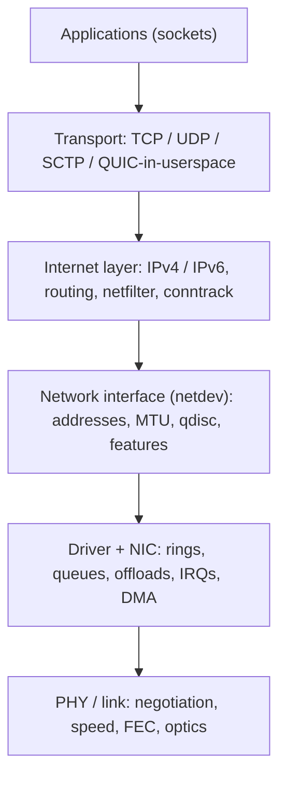
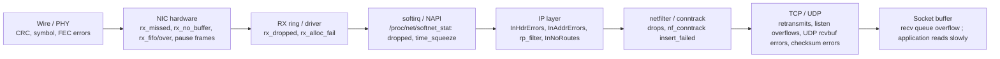

# 2.22 Linux networking I: inspecting state with ip, ss, counters and the observability toolkit

| | |
|---|---|
| Level | Intermediate |
| Priority tier | 0 |
| Lab venue | Any Linux VM (root); BCC/bpftrace tools need a recent kernel |
| Part | Part 2: Networking, from first principles to AI fabrics |
| Status | Drafted, labs **untested** |

## Why this matters for AI infrastructure

Every network incident on a GPU server starts with the same questions: which interface, which address, which route, which sockets, which counters are moving, and where in the stack packets are being dropped. This chapter is the Linux operator's toolkit for answering those questions fast and correctly: the kernel's view of interfaces, the `ip` command family, `ss` for sockets, `ethtool`/`nstat`/`sar`/`nicstat` for counters, the network configuration managers (NetworkManager, systemd-networkd, Netplan, cloud-init) that decide what the interfaces look like at boot, the socket API behind every application, and a performance methodology (tools method, USE, workload characterization, latency analysis, TCP analysis) with eBPF-based tools for deeper visibility. Later chapters cover the filtering layer (2.23), policy routing, bonding and tuning (2.24), namespaces and containers (2.25), packet capture (2.26) and monitoring systems (2.31).

## Prerequisites and outcomes

You should know IP, routing and TCP/UDP basics (2.4 to 2.7), plus Linux processes and systemd (Part 1).

After this chapter you can:

- Describe how the kernel separates the physical layer from the internet layer with network interfaces, and read `ip addr`, `ip link`, `ip route`, `ip neigh`, `ip rule`, `ip -s`, `ip -d`, `ip -j` output.
- Configure interfaces temporarily with `ip` and persistently with Netplan, NetworkManager (`nmcli`), systemd-networkd and cloud-init; explain unmanaged interfaces, dispatcher scripts and why manual configuration is fragile.
- Explain sockets (stream, datagram, listening vs connected, `accept`, Unix domain sockets) and inspect them with `ss`, `lsof -i`, `netstat`, `nc`, `telnet`, `curl --trace`.
- Read interface and protocol counters (`ip -s link`, `ethtool -S`, `nstat`, `/proc/net/*`, `sar -n`, `nicstat`) and tell errors, drops, overruns and retransmits apart.
- Apply network performance methodology: tools method, USE, workload characterization, latency analysis, TCP analysis, static performance tuning, resource controls, micro-benchmarking.
- Use `tcplife`, `tcptop`, `tcpretrans`, `tcpconnect`, `tcpaccept`, `bpftrace`, `tcpdump` and `perf` for application-to-wire tracing.
- Diagnose systematically from the application down to the NIC and back up from the wire.

## 1. The kernel's view: network interfaces

The Linux kernel keeps a deliberate division between hardware and protocol: a **network interface** (netdev) is the object that connects the **physical layer** (driver, NIC, link) to the **internet layer** (IP addresses, routes). Configuring an interface means binding IP addressing to a hardware-backed (or virtual) device. Interface names indicate origin: `lo` (loopback), `eth0` (legacy), predictable names such as `enp0s31f6` (PCI bus/slot), `eno1` (firmware onboard), `ens3` (hotplug slot), `wlp3s0` (wireless), and virtual types: `bridge`, `bond`, `vlan` (`eth0.100`), `veth`, `vxlan`, `tun/tap`, `wireguard`, `dummy`, `macvlan`, `ipvlan`, `gre`, `ib0` (IPoIB), `docker0`, `cni0`, `flannel.1`, `cali*`, `lxc*`, `br-*`. Interface index 1 is almost always `lo`. Virtual interfaces behave like physical ones to the IP layer, which is why overlays, containers and VPNs are possible.



## 2. The `ip` command family

`ip` (iproute2) replaced `ifconfig`, `route`, `arp` and `netstat -r`. It speaks netlink to the kernel and handles IPv4/IPv6 and all virtual device types.

```bash
ip -br addr                 # brief: interface, state, addresses       (ip -c for colour, ip -j for JSON)
ip -br link                 # link state and MAC
ip addr show dev enp0s31f6  # full details of one interface
ip -d link show vxlan0      # -d: type-specific details (bond mode, vlan id, vxlan params)
ip -s link show eth0        # RX/TX counters: bytes, packets, errors, dropped, overrun, carrier, collisions
ip -s -s link show eth0     # extra detail on errors
ip route ; ip route get 10.30.7.8 ; ip -6 route
ip neigh                    # ARP/NDP cache and states (REACHABLE, STALE, DELAY, PROBE, FAILED, INCOMPLETE)
ip rule ; ip route show table all
ip maddr                    # multicast memberships
ip netns list ; ip -n ns1 addr   # namespaces
ip monitor                  # live netlink events: link, addr, route, neigh changes
ip -j addr | jq '.[] | {ifname, addr_info}'     # machine-readable output for scripts
```

Reading `ip addr` output:

```text
2: enp0s31f6: <BROADCAST,MULTICAST,UP,LOWER_UP> mtu 1500 qdisc fq_codel state UP group default qlen 1000
    link/ether 40:8d:5c:fc:24:1f brd ff:ff:ff:ff:ff:ff
    inet 10.23.2.4/24 brd 10.23.2.255 scope global noprefixroute enp0s31f6
       valid_lft forever preferred_lft forever
    inet6 2001:db8:8500:e:52b6:59cc:74e9:8b6e/64 scope global dynamic noprefixroute
       valid_lft 86054sec preferred_lft 86054sec
    inet6 fe80::d05c:97f9:7be8:bca/64 scope link noprefixroute
```

- Flags: `UP` (administratively enabled), `LOWER_UP` (carrier detected; `NO-CARRIER` means no link), `BROADCAST`, `MULTICAST`, `PROMISC`, `SLAVE`/`MASTER` (bond/bridge relationships). `state UP/DOWN/UNKNOWN/LOWERLAYERDOWN`.
- `mtu`, `qdisc` (egress scheduler: `fq_codel`, `mq`, `noqueue` for virtual devices), `qlen` (txqueuelen).
- `link/ether` MAC; `inet`/`inet6` addresses with prefix lengths; `scope` (global/link/host); `dynamic`/`secondary`/`noprefixroute` and lifetimes (DHCP and SLAAC addresses expire).

Temporary configuration (lost on reboot or manager reconfiguration):

```bash
sudo ip link set eth1 up ; sudo ip link set eth1 mtu 9000
sudo ip addr add 10.100.0.45/24 dev eth1 ; sudo ip addr del 10.100.0.45/24 dev eth1
sudo ip route add default via 10.100.0.1 dev eth1
sudo ip link add link eth0 name eth0.100 type vlan id 100
sudo ip link set eth1 down ; sudo ip addr flush dev eth1
```

Manual configuration is useful for experiments and emergencies, but fragile: it disappears on reboot and conflicts with managers that "own" the interface (a running DHCP client or NetworkManager will undo or fight your changes). Legacy tools (`ifconfig`, `route`, `arp`, `netstat`) are from the `net-tools` package, may not be installed, and miss newer features, but you will see them in old documentation.

### `ethtool`: the hardware side

```bash
ethtool eth0                  # link status, speed/duplex, auto-negotiation, supported/advertised modes, port
ethtool -i eth0               # driver, firmware, bus info
ethtool -S eth0               # driver/NIC statistics (per-queue, rx_missed, rx_no_buffer, tx_timeouts, pause frames, ecn marks)
ethtool -g eth0 ; sudo ethtool -G eth0 rx 4096 tx 4096    # ring buffer sizes
ethtool -l eth0 ; sudo ethtool -L eth0 combined 16        # queue/channel counts (RSS)
ethtool -k eth0 ; sudo ethtool -K eth0 gro off            # offloads: tso gso gro lro rxhash, checksums, tunnel segmentation
ethtool -c eth0 ; sudo ethtool -C eth0 adaptive-rx on     # interrupt coalescing
ethtool -a eth0                                          # pause frame (802.3x) settings
ethtool -x eth0 ; ethtool -n eth0                        # RSS indirection table, flow classification rules
ethtool -m eth0                                          # transceiver/optics diagnostics (power, temperature, vendor)
ethtool --show-fec eth0 ; ethtool -T eth0                # forward error correction ; timestamping/PTP capabilities
```

A cable pulled or a switch port down shows `Link detected: no`. A 100 GbE NIC negotiating 25 GbE shows in `Speed:`; a half-duplex or wrong-speed link is a classic cause of mystery throughput loss. `ethtool -m` reveals dirty optics (low RX power) before they cause CRC errors.

## 3. Persistent configuration: managers and files

Why simple boot scripts are not enough: networks are dynamic. A laptop switches among wired, Wi-Fi and VPN; servers get addresses by DHCP; clouds assign addresses and routes via metadata; interfaces appear and disappear (hotplug, containers, SR-IOV VFs). A configuration manager must decide which interface to use, how to bring up the physical layer, how to configure the IP layer (static or DHCP/SLAAC), how users change connectivity without being root, and what to do when connectivity is lost.

| Tool | Where used | Config location | Notes |
|---|---|---|---|
| **NetworkManager** | Desktops, many servers (RHEL/Fedora/SUSE), some Ubuntu setups | `/etc/NetworkManager/`, connections in `/etc/NetworkManager/system-connections/` (keyfiles) | Daemon with connections (profile = device + settings); `nmcli`, `nmtui`, `nm-online`; plugins for legacy formats (`ifupdown`, `ifcfg-rh`); `unmanaged-devices`; dispatcher scripts in `/etc/NetworkManager/dispatcher.d/` |
| **systemd-networkd** | Servers, minimal systems, containers | `/etc/systemd/network/*.network\|.netdev\|.link` | Static or DHCP; bonds, VLANs, bridges, VXLAN; `networkctl`; pairs with `systemd-resolved` |
| **Netplan** | Ubuntu (and others) | `/etc/netplan/*.yaml` | YAML front-end; renders for NetworkManager or networkd; `netplan try/apply/generate`; cloud-init writes it |
| **ifupdown** | Debian (older) | `/etc/network/interfaces`, `/etc/network/if-up.d/` | `ifup/ifdown` |
| **cloud-init** | Cloud images, bare-metal provisioning | `/etc/cloud/`, `network-config` | Generates Netplan/NM/networkd config from metadata |
| **dhclient / dhcpcd / NM internal DHCP** | DHCP clients | `/var/lib/dhcp/*.leases` | Chapter 2.9 |
| **wpa_supplicant / iwd** | Wi-Fi | | Wireless authentication |
| **udev `.link` files** | Interface naming | `/etc/systemd/network/*.link`, kernel cmdline `net.ifnames=0` | Predictable names and MAC/name pinning |

Examples:

```yaml
# /etc/netplan/50-gpu.yaml  (apply with: sudo netplan try)
network:
  version: 2
  renderer: networkd
  ethernets:
    eno1: { dhcp4: true, dhcp4-overrides: { use-routes: true } }
    ens1f0:
      addresses: [10.100.0.45/24]
      mtu: 9000
      dhcp4: false
      optional: true            # don't wait for this link at boot
  vlans:
    vlan200: { id: 200, link: eno1, addresses: [10.200.0.45/24] }
```

```bash
nmcli device status ; nmcli connection show ; nmcli -p connection show "Wired connection 1"
sudo nmcli connection add type ethernet ifname ens1f0 con-name fabric0 ipv4.method manual ipv4.addresses 10.100.0.45/24 802-3-ethernet.mtu 9000 ipv4.never-default yes
sudo nmcli connection up fabric0 ; sudo nmcli device reapply ens1f0
nm-online -q && echo network-up          # exit code usable in scripts
networkctl status ; networkctl list ; sudo networkctl reload   # systemd-networkd
```

Operational rules: choose **one** manager per interface; keep fabric and storage NICs `unmanaged` or `never-default`; make sure configuration is **idempotent and declarative** (rendered from inventory, chapter 2.28/2.29); test with `netplan try` or a console/serial access before cutting the link you are connected over; mark non-critical NICs `optional` so boot does not hang; verify after boot with an audit script (chapter 1.28). The localhost interface is normally excluded from managers because its configuration never changes and basic services need it early.

## 4. Sockets: how processes use the network

A **socket** is the kernel interface through which a process reads and writes network data; it is the boundary between user-space applications and the kernel's transport layer. Socket types: **stream** (`SOCK_STREAM`, TCP), **datagram** (`SOCK_DGRAM`, UDP), **raw** (`SOCK_RAW`, ICMP tools, packet crafting), **packet** (`AF_PACKET`, tcpdump), **netlink** (`AF_NETLINK`, kernel config), **Unix domain** (`AF_UNIX`, local IPC), **vsock** (VM host-guest).

A typical TCP server's life cycle: `socket()` → `bind(addr:port)` → `listen(backlog)` → a loop of: `accept()` returns a *new* connected socket → `read/recv` and `write/send` → `close()`. Two kinds of sockets exist: the **listening socket** (kept by the master process) and a **per-connection socket** (read/write). Traditional servers `fork()` per connection or pre-fork worker pools; modern ones use event loops (`epoll`, `io_uring`) to handle thousands of connections per thread. Sockets are file descriptors: they show up in `/proc/<pid>/fd`, are limited by `ulimit -n`/`fs.file-max`, and are inherited across `fork`. Binding to `0.0.0.0`/`::` listens on all addresses; `127.0.0.1` only local; a specific address only that interface; `SO_REUSEADDR/SO_REUSEPORT` allow restarts and multi-process load sharing; `SO_KEEPALIVE`, `TCP_NODELAY`, `SO_RCVBUF/SO_SNDBUF` tune behaviour (chapter 2.6).

**Unix domain sockets** provide local IPC with the socket API but no network: they may be bound to a filesystem path (`/var/run/docker.sock`, `/run/dbus/system_bus_socket`, `/var/run/mysqld/mysqld.sock`) so that ordinary file permissions control access (and keep it off the network), and they avoid the IP stack's overhead so are faster than loopback TCP. They are also used for passing file descriptors and credentials (`SCM_RIGHTS`, `SO_PEERCRED`). Access to `docker.sock` is equivalent to root: protect it. `ss -xlp` and `lsof -U` list them.

### Inspecting sockets

```bash
ss -tulpn                     # listening TCP/UDP sockets with owning processes (root for -p of others)
ss -tan state established     # established TCP; states: listen, syn-sent, syn-recv, fin-wait-1/2, time-wait, close-wait, last-ack...
ss -tn dst 10.0.0.5           # filter: dst/src, sport/dport (e.g. 'sport = :443')
ss -ti                        # TCP internals per socket (rtt, cwnd, retrans, delivery_rate, bytes_acked, limits)
ss -tiepm                     # + extended info, processes, memory
ss -s                         # summary: totals per state
ss -xlp                       # Unix domain listeners
ss -K dst 10.0.0.5 dport = 22 # kill matching sockets (CONFIG_INET_DIAG_DESTROY)
sudo lsof -iTCP -sTCP:LISTEN -nP          # which process listens on which port
sudo lsof -i :443 -nP                     # who uses port 443 ; lsof -i@10.0.0.5 ; lsof -U for Unix sockets
sudo lsof -p <pid> -a -i -nP              # a process's network sockets
netstat -tulpn ; netstat -s                # legacy equivalents (netstat -s = protocol statistics)
nc -zv 10.0.0.5 22 443 ; nc -l 5000 ; echo hi | nc -u host 5000    # netcat: connect/listen/test (-z scan, -u UDP)
telnet example.org 80          # raw TCP client: type GET / HTTP/1.1 / Host: example.org
curl -v --trace-ascii trace.txt http://example.org/    # protocol-level view: connect, headers, body
```

What the telnet/curl exercises show: a TCP service is just an uninterrupted two-way byte stream; the HTTP "header" versus "data" distinction exists only in the user-space program: the kernel and the network treat them identically. That is why you can debug any text protocol by hand.

Interpretations: `Recv-Q`/`Send-Q` for listening sockets are the accept queue length/limit; for established sockets they are unread/unsent bytes (a persistently non-zero `Recv-Q` means the application isn't reading; a growing `Send-Q` means the network or peer is slow or stalled). Many `CLOSE-WAIT` sockets mean the application isn't closing; many `SYN-SENT` mean the peer or path is blocking; many `TIME-WAIT` are normal churn (chapter 2.6).

### Remote procedure calls and `rpcbind`

**RPC** lets a client call functions on a remote server, using assigned program numbers; the **rpcbind** (portmapper, TCP/UDP 111) service maps program numbers to ports. NFS (v3) and NIS depend on it; NFSv4 does not need rpcbind. `rpcinfo -p host` lists services. On a machine that doesn't need them, disable `rpcbind` (it is a common unwanted exposure, chapter 2.21).

## 5. Counters: where packets disappear

Network problems are about packets that did not arrive or arrived late; counters tell you at which layer. The path of a received packet and where each layer counts drops:



| Tool | What it shows |
|---|---|
| `ip -s link` | Per-interface RX/TX bytes, packets, **errors**, **dropped**, **overrun**, carrier errors (kernel/driver view) |
| `ethtool -S eth0` | NIC/driver counters: `rx_crc_errors`, `rx_missed_errors`, `rx_no_buffer`, `tx_timeout`, per-queue stats, pause and ECN/CNP counters on RDMA NICs |
| `nstat -az` / `nstat -d 1` | Kernel SNMP/netstat counters as deltas: `TcpRetransSegs`, `TcpExtListenOverflows`, `TcpExtTCPTimeouts`, `IpInDiscards`, `UdpRcvbufErrors`, `IpExtInNoRoutes`, etc. |
| `netstat -s` | The same counters, grouped by protocol (verbose) |
| `cat /proc/net/dev` | Raw per-interface counters used by many exporters |
| `cat /proc/net/softnet_stat` | Per-CPU softirq packet processing: column 2 `dropped` (backlog full), column 3 `time_squeeze` (budget exhausted) |
| `cat /proc/net/snmp` / `/proc/net/netstat` | Raw protocol counters (source for nstat) |
| `sar -n DEV,EDEV,TCP,ETCP,SOCK 1` | Time series: throughput, packet rates, errors, TCP connection rates, retransmits |
| `nicstat 1` | Per-interface **utilisation** and **saturation** (rare among tools) with throughput |
| `tc -s qdisc show dev eth0` | Egress queue drops, requeues, backlog (qdisc-level saturation) |
| `conntrack -S`, `dmesg` | Connection tracking failures: `insert_failed`, `drop`, `table full` messages |
| `cat /sys/class/net/eth0/statistics/*` ; `cat /sys/class/net/eth0/speed` | Same as ip -s; negotiated speed |

Reading them: **errors** with CRC/frame/length indicate physical-layer problems (cable, optics, FEC, speed/duplex mismatch); **dropped/missed/no_buffer** indicate the host couldn't keep up (increase rings, enable RSS/more queues, fix IRQ affinity, reduce per-packet cost, add CPU, use XDP); **softnet dropped/time_squeeze** indicates softirq starvation (`net.core.netdev_budget`, `netdev_max_backlog`, RPS/RFS); **TCP retransmits** point to loss somewhere on the path (compare against the baseline: Internet-facing flows retransmit more than rack-local ones); **ListenOverflows** means the accept queue is full; **UdpRcvbufErrors** means socket buffers overflowed; **pause/PFC** counters show backpressure (chapter 2.19). Always take **deltas over an interval** (counters are cumulative; `nstat` and `sar` do this) and relate to throughput.

Quick health check script:

```bash
echo "== links ==";   ip -br link; ip -br addr
echo "== speeds ==";  for i in /sys/class/net/*/speed; do echo "$i: $(cat $i 2>/dev/null)"; done
echo "== errors ==";  ip -s link | awk '/^[0-9]+:/{n=$2} /RX:/{getline; rx=$3" err,"$4" drop,"$5" over"} /TX:/{getline; print n, "RX", rx, " TX", $3" err,"$4" drop,"$5" carr"}'
echo "== tcp ==";     nstat -az | egrep 'TcpRetransSegs|TcpExtListenOverflows|TcpExtTCPTimeouts|TcpExtTCPSynRetrans|IpInDiscards|UdpRcvbufErrors'
echo "== softnet =="; awk '{print NR-1, "dropped="strtonum("0x"$2), "squeezed="strtonum("0x"$3)}' /proc/net/softnet_stat
echo "== conntrack =="; conntrack -C 2>/dev/null; sysctl -n net.netfilter.nf_conntrack_max 2>/dev/null
```

## 6. Performance methodology

Use a method, not random tool-running. The recommended order for network analysis: **performance monitoring** (baseline over time), **USE method**, **static performance tuning**, then **workload characterization**; use latency analysis, TCP analysis and packet sniffing for specific issues, and micro-benchmarking to validate hypotheses.

### Tools method (checklist)

Iterate over the tools and look at the key metrics: `nstat`/`netstat -s` (retransmits, out-of-order), `ip -s link` (errors, drops, overruns), `ss -tiepm` (per-socket limiter flags such as rwnd-limited, cwnd-limited, app-limited), `nicstat`/`ip -s link` (throughput versus negotiated speed), `tcplife`/`tcptop` (sessions, throughput by process), `tcpdump` (short targeted captures), `perf`/BCC/bpftrace (selected packets, kernel state). Weakness: only finds what the tools show.

### USE method

For each interface and direction (RX, TX) check **Utilization** (busy fraction = throughput / negotiated speed, including all headers; with cloud caps use the imposed limit), **Saturation** (queueing: qdisc backlog and drops, application threads blocked on send, TCP retransmits as a symptom, NIC ring overruns), **Errors** (RX: bad checksum, too short/long, CRC; TX: late collisions, carrier). Check errors first (cheap and clear). Apply also to NICs/controllers and the bus (sum port throughputs; compare to PCIe bandwidth for 400G NICs: a PCIe Gen4 x16 slot (about 252 Gb/s usable) cannot feed a single 400G port; Gen5 x16 is required), and to the kernel stack (softirq CPU, memory for socket buffers, conntrack table).

### Workload characterization

Measure what is applied before judging the system: interface throughput (bytes/s RX/TX), packet rates (frames/s), TCP connection rates (active vs passive), average packet sizes, flows by protocol/port/peer, burstiness, over time of day. Questions: Who are the top talkers? Is traffic mostly small packets (PPS-bound) or large (bandwidth-bound)? Is it unnecessary (chatty protocols, repeated DNS, uncached fetches)? Eliminating unnecessary work is often the biggest win.

### Latency analysis

Break latency into parts and find which grows: **name resolution** (DNS; timeouts of tens of seconds), **ping/RTT** (path), **TCP connection (handshake) latency**, **first-byte latency** (server think time + RTT), **connection life span** (short-lived connections multiply handshake costs), **per-request latency** at the application. Tools: `curl -w` timing variables, `dig +stats`, `tcpconnlat`, `tcpdump` timestamps, `ss -ti` rtt, `mtr`, application tracing. Compare against expected values (rack-local 100G: tens of microseconds; same-DC 0.2 to 0.6 ms; cross-continent 40 to 180 ms).

### TCP analysis

Look at TCP-specific behaviour: send/receive buffer sizes and limits, window sizes, congestion control state, retransmits and timeouts, listen queue, duplicate ACKs, zero windows, SYN backlog, TIME_WAIT. `ss -ti` limiter flags (`rwnd_limited`, `cwnd_limited`, `sndbuf_limited`, `app_limited`) tell which factor bounds each connection; `nstat` explains loss; `tcpretrans` shows which flows retransmit and where; `tcpdump`/Wireshark give the ground truth (chapters 2.6 and 2.26).

### Static performance tuning

Check the configuration for deviations from best practice, *before* load: negotiated link speed/duplex/FEC, MTU consistent end to end, offloads on, ring sizes and queue counts, IRQ affinity and NUMA locality of NIC vs GPU, interrupt coalescing, qdisc, TCP buffer limits and congestion control, `somaxconn`/backlog, conntrack limits, firewall rule counts, routing correctness, NIC firmware/driver versions, kernel version, bonding/LACP state, DNS config. Most real problems are configuration drift (one node with a 1 GbE negotiated link, wrong MTU, a disabled offload, a different driver).

### Resource controls

Network bandwidth can be limited per cgroup/process/interface: `tc` (qdiscs/classes, `htb`, `tbf`, `fq` with `SO_MAX_PACING_RATE`), cgroup v2 + eBPF (`net_cls`/`net_prio` legacy; `bpf` rate limiting), Kubernetes bandwidth annotations (`kubernetes.io/ingress-bandwidth`), cloud instance caps, NIC SR-IOV VF rate limits, switch policing. Know which limit is active before blaming the network.

### Micro-benchmarking

Measure isolated components to confirm capacity: `iperf3` (TCP/UDP throughput), `netperf` (request/response, TCP_RR for latency), `ping -f`, `ib_write_bw/ib_write_lat` (RDMA), `nccl-tests` (collectives), `fio` over NFS/S3, `wrk/hey/ghz` (HTTP/gRPC), `pktgen`/`trafgen`/TRex (packet rates). Rules: control variables (pin CPUs, same NUMA node as the NIC), run long enough, record kernel/driver/firmware versions, compare against theory (line rate minus overhead: 94% of nominal at 1500 MTU).

## 7. Observability tools in practice

### `ss -ti` fields

```text
$ ss -ti dst 10.0.0.5
ESTAB 0 0 10.0.0.2:51234 10.0.0.5:443
  cubic wscale:7,7 rto:204 rtt:0.31/0.12 mss:1448 pmtu:1500 cwnd:10 ssthresh:7 bytes_sent:2.1M bytes_acked:2.1M
  bytes_retrans:12K segs_out:1500 segs_in:900 send 373Mbps pacing_rate 746Mbps delivery_rate 330Mbps
  busy:2300ms rwnd_limited:100ms(4.3%) app_limited retrans:0/9 reordering:3 rcv_space:14480
```

`rtt:avg/var`, `cwnd`, `ssthresh`, `retrans:current/total`, `delivery_rate` (achieved), `pacing_rate`, limiter times (`busy`, `rwnd_limited`, `sndbuf_limited`, `cwnd_limited` as percentages), `app_limited` (the application isn't providing data), `reordering`, `minrtt`.

### BCC / bpftrace tools

eBPF tools observe the kernel with low overhead (install `bcc-tools`/`bpftrace`; run as root; need BTF-enabled kernels for CO-RE tools):

```bash
sudo tcplife           # one line per TCP session: PID, comm, local/remote, TX_KB, RX_KB, duration (MS)
sudo tcptop            # top TCP senders/receivers by process, refreshed
sudo tcpconnect        # trace outbound connect() calls (who connects where)
sudo tcpaccept         # trace accept() (inbound)
sudo tcpconnlat        # time from connect() to established (handshake latency) by process
sudo tcpretrans        # retransmits with the kernel state (flow, state, type: RETRANS/TLP)
sudo tcpdrop           # packets dropped by the kernel TCP stack with a stack trace (why)
sudo tcpstates         # TCP state transitions with durations
sudo sockstat ; sudo solisten ; sudo udpconnect ; sudo softirqs ; sudo hardirqs ; sudo runqlat
sudo bpftrace -e 'tracepoint:tcp:tcp_retransmit_skb { @[comm, args->daddr] = count(); }'
sudo bpftrace -e 'kprobe:tcp_sendmsg { @bytes[comm] = hist(arg2); }'                       # send size distribution per process
sudo bpftrace -e 'tracepoint:skb:kfree_skb { @[args->location] = count(); }'               # where packets are dropped (kernel address -> use ksym)
sudo bpftrace -e 'kprobe:__dev_queue_xmit { @[comm] = count(); } interval:s:5 { exit(); }'
```

These answer questions counters cannot: *which process* is retransmitting, *which function* dropped a packet (kfree_skb with drop reasons on newer kernels: `tcpdump`-like visibility without capturing), *how long* connections last and how much they transferred, *who* connects to what.

### `perf`, `tcpdump`, Wireshark

`perf record -g -a -- sleep 10` + flame graphs show CPU in the network stack (softirq `net_rx_action`, `tcp_v4_rcv`, driver poll); `perf trace -e 'net:*,skb:*'`/`perf top`; `tcpdump` for ground-truth packets (full treatment in chapter 2.26); Wireshark for analysis (Expert Information, TCP stream graphs). For high-rate networks, capturing at full line rate is impractical: filter narrowly, truncate (`-s 128`), use ring buffers (`-C`, `-W`), capture on the NIC with hardware timestamps, or sample (sFlow/IPFIX, `tcpdump` + `-c`).

### Experimentation tools

`ping`, `traceroute`/`mtr`/`tracepath` (chapter 2.7), `iperf3 -c host -P 8 -t 30` (use multiple parallel streams for 100G), `netperf -t TCP_RR`, `tc qdisc ... netem` to inject delay/loss/reorder/rate for repeatable tests, `nping`/`hping3`, `pktgen` kernel module for packet-rate tests.

## 8. Putting it together: a top-down and bottom-up checklist

**Top-down (application symptom → wire).**

1. Is the process running and listening (`ss -tulpn`, `systemctl status`)? On the expected address/port (loopback vs all)? Accept queue (`ss -ltn` Recv-Q) full?
2. Can a local client connect (`nc -zv localhost port`)? From a peer (`nc -zv host port`)? Refused vs timeout (chapter 2.6).
3. DNS correct? (`getent hosts`, `dig`, chapter 2.8.) Proxy variables (`env | grep -i proxy`)?
4. Route and source address: `ip route get <dst>` (chapter 2.5). Policy routing (`ip rule`)? rp_filter?
5. Firewall: `nft list ruleset`, `iptables -S`, cloud security groups, conntrack (`conntrack -L | grep ...`, chapter 2.23).
6. Neighbour resolution: `ip neigh` shows FAILED/INCOMPLETE? Link-layer reachability (`arping`).
7. Interface health: `ip -s link`, `ethtool`, `ethtool -S`, optics, MTU, speed.
8. Packet capture at the interface (and at the peer) to confirm what is sent/received (chapter 2.26).

**Bottom-up (hardware symptom → application).** Link up? Speed/FEC correct? Errors rising? Ring drops? IRQ/CPU saturation (`mpstat -P ALL 1`, `/proc/interrupts`, `softirqs`)? Driver/firmware known issues? qdisc drops? IP-layer counters? TCP retransmits? Application reading?

**Common root causes by symptom.**

| Symptom | First checks | Typical causes |
|---|---|---|
| Interface up but no connectivity | `ip route get`, `ip neigh`, `arping`, `tcpdump` | Wrong VLAN, gateway ARP failing, firewall, rp_filter, duplicate IP, wrong MTU/jumbo |
| Throughput lower than line rate | `ethtool` speed, `ss -ti` limiter, `iperf3 -P`, CPU/IRQ, MTU | Negotiated 10G on 100G NIC, single flow limits, no offloads, IRQ on wrong NUMA node, RSS queues=1 |
| Drops with low utilisation | `ethtool -S`, `softnet_stat`, `tc -s` | Ring too small, microbursts, softirq budget, qdisc limits |
| Intermittent latency spikes | `tcpretrans`, `nstat`, `ss -ti`, `perf` | RTO retransmits, conntrack full, DNS timeouts, CPU scheduling, GC pauses |
| Connections refused/reset | `ss -ltn`, firewall logs, `tcpdump` RST | Not listening, backlog, firewall reject, idle-timeout resets from middleboxes |
| "Works for small, hangs for large" | `ping -M do -s`, `tracepath` | MTU black hole (chapter 2.7) |
| After reboot config lost | manager, `ip` vs persistent files | Manual config not persisted; manager overriding |

## 9. Lab: a guided tour with deliberate faults (untested)

1. **Inventory**: on a fresh VM run the commands in sections 2 to 5 and write a one-page "network state report" (interfaces, MTU, routes, neighbours, sockets, counters). Save it as a baseline.
2. **Interface lifecycle**: create `dummy0` and a `veth` pair with `ip`; assign addresses; watch `ip monitor` in another terminal; delete them; note what's printed.
3. **Persistence**: write a Netplan (or networkd/NM) config for a dummy/VLAN interface; `netplan try`; reboot (or `systemctl restart systemd-networkd`) and verify; then remove it. Show that a manual `ip addr add` disappears and that a DHCP client can overwrite a manual route.
4. **Sockets**: run `python3 -m http.server 8000`; find it with `ss -tulpn`, `lsof -i :8000`; connect with `nc`, `telnet` and `curl --trace-ascii`; start a listener bound to `127.0.0.1` vs `0.0.0.0` and test from another namespace; create a Unix domain socket server (`socat UNIX-LISTEN:/tmp/s.sock,fork -`) and inspect with `ss -xlp`/`lsof -U`.
5. **Accept queue**: write a server with `listen(1)` that never calls `accept`; open many clients; observe `ss -ltn` Recv-Q/Send-Q and `nstat` ListenOverflows/ListenDrops.
6. **Counters**: generate load with `iperf3`; watch `ip -s link`, `sar -n DEV 1`, `nicstat 1`, `nstat -d 1`; inject loss with `tc qdisc add dev lo root netem loss 1%` and watch retransmits in `nstat`, `ss -ti`, `tcpretrans`; remove the qdisc.
7. **eBPF tools**: run `tcplife`, `tcpconnect`, `tcpretrans`, `tcpdrop` during a download and an induced drop; use the bpftrace one-liners; compare with `tcpdump` evidence.
8. **Faults**: introduce (a) wrong MTU on one side, (b) a blocking nft rule, (c) a missing return route, (d) a full conntrack table (lower `nf_conntrack_max`), (e) a mismatched speed (`ethtool -s` on a veth if supported) and diagnose each with the checklist, recording the evidence that distinguishes them.
9. **USE report**: produce a utilisation/saturation/errors table for each interface during a stress test.
10. **Clean up.**

Mark tested only after execution.

## 10. Common mistakes

- Using `ifconfig`/`route`/`netstat` knowledge from old guides and missing modern fields (`ip -s`, `ss -ti`).
- Making manual `ip` changes and expecting persistence; two managers fighting over one interface.
- Reading cumulative counters without deltas; ignoring errors (physical) when looking at drops (host).
- Blaming "the network" before checking the socket (Recv-Q/Send-Q), the application, DNS or the firewall.
- Testing throughput with one TCP flow on a 100G link; not pinning to the NIC's NUMA node.
- Capturing at a high rate on the same host being tested and perturbing results.
- Forgetting that `lsof`/`ss` without root show only your processes.
- Assuming loopback tests prove external reachability (kernel short-circuits local traffic).

## 11. Interview angles

- "A service on this server is unreachable. Walk me through your debugging, top-down and bottom-up."
- "Difference between `ip addr`, `ip link`, `ip route`, `ip neigh`; what are the flags `UP` and `LOWER_UP`?"
- "How do you find which process owns a port? Which connections are stuck? What does Recv-Q mean?"
- "How do you tell whether packet drops are in the NIC, the kernel or the application?"
- "NetworkManager vs systemd-networkd vs Netplan: how do they relate? How do you persist a static IP?"
- "What is a Unix domain socket; why is it faster; how is it secured?"
- "Explain the USE method for a network interface."
- "How would you find which process is causing TCP retransmits on a host?" (`tcpretrans`, bpftrace.)
- "Why can a 400G NIC underperform on a Gen4 PCIe slot?" 

## 12. Checkpoint questions (40)

1. What does a kernel network interface connect? **A:** The physical layer (driver/NIC) and the internet layer (IP).
2. Which interface is index 1? **A:** `lo`.
3. What does `LOWER_UP` mean? **A:** Carrier detected on the link.
4. Replacement for `ifconfig`? **A:** `ip addr`/`ip link`.
5. What does `ip -s link` show? **A:** RX/TX counters including errors, drops, overruns.
6. What does `ip -d link` add? **A:** Type-specific details.
7. What does `ip monitor` do? **A:** Streams netlink events.
8. How do you get JSON output? **A:** `ip -j`.
9. What does `ethtool -S` show? **A:** NIC/driver statistics.
10. What does `ethtool -m` show? **A:** Transceiver diagnostics.
11. What are ring buffers? **A:** Preallocated descriptor rings for RX/TX; sized with `ethtool -G`.
12. Why would `ip addr add` not survive reboot? **A:** It changes runtime state only.
13. What is Netplan? **A:** YAML front-end rendering to NetworkManager or networkd.
14. What is `nmcli` used for? **A:** Controlling NetworkManager.
15. Where does networkd config live? **A:** `/etc/systemd/network`.
16. Why mark NICs `optional`? **A:** Avoid boot waiting for non-critical links.
17. What is a socket? **A:** Kernel interface between processes and network.
18. Stream vs datagram socket? **A:** TCP vs UDP.
19. Listening vs connected socket? **A:** Accepts connections vs per-connection read/write.
20. What do Unix domain sockets avoid? **A:** The network stack; access via file permissions.
21. Danger of `docker.sock`? **A:** Root-equivalent control of the host.
22. `ss` options for listeners with processes? **A:** `-tulpn`.
23. What does `Recv-Q` on a listener mean? **A:** Current accept queue length.
24. What does a persistent `Recv-Q` on ESTAB mean? **A:** Application isn't reading.
25. Many CLOSE_WAIT indicates? **A:** App not closing sockets.
26. `lsof -i :443` does? **A:** Lists processes using port 443.
27. What does `rpcbind` do? **A:** Maps RPC program numbers to ports (port 111).
28. Which command shows kernel TCP counters as deltas? **A:** `nstat`.
29. `softnet_stat` column 2/3? **A:** Dropped / time_squeeze.
30. Errors vs drops? **A:** Errors = bad frames (physical); drops = host couldn't process.
31. What is USE? **A:** Utilization, Saturation, Errors per resource.
32. How to compute interface utilization? **A:** Throughput / negotiated speed.
33. What does workload characterization measure? **A:** Throughput, packet rate, connection rate, top talkers.
34. What does `ss -ti` limiter flag `rwnd_limited` mean? **A:** Receiver window bounds the flow.
35. What does `tcplife` show? **A:** Per-session duration and bytes by process.
36. What does `tcpretrans` show? **A:** Retransmitted segments with flow and state.
37. Which tool shows why packets are dropped in the kernel? **A:** `tcpdrop`/bpftrace on `kfree_skb`.
38. What is static performance tuning? **A:** Auditing configuration against best practice before load.
39. PCIe concern for 400G? **A:** Needs Gen5 x16; Gen4 x16 ≈ 252 Gb/s usable.
40. First check when "works on loopback, not remotely"? **A:** Bind address/firewall/route; loopback bypasses the stack.

## 13. Sources and review notes

**Written in original words.** Principal sources:

- Brian Ward, *How Linux Works*, 3rd ed.: chapter 9 (kernel network interfaces, interface configuration with `ip`, manually adding routes, boot-activated configuration, problems with manual configuration, Netplan, network configuration managers, NetworkManager operation, interaction, configuration, unmanaged interfaces and dispatching) and chapter 10 (basics of services with telnet and curl, network servers, diagnostic tools: `lsof`, tcpdump overview, netcat, port scanning, RPC, network sockets, Unix domain sockets).
- Brendan Gregg, *Systems Performance*, 2nd ed., chapter 10 (Network): terminology and models, concepts (latency, packet size, buffering, backlog, interface negotiation, congestion avoidance, utilization), architecture, methodology (tools method, USE, workload characterization, latency analysis, performance monitoring, packet sniffing, TCP analysis, static tuning, resource controls, micro-benchmarking), observability tools (`ss`, `ip`, `nstat`, `netstat`, `sar`, `nicstat`, `ethtool`, `tcplife`, `tcptop`, `tcpretrans`, `bpftrace`, `tcpdump`), experimentation tools.
- *Networking and Kubernetes*, chapter 2 (Linux networking: interface and bridge concepts) is expanded in chapters 2.23 and 2.25; the `nvidia-devops` networking masterclass was consulted for GPU-server specifics.
- The health-check script, tables and checklists are the author's synthesis.

**Flagged for verification before publishing:** BCC tool names and availability per distribution (`tcplife-bpfcc` suffixes on Debian/Ubuntu), `ethtool` option support per driver, `ss` field names per iproute2 version, `kfree_skb` tracepoint arguments per kernel, PCIe throughput figures, and Netplan/NM syntax per release; all labs are **untested**.
