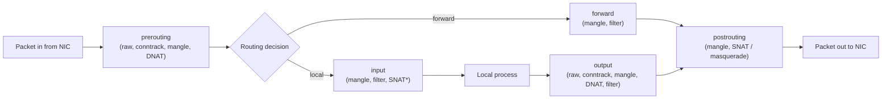
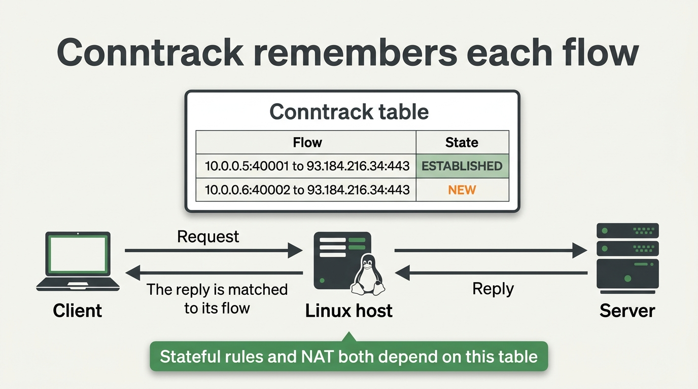

# 2.23 Linux networking II: netfilter, nftables, conntrack and NAT

| | |
|---|---|
| Level | Intermediate to advanced |
| Priority tier | 0 |
| Lab venue | Linux VM or namespaces (root, nftables installed) |
| Part | Part 2: Networking, from first principles to AI fabrics |
| Status | Drafted, labs **untested** |

## Why this matters for AI infrastructure

Imagine a node that looks healthy. Its CPUs are idle, its bandwidth is spare, and yet new connections simply stop working. Dashboards are green, the pods are running, and users are still getting timeouts. The cause is often in netfilter, the kernel framework that inspects and filters packets. Almost every packet on a Kubernetes node passes through it.

Many components add rules to that same path, and none of them knows about the others. kube-proxy installs thousands of NAT rules, and container runtimes add masquerade and port-publish rules. CNIs add policy chains, cloud agents add their own, and the host firewall sits underneath all of them. It is like a building where every tenant has been allowed to hang their own barrier across the same corridor.

Small mistakes in this layer have large effects. When the connection-tracking table fills, new connections fail silently on a node that looks idle. A rule ordering mistake that drops health-check traffic can stall a whole rollout. When 5,000 pods share one SNAT address, outbound connections to a database can time out.

Understanding hooks, tables, chains, priorities, the connection-tracking state machine and NAT is therefore a core operations skill. Moving from linear iptables rule lists to nftables sets, maps and eBPF datapaths is also a performance topic for large nodes. When you troubleshoot such a node, you need to know which layer dropped the packet. The story below starts with the places in the kernel where a packet can be touched, and then follows the packet through the nftables language and its iptables ancestors. It continues to conntrack, which remembers flows so that replies can find their way home, and to NAT, which rewrites addresses. After that comes what container hosts do to all of this, a way to design a firewall so it stays safe to change, and the debugging habits that find the one rule that ate your packet.

## Prerequisites and outcomes

Before you change a firewall, you need the basics from earlier chapters. You should know IP routing and forwarding from chapter 2.5, TCP basics from 2.6, NAT concepts from 2.9, security basics from 2.21, and the `ss` and `ip` tools from 2.22. If you can describe what happens when a packet arrives that is not addressed to the host, and why NAT needs to remember something, you have enough background.

New words, such as hook, chain, tuple and verdict, are explained the first time they appear, with a packet you can picture.

## 1. Netfilter architecture

Suppose a packet arrives at a server and vanishes without an error. To find out where it went, you need to know where the kernel inspects packets. Netfilter is the framework that provides those inspection points, called hooks. Think of them as checkpoints along a corridor. Subsystems such as iptables, nftables, conntrack, NAT, IPVS, SELinux secmark and bridge filters register handlers on a hook, each with a priority. The kernel calls the handlers in order, and each one returns a verdict: accept, drop, queue to userspace, stolen, or repeat/continue. `iptables` and `nftables` are user-space front ends to different kernel implementations of rule evaluation.

There are five IPv4 and IPv6 hooks. Each one is a fixed point in the packet path, and the table below shows when a packet reaches it.

| Hook | iptables chain | Triggered when |
|---|---|---|
| `prerouting` | PREROUTING | Any packet arrives from an interface, before the routing decision (DNAT happens here) |
| `input` | INPUT | The routing decision says the packet is for this host |
| `forward` | FORWARD | The routing decision says to route it to another host |
| `output` | OUTPUT | A locally generated packet leaves a local process, before routing is finalised |
| `postrouting` | POSTROUTING | Any packet is about to leave an interface, after routing (SNAT/masquerade happens here) |

Notice that `prerouting` runs before the routing decision. That is why destination NAT (DNAT) happens there, while source NAT (SNAT) and masquerade happen in `postrouting`, after routing. DNAT has to change the destination before the kernel decides where to send the packet, and SNAT has to wait until the kernel has chosen the outgoing interface.



The path a packet takes depends on where it starts and where it ends. The table lists the hooks each path visits, in order.

| Source → destination | Hooks (in order) |
|---|---|
| Local process → local (loopback) | output, then (re-entering) prerouting? No: output, postrouting, then input after the loopback re-entry (prerouting, input) |
| Local process → external | output, postrouting |
| External → this host | prerouting, input |
| External → external (routed) | prerouting, forward, postrouting |

A host that talks to itself is a special case. Its packet passes through output and postrouting, leaves through the loopback, and re-enters like any other packet. It then hits prerouting and input.

NAT changes the routing decision only at `prerouting`, for DNAT, and at `output`, for locally generated DNAT. Once a packet reaches `input`, no routing decision is made. That is why destination NAT lives in `prerouting` and `output`, and source NAT lives in `postrouting` and `input`.

Reverse-path filtering drops packets that have impossible source addresses, unless you disable it. One example is a source of 127.0.0.1 arriving on an external interface. Another is a source that cannot be reached through the interface it arrived on. Reverse-path filtering is covered in chapter 2.5. Disabling it is risky, because services that trust localhost traffic can then be attacked from the network, and a Kubernetes CVE exploited a similar assumption. Keep `rp_filter` at least in loose mode, and turn on `log_martians` while you investigate.

### Tables and chains in iptables

Think of a building with several security checkpoints. Some checkpoints only look at the visitor's name on a list. Others check bags. Others write down where the visitor is going. Each checkpoint has its own job, and the order matters, because a visitor who is turned away early never reaches the later desks. The tables work the same way. Each table is a checkpoint with a purpose, and each rule in a chain is a line on the checkpoint's list. Walk one packet through the checkpoints in order and you will see why a rule in one table can be ignored by a rule in another.

iptables groups its rules into tables, and each table has a purpose. A table holds chains, which are either hook points or user-defined chains.

| Table | Purpose | Built-in chains |
|---|---|---|
| `filter` | Accept/drop/reject (default table) | INPUT, FORWARD, OUTPUT |
| `nat` | Address translation (first packet of a flow only) | PREROUTING, INPUT, OUTPUT, POSTROUTING |
| `mangle` | Modify fields (TOS/DSCP, TTL, marks, MSS clamping) | all five |
| `raw` | Exempt from conntrack (`NOTRACK`/`CT --notrack`), early drop | PREROUTING, OUTPUT |
| `security` | SELinux secmark | INPUT, FORWARD, OUTPUT |

Within a hook, the tables run in priority order: raw → mangle → nat(dnat) → filter → security → nat(snat). Each rule has a match, which selects packets, and a target, which says what to do with them. Targets include `ACCEPT`, `DROP`, `REJECT`, `LOG`, `DNAT`, `SNAT`, `MASQUERADE`, `MARK`, `TCPMSS` and `RETURN`, plus a jump to a user chain. Every chain also has a default policy.

Rules are checked one at a time until a terminating target matches. Consider a node with 10,000 rules. A packet that matches only near the end of the list is compared against every rule before it, so the cost grows with the rule count. That is a real problem on Kubernetes nodes with many services, such as kube-proxy in iptables mode.

### nftables

Picture a kitchen drawer full of single-purpose gadgets, one for each job, and a single tool that replaces all of them. nftables is that single tool. A rule in nftables is written once, in one language, and the kernel compiles it into a small program that runs on every packet. Because the whole ruleset is compiled as one unit, a change can be loaded in one step, so there is no moment when the firewall is half updated. The walkthrough below shows how the parts fit together, starting from the family and working down to a single rule.

nftables needs kernel 3.13+ and is the default in modern distributions. It replaces iptables, ip6tables, arptables and ebtables with one framework and one tool, `nft`. Rules compile to bytecode, which a small virtual machine in the kernel evaluates. The ruleset can be replaced atomically, which means the old rules stay active until the new set is complete, so there is no moment when the firewall is half loaded. The framework also offers efficient hash, rbtree and interval sets, along with maps.

On many systems, the `iptables` binary is really `iptables-nft`, a compatibility layer that translates the old syntax into nftables objects. Check which one you have with `iptables --version`. Legacy and nft variants must not be mixed carelessly.

Five parts make up the nftables model:

- Family: `ip`, `ip6`, `inet` (IPv4 and IPv6 in one table), `arp`, `bridge`, and `netdev` (ingress on an interface, before most of the stack).
- Table: a namespace for chains, sets and maps, such as `table inet filter`.
- Chain: a base chain attaches to a hook with a `type` (filter, nat or route), a `hook` (prerouting, input, forward, output, postrouting or ingress), a `priority` (lower runs earlier) and a `policy`. Regular chains are jump targets.
- Rule: expressions that match and then act, such as `tcp dport 22 ct state new accept`, `ip saddr @blocklist drop`, `counter`, `log prefix "x "`, `limit rate 10/second`, `masquerade`, `dnat to 10.0.0.20:443` and `meta mark set 0x10`.
- Set or map: a collection of addresses, ports or interfaces (`type ipv4_addr; flags interval; timeout 1h`), or a key-to-value map used for DNAT tables and verdict maps.

The commands below cover daily work: listing, loading, adding and deleting rules.

```bash
sudo nft list ruleset                           # everything
sudo nft list table inet filter -a              # with handles (to delete a rule)
sudo nft -f /etc/nftables.conf                  # atomically load a file ; -c to check syntax only
sudo nft monitor trace                          # live packet tracing (with 'nftrace set 1' rules)
sudo nft add rule inet filter input tcp dport 22 accept
sudo nft delete rule inet filter input handle 5
sudo nft flush ruleset                          # careful: opens a default-deny box or drops your SSH if policy drop
sudo systemctl enable --now nftables            # loads /etc/nftables.conf at boot
```

Be careful with `flush ruleset`. With a drop policy in place, it can cut off your own SSH session.

### A default-deny host firewall (server)

Picture an engineer who edits a firewall on a remote server over SSH, adds a drop policy, and loses the session. The server is still running, but nobody can reach it. The safest habit is the one this section keeps returning to: prepare the allow rules first, keep a second session open, and set a timer that undoes the change if you cannot confirm it in time. The ruleset below follows that order, with the allowed traffic placed before the final drop.

Suppose you must lock down a server that is reachable from the network. A default-deny ruleset drops everything, then allows only what you name. It is the difference between a club with a guest list and a club with a list of banned people. Read the ruleset from top to bottom. The early rules carry the common traffic, and the last rule logs and drops whatever is left.

```text
#!/usr/sbin/nft -f
flush ruleset
table inet filter {
  set mgmt_nets { type ipv4_addr; flags interval; elements = { 10.20.0.0/24, 10.21.0.0/24 } }
  set blocklist { type ipv4_addr; flags timeout; }                  # dynamic bans (fail2ban / scripts add here)

  chain input {
    type filter hook input priority 0; policy drop;
    iif lo accept
    ct state invalid drop
    ct state established,related accept
    ip saddr @blocklist drop
    ip protocol icmp icmp type { echo-request, destination-unreachable, time-exceeded } limit rate 10/second accept
    ip6 nexthdr icmpv6 icmpv6 type { destination-unreachable, packet-too-big, time-exceeded, parameter-problem, nd-router-advert, nd-neighbor-solicit, nd-neighbor-advert, echo-request } accept
    tcp dport 22 ip saddr @mgmt_nets ct state new limit rate 10/minute accept     # SSH only from mgmt, rate-limited
    tcp dport { 9100, 9400 } ip saddr 10.20.0.50 accept                         # node_exporter, dcgm-exporter from Prometheus only
    udp dport 4791 ip saddr 10.100.0.0/16 accept                                 # RoCEv2 (if the host firewall is in the path)
    log prefix "nft-input-drop: " limit rate 5/minute counter drop
  }
  chain forward { type filter hook forward priority 0; policy drop; }        # not a router
  chain output  { type filter hook output  priority 0; policy accept; }
}
```

Start with a default drop policy and add explicit accepts. Accept loopback and established or related traffic early, because most packets belong to flows that already exist. Drop packets in the invalid state. Never block the ICMP and ICMPv6 types that PMTUD and neighbour discovery need (chapter 2.7). Limit and log your drops, and keep the management allow-list in a named set that configuration management owns.

Test every change with `nft -c -f` first, and keep a second session open. When you edit a remote firewall, add a safety timer, such as `sleep 60 && nft flush ruleset &` or `at`, so that a lockout clears itself.

### A router/NAT gateway ruleset

Picture a gate-keeper at the edge of a small village. Villagers may walk out to the market freely, and the gate-keeper keeps a note of who went out so that the replies can be let back in. Strangers may come in only to a few houses that have been named on a list. That is what a router with NAT does. Read the ruleset below as the gate-keeper's instructions, one line at a time, and ask at each line who is allowed through and what note is kept.

A router has to do two things a server does not. It must forward packets between networks, and it must translate addresses at the edge. The ruleset below handles both.

```text
table inet filter {
  chain input   { type filter hook input priority 0; policy drop;
                  iif lo accept; ct state established,related accept; ct state invalid drop
                  iifname "lan0" tcp dport 22 accept; iifname "lan0" udp dport { 53, 67 } accept }
  chain forward { type filter hook forward priority 0; policy drop;
                  ct state established,related accept; ct state invalid drop
                  iifname "lan0" oifname "wan0" accept                                 # outbound
                  iifname "wan0" oifname "lan0" ct status dnat accept                 # only published services }
}
table ip nat {
  chain prerouting  { type nat hook prerouting  priority dstnat; policy accept;
                      iifname "wan0" tcp dport 8443 dnat to 10.0.0.20:443 }            # port forward
  chain postrouting { type nat hook postrouting priority srcnat; policy accept;
                      oifname "wan0" masquerade }
}
```

The forward chain holds the policy of the router. Outbound traffic from the LAN is allowed, and inbound traffic is allowed only for services you have published. The router also needs `sysctl net.ipv4.ip_forward=1`, covered in chapter 2.5.

The same gateway in iptables looks like this: `iptables -P FORWARD DROP`, `iptables -t nat -A POSTROUTING -o wan0 -j MASQUERADE`, `iptables -A FORWARD -i wan0 -o lan0 -m conntrack --ctstate ESTABLISHED,RELATED -j ACCEPT`, and `iptables -A FORWARD -i lan0 -o wan0 -j ACCEPT`. To convert legacy rules to nft syntax, use `iptables-translate`.

### iptables quick map

These commands list, add, delete and save iptables rules. The list commands are safe to run at any time, so start there.

```bash
iptables -S ; iptables -L -n -v --line-numbers ; iptables -t nat -S      # list rules (with counters)
iptables -A INPUT -s 192.168.34.63 -j DROP                                # append ; -I INPUT 1 to insert at top ; -D to delete
iptables -P FORWARD DROP                                                  # default policy
iptables -A INPUT -p tcp --dport 22 -m conntrack --ctstate NEW -m recent --update --seconds 60 --hitcount 5 -j DROP
iptables-save > rules.v4 ; iptables-restore < rules.v4                    # atomic dump/load (persist with iptables-persistent / netfilter-persistent)
iptables -t mangle -A FORWARD -p tcp --tcp-flags SYN,RST SYN -j TCPMSS --clamp-mss-to-pmtu     # MSS clamping (chapter 2.7)
iptables -t raw -A PREROUTING -p tcp --dport 80 -j CT --notrack           # bypass conntrack
```

Many tools write rules on the same host. ufw runs on Ubuntu. firewalld runs on the RHEL family, and it uses zones, services and rich rules with an nftables backend. Cloud agents, Docker and Kubernetes components write rules too. To see the combined result, run `nft list ruleset` or `iptables-save`. On a container host, avoid flushing everything, because you will delete chains the runtime manages and break networking.

## 2. Connection tracking (conntrack)

If you run Kubernetes or a NAT gateway, you will eventually read this table. Conntrack is the kernel's table of active flows. It lets netfilter make stateful decisions, and it lets NAT translate replies back to the right client. A bank teller who remembers that you just asked to withdraw money can answer "yes, I was expecting you" when you return, and a conntrack table works the same way for packets. The module is `nf_conntrack`. Each entry stores the original tuple, which is the source, destination, protocol and ports as they arrived. A tuple is simply the set of values that identifies one flow. Each entry also stores the reply tuple, which shows how the reply looks after NAT, along with a state, a timeout, a mark, a zone and counters. Conntrack is required for stateful filtering with `ct state`, for NAT, for kube-proxy in iptables mode, for Docker published ports and for many helpers.



*Figure 2.23.1. Conntrack remembers each flow so replies can be matched.*

### States

Think of conntrack states as stages in a visit. A new visitor arrives at the gate and is written in a book, and that is NEW. Once a reply comes back from the house they went to, the visit is known to be real, and the state becomes ESTABLISHED. A reply that belongs to an earlier visit but comes through a different gate is RELATED. A message that matches no visit at all is INVALID. Walk through a simple web request with these four stages in mind, and the rules that mention them will read like plain sentences.

Every entry carries one of the states below. The state tells the firewall where the flow is in its life.

| State | Meaning |
|---|---|
| `NEW` | First packet of a flow; no reply seen |
| `ESTABLISHED` | Traffic seen in both directions |
| `RELATED` | New flow related to an existing one (FTP data connection, ICMP error for an existing flow) |
| `INVALID` | Doesn't match a known flow or violates the state machine (out-of-window TCP, unsolicited ACK); usually drop |
| `UNTRACKED` | Explicitly exempted from tracking (raw/NOTRACK) |
| `DNAT` / `SNAT` (as `ct status`) | The flow has been translated |

Conntrack changes what a firewall has to allow. Without it, a firewall that accepts inbound replies must open ephemeral port ranges for every outbound connection. With conntrack, a rule that says "allow established" is enough, and NAT knows how to map replies back. The state machine follows TCP details such as SYN_SENT, SYN_RECV, ESTABLISHED, FIN_WAIT, CLOSE_WAIT, TIME_WAIT and CLOSE. For UDP it uses a pseudo-state, UNREPLIED, which becomes ASSURED after bidirectional traffic. ICMP is tracked as well.

### Inspecting and managing

Picture a support engineer who is asked why a particular connection is failing. The engineer looks in the book of open visits, finds the entry, and reads it. The commands in this section are that book. Start with the simplest view, look at one entry in full, and only then change anything. Reading first costs nothing, and it often shows the answer before any change is needed.

When you suspect the table is involved, reach for these commands. Each one answers a different question you may have.

```bash
sudo conntrack -L | head                  # entries: protocol, timeout, state, original tuple, reply tuple, [ASSURED]
sudo conntrack -L -p tcp --dport 443 ; sudo conntrack -L -s 10.0.0.5
sudo conntrack -C                          # count ; also /proc/sys/net/netfilter/nf_conntrack_count
sudo conntrack -S                          # per-CPU stats: found, invalid, insert, insert_failed, drop, early_drop, error, search_restart
sudo conntrack -E                          # event stream (NEW, UPDATE, DESTROY) ; -E -e NEW for new flows
sudo conntrack -D -s 10.0.0.5              # delete matching entries (e.g. after changing a NAT rule)
sysctl net.netfilter.nf_conntrack_max net.netfilter.nf_conntrack_buckets net.netfilter.nf_conntrack_count
sysctl net.netfilter.nf_conntrack_tcp_timeout_established net.netfilter.nf_conntrack_udp_timeout
```

Read an entry like this one from left to right: `tcp 6 431999 ESTABLISHED src=10.0.0.5 dst=198.51.100.7 sport=51000 dport=443 src=198.51.100.7 dst=203.0.113.9 sport=443 dport=40001 [ASSURED] mark=0 use=1`. The first tuple is the original direction, as the packet arrived. The second tuple is the reply direction, as it will look on the wire after NAT. Here that means the NAT address 203.0.113.9 and the translated port 40001.

### Sizing, timeouts and exhaustion

Imagine a busy gateway at night. New connections from many services start to time out, but nobody has changed anything, CPU is low, and the bandwidth graph looks calm. The problem is a table that has quietly filled up. Every flow the gateway handles takes one entry, and entries stay alive for as long as their timeouts allow. When the table is full, the gateway does not tell the client anything. It drops the new connection. The paragraphs below explain what fills the table, how long entries live, and the order in which to fix it.

A conntrack table has a fixed capacity. Entries live in a hash table whose bucket count is set by `nf_conntrack_buckets`, and the total is capped by `nf_conntrack_max`. The module parameter for the bucket count is `hashsize`. Each entry costs roughly 300 to 400 bytes, plus hash overhead.

When the table is full, new connections are dropped silently. The kernel still logs the event, so `dmesg` shows `nf_conntrack: table full, dropping packet`, and `conntrack -S` counts `insert_failed` and `drop`. This is a classic cause of intermittent timeouts on busy NAT gateways and Kubernetes nodes. CPU and bandwidth look fine on a box in this state, which is why the problem is easy to miss.

Here is the timeout arithmetic. The default established timeout is 5 days. In seconds, that is 432,000. Lowering it to 3600 seconds, the value in the sysctl example below, lets idle entries expire 120 times sooner.

When the table fills, work through five remedies in order.

1. Find who creates the flows, using `conntrack -L | awk ... | sort | uniq -c` and `conntrack -E`. Then fix chatty clients, and add connection pooling or keep-alives.
2. Shorten the timeouts. The default `nf_conntrack_tcp_timeout_established` of 5 days is far too long for many workloads, so use values from 600 s to 86,400 s. Set `time_wait` to 30 s, and use 30 s or 120 s for UDP, along with the `generic` timeout.
3. Raise `nf_conntrack_max`, memory permitting. Set the buckets to max/4 to max/8 to limit hash collisions, because each lookup costs O(chain length).
4. Bypass conntrack for traffic that needs neither NAT nor stateful rules. Use `CT --notrack` or `notrack` in the `raw` hook. Typical candidates are east-west storage or RDMA-adjacent traffic, high-rate DNS, and load-balancer VIP traffic. Untracked traffic needs explicit stateless allow rules in both directions.
5. Move to an eBPF datapath that avoids netfilter.

Start with the first remedy, because it addresses the cause. The commands below raise the limits, set the hash size, and exempt a high-rate service from tracking.

```bash
# raise limits persistently
printf 'net.netfilter.nf_conntrack_max=2097152\nnet.netfilter.nf_conntrack_tcp_timeout_established=3600\nnet.netfilter.nf_conntrack_tcp_timeout_time_wait=30\n' | sudo tee /etc/sysctl.d/90-conntrack.conf
echo 262144 | sudo tee /sys/module/nf_conntrack/parameters/hashsize
# nftables: exempt a high-rate service from tracking
nft add table inet raw
nft 'add chain inet raw prerouting { type filter hook prerouting priority raw; }'
nft add rule inet raw prerouting udp dport 53 notrack
```

Helpers, also called ALGs, read application payloads so that conntrack can open expected related flows. They cover FTP, SIP, TFTP and H.323. Since kernel 4.x, automatic helper assignment is disabled by default, so an explicit `ct helper` rule is required, for security. Zones (`ct zone`) separate tracking domains, so overlapping address spaces, such as multi-tenant NAT or VRFs, do not collide.

Watch for asymmetric routing, because it also breaks conntrack. If you run several gateways, requests and replies may take different paths. If requests and replies take different paths through different gateways, the second gateway sees replies without a flow and marks them INVALID. Design NAT gateways with symmetric paths, or share state with `conntrackd`.

### Conntrack and UDP/DNS races

Walk through the race one step at a time. A client sends two questions to the same resolver at almost the same moment, both from one source port. Each question tries to create the same entry in the table. The first one wins the creation, and the second finds the entry half made and is discarded. The client waits for an answer that never comes, and only the timeout rescues it. The walkthrough shows why the problem only appears under NAT, and why the fixes all try to separate the two questions or to skip the table for them.

Two UDP packets with the same 5-tuple, sent at the same moment, can race to create the conntrack entry through NAT. Take A and AAAA DNS queries sent from one source port as an example. Both ask the same question in two forms, and a resolver library sends them together. One of the two is dropped. On older kernels, this race caused the infamous 5-second DNS timeouts (chapter 2.8), because the client waited the full retry period for an answer that never came. Mitigations include `single-request-reopen`, NodeLocal DNSCache, newer kernels, or `notrack` for DNS. Use `notrack` for DNS only once you have the stateless rules in place.

## 3. NAT in practice

Consider a team that changes a NAT rule in the morning and sees no effect on connections already open. The change is correct. It applies only to new flows, because the mapping for each open flow was written into conntrack when that flow began. Once you know that, NAT stops being magic. It becomes a set of decisions taken at the start of each flow and remembered afterwards, and that memory is why the sections below worry so much about ports and tables.

NAT mechanics were introduced in chapter 2.9. This section covers the Linux specifics.

Only the first packet of a flow traverses the nat table. The translation is then stored in conntrack and applied automatically to every later packet, in both directions. So changing a NAT rule does not affect existing flows until their entries are deleted or expire, for example with `conntrack -D`. The NAT rule is only consulted when a flow begins, so it is easy to fix a rule, see no improvement, and wrongly conclude that the fix did not work.

Choose the SNAT form with care. `snat to 203.0.113.9` uses a static address, which is cheaper. `masquerade` uses the dynamic address of the interface, and it flushes conntrack entries when the interface goes down. For a pool of addresses, use `snat to 203.0.113.9-203.0.113.12 persistent` or `fully-random`. Add `--to-ports 10000-60000` to restrict the port range.

Port exhaustion is easy to underestimate, so work through the arithmetic. A single source address can use about 64k ports per destination address and port. Suppose thousands of containers connect through one gateway IP to one database IP and port. All of them share that pool, and when it runs out, connects time out with "SNAT port exhaustion". The symptoms are connect timeouts and a rising `insert_failed` counter. You can fix this by adding more SNAT addresses in a round-robin pool, or by using connection pooling such as PgBouncer or HTTP keep-alive. You can also reduce TIME_WAIT on the gateway, spread connections across destinations, or avoid NAT entirely with routable pod IPs or private endpoints.

Port forwarding with DNAT needs a matching `forward` accept. Hairpin traffic, which loops back through the same NAT box, needs SNAT or masquerade (chapter 2.9). The `ct status dnat` match picks out translated flows.

For load-balanced services, source address preservation avoids SNAT altogether. Kubernetes `externalTrafficPolicy: Local` and DSR both do this. NAT66 and NAT64 are possible but rare, because IPv6 normally needs no NAT.

The order of operations decides what each rule sees. The sequence is raw (notrack), conntrack, mangle prerouting, nat dstnat, routing, filter forward, mangle forward and nat srcnat. The forward chain sees post-DNAT destination addresses. To match the address from before NAT, use `ct original daddr`.

Before you change a NAT rule on a live gateway, decide whether existing flows must move too. They will keep the old translation until their entries are deleted.

## 4. Container and Kubernetes hosts

Picture a host where three different tools all believe they own the firewall. The container runtime wrote its rules first, the cluster's proxy added thousands more, and the administrator added a few of their own. A packet now passes through all of them, and the order is not obvious from any one file. This section explains which tool writes which chain, and how to read the combined result without breaking the parts that the other tools depend on.

Container hosts are where most surprises happen, because the runtime writes firewall rules that you did not. You install a firewall, test it, and later find that a port you never opened is reachable. Docker creates the `docker0` bridge. It adds a `DOCKER` nat chain for DNAT of published ports, and a `DOCKER-USER` chain for your own rules, which is evaluated first in FORWARD. It also adds `DOCKER-ISOLATION-*` chains and a masquerade rule for the bridge subnet. Docker sets the FORWARD policy to DROP and enables `ip_forward`. Because Docker inserts its rules ahead of them, it bypasses ufw and firewalld rules for published ports. Put restrictions in `DOCKER-USER`, or bind published ports to a specific address, such as `-p 127.0.0.1:8080:80`. Check the result with `iptables -t nat -S DOCKER`.

kube-proxy in iptables mode programs `KUBE-SERVICES`, `KUBE-NODEPORTS`, `KUBE-SVC-*`, `KUBE-SEP-*`, `KUBE-MARK-MASQ`, `KUBE-POSTROUTING` and `KUBE-FORWARD`. Each `KUBE-SVC-*` chain belongs to one Service and uses probabilistic jumps to balance load. Each `KUBE-SEP-*` chain performs the DNAT for one endpoint. Every packet sent to a ClusterIP walks these chains. With thousands of Services, you get thousands of rules, slow rule updates that need a full resync, and rising CPU at scale. IPVS mode uses kernel hash tables with real schedulers instead. The Cilium eBPF kube-proxy replacement programs maps instead. To debug one Service, run `iptables-save | grep KUBE-SVC-xxx`, `ipvsadm -Ln`, `conntrack -L | grep <clusterIP>` and `kubectl get endpointslices`.

CNIs implement NetworkPolicy through iptables or ipset chains (Calico uses `cali-*`), through nftables, or through eBPF in Cilium. The host firewall must still allow the own traffic of the CNI. That includes VXLAN on UDP 4789 and 8472, BGP on 179, IPIP as protocol 4, Typha, health checks, and node-to-node pod traffic.

Some rules are easy to break by accident. Do not run a firewalld or ufw reload, or `iptables -F`, on a Kubernetes node until you know what it deletes. Prefer tools that preserve chains they do not own. Keep host rules in a separate nftables table, because nft tables coexist, and keep them out of the iptables tables that kube-proxy owns. Also remember that nft and iptables-legacy rule sets are separate, and both are evaluated.

Some traffic never reaches netfilter at all. Cilium attaches eBPF programs at the XDP and TC hooks, so it performs load balancing and policy before netfilter. It can run many flows without conntrack, because it keeps its own maps. For GPU and RDMA traffic, the fast path uses the NIC and bypasses the kernel stack entirely, as RoCE does. Host netfilter never sees that traffic, so apply isolation at the switch or the NIC instead (chapter 2.21).

On a Kubernetes node, put your own rules in their own nftables table, and leave the chains of kube-proxy alone.

## 5. Firewall design strategies

Imagine a team that has grown its firewall one emergency rule at a time for five years. Nobody knows why half the rules exist, and every change feels risky. The strategies below are the habits that stop that growth. They ask you to design the zones first, decide the policy, keep the rules in version control, and test every change on a copy. The practice is slower in the first week and far faster in the second year.

A firewall is easiest to keep safe when it is designed, not accumulated. Start with the policy. Deny inbound and forwarded traffic by default, then allow only the services you need, from the sources that need them. On sensitive hosts, allow outbound traffic selectively too. GPU nodes, for example, need egress allow-lists for package mirrors, registries, NTP, DNS and monitoring.

Give the structure the same care. Use a separate chain for each zone, such as `mgmt`, `fabric`, `storage` and `tenant`. Use sets for host groups. Interface matches with `iifname` need care, because interface names can change. Generate rules from inventory with templates, such as Ansible, rather than editing them by hand.

Very high-rate flows, such as storage or DNS servers, are the exception to stateful rules. For those, use `notrack` with stateless rules, or move the filtering to switch ACLs or to NIC and DPU firewalls.

Order matters for speed. Put the highest-hit rules first, which is usually the established and related accept. Use sets and maps instead of long lists. Drop obvious garbage early, in `ingress`, `netdev` or `raw prerouting`. Avoid per-rule logging at line rate, and use `limit` to keep log volume down.

For visibility, use rate-limited `log` with a prefix, and a `counter` on each rule. Ship the logs to your central logging system. `ulogd` or NFLOG give you structured logs. Metrics come from `nftables_exporter` or `node_exporter`, which exposes the nf_conntrack statistics.

Change safety comes from process. Keep rulesets in version control, check them with `nft -c`, and test them on staging and canary hosts first. Keep out-of-band access, use automatic rollback timers, and document the owner and the reason for each rule.

Flowtables handle the hardware side. A `flowtable` offloads established forwarded flows to a software fast path, and to hardware on supported NICs and switches. Long flows then bypass most of netfilter. Use `flow add @ft` to add a flow to the table. For OVS and offload work, `ethtool -K eth0 hw-tc-offload on` and TC flower are the relevant tools.

For DDoS-rate filtering, look at eBPF or XDP firewalls, such as Cilium, Katran or custom XDP drop programs. They can handle millions of packets per second per core. Cloud security groups, cloud network firewalls and hardware ACLs on switches are other options.

Decide which layer owns each rule, whether switch, NIC or host, before you write the first one.

### Default-deny rules, step by step

A firewall is safest when it allows only what you trust. The classic iptables walk-through below builds that stance one rule at a time, so you can see why each rule is needed. Start by changing the INPUT chain policy so that unmatched traffic is dropped:

```
# iptables -P INPUT DROP
```

Allow ping and other ICMP traffic:

```
# iptables -A INPUT -p icmp -j ACCEPT
```

Make sure your host still receives packets sent to 127.0.0.1 and to its own address. Assuming the address of your host is `my_addr`:

```
# iptables -A INPUT -s 127.0.0.1 -j ACCEPT
# iptables -A INPUT -s my_addr -j ACCEPT
```

WARNING: do not run these commands one by one on a machine you reach only remotely. The first DROP blocks you at once, and you may need a reboot to regain access. If you control the whole subnet, use it in place of `my_addr`, such as `10.23.2.0/24`.

Your host still needs outbound TCP. Every TCP connection starts with a SYN packet, so accepting every TCP packet that is not a SYN lets your host open connections while blocking new inbound ones. The `!` means negation, so `! --syn` matches any non-SYN packet:

```
# iptables -A INPUT -p tcp '!' --syn -j ACCEPT
```

If you use remote DNS over UDP, accept replies from each name server listed in `/etc/resolv.conf`. Replace `ns_addr` with the address of the server:

```
# iptables -A INPUT -p udp --source-port 53 -s ns_addr -j ACCEPT
```

Finally, allow SSH from anywhere:

```
# iptables -A INPUT -p tcp --destination-port 22 -j ACCEPT
```

These settings suit many situations, especially a broadband host that an intruder might port-scan. On a router, use the FORWARD chain instead, with source and destination subnets. For complex setups, a tool such as Shorewall can help. The key idea is to permit only what you accept, rather than hunting for bad traffic.

### Rule order and the first match

Walk through one packet against a short chain, the way the kernel does. It reads the first rule. If the rule matches, the kernel obeys it and stops reading. If the rule does not match, the kernel moves on to the next line. This simple loop explains why a broad drop near the top can hide a narrow accept further down. The example below builds that situation one line at a time, so you can see the moment the accept stops working and the reason why.

The kernel reads a chain from top to bottom and uses the first rule that matches. That one fact explains most "my rule does not work" stories. Start with one rule that drops a noisy host:

```
# iptables -A INPUT -s 192.168.34.63 -j DROP
```

`-A INPUT` appends the rule to the INPUT chain. `-s` sets the source address, and `-j DROP` discards matching packets. Later, you also block TCP port 25 from a whole subnet:

```
# iptables -A INPUT -s 192.168.34.0/24 -p tcp --destination-port 25 -j DROP
```

Then a colleague at `192.168.34.37` says she cannot email you. You append an accept rule for her, and it does not work, because the subnet rule above it matches first. The chain now reads:

```
Chain INPUT (policy ACCEPT)
target prot opt source destination
DROP all -- 192.168.34.63 anywhere
DROP tcp -- 192.168.34.0/24 anywhere tcp dpt:smtp
ACCEPT all -- 192.168.34.37 anywhere
```

The fix is to move the accept rule up. Delete rule 3 with `iptables -D INPUT 3`. Then insert the rule at the top with `iptables -I INPUT -s 192.168.34.37 -j ACCEPT`. To insert at another position, give the number first, as in `iptables -I INPUT 4 ...`.

Each chain also has a default policy for packets that no rule matches. ACCEPT lets them through, and DROP discards them. Set a policy with `iptables -P`. View the current rules with `iptables -L`.

## 6. Debugging netfilter

Picture a packet that reaches the host, is accepted by the network card, and never appears in the application log. Somewhere between the wire and the socket, a rule discarded it. The work in this section is a search for that rule. Counters tell you which rules matched at all. The trace tells you which rule made the decision for one packet. Read the three stories below first, so the commands feel like tools you have already seen used.

When a packet goes missing, your job is to find the rule that touched it. Start with counters, which show which rules matched. Then trace one packet through the hooks. The commands below follow that order.

```bash
# 1) Where did it go? counters on every rule
sudo nft list ruleset | less ; sudo iptables -L -n -v ; sudo iptables -t nat -L -n -v
# 2) Trace a specific packet through all hooks (nftables)
sudo nft add table inet trace_t
sudo nft 'add chain inet trace_t pre { type filter hook prerouting priority -300; }'
sudo nft add rule inet trace_t pre ip saddr 10.0.0.5 tcp dport 443 meta nftrace set 1
sudo nft monitor trace                          # shows each rule evaluated with verdicts and the final decision
# iptables TRACE (needs a netfilter log backend on newer kernels: modprobe nf_log_ipv4; sysctl net.netfilter.nf_log.2=nf_log_ipv4)
sudo iptables -t raw -A PREROUTING -s 10.0.0.5 -p tcp --dport 443 -j TRACE ; sudo dmesg -w
# 3) Log drops at the end of a chain with a prefix and rate limit; correlate in journalctl -k
# 4) Look at conntrack: is the flow tracked? what is the state? NAT mapping?
sudo conntrack -L -s 10.0.0.5 ; sudo conntrack -E -s 10.0.0.5
# 5) Capture on both sides of the box to prove what arrives and what leaves (chapter 2.26)
sudo tcpdump -ni any host 10.0.0.5 and port 443
# 6) Kernel drop locations
sudo dropwatch -l kas ; sudo bpftrace -e 'kprobe:nf_hook_slow { @[comm] = count(); }'
```

Here are three cases where this sequence found the problem. In the first, a packet appeared on `eth0` but never reached the application, even though routing was correct. Enabling TRACE showed the packet passing prerouting and entering input, then hitting rule #45 in the filter table. That rule was a stale DROP inserted by an automation job.

In the second, replies from a backend never reached the client. The default gateway of the backend was not the NAT box, so the connection showed as INVALID or untracked on the return path.

In the third, new connections stalled while `conntrack -C` equalled `nf_conntrack_max`. Check that count against the maximum first whenever new connections stall.

## 7. Performance notes for large nodes

Picture a large node where the dashboards show the processors busy, but the work seems to move slowly. The cause is often the path every packet must walk. Each packet is compared against the rules in order, and each lookup in the connection table takes a lock. When the rule list is long and the connection rate is high, the cost grows with both. The notes below explain where the time goes, and which change moves the cost off the hot path.

Rule evaluation in iptables is linear, so its cost grows with the number of rules. 20,000 rules cost real microseconds per packet. They also make updates slow, because kube-proxy rewrites the whole table. Use nftables sets and maps, IPVS, or eBPF datapaths instead.

Conntrack lookups and inserts take locks per bucket. At high connection rates, in the hundreds of thousands per second, you need larger hash tables and per-CPU stats checks. Sometimes you also need `notrack`.

Heavy netfilter work shows up as `ksoftirqd` and `si` CPU time. Spread that load with RSS and RPS (chapter 2.24), and keep your rules lean.

Large flows benefit from flowtable offload, and from GRO and TSO. Netfilter sees aggregated packets on the receive side, after GRO has run.

DDoS-grade drop rates need XDP or hardware filtering. Netfilter drops at roughly a million packets per second per core. That figure is an order of magnitude, so measure it on your own hardware.

RDMA, RoCE and GPUDirect traffic bypass the host stack. DPDK and XDP applications bypass netfilter by design.

Measure drop rates and softirq time on your own nodes before you choose between sets, offload and XDP.

## 8. Hands-on lab: build, break, and trace

Start with the self-checking Python lab, which you can run locally. It verifies the five-hook traversal paths: `external_to_local`, `local_to_external`, `external_to_external_forwarded` and `local_to_local_loopback`. It also checks `nf_conntrack` table sizing. With `nf_conntrack_max = 2,097,152`, the lab expects `hashsize = 262,144` and about `~708 MiB` of RAM. Finally, it classifies conntrack states: `UNTRACKED`, `RELATED`, `ESTABLISHED`, `NEW` and `INVALID`.

```bash
python3 code/part02/linux_netfilter_conntrack_lab.py
```

Next, move to a disposable Linux VM with `root` and `nftables` installed. The interactive VM commands below were not run on live hardware, so run each one and check the output yourself. Work through these steps in order, and watch the counters as you go.

1. Start with the hooks. Add nftables rules with counters at each hook: `prerouting`, `input`, `forward`, `output` and `postrouting`. Send a local ping, a forwarded ping through a namespace router (chapter 2.5), and traffic to the host itself. Then check the hook-order table above by watching the counters.
2. Apply the default-deny server ruleset in a namespace. Verify it with `nc` or `nmap` from another namespace, checking which ports are allowed and which are dropped. Test ICMP, and watch the counters in `nft list ruleset`. Finally, confirm that removing the `ct state established` rule breaks replies.
3. Build three namespaces: lan, router and wan. Implement masquerade and port forwarding, and inspect `conntrack -L` for the original and reply tuples. Show the effect of changing the NAT rule on existing flows, which is none. Then show the effect after `conntrack -D`. Create hairpin NAT, and fix it.
4. Set `nf_conntrack_max=2048`. Open thousands of connections with `nc` loops or `hping3 -S --flood`. Watch `dmesg` and `conntrack -S`. Then fix the problem with timeouts, a bigger table, and `notrack` for one service.
5. Restrict the SNAT range with `snat to 203.0.113.9:40000-40010`. Open more connections to one destination and port than there are ports available. Observe the failures, then add a second address and see the connections succeed.
6. Use `nft monitor trace` to follow a packet. Insert a faulty DROP rule and find it. For the legacy path, use `iptables -j TRACE`.
7. Load 50,000 addresses into an nft set, then compare that with 50,000 iptables rules. Use ipset or `iptables-nft` for the comparison. Benchmark the packet rate with `iperf3` or `pktgen`, and measure CPU usage. Add a flowtable, and compare forwarded throughput.
8. On a host with Docker, inspect `iptables -t nat -S DOCKER`, publish a port, and test `DOCKER-USER` filtering. In kind or minikube, list the `KUBE-SVC-*` chains for a Service and map them to endpoints. Then compare with IPVS mode.
9. Clean up by restoring the saved rulesets. Do not run `flush ruleset` on container hosts.

Keep a copy of your saved rulesets within reach, because step 9 depends on them.

## 9. Common mistakes

Picture an engineer who wants to be careful. They write a new rule, test it from their own laptop, see it work, and push it to every node at once. Later that week, a host behind a different network cannot reach its database, and nobody connects the two events for hours. The mistakes below are the quiet habits behind stories like that one. Read them as a short checklist before every firewall change.

Each of these mistakes appears in the sections above. Check a change against this list before you apply it.

- Locking yourself out over SSH by setting policy drop before adding the allow rule, with no rollback timer.
- Flushing rules on a Docker or Kubernetes host, or mixing the iptables-legacy and nft backends.
- Allowing ESTABLISHED but forgetting the INVALID drop and the ICMP and ICMPv6 requirements for PMTUD and ND.
- Assuming a changed NAT rule affects existing connections.
- Ignoring conntrack capacity until the table is full, or keeping the default 5-day established timeout.
- Putting NAT rules in the wrong hook or priority, or filtering on post-NAT addresses by accident.
- Writing long linear rule lists, or logging every drop at line rate.
- Believing the host firewall protects RDMA traffic, which it does not.

## 10. Interview angles

You may hear these questions in an interview. Each one asks you to explain a mechanism, not just name a command. For each question, start with the hook or table involved, then state the consequence.

- "Draw the netfilter hooks and the path of a forwarded packet. Where do DNAT and SNAT occur and why there?"
- "iptables vs nftables: what changed and why does it matter at scale?"
- "What is conntrack? What do ESTABLISHED, RELATED and INVALID mean? What happens when the table is full?"
- "Pods time out connecting to an external DB through a NAT gateway. What do you check?" (SNAT port exhaustion, conntrack, MTU, DNS.)
- "How does kube-proxy implement Services in iptables mode? What are the scaling limits and alternatives?"
- "How would you trace which rule drops a packet?"
- "Explain default deny and stateless vs stateful rules; how would you firewall a GPU node?"
- "How do you bypass conntrack and why would you?"

## Exercises

Take each situation in turn, and answer it from the mechanism before you reach for a command.

1. A packet vanishes inside a host and you need the hook order. Use `trace_netfilter_hooks()` in `code/part02/linux_netfilter_conntrack.py` to list the exact sequence of netfilter hooks traversed by an external-to-local packet, a local-to-external packet, a forwarded packet and a local-to-local loopback packet.
2. State the priority order of subsystems within a hook (`raw -> conntrack -> mangle -> nat(dnat) -> filter -> security -> nat(snat)`). Then explain why `forward` filter rules see the **post-DNAT** destination IP.
3. A Kubernetes node is slow to update its rules. Explain why 20,000 iptables rules slow packet handling and rule updates on large nodes. Then show how nftables solves this with unified `inet` tables, atomic `nft -f` transactions, O(1) and O(log n) sets (`@mgmt_nets`, `@blocklist`), verdict maps (`vmap`) and fast-path flowtable offloads.
4. You must lock down a server. Write the default-deny `inet filter` host firewall from Section 1, and explain its rule ordering. Cover `iif lo accept`, `ct state invalid drop`, `ct state established,related accept`, `@blocklist`, the ICMPv4 and ICMPv6 allow rules for PMTUD and ND, rate-limited SSH from `@mgmt_nets`, Prometheus on `9100` and `9400`, and rate-limited drop logging. Then state the safety procedure you would follow before loading rules on a remote server.
5. A gateway marks replies as INVALID. Using `classify_conntrack_packet_state()`, explain the states `NEW`, `ESTABLISHED`, `RELATED`, `INVALID` and `UNTRACKED`, and why asymmetric routing triggers `INVALID` drops.
6. A gateway logs `nf_conntrack: table full, dropping packet`. Using `size_conntrack_table()`, compute the recommended `hashsize` buckets (`262,144`) and the approximate RAM (`~708 MiB`) for `nf_conntrack_max = 2,097,152`. Then write the `sysctl` and `nft raw prerouting ... notrack` commands that prevent the message.
7. A published Docker port ignores your firewall. Explain why `docker run -p 8080:80` bypasses `ufw` and `INPUT` chain firewall rules, and how you restrict it using `DOCKER-USER` or `-p 127.0.0.1:8080:80`.
8. A colleague wants to reset the firewall on a live Kubernetes node. Explain why you must never run `nft flush ruleset` or `iptables -F` there. Then explain how host netfilter interacts with RoCEv2 RDMA traffic.
9. Debug a vanishing packet. Write the exact sequence of `nft` commands that attaches a temporary priority `-300` trace chain (`meta nftrace set 1`), then streams rule-by-rule evaluation with `sudo nft monitor trace`. The packets to follow are those from `10.0.0.5` to TCP port `443` that vanish inside a host.

## Checkpoint questions (20)

<details>
<summary>1. Name the five Linux `netfilter` hooks and state which hooks a local-in, local-out, forwarded, and loopback packet traverse (*Networking and Kubernetes*, chapter 2).</summary>

The five hooks are **`prerouting`**, **`input`**, **`forward`**, **`output`**, and **`postrouting`**.

- **External to local process**: `prerouting`, then the routing decision selects local, then `input`.
- **Local process to external**: `output`, then `postrouting`.
- **External to external (routed or forwarded)**: `prerouting`, then the routing decision selects forward, then `forward`, then `postrouting`.
- **Local process to local process (loopback `lo`)**: `output`, then `postrouting`, then loopback re-entry, then `prerouting`, then `input`.
</details>

<details>
<summary>2. In what priority order are `iptables` tables (and `netfilter` subsystems) visited at a hook, and what IP address does the `forward` filter chain see after `DNAT`?</summary>

From the lowest priority number (earliest) to the highest (latest): **`raw` (`-300`)**, **`conntrack` (`-200`)**, **`mangle` (`-150`)**, **`nat` dstnat/DNAT (`-100`)**, **`filter` (`0`)**, **`security` (`50`)**, and **`nat` srcnat/SNAT (`100`)**.

DNAT runs in `prerouting` at priority `-100`, before the routing decision and before `forward` (priority `0`). So rules in the `forward` filter chain see the new post-DNAT destination IP and port. To match the original pre-DNAT VIP in `nftables`, use `ct original daddr` or `ct status dnat`.
</details>

<details>
<summary>3. What is a Martian packet, and why is disabling `rp_filter` on `127.0.0.0/8` dangerous (*Networking and Kubernetes*, chapter 2)?</summary>

A **Martian packet** arrives on an interface with a bogon or impossible source or destination IP. Examples are `127.0.0.1` arriving on a physical Ethernet NIC from the wire, or a source IP that fails Reverse-Path Filtering (`rp_filter`).

If `rp_filter` or `route_localnet` is misconfigured to accept external packets addressed to `127.0.0.1`, an attacker on the LAN can reach daemons bound to `127.0.0.1`. Those daemons assume that "localhost" means only local processes. Set `net.ipv4.conf.all.log_martians = 1` when you audit.
</details>

<details>
<summary>4. What are the five `iptables` tables (`filter`, `nat`, `mangle`, `raw`, `security`) and their purposes?</summary>

- **`filter`**: the default table for packet filtering, with `ACCEPT`, `DROP` and `REJECT` in `INPUT`, `FORWARD` and `OUTPUT`.
- **`nat`**: translates addresses and ports on the first (`NEW`) packet of a flow, in `PREROUTING`, `INPUT`, `OUTPUT` and `POSTROUTING`.
- **`mangle`**: modifies headers, such as `TOS`/`DSCP`, `TTL`, `fwmark`, and `TCPMSS --clamp-mss-to-pmtu` across all five hooks.
- **`raw`**: runs before `conntrack`, in `PREROUTING` and `OUTPUT`. It exempts traffic from connection tracking (`-j CT --notrack`) or drops floods early.
- **`security`**: applies Mandatory Access Control labels, such as the `SELinux` `secmark`.
</details>

<details>
<summary>5. What five architectural improvements does `nftables` make over legacy `iptables`?</summary>

1. A single CLI (`nft`) and the `inet` family, which covers IPv4 and IPv6, plus `arp`, `bridge` and early `netdev` `ingress`. This replaces four separate tools: `iptables`, `ip6tables`, `arptables` and `ebtables`.
2. Built-in O(1) and O(log n) sets, maps and verdict maps (`vmap`). Matching 50,000 IPs or Services takes one lookup, not 50,000 linear rule evaluations.
3. True atomic ruleset replacement (`nft -f`), without lock contention.
4. Multiple independent tables per hook, so host firewall tables and container or CNI tables do not overwrite each other.
5. Fast-path `flowtable` offload (`flow add @ft`), which bypasses the filter path for established forwarded flows.
</details>

<details>
<summary>6. What is the difference between `iptables-legacy` and `iptables-nft`, and why must you never mix them carelessly on a node?</summary>

Modern distributions ship two binaries behind the `iptables` command. Check which one you have with `iptables --version`. `iptables-legacy` programs the old `xtables` kernel API. `iptables-nft` translates `iptables` commands into nftables kernel bytecode.

Both subsystems can be active in the kernel at the same time. If an admin writes rules with `iptables-legacy` while kube-proxy or Docker uses `iptables-nft`, `iptables -L` from one binary will not show the rules the other one programmed. That causes invisible drops.
</details>

<details>
<summary>7. In a default-deny `nftables` `input` chain, why must `iif lo accept`, `ct state invalid drop`, and `ct state established,related accept` appear at the very top of the chain?</summary>

Over 99% of packets in a normal TCP/UDP flow are established data and ACK packets, sent after the initial `SYN`. Putting `iif lo accept`, `ct state invalid drop` and `ct state established,related accept` first means almost every legitimate packet is accepted in O(1) time.

Only the first `NEW` packet of a connection walks the port and set allow-list rules below.
</details>

<details>
<summary>8. Define the five `nf_conntrack` states (`NEW`, `ESTABLISHED`, `RELATED`, `INVALID`, `UNTRACKED`).</summary>

- **`NEW`**: the first packet of a flow, such as a TCP `SYN` or the first UDP datagram. Conntrack has not yet seen a reply in the reverse direction.
- **`ESTABLISHED`**: conntrack has seen valid packets in both the original and reply directions.
- **`RELATED`**: a new flow logically tied to an existing `ESTABLISHED` flow. The main examples are ICMP and ICMPv6 error messages, such as `Fragmentation Needed` or `Packet Too Big`, and `Time Exceeded`, that quote an active flow's header. Helper-tracked FTP and SIP data channels also count.
- **`INVALID`**: a packet that breaks the protocol state machine or matches no known flow. An example is an unsolicited TCP `ACK` or `RST`, or an out-of-window segment, often caused by asymmetric routing. Always `drop` it.
- **`UNTRACKED`**: exempted from connection tracking in the `raw` hook with `notrack`.
</details>

<details>
<summary>9. What happens when the Linux `nf_conntrack` table fills up, how do you diagnose it, and what are the five ordered remedies?</summary>

When `nf_conntrack_count` reaches `nf_conntrack_max`, the kernel silently drops all new connections. It prints `nf_conntrack: table full, dropping packet` in `dmesg` or `journalctl -k`, and it increments `insert_failed` and `drop` in `sudo conntrack -S`.

Fix it in this order:

1. Identify the top flow creators with `sudo conntrack -L` or `conntrack -E`, and fix unpooled chatty clients.
2. Shorten conntrack timeouts. The main one is `net.netfilter.nf_conntrack_tcp_timeout_established`, whose default is 5 days, or 432,000 s. That is far too long, so lower it to 3600 s. Also lower `tcp_timeout_time_wait`, which is 30 s.
3. Raise `nf_conntrack_max`, for example to `2097152`. Each entry costs about 350 bytes, which is roughly `700 MiB` of RAM. Scale `hashsize` (`nf_conntrack_buckets`) to `max / 4` or `max / 8`, which gives `262144`, so hash chains stay O(1).
4. Bypass conntrack with `notrack` for high-rate stateless traffic, such as DNS or storage.
5. Move to an eBPF datapath, such as Cilium.
</details>

<details>
<summary>10. How do you exempt a high-rate service (like UDP port 53 DNS) from `conntrack` in `nftables`, and what rule must you remember to add when you use `notrack`?</summary>

Create a chain at priority `raw` (`-300`, which runs before conntrack at `-200`) in both `prerouting` and `output`. Apply `notrack` there, for example `udp dport 53 notrack` and `udp sport 53 notrack`.

Untracked packets do not match `ct state established,related accept`. So you must also add explicit stateless `accept` rules in your `filter` `input`, `output` and `forward` chains for both directions of that traffic. Otherwise the filter chain drops it.
</details>

<details>
<summary>11. Why does editing or deleting a `NAT` rule in `nftables`/`iptables` NOT change the translation of already-established connections?</summary>

The `nat` chains (`prerouting`, `output`, `postrouting`) are evaluated only on the first `NEW` packet of a flow. Once the translation is recorded in the `nf_conntrack` entry, conntrack translates every later packet directly, without consulting the `nat` ruleset.

To make an existing flow, such as a long-lived UDP stream or keep-alive connection, use an updated NAT rule, flush its conntrack entry with `sudo conntrack -D -s <ip>`.
</details>

<details>
<summary>12. What are `conntrack` Helpers (`ALGs`) and `conntrack` Zones (`ct zone`)?</summary>

- **Helpers (`ALGs`)**: kernel modules, such as `nf_conntrack_ftp`, `tftp` and `sip`, that inspect control payloads and open `RELATED` pinholes for secondary data connections. Since Linux 4.7+, automatic helper assignment is disabled by default (`nf_conntrack_helper = 0`), because spoofed payloads could trick helpers into opening firewall ports. You must attach helpers explicitly with `ct helper` rules.
- **Zones (`ct zone set <id>`)**: partition the conntrack table into isolated virtual namespaces, so overlapping IP addresses from different tenants or VRFs on one host never collide.
</details>

<details>
<summary>13. Why does `docker run -p 8080:80` bypass `ufw` or host `INPUT` firewall rules, and how do you restrict access to Docker-published ports?</summary>

When Docker publishes a container port with `-p 8080:80`, it inserts a DNAT rule in `PREROUTING`, in the `DOCKER` chain. That rule rewrites the destination IP to the container's bridge IP, such as `172.17.0.x:80`.

Because DNAT changes the destination before routing, the packet takes the `FORWARD` hook instead of the host's `INPUT` hook, where `ufw` host rules live. Docker also places its `DOCKER` chain late in `FORWARD`.

To restrict access, do one of two things. Bind published ports to localhost with `-p 127.0.0.1:8080:80`. Or place your filter rules in the `DOCKER-USER` chain, which Docker evaluates at the very top of `FORWARD`, before its own rules.
</details>

<details>
<summary>14. How does `kube-proxy` in `iptables` mode program a Kubernetes `Service` with 4 Pod endpoints?</summary>

In nat `PREROUTING` and `OUTPUT`, kube-proxy jumps to `KUBE-SERVICES`. That chain matches the Service `ClusterIP:port` and jumps to `KUBE-SVC-<hash>`.

Inside `KUBE-SVC-<hash>`, four sequential rules use the `statistic` module (`--mode random --probability 0.25`, `0.3333`, `0.50`, and `1.0`). Each rule gives an exact `1/4` (`25%`) chance of jumping to its endpoint chain, `KUBE-SEP-<hash>`. That chain runs `-j DNAT --to-destination <pod_ip>:<port>`. It also marks hairpin and external traffic with `KUBE-MARK-MASQ`, for `MASQUERADE` in `POSTROUTING`.
</details>

<details>
<summary>15. Why must you NEVER run `nft flush ruleset` or `iptables -F` on a running Kubernetes or Docker node?</summary>

Either command wipes out every `KUBE-SERVICES`, `KUBE-FORWARD`, `DOCKER` and CNI (`cali-*` or `cilium_*`) chain in the kernel. That breaks all Kubernetes `ClusterIP` Services, Pod egress NAT and `NetworkPolicy` enforcement across the node. The breakage lasts until kube-proxy, the CNI daemonset and `dockerd` or `containerd` are restarted.

Put custom host firewall rules in a dedicated `nftables` table, such as `table inet host_firewall { ... }`. Then flush only that table, with `nft flush table inet host_firewall`.
</details>

<details>
<summary>16. Does a Linux host firewall (`nftables` / `iptables`) filter `RoCEv2` or `InfiniBand` `GPUDirect RDMA` traffic?</summary>

**No.** True RDMA, meaning `ibverbs` and GPUDirect RDMA over InfiniBand or RoCEv2 hardware offload, bypasses the Linux kernel networking stack and `netfilter` hooks completely. Packets travel directly between GPU HBM or host pinned memory and the NIC ASIC over PCIe DMA.

Only the initial TCP socket bootstrap, and non-offloaded control packets, traverse `netfilter`. Enforce RDMA security with InfiniBand `P_Key`s, switch ACLs or VRFs, or BlueField DPU hardware firewalls.
</details>

<details>
<summary>17. How do `nftables` `flowtable`s accelerate packet forwarding on a Linux router or firewall?</summary>

Once a forwarded TCP or UDP connection reaches the `ESTABLISHED` state (`ct state established`), the rule `flow add @ft` inserts the flow's 5-tuple, next-hop MAC and outgoing interface into an `nftables` `flowtable`.

Later packets of that flow are matched at the ingress hook right after the driver. They go straight to the egress NIC queue, or into switch or SmartNIC hardware with `flags offload`. They skip `prerouting`, the routing table lookup, `forward` and `postrouting` entirely.
</details>

<details>
<summary>18. Walk through how to trace a single dropped packet rule-by-rule using `nft monitor trace`.</summary>

1. Create a temporary trace table and a chain at priority `-300`, which runs before `raw` and `conntrack`:
`sudo nft add table inet trace_t`
`sudo nft 'add chain inet trace_t pre { type filter hook prerouting priority -300; }'`
2. Add a narrow rule that matches only your test packet and sets **`meta nftrace set 1`**:
`sudo nft add rule inet trace_t pre ip saddr 10.0.0.5 tcp dport 443 meta nftrace set 1`
3. Run **`sudo nft monitor trace`** while you send one test packet. The kernel prints every hook, table, chain, rule expression and verdict (`accept`, `jump`, `drop`) the packet hits. That pinpoints the exact offending rule. Clean up with `sudo nft delete table inet trace_t`.
</details>

<details>
<summary>19. What is the safest way to apply a new `nftables` ruleset on a remote server over SSH without locking yourself out?</summary>

1. Check the file's syntax first with `sudo nft -c -f /etc/nftables.conf`.
2. Keep a second active SSH session open, and verify out-of-band BMC or serial console access.
3. Start an automatic rollback timer in the background before you apply anything: `sudo sh -c 'sleep 60 && nft -f /etc/nftables.backup' &`. Then apply the new ruleset with `sudo nft -f /etc/nftables.conf`. Verify that you can open a new SSH connection, and only then kill the `sleep` rollback job.
</details>

<details>
<summary>20. Where in `netfilter` should you drop high-rate DDoS or bogon packets for maximum single-host performance?</summary>

The earlier you drop a packet, the less CPU and memory the kernel spends on it.

1. Fastest: a NIC hardware ACL, or XDP (`eBPF` in the driver RX ring), before `sk_buff` allocation (`> 10 Mpps/core`).
2. Second fastest: the `nftables` `netdev` family `ingress` hook, which runs right after driver RX, before L3 routing or `conntrack`.
3. Third: `raw` `prerouting` (`priority -300`) with `drop`, which avoids allocating a `conntrack` entry for flooded SYN or UDP packets.
</details>

## Sources and review notes

- **Sources read in full:**
  - `networking-and-kubernetes` — James Strong and Vallery Lancey, *Networking and Kubernetes*, **Chapter 2: Linux Networking** (netfilter 5 hooks and packet flows, Martian packets, conntrack states, iptables tables/chains, and Kubernetes `kube-proxy` interactions).
  - `how-linux-works-3rd-edition` — Brian Ward, *How Linux Works*, 3rd ed., **Chapter 9: Understanding Your Network and Its Configuration** (Linux as a router, private networks, NAT / IP masquerading, and firewall rules/strategies).
  - `systems-performance-2nd-edition` — Brendan Gregg, *Systems Performance: Enterprise and the Cloud*, 2nd ed., **Chapters 4 and 10** (netfilter/conntrack performance and packet drop tracing).
  - `production-kubernetes` — Josh Rosso et al., *Production Kubernetes*, **Chapter 6: Service Routing** (`kube-proxy` iptables vs IPVS).
  - `nvidia-devops/volume-01/03-linux-networking-masterclass.md`, `volume-01/01-linux-compute-memory-masterclass.md`, `volume-01/02-linux-storage-io-masterclass.md`, and `volume-01/04-linux-systemd-containers-masterclass.md` — migrated the netfilter/conntrack/NAT at scale, conntrack exhaustion and tuning, bypassing netfilter with `NOTRACK` and eBPF, `iptables` vs `nftables`, SNAT port exhaustion, Path MTU and `iptables -j TRACE` scenarios, `veth` bottlenecks, and `dropwatch` packet-drop debugging.
- **Run here:** `python3 code/part02/linux_netfilter_conntrack_lab.py` (13 passed, 0 failed).
- **Explicitly labelled inferences:** The Section 1 default-deny GPU server `nftables` ruleset (`@mgmt_nets`, `@blocklist`, `9100`/`9400` exporters, `4791` RoCEv2), router/NAT gateway ruleset (`ct status dnat`), `nf_conntrack` sizing (`2,097,152` max / `262,144` buckets), and `meta nftrace set 1` debugging workflow synthesize the `netfilter.org` documentation and the `nft(8)` and `conntrack(8)` manuals (cross-referenced with Chapters 2.5, 2.6, 2.7, 2.8, 2.9, 2.20, 2.21, 2.22, 2.24, 2.25, and 2.26, plus original study items 21, 22, 23, 24, 25, 26, 27, 28, 29, 30, 31, 32, 33, 34, 35, 36, 37, 38, 39, and 40).
- **Not verified on live hardware:** All interactive VM commands (`nft`, `iptables`, `conntrack`, `sysctl`, `dropwatch`, `bpftrace`) are marked and must be executed on a disposable Linux VM with console access.
