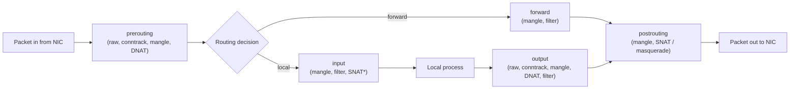

# 2.23 Linux networking II: netfilter, nftables, conntrack and NAT

| | |
|---|---|
| Level | Intermediate to advanced |
| Priority tier | 0 |
| Lab venue | Linux VM or namespaces (root, nftables installed) |
| Part | Part 2: Networking, from first principles to AI fabrics |
| Status | Drafted, labs **untested** |

## Why this matters for AI infrastructure

Almost every packet on a Kubernetes node touches netfilter: kube-proxy installs thousands of NAT rules, container runtimes add masquerade and port-publish rules, CNIs add policy chains, cloud agents add their own, and the host firewall sits underneath. When the connection-tracking table fills, new connections fail silently on a node that looks idle. When a rule ordering mistake drops health-check traffic, a whole rollout stalls. When 5,000 pods share one SNAT address, outbound connections to a database time out. Understanding hooks, tables, chains, priorities, the connection-tracking state machine and NAT is therefore a core operations skill, and moving from linear iptables rule lists to nftables sets, maps and eBPF datapaths is a performance topic for large nodes. This chapter covers the architecture, the nftables language (with iptables equivalents), conntrack (states, sizing, helpers, bypass), NAT in practice, firewall design patterns for servers, routers and container hosts, and debugging techniques (counters, logging, tracing).

## Prerequisites and outcomes

You should know IP routing and forwarding (2.5), TCP basics (2.6), NAT concepts (2.9), security basics (2.21), and `ss`/`ip` (2.22).

After this chapter you can:

- Describe the five netfilter hooks, packet flows for local, forwarded and locally generated traffic, and where routing decisions, DNAT and SNAT happen.
- Explain iptables tables and chains (filter, nat, mangle, raw, security) and the nftables model (families, tables, chains with hook/priority/policy, rules, sets, maps, verdict maps, flowtables), and translate between them.
- Write a safe default-deny server firewall, a router/NAT gateway ruleset and a container-host ruleset in nftables.
- Explain connection tracking: tuples, states (NEW, ESTABLISHED, RELATED, INVALID, UNTRACKED, SNAT/DNAT), timeouts, helpers, zones, and diagnose table exhaustion.
- Use `conntrack`, `nft list/monitor/trace`, counters and logging to debug drops and NAT mappings.
- Explain how Docker, Kubernetes (kube-proxy iptables/IPVS), Cilium (eBPF) and NetworkPolicy interact with netfilter, and when to bypass conntrack.
- Apply performance practices: sets instead of rule lists, early drop in `ingress`/`raw`, flowtable offload, hardware offload.

## 1. Netfilter architecture

**Netfilter** is a framework of hooks in the kernel's packet path. Subsystems (iptables, nftables, conntrack, NAT, IPVS, SELinux secmark, bridge filters) register handlers on hooks with a priority; the kernel calls them in order and each returns a verdict (accept, drop, queue to userspace, stolen, repeat/continue). `iptables` and `nftables` are user-space front ends to different kernel implementations of rule evaluation.

There are five IPv4/IPv6 hooks:

| Hook | iptables chain | Triggered when |
|---|---|---|
| `prerouting` | PREROUTING | Any packet arrives from an interface, before the routing decision (DNAT happens here) |
| `input` | INPUT | The routing decision says the packet is for this host |
| `forward` | FORWARD | The routing decision says to route it to another host |
| `output` | OUTPUT | A locally generated packet leaves a local process, before routing is finalised |
| `postrouting` | POSTROUTING | Any packet is about to leave an interface, after routing (SNAT/masquerade happens here) |



Packet flows by source and destination:

| Source → destination | Hooks (in order) |
|---|---|
| Local process → local (loopback) | output, then (re-entering) prerouting? No: output, postrouting, then input after the loopback re-entry (prerouting, input) |
| Local process → external | output, postrouting |
| External → this host | prerouting, input |
| External → external (routed) | prerouting, forward, postrouting |

(A host talking to itself triggers output and postrouting, leaves "through" the loopback and re-enters like any other packet, hitting prerouting and input.) NAT changes the *routing decision* only at prerouting (DNAT) and output (locally generated DNAT); after the packet reaches `input` no routing decisions are made. This is why destination NAT lives in prerouting/output and source NAT in postrouting/input.

**Martian packets and rp_filter**: packets with impossible source addresses (e.g. a source of 127.0.0.1 arriving on an external interface, or a source not reachable via the arrival interface) are dropped by reverse-path filtering unless disabled (chapter 2.5). Disabling it means services that trust "localhost" traffic can be attacked from the network (a Kubernetes CVE exploited a similar assumption); keep `rp_filter` at least in loose mode and `log_martians` during investigation.

### Tables and chains in iptables

iptables organises rules in **tables** (purpose) containing **chains** (hook points + user-defined chains):

| Table | Purpose | Built-in chains |
|---|---|---|
| `filter` | Accept/drop/reject (default table) | INPUT, FORWARD, OUTPUT |
| `nat` | Address translation (first packet of a flow only) | PREROUTING, INPUT, OUTPUT, POSTROUTING |
| `mangle` | Modify fields (TOS/DSCP, TTL, marks, MSS clamping) | all five |
| `raw` | Exempt from conntrack (`NOTRACK`/`CT --notrack`), early drop | PREROUTING, OUTPUT |
| `security` | SELinux secmark | INPUT, FORWARD, OUTPUT |

Within a hook, tables are visited in priority order (raw → mangle → nat(dnat) → filter → security → nat(snat)). Each rule has a match, a target (`ACCEPT`, `DROP`, `REJECT`, `LOG`, `DNAT`, `SNAT`, `MASQUERADE`, `MARK`, `TCPMSS`, `RETURN`, jump to user chain), and chains have a default policy. Rules are evaluated **linearly** until a terminating target matches: with 10,000 rules the cost per packet grows, which is a real problem on Kubernetes nodes with many services (kube-proxy iptables mode).

### nftables

**nftables** (kernel 3.13+, default in modern distributions) replaces iptables/ip6tables/arptables/ebtables with one framework and one tool (`nft`), a compiled bytecode evaluated by a small in-kernel virtual machine, atomic ruleset replacement, and efficient data structures (hash/rbtree/interval **sets** and **maps**). On many systems the `iptables` binary is `iptables-nft`, a compatibility layer that translates legacy syntax into nftables objects (check `iptables --version`; legacy and nft variants must not be mixed carelessly).

Model:

- **Family**: `ip`, `ip6`, `inet` (IPv4+IPv6 in one table), `arp`, `bridge`, `netdev` (ingress on an interface, before most of the stack).
- **Table**: a namespace for chains, sets and maps (`table inet filter`).
- **Chain**: base chains attach to a hook with `type` (filter, nat, route), `hook` (prerouting, input, forward, output, postrouting, ingress), `priority` (lower runs earlier) and `policy`; regular chains are jump targets.
- **Rule**: expressions (matches then statements): `tcp dport 22 ct state new accept`, `ip saddr @blocklist drop`, `counter`, `log prefix "x "`, `limit rate 10/second`, `masquerade`, `dnat to 10.0.0.20:443`, `meta mark set 0x10`.
- **Set/map**: collections of addresses, ports, interfaces (`type ipv4_addr; flags interval; timeout 1h`) and key→value maps used for DNAT tables and verdict maps.

```bash
sudo nft list ruleset                           # everything
sudo nft list table inet filter -a              # with handles (to delete a rule)
sudo nft -f /etc/nftables.conf                  # atomically load a file ; -c to check syntax only
sudo nft monitor trace                          # live packet tracing (with 'nftrace set 1' rules)
sudo nft add rule inet filter input tcp dport 22 accept
sudo nft delete rule inet filter input handle 5
sudo nft flush ruleset                          # careful: opens a default-deny box or drops your SSH if policy drop
sudo systemctl enable --now nftables            # loads /etc/nftables.conf at boot
```

### A default-deny host firewall (server)

```text
#!/usr/sbin/nft -f
flush ruleset
table inet filter {
  set mgmt_nets { type ipv4_addr; flags interval; elements = { 10.20.0.0/24, 10.21.0.0/24 } }
  set blocklist { type ipv4_addr; flags timeout; }                  # dynamic bans (fail2ban / scripts add here)

  chain input {
    type filter hook input priority 0; policy drop;
    iif lo accept
    ct state invalid drop
    ct state established,related accept
    ip saddr @blocklist drop
    ip protocol icmp icmp type { echo-request, destination-unreachable, time-exceeded } limit rate 10/second accept
    ip6 nexthdr icmpv6 icmpv6 type { destination-unreachable, packet-too-big, time-exceeded, parameter-problem, nd-router-advert, nd-neighbor-solicit, nd-neighbor-advert, echo-request } accept
    tcp dport 22 ip saddr @mgmt_nets ct state new limit rate 10/minute accept     # SSH only from mgmt, rate-limited
    tcp dport { 9100, 9400 } ip saddr 10.20.0.50 accept                         # node_exporter, dcgm-exporter from Prometheus only
    udp dport 4791 ip saddr 10.100.0.0/16 accept                                 # RoCEv2 (if the host firewall is in the path)
    log prefix "nft-input-drop: " limit rate 5/minute counter drop
  }
  chain forward { type filter hook forward priority 0; policy drop; }        # not a router
  chain output  { type filter hook output  priority 0; policy accept; }
}
```

Key practices: **default drop** with explicit accepts; accept loopback and established/related first for performance; drop `invalid` state; **never block** ICMP/ICMPv6 types needed for PMTUD and neighbour discovery (chapter 2.7); limit and log drops; keep the management allow-list in a named set managed by configuration management; test changes with `nft -c -f`, keep a second session open, and use a safety timer (`sleep 60 && nft flush ruleset &`, or `at`) when editing remote firewalls.

### A router/NAT gateway ruleset

```text
table inet filter {
  chain input   { type filter hook input priority 0; policy drop;
                  iif lo accept; ct state established,related accept; ct state invalid drop
                  iifname "lan0" tcp dport 22 accept; iifname "lan0" udp dport { 53, 67 } accept }
  chain forward { type filter hook forward priority 0; policy drop;
                  ct state established,related accept; ct state invalid drop
                  iifname "lan0" oifname "wan0" accept                                 # outbound
                  iifname "wan0" oifname "lan0" ct status dnat accept                 # only published services }
}
table ip nat {
  chain prerouting  { type nat hook prerouting  priority dstnat; policy accept;
                      iifname "wan0" tcp dport 8443 dnat to 10.0.0.20:443 }            # port forward
  chain postrouting { type nat hook postrouting priority srcnat; policy accept;
                      oifname "wan0" masquerade }
}
```

Plus `sysctl net.ipv4.ip_forward=1` (chapter 2.5). The equivalent iptables version: `iptables -P FORWARD DROP`, `iptables -t nat -A POSTROUTING -o wan0 -j MASQUERADE`, `iptables -A FORWARD -i wan0 -o lan0 -m conntrack --ctstate ESTABLISHED,RELATED -j ACCEPT`, `iptables -A FORWARD -i lan0 -o wan0 -j ACCEPT`. `iptables-translate` converts legacy rules to nft syntax.

### iptables quick map

```bash
iptables -S ; iptables -L -n -v --line-numbers ; iptables -t nat -S      # list rules (with counters)
iptables -A INPUT -s 192.168.34.63 -j DROP                                # append ; -I INPUT 1 to insert at top ; -D to delete
iptables -P FORWARD DROP                                                  # default policy
iptables -A INPUT -p tcp --dport 22 -m conntrack --ctstate NEW -m recent --update --seconds 60 --hitcount 5 -j DROP
iptables-save > rules.v4 ; iptables-restore < rules.v4                    # atomic dump/load (persist with iptables-persistent / netfilter-persistent)
iptables -t mangle -A FORWARD -p tcp --tcp-flags SYN,RST SYN -j TCPMSS --clamp-mss-to-pmtu     # MSS clamping (chapter 2.7)
iptables -t raw -A PREROUTING -p tcp --dport 80 -j CT --notrack           # bypass conntrack
```

Front ends: **ufw** (Ubuntu), **firewalld** (RHEL family; zones, services, rich rules; nftables backend), cloud agents, Docker, and Kubernetes components all write rules: use `nft list ruleset`/`iptables-save` to see the union, and avoid "flushing everything" on container hosts (you will delete runtime-managed chains and break networking).

## 2. Connection tracking (conntrack)

**Conntrack** (`nf_conntrack`) maintains a table of flows so that netfilter can make stateful decisions and so NAT can translate the reply direction. Each entry stores the **original tuple** (src, dst, protocol, ports as seen on arrival) and the **reply tuple** (what the reply looks like after NAT), a state, timeout, mark, zone and counters. It is required for stateful filtering (`ct state`), NAT (SNAT/DNAT/masquerade), kube-proxy iptables mode, Docker published ports, and many helpers.

### States

| State | Meaning |
|---|---|
| `NEW` | First packet of a flow; no reply seen |
| `ESTABLISHED` | Traffic seen in both directions |
| `RELATED` | New flow related to an existing one (FTP data connection, ICMP error for an existing flow) |
| `INVALID` | Doesn't match a known flow or violates the state machine (out-of-window TCP, unsolicited ACK); usually drop |
| `UNTRACKED` | Explicitly exempted from tracking (raw/NOTRACK) |
| `DNAT` / `SNAT` (as `ct status`) | The flow has been translated |

Without conntrack, a firewall that allows inbound replies must open ephemeral port ranges for any outbound connection; with it, "allow established" is enough and NAT knows how to map replies back. The state machine tracks TCP details (SYN_SENT, SYN_RECV, ESTABLISHED, FIN_WAIT, CLOSE_WAIT, TIME_WAIT, CLOSE), UDP (pseudo-state: UNREPLIED, then ASSURED after bidirectional traffic), and ICMP.

### Inspecting and managing

```bash
sudo conntrack -L | head                  # entries: protocol, timeout, state, original tuple, reply tuple, [ASSURED]
sudo conntrack -L -p tcp --dport 443 ; sudo conntrack -L -s 10.0.0.5
sudo conntrack -C                          # count ; also /proc/sys/net/netfilter/nf_conntrack_count
sudo conntrack -S                          # per-CPU stats: found, invalid, insert, insert_failed, drop, early_drop, error, search_restart
sudo conntrack -E                          # event stream (NEW, UPDATE, DESTROY) ; -E -e NEW for new flows
sudo conntrack -D -s 10.0.0.5              # delete matching entries (e.g. after changing a NAT rule)
sysctl net.netfilter.nf_conntrack_max net.netfilter.nf_conntrack_buckets net.netfilter.nf_conntrack_count
sysctl net.netfilter.nf_conntrack_tcp_timeout_established net.netfilter.nf_conntrack_udp_timeout
```

Example entry: `tcp 6 431999 ESTABLISHED src=10.0.0.5 dst=198.51.100.7 sport=51000 dport=443 src=198.51.100.7 dst=203.0.113.9 sport=443 dport=40001 [ASSURED] mark=0 use=1`. The first tuple is the original direction; the second is the reply direction as it will look on the wire after NAT (here, the NAT address 203.0.113.9 and the translated port 40001).

### Sizing, timeouts and exhaustion

Entries live in a hash table sized by `nf_conntrack_buckets` (module parameter `hashsize`) and capped by `nf_conntrack_max`; each entry costs roughly 300 to 400 bytes plus hash overhead. When the table is full, **new connections are dropped silently** (`nf_conntrack: table full, dropping packet` in `dmesg`; `conntrack -S` shows `insert_failed`/`drop`): a classic cause of intermittent timeouts on busy NAT gateways and Kubernetes nodes, while CPU and bandwidth look fine. Remedies, in order: (1) **find who creates the flows** (`conntrack -L | awk ... | sort | uniq -c`, `conntrack -E`), fix chatty clients, add connection pooling or keep-alives; (2) **shorten timeouts** (`nf_conntrack_tcp_timeout_established` default 5 days is far too long for many workloads: 600 s to 86,400 s; `time_wait` 30 s; `udp` 30/120 s; `generic`); (3) **raise `nf_conntrack_max`** (memory permitting) and set buckets to max/4 to max/8 to limit hash collisions (lookups are O(chain length)); (4) **bypass conntrack** for traffic that needs neither NAT nor stateful rules (`CT --notrack`/`notrack` in the `raw` hook: east-west storage or RDMA-adjacent traffic, high-rate DNS, load-balancer VIP traffic), remembering that untracked traffic needs explicit stateless allow rules in both directions; (5) move to an eBPF datapath that avoids netfilter.

```bash
# raise limits persistently
printf 'net.netfilter.nf_conntrack_max=2097152\nnet.netfilter.nf_conntrack_tcp_timeout_established=3600\nnet.netfilter.nf_conntrack_tcp_timeout_time_wait=30\n' | sudo tee /etc/sysctl.d/90-conntrack.conf
echo 262144 | sudo tee /sys/module/nf_conntrack/parameters/hashsize
# nftables: exempt a high-rate service from tracking
nft add table inet raw
nft 'add chain inet raw prerouting { type filter hook prerouting priority raw; }'
nft add rule inet raw prerouting udp dport 53 notrack
```

**Helpers and ALGs** (FTP, SIP, TFTP, H.323) let conntrack open expected related flows by parsing payloads; since kernel 4.x automatic helper assignment is disabled by default (explicit `ct helper` is required) for security. **Zones** (`ct zone`) separate tracking domains so overlapping address spaces (multi-tenant NAT, VRFs) don't collide. **Conntrack and asymmetric routing**: if requests and replies take different paths through different gateways, the second gateway sees replies without a flow and marks them INVALID: design NAT gateways with symmetric paths or share state (`conntrackd`).

### Conntrack and UDP/DNS races

UDP flows are created when the first packet is processed; two UDP packets with the same 5-tuple sent concurrently (e.g. A and AAAA DNS queries from one source port) can race to create the entry through NAT, and one is dropped, causing the infamous 5-second DNS timeouts on older kernels (chapter 2.8). Mitigations: `single-request-reopen`, NodeLocal DNSCache, newer kernels, or `notrack` for DNS.

## 3. NAT in practice

NAT mechanics were introduced in chapter 2.9; here are the Linux specifics.

- **Only the first packet of a flow traverses the nat table**; the translation is stored in conntrack and applied to all subsequent packets in both directions automatically. Therefore changing a NAT rule does not affect existing flows until entries are deleted or expire (`conntrack -D`).
- **SNAT vs masquerade**: `snat to 203.0.113.9` (static address, cheaper); `masquerade` (dynamic interface address, flushes conntrack entries when the interface goes down). Use `snat to 203.0.113.9-203.0.113.12 persistent` or `fully-random` for pooled addresses; `--to-ports 10000-60000` restricts the port range.
- **Port exhaustion**: a single source address can use ~64k ports per destination address:port. A NAT gateway with one IP serving thousands of containers connecting to one database IP:port runs out ("SNAT port exhaustion": connect timeouts, `insert_failed` counters). Fixes: more SNAT addresses (round-robin pool), connection pooling (PgBouncer, HTTP keep-alive), reduce TIME_WAIT on the gateway, spread across destinations, or avoid NAT (routable pod IPs, private endpoints).
- **DNAT/port forwarding** requires a matching `forward` accept; hairpin traffic needs SNAT/masquerade (chapter 2.9); `ct status dnat` matches translated flows.
- **Source address preservation** for load-balanced services (Kubernetes `externalTrafficPolicy: Local`, DSR) avoids SNAT.
- **NAT66/NAT64** are possible but rare; IPv6 normally needs no NAT.
- **Order of operations** matters: raw (notrack) → conntrack → mangle prerouting → nat dstnat → routing → filter forward → mangle forward → nat srcnat. Filtering on the *translated* or *original* address depends on the hook: forward chain sees post-DNAT destination addresses (use `ct original daddr` to match the pre-NAT address).

## 4. Container and Kubernetes hosts

- **Docker** creates the `docker0` bridge, a `DOCKER` nat chain (DNAT for published ports), `DOCKER-USER` (your rules, evaluated first in FORWARD; put restrictions here), `DOCKER-ISOLATION-*` chains, and a masquerade rule for the bridge subnet; it also sets the FORWARD policy to DROP and enables `ip_forward`. Docker bypasses ufw/firewalld rules for published ports because it inserts its rules ahead; use `DOCKER-USER` or bind published ports to specific addresses (`-p 127.0.0.1:8080:80`). Check with `iptables -t nat -S DOCKER`.
- **Kubernetes kube-proxy (iptables mode)** programs chains `KUBE-SERVICES`, `KUBE-NODEPORTS`, `KUBE-SVC-*` (per Service, with probabilistic jumps for load balancing), `KUBE-SEP-*` (per endpoint DNAT), `KUBE-MARK-MASQ`, `KUBE-POSTROUTING`, and `KUBE-FORWARD`. Every packet to a ClusterIP traverses these; thousands of Services mean thousands of rules and slow rule updates (full resync) and CPU at scale; **IPVS mode** uses kernel hash tables with real schedulers; **eBPF (Cilium) kube-proxy replacement** programs maps instead. Debug: `iptables-save | grep KUBE-SVC-xxx`, `ipvsadm -Ln`, `conntrack -L | grep <clusterIP>`, `kubectl get endpointslices`.
- **NetworkPolicy** is implemented by CNIs through iptables/ipset chains (Calico: `cali-*`), nftables, or eBPF (Cilium); the host firewall must allow the CNI's traffic (VXLAN UDP 4789/8472, BGP 179, IPIP protocol 4, Typha, health checks) and node-to-node pod traffic.
- **Interaction rules**: don't run firewalld/ufw `reload` or `iptables -F` on a Kubernetes node without understanding what you delete; prefer tools that preserve foreign chains; keep host rules in a separate nftables table (nft tables coexist), not in the iptables tables kube-proxy owns; remember that nft and iptables-legacy rule sets are separate and both evaluated.
- **Bypassing netfilter**: Cilium attaches eBPF programs at XDP/TC hooks, performing load balancing and policy before netfilter, and can run without conntrack for many flows (it keeps its own maps). For GPU/RDMA traffic, the fast path uses the NIC and bypasses the kernel stack entirely (RoCE), so host netfilter does not see it; apply isolation at the switch/NIC instead (chapter 2.21).

## 5. Firewall design strategies

- **Policy**: default deny inbound and forward; allow only necessary services from necessary sources; allow outbound selectively on sensitive hosts (egress allow-lists for GPU nodes: package mirrors, registries, NTP, DNS, monitoring).
- **Structure**: separate chains per zone (`mgmt`, `fabric`, `storage`, `tenant`); sets for host groups; use interface/VLAN matches (`iifname`) with care (names can change); generate rules from inventory (templates in Ansible) rather than hand edits.
- **Stateless where it matters**: for very high-rate flows (storage, DNS servers), use `notrack` and stateless rules, or place filtering in switch ACLs and NIC/DPU firewalls.
- **Order for performance**: put the highest-hit rules first (established/related accept), use sets/maps instead of long lists, drop obvious garbage early (`ingress`/`netdev` or `raw prerouting`), and avoid per-rule logging at line rate (use `limit`).
- **Logging**: rate-limited `log` with prefix, `counter` per rule, ship to the central log system; use `ulogd`/NFLOG for structured logs; metrics via `nftables_exporter`/`node_exporter` (nf_conntrack stats).
- **Change safety**: version control rulesets, `nft -c`, staging, canary hosts, out-of-band access, automatic rollback timers; document owners and reasons.
- **Hardware and offload**: flowtables (`flowtable` with `flow add @ft`) offload established forwarded flows to a software fast path (and hardware on supported NICs/switches), bypassing most of netfilter for long flows; `ethtool -K eth0 hw-tc-offload on` and TC flower for OVS/offload.
- **Alternatives**: eBPF/XDP firewalls (Cilium, Katran, custom XDP drop programs) for DDoS-rate filtering (millions of packets per second per core), cloud security groups and network firewalls, and hardware ACLs on switches.

## 6. Debugging netfilter

```bash
# 1) Where did it go? counters on every rule
sudo nft list ruleset | less ; sudo iptables -L -n -v ; sudo iptables -t nat -L -n -v
# 2) Trace a specific packet through all hooks (nftables)
sudo nft add table inet trace_t
sudo nft 'add chain inet trace_t pre { type filter hook prerouting priority -300; }'
sudo nft add rule inet trace_t pre ip saddr 10.0.0.5 tcp dport 443 meta nftrace set 1
sudo nft monitor trace                          # shows each rule evaluated with verdicts and the final decision
# iptables TRACE (needs a netfilter log backend on newer kernels: modprobe nf_log_ipv4; sysctl net.netfilter.nf_log.2=nf_log_ipv4)
sudo iptables -t raw -A PREROUTING -s 10.0.0.5 -p tcp --dport 443 -j TRACE ; sudo dmesg -w
# 3) Log drops at the end of a chain with a prefix and rate limit; correlate in journalctl -k
# 4) Look at conntrack: is the flow tracked? what is the state? NAT mapping?
sudo conntrack -L -s 10.0.0.5 ; sudo conntrack -E -s 10.0.0.5
# 5) Capture on both sides of the box to prove what arrives and what leaves (chapter 2.26)
sudo tcpdump -ni any host 10.0.0.5 and port 443
# 6) Kernel drop locations
sudo dropwatch -l kas ; sudo bpftrace -e 'kprobe:nf_hook_slow { @[comm] = count(); }'
```

A typical diagnosis: a packet is seen entering `eth0` but never reaches the application, and routing is correct. Enabling TRACE shows it traverses prerouting, enters input, and hits rule #45 in the filter table, a stale DROP rule inserted by an automation job. Another: replies from a backend never reach the client because the backend's default gateway isn't the NAT box and the connection is INVALID/untracked on the return path. Another: new connections stall while `conntrack -C` equals `nf_conntrack_max`.

## 7. Performance notes for large nodes

- Rule evaluation is O(rules) for iptables. 20,000 rules cost real microseconds per packet and make updates slow (kube-proxy rewrites the whole table). Use nftables sets/maps, IPVS, or eBPF datapaths.
- Conntrack lookups and inserts take locks per bucket; high connection rates (hundreds of thousands per second) need larger hash tables, per-CPU stats checks, and sometimes `notrack`.
- Softirq CPU: heavy netfilter work shows as `ksoftirqd` and `si` CPU time; spread with RSS/RPS (chapter 2.24) and keep rules lean.
- Large flows benefit from flowtable offload and GRO/TSO (netfilter sees aggregated packets on the receive side after GRO).
- DDoS-grade drop rates need XDP or hardware filtering; netfilter drops at roughly a million packets per second per core (order of magnitude; measure).
- RDMA/RoCE and GPUDirect traffic bypass the host stack; DPDK/XDP apps bypass netfilter by design.

## 8. Lab: build, break and trace (untested)

1. **Hooks**: add nftables rules with counters at each hook (`prerouting`, `input`, `forward`, `output`, `postrouting`) for local ping, forwarded ping (namespace router, chapter 2.5), and traffic to self; verify the hook-order table above by watching counters.
2. **Default-deny server**: apply the server ruleset in a namespace; verify with `nc`/`nmap` from another namespace (allowed vs dropped ports); test ICMP; watch `nft list ruleset` counters; confirm that removing the `ct state established` rule breaks replies.
3. **Router/NAT**: three namespaces (lan, router, wan); implement masquerade and port forwarding; inspect `conntrack -L` for original/reply tuples; show the effect of changing the NAT rule on existing flows (no change) and after `conntrack -D`; create hairpin NAT and fix it.
4. **Conntrack exhaustion**: set `nf_conntrack_max=2048`; open thousands of connections (`nc` loops or `hping3 -S --flood`); watch `dmesg` and `conntrack -S`; fix with timeouts, a bigger table, and `notrack` for a service.
5. **SNAT port exhaustion**: restrict the SNAT range (`snat to 203.0.113.9:40000-40010`) and open more connections to one destination:port than ports available; observe failures; add a second address and see them succeed.
6. **Tracing**: use `nft monitor trace` to follow a packet; insert a faulty DROP rule and find it; use `iptables -j TRACE` for the legacy path.
7. **Sets and performance**: load 50,000 addresses into an nft set vs 50,000 iptables rules (ipset/`iptables-nft` for comparison); benchmark packet rate with `iperf3`/`pktgen` and CPU usage; add a flowtable and compare forwarded throughput.
8. **Docker/K8s**: on a host with Docker, inspect `iptables -t nat -S DOCKER`, publish a port, test `DOCKER-USER` filtering; in kind/minikube list `KUBE-SVC-*` chains for a Service and map them to endpoints; compare with IPVS mode.
9. **Clean up** (restore saved rulesets, don't `flush ruleset` on container hosts).

Mark tested only after execution.

## 9. Common mistakes

- Locking yourself out over SSH by setting policy drop before adding the allow rule; no rollback timer.
- Flushing rules on a Docker/Kubernetes host; mixing iptables-legacy and nft backends.
- Allowing ESTABLISHED but forgetting INVALID drop and ICMP/ICMPv6 requirements (PMTUD, ND).
- Assuming a changed NAT rule affects existing connections.
- Ignoring conntrack capacity until the table is full; default 5-day established timeout.
- Putting NAT rules in the wrong hook/priority; filtering on post-NAT addresses by accident.
- Linear giant rule lists; logging every drop at line rate.
- Believing the host firewall protects RDMA traffic (it does not).

## 10. Interview angles

- "Draw the netfilter hooks and the path of a forwarded packet. Where do DNAT and SNAT occur and why there?"
- "iptables vs nftables: what changed and why does it matter at scale?"
- "What is conntrack? What do ESTABLISHED, RELATED and INVALID mean? What happens when the table is full?"
- "Pods time out connecting to an external DB through a NAT gateway. What do you check?" (SNAT port exhaustion, conntrack, MTU, DNS.)
- "How does kube-proxy implement Services in iptables mode? What are the scaling limits and alternatives?"
- "How would you trace which rule drops a packet?"
- "Explain default deny and stateless vs stateful rules; how would you firewall a GPU node?"
- "How do you bypass conntrack and why would you?"

## 11. Checkpoint questions (40)

1. Name the five netfilter hooks. **A:** prerouting, input, forward, output, postrouting.
2. Where does DNAT occur? **A:** prerouting (and output for local).
3. Where does SNAT/masquerade occur? **A:** postrouting (and input).
4. Which hooks see a forwarded packet? **A:** prerouting, forward, postrouting.
5. Which see a locally generated packet to an external host? **A:** output, postrouting.
6. What is the iptables `raw` table for? **A:** Exempting flows from conntrack / early filtering.
7. What does the `mangle` table do? **A:** Modifies packet fields (TOS/DSCP, TTL, marks, MSS).
8. Why is iptables O(n) a problem? **A:** Linear rule evaluation and full-table updates at scale.
9. What does nftables add? **A:** Unified tool, sets/maps, atomic updates, inet family, efficient evaluation.
10. What is an nft `inet` family table? **A:** One table handling IPv4 and IPv6.
11. What defines a base chain? **A:** type, hook, priority (and policy).
12. What does `iptables-nft` do? **A:** Translates iptables syntax to nftables objects.
13. What does conntrack store? **A:** Original and reply tuples, state, timeout, marks.
14. Meaning of RELATED? **A:** New flow associated with an existing one (FTP data, ICMP errors).
15. Meaning of INVALID? **A:** Packet doesn't fit any flow/state; usually dropped.
16. What happens when the table is full? **A:** New connections are dropped.
17. Which log message indicates it? **A:** `nf_conntrack: table full, dropping packet`.
18. Which counters show insert failures? **A:** `conntrack -S` insert_failed/drop.
19. How to size the hash table? **A:** buckets ≈ max/4 to max/8.
20. Default TCP established timeout? **A:** 5 days (432000 s); lower it.
21. How to bypass conntrack? **A:** `notrack` / `CT --notrack` in raw prerouting/output.
22. What must you add when bypassing? **A:** Explicit stateless allow rules both directions.
23. What do conntrack helpers do? **A:** Track related flows for protocols like FTP/SIP.
24. What are ct zones for? **A:** Separate tracking domains for overlapping address spaces.
25. Do existing flows change when you edit a NAT rule? **A:** No; delete entries or wait.
26. Masquerade vs SNAT? **A:** Dynamic interface address vs fixed address.
27. What causes SNAT port exhaustion? **A:** Too many flows from one IP to one destination IP:port.
28. Fixes for port exhaustion? **A:** More SNAT IPs, pooling, shorter timeouts, avoid NAT.
29. What is DOCKER-USER? **A:** Chain for user rules evaluated before Docker's own.
30. What do KUBE-SVC and KUBE-SEP chains do? **A:** Per-Service load balancing and per-endpoint DNAT.
31. Why use IPVS or eBPF for kube-proxy? **A:** Hash-based lookup and faster updates at scale.
32. What is nft trace? **A:** `meta nftrace set 1` + `nft monitor trace` to follow rule evaluation.
33. What ICMP must never be blocked? **A:** Types for PMTUD and ND (v4 type 3 code 4; v6 packet-too-big, ND).
34. What is a flowtable? **A:** Fast-path offload for established forwarded flows.
35. Why is default deny recommended? **A:** Unknown services stay unreachable.
36. How do you atomically replace a ruleset? **A:** `nft -f file` (flush + load in one transaction).
37. What is a Martian packet? **A:** One with an impossible source address.
38. Who sees RDMA traffic in the host kernel? **A:** No one; it bypasses the stack.
39. Where do you put restrictions for Docker-published ports? **A:** DOCKER-USER (or bind to specific addresses).
40. Which tool lists conntrack entries? **A:** `conntrack -L`.

## 12. Sources and review notes

**Written in original words.** Principal sources:

- The author's own `nvidia-devops` repository, volume 01 networking masterclass (netfilter/conntrack/NAT at scale, conntrack exhaustion and tuning, bypassing netfilter with NOTRACK and eBPF, iptables versus nftables, the SNAT port exhaustion, path-MTU and iptables TRACE scenarios, the veth bottleneck scenario, packet drop debugging with dropwatch).
- Brian Ward, *How Linux Works*, 3rd ed., chapter 9: Linux as a router, private networks, NAT (IP masquerading), routers and Linux, firewalls (basics, setting rules, strategies).
- *Networking and Kubernetes*, chapter 2: Netfilter hooks and flows, conntrack states, iptables and Kubernetes interactions (hook order table and Martian packet discussion).
- nftables and conntrack specifics are the author's synthesis from the netfilter.org documentation, the nftables wiki and `nft(8)`, `conntrack(8)` manuals.

**Flagged for verification before publishing:** nft syntax per version (e.g. `ct status dnat`, flowtable declarations), conntrack default timeouts and automatic-helper behaviour per kernel, kube-proxy chain names, per-entry memory cost, drop-rate figures, and `nftrace` usage; all labs are **untested**.
