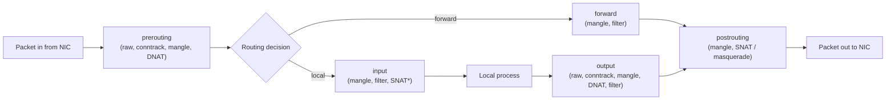

# 2.23 Linux networking II: netfilter, nftables, conntrack and NAT

| | |
|---|---|
| Level | Intermediate to advanced |
| Priority tier | 0 |
| Lab venue | Linux VM or namespaces (root, nftables installed) |
| Part | Part 2: Networking, from first principles to AI fabrics |
| Status | Drafted, labs **untested** |

## Why this matters for AI infrastructure

Almost every packet on a Kubernetes node touches netfilter: kube-proxy installs thousands of NAT rules, container runtimes add masquerade and port-publish rules, CNIs add policy chains, cloud agents add their own, and the host firewall sits underneath. When the connection-tracking table fills, new connections fail silently on a node that looks idle. When a rule ordering mistake drops health-check traffic, a whole rollout stalls. When 5,000 pods share one SNAT address, outbound connections to a database time out. Understanding hooks, tables, chains, priorities, the connection-tracking state machine and NAT is therefore a core operations skill, and moving from linear iptables rule lists to nftables sets, maps and eBPF datapaths is a performance topic for large nodes. This chapter covers the architecture, the nftables language (with iptables equivalents), conntrack (states, sizing, helpers, bypass), NAT in practice, firewall design patterns for servers, routers and container hosts, and debugging techniques (counters, logging, tracing).

## Prerequisites and outcomes

You should know IP routing and forwarding (2.5), TCP basics (2.6), NAT concepts (2.9), security basics (2.21), and `ss`/`ip` (2.22).

After this chapter you can:

- Describe the five netfilter hooks, packet flows for local, forwarded and locally generated traffic, and where routing decisions, DNAT and SNAT happen.
- Explain iptables tables and chains (filter, nat, mangle, raw, security) and the nftables model (families, tables, chains with hook/priority/policy, rules, sets, maps, verdict maps, flowtables), and translate between them.
- Write a safe default-deny server firewall, a router/NAT gateway ruleset and a container-host ruleset in nftables.
- Explain connection tracking: tuples, states (NEW, ESTABLISHED, RELATED, INVALID, UNTRACKED, SNAT/DNAT), timeouts, helpers, zones, and diagnose table exhaustion.
- Use `conntrack`, `nft list/monitor/trace`, counters and logging to debug drops and NAT mappings.
- Explain how Docker, Kubernetes (kube-proxy iptables/IPVS), Cilium (eBPF) and NetworkPolicy interact with netfilter, and when to bypass conntrack.
- Apply performance practices: sets instead of rule lists, early drop in `ingress`/`raw`, flowtable offload, hardware offload.

## 1. Netfilter architecture

**Netfilter** is a framework of hooks in the kernel's packet path. Subsystems (iptables, nftables, conntrack, NAT, IPVS, SELinux secmark, bridge filters) register handlers on hooks with a priority; the kernel calls them in order and each returns a verdict (accept, drop, queue to userspace, stolen, repeat/continue). `iptables` and `nftables` are user-space front ends to different kernel implementations of rule evaluation.

There are five IPv4/IPv6 hooks:

| Hook | iptables chain | Triggered when |
|---|---|---|
| `prerouting` | PREROUTING | Any packet arrives from an interface, before the routing decision (DNAT happens here) |
| `input` | INPUT | The routing decision says the packet is for this host |
| `forward` | FORWARD | The routing decision says to route it to another host |
| `output` | OUTPUT | A locally generated packet leaves a local process, before routing is finalised |
| `postrouting` | POSTROUTING | Any packet is about to leave an interface, after routing (SNAT/masquerade happens here) |



Packet flows by source and destination:

| Source → destination | Hooks (in order) |
|---|---|
| Local process → local (loopback) | output, then (re-entering) prerouting? No: output, postrouting, then input after the loopback re-entry (prerouting, input) |
| Local process → external | output, postrouting |
| External → this host | prerouting, input |
| External → external (routed) | prerouting, forward, postrouting |

(A host talking to itself triggers output and postrouting, leaves "through" the loopback and re-enters like any other packet, hitting prerouting and input.) NAT changes the *routing decision* only at prerouting (DNAT) and output (locally generated DNAT); after the packet reaches `input` no routing decisions are made. This is why destination NAT lives in prerouting/output and source NAT in postrouting/input.

**Martian packets and rp_filter**: packets with impossible source addresses (e.g. a source of 127.0.0.1 arriving on an external interface, or a source not reachable via the arrival interface) are dropped by reverse-path filtering unless disabled (chapter 2.5). Disabling it means services that trust "localhost" traffic can be attacked from the network (a Kubernetes CVE exploited a similar assumption); keep `rp_filter` at least in loose mode and `log_martians` during investigation.

### Tables and chains in iptables

iptables organises rules in **tables** (purpose) containing **chains** (hook points + user-defined chains):

| Table | Purpose | Built-in chains |
|---|---|---|
| `filter` | Accept/drop/reject (default table) | INPUT, FORWARD, OUTPUT |
| `nat` | Address translation (first packet of a flow only) | PREROUTING, INPUT, OUTPUT, POSTROUTING |
| `mangle` | Modify fields (TOS/DSCP, TTL, marks, MSS clamping) | all five |
| `raw` | Exempt from conntrack (`NOTRACK`/`CT --notrack`), early drop | PREROUTING, OUTPUT |
| `security` | SELinux secmark | INPUT, FORWARD, OUTPUT |

Within a hook, tables are visited in priority order (raw → mangle → nat(dnat) → filter → security → nat(snat)). Each rule has a match, a target (`ACCEPT`, `DROP`, `REJECT`, `LOG`, `DNAT`, `SNAT`, `MASQUERADE`, `MARK`, `TCPMSS`, `RETURN`, jump to user chain), and chains have a default policy. Rules are evaluated **linearly** until a terminating target matches: with 10,000 rules the cost per packet grows, which is a real problem on Kubernetes nodes with many services (kube-proxy iptables mode).

### nftables

**nftables** (kernel 3.13+, default in modern distributions) replaces iptables/ip6tables/arptables/ebtables with one framework and one tool (`nft`), a compiled bytecode evaluated by a small in-kernel virtual machine, atomic ruleset replacement, and efficient data structures (hash/rbtree/interval **sets** and **maps**). On many systems the `iptables` binary is `iptables-nft`, a compatibility layer that translates legacy syntax into nftables objects (check `iptables --version`; legacy and nft variants must not be mixed carelessly).

Model:

- **Family**: `ip`, `ip6`, `inet` (IPv4+IPv6 in one table), `arp`, `bridge`, `netdev` (ingress on an interface, before most of the stack).
- **Table**: a namespace for chains, sets and maps (`table inet filter`).
- **Chain**: base chains attach to a hook with `type` (filter, nat, route), `hook` (prerouting, input, forward, output, postrouting, ingress), `priority` (lower runs earlier) and `policy`; regular chains are jump targets.
- **Rule**: expressions (matches then statements): `tcp dport 22 ct state new accept`, `ip saddr @blocklist drop`, `counter`, `log prefix "x "`, `limit rate 10/second`, `masquerade`, `dnat to 10.0.0.20:443`, `meta mark set 0x10`.
- **Set/map**: collections of addresses, ports, interfaces (`type ipv4_addr; flags interval; timeout 1h`) and key→value maps used for DNAT tables and verdict maps.

```bash
sudo nft list ruleset                           # everything
sudo nft list table inet filter -a              # with handles (to delete a rule)
sudo nft -f /etc/nftables.conf                  # atomically load a file ; -c to check syntax only
sudo nft monitor trace                          # live packet tracing (with 'nftrace set 1' rules)
sudo nft add rule inet filter input tcp dport 22 accept
sudo nft delete rule inet filter input handle 5
sudo nft flush ruleset                          # careful: opens a default-deny box or drops your SSH if policy drop
sudo systemctl enable --now nftables            # loads /etc/nftables.conf at boot
```

### A default-deny host firewall (server)

```text
#!/usr/sbin/nft -f
flush ruleset
table inet filter {
  set mgmt_nets { type ipv4_addr; flags interval; elements = { 10.20.0.0/24, 10.21.0.0/24 } }
  set blocklist { type ipv4_addr; flags timeout; }                  # dynamic bans (fail2ban / scripts add here)

  chain input {
    type filter hook input priority 0; policy drop;
    iif lo accept
    ct state invalid drop
    ct state established,related accept
    ip saddr @blocklist drop
    ip protocol icmp icmp type { echo-request, destination-unreachable, time-exceeded } limit rate 10/second accept
    ip6 nexthdr icmpv6 icmpv6 type { destination-unreachable, packet-too-big, time-exceeded, parameter-problem, nd-router-advert, nd-neighbor-solicit, nd-neighbor-advert, echo-request } accept
    tcp dport 22 ip saddr @mgmt_nets ct state new limit rate 10/minute accept     # SSH only from mgmt, rate-limited
    tcp dport { 9100, 9400 } ip saddr 10.20.0.50 accept                         # node_exporter, dcgm-exporter from Prometheus only
    udp dport 4791 ip saddr 10.100.0.0/16 accept                                 # RoCEv2 (if the host firewall is in the path)
    log prefix "nft-input-drop: " limit rate 5/minute counter drop
  }
  chain forward { type filter hook forward priority 0; policy drop; }        # not a router
  chain output  { type filter hook output  priority 0; policy accept; }
}
```

Key practices: **default drop** with explicit accepts; accept loopback and established/related first for performance; drop `invalid` state; **never block** ICMP/ICMPv6 types needed for PMTUD and neighbour discovery (chapter 2.7); limit and log drops; keep the management allow-list in a named set managed by configuration management; test changes with `nft -c -f`, keep a second session open, and use a safety timer (`sleep 60 && nft flush ruleset &`, or `at`) when editing remote firewalls.

### A router/NAT gateway ruleset

```text
table inet filter {
  chain input   { type filter hook input priority 0; policy drop;
                  iif lo accept; ct state established,related accept; ct state invalid drop
                  iifname "lan0" tcp dport 22 accept; iifname "lan0" udp dport { 53, 67 } accept }
  chain forward { type filter hook forward priority 0; policy drop;
                  ct state established,related accept; ct state invalid drop
                  iifname "lan0" oifname "wan0" accept                                 # outbound
                  iifname "wan0" oifname "lan0" ct status dnat accept                 # only published services }
}
table ip nat {
  chain prerouting  { type nat hook prerouting  priority dstnat; policy accept;
                      iifname "wan0" tcp dport 8443 dnat to 10.0.0.20:443 }            # port forward
  chain postrouting { type nat hook postrouting priority srcnat; policy accept;
                      oifname "wan0" masquerade }
}
```

Plus `sysctl net.ipv4.ip_forward=1` (chapter 2.5). The equivalent iptables version: `iptables -P FORWARD DROP`, `iptables -t nat -A POSTROUTING -o wan0 -j MASQUERADE`, `iptables -A FORWARD -i wan0 -o lan0 -m conntrack --ctstate ESTABLISHED,RELATED -j ACCEPT`, `iptables -A FORWARD -i lan0 -o wan0 -j ACCEPT`. `iptables-translate` converts legacy rules to nft syntax.

### iptables quick map

```bash
iptables -S ; iptables -L -n -v --line-numbers ; iptables -t nat -S      # list rules (with counters)
iptables -A INPUT -s 192.168.34.63 -j DROP                                # append ; -I INPUT 1 to insert at top ; -D to delete
iptables -P FORWARD DROP                                                  # default policy
iptables -A INPUT -p tcp --dport 22 -m conntrack --ctstate NEW -m recent --update --seconds 60 --hitcount 5 -j DROP
iptables-save > rules.v4 ; iptables-restore < rules.v4                    # atomic dump/load (persist with iptables-persistent / netfilter-persistent)
iptables -t mangle -A FORWARD -p tcp --tcp-flags SYN,RST SYN -j TCPMSS --clamp-mss-to-pmtu     # MSS clamping (chapter 2.7)
iptables -t raw -A PREROUTING -p tcp --dport 80 -j CT --notrack           # bypass conntrack
```

Front ends: **ufw** (Ubuntu), **firewalld** (RHEL family; zones, services, rich rules; nftables backend), cloud agents, Docker, and Kubernetes components all write rules: use `nft list ruleset`/`iptables-save` to see the union, and avoid "flushing everything" on container hosts (you will delete runtime-managed chains and break networking).

## 2. Connection tracking (conntrack)

**Conntrack** (`nf_conntrack`) maintains a table of flows so that netfilter can make stateful decisions and so NAT can translate the reply direction. Each entry stores the **original tuple** (src, dst, protocol, ports as seen on arrival) and the **reply tuple** (what the reply looks like after NAT), a state, timeout, mark, zone and counters. It is required for stateful filtering (`ct state`), NAT (SNAT/DNAT/masquerade), kube-proxy iptables mode, Docker published ports, and many helpers.

### States

| State | Meaning |
|---|---|
| `NEW` | First packet of a flow; no reply seen |
| `ESTABLISHED` | Traffic seen in both directions |
| `RELATED` | New flow related to an existing one (FTP data connection, ICMP error for an existing flow) |
| `INVALID` | Doesn't match a known flow or violates the state machine (out-of-window TCP, unsolicited ACK); usually drop |
| `UNTRACKED` | Explicitly exempted from tracking (raw/NOTRACK) |
| `DNAT` / `SNAT` (as `ct status`) | The flow has been translated |

Without conntrack, a firewall that allows inbound replies must open ephemeral port ranges for any outbound connection; with it, "allow established" is enough and NAT knows how to map replies back. The state machine tracks TCP details (SYN_SENT, SYN_RECV, ESTABLISHED, FIN_WAIT, CLOSE_WAIT, TIME_WAIT, CLOSE), UDP (pseudo-state: UNREPLIED, then ASSURED after bidirectional traffic), and ICMP.

### Inspecting and managing

```bash
sudo conntrack -L | head                  # entries: protocol, timeout, state, original tuple, reply tuple, [ASSURED]
sudo conntrack -L -p tcp --dport 443 ; sudo conntrack -L -s 10.0.0.5
sudo conntrack -C                          # count ; also /proc/sys/net/netfilter/nf_conntrack_count
sudo conntrack -S                          # per-CPU stats: found, invalid, insert, insert_failed, drop, early_drop, error, search_restart
sudo conntrack -E                          # event stream (NEW, UPDATE, DESTROY) ; -E -e NEW for new flows
sudo conntrack -D -s 10.0.0.5              # delete matching entries (e.g. after changing a NAT rule)
sysctl net.netfilter.nf_conntrack_max net.netfilter.nf_conntrack_buckets net.netfilter.nf_conntrack_count
sysctl net.netfilter.nf_conntrack_tcp_timeout_established net.netfilter.nf_conntrack_udp_timeout
```

Example entry: `tcp 6 431999 ESTABLISHED src=10.0.0.5 dst=198.51.100.7 sport=51000 dport=443 src=198.51.100.7 dst=203.0.113.9 sport=443 dport=40001 [ASSURED] mark=0 use=1`. The first tuple is the original direction; the second is the reply direction as it will look on the wire after NAT (here, the NAT address 203.0.113.9 and the translated port 40001).

### Sizing, timeouts and exhaustion

Entries live in a hash table sized by `nf_conntrack_buckets` (module parameter `hashsize`) and capped by `nf_conntrack_max`; each entry costs roughly 300 to 400 bytes plus hash overhead. When the table is full, **new connections are dropped silently** (`nf_conntrack: table full, dropping packet` in `dmesg`; `conntrack -S` shows `insert_failed`/`drop`): a classic cause of intermittent timeouts on busy NAT gateways and Kubernetes nodes, while CPU and bandwidth look fine. Remedies, in order: (1) **find who creates the flows** (`conntrack -L | awk ... | sort | uniq -c`, `conntrack -E`), fix chatty clients, add connection pooling or keep-alives; (2) **shorten timeouts** (`nf_conntrack_tcp_timeout_established` default 5 days is far too long for many workloads: 600 s to 86,400 s; `time_wait` 30 s; `udp` 30/120 s; `generic`); (3) **raise `nf_conntrack_max`** (memory permitting) and set buckets to max/4 to max/8 to limit hash collisions (lookups are O(chain length)); (4) **bypass conntrack** for traffic that needs neither NAT nor stateful rules (`CT --notrack`/`notrack` in the `raw` hook: east-west storage or RDMA-adjacent traffic, high-rate DNS, load-balancer VIP traffic), remembering that untracked traffic needs explicit stateless allow rules in both directions; (5) move to an eBPF datapath that avoids netfilter.

```bash
# raise limits persistently
printf 'net.netfilter.nf_conntrack_max=2097152\nnet.netfilter.nf_conntrack_tcp_timeout_established=3600\nnet.netfilter.nf_conntrack_tcp_timeout_time_wait=30\n' | sudo tee /etc/sysctl.d/90-conntrack.conf
echo 262144 | sudo tee /sys/module/nf_conntrack/parameters/hashsize
# nftables: exempt a high-rate service from tracking
nft add table inet raw
nft 'add chain inet raw prerouting { type filter hook prerouting priority raw; }'
nft add rule inet raw prerouting udp dport 53 notrack
```

**Helpers and ALGs** (FTP, SIP, TFTP, H.323) let conntrack open expected related flows by parsing payloads; since kernel 4.x automatic helper assignment is disabled by default (explicit `ct helper` is required) for security. **Zones** (`ct zone`) separate tracking domains so overlapping address spaces (multi-tenant NAT, VRFs) don't collide. **Conntrack and asymmetric routing**: if requests and replies take different paths through different gateways, the second gateway sees replies without a flow and marks them INVALID: design NAT gateways with symmetric paths or share state (`conntrackd`).

### Conntrack and UDP/DNS races

UDP flows are created when the first packet is processed; two UDP packets with the same 5-tuple sent concurrently (e.g. A and AAAA DNS queries from one source port) can race to create the entry through NAT, and one is dropped, causing the infamous 5-second DNS timeouts on older kernels (chapter 2.8). Mitigations: `single-request-reopen`, NodeLocal DNSCache, newer kernels, or `notrack` for DNS.

## 3. NAT in practice

NAT mechanics were introduced in chapter 2.9; here are the Linux specifics.

- **Only the first packet of a flow traverses the nat table**; the translation is stored in conntrack and applied to all subsequent packets in both directions automatically. Therefore changing a NAT rule does not affect existing flows until entries are deleted or expire (`conntrack -D`).
- **SNAT vs masquerade**: `snat to 203.0.113.9` (static address, cheaper); `masquerade` (dynamic interface address, flushes conntrack entries when the interface goes down). Use `snat to 203.0.113.9-203.0.113.12 persistent` or `fully-random` for pooled addresses; `--to-ports 10000-60000` restricts the port range.
- **Port exhaustion**: a single source address can use ~64k ports per destination address:port. A NAT gateway with one IP serving thousands of containers connecting to one database IP:port runs out ("SNAT port exhaustion": connect timeouts, `insert_failed` counters). Fixes: more SNAT addresses (round-robin pool), connection pooling (PgBouncer, HTTP keep-alive), reduce TIME_WAIT on the gateway, spread across destinations, or avoid NAT (routable pod IPs, private endpoints).
- **DNAT/port forwarding** requires a matching `forward` accept; hairpin traffic needs SNAT/masquerade (chapter 2.9); `ct status dnat` matches translated flows.
- **Source address preservation** for load-balanced services (Kubernetes `externalTrafficPolicy: Local`, DSR) avoids SNAT.
- **NAT66/NAT64** are possible but rare; IPv6 normally needs no NAT.
- **Order of operations** matters: raw (notrack) → conntrack → mangle prerouting → nat dstnat → routing → filter forward → mangle forward → nat srcnat. Filtering on the *translated* or *original* address depends on the hook: forward chain sees post-DNAT destination addresses (use `ct original daddr` to match the pre-NAT address).

## 4. Container and Kubernetes hosts

- **Docker** creates the `docker0` bridge, a `DOCKER` nat chain (DNAT for published ports), `DOCKER-USER` (your rules, evaluated first in FORWARD; put restrictions here), `DOCKER-ISOLATION-*` chains, and a masquerade rule for the bridge subnet; it also sets the FORWARD policy to DROP and enables `ip_forward`. Docker bypasses ufw/firewalld rules for published ports because it inserts its rules ahead; use `DOCKER-USER` or bind published ports to specific addresses (`-p 127.0.0.1:8080:80`). Check with `iptables -t nat -S DOCKER`.
- **Kubernetes kube-proxy (iptables mode)** programs chains `KUBE-SERVICES`, `KUBE-NODEPORTS`, `KUBE-SVC-*` (per Service, with probabilistic jumps for load balancing), `KUBE-SEP-*` (per endpoint DNAT), `KUBE-MARK-MASQ`, `KUBE-POSTROUTING`, and `KUBE-FORWARD`. Every packet to a ClusterIP traverses these; thousands of Services mean thousands of rules and slow rule updates (full resync) and CPU at scale; **IPVS mode** uses kernel hash tables with real schedulers; **eBPF (Cilium) kube-proxy replacement** programs maps instead. Debug: `iptables-save | grep KUBE-SVC-xxx`, `ipvsadm -Ln`, `conntrack -L | grep <clusterIP>`, `kubectl get endpointslices`.
- **NetworkPolicy** is implemented by CNIs through iptables/ipset chains (Calico: `cali-*`), nftables, or eBPF (Cilium); the host firewall must allow the CNI's traffic (VXLAN UDP 4789/8472, BGP 179, IPIP protocol 4, Typha, health checks) and node-to-node pod traffic.
- **Interaction rules**: don't run firewalld/ufw `reload` or `iptables -F` on a Kubernetes node without understanding what you delete; prefer tools that preserve foreign chains; keep host rules in a separate nftables table (nft tables coexist), not in the iptables tables kube-proxy owns; remember that nft and iptables-legacy rule sets are separate and both evaluated.
- **Bypassing netfilter**: Cilium attaches eBPF programs at XDP/TC hooks, performing load balancing and policy before netfilter, and can run without conntrack for many flows (it keeps its own maps). For GPU/RDMA traffic, the fast path uses the NIC and bypasses the kernel stack entirely (RoCE), so host netfilter does not see it; apply isolation at the switch/NIC instead (chapter 2.21).

## 5. Firewall design strategies

- **Policy**: default deny inbound and forward; allow only necessary services from necessary sources; allow outbound selectively on sensitive hosts (egress allow-lists for GPU nodes: package mirrors, registries, NTP, DNS, monitoring).
- **Structure**: separate chains per zone (`mgmt`, `fabric`, `storage`, `tenant`); sets for host groups; use interface/VLAN matches (`iifname`) with care (names can change); generate rules from inventory (templates in Ansible) rather than hand edits.
- **Stateless where it matters**: for very high-rate flows (storage, DNS servers), use `notrack` and stateless rules, or place filtering in switch ACLs and NIC/DPU firewalls.
- **Order for performance**: put the highest-hit rules first (established/related accept), use sets/maps instead of long lists, drop obvious garbage early (`ingress`/`netdev` or `raw prerouting`), and avoid per-rule logging at line rate (use `limit`).
- **Logging**: rate-limited `log` with prefix, `counter` per rule, ship to the central log system; use `ulogd`/NFLOG for structured logs; metrics via `nftables_exporter`/`node_exporter` (nf_conntrack stats).
- **Change safety**: version control rulesets, `nft -c`, staging, canary hosts, out-of-band access, automatic rollback timers; document owners and reasons.
- **Hardware and offload**: flowtables (`flowtable` with `flow add @ft`) offload established forwarded flows to a software fast path (and hardware on supported NICs/switches), bypassing most of netfilter for long flows; `ethtool -K eth0 hw-tc-offload on` and TC flower for OVS/offload.
- **Alternatives**: eBPF/XDP firewalls (Cilium, Katran, custom XDP drop programs) for DDoS-rate filtering (millions of packets per second per core), cloud security groups and network firewalls, and hardware ACLs on switches.

## 6. Debugging netfilter

```bash
# 1) Where did it go? counters on every rule
sudo nft list ruleset | less ; sudo iptables -L -n -v ; sudo iptables -t nat -L -n -v
# 2) Trace a specific packet through all hooks (nftables)
sudo nft add table inet trace_t
sudo nft 'add chain inet trace_t pre { type filter hook prerouting priority -300; }'
sudo nft add rule inet trace_t pre ip saddr 10.0.0.5 tcp dport 443 meta nftrace set 1
sudo nft monitor trace                          # shows each rule evaluated with verdicts and the final decision
# iptables TRACE (needs a netfilter log backend on newer kernels: modprobe nf_log_ipv4; sysctl net.netfilter.nf_log.2=nf_log_ipv4)
sudo iptables -t raw -A PREROUTING -s 10.0.0.5 -p tcp --dport 443 -j TRACE ; sudo dmesg -w
# 3) Log drops at the end of a chain with a prefix and rate limit; correlate in journalctl -k
# 4) Look at conntrack: is the flow tracked? what is the state? NAT mapping?
sudo conntrack -L -s 10.0.0.5 ; sudo conntrack -E -s 10.0.0.5
# 5) Capture on both sides of the box to prove what arrives and what leaves (chapter 2.26)
sudo tcpdump -ni any host 10.0.0.5 and port 443
# 6) Kernel drop locations
sudo dropwatch -l kas ; sudo bpftrace -e 'kprobe:nf_hook_slow { @[comm] = count(); }'
```

A typical diagnosis: a packet is seen entering `eth0` but never reaches the application, and routing is correct. Enabling TRACE shows it traverses prerouting, enters input, and hits rule #45 in the filter table, a stale DROP rule inserted by an automation job. Another: replies from a backend never reach the client because the backend's default gateway isn't the NAT box and the connection is INVALID/untracked on the return path. Another: new connections stall while `conntrack -C` equals `nf_conntrack_max`.

## 7. Performance notes for large nodes

- Rule evaluation is O(rules) for iptables. 20,000 rules cost real microseconds per packet and make updates slow (kube-proxy rewrites the whole table). Use nftables sets/maps, IPVS, or eBPF datapaths.
- Conntrack lookups and inserts take locks per bucket; high connection rates (hundreds of thousands per second) need larger hash tables, per-CPU stats checks, and sometimes `notrack`.
- Softirq CPU: heavy netfilter work shows as `ksoftirqd` and `si` CPU time; spread with RSS/RPS (chapter 2.24) and keep rules lean.
- Large flows benefit from flowtable offload and GRO/TSO (netfilter sees aggregated packets on the receive side after GRO).
- DDoS-grade drop rates need XDP or hardware filtering; netfilter drops at roughly a million packets per second per core (order of magnitude; measure).
- RDMA/RoCE and GPUDirect traffic bypass the host stack; DPDK/XDP apps bypass netfilter by design.

## 8. Hands-on lab: build, break, and trace

First, run the self-checking Python lab (`code/part02/linux_netfilter_conntrack_lab.py`) locally. It verifies the 5-hook netfilter traversal paths (`external_to_local`, `local_to_external`, `external_to_external_forwarded`, `local_to_local_loopback`), `nf_conntrack` table sizing (`nf_conntrack_max = 2,097,152` -> `hashsize = 262,144`, `~708 MiB` RAM), and `conntrack` state classification (`UNTRACKED`, `RELATED`, `ESTABLISHED`, `NEW`, `INVALID`).

```bash
python3 code/part02/linux_netfilter_conntrack_lab.py
```

Next, on a disposable Linux VM with `root` and `nftables` installed (all interactive VM commands below are `untested here`), work through these steps:

1. **Hooks**: add nftables rules with counters at each hook (`prerouting`, `input`, `forward`, `output`, `postrouting`) for local ping, forwarded ping (namespace router, chapter 2.5), and traffic to self; verify the hook-order table above by watching counters.
2. **Default-deny server**: apply the server ruleset in a namespace; verify with `nc`/`nmap` from another namespace (allowed vs dropped ports); test ICMP; watch `nft list ruleset` counters; confirm that removing the `ct state established` rule breaks replies.
3. **Router/NAT**: three namespaces (lan, router, wan); implement masquerade and port forwarding; inspect `conntrack -L` for original/reply tuples; show the effect of changing the NAT rule on existing flows (no change) and after `conntrack -D`; create hairpin NAT and fix it.
4. **Conntrack exhaustion**: set `nf_conntrack_max=2048`; open thousands of connections (`nc` loops or `hping3 -S --flood`); watch `dmesg` and `conntrack -S`; fix with timeouts, a bigger table, and `notrack` for a service.
5. **SNAT port exhaustion**: restrict the SNAT range (`snat to 203.0.113.9:40000-40010`) and open more connections to one destination:port than ports available; observe failures; add a second address and see them succeed.
6. **Tracing**: use `nft monitor trace` to follow a packet; insert a faulty DROP rule and find it; use `iptables -j TRACE` for the legacy path.
7. **Sets and performance**: load 50,000 addresses into an nft set vs 50,000 iptables rules (ipset/`iptables-nft` for comparison); benchmark packet rate with `iperf3`/`pktgen` and CPU usage; add a flowtable and compare forwarded throughput.
8. **Docker/K8s**: on a host with Docker, inspect `iptables -t nat -S DOCKER`, publish a port, test `DOCKER-USER` filtering; in kind/minikube list `KUBE-SVC-*` chains for a Service and map them to endpoints; compare with IPVS mode.
9. **Clean up** (restore saved rulesets, don't `flush ruleset` on container hosts).

## 9. Common mistakes

- Locking yourself out over SSH by setting policy drop before adding the allow rule; no rollback timer.
- Flushing rules on a Docker/Kubernetes host; mixing iptables-legacy and nft backends.
- Allowing ESTABLISHED but forgetting INVALID drop and ICMP/ICMPv6 requirements (PMTUD, ND).
- Assuming a changed NAT rule affects existing connections.
- Ignoring conntrack capacity until the table is full; default 5-day established timeout.
- Putting NAT rules in the wrong hook/priority; filtering on post-NAT addresses by accident.
- Linear giant rule lists; logging every drop at line rate.
- Believing the host firewall protects RDMA traffic (it does not).

## 10. Interview angles

- "Draw the netfilter hooks and the path of a forwarded packet. Where do DNAT and SNAT occur and why there?"
- "iptables vs nftables: what changed and why does it matter at scale?"
- "What is conntrack? What do ESTABLISHED, RELATED and INVALID mean? What happens when the table is full?"
- "Pods time out connecting to an external DB through a NAT gateway. What do you check?" (SNAT port exhaustion, conntrack, MTU, DNS.)
- "How does kube-proxy implement Services in iptables mode? What are the scaling limits and alternatives?"
- "How would you trace which rule drops a packet?"
- "Explain default deny and stateless vs stateful rules; how would you firewall a GPU node?"
- "How do you bypass conntrack and why would you?"

## Exercises

1. **The Five Netfilter Hooks, Table Priority Order, and Loopback Re-Entry (`NK` Chapter 2):** (a) Using `trace_netfilter_hooks()` in `code/part02/linux_netfilter_conntrack.py`, list the exact sequence of netfilter hooks traversed by an external-to-local packet, a local-to-external packet, a forwarded packet, and a local-to-local loopback packet; (b) state the priority execution order of subsystems within a hook (`raw -> conntrack -> mangle -> nat(dnat) -> filter -> security -> nat(snat)`), and explain why `forward` filter rules see the **post-DNAT** destination IP.
2. **`iptables` Linear `O(n)` Chains vs. `nftables` Families, Sets, Verdict Maps, and Flowtables:** Explain why `20,000` `iptables` rules degrade packet latency and rule-update times on large Kubernetes nodes, and show how `nftables` solves this using unified `inet` tables, atomic `nft -f` transactions, `O(1)`/`O(log n)` sets (`@mgmt_nets`, `@blocklist`), verdict maps (`vmap`), and fast-path `flowtable` offloads.
3. **Writing a Default-Deny GPU Server Firewall and a Router/NAT Gateway in `nftables`:** Write and explain the rule ordering of the Section 1 default-deny `inet filter` host firewall (`iif lo accept`, `ct state invalid drop`, `ct state established,related accept`, `@blocklist`, ICMPv4/ICMPv6 PMTUD + ND allow rules, rate-limited SSH from `@mgmt_nets`, Prometheus `9100`/`9400`, and rate-limited drop logging), and state the safety procedure before loading rules on a remote server.
4. **`nf_conntrack` States, Sizing (`nf_conntrack_max` and `hashsize`), Timeouts, and `notrack` Bypass:** (a) Using `classify_conntrack_packet_state()`, explain the five conntrack states (`NEW`, `ESTABLISHED`, `RELATED`, `INVALID`, `UNTRACKED`) and why asymmetric routing triggers `INVALID` drops; (b) using `size_conntrack_table()`, compute the recommended `hashsize` buckets (`262,144`) and approximate RAM (`~708 MiB`) for `nf_conntrack_max = 2,097,152`, and write the `sysctl` and `nft raw prerouting ... notrack` commands to prevent `nf_conntrack: table full, dropping packet`.
5. **Docker (`DOCKER-USER`) and Kubernetes (`kube-proxy` `iptables` vs. `IPVS` vs. Cilium `eBPF`) Interactions:** (a) Why does `docker run -p 8080:80` bypass `ufw` and `INPUT` chain firewall rules, and how do you restrict it using `DOCKER-USER` or `-p 127.0.0.1:8080:80`? (b) Why must you never run `nft flush ruleset` or `iptables -F` on a live Kubernetes node, and how does host netfilter interact with RoCEv2 RDMA traffic?
6. **Debugging Netfilter Drops with `meta nftrace set 1`, `conntrack -S`, and `dropwatch`:** Write the exact sequence of `nft` commands to attach a temporary priority `-300` trace chain (`meta nftrace set 1`) and stream rule-by-rule evaluation with `sudo nft monitor trace` when packets from `10.0.0.5` to TCP port `443` vanish inside a host.

## Checkpoint questions (20)

<details>
<summary>1. Name the five Linux `netfilter` hooks and state which hooks a local-in, local-out, forwarded, and loopback packet traverse (`NK` Chapter 2).</summary>

The five hooks are **`prerouting`**, **`input`**, **`forward`**, **`output`**, and **`postrouting`**:\n- **External -> Local process**: `prerouting` ->*(routing decision: local)*-> `input`.\n- **Local process -> External**: `output` -> `postrouting`.\n- **External -> External (routed/forwarded)**: `prerouting` ->*(routing decision: forward)*-> `forward` -> `postrouting`.\n- **Local process -> Local process (loopback `lo`)**: `output` -> `postrouting` ->*(loopback re-entry)*-> `prerouting` -> `input`.
</details>

<details>
<summary>2. In what priority order are `iptables` tables (and `netfilter` subsystems) visited at a hook, and what IP address does the `forward` filter chain see after `DNAT`?</summary>

From lowest numerical priority (earliest) to highest (latest):\n**`raw` (`-300`) -> `conntrack` (`-200`) -> `mangle` (`-150`) -> `nat` `dstnat`/`DNAT` (`-100`) -> `filter` (`0`) -> `security` (`50`) -> `nat` `srcnat`/`SNAT` (`100`)**.\nBecause `DNAT` executes in `prerouting` at priority `-100` **before** the routing decision and before `forward` (`priority 0`), rules in the **`forward` filter chain see the new post-DNAT destination IP and port** (use `ct original daddr` or `ct status dnat` in `nftables` if you need to match the original pre-DNAT VIP).
</details>

<details>
<summary>3. What is a Martian packet, and why is disabling `rp_filter` on `127.0.0.0/8` dangerous (`NK` Chapter 2)?</summary>

A **Martian packet** is a packet arriving on an interface with a bogon or impossible source/destination IP (such as `127.0.0.1` arriving on a physical Ethernet NIC from the wire, or a source IP that fails Reverse-Path Filtering `rp_filter`). If `rp_filter` or `route_localnet` is misconfigured to accept external packets addressed to `127.0.0.1`, an attacker on the LAN can reach daemons bound to `127.0.0.1` that assumed \"localhost = local processes only\" ( enable `net.ipv4.conf.all.log_martians = 1` when auditing).
</details>

<details>
<summary>4. What are the five `iptables` tables (`filter`, `nat`, `mangle`, `raw`, `security`) and their purposes?</summary>

- **`filter`**: default table for packet filtering (`ACCEPT`, `DROP`, `REJECT` in `INPUT`, `FORWARD`, `OUTPUT`).\n- **`nat`**: address/port translation on the **first (`NEW`) packet** of a flow (`PREROUTING`, `INPUT`, `OUTPUT`, `POSTROUTING`).\n- **`mangle`**: header modification (`TOS`/`DSCP`, `TTL`, `fwmark`, and `TCPMSS --clamp-mss-to-pmtu` across all 5 hooks).\n- **`raw`**: runs before `conntrack` (`PREROUTING`, `OUTPUT`) to exempt traffic from connection tracking (`-j CT --notrack`) or drop floods early.\n- **`security`**: applies Mandatory Access Control (`SELinux` `secmark`) labels.
</details>

<details>
<summary>5. What five architectural improvements does `nftables` make over legacy `iptables`?</summary>

(1) **Single unified CLI (`nft`) and `inet` family** covering both IPv4 and IPv6 (plus `arp`, `bridge`, and early `netdev` `ingress`) instead of four separate tools (`iptables`, `ip6tables`, `arptables`, `ebtables`);\n(2) **Built-in `O(1)` / `O(log n)` sets, maps, and verdict maps (`vmap`)** so matching 50,000 IPs or Services takes 1 lookup instead of 50,000 linear rule evaluations;\n(3) **True atomic ruleset replacement** (`nft -f`) without lock contention;\n(4) **Multiple independent tables per hook** (so host firewall tables and container/CNI tables do not overwrite each other); and\n(5) **Fast-path `flowtable` offload** (`flow add @ft`) that bypasses the filter path for established forwarded flows.
</details>

<details>
<summary>6. What is the difference between `iptables-legacy` and `iptables-nft`, and why must you never mix them carelessly on a node?</summary>

Modern distributions ship two binaries behind the `iptables` command (`iptables --version`): **`iptables-legacy`** (which programs the old `xtables` kernel API) and **`iptables-nft`** (which translates `iptables` CLI commands into `nftables` kernel bytecode). Both subsystems can be active in the kernel at the same time. If a host admin writes rules with `iptables-legacy` while `kube-proxy` or Docker uses `iptables-nft`, `iptables -L` from one binary will not show the rules programmed by the other—causing invisible drops.
</details>

<details>
<summary>7. In a default-deny `nftables` `input` chain, why must `iif lo accept`, `ct state invalid drop`, and `ct state established,related accept` appear at the very top of the chain?</summary>

Over 99% of packets in a normal TCP/UDP flow are **`established` data and ACK packets** after the initial `SYN`. Placing `iif lo accept`, `ct state invalid drop`, and `ct state established,related accept` as the first three rules ensures that almost every legitimate packet is accepted in `O(1)` time at the top of the chain, while only the first `NEW` packet of a connection walks the port/set allow-list rules below.
</details>

<details>
<summary>8. Define the five `nf_conntrack` states (`NEW`, `ESTABLISHED`, `RELATED`, `INVALID`, `UNTRACKED`).</summary>

- **`NEW`**: the first packet of a flow (e.g., TCP `SYN` or first UDP datagram); conntrack has not yet seen a reply packet in the reverse direction.\n- **`ESTABLISHED`**: conntrack has observed valid packets in **both** the original and reply directions.\n- **`RELATED`**: a brand-new flow logically associated with an existing `ESTABLISHED` flow—most importantly **ICMP / ICMPv6 error messages** (`Fragmentation Needed` / `Packet Too Big`, `Time Exceeded`) quoting an active flow's header, or helper-tracked FTP/SIP data channels.\n- **`INVALID`**: a packet that violates the protocol state machine or matches no known flow (e.g., an unsolicited TCP `ACK`/`RST` or out-of-window segment—often caused by **asymmetric routing**); always `drop`.\n- **`UNTRACKED`**: explicitly exempted from connection tracking in the `raw` hook (`notrack`).
</details>

<details>
<summary>9. What happens when the Linux `nf_conntrack` table fills up, how do you diagnose it, and what are the five ordered remedies?</summary>

When `nf_conntrack_count` reaches `nf_conntrack_max`, the kernel **silently drops all new connections** (printing **`nf_conntrack: table full, dropping packet`** in `dmesg` / `journalctl -k` and incrementing **`insert_failed` and `drop` in `sudo conntrack -S`**). Fix it in order:\n(1) **Identify the top flow creators** (`sudo conntrack -L` / `conntrack -E`) and fix unpooled chatty clients;\n(2) **Shorten conntrack timeouts**—especially `net.netfilter.nf_conntrack_tcp_timeout_established` (whose default is **5 days = `432,000 s`**, far too long; lower to `3600 s`) and `tcp_timeout_time_wait` (`30 s`);\n(3) **Raise `nf_conntrack_max`** (e.g., `2097152`, ~350 bytes/entry ≈ `700 MiB` RAM) and scale **`hashsize` (`nf_conntrack_buckets`) to `max / 4` or `max / 8`** (`262144`) so hash chains stay O(1);\n(4) **Bypass conntrack (`notrack`)** for high-rate stateless traffic (DNS, storage); and\n(5) Move to an **eBPF datapath** (Cilium).
</details>

<details>
<summary>10. How do you exempt a high-rate service (like UDP port 53 DNS) from `conntrack` in `nftables`, and what rule must you remember to add when you use `notrack`?</summary>

Create a chain at priority `raw` (`-300`, before conntrack at `-200`) in both **`prerouting` and `output`** and apply **`notrack`** (e.g., `udp dport 53 notrack` and `udp sport 53 notrack`). Because `UNTRACKED` packets **do not match `ct state established,related accept`**, you **must** also add explicit stateless `accept` rules in your `filter` `input`/`output`/`forward` chains for both directions of that traffic, or the filter chain will drop it.
</details>

<details>
<summary>11. Why does editing or deleting a `NAT` rule in `nftables`/`iptables` NOT change the translation of already-established connections?</summary>

Because the `nat` table chains (`prerouting`, `output`, `postrouting`) are evaluated **only on the first (`NEW`) packet** of a flow. Once the translation tuple is recorded in the `nf_conntrack` entry, all subsequent packets of that flow are translated directly by `conntrack` without consulting the `nat` ruleset. To force an existing flow (such as a long-lived UDP stream or keep-alive connection) to use an updated NAT rule, you must flush its conntrack entry with **`sudo conntrack -D -s <ip>`**.
</details>

<details>
<summary>12. What are `conntrack` Helpers (`ALGs`) and `conntrack` Zones (`ct zone`)?</summary>

- **Helpers (`ALGs`)**: kernel modules (`nf_conntrack_ftp`, `tftp`, `sip`) that inspect application control payloads to dynamically open `RELATED` pinholes for secondary data connections. Since Linux 4.7+, automatic helper assignment is disabled by default (`nf_conntrack_helper = 0`) because spoofed payloads could trick helpers into opening firewall ports; helpers must be attached explicitly via `ct helper` rules.\n- **Zones (`ct zone set <id>`)**: partition the conntrack table into isolated virtual namespaces so overlapping IP addresses from different tenants or VRFs on the same host never collide.
</details>

<details>
<summary>13. Why does `docker run -p 8080:80` bypass `ufw` or host `INPUT` firewall rules, and how do you restrict access to Docker-published ports?</summary>

When Docker publishes a container port (`-p 8080:80`), it inserts a **`DNAT` rule in `PREROUTING` (`DOCKER` chain)** that rewrites the destination IP to the container's bridge IP (`172.17.0.x:80`). Because `DNAT` changes the destination to a container IP before routing, the packet takes the **`FORWARD` hook** instead of the host's `INPUT` hook (where `ufw` host rules live), and Docker places its `DOCKER` chain late in `FORWARD`. To restrict access: (1) bind published ports to localhost (`-p 127.0.0.1:8080:80`), or (2) place your filter rules inside the **`DOCKER-USER` chain**, which Docker evaluates at the very top of `FORWARD` before its own rules.
</details>

<details>
<summary>14. How does `kube-proxy` in `iptables` mode program a Kubernetes `Service` with 4 Pod endpoints?</summary>

In `nat` `PREROUTING` and `OUTPUT`, `kube-proxy` jumps to **`KUBE-SERVICES`**, which matches the Service `ClusterIP:port` and jumps to **`KUBE-SVC-<hash>`**. Inside `KUBE-SVC-<hash>`, 4 sequential rules use the `statistic` module (`--mode random --probability 0.25`, `0.3333`, `0.50`, and `1.0`) so each rule has an exact `1/4` (`25%`) chance of jumping to its corresponding endpoint chain **`KUBE-SEP-<hash>`**, which executes **`-j DNAT --to-destination <pod_ip>:<port>`** (and marks hairpin/external traffic with `KUBE-MARK-MASQ` for `POSTROUTING` `MASQUERADE`).
</details>

<details>
<summary>15. Why must you NEVER run `nft flush ruleset` or `iptables -F` on a running Kubernetes or Docker node?</summary>

Running `nft flush ruleset` or `iptables -F` wipes out every `KUBE-SERVICES`, `KUBE-FORWARD`, `DOCKER`, and CNI (`cali-*` / `cilium_*`) chain in the kernel—instantly breaking all Kubernetes `ClusterIP` Services, Pod egress NAT, and `NetworkPolicy` enforcement across the node until `kube-proxy`, the CNI daemonset, and `dockerd`/`containerd` are restarted. Always put custom host firewall rules in a **dedicated `nftables` table** (`table inet host_firewall { ... }`) and flush only your own table (`nft flush table inet host_firewall`).
</details>

<details>
<summary>16. Does a Linux host firewall (`nftables` / `iptables`) filter `RoCEv2` or `InfiniBand` `GPUDirect RDMA` traffic?</summary>

**No.** True RDMA (`ibverbs` / `GPUDirect RDMA` over InfiniBand or RoCEv2 hardware offload) **bypasses the Linux kernel networking stack and `netfilter` hooks completely**—packets travel directly between GPU HBM / host pinned memory and the NIC ASIC over PCIe DMA. Only the initial TCP/socket bootstrap (and non-offloaded control packets) traverses `netfilter`; RDMA data-plane security must be enforced via **InfiniBand `P_Key`s**, **switch ACLs / VRFs**, or **BlueField DPU hardware firewalls**.
</details>

<details>
<summary>17. How do `nftables` `flowtable`s accelerate packet forwarding on a Linux router or firewall?</summary>

Once a forwarded TCP or UDP connection reaches the `ESTABLISHED` state (`ct state established`), a rule `flow add @ft` inserts the flow's 5-tuple, next-hop MAC, and outgoing interface into an **`nftables` `flowtable`**. Subsequent packets of that flow are matched at the **ingress hook right after the driver** and forwarded directly to the egress NIC queue (or offloaded into switch/SmartNIC hardware via `flags offload`), **completely bypassing `prerouting`, routing table lookup, `forward`, and `postrouting`**.
</details>

<details>
<summary>18. Walk through how to trace a single dropped packet rule-by-rule using `nft monitor trace`.</summary>

(1) Create a temporary trace table and chain at priority `-300` (before `raw`/`conntrack`):\n`sudo nft add table inet trace_t`\n`sudo nft 'add chain inet trace_t pre { type filter hook prerouting priority -300; }'`\n(2) Add a narrow rule matching only your test packet and setting **`meta nftrace set 1`**:\n`sudo nft add rule inet trace_t pre ip saddr 10.0.0.5 tcp dport 443 meta nftrace set 1`\n(3) Run **`sudo nft monitor trace`** while sending one test packet: the kernel prints every hook, table, chain, rule expression, and verdict (`accept`, `jump`, `drop`) that the packet hits, pinpointing the exact offending rule. Clean up with `sudo nft delete table inet trace_t`.
</details>

<details>
<summary>19. What is the safest way to apply a new `nftables` ruleset on a remote server over SSH without locking yourself out?</summary>

(1) Always syntax-check the file first with **`sudo nft -c -f /etc/nftables.conf`**;\n(2) Keep a **second active SSH session** open (and verify out-of-band BMC/serial console access);\n(3) Start an **automatic rollback timer** in the background before applying (`sudo sh -c 'sleep 60 && nft -f /etc/nftables.backup' &`), apply the new ruleset (`sudo nft -f /etc/nftables.conf`), verify you can open a *new* SSH connection, and only then kill the `sleep` rollback job.
</details>

<details>
<summary>20. Where in `netfilter` should you drop high-rate DDoS or bogon packets for maximum single-host performance?</summary>

The earlier in the packet path you drop a packet, the less CPU and memory the kernel spends on it:\n(1) Fastest: **NIC hardware ACL / XDP (`eBPF` in driver RX ring)** before `sk_buff` allocation (`> 10 Mpps/core`);\n(2) Second fastest: **`nftables` `netdev` family `ingress` hook** (runs immediately after driver RX before L3 routing or `conntrack`);\n(3) Third: **`raw` `prerouting` (`priority -300`)** with `drop` (avoids allocating a `conntrack` entry for flooded SYN/UDP packets).
</details>

## Sources and review notes

- **Sources read in full:**
  - `networking-and-kubernetes` — James Strong and Vallery Lancey, *Networking and Kubernetes*, **Chapter 2: Linux Networking** (netfilter 5 hooks and packet flows, Martian packets, conntrack states, iptables tables/chains, and Kubernetes `kube-proxy` interactions).
  - `how-linux-works-3rd-edition` — Brian Ward, *How Linux Works*, 3rd ed., **Chapter 9: Understanding Your Network and Its Configuration** (Linux as a router, private networks, NAT / IP masquerading, and firewall rules/strategies).
  - `systems-performance-2nd-edition` — Brendan Gregg, *Systems Performance: Enterprise and the Cloud*, 2nd ed., **Chapters 4 and 10** (netfilter/conntrack performance and packet drop tracing).
  - `production-kubernetes` — Josh Rosso et al., *Production Kubernetes*, **Chapter 6: Service Routing** (`kube-proxy` iptables vs IPVS).
  - `nvidia-devops/volume-01/03-linux-networking-masterclass.md`, `volume-01/01-linux-compute-memory-masterclass.md`, `volume-01/02-linux-storage-io-masterclass.md`, and `volume-01/04-linux-systemd-containers-masterclass.md` — migrated the netfilter/conntrack/NAT at scale, conntrack exhaustion and tuning, bypassing netfilter with `NOTRACK` and eBPF, `iptables` vs `nftables`, SNAT port exhaustion, Path MTU and `iptables -j TRACE` scenarios, `veth` bottlenecks, and `dropwatch` packet-drop debugging.
- **Run here:** `python3 code/part02/linux_netfilter_conntrack_lab.py` (13 passed, 0 failed).
- **Explicitly labelled inferences:** The Section 1 default-deny GPU server `nftables` ruleset (`@mgmt_nets`, `@blocklist`, `9100`/`9400` exporters, `4791` RoCEv2), router/NAT gateway ruleset (`ct status dnat`), `nf_conntrack` sizing (`2,097,152` max / `262,144` buckets), and `meta nftrace set 1` debugging workflow synthesize the `netfilter.org` documentation and the `nft(8)` and `conntrack(8)` manuals (cross-referenced with Chapters 2.5, 2.6, 2.7, 2.8, 2.9, 2.20, 2.21, 2.22, 2.24, 2.25, and 2.26, plus original study items 21, 22, 23, 24, 25, 26, 27, 28, 29, 30, 31, 32, 33, 34, 35, 36, 37, 38, 39, and 40).
- **Not verified on live hardware:** All interactive VM commands (`nft`, `iptables`, `conntrack`, `sysctl`, `dropwatch`, `bpftrace`) are marked (untested here) and must be executed on a disposable Linux VM with console access.
