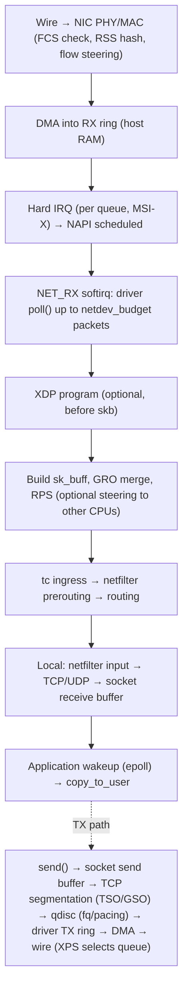

# 2.24 Linux networking III: policy routing, VRF, bonding, MTU, NIC and stack tuning

| | |
|---|---|
| Level | Advanced |
| Priority tier | 0 |
| Lab venue | Linux VMs / namespaces; NIC tuning needs real hardware |
| Part | Part 2: Networking, from first principles to AI fabrics |
| Status | Drafted, labs **untested** |

## Why this matters for AI infrastructure

A GPU server is a multi-homed machine with several NICs on several networks (management, front-end, storage, compute rails), a 100 to 800 Gb/s capability that a default Linux configuration will not deliver, and workloads (collective communication, checkpoint writes, dataset reads) that expose every inefficiency in the packet path. Getting the last 50% of bandwidth and the last 50 microseconds of latency means understanding how packets leave and enter the host: which routing table is consulted for which source address, how interrupts and queues map to cores and NUMA nodes, which offloads are on, how big the rings and buffers are, what the MTU is end to end, and which TCP knobs matter. The same knowledge diagnoses classic failures: replies leaving the wrong NIC, a single core pegged in softirq, drops at the NIC ring that never reach `tcpdump`, a 100G link delivering 25G to one flow, or a stack tuned for the wrong round-trip time. This chapter covers policy routing and VRFs, bonding operations, MTU design, NIC and kernel tuning, congestion control and buffers, and kernel-bypass options, with a method for tuning safely.

## Prerequisites and outcomes

You should know routing on a host (2.5), TCP (2.6), `ip`/`ethtool`/counters (2.22), netfilter (2.23) and LAG/ECMP (2.12).

After this chapter you can:

- Build and verify source-based, mark-based and interface-based policy routing; fix asymmetric routing on multi-homed servers; persist rules in Netplan/NetworkManager/networkd.
- Use VRFs for L3 isolation on Linux, run processes inside a VRF, and leak routes where needed.
- Operate and troubleshoot Linux bonds (modes, LACP state, hash policy, failover tests) and decide where bonding is the wrong tool (compute rails).
- Design MTU end to end (jumbo, overlays, MSS clamping), verify with DF pings, and persist it.
- Trace the receive and transmit paths (NIC, DMA, ring, hardirq, NAPI/softirq, XDP, skb, tc, netfilter, socket) and tune each stage: ring sizes, interrupt coalescing, RSS/RPS/RFS/XPS, IRQ affinity, NUMA locality, offloads (TSO, GSO, GRO, LRO), PCIe.
- Tune the TCP/IP stack: buffers, backlogs, congestion control and qdisc, TIME_WAIT/ports, keepalives, window scaling/SACK/timestamps, conntrack, busy polling and zero-copy; justify each change with measurement.
- Choose among kernel-stack, XDP/eBPF, SR-IOV, DPDK and RDMA data paths.
- Apply a tuning methodology (baseline, one change, measure, revert) and a safe rollout.

## 1. Policy routing

Standard Linux routing consults the table by **destination** (chapter 2.5). **Policy-based routing (PBR)** adds selectors: the kernel first evaluates a prioritised list of **rules** (`ip rule`) that choose *which routing table* to use based on source address, destination, input interface, TOS/DSCP, fwmark, UID/GID range, IP protocol and ports, and then does the longest-prefix lookup in that table.

```bash
ip rule show
# 0:      from all lookup local
# 32766:  from all lookup main
# 32767:  from all lookup default
cat /etc/iproute2/rt_tables              # name ↔ number map for tables (255 local, 254 main, 253 default) ; add your own
```

Rule fields: `from`, `to`, `iif`, `oif`, `tos`, `fwmark`, `uidrange`, `ipproto`, `sport`, `dport`; actions: `lookup <table>`, `blackhole`, `unreachable`, `prohibit`, `goto`; `priority N` (lower evaluated first). Rules are evaluated in order until one yields a route.

### Fixing multi-homed asymmetric routing

A server has `eth0` 10.0.0.5/24 (default gateway 10.0.0.1) and `eth1` 192.168.1.5/24 (storage; its gateway 192.168.1.1 reaches other storage subnets). A client from a remote storage subnet connects to 192.168.1.5; the request arrives on `eth1`, but the reply is routed by destination: the main table's default route points out `eth0` with source 192.168.1.5. The upstream router at 10.0.0.1 sees a packet from 192.168.1.5 on the wrong VLAN and drops it (unicast reverse path forwarding), or the client drops a reply that arrives from an unexpected path. Fix by giving each NIC its own routing table and selecting it by **source address**:

```bash
echo "200 storage" | sudo tee -a /etc/iproute2/rt_tables
sudo ip route add 192.168.1.0/24 dev eth1 src 192.168.1.5 table storage          # connected route in the table
sudo ip route add default via 192.168.1.1 dev eth1 table storage                  # that table's own default
sudo ip rule add from 192.168.1.5/32 lookup storage priority 1000
ip route get 10.50.0.9 from 192.168.1.5 iif lo          # verify: shows via 192.168.1.1 dev eth1
```

Also: set `rp_filter` to loose (2) or 0 for multi-NIC servers (chapter 2.5), and configure `arp_ignore=1`/`arp_announce=2` so each NIC answers ARP only for its own addresses. For **one table per rail** on a GPU node with eight NICs, script the table and rule creation from inventory (table = 100 + rail index).

### Netplan / NetworkManager / networkd persistence

```yaml
# netplan
network:
  version: 2
  ethernets:
    eth1:
      addresses: [192.168.1.5/24]
      routes:
        - to: default
          via: 192.168.1.1
          table: 200
        - to: 192.168.1.0/24
          scope: link
          table: 200
      routing-policy:
        - from: 192.168.1.5
          table: 200
          priority: 1000
```

```bash
# NetworkManager
nmcli connection modify eth1 ipv4.routes "0.0.0.0/0 192.168.1.1 table=200" ipv4.routing-rules "priority 1000 from 192.168.1.5 table 200"
# systemd-networkd:  [RoutingPolicyRule] From=192.168.1.5  Table=200  Priority=1000   and   [Route] Gateway=... Table=200
```

### fwmark-based and UID-based routing

Mark packets with netfilter/nftables (or `SO_MARK` in the application), then select a table by mark. Uses: send traffic from a particular process/container/user through a VPN or a specific uplink, steer storage traffic to a dedicated NIC, implement transparent proxies.

```bash
sudo nft add table inet mangle_t
sudo nft 'add chain inet mangle_t out { type route hook output priority mangle; }'
sudo nft add rule inet mangle_t out meta skuid 1001 meta mark set 0x64     # all packets of uid 1001 get mark 100
sudo ip rule add fwmark 0x64 lookup 100 priority 900
sudo ip rule add uidrange 1001-1001 lookup 100 priority 910              # alternative without marking
```

(`type route` chains re-run the routing decision after the mark is set; a `filter` hook in output would not re-route.) The routing cache no longer exists in modern kernels, so rule changes take effect for new lookups immediately; `ip route flush cache` is a no-op. `ip route get ... mark 0x64 uid 1001 from <src> iif <dev>` simulates the lookup.

### Common PBR patterns in clusters

| Use | Rule | Notes |
|---|---|---|
| Per-NIC replies (storage, rails) | `from <nic ip> lookup <table>` | Each NIC has its own default and connected routes |
| Per-tenant/VRF | `iif <dev> lookup <table>` or VRF device | Combine with namespaces |
| Egress through proxy/VPN | `fwmark` / `uidrange` | Per-process egress policy |
| Kubernetes pods with multiple NICs (Multus) | Pod-level rules in the pod namespace | Each secondary interface needs return routes |
| Source-specific routing for IPv6 | `from <prefix> lookup <table>` | Multi-prefix hosts (SADR) |
| Blackhole abuse sources | `from <addr> blackhole` | Cheap emergency block |

## 2. VRF on Linux

A **VRF** (virtual routing and forwarding) device gives a group of interfaces their own routing table, isolated from the default one, lighter than a network namespace (processes still share sockets, files, and other stack state). They are central to multi-tenant leaf switches (Cumulus/SONiC-like) and useful on hosts.

```bash
sudo ip link add vrf-blue type vrf table 10
sudo ip link set vrf-blue up
sudo ip link set eth2 master vrf-blue ; sudo ip addr add 10.9.0.5/24 dev eth2 ; sudo ip link set eth2 up
ip -br link show type vrf ; ip -vrf vrf-blue route show ; ip vrf show
sudo ip vrf exec vrf-blue ping 10.9.0.1               # run a command bound to the VRF (sockets bound via SO_BINDTODEVICE)
sudo ip vrf exec vrf-blue ssh 10.9.0.9
ss -tn --vrf vrf-blue ; ss -tlnp   # services: sysctl net.ipv4.tcp_l3mdev_accept=1 lets one listener accept in any VRF
```

Route leaking between VRFs: `ip route add 10.9.0.0/24 dev vrf-blue table main` style entries or a veth pair connecting VRFs (`ip link add v1 type veth peer name v2`; place each end in a different VRF), or BGP route targets in FRR (chapter 2.17). Caveats: services must be started inside the VRF or be VRF-aware (`tcp_l3mdev_accept`, `udp_l3mdev_accept`, `ip vrf exec`), DNS and NTP lookups depend on resolvers reachable in the VRF, and `ip route get` needs `oif vrf-blue`.

## 3. Bonding operations

Mode choices and hashing are in chapter 2.12; here is the operational view.

```bash
cat /proc/net/bonding/bond0                       # authoritative state: mode, hash policy, MII status, slaves, aggregator IDs, LACP partner
ip -d link show bond0 ; ip -br link show master bond0
ethtool bond0 ; ethtool ens1f0 ; ethtool ens1f1   # speeds must match
sudo ip link set ens1f0 down ; ping -i 0.1 <peer>  # failover test: count lost pings, then bring it back
tcpdump -ni ens1f0 ether proto 0x8809              # LACPDUs (slow protocols)
watch -n1 "cat /sys/class/net/bond0/bonding/ad_aggregator; cat /sys/class/net/bond0/bonding/slaves"
```

Verification checklist after changes: all slaves in the same **Aggregator ID** with non-zero **partner MAC**; `lacp_rate fast`; `xmit_hash_policy layer3+4` (or encap variants for tunnels); `min_links` set; MTU identical on bond and slaves (set on the bond; slaves inherit); `miimon 100`; the switch shows the port-channel up with all members `bundled`; a throughput test with many flows shows traffic on all members (`sar -n DEV 1` or `ip -s link`); a failover test (pull cables, reboot a switch) meets the recovery objective.

**Bonding and RDMA**: one RDMA flow (one queue pair) cannot be split across two links by LACP; for compute fabrics use **independent rails** (each NIC its own IP/subnet) and let NCCL/MPI stripe across NICs; some NICs offer **hardware LAG** (mlx5 `lag_mode`) that keeps RoCE working across a bond for the management/storage plane. Never bond the GPU compute rails.

## 4. MTU design

MTU must be a deliberate, **end-to-end consistent** property of each network, and every device on a layer-2 segment must agree: hosts, switch ports, VLAN interfaces, bonds, bridges, virtual switches, overlays.

| Network | Typical MTU | Notes |
|---|---|---|
| Management / Internet-facing | 1500 | Default; compatible with everything |
| Storage (NFS, Lustre, object, NVMe/TCP) | 9000 | Fewer packets per byte; needs every hop to support jumbo |
| RoCE compute fabric | 9000 on Ethernet, RDMA MTU 4096 | Eth headers + 4096 payload fits; configured per NIC (`ibv_devinfo` active_mtu) |
| Overlays (VXLAN/Geneve) | underlay − 50 (e.g. 8950/9000 or 1450/1500) | Chapter 2.17 |
| Kubernetes pod network | node MTU − overlay overhead | CNI config; mismatches cause "small works, large hangs" |
| Cloud VPC | cloud-specific (e.g. 1460 GCP default, configurable; 9001 AWS inside VPC) | Check per path |

```bash
sudo ip link set eth1 mtu 9000                                  # runtime
ip -d link show eth1 | grep mtu ; cat /sys/class/net/eth1/mtu
ping -M do -s 8972 -c 3 <peer>                                  # 9000 − 28 bytes of IP/ICMP header
tracepath -n <peer>                                             # discovers the path MTU hop by hop
# persistence: netplan 'mtu: 9000', nmcli 802-3-ethernet.mtu 9000, networkd [Link] MTUBytes=9000
sudo iptables -t mangle -A FORWARD -p tcp --tcp-flags SYN,RST SYN -j TCPMSS --clamp-mss-to-pmtu     # MSS clamping on gateways
sysctl net.ipv4.tcp_mtu_probing                                 # 1: probe after black-hole detection ; 2: always probe
```

Remember TCP MSS derives from interface MTU (1460/8960), UDP applications may fragment (avoid), PMTUD needs ICMP (chapter 2.7), and offloads (TSO/GSO/GRO) mean the stack handles 64 KB super-packets that are segmented at the NIC, so a captured packet can be larger than the MTU. Throughput gain from jumbo frames is smaller on offload-capable NICs but CPU and interrupt cost still drop; 9000 is the usual choice for storage and RoCE.

## 5. The packet path and where to tune it



### 5.1 Know the limits first (static tuning)

Before changing anything, record: NIC model/firmware/driver; link speed and FEC; PCIe generation/width and the NUMA node of the NIC (`cat /sys/class/net/eth0/device/numa_node`, `lspci -vv -s <bus> | grep -E 'LnkSta|LnkCap'`, `nvidia-smi topo -m` for GPU-NIC affinity); CPU model, core count per NUMA node, SMT; kernel version; current ring sizes/coalescing/offloads/queues; IRQ distribution; firewall rules; MTU; congestion control; and the workload (flows, packet sizes, request rates). A PCIe Gen4 x16 slot (about 252 Gb/s usable) caps a 400G NIC; a NIC on the remote NUMA node adds latency and halves bandwidth because traffic crosses the inter-socket link.

### 5.2 Rings, interrupts and coalescing

```bash
ethtool -g eth0                        # ring sizes: RX/TX current and pre-set maximums
sudo ethtool -G eth0 rx 4096 tx 4096   # bigger rings absorb microbursts (costs memory and latency under overload)
ethtool -c eth0 ; sudo ethtool -C eth0 adaptive-rx on adaptive-tx on      # or fixed: rx-usecs 50 rx-frames 20
```

Bigger rings reduce `rx_missed`/`rx_out_of_buffer` drops when the CPU cannot poll fast enough; they do not fix a permanently overloaded CPU. **Interrupt coalescing** delays interrupts to batch packets: lower CPU use and higher throughput at the cost of latency. Throughput/storage NICs: adaptive or moderate coalescing; latency-critical NICs (kernel-path MPI/NCCL sockets, trading): minimal or none (RDMA NICs bypass this entirely). Verify with `/proc/interrupts` rates and `sar -I` while testing.

### 5.3 Queues, RSS, RPS, RFS, XPS

A single core cannot process 100 Gb/s; traffic must be spread over many queues and cores while keeping each flow on one core (ordering and cache locality).

- **RSS (receive-side scaling, hardware)**: the NIC hashes packet fields (Toeplitz over IPs and ports) to select one of N receive queues, each with its own interrupt. `ethtool -l eth0` (channels), `sudo ethtool -L eth0 combined 32`, `ethtool -x eth0` (indirection table and hash key), `sudo ethtool -X eth0 equal 32`, hash fields via `ethtool -N eth0 rx-flow-hash tcp4 sdfn`. Set queues to the number of cores on the **NIC's NUMA node** (not necessarily all cores). Note that overlay traffic (VXLAN) hashes only on the outer headers unless the NIC supports inner-header RSS.
- **IRQ affinity**: each queue's IRQ should run on a core local to the NIC. `grep eth0 /proc/interrupts`, `cat /proc/irq/<n>/smp_affinity_list`, `echo <cpu> | sudo tee /proc/irq/<n>/smp_affinity_list`; vendor scripts (`set_irq_affinity_bynode.sh <node> eth0`, `mlnx_affinity`) do this; stop `irqbalance` (or exclude the NIC) when pinning manually; align with the application's CPU placement (the thread that consumes the data should ideally run on the same NUMA node/cache domain).
- **RPS (receive packet steering, software)**: spreads packet processing after the interrupt to other CPUs when the NIC lacks enough queues (`echo ffff > /sys/class/net/eth0/queues/rx-0/rps_cpus`; `net.core.rps_sock_flow_entries`); **RFS** steers packets toward the CPU where the consuming application thread runs (`/sys/class/net/eth0/queues/rx-0/rps_flow_cnt`); **aRFS** does the same in hardware. Useful on virtual NICs and single-queue devices; modern multi-queue NICs usually rely on RSS.
- **XPS (transmit packet steering)**: maps CPUs to TX queues (`/sys/class/net/eth0/queues/tx-0/xps_cpus`) to avoid lock contention and cross-NUMA transmits.
- **Verification**: `mpstat -P ALL 1` (are `%soft` and `%irq` spread, or is one core at 100%?), `perf top`, `/proc/softirqs` NET_RX per CPU, `ethtool -S eth0 | grep -E 'rx_queue_.*_packets'` (per-queue balance), `cat /proc/net/softnet_stat` (drops, squeezes).

### 5.4 Offloads

| Offload | What | Notes |
|---|---|---|
| **Checksum offload** (rx/tx) | NIC computes/validates L4 checksums | Capture on the sender shows "bad cksum" (benign) |
| **TSO / GSO** | Send 64 KB buffers; NIC (TSO) or kernel late (GSO) segments into MTU-sized frames | Big CPU saver; enable |
| **GRO** | Merge received packets of a flow into larger skbs before the stack | Big CPU saver; may hurt forwarding/bridges/latency; disable on routers/VXLAN gateways (use `rx-gro-hw`/`gro` per case) |
| **LRO** | Hardware merge on receive | Breaks forwarding (headers lost); avoid on routers/bridges/hypervisors |
| **Tunnel segmentation** (`tx-udp_tnl-segmentation`), VLAN offload, `rx-vlan-offload` | Offload for VXLAN/Geneve and VLAN tags | Check with `ethtool -k` |
| **Scatter-gather, TX checksum, rxhash** | Zero-copy-ish transmit; hardware hash | Keep on |
| **Flow control (802.3x pause)** | Link-level pause | Usually off in modern DCs; PFC instead (chapter 2.19) |
| **TLS/IPsec/MACsec offload** | NIC encrypts | Reduces CPU for encrypted traffic (kTLS, ESP) |

```bash
ethtool -k eth0 | egrep 'rx-checksumming|tx-checksumming|scatter-gather|tcp-segmentation|generic-segmentation|generic-receive|large-receive|rx-vlan|tx-udp_tnl|hw-tc-offload'
sudo ethtool -K eth0 tso on gso on gro on lro off
```

### 5.5 Kernel queues, budget and backlog

```bash
sysctl net.core.netdev_budget net.core.netdev_budget_usecs net.core.netdev_max_backlog net.core.dev_weight
sudo sysctl -w net.core.netdev_budget=600 net.core.netdev_max_backlog=10000     # more work per softirq, bigger per-CPU backlog (RPS)
cat /proc/net/softnet_stat       # col2 drops (backlog overflow), col3 time_squeeze (budget exhausted) → raise budget or add queues
```

If `time_squeeze` increases, softirq is cut off before draining the ring: raise `netdev_budget`(`_usecs`) or spread load. If `dropped` increases, the per-CPU backlog queue (RPS path) overflowed. If the ring itself overflows (`rx_missed`), the CPU isn't polling fast enough: more queues/cores, bigger ring, fewer per-packet costs (disable expensive netfilter, use XDP).

### 5.6 Busy polling and low latency

`net.core.busy_poll`/`busy_read` (microseconds) let sockets spin-poll the NIC queue instead of sleeping, trading CPU for microseconds of latency; `SO_BUSY_POLL`/`epoll` busy poll per socket; isolate cores (`isolcpus`, `nohz_full`, `rcu_nocbs`), disable C-states (`tuned` profile `network-latency`, `intel_idle.max_cstate=1`), set CPU governor `performance`, and use `tuned-adm profile network-throughput|network-latency` as a baseline. For microsecond-class work use RDMA or DPDK instead.

## 6. TCP/IP stack tuning

Rule: **measure first**; most defaults are sane and the stack autotunes. Tune for your bandwidth-delay product, connection rates and memory (chapter 2.6 explains the mechanisms).

| Goal | Settings (starting points; validate) |
|---|---|
| Long-fat-pipe throughput | `net.core.rmem_max/wmem_max=134217728`, `net.ipv4.tcp_rmem="4096 131072 134217728"`, `tcp_wmem="4096 65536 134217728"`, `tcp_window_scaling=1`, `tcp_sack=1`, `tcp_timestamps=1`, `tcp_moderate_rcvbuf=1` |
| Short-RTT DC 100G | Buffers 16 to 64 MB max; keep defaults for min/default; avoid huge defaults that waste memory |
| Congestion control + pacing | `net.core.default_qdisc=fq`, `net.ipv4.tcp_congestion_control=bbr` (WAN/edge) or `cubic` (default), DCTCP+ECN in controlled fabrics (`tcp_ecn=1`) |
| Accept bursts | `net.core.somaxconn=4096..65535`, `tcp_max_syn_backlog=8192`, application backlog; `tcp_syncookies=1` |
| Many outbound connections | `ip_local_port_range="10240 65535"`, `tcp_tw_reuse=1`, connection pooling, spread over destination addresses |
| Idle connection hygiene | `tcp_keepalive_time/intvl/probes` (e.g. 300/30/5), `tcp_slow_start_after_idle=0` for persistent bursty connections |
| Fail-fast clients | `tcp_syn_retries=2..3`, `tcp_retries2` lower (e.g. 8) for dead peer detection, `TCP_USER_TIMEOUT` per socket |
| PMTUD black holes | `tcp_mtu_probing=1` |
| Low latency | `tcp_notsent_lowat=131072`, `TCP_NODELAY`, `tcp_low_latency` obsolete; busy poll |
| UDP receivers (StatsD, syslog, telemetry) | `rmem_max` larger, `SO_RCVBUF`, `net.core.netdev_max_backlog`, `net.ipv4.udp_mem`; watch `UdpRcvbufErrors` |
| Conntrack | `nf_conntrack_max`, hashsize, timeouts (chapter 2.23) |
| Forwarding / multi-homing | `ip_forward=1` (only where needed), `rp_filter=2`, `arp_ignore=1`, `arp_announce=2`, `accept_redirects=0` |
| File descriptors | `fs.file-max`, `ulimit -n` (LimitNOFILE) for servers with many sockets |

An example AI-node sysctl baseline (start point only; the originals in the source repository carry the same caveat):

```ini
# /etc/sysctl.d/99-ai-node-network.conf
net.core.default_qdisc = fq
net.ipv4.tcp_congestion_control = bbr          # use cubic inside the DC if BBR shows unfairness or retransmit issues
net.core.rmem_max = 134217728
net.core.wmem_max = 134217728
net.ipv4.tcp_rmem = 4096 131072 134217728
net.ipv4.tcp_wmem = 4096 65536 134217728
net.core.netdev_max_backlog = 10000
net.core.netdev_budget = 600
net.core.somaxconn = 4096
net.ipv4.tcp_max_syn_backlog = 8192
net.ipv4.tcp_syncookies = 1
net.ipv4.ip_local_port_range = 10240 65535
net.ipv4.tcp_tw_reuse = 1
net.ipv4.tcp_slow_start_after_idle = 0
net.ipv4.tcp_mtu_probing = 1
net.ipv4.conf.all.rp_filter = 2
net.ipv4.conf.default.rp_filter = 2
net.netfilter.nf_conntrack_max = 2097152         # only if nf_conntrack is loaded
net.netfilter.nf_conntrack_tcp_timeout_established = 3600
```

Production example from the literature (a large streaming operator): `default_qdisc=fq`, `netdev_max_backlog=5000`, `rmem_max/wmem_max=16 MB`, `somaxconn=1024`, `ip_local_port_range=10240 65535`, `tcp_abort_on_overflow=1`, `tcp_congestion_control=bbr`, `tcp_max_syn_backlog=8192`, `tcp_rmem/wmem="4096 12582912 16777216"`, `tcp_slow_start_after_idle=0`, `tcp_syn_retries=2`, `tcp_tw_reuse=1`: fourteen settings, not a recipe, and some values were being revised after regression testing. Lesson: small, evidence-based sets beat 200-line cargo-cult files.

### Socket options (per application)

`SO_RCVBUF`/`SO_SNDBUF` (disables autotuning if set: avoid), `TCP_NODELAY`, `TCP_CORK`/`MSG_MORE`, `TCP_QUICKACK`, `SO_KEEPALIVE` + `TCP_KEEPIDLE/INTVL/CNT`, `TCP_USER_TIMEOUT`, `TCP_CONGESTION` (per socket algorithm), `SO_REUSEPORT` (multi-process listeners with kernel load balancing), `SO_BUSY_POLL`, `SO_MAX_PACING_RATE`, `MSG_ZEROCOPY` and `sendfile()`/`splice()` (avoid user-space copies: a static file is DMAed from the page cache to the NIC with no CPU copy, saving two copies and context switches), `SO_INCOMING_CPU`. Application servers should set these deliberately rather than rely on system-wide changes.

### Qdisc and pacing

Default `fq_codel`/`mq` is fine for most hosts. `fq` provides per-flow pacing (required by BBR on older kernels and useful with `SO_MAX_PACING_RATE`), `mq` creates one qdisc per TX queue to avoid lock contention. Check drops/requeues with `tc -s qdisc show dev eth0`. Heavy shaping (`htb`) on 100G links is CPU intensive; prefer NIC rate limits or switch policing.

## 7. Beyond the kernel stack

| Technology | Idea | When |
|---|---|---|
| **XDP** (eXpress Data Path) | eBPF program in the driver before skb allocation; verdicts PASS/DROP/TX/REDIRECT | DDoS drop at millions of pps, load balancers (Katran), custom forwarding, telemetry |
| **AF_XDP** | Zero-copy path from XDP to user space | High-rate packet apps without full DPDK |
| **eBPF/TC (Cilium)** | Policy and load balancing at tc hooks, skipping netfilter and shortcutting pod-to-pod | Kubernetes at scale |
| **SR-IOV** | NIC exposes Virtual Functions passed into VMs/containers | Near-native NIC performance for pods/VMs; loses host policy visibility and live migration (`echo 4 > /sys/class/net/<pf>/device/sriov_numvfs`) |
| **DPDK** | User-space poll-mode drivers on dedicated cores | Virtual routers, UPF, vSwitches; 100% CPU always; own TCP stack |
| **RDMA (RoCE/IB)** | NIC does transport; kernel bypass; zero copy | GPU collectives, storage (NVMe-oF, Lustre, GPUDirect), see Part 11 |
| **io_uring / kTLS** | Async syscalls batching; TLS in kernel/NIC | Efficient servers |

**veth cost**: container traffic crossing veth pairs and bridges is processed in softirq context of the sending CPU; a single flow can saturate one core (~15 Gb/s class in some kernels/configs). Remedies: host networking for heavy pods, ipvlan/macvlan, SR-IOV, eBPF host routing (Cilium), or RDMA via Multus secondary networks. Kubernetes Topology Manager and CPU Manager can align pod CPUs, NIC VFs and GPUs on the same NUMA node.

## 8. A safe tuning method

1. **Define the goal and metric** (e.g. 8×400G all-reduce bandwidth ≥ 90% of line rate; p99 RPC latency; zero drops at 99th percentile load).
2. **Baseline** with representative tests (`iperf3 -P 16`, `nccl-tests`, `ib_write_bw`, application benchmark) and record configuration (`ethtool -k/-g/-c/-l`, sysctl dump, IRQ map, CPU/NUMA, versions).
3. **Locate the bottleneck** with USE and counters (chapter 2.22): link speed, PCIe, NIC drops, softirq CPU, socket buffers, application CPU.
4. **Change one thing**, measure again with the same test, keep or revert; record the delta.
5. **Prefer structural fixes** (NUMA alignment, more queues, correct MTU, remove conntrack, bypass) over sysctl lore.
6. **Roll out via configuration management** with canaries, persistent files (`/etc/sysctl.d`, udev rules or systemd units for ethtool/IRQ settings), and an audit script that compares actual to intended values (chapter 1.28).
7. **Re-validate** after kernel, driver, firmware or workload changes.

Persisting ethtool/IRQ settings: a `systemd` unit or udev rule or NetworkManager dispatcher/networkd `[Link]` section, e.g. `/etc/systemd/network/10-eth0.link` with `[Link] RxBufferSize=4096 TxBufferSize=4096 GenericReceiveOffload=yes`, or `ethtool` calls in a oneshot unit after `network-online.target`.

## 9. Scenarios

1. **Single flow delivers 25 Gb/s on a 100G link.** Check: one TCP flow is bounded by one core and window/RTT (use `iperf3 -P 8`); softirq on one core (`mpstat`), RSS collisions, GRO off, buffers too small for RTT, MTU 1500 vs 9000, PCIe slot width, NUMA mismatch. Resolution: parallel streams, more queues and correct IRQ pinning, jumbo frames, BDP buffers, local NUMA node.
2. **Drops before `tcpdump` sees them.** `ethtool -S` shows `rx_missed`/`rx_out_of_buffer`: ring overflow. Increase rings, add queues, fix IRQ pinning, shed per-packet overhead.
3. **Softirq saturation on one core** from veth or a single-queue virtual NIC: RPS/RFS, multiqueue virtio (`ethtool -L`), host networking/SR-IOV for hot pods.
4. **Replies leave on the wrong NIC.** Policy routing (section 1).
5. **Jumbo frames partly working.** One hop at 1500; `ping -M do -s 8972` fails; fix MTU consistently, clamp MSS, permit ICMP.
6. **Outbound connection failures at high rates.** Ephemeral port range, TIME_WAIT, SNAT exhaustion, conntrack full: pooling, `tcp_tw_reuse`, more source IPs.
7. **UDP telemetry loss (StatsD/syslog).** `UdpRcvbufErrors`: raise `rmem_max`, set `SO_RCVBUF`, scale receivers with `SO_REUSEPORT`, check `netdev_max_backlog`.
8. **Latency spikes at idle then burst.** Coalescing and C-states: lower coalescing, `tuned network-latency`, busy poll, pin cores.
9. **Asymmetric ECMP reorder.** Hosts with BGP to two ToRs reorder if paths differ; use consistent hashing and avoid per-packet balancing.
10. **Bond up, throughput low.** Single flow pinned to one member; hash policy `layer2`; use `layer3+4` or multi-flow tests.

## 10. Lab: policy routing and tuning (untested)

1. **Multi-homed asymmetric fix**: build two NIC namespaces (a server with `eth0`/`eth1` on different subnets via veths to two routers), reproduce reply-on-wrong-NIC drops with `rp_filter=1` or an upstream uRPF rule, fix with rules/tables; verify with `ip route get ... from ...` and tcpdump.
2. **fwmark/uid routing**: mark a user's traffic and route it through another gateway namespace; confirm with `traceroute`.
3. **VRF**: two VRFs on one namespace with overlapping 10.9.0.0/24 networks; run `ip vrf exec` pings; leak a route via veth.
4. **Bond failover test**: create a bond of two veth pairs between namespaces; measure failover time with `miimon` 100 vs 1000; inspect `/proc/net/bonding`; try `layer2` vs `layer3+4` with many flows.
5. **MTU ladder**: set MTU 9000 on one side, 1500 on a router; show hang; fix with MSS clamp, MTU, ICMP allowed; verify `ping -M do -s 8972`.
6. **Ring/IRQ/RSS experiments (hardware)**: baseline `iperf3 -P 16` on a 25/100G NIC; change queue count, IRQ affinity (local vs remote NUMA), ring sizes, coalescing, GRO/TSO; record throughput and `mpstat` to see each effect.
7. **XDP drop**: attach a small `xdp_drop` program (BCC/libbpf-tools or `ip link set dev eth0 xdp obj ...`) and compare drop rate vs an nft rule using `pktgen`/`hping3` flood on a lab link.
8. **sysctl baseline**: apply the baseline file on a VM, benchmark before/after on a high-BDP emulated path (`tc netem delay 40ms`), and revert one setting at a time to attribute gains.
9. **Zero copy**: compare `sendfile` vs `read/write` file serving (`nginx sendfile on/off`, `wrk`) CPU usage.
10. **Clean up.**

Mark tested only after execution.

## 11. Common mistakes

- Pasting 100-line sysctl "AI/HPC tuning" files without measurement; setting `SO_RCVBUF` explicitly (kills autotuning).
- Setting MTU on hosts but not on every switch port/bond/VLAN/overlay.
- Pinning IRQs to the wrong NUMA node, or leaving `irqbalance` to undo manual pinning.
- Turning on LRO on a router/bridge/hypervisor; disabling GRO/TSO globally to "fix" captures.
- Tuning a 25G flow problem by changing congestion control when the issue is single-core softirq.
- Forgetting persistence: ethtool/IRQ settings lost at reboot or driver reload.
- Strict `rp_filter` on multi-homed hosts; missing source-based routing.
- Benchmarking with one flow or on loopback and extrapolating.
- Ignoring PCIe/NUMA topology of NIC and GPU.

## 12. Interview angles

- "A multi-homed server answers on the wrong interface. Why and how do you fix it?"
- "Explain `ip rule` vs routing tables vs VRFs vs namespaces."
- "Walk the receive path of a packet from the wire to the application and where drops can occur."
- "How do RSS, IRQ affinity, RPS and RFS differ?"
- "TSO, GSO, GRO, LRO: what are they, when to disable?"
- "A single TCP stream only reaches 25 Gb/s on a 100G NIC. What do you check?"
- "How would you tune a server for long-distance bulk transfers? For low-latency RPC?"
- "Why shouldn't you bond RDMA compute NICs?"
- "What are XDP, AF_XDP, DPDK and SR-IOV and when would you use each?"
- "How do you make tuning changes safe and repeatable?"

## 13. Checkpoint questions (40)

1. What does `ip rule` select? **A:** Which routing table to consult based on packet attributes.
2. Default rule order? **A:** local (0), main (32766), default (32767).
3. Where to name tables? **A:** `/etc/iproute2/rt_tables`.
4. Fix for reply on wrong NIC? **A:** Per-NIC table + `from <ip> lookup`.
5. Which sysctl relaxes reverse-path filtering? **A:** `rp_filter=2` (loose) or 0.
6. What do `arp_ignore`/`arp_announce` do? **A:** Limit ARP replies/announcements to the right interface.
7. How do you route by user? **A:** `ip rule add uidrange`.
8. Why `type route` chain for marking? **A:** It re-evaluates routing after setting the mark.
9. What is a VRF? **A:** Isolated routing table bound to a device.
10. How to run a command in a VRF? **A:** `ip vrf exec <vrf> <cmd>`.
11. VRF vs namespace? **A:** VRF isolates only routing; namespaces isolate whole stack.
12. What shows LACP partner info? **A:** `/proc/net/bonding/bond0`.
13. Why not bond compute rails? **A:** One QP can't be striped; NCCL stripes across NICs.
14. MTU verification command? **A:** `ping -M do -s <mtu-28>`.
15. Overlay MTU for VXLAN on 9000? **A:** 8950.
16. What does MSS clamping do? **A:** Rewrites SYN MSS to fit path MTU.
17. NIC DMA target for RX? **A:** RX ring buffers in host RAM.
18. What is NAPI? **A:** Interrupt-then-poll mechanism limiting interrupt load.
19. Where do `time_squeeze` counts come from? **A:** Softirq budget exhausted before ring empty.
20. What are `rx_missed` drops? **A:** NIC ring overflow before the host polled.
21. What does RSS do? **A:** Hashes flows to multiple RX queues/IRQs.
22. What does RPS do? **A:** Software steering of packet processing across CPUs.
23. What does RFS add? **A:** Steers to the CPU of the consuming thread.
24. What does XPS do? **A:** Maps CPUs to TX queues.
25. Why align IRQs to the NIC's NUMA node? **A:** Avoid cross-socket memory traffic.
26. Which command sets ring sizes? **A:** `ethtool -G`.
27. Coalescing trade-off? **A:** Less CPU/more throughput vs more latency.
28. TSO vs GSO? **A:** Hardware vs software segmentation of large sends.
29. When to turn off LRO? **A:** On routers/bridges/hypervisors.
30. Which qdisc pairs with BBR classically? **A:** `fq`.
31. Which settings set TCP buffers? **A:** `tcp_rmem`, `tcp_wmem`, `rmem_max`, `wmem_max`.
32. Why not set `SO_RCVBUF`? **A:** Disables receive autotuning.
33. What does `tcp_slow_start_after_idle=0` do? **A:** Keeps cwnd after idle.
34. What is `somaxconn`? **A:** Max accept-queue length per listener.
35. What does `sendfile` avoid? **A:** User-space copies.
36. XDP verdicts? **A:** PASS, DROP, TX, REDIRECT (ABORTED).
37. SR-IOV downside? **A:** Host policy/visibility lost; migration hard.
38. DPDK trade-off? **A:** Highest packet rates but burns dedicated cores and bypasses the kernel stack.
39. veth bottleneck cause? **A:** Softirq processing on one CPU per flow.
40. Tuning method in one line? **A:** Baseline, one change, measure, keep or revert, persist.

## 14. Sources and review notes

**Written in original words.** Principal sources:

- The author's own `nvidia-devops` repository, volume 01 networking masterclass: the packet journey (Rx path, NAPI, RSS and interrupt affinity, ring buffers and coalescing, Tx path and offloads), policy-based routing and the multi-homed asymmetric routing fix, VRF, bonding and LACP limitations, multi-homing for RoCEv2, SR-IOV and DPDK, eBPF/XDP and Cilium, LFN/TCP window scaling and SACK, the veth bottleneck scenario, MTU, and the sysctl tuning cheat sheet (with its caveats).
- Brendan Gregg, *Systems Performance*, 2nd ed., chapter 10 (network tuning: system-wide tunables with the production example, socket and TCP buffers, backlog, congestion control, TCP options, device queues, socket options, configuration; methodology for static performance tuning and resource controls).
- Brian Ward, *How Linux Works*, 3rd ed., chapter 9 (manual interface and route configuration, network managers, routers).
- Kernel documentation (`ip-sysctl`, `scaling.rst`, `vrf.rst`), `ethtool(8)`, `ip-rule(8)` and driver documentation informed the commands; values in tables are starting points, not recommendations.

**Flagged for verification before publishing:** every sysctl value and ethtool/driver option against the target kernel, NIC and firmware; `tcp_l3mdev_accept`, `type route` mark/reroute behaviour, `hw-tc-offload`/GRO hardware flags per NIC; BBR availability and fairness on your kernel; PCIe throughput figures; veth throughput claims (vary widely); all labs are **untested**.
