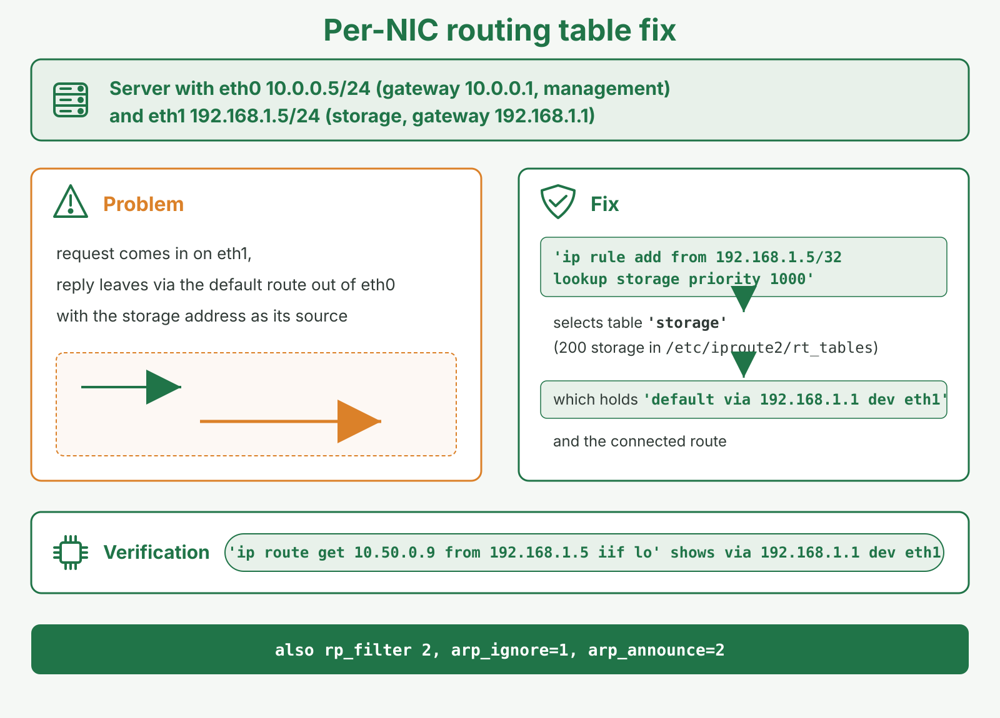
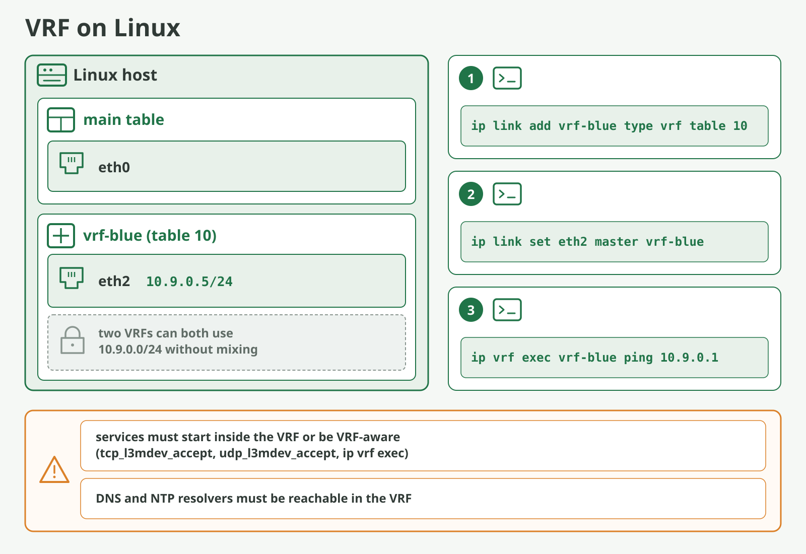
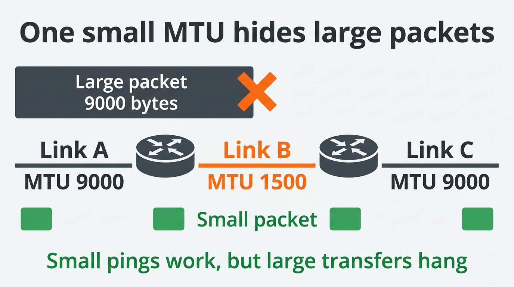
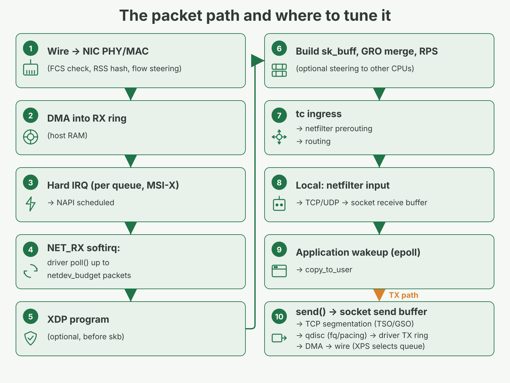
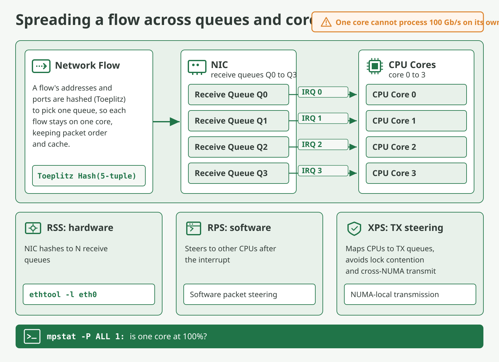
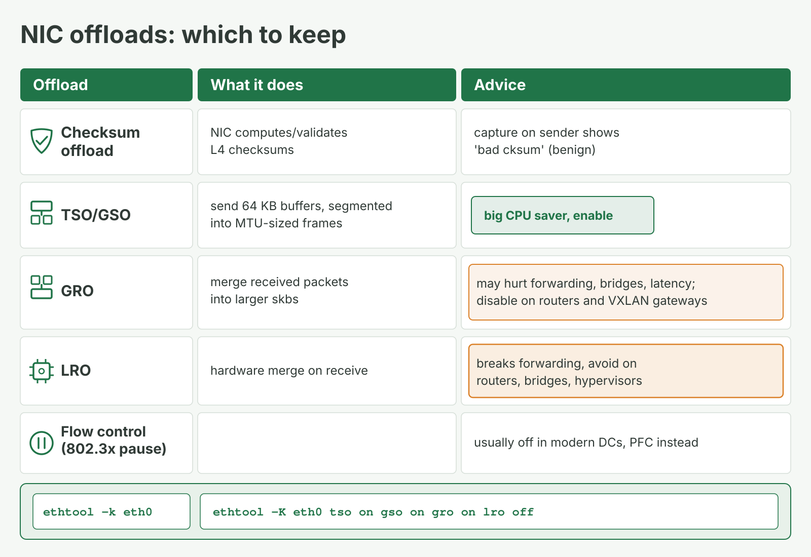

# 2.24 Linux networking III: policy routing, VRF, bonding, MTU, NIC and stack tuning

| | |
|---|---|
| Level | Advanced |
| Priority tier | 0 |
| Lab venue | Linux VMs / namespaces; NIC tuning needs real hardware |
| Part | Part 2: Networking, from first principles to AI fabrics |
| Status | Drafted, labs **untested** |

## Why this matters for AI infrastructure

A GPU server is a multi-homed machine. It has several NICs, and each one sits on a different network: management, front end, storage and compute rails. The hardware can reach a 100 to 800 Gb/s capability, but a default Linux configuration will not deliver it. Collective communication, checkpoint writes and dataset reads then expose every inefficiency in the packet path. It is like buying a racing car and finding that the first gear is stuck: the engine is fine, and something in the transmission is losing the power.

Getting the last 50% of bandwidth and the last 50 microseconds of latency means understanding how packets leave and enter the host. You need to know which routing table applies to which source address. You also need to know how interrupts and queues map to cores and NUMA nodes, which offloads are on, how big the rings and buffers are, what the MTU is end to end, and which TCP knobs matter.

The same knowledge explains the classic failures. Replies can leave the wrong NIC. A single core can get pegged in softirq. Drops at the NIC ring may never reach `tcpdump`. A 100G link can deliver only 25G to one flow. A stack tuned for the wrong round-trip time will also disappoint. The chapter follows those failures one at a time. First comes how a server with several NICs decides which one to answer on, then how bonding and MTU should be run, then the long journey of a packet through the NIC, the kernel queues and the TCP stack, with the knobs at each stage. It closes with the paths that bypass the kernel, and a method for changing any of this safely. Keep the failures above in mind as you read the sections below.

## Prerequisites and outcomes

You should know host routing (chapter 2.5), TCP (chapter 2.6), `ip`, `ethtool` and counters (chapter 2.22), netfilter (chapter 2.23), and LAG and ECMP (chapter 2.12). In practice, that means you can read a routing table, explain what a congestion window does, read an `ethtool -S` counter, and describe why a bond spreads flows rather than packets.

Terms such as RSS, GRO and NAPI are explained at the stage of the packet path where they matter, so you do not need to know them yet.

## 1. Policy routing

Picture a house with two front doors, one on a quiet lane and one on a main road. A visitor who rings the main-road bell should be sent home along the main road, not the lane. A server with two network cards is in the same position. A reply has to leave by the card the request arrived on, and the normal routing table, which looks only at the destination, cannot remember which door the visitor used. Policy routing adds that memory. The rest of this section shows how to write it down.

Normal routing looks only at the destination. That works for most traffic, but a server with two NICs often needs more. Imagine a house with two front doors, one on a quiet street and one on a main road. A visitor who rings the main-road bell should be sent home along the main road, and a destination-only rule has no way to remember which door they used. **Policy-based routing (PBR)** adds selectors. The kernel first checks a prioritised list of **rules** (`ip rule`). Each rule chooses which routing table to use, based on source address, destination, input interface, TOS/DSCP, fwmark, UID/GID range, IP protocol and ports. After a rule picks the table, the kernel does the longest-prefix lookup in that table.

The first command below prints the rule list the kernel checks. The second shows which name maps to which table number.

```bash
ip rule show
# 0:      from all lookup local
# 32766:  from all lookup main
# 32767:  from all lookup default
cat /etc/iproute2/rt_tables              # name ↔ number map for tables (255 local, 254 main, 253 default) ; add your own
```

Rules are checked in order until one yields a route. Each rule has match fields: `from`, `to`, `iif`, `oif`, `tos`, `fwmark`, `uidrange`, `ipproto`, `sport` and `dport`. Its action can be `lookup <table>`, `blackhole`, `unreachable`, `prohibit` or `goto`. The `priority N` value sets the order, and a lower number is evaluated first.

### Fixing multi-homed asymmetric routing



*Figure 2.24.1. A rule that selects a per-NIC table by source address makes replies leave through the NIC they arrived on.*

Walk through the failure the way the packets do. A request comes in on the storage card. The server answers using the default route, which points out of the management card. The reply leaves with the storage address as its source, but from the wrong door. The router upstream sees an address on a port where it does not belong, and it drops the reply. The client waits, retries, and gets nothing. The steps below undo that chain, one link at a time, so each command can be checked against the packet it is meant to change.

Consider a server with `eth0` at 10.0.0.5/24, whose default gateway is 10.0.0.1. Its second NIC, `eth1`, is 192.168.1.5/24 for storage, with gateway 192.168.1.1. A client on a remote storage subnet connects to 192.168.1.5. The request arrives on `eth1`, but the reply is routed by destination. The default route of the main table points out `eth0`, and the reply keeps source 192.168.1.5. The upstream router at 10.0.0.1 sees a packet from 192.168.1.5 on the wrong VLAN and drops it, because of unicast reverse path forwarding. Or the client drops a reply that arrives from an unexpected path. The symptom is maddening: the connection starts, the first packet is seen, and everything after it times out.

The fix gives each NIC its own routing table, and then selects that table by **source address**. A reply carries the address of the NIC it should leave through, so the rule says: packets from this address use this table.

```bash
echo "200 storage" | sudo tee -a /etc/iproute2/rt_tables
sudo ip route add 192.168.1.0/24 dev eth1 src 192.168.1.5 table storage          # connected route in the table
sudo ip route add default via 192.168.1.1 dev eth1 table storage                  # that table's own default
sudo ip rule add from 192.168.1.5/32 lookup storage priority 1000
ip route get 10.50.0.9 from 192.168.1.5 iif lo          # verify: shows via 192.168.1.1 dev eth1
```

The last command confirms the fix. It should show the route via 192.168.1.1 on `eth1`.

Two more settings help on a multi-NIC host. Set `rp_filter` to 2 (loose) or 0, as chapter 2.5 explains. Then set `arp_ignore=1` and `arp_announce=2`, so each NIC answers ARP only for its own addresses. On a GPU node with eight NICs, script the table and rule creation from inventory, with table = 100 + rail index, rather than typing each one.

### Netplan / NetworkManager / networkd persistence

Picture a server that works perfectly after you type the routes by hand, and then comes back from a reboot with none of them. The change was real but temporary, because nothing wrote it down where the boot process reads it. The examples below show the same routes written into three different managers. Choose the one your machine already uses, and write the change there before you rely on it.

Commands you type stay in effect only until the next reboot. To keep the same routes and rules, write them into the network configuration. The examples below show Netplan, NetworkManager and systemd-networkd.

```yaml
# netplan
network:
  version: 2
  ethernets:
    eth1:
      addresses: [192.168.1.5/24]
      routes:
        - to: default
          via: 192.168.1.1
          table: 200
        - to: 192.168.1.0/24
          scope: link
          table: 200
      routing-policy:
        - from: 192.168.1.5
          table: 200
          priority: 1000
```

```bash
# NetworkManager
nmcli connection modify eth1 ipv4.routes "0.0.0.0/0 192.168.1.1 table=200" ipv4.routing-rules "priority 1000 from 192.168.1.5 table 200"
# systemd-networkd:  [RoutingPolicyRule] From=192.168.1.5  Table=200  Priority=1000   and   [Route] Gateway=... Table=200
```

The Netplan file declares the same table, route and rule as the commands above. The NetworkManager command and the networkd lines do the same job in their own syntax.

### fwmark-based and UID-based routing

Picture a laptop where one application must always use the company VPN, while everything else goes out normally. Routing by destination cannot express that rule, because the destination is the same for both kinds of traffic. A mark solves the problem. The application's packets are tagged inside the kernel, and the routing rule says that tagged packets use a different table. The walkthrough shows the tag being set, the rule matching it, and the table sending the packet out through the chosen door.

Sometimes the source address is not the right selector. You can mark packets instead, and then select a table by that mark. A mark is a small number attached to a packet inside the kernel, like a sticky note that never leaves the machine. Set the mark with netfilter or nftables, or set `SO_MARK` inside the application. Marks suit three jobs. They send traffic from one process, container or user through a VPN or a specific uplink. They steer storage traffic to a dedicated NIC. They also build transparent proxies.

```bash
sudo nft add table inet mangle_t
sudo nft 'add chain inet mangle_t out { type route hook output priority mangle; }'
sudo nft add rule inet mangle_t out meta skuid 1001 meta mark set 0x64     # all packets of uid 1001 get mark 100
sudo ip rule add fwmark 0x64 lookup 100 priority 900
sudo ip rule add uidrange 1001-1001 lookup 100 priority 910              # alternative without marking
```

The chain type matters here. A `type route` chain re-runs the routing decision after the mark is set. A `filter` hook in output would not re-route. The routing cache no longer exists in modern kernels, so rule changes take effect for new lookups immediately, and `ip route flush cache` is a no-op. Simulate a lookup with `ip route get ... mark 0x64 uid 1001 from <src> iif <dev>`, and do that before you rely on a mark.

### Common PBR patterns in clusters

The table lists the patterns you meet most often in clusters. Each row uses one of the selectors above.

| Use | Rule | Notes |
|---|---|---|
| Per-NIC replies (storage, rails) | `from <nic ip> lookup <table>` | Each NIC has its own default and connected routes |
| Per-tenant/VRF | `iif <dev> lookup <table>` or VRF device | Combine with namespaces |
| Egress through proxy/VPN | `fwmark` / `uidrange` | Per-process egress policy |
| Kubernetes pods with multiple NICs (Multus) | Pod-level rules in the pod namespace | Each secondary interface needs return routes |
| Source-specific routing for IPv6 | `from <prefix> lookup <table>` | Multi-prefix hosts (SADR) |
| Blackhole abuse sources | `from <addr> blackhole` | Cheap emergency block |

For each NIC, decide which source addresses must leave through it, and write one table for that NIC.

## 2. VRF on Linux



*Figure 2.24.2. A VRF gives a group of interfaces its own routing table so identical address ranges do not collide.*

Picture a shared office building where two companies rent floors. Each company has its own telephone switchboard and its own extension numbers, so company A can dial extension seven without reaching company B's extension seven. A VRF is the switchboard for one tenant. Two tenants can use the same address on their own switchboards without any clash. The steps below create two switchboards on one server and show how a process is placed on one of them.

Imagine two groups of interfaces that both use 10.9.0.0/24. Two customers, say, have each been told to use the same private range, and the machine must serve both without mixing them up. A VRF gives each group its own routing table, so the two networks stay apart. A **VRF** (virtual routing and forwarding) device is that kind of group. It is lighter than a network namespace, because processes still share sockets, files and other stack state. VRFs are central to multi-tenant leaf switches, the kind that run Cumulus or SONiC, and they are useful on hosts too.

The commands below create the VRF, add an interface to it, and then inspect and use it.

```bash
sudo ip link add vrf-blue type vrf table 10
sudo ip link set vrf-blue up
sudo ip link set eth2 master vrf-blue ; sudo ip addr add 10.9.0.5/24 dev eth2 ; sudo ip link set eth2 up
ip -br link show type vrf ; ip -vrf vrf-blue route show ; ip vrf show
sudo ip vrf exec vrf-blue ping 10.9.0.1               # run a command bound to the VRF (sockets bound via SO_BINDTODEVICE)
sudo ip vrf exec vrf-blue ssh 10.9.0.9
ss -tn --vrf vrf-blue ; ss -tlnp   # services: sysctl net.ipv4.tcp_l3mdev_accept=1 lets one listener accept in any VRF
```

`ip vrf exec` runs a command bound to the VRF, with its sockets bound through `SO_BINDTODEVICE`. The `ss` lines show sockets per VRF.

Sometimes one VRF must reach another. You can leak a route with an entry such as `ip route add 10.9.0.0/24 dev vrf-blue table main`. You can also join two VRFs with a veth pair, created by `ip link add v1 type veth peer name v2`, with each end placed in a different VRF. A third option is BGP route targets in FRR, covered in chapter 2.17.

VRFs come with three caveats. Services must start inside the VRF or be VRF-aware, using `tcp_l3mdev_accept`, `udp_l3mdev_accept` or `ip vrf exec`. DNS and NTP lookups depend on resolvers that are reachable in the VRF. And `ip route get` needs `oif vrf-blue`. Before you move a service into a VRF, confirm that it can reach its DNS and NTP servers from inside that VRF.

## 3. Bonding operations

Picture two network cables tied together so that they behave like one thicker cable. Traffic flows along both cables, and if one breaks, the other keeps the link alive. That is a bond. The operating questions are practical ones. Are both cables really in the same bundle? Does the switch on the far end agree? Does one busy flow stay on one cable, or does it spread? The walkthrough below asks those questions in order, so that a bond that looks healthy is also a bond that is working.

How do you know a bond is really working? A bond can show "up" and still use only one of its links, or hold two links that are bundled to different partners. Mode choices and hashing are covered in chapter 2.12. This section covers the operational view: what to read on the host, what to test, and what to confirm on the switch.

Start with the authoritative state file, and then check each interface.

```bash
cat /proc/net/bonding/bond0                       # authoritative state: mode, hash policy, MII status, slaves, aggregator IDs, LACP partner
ip -d link show bond0 ; ip -br link show master bond0
ethtool bond0 ; ethtool ens1f0 ; ethtool ens1f1   # speeds must match
sudo ip link set ens1f0 down ; ping -i 0.1 <peer>  # failover test: count lost pings, then bring it back
tcpdump -ni ens1f0 ether proto 0x8809              # LACPDUs (slow protocols)
watch -n1 "cat /sys/class/net/bond0/bonding/ad_aggregator; cat /sys/class/net/bond0/bonding/slaves"
```

The `watch` line shows how the aggregator and the members change while a test runs. The `ethtool` lines confirm that the member speeds match.

After any change, check the bond against this list. Every slave should sit in the same **Aggregator ID**, with a non-zero partner MAC. A slave in a different aggregator is not part of the bundle, and a zero partner MAC means the switch never answered. Set `lacp_rate fast`, `xmit_hash_policy layer3+4` (or an encapsulation variant for tunnels), `min_links` and `miimon 100`. Keep the MTU identical on the bond and its slaves. Set it on the bond, and the slaves inherit it.

On the switch, the port-channel should be up, with all members `bundled`. Run a throughput test with many flows, and confirm traffic on every member with `sar -n DEV 1` or `ip -s link`. Finally, run a failover test by pulling cables or rebooting a switch, and check that recovery meets your recovery objective.

Bonding does not suit compute rails. One RDMA flow, which uses one queue pair, cannot be split across two links by LACP. For compute fabrics, use independent rails instead, with each NIC on its own IP address and subnet. Then let NCCL or MPI stripe traffic across the NICs. Some NICs offer hardware LAG. The mlx5 `lag_mode` setting, for example, keeps RoCE working across a bond for the management and storage plane. Never bond the GPU compute rails.

## 4. MTU design

Imagine a team whose small requests work perfectly, while every large download hangs. A ping of ordinary size gets an answer, and the application log shows nothing unusual. The usual culprit is a link on the path that accepts smaller packets than the others, so a large packet that cannot fit is quietly dropped. MTU design is the discipline of agreeing on one size everywhere, and checking that agreement with a test that refuses to fragment. The sections below explain how to set the size and how to prove it.



*Figure 2.24.3. A single small-MTU link stops large packets while small ones pass.*

How large can a packet be on this network, and does every device agree? The MTU is a deliberate property of each network. Every device on a layer-2 segment has to agree on it, including hosts, switch ports, VLAN interfaces, bonds, bridges, virtual switches and overlays. One device with a smaller value is enough to cause trouble, because the large packet either gets dropped or has to be split.

The table gives the usual MTU for each network, along with what to watch for. Each row sets its own value, so check the MTU for each network separately.

| Network | Typical MTU | Notes |
|---|---|---|
| Management / Internet-facing | 1500 | Default; compatible with everything |
| Storage (NFS, Lustre, object, NVMe/TCP) | 9000 | Fewer packets per byte; needs every hop to support jumbo |
| RoCE compute fabric | 9000 on Ethernet, RDMA MTU 4096 | Eth headers + 4096 payload fits; configured per NIC (`ibv_devinfo` active_mtu) |
| Overlays (VXLAN/Geneve) | underlay − 50 (e.g. 8950/9000 or 1450/1500) | Chapter 2.17 |
| Kubernetes pod network | node MTU − overlay overhead | CNI config; mismatches cause "small works, large hangs" |
| Cloud VPC | cloud-specific (e.g. 1460 GCP default, configurable; 9001 AWS inside VPC) | Check per path |

Set the MTU, then test the path end to end with a do-not-fragment ping.

```bash
sudo ip link set eth1 mtu 9000                                  # runtime
ip -d link show eth1 | grep mtu ; cat /sys/class/net/eth1/mtu
ping -M do -s 8972 -c 3 <peer>                                  # 9000 − 28 bytes of IP/ICMP header
tracepath -n <peer>                                             # discovers the path MTU hop by hop
# persistence: netplan 'mtu: 9000', nmcli 802-3-ethernet.mtu 9000, networkd [Link] MTUBytes=9000
sudo iptables -t mangle -A FORWARD -p tcp --tcp-flags SYN,RST SYN -j TCPMSS --clamp-mss-to-pmtu     # MSS clamping on gateways
sysctl net.ipv4.tcp_mtu_probing                                 # 1: probe after black-hole detection ; 2: always probe
```

The `-s 8972` value is the 9000-byte MTU less 28 bytes of IP and ICMP header. Keep three more details in mind. TCP MSS comes from the interface MTU, so it works out to 1460 or 8960 here. UDP applications may fragment, which you should avoid. PMTUD depends on ICMP, which chapter 2.7 covers.

Offloads also change what you capture. TSO, GSO and GRO let the stack handle 64 KB super-packets, which the NIC segments on the wire. A captured packet can therefore be larger than the MTU. Jumbo frames gain less on offload-capable NICs, but CPU and interrupt costs still drop. For storage and RoCE, 9000 is the usual choice, so set it and verify every hop with `tracepath` before you rely on it.

## 5. The packet path and where to tune it

Picture a 100G link that moves only 25G for one transfer, while other transfers on the same host run at full speed. The link is not the problem. The packet passes through a long chain of queues and cores, and one stage in that chain has a narrow limit for this flow. The diagram that follows shows the chain. Each stage can be tuned on its own, and each stage can be the one that caps the flow. Walk the path from the wire inwards, the way a packet does, and ask at every stage whether it is the narrow point.

A packet crosses many stages between the wire and your application, and a bottleneck can sit in any of them. The diagram shows the path in order. The sections below tune each stage, so that you can place each knob on the picture as you meet it.



*Figure 2.24.4. The packet path and where to tune it, as a diagram.*

Read the receive path from the top. If you want the transmit path, follow the dotted arrow at the bottom.

### 5.1 Know the limits first (static tuning)

Before you change anything, write down what the machine can do. A tuning session without that list is a guess in the dark. Record the NIC model, firmware and driver, the link speed and FEC, and the PCIe generation and width. Also note the CPU model, the cores per NUMA node, SMT, the kernel version, the ring sizes, coalescing, offloads and queues, the IRQ distribution, firewall rules, MTU, congestion control and the workload. Find the NUMA node of the NIC with `cat /sys/class/net/eth0/device/numa_node`, its PCIe link with `lspci -vv -s <bus> | grep -E 'LnkSta|LnkCap'`, and its GPU affinity with `nvidia-smi topo -m`.

The numbers make the limits concrete. A PCIe Gen4 x16 slot offers about 252 Gb/s usable, so the slot caps a 400G NIC. A NIC on the remote NUMA node adds latency and halves bandwidth, because traffic crosses the inter-socket link. A NUMA node is a group of CPU cores with their own local memory, and reaching the memory of another node is slower.

### 5.2 Rings, interrupts and coalescing

Walk through what happens when a burst of packets reaches the card. The card writes each packet into a slot of the ring. Each time a slot fills, the card can either raise an interrupt straight away or wait a little and raise one interrupt for a batch. Waiting saves the processor from many small interruptions, but it adds a little delay to each packet. The ring is the waiting room, and coalescing decides how long the card waits before calling the processor. The steps below show the trade-off with one burst in mind.

Traffic arrives in bursts, and the CPU does not always poll the NIC fast enough. Ring sizes and interrupt coalescing decide how much a burst can absorb. The ring is the waiting room between the NIC and the kernel, and its size is the number of seats.

```bash
ethtool -g eth0                        # ring sizes: RX/TX current and pre-set maximums
sudo ethtool -G eth0 rx 4096 tx 4096   # bigger rings absorb microbursts (costs memory and latency under overload)
ethtool -c eth0 ; sudo ethtool -C eth0 adaptive-rx on adaptive-tx on      # or fixed: rx-usecs 50 rx-frames 20
```

Bigger rings reduce `rx_missed` and `rx_out_of_buffer` drops when the CPU cannot poll fast enough. They do not fix a CPU that is permanently overloaded. Interrupt coalescing waits a little before it raises an interrupt, so one interrupt carries several packets. That lowers CPU use and raises throughput, but it adds latency. Storage and throughput NICs usually suit adaptive or moderate coalescing. Latency-critical NICs, such as kernel-path MPI or NCCL sockets and trading systems, need minimal coalescing or none. RDMA NICs bypass this entirely. Verify with `/proc/interrupts` rates and `sar -I` while you test.

### 5.3 Queues, RSS, RPS, RFS, XPS



*Figure 2.24.5. Hardware queues and software steering spread traffic across cores while each flow stays on one core.*

Walk through one flow from the wire to the application to see why the spreading matters. The card hashes the flow's addresses and ports and places it in one queue. That queue raises an interrupt on one core. The core handles the packets of that flow in order, and the application reads them from memory that the core has just touched, which keeps the cache warm. If the same flow were spread across several cores, packets could arrive out of order and the cache would be thrashed. The steps below show how the four mechanisms in this heading decide where each step of that walk happens.

One core cannot process 100 Gb/s on its own. Traffic has to spread across many queues and cores, while each flow stays on one core, so packets keep their order and stay in cache. If two cores worked on the same flow, packets could be handled out of order and the cache lines would bounce between them.

RSS, receive-side scaling, is the hardware option. The NIC hashes packet fields with Toeplitz over IPs and ports to pick one of N receive queues, and each queue has its own interrupt. Use `ethtool -l eth0` to see the channels, `sudo ethtool -L eth0 combined 32` to set them, `ethtool -x eth0` to see the indirection table and hash key, and `sudo ethtool -X eth0 equal 32` to spread the table evenly. Set hash fields with `ethtool -N eth0 rx-flow-hash tcp4 sdfn`. Match the queue count to the cores on the NUMA node of the NIC, which is not always all the cores. Overlay traffic such as VXLAN hashes only on the outer headers, unless the NIC supports inner-header RSS.

The IRQ of each queue should run on a core that is local to the NIC. Inspect the IRQs with `grep eth0 /proc/interrupts`, and check the current CPU list of a queue with `cat /proc/irq/<n>/smp_affinity_list`. Pin it with `echo <cpu> | sudo tee /proc/irq/<n>/smp_affinity_list`. Vendor scripts such as `set_irq_affinity_bynode.sh <node> eth0` and `mlnx_affinity` do the same job. When you pin manually, stop `irqbalance` or exclude the NIC from it. Then align the IRQs with the application, so the thread that consumes the data runs on the same NUMA node or cache domain.

RPS, short for receive packet steering, is the software option. It spreads packet processing to other CPUs after the interrupt, which helps when the NIC has too few queues. Enable it with `echo ffff > /sys/class/net/eth0/queues/rx-0/rps_cpus` and `net.core.rps_sock_flow_entries`. RFS steers packets to the CPU where the consuming application thread runs, through `/sys/class/net/eth0/queues/rx-0/rps_flow_cnt`. aRFS does the same in hardware. RPS and RFS are useful on virtual NICs and single-queue devices. Modern multi-queue NICs usually rely on RSS.

XPS, transmit packet steering, maps CPUs to TX queues through `/sys/class/net/eth0/queues/tx-0/xps_cpus`. That avoids lock contention and cross-NUMA transmits.

Check the result with `mpstat -P ALL 1`. Are `%soft` and `%irq` spread across cores, or is one core at 100%? Also look at `perf top`, the NET_RX column per CPU in `/proc/softirqs`, per-queue balance from `ethtool -S eth0 | grep -E 'rx_queue_.*_packets'`, and `cat /proc/net/softnet_stat` for drops and squeezes. On modern NICs, let RSS do the spreading, and reach for RPS only when a device has too few queues.

### 5.4 Offloads



*Figure 2.24.6. TSO and GSO save CPU, but GRO and LRO can break routers and bridges.*

Picture a clerk who checks every envelope for a correct postcode before it goes out. Offloads hand that clerk's job to the card. The card checks the checksum, or cuts large data into packets, or joins small packets back into larger ones, so the processor does not have to. The saving is real, but a clerk who changes the envelopes can break the mail for everyone downstream. The paragraphs below describe each offload, and the situations in which switching it off is the right move.

Offloads move per-packet work from the CPU to the NIC. They save CPU time, but some of them break routers and bridges, so you need to know which is which. The table lists each offload, what it does and when it matters.

| Offload | What | Notes |
|---|---|---|
| **Checksum offload** (rx/tx) | NIC computes/validates L4 checksums | Capture on the sender shows "bad cksum" (benign) |
| **TSO / GSO** | Send 64 KB buffers; NIC (TSO) or kernel late (GSO) segments into MTU-sized frames | Big CPU saver; enable |
| **GRO** | Merge received packets of a flow into larger skbs before the stack | Big CPU saver; may hurt forwarding/bridges/latency; disable on routers/VXLAN gateways (use `rx-gro-hw`/`gro` per case) |
| **LRO** | Hardware merge on receive | Breaks forwarding (headers lost); avoid on routers/bridges/hypervisors |
| **Tunnel segmentation** (`tx-udp_tnl-segmentation`), VLAN offload, `rx-vlan-offload` | Offload for VXLAN/Geneve and VLAN tags | Check with `ethtool -k` |
| **Scatter-gather, TX checksum, rxhash** | Zero-copy-ish transmit; hardware hash | Keep on |
| **Flow control (802.3x pause)** | Link-level pause | Usually off in modern DCs; PFC instead (chapter 2.19) |
| **TLS/IPsec/MACsec offload** | NIC encrypts | Reduces CPU for encrypted traffic (kTLS, ESP) |

The first command lists the offloads that are on. The second turns on TSO, GSO and GRO, and turns LRO off.

```bash
ethtool -k eth0 | egrep 'rx-checksumming|tx-checksumming|scatter-gather|tcp-segmentation|generic-segmentation|generic-receive|large-receive|rx-vlan|tx-udp_tnl|hw-tc-offload'
sudo ethtool -K eth0 tso on gso on gro on lro off
```

### 5.5 Kernel queues, budget and backlog

Picture a kitchen where the waiters bring plates to the pass at a fixed pace. If too many plates arrive during one rush, either the pass fills up and dishes wait, or the waiters run out of time for the round and leave some plates behind. The kernel's receive path behaves the same way. The budget is how much work one round may do, and the backlog is the pass where packets wait for their turn. The two counters at the top of this section tell you which of those two places overflowed.

Sometimes the NIC is fine, but the kernel cannot drain its work fast enough. Two counters tell you which limit you hit.

```bash
sysctl net.core.netdev_budget net.core.netdev_budget_usecs net.core.netdev_max_backlog net.core.dev_weight
sudo sysctl -w net.core.netdev_budget=600 net.core.netdev_max_backlog=10000     # more work per softirq, bigger per-CPU backlog (RPS)
cat /proc/net/softnet_stat       # col2 drops (backlog overflow), col3 time_squeeze (budget exhausted) → raise budget or add queues
```

If `time_squeeze` rises, softirq stops before it drains the ring. Raise `netdev_budget` or `netdev_budget_usecs`, or spread the load. If `dropped` rises, the per-CPU backlog queue used by RPS overflowed. If the ring itself overflows, which shows as `rx_missed`, the CPU is not polling fast enough. That calls for more queues or cores, a bigger ring, or fewer per-packet costs, such as disabling expensive netfilter rules or using XDP. Change the budget when `time_squeeze` rises, and the backlog when `dropped` rises.

### 5.6 Busy polling and low latency

Some workloads care more about microseconds than about CPU time. Busy polling makes a socket spin on the NIC queue instead of sleeping. That trades CPU for lower latency. A waiter who stands at the kitchen door gets your plate a moment sooner than one who waits to be called, and costs the restaurant a waiter's attention. The sysctl values `net.core.busy_poll` and `net.core.busy_read` set the time in microseconds, and `SO_BUSY_POLL` or epoll busy poll does the same per socket.

Low latency also needs quiet cores. Isolate cores with `isolcpus`, `nohz_full` and `rcu_nocbs`. Disable deep C-states with the `tuned` profile `network-latency` or `intel_idle.max_cstate=1`. Set the CPU governor to `performance`. Use `tuned-adm profile network-throughput` or `tuned-adm profile network-latency` as a baseline. For microsecond-class work, plan on RDMA or DPDK instead.

## 6. TCP/IP stack tuning

Most TCP defaults are sane, because the stack autotunes buffers for you. That is why copying a long list of settings from a blog rarely helps and sometimes hurts. Measure first, and change a setting only when a number tells you to. Tune the stack for your bandwidth-delay product, your connection rates and your memory. The bandwidth-delay product is the amount of data that fits on the wire between two hosts, which is the speed multiplied by the round-trip time, and the buffers must be at least that large to keep a fast long path full. Chapter 2.6 explains the mechanisms behind each setting.

The table maps each goal to the settings to start from. Treat every value as a starting point, and validate it on your own traffic.

| Goal | Settings (starting points; validate) |
|---|---|
| Long-fat-pipe throughput | `net.core.rmem_max/wmem_max=134217728`, `net.ipv4.tcp_rmem="4096 131072 134217728"`, `tcp_wmem="4096 65536 134217728"`, `tcp_window_scaling=1`, `tcp_sack=1`, `tcp_timestamps=1`, `tcp_moderate_rcvbuf=1` |
| Short-RTT DC 100G | Buffers 16 to 64 MB max; keep defaults for min/default; avoid huge defaults that waste memory |
| Congestion control + pacing | `net.core.default_qdisc=fq`, `net.ipv4.tcp_congestion_control=bbr` (WAN/edge) or `cubic` (default), DCTCP+ECN in controlled fabrics (`tcp_ecn=1`) |
| Accept bursts | `net.core.somaxconn=4096..65535`, `tcp_max_syn_backlog=8192`, application backlog; `tcp_syncookies=1` |
| Many outbound connections / NCCL bootstrap | `ip_local_port_range="10240 65535"` (or a dedicated range such as `net.ipv4.ip_local_port_range="50000 51000"` in `/etc/sysctl.conf` / `/proc/sys/net/ipv4/ip_local_port_range` paired with `NCCL_SOCKET_IFNAME` and `MASTER_PORT` to prevent TCP port exhaustion during `NCCL` out-of-band bootstrap handshakes; for socket/TCP transport paths, `NCCL_NSOCKS_PERTHREAD` × `NCCL_SOCKET_NTHREADS` cannot exceed `64` sockets total per communicator), `tcp_tw_reuse=1`, connection pooling, spread over destination addresses |
| Idle connection hygiene | `tcp_keepalive_time/intvl/probes` (e.g. 300/30/5), `tcp_slow_start_after_idle=0` for persistent bursty connections |
| Fail-fast clients | `tcp_syn_retries=2..3`, `tcp_retries2` lower (e.g. 8) for dead peer detection, `TCP_USER_TIMEOUT` per socket |
| PMTUD black holes | `tcp_mtu_probing=1` |
| Low latency | `tcp_notsent_lowat=131072`, `TCP_NODELAY`, `tcp_low_latency` obsolete; busy poll |
| UDP receivers (StatsD, syslog, telemetry) | `rmem_max` larger, `SO_RCVBUF`, `net.core.netdev_max_backlog`, `net.ipv4.udp_mem`; watch `UdpRcvbufErrors` |
| Conntrack | `nf_conntrack_max`, hashsize, timeouts (chapter 2.23) |
| Forwarding / multi-homing | `ip_forward=1` (only where needed), `rp_filter=2`, `arp_ignore=1`, `arp_announce=2`, `accept_redirects=0` |
| File descriptors | `fs.file-max`, `ulimit -n` (LimitNOFILE) for servers with many sockets |

The block below is an example AI-node baseline. It is a starting point only, so validate each line before you keep it.

```ini
# /etc/sysctl.d/99-ai-node-network.conf
net.core.default_qdisc = fq
net.ipv4.tcp_congestion_control = bbr          # use cubic inside the DC if BBR shows unfairness or retransmit issues
net.core.rmem_max = 134217728
net.core.wmem_max = 134217728
net.ipv4.tcp_rmem = 4096 131072 134217728
net.ipv4.tcp_wmem = 4096 65536 134217728
net.core.netdev_max_backlog = 10000
net.core.netdev_budget = 600
net.core.somaxconn = 4096
net.ipv4.tcp_max_syn_backlog = 8192
net.ipv4.tcp_syncookies = 1
net.ipv4.ip_local_port_range = 10240 65535
net.ipv4.tcp_tw_reuse = 1
net.ipv4.tcp_slow_start_after_idle = 0
net.ipv4.tcp_mtu_probing = 1
net.ipv4.conf.all.rp_filter = 2
net.ipv4.conf.default.rp_filter = 2
net.netfilter.nf_conntrack_max = 2097152         # only if nf_conntrack is loaded
net.netfilter.nf_conntrack_tcp_timeout_established = 3600
```

The conntrack line applies only when `nf_conntrack` is loaded, so skip it on hosts without that module.

The literature also gives a production example from a large streaming operator. Its fourteen settings include `default_qdisc=fq`, `netdev_max_backlog=5000` and `rmem_max/wmem_max=16 MB`. The rest include `somaxconn=1024`, `ip_local_port_range=10240 65535`, `tcp_abort_on_overflow=1`, `tcp_congestion_control=bbr` and `tcp_max_syn_backlog=8192`. The remaining settings are `tcp_rmem` and `tcp_wmem="4096 12582912 16777216"`, `tcp_slow_start_after_idle=0`, `tcp_syn_retries=2` and `tcp_tw_reuse=1`. That set is not a recipe, and some values were being revised after regression testing. The lesson is that small, evidence-based sets beat 200-line cargo-cult files.

### Socket options (per application)

Applications can set socket options too, and they should do so on purpose, rather than rely on system-wide changes. Setting `SO_RCVBUF` or `SO_SNDBUF` turns off autotuning, so avoid it. Other options include `TCP_NODELAY`, `TCP_CORK` and `MSG_MORE`, and `TCP_QUICKACK`. Keepalives use `SO_KEEPALIVE` with `TCP_KEEPIDLE/INTVL/CNT`. `TCP_USER_TIMEOUT` sets a per-socket timeout, and `TCP_CONGESTION` picks a congestion algorithm for one socket. `SO_REUSEPORT` lets several processes listen with kernel load balancing. `SO_BUSY_POLL`, `SO_MAX_PACING_RATE` and `SO_INCOMING_CPU` complete the list.

`MSG_ZEROCOPY` and `sendfile()`/`splice()` avoid user-space copies. A static file, for example, is DMAed from the page cache to the NIC with no CPU copy. That saves two copies and context switches. Set socket options in the application that owns the socket, and only where a measurement justifies them.

### Qdisc and pacing

Picture a bus stop where buses leave in bunches, so a crowd waits and then a crowd rushes on. Pacing is the timetable that spreads departures evenly. The queue discipline is the rule that decides who boards first when the bus is full. The steps below show how to look at both, so that a burst can be seen on the timetable before it causes a complaint.

The default `fq_codel` or `mq` qdisc is fine for most hosts. The `fq` qdisc gives per-flow pacing, which BBR required on older kernels, and it is useful alongside `SO_MAX_PACING_RATE`. Pacing means sending packets at an even rate instead of in sudden bursts. The `mq` qdisc creates one qdisc per TX queue, which avoids lock contention. Check drops and requeues with `tc -s qdisc show dev eth0`. Heavy shaping with `htb` on 100G links costs a lot of CPU, so prefer NIC rate limits or switch policing.

## 7. Beyond the kernel stack

Picture a city where every vehicle, from a bicycle to a lorry, uses the same roads and traffic lights. Sometimes that is fine. Sometimes a lorry carrying a fixed load needs its own lane with no lights at all. The alternatives in this section are those private lanes. Each one takes a class of work away from the general road, and each one gives something up in return, such as flexibility or the familiar tools of the kernel.

Sometimes the kernel stack is the wrong place for the work. It is a general-purpose road, with traffic lights and speed limits for everyone, and some jobs want a private track. The table compares the main alternatives, and the paragraph after it covers the cost of containers.

| Technology | Idea | When |
|---|---|---|
| **XDP** (eXpress Data Path) | eBPF program in the driver before skb allocation; verdicts PASS/DROP/TX/REDIRECT | DDoS drop at millions of pps, load balancers (Katran), custom forwarding, telemetry |
| **AF_XDP** | Zero-copy path from XDP to user space | High-rate packet apps without full DPDK |
| **eBPF/TC (Cilium)** | Policy and load balancing at tc hooks, skipping netfilter and shortcutting pod-to-pod | Kubernetes at scale |
| **SR-IOV** | NIC exposes Virtual Functions passed into VMs/containers | Near-native NIC performance for pods/VMs; loses host policy visibility and live migration (`echo 4 > /sys/class/net/<pf>/device/sriov_numvfs`) |
| **DPDK** | User-space poll-mode drivers on dedicated cores | Virtual routers, UPF, vSwitches; 100% CPU always; own TCP stack |
| **RDMA (RoCE/IB)** | NIC does transport; kernel bypass; zero copy | GPU collectives, storage (NVMe-oF, Lustre, GPUDirect), see Part 11 |
| **io_uring / kTLS** | Async syscalls batching; TLS in kernel/NIC | Efficient servers |

Each row trades something. XDP keeps the Linux stack for normal traffic, while DPDK and RDMA take the work away from the kernel.

The veth cost is worth knowing. Container traffic that crosses a veth pair and a bridge is processed in softirq context on the sending CPU. A single flow can therefore saturate one core, in the range of about 15 Gb/s in some kernels and configurations. You can fix this with host networking for heavy pods, ipvlan or macvlan, SR-IOV, eBPF host routing through Cilium, or RDMA over Multus secondary networks. Kubernetes Topology Manager and CPU Manager can also align pod CPUs, NIC VFs and GPUs on the same NUMA node. If you run heavy pods, choose one of these remedies. Compare the rows of the table above when you pick.

## 8. A safe tuning method

Imagine a colleague who changes six kernel settings on Monday and says the cluster is faster on Tuesday. Nobody knows which setting helped, one of them may have hurt, and the next kernel upgrade may quietly undo the lot. The method in this section exists to prevent that story. It asks you to name the goal first, measure a baseline, change one thing, measure again, and roll out only what the numbers justify. Each step is small, and together they make tuning something you can explain to someone else.

You need a method that shows which change helped. Without one, tuning becomes a pile of settings that nobody can explain, and the next kernel upgrade quietly undoes half of them. The seven steps below build on each other.

1. Define the goal and the metric first. An example is 8×400G all-reduce bandwidth ≥ 90% of line rate. Others are p99 RPC latency, and zero drops at the 99th percentile load.
2. Take a baseline with representative tests, such as `iperf3 -P 16`, `nccl-tests`, `ib_write_bw` or an application benchmark. Record the configuration too: the output of `ethtool -k`, `-g`, `-c` and `-l`, a sysctl dump, the IRQ map, the CPU and NUMA layout, and the versions.
3. Find the bottleneck with the USE method and counters, as chapter 2.22 describes. Check link speed, PCIe, NIC drops, softirq CPU, socket buffers and application CPU.
4. Change one thing, then measure again with the same test. Keep the change or revert it, and record the delta.
5. Prefer structural fixes over sysctl lore. NUMA alignment, more queues, the correct MTU, removing conntrack and bypassing the stack are structural fixes.
6. Roll out through configuration management, with canaries and persistent files such as `/etc/sysctl.d`, udev rules or systemd units for ethtool and IRQ settings. Add an audit script that compares actual values with intended values (chapter 1.28).
7. Re-validate after a kernel, driver, firmware or workload change.

To keep ethtool and IRQ settings across a reboot, use a systemd unit, a udev rule, or a NetworkManager dispatcher or networkd `[Link]` section. For example, `/etc/systemd/network/10-eth0.link` can hold `[Link] RxBufferSize=4096 TxBufferSize=4096 GenericReceiveOffload=yes`. You can also run `ethtool` calls in a oneshot unit that starts after `network-online.target`.

Write the metric down before you touch any setting.

## 9. Scenarios

Read each scenario below as a short story. The story starts with a symptom that a user or a dashboard reports, and then it walks through what the engineer checks, in the order they check it. Try to guess the cause before reading the rest of each story. The guess is good practice, and when it is wrong, the reason it was wrong is usually the most useful lesson.

Each scenario below starts with a symptom you might see on a live host. It then tells you what to check and how to fix it. Read the symptom, guess the cause, and only then read on.

1. Suppose one transfer reaches only 25 Gb/s on a 100G link. Start with `iperf3 -P 8`, because one TCP flow is bounded by one core and by its window and RTT. Next, check softirq on one core with `mpstat`. Look for RSS collisions, check whether GRO is off, and see whether the buffers are too small for the RTT. Confirm the MTU is 9000 rather than 1500, check the PCIe slot width, and look for any NUMA mismatch. The fix is parallel streams, more queues with correct IRQ pinning, jumbo frames, buffers sized to the bandwidth-delay product, and the local NUMA node.
2. Some packets are dropped before `tcpdump` can see them, so you check `ethtool -S` instead. Counters such as `rx_missed` or `rx_out_of_buffer` mean the ring overflowed. Increase the rings, add queues, fix IRQ pinning, and shed per-packet overhead.
3. One core spends its time in softirq because of a veth pair or a single-queue virtual NIC. Use RPS or RFS, multiqueue virtio with `ethtool -L`, or host networking and SR-IOV for hot pods.
4. When replies leave on the wrong NIC, you need the policy routing in section 1.
5. Jumbo frames work for some traffic but not all. One hop still runs at 1500. A `ping -M do -s 8972` fails. Fix the MTU consistently, clamp MSS, and permit ICMP.
6. Outbound connections fail at high rates, or the NCCL bootstrap handshake stalls. The likely cause is a narrow ephemeral port range. Check `net.ipv4.ip_local_port_range` in `/etc/sysctl.conf`. One example uses `"50000 51000"`, and `"10240 65535"` is another option. Also set an explicit `MASTER_PORT` and `NCCL_SOCKET_IFNAME=ib0`, so bootstrap handshakes do not land on `eth0`, `docker0` or `lo`. Other causes are `TIME_WAIT`, SNAT exhaustion and a full conntrack table. Fix them with connection pooling, `tcp_tw_reuse`, or more source IPs. When you tune NCCL socket transport across multiple NICs, `NCCL_NSOCKS_PERTHREAD` × `NCCL_SOCKET_NTHREADS` must not exceed `64` sockets total per communicator.
7. UDP telemetry, such as StatsD or syslog, loses data. If you see it, watch `UdpRcvbufErrors`. Raise `rmem_max`, set `SO_RCVBUF`, scale the receivers with `SO_REUSEPORT`, and check `netdev_max_backlog`.
8. Latency spikes when traffic goes from idle to a burst. Look at coalescing and C-states. Lower the coalescing, apply `tuned network-latency`, enable busy polling, and pin cores.
9. If your hosts have BGP sessions to two ToRs, packets can reorder when the paths differ. Use consistent hashing, and avoid per-packet balancing.
10. A bond reports as up, but you see low throughput. One flow is pinned to one member, and the hash policy may be `layer2`. Use `layer3+4`, or run a multi-flow test.

## 10. Hands-on lab: policy routing and tuning

Start on your own machine with the self-checking Python lab, at `code/part02/linux_stack_nic_tuning_lab.py`. The lab checks NUMA-local RSS queue and IRQ CPU affinity planning with `plan_numa_local_rss_and_irq`. It also checks the NCCL socket-transport limit `NCCL_NSOCKS_PERTHREAD * NCCL_SOCKET_NTHREADS <= 64`, and it validates bootstrap ephemeral ports. Last, it checks the BDP-based sizing of socket buffers, at 16 MiB against 128 MiB for `rmem_max` and `wmem_max`. Run it with this command.

```bash
python3 code/part02/linux_stack_nic_tuning_lab.py
```

The steps after that need a disposable Linux VM with `root`. The sixth step also needs bare-metal NIC hardware, which is optional. The interactive VM commands below were not run on live hardware, so run them on a throwaway system first.

1. The first step is the multi-homed asymmetric fix. Build two NIC namespaces, where a server has `eth0` and `eth1` on different subnets, connected by veths to two routers. Reproduce the reply-on-wrong-NIC drops with `rp_filter=1` or an upstream uRPF rule. Then fix them with rules and tables, and verify with `ip route get ... from ...` and `tcpdump`.
2. The second step covers fwmark and uid routing. Mark one user's traffic, and route it through another gateway namespace. Confirm the path with `traceroute`.
3. The third step builds two VRFs in one namespace, with overlapping 10.9.0.0/24 networks. Run pings with `ip vrf exec`, and then leak a route through a veth.
4. The fourth step tests bond failover. Create a bond of two veth pairs between namespaces, and measure the failover time with `miimon` set to 100 and then to 1000. Inspect `/proc/net/bonding`, and try `layer2` against `layer3+4` with many flows.
5. The fifth step is the MTU ladder. Set MTU 9000 on one side and 1500 on a router, and watch the hang. Fix it with an MSS clamp, the MTU, and ICMP allowed. Then verify with `ping -M do -s 8972`.
6. The sixth step runs ring, IRQ and RSS experiments on hardware. Start with a baseline of `iperf3 -P 16` on a 25G or 100G NIC. Then change the queue count, the IRQ affinity (local against remote NUMA), the ring sizes, the coalescing, and GRO and TSO. Record the throughput and `mpstat` after each change, so you can see each effect.
7. The seventh step is an XDP drop. Attach a small `xdp_drop` program, using BCC, libbpf-tools, or `ip link set dev eth0 xdp obj ...`. Then compare its drop rate with an nft rule, using a `pktgen` or `hping3` flood on a lab link.
8. The eighth step applies the sysctl baseline file on a VM. Benchmark before and after on a high-BDP emulated path, made with `tc netem delay 40ms`. Then revert one setting at a time, so you can see which setting gave each gain.
9. The ninth step compares zero copy. Measure the CPU use of `sendfile` against `read/write` file serving, with `nginx sendfile on` and `off` under `wrk`.
10. The last step is cleanup.

Record each number you measure, so that you can attribute every gain to one change.

## 11. Common mistakes

Picture an engineer who copies a long tuning file from a forum, applies it to every node, and sees the throughput fall. Nobody measured the baseline, so nobody knows which line caused the fall, and the file is now part of the team's routine. The mistakes below are the habits behind stories like this one. Each habit feels like progress when you do it, and each one hides the cause that you need to see.

Most tuning mistakes come from a few habits.

- Pasting a 100-line sysctl file for "AI/HPC tuning" without measuring it. Setting `SO_RCVBUF` explicitly also kills autotuning.
- Setting the MTU on the hosts but not on every switch port, bond, VLAN or overlay.
- Pinning IRQs to the wrong NUMA node, or leaving `irqbalance` in place to undo the manual pinning.
- Turning on LRO on a router, bridge or hypervisor. Disabling GRO or TSO globally to "fix" captures is also a mistake.
- Changing congestion control to fix a 25G flow problem when the real issue is single-core softirq.
- Forgetting persistence, so that ethtool and IRQ settings are lost at reboot or on driver reload.
- Using strict `rp_filter` on multi-homed hosts, or skipping source-based routing.
- Benchmarking with one flow, or on loopback, and then extrapolating the result.
- Ignoring the PCIe and NUMA topology of the NIC and the GPU.

If you measure every setting before you copy it, you avoid the first mistake.

## 12. Interview angles

Interviewers ask these questions to see how you reason, not just what you remember. For each one, start with the layer where the problem lives, name the mechanism at that layer, and only then name the tool. A good answer sounds like a walk through the packet, step by step, with a clear point where the problem appears.

Use these questions to test yourself. Answer each one in your own words before you move on.

- A multi-homed server answers on the wrong interface. Why does that happen, and how do you fix it?
- How do `ip rule`, routing tables, VRFs and namespaces differ?
- Walk through the receive path of a packet, from the wire to the application. Where can drops occur?
- How do RSS, IRQ affinity, RPS and RFS differ?
- What are TSO, GSO, GRO and LRO, and when should you disable them?
- A single TCP stream reaches only 25 Gb/s on a 100G NIC. What do you check?
- How would you tune a server for long-distance bulk transfers, and how would you tune it for low-latency RPC?
- Why shouldn't you bond RDMA compute NICs?
- What are XDP, AF_XDP, DPDK and SR-IOV, and when would you use each?
- How do you make tuning changes safe and repeatable?

The last question ties the chapter together. Its answer is the seven-step method in section 8.

## Exercises

Each exercise gives one situation. Answer it from the mechanism first, and run the command second.

1. A multi-homed server answers on the wrong NIC. Write the `ip route` and `ip rule` commands, plus Netplan persistence, that you would use to fix asymmetric routing. Its `eth0` is `10.0.0.5/24` with gateway `10.0.0.1`. Its storage NIC `eth1` is `192.168.1.5/24` with gateway `192.168.1.1`, and it uses table `200 storage`.
2. You mark packets with `meta mark set 0x64` for fwmark routing. Explain why `nft` needs `type route hook output` for this to work.
3. A team asks whether to use a VRF or a namespace. Contrast a Linux VRF, created with `ip link add vrf-blue type vrf table 10` and run with `ip vrf exec`, with a network namespace.
4. List the 7-item operational verification checklist for a Linux `802.3ad` LACP bond, read from `/proc/net/bonding/bond0`. Then explain why GPU compute rails are never bonded.
5. Compare the standard MTU values for management (`1500`), storage (`9000`), RoCEv2 (`9000` Ethernet, `4096` IB MTU) and VXLAN overlays (`underlay - 50`). Then write the `ping -M do` command that you would use to verify the path.
6. Trace a packet from the wire to `copy_to_user`, through `Wire -> DMA RX ring -> MSI-X Hard IRQ -> NAPI NET_RX softirq -> XDP -> sk_buff/GRO/RPS -> tc/netfilter/routing -> socket buffer`.
7. One core runs hot with softirq. Use `plan_numa_local_rss_and_irq()` in `code/part02/linux_stack_nic_tuning.py` to explain how to size RSS queues with `ethtool -L`, and how to pin IRQs with `smp_affinity_list` to the NUMA node that is local to the NIC. Read that node from `/sys/class/net/<dev>/device/numa_node`.
8. Contrast `TSO`, `GSO`, `GRO` and `LRO`, and explain why LRO must be disabled on routers, bridges and hypervisors. Then explain how `sendfile()` and `MSG_ZEROCOPY` save CPU cycles and memory bandwidth when a server sends large files or checkpoints.
9. Two paths need different socket buffers. Use `recommend_tcp_max_buffer_bytes()` to compare the recommended `rmem_max` and `wmem_max` ceiling for a `100 Gb/s x 0.2 ms` intra-DC path (`16 MiB`) with a `10 Gb/s x 40 ms` WAN path (`128 MiB`). Explain why applications should not set `SO_RCVBUF` by hand.
10. An NCCL job stalls at bootstrap. Use `validate_nccl_socket_and_port_config()` to check `NCCL_NSOCKS_PERTHREAD * NCCL_SOCKET_NTHREADS <= 64`, `NCCL_SOCKET_IFNAME`, and `net.ipv4.ip_local_port_range` set to `"50000 51000"` or `"10240 65535"`.
11. A team wants to leave the kernel stack. Compare `XDP`, `AF_XDP`, `SR-IOV`, `DPDK` and `RDMA` (`RoCEv2` or InfiniBand). Explain why container `veth` pairs can bottleneck a single CPU core in softirq.
12. A single TCP stream reaches only `25 Gb/s` on a `100G` NIC. Walk through the seven-step tuning method to find out why.

## Checkpoint questions (20)

<details>
<summary>1. How does policy-based routing (`ip rule`) extend standard destination-based routing, and what are the three default rules?</summary>

Normally the kernel looks up the destination in a routing table. With policy-based routing, it first walks the `ip rule` list, starting from the lowest priority number. A rule can match on source IP (`from`), destination IP (`to`), incoming interface (`iif`), outgoing interface (`oif`), `tos`/`DSCP`, `fwmark`, `uidrange`, IP protocol and L4 ports (`sport`/`dport`). The matching rule picks which routing table to query. The three built-in rules are:

- Priority `0`: `from all lookup local` (table `255`, local IPs and broadcast)
- Priority `32766`: `from all lookup main` (table `254`)
- Priority `32767`: `from all lookup default` (table `253`)
</details>

<details>
<summary>2. Walk through the exact commands to fix reply-on-wrong-NIC asymmetric routing for a secondary storage interface `eth1` (`192.168.1.5/24`, gateway `192.168.1.1`).</summary>

Start by naming a routing table: `echo "200 storage" | sudo tee -a /etc/iproute2/rt_tables`. Next, add the connected subnet route and the default gateway to that table:

`sudo ip route add 192.168.1.0/24 dev eth1 src 192.168.1.5 table storage`

`sudo ip route add default via 192.168.1.1 dev eth1 table storage`

Then add the source-based rule: `sudo ip rule add from 192.168.1.5/32 lookup storage priority 1000`. Finally, set `rp_filter = 2` (loose), set `arp_ignore = 1` and `arp_announce = 2`, and verify with `ip route get 10.50.0.9 from 192.168.1.5 iif lo`.
</details>

<details>
<summary>3. Why must an `nftables` chain that sets a packet mark (`meta mark set 0x64`) for policy routing on locally generated packets use `type route hook output` instead of `type filter hook output`?</summary>

For packets the host generates, the kernel does the first routing lookup before the `output` hook runs. A `type filter hook output` chain can accept or drop the packet, but you should know it does not re-run the routing lookup when `meta mark` changes. A chain declared as `type route hook output priority mangle` tells the kernel to re-run the FIB and `ip rule` lookup whenever the mark, or the IP header, changes in `output`.
</details>

<details>
<summary>4. How does a Linux `VRF` device (`ip link add vrf-blue type vrf table 10`) differ from a Linux Network Namespace (`ip netns`)?</summary>

A network namespace (`ip netns`) virtualizes the entire network stack. That covers interfaces, loopback, routing tables, `ip rule`s, nftables and conntrack, and all TCP and UDP port bindings. This isolates processes cleanly, which suits containers. A Linux VRF is a lightweight netdev bound to one kernel routing table, such as `table 10`. Interfaces enslaved to `vrf-blue` (with `ip link set eth2 master vrf-blue`) use table `10` for L3 routing. They still share the host's process space, filesystem and global socket table. You run a process in a VRF with `sudo ip vrf exec vrf-blue <cmd>`. A single daemon can accept connections across all VRFs when `net.ipv4.tcp_l3mdev_accept = 1`.
</details>

<details>
<summary>5. What are the typical `MTU` settings across the networks of an AI cluster, and why is RoCEv2's RDMA MTU `4096` when the Ethernet interface MTU is `9000`?</summary>

- Management and Internet: `1500` bytes.
- Storage (`NFS`, `Lustre`, `NVMe/TCP`): `9000` bytes.
- VXLAN and Geneve overlays: `underlay_mtu - 50`, For example, a 9000-byte underlay less 50 leaves `8950` bytes, and a 1500-byte underlay leaves `1450`.
- RoCEv2 compute fabric: Ethernet interface `MTU = 9000`, and InfiniBand/RDMA `active_mtu = 4096`, which you read with `ibv_devinfo`.

The InfiniBand specification defines power-of-two payload MTUs: `256`, `512`, `1024`, `2048` and `4096`. A `4096`-byte RDMA payload, plus the RoCEv2 `BTH` and `ICRC` fields and the UDP, IP and Ethernet headers, fits inside a `9000`-byte Ethernet jumbo frame. Two 4 KB RDMA packets can even coalesce or traverse tunnels without fragmentation.
</details>

<details>
<summary>6. Trace the 8 stages of the Linux kernel Receive (`RX`) path from the physical wire to the user-space application.</summary>

1. Wire to NIC PHY/MAC: the NIC checks the FCS CRC, computes the Toeplitz **RSS hash**, and selects one of `N` hardware RX queues.
2. DMA to host RAM: the NIC DMAs the frame into a pre-allocated buffer descriptor in that queue's **RX ring**.
3. Hard IRQ (`MSI-X`): the NIC raises the queue's CPU interrupt. That disables further hard IRQs on the queue and schedules **NAPI** with `napi_schedule`.
4. `NET_RX_SOFTIRQ` (`net_rx_action`): the kernel polls the driver with `poll()`, up to `net.core.netdev_budget` packets.
5. `XDP` hook (optional): an eBPF program runs in the driver before an `sk_buff` is allocated.
6. `sk_buff` allocation, `GRO` and `RPS`/`RFS`: the kernel builds the `sk_buff`, merges same-flow segments with GRO, and optionally steers them to another CPU.
7. `tc ingress`, `netfilter prerouting`, routing, `netfilter input` and the TCP/UDP protocol handler: the kernel validates headers and state, sends ACKs, and queues data in the **socket receive buffer**.
8. Application wakeup (`epoll`) and `copy_to_user()`: the application reads the data.
</details>

<details>
<summary>7. What is the trade-off when increasing NIC Ring Buffer sizes (`ethtool -G`) and Interrupt Coalescing (`ethtool -C`)?</summary>

Larger RX and TX rings, set with `ethtool -G eth0 rx 4096 tx 4096`, absorb sub-millisecond microbursts. They avoid `rx_missed_errors` and `rx_no_buffer` drops while the CPU is briefly busy. The cost is a larger memory footprint and slightly higher worst-case queueing latency under sustained overload.

Interrupt coalescing, set with `ethtool -C eth0 adaptive-rx on` or `rx-usecs 50 rx-frames 20`, batches several arriving packets into one hardware interrupt. That reduces CPU interrupt overhead and increases bulk throughput. The cost is a few microseconds of added latency per packet. Enable adaptive coalescing on bulk storage and front-end NICs, and keep coalescing minimal on latency-critical sockets.
</details>

<details>
<summary>8. Compare `RSS`, `RPS`, `RFS` (`aRFS`), and `XPS`.</summary>

- RSS (receive-side scaling, hardware): the NIC hashes the packet's 4-tuple with a Toeplitz hash into one of `N` hardware RX queues. Each queue has its own DMA ring and MSI-X interrupt. Use `ethtool -l` and `-L` to manage them.
- RPS (receive packet steering, software): the kernel hashes packets in software after the driver interrupt, which spreads `sk_buff` processing across CPUs. If you have a NIC with only one hardware RX queue, as some older virtual NICs do, use it.
- RFS (receive flow steering) and aRFS (hardware-accelerated RFS): these steer a flow's packets to the exact CPU core where the application thread calling `recv()` is running. That maximizes cache hits in L1, L2 and L3.
- XPS (transmit packet steering): maps each CPU core to a dedicated hardware TX queue, through `/sys/class/net/<dev>/queues/tx-*/xps_cpus`. That removes cross-core TX lock contention and cross-NUMA DMA reads.
</details>

<details>
<summary>9. Why must a high-speed NIC's `RSS` queues and `IRQ` affinities be pinned strictly to its local `NUMA` node, and how do you check it?</summary>

Each PCIe root complex is wired to one specific CPU socket, which is its NUMA node. Check it with `cat /sys/class/net/eth0/device/numa_node` and `nvidia-smi topo -m`. If a NIC on NUMA node 1 fires interrupts or DMAs `sk_buff`s to cores on NUMA node 0, every packet descriptor, `sk_buff` and payload copy crosses the inter-socket link (UPI or Infinity Fabric). That adds latency, wastes interconnect bandwidth and pollutes remote caches. Stop `irqbalance` or set `IRQBALANCE_BANNED_CPUS`. Set the RSS queue count with `ethtool -L` to the core count of the local NUMA node, and pin `/proc/irq/<n>/smp_affinity_list` to local NUMA CPUs.
</details>

<details>
<summary>10. Compare `TSO`, `GSO`, `GRO`, and `LRO`, and explain why `LRO` must be disabled on routers, bridges, and hypervisors.</summary>

- TSO (TCP Segmentation Offload): the kernel hands a `64 KiB` TCP buffer to the NIC, and the NIC hardware slices it into `1460` or `8960`-byte MSS frames on the wire.
- GSO (Generic Segmentation Offload): a software fallback that delays segmentation in the kernel until right before the driver.
- GRO (Generic Receive Offload): a lossless receive coalescing step, in software or hardware, that merges consecutive segments of one flow into one `64 KiB` `sk_buff`. It keeps enough header metadata to re-segment cleanly if the packets are forwarded.
- LRO (Large Receive Offload): older hardware receive coalescing that lossily merges headers into one giant packet. On a Linux router, bridge or hypervisor, forwarded packets lose their original headers and state, which breaks TCP and forwarding. Disable it with `sudo ethtool -K eth0 lro off`.
</details>

<details>
<summary>11. What do `net.core.netdev_budget`, `netdev_budget_usecs`, and `netdev_max_backlog` tune?</summary>

- `net.core.netdev_budget` (default `300`, often raised to `600`) and `netdev_budget_usecs` (default `2000` µs) control how many packets, and for how many microseconds, one `NET_RX_SOFTIRQ` NAPI poll cycle may process before it yields the CPU. Raising them fixes a rising `time_squeeze` (column 3 of `/proc/net/softnet_stat`).
- `net.core.netdev_max_backlog` (default `1000`, often raised to `5000` to `10000`) sizes the per-CPU software input queue that RPS and loopback use. Raising it fixes a rising `dropped` count (column 2 of `/proc/net/softnet_stat`).
</details>

<details>
<summary>12. How do you size `net.core.rmem_max`/`wmem_max` and `net.ipv4.tcp_rmem`/`tcp_wmem`, and why did the streaming operator in Systems Performance chapter 10 use `16 MB` instead of `128 MB`?</summary>

`tcp_rmem` and `tcp_wmem` take three byte values, `"min default max"`. The `max` value, and `net.core.rmem_max` and `wmem_max`, must be at least 1 to 2 times the bandwidth-delay product (BDP = BW × RTT) of your longest path. That gives `128 MiB` (`134,217,728` bytes) for 10 to 25 Gb/s cross-continent WAN paths, and `16` to `64 MiB` for intra-DC 100G paths. The streaming operator in Systems Performance chapter 10 capped `rmem_max` and `wmem_max` at `16 MiB` (`16,777,216`). Each server handled tens of thousands of concurrent client connections, and oversized buffers across thousands of sockets risk exhausting host RAM under an attack or a slow-reader stall.
</details>

<details>
<summary>13. What TCP port exhaustion and socket-limit issues occur during `NCCL` bootstrap and socket-transport runs, and how do you fix them (AI Systems Performance Engineering, chapter 4)?</summary>

(1) During multi-node NCCL out-of-band TCP bootstrap, ranks open a burst of TCP connections to exchange RDMA queue-pair and ring metadata. If `net.ipv4.ip_local_port_range` is too narrow, or ports stay in `TIME_WAIT`, the bootstrap hangs or fails with `Cannot assign requested address`. Configure a dedicated, wide `net.ipv4.ip_local_port_range`, such as `"50000 51000"` from the book's isolated-port example or `"10240 65535"` with `tcp_tw_reuse = 1`. Set `MASTER_PORT`, and set `NCCL_SOCKET_IFNAME=ib0`, never `lo` or `docker0`.

(2) When you use NCCL over IP sockets, with `NCCL_SOCKET_NTHREADS` threads and `NCCL_NSOCKS_PERTHREAD` sockets per thread, NCCL enforces a hard ceiling of `64` sockets per communicator. The rule is `NCCL_NSOCKS_PERTHREAD * NCCL_SOCKET_NTHREADS <= 64`, so `4 * 8 = 32` passes.
</details>

<details>
<summary>14. How do `sendfile()` and `MSG_ZEROCOPY` reduce CPU usage during high-bandwidth data transfers?</summary>

If you use the traditional `read(file_fd, buf)` followed by `write(sock_fd, buf)`, the CPU copies data twice. The data moves from the kernel page cache to a user-space buffer, and then to the kernel socket buffer. It also costs four user-kernel context switches. `sendfile()`, and `splice()` as well, moves data from the kernel page cache to the socket in one syscall. The NIC DMAs the payload straight out of the page cache, so the CPU makes zero copies. `MSG_ZEROCOPY` on `sendmsg()` pins user-space memory pages and DMAs directly from user memory, for payloads of `10 KB` or more.
</details>

<details>
<summary>15. Compare `XDP`, `AF_XDP`, `SR-IOV`, `DPDK`, and `RDMA` (`RoCEv2` / `InfiniBand`).</summary>

- XDP (eXpress Data Path): runs an eBPF program inside the NIC driver, before `sk_buff` allocation. Its verdicts are `XDP_DROP`, `XDP_TX`, `XDP_REDIRECT` and `XDP_PASS`. It suits DDoS dropping above `10 Mpps` per core, and L4 load balancing such as `Katran`, while the Linux stack keeps handling normal traffic.
- AF_XDP: redirects selected frames from an XDP program into a zero-copy user-space ring (`UMEM`), without taking over the whole NIC.
- SR-IOV: splits one physical PCIe NIC (`PF`) into several hardware Virtual Functions (`VF`s), which pass directly into pods or VMs (`sriov_numvfs`). That bypasses the host software bridge and the veth tax.
- DPDK: unbinds the NIC from the kernel and runs a user-space poll-mode driver (`PMD`) that spins at 100% CPU on dedicated cores.
- RDMA (RoCEv2 or InfiniBand): offloads the whole transport protocol, with its Queue Pairs, into the NIC ASIC. It DMAs directly to and from GPU HBM (GPUDirect RDMA), with `1–3 µs` latency and about 0% CPU.
</details>

<details>
<summary>16. Why can a container `veth` pair become a throughput bottleneck on a `100G` node, and what are the four alternatives?</summary>

When a pod sends or receives packets through a Linux `veth` pair and a software bridge, each packet triggers a softirq transition (`NET_RX_SOFTIRQ`). It also crosses the `tc` and netfilter hooks twice, once inside the pod namespace and once on the host. That pins a single high-rate flow to one CPU core, which limits each flow to about `15` to `25 Gb/s`. For high-bandwidth pods, the four alternatives are: (1) `hostNetwork: true`, which shares the host namespace directly; (2) Cilium eBPF host routing, using `bpf_redirect_peer` to bypass the host stack between the `veth` ends; (3) `ipvlan` or `macvlan`; or (4) `SR-IOV` or `RDMA` VF attachment through Multus.
</details>

<details>
<summary>17. Why does a single TCP stream (`iperf3 -c host`) often plateau at `15` to `30 Gb/s` on a `100 Gb/s` or `400 Gb/s` NIC even when the network path is idle?</summary>

All packets of a single TCP 4-tuple hash to one RSS queue, and one CPU core processes them. That core handles both the kernel softirq work and the single-threaded user-space `read` and `write` loop. Check `mpstat -P ALL 1`. You will see one CPU core pinned at 100% (`%soft` plus `%usr` or `%sys`), while 63 other cores sit idle. To fix single-stream speed, use jumbo MTU (`9000`), the `TSO` and `GRO` offloads, NUMA-local CPU pinning (`numactl`), and larger socket buffers. For example, if one core sits at 100% while 63 others sit idle, that core is the limit. Use parallel streams, such as `iperf3 -P 8` or `-P 16`, to exercise multiple RSS queues and cores.
</details>

<details>
<summary>18. How do you tune a Linux host specifically for ultra-low-latency RPCs versus bulk throughput?</summary>

- Ultra-low latency: when you care about RPC latency, set `tuned-adm profile network-latency`, disable deep CPU C-states (`intel_idle.max_cstate=1`, CPU governor `performance`), and disable or lower NIC interrupt coalescing (`ethtool -C rx-usecs 0`). Enable socket busy polling (`net.core.busy_poll = 50`, `net.core.busy_read = 50`), set `TCP_NODELAY` on sockets, and cap sender bufferbloat with `net.ipv4.tcp_notsent_lowat = 131072`.
- Bulk throughput: set `MTU = 9000`, enable `TSO`, `GSO` and `GRO` with adaptive interrupt coalescing, size `rmem_max` and `wmem_max` to at least `2 * BDP`, and use `fq` with `bbr` for WAN or `cubic` or `dctcp` for the data center.
</details>

<details>
<summary>19. How do you persist `ethtool` ring, queue, and offload settings across reboots on modern Linux servers?</summary>

`ethtool -G`, `-L` and `-K` commands are volatile. They reset on reboot or driver reload. If you want them to survive a reboot, persist them declaratively with `systemd-networkd` `.link` files in `/etc/systemd/network/10-<ifname>.link`, which hold `[Link] RxBufferSize=4096 TxBufferSize=4096 CombinedChannels=32 GenericReceiveOffload=yes LargeReceiveOffload=no`. You can also use a NetworkManager dispatcher script in `/etc/NetworkManager/dispatcher.d/`, or a systemd oneshot service ordered `After=network-online.target`. Manage any of these with Ansible, and verify them with a boot audit check.
</details>

<details>
<summary>20. Summarize the 7-step Safe Network Tuning Methodology.</summary>

(1) Define a quantitative target metric, such as `nccl-tests` algbw/busbw, `iperf3` goodput, or p99 RPC latency.
(2) Record the complete baseline: hardware and NUMA topology, driver and firmware versions, `ethtool`, `sysctl`, counters, and the benchmark score.
(3) Locate the active bottleneck with the USE method: link speed, PCIe gen and width, NIC ring `rx_missed`, `softnet_stat`, the `ss -ti` limiter, or the CPU core.
(4) Change ONE parameter at a time, and re-measure with the identical test.
(5) Keep only the changes that produce a measurable improvement, and revert the no-ops.
(6) Prefer structural fixes, such as NUMA alignment, MTU 9000, RSS queues, and removing `conntrack`, over cargo-cult `sysctl` lists.
(7) Persist the configuration in version control under configuration management, with automated drift checks.
</details>

## Sources and review notes

- **Sources read in full:**
  - `systems-performance-2nd-edition` — Brendan Gregg, *Systems Performance: Enterprise and the Cloud*, 2nd ed., **Chapter 10: Network** (system-wide tunables and the 14-setting streaming production example `12582912`/`16777216`, socket and TCP buffers, backlog, congestion control, TCP options, device queues, socket options `SO_REUSEPORT` / `MSG_ZEROCOPY` / `sendfile`, static performance tuning, and resource controls).
  - `ai-systems-performance-engineering` — Chris Fregly, *AI Systems Performance Engineering*, **Chapter 4: Tuning Distributed Networking Communication** (host TCP stack and MTU `9000` tuning `rmem_max`/`wmem_max`, `tcp_rmem`/`tcp_wmem`, CUBIC vs BBR, NUMA-local NIC interrupt affinity, `NCCL` bootstrap ephemeral TCP port exhaustion `net.ipv4.ip_local_port_range="50000 51000"` in `/etc/sysctl.conf`, `NCCL_SOCKET_IFNAME`, `MASTER_PORT`, and socket-transport connection limits `NCCL_NSOCKS_PERTHREAD * NCCL_SOCKET_NTHREADS <= 64`).
  - `how-linux-works-3rd-edition` — Brian Ward, *How Linux Works*, 3rd ed., **Chapter 9: Understanding Your Network and Its Configuration** (manual interface and route configuration, network managers, and routers).
  - `nvidia-devops/volume-01/03-linux-networking-masterclass.md` — migrated the packet journey (RX path, NAPI, RSS and interrupt affinity, ring buffers and coalescing, TX path and offloads), policy-based routing and the multi-homed asymmetric routing fix, VRF, bonding and LACP limitations, multi-homing for RoCEv2, SR-IOV and DPDK, eBPF/XDP and Cilium, LFN/TCP window scaling and SACK, the `veth` bottleneck scenario, MTU, and the `sysctl` tuning cheat sheet.
- **Run here:** `python3 code/part02/linux_stack_nic_tuning_lab.py` (10 passed, 0 failed).
- **Explicitly labelled inferences:** The Section 5 RX/TX packet-path Mermaid diagram, `/etc/sysctl.d/99-ai-node-network.conf` baseline, and Section 9 10-scenario troubleshooting guide synthesize the Linux kernel documentation (`ip-sysctl.rst`, `scaling.rst`, `vrf.rst`), `ethtool(8)`, and `ip-rule(8)` (cross-referenced with Chapters 1.28, 2.5, 2.6, 2.7, 2.12, 2.17, 2.19, 2.22, 2.23, and Part 11, plus original study items 21, 22, 23, 24, 25, 26, 27, 28, 29, 30, 31, 32, 33, 34, 35, 36, 37, 38, 39, and 40).
- **Not verified on live hardware:** All interactive VM and NIC tuning commands (`ip rule`, `ip vrf`, `ethtool -G/-L/-K/-C/-X/-N`, `sysctl`, `mpstat`, `iperf3`) are marked and must be executed on a disposable Linux VM or test server.
