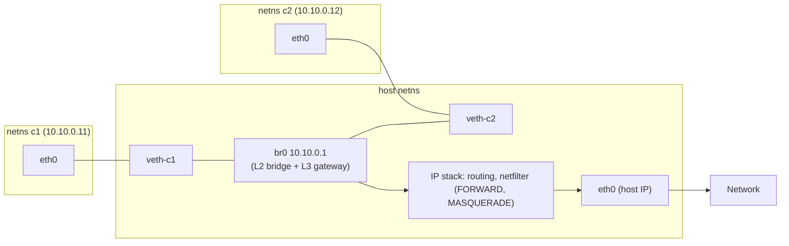

# 2.25 Linux networking IV: namespaces, veth, bridges and container networking

| | |
|---|---|
| Level | Intermediate to advanced |
| Priority tier | 0 |
| Lab venue | Linux VM with root; Docker/containerd; kind for CNI exercises |
| Part | Part 2: Networking, from first principles to AI fabrics |
| Status | Drafted, labs **untested** |

## Why this matters for AI infrastructure

Every containerised GPU workload gets its networking from a handful of kernel primitives: a network namespace per pod or container, a veth pair into the host, a bridge or routed path, and NAT or an overlay between nodes. When a training pod cannot reach the parameter server, when NCCL picks the pod's `eth0` instead of the RDMA interface, when throughput inside a pod is a fraction of the host's, or when a CNI upgrade breaks pod-to-pod traffic, you debug these primitives. GPU clusters add a twist: multi-NIC pods that need secondary RDMA interfaces (Multus, SR-IOV, macvlan), host networking for collective libraries, and CNIs chosen for performance rather than convenience. This chapter builds container networking from first principles (namespaces, veth, bridge, routing, NAT), then covers Docker's network modes, the CNI specification and common plugins, how Kubernetes pod networking works across nodes, and how to design and debug networking for GPU pods.

## Prerequisites and outcomes

You should know IP routing and forwarding (2.5), VLAN/bridging (2.11), netfilter and NAT (2.23), overlays (2.17), and cgroups/namespaces (Part 1, chapters 1.18 to 1.20).

After this chapter you can:

- Create, inspect and debug network namespaces; connect them with veth pairs, Linux bridges, routing, macvlan and ipvlan; give them NAT and DNS.
- Explain what a container's network is: its own interfaces, routes, conntrack, iptables rules, and `/etc/resolv.conf`.
- Describe Docker's network modes (bridge, host, none, overlay, macvlan, container) and the container network model (sandbox, endpoint, network).
- Explain CNI: the plugin interface (ADD/DEL/CHECK, JSON config), IPAM plugins, chained plugins, and how kubelet/containerd invoke it; compare Flannel, Calico, Cilium, AWS VPC CNI, Antrea, Multus.
- Trace pod-to-pod traffic on one node and across nodes (bridge, routed, overlay), pod-to-service and pod-to-external flows.
- Design pod networking for GPU workloads: host network vs CNI, secondary networks with Multus, SR-IOV VFs and RDMA, MTU, NUMA/topology alignment, NetworkPolicy.
- Debug container networking with `nsenter`, `ip netns`, `crictl`, `tcpdump` inside namespaces, and by following hops.

## 1. Network namespaces

A **network namespace** is a complete, independent copy of the network stack: its own network interfaces, IP addresses, routing tables, ARP/ND neighbour tables, netfilter rules, conntrack table, `/proc/net`, sockets, port numbers, and sysctls under `net.*`. Processes inside a namespace see only that namespace. This is why two containers can each run a server on port 8080 on the same host: each has its own port space. It also solves the "one TCP/IP stack per OS" problem that motivated hypervisors, without a separate kernel.

```bash
sudo ip netns add red                             # creates /run/netns/red (a bind mount to the namespace)
ip netns list
sudo ip netns exec red ip link                    # run any command inside; initially only a down loopback
sudo ip -n red link set lo up                     # '-n' is shorthand for netns exec for ip commands
sudo ip netns exec red bash                       # a shell inside the namespace
sudo ip netns del red
lsns -t net                                       # all network namespaces and their processes
sudo nsenter -t <pid> -n ip addr                  # enter a process's (container's) namespace by PID, run host tools inside
ls -l /proc/<pid>/ns/net                          # identity of a process's netns (compare inode numbers)
```

Container runtimes create anonymous namespaces (not under `/run/netns`); to inspect them, find the container's PID (`docker inspect -f '{{.State.Pid}}'`, `crictl inspectp`, `kubectl` + node access) and use `nsenter -t PID -n`. A **pod** in Kubernetes shares one namespace among its containers (created by the pause/sandbox container), so containers in a pod talk via `localhost`.

### Interfaces across namespaces

A physical NIC lives in exactly one namespace. A virtual interface can be moved (`ip link set X netns Y`). Namespaces are connected using virtual devices:

| Device | What it is |
|---|---|
| **veth pair** | Two linked virtual NICs: what goes in one end comes out the other, even across namespaces: a virtual patch cable |
| **bridge** | Software L2 switch joining several interfaces (veths, physical NICs, VXLAN devices) |
| **macvlan** | Sub-interface of a parent NIC with its own MAC; packets go straight to the wire; container appears as a separate host on the parent's LAN |
| **ipvlan** | Sub-interface sharing the parent's MAC with its own IP (L2 or L3 mode); good when switches limit MACs per port |
| **dummy / tun / tap / wireguard / vxlan / vrf** | Special devices used by VPNs, overlays, VMs, routing isolation |
| **SR-IOV VF** | Hardware virtual function placed directly into a namespace |

## 2. Building container networking by hand

Container networking is these primitives assembled by software. Doing it manually once is the best way to understand it.

```bash
# 1. Two "containers" (namespaces) connected through a bridge on the host, with NAT to the outside
sudo ip link add br0 type bridge ; sudo ip addr add 10.10.0.1/24 dev br0 ; sudo ip link set br0 up
for n in c1 c2; do
  sudo ip netns add $n
  sudo ip link add veth-$n type veth peer name eth0-$n          # host end, container end
  sudo ip link set eth0-$n netns $n                              # move the container end into the namespace
  sudo ip link set veth-$n master br0 ; sudo ip link set veth-$n up
  sudo ip -n $n link set lo up ; sudo ip -n $n link set eth0-$n name eth0 ; sudo ip -n $n link set eth0 up
done
sudo ip -n c1 addr add 10.10.0.11/24 dev eth0 ; sudo ip -n c2 addr add 10.10.0.12/24 dev eth0
sudo ip -n c1 route add default via 10.10.0.1 ; sudo ip -n c2 route add default via 10.10.0.1
sudo ip netns exec c1 ping -c2 10.10.0.12                     # container to container via the bridge (L2 switching)
# 2. Outbound access: forwarding + masquerade for the container subnet
sudo sysctl -w net.ipv4.ip_forward=1
sudo iptables -t nat -A POSTROUTING -s 10.10.0.0/24 ! -o br0 -j MASQUERADE
sudo iptables -I FORWARD -i br0 -j ACCEPT ; sudo iptables -I FORWARD -o br0 -m conntrack --ctstate ESTABLISHED,RELATED -j ACCEPT
sudo ip netns exec c1 ping -c2 8.8.8.8
# 3. Inbound port publishing: host:8080 -> c1:80 (DNAT)
sudo iptables -t nat -A PREROUTING -p tcp --dport 8080 -j DNAT --to-destination 10.10.0.11:80
sudo iptables -t nat -A OUTPUT -p tcp -d 127.0.0.1 --dport 8080 -j DNAT --to-destination 10.10.0.11:80     # for local clients
# 4. DNS inside: per-namespace resolv.conf under /etc/netns/<ns>/resolv.conf
sudo mkdir -p /etc/netns/c1 && echo "nameserver 1.1.1.1" | sudo tee /etc/netns/c1/resolv.conf
```

This is almost literally what Docker's default bridge network does: create `docker0`, a veth per container, an IPAM-assigned address from a private pool, a default route via the bridge, masquerade for outbound, DNAT for published ports, and a bind-mounted `/etc/resolv.conf`.

The data path for container A → container B on the same bridge: A's stack (routing: same subnet, ARP for B) → A's `eth0` (veth peer) → host-side veth → bridge (MAC learning, forwards to B's veth) → B's `eth0`. Netfilter hooks in the bridge path (`br_netfilter`, `net.bridge.bridge-nf-call-iptables=1`) let iptables see bridged traffic; Kubernetes requires this setting so kube-proxy rules apply to pod-to-pod traffic through bridges. For A → external: A's default route via the bridge IP → host IP stack → FORWARD → POSTROUTING masquerade → out the NIC with the host's address; return traffic is un-NATed by conntrack and delivered back through the bridge.



Alternatives to bridge+NAT: **routed veth** (no bridge: one /32 route per container pointing at its veth host end, with proxy ARP or routing protocol; Calico's model), **macvlan** (container on the physical LAN with its own MAC; host-to-container communication on the same parent doesn't work without a macvlan sub-interface on the host), **ipvlan L3** (container IPs routed through the parent; no MAC explosion), **host networking** (no namespace), and **SR-IOV/DPDK** (hardware or user-space bypass).

```bash
# macvlan: container directly on the LAN (bridge mode among macvlans on the same parent)
sudo ip link add mv0 link eth0 type macvlan mode bridge ; sudo ip link set mv0 netns c1
sudo ip -n c1 addr add 192.168.1.60/24 dev mv0 ; sudo ip -n c1 link set mv0 up
# ipvlan L3: shared MAC, routed
sudo ip link add ipv0 link eth0 type ipvlan mode l3 ; sudo ip link set ipv0 netns c2
```

## 3. Docker networking

Containers originated in LXC (cgroups + namespaces) and were popularised by Docker with a friendly image format, registry and runtime, later standardised by the Open Container Initiative (OCI: composable, decentralised, minimalist specs; runc is the reference runtime; containerd and CRI-O are the container runtimes used by Kubernetes). Docker's network model, libnetwork's **container network model (CNM)**, has three concepts: **sandbox** (a container's network namespace configuration), **endpoint** (a container's attachment point to a network, typically a veth), and **network** (a group of endpoints that can communicate). Drivers: *local* drivers (bridge, host, none, macvlan, ipvlan) are per-host; *global* drivers (overlay) need a distributed key-value store for coordination.

| Mode | Behaviour | Use |
|---|---|---|
| **bridge** (default `docker0`; or user-defined bridges) | Private subnet, veth per container, NAT outbound, `-p` publishes via DNAT; user-defined bridges add DNS-based container name resolution and isolation | Single-host development, simple services |
| **host** (`--network host`) | Container shares the host namespace; no isolation, no NAT, best performance, ports conflict with host | NCCL/HPC containers, performance-critical, packet capture tools |
| **none** | Only loopback | Isolation, custom networking (CNI-like setups), batch jobs without network |
| **container:NAME** | Shares another container's namespace | Sidecars (this is how a Kubernetes pod works) |
| **overlay** | VXLAN across Docker hosts (Swarm) | Multi-host before Kubernetes |
| **macvlan / ipvlan** | Container on the physical network | Legacy apps needing LAN addresses |

```bash
docker network ls ; docker network inspect bridge
docker run -d --name web -p 8080:80 nginx ; iptables -t nat -S DOCKER ; ip -br link | grep -E 'docker0|veth'
docker run --rm --network host nicolaka/netshoot ss -tulpn          # debug container with a toolbox
docker run --rm --network container:web nicolaka/netshoot tcpdump -ni eth0     # sniff inside another container's netns
bridge link ; bridge fdb show br docker0 ; cat /proc/sys/net/bridge/bridge-nf-call-iptables
```

Docker's published ports bypass host firewalls managed by ufw/firewalld because Docker inserts its own NAT/FORWARD rules (chapter 2.23); restrict with `DOCKER-USER` or bind addresses. Docker's default subnet (172.17.0.0/16) may overlap with corporate or VPN ranges: set `default-address-pools` in `/etc/docker/daemon.json`. In production GPU clusters, Docker's network features are rarely used directly; Kubernetes with CNI replaces them.

## 4. CNI: the Container Network Interface

Kubernetes did not adopt the CNM; it uses **CNI**, a simpler specification from CoreOS (now CNCF): a CNI **plugin** is an executable that, given a JSON network configuration and environment variables describing the container, configures networking for it. It needs no daemon and is cross-platform.

### How it works

1. The container runtime (containerd, CRI-O) creates the pod sandbox (a network namespace, usually held by the `pause` container).
2. The runtime reads the CNI configuration (`/etc/cni/net.d/*.conf|*.conflist`) and executes the plugin binary from `/opt/cni/bin/` with environment variables `CNI_COMMAND` (`ADD`, `DEL`, `CHECK`, `VERSION`), `CNI_CONTAINERID`, `CNI_NETNS` (path of the namespace), `CNI_IFNAME` (e.g. `eth0`), `CNI_ARGS`, `CNI_PATH`, with the network config on stdin.
3. The plugin creates interfaces (veth, macvlan, ...), moves one end into the namespace, calls an **IPAM plugin** (`host-local`, `dhcp`, `static`, or a CNI-specific allocator) for an address, sets routes, and returns a JSON result (IPs, routes, DNS).
4. On pod deletion, the runtime calls `DEL` to clean up. Plugins may be **chained** (a `.conflist` runs several in order: e.g. `bridge` → `portmap` → `bandwidth` → `tuning`).

```json
{
  "cniVersion": "1.0.0",
  "name": "mynet",
  "plugins": [
    { "type": "bridge", "bridge": "cni0", "isGateway": true, "ipMasq": true, "mtu": 1450,
      "ipam": { "type": "host-local", "subnet": "10.244.1.0/24", "routes": [ { "dst": "0.0.0.0/0" } ] } },
    { "type": "portmap", "capabilities": { "portMappings": true } },
    { "type": "bandwidth", "capabilities": { "bandwidth": true } }
  ]
}
```

Reference plugins (containernetworking/plugins): *main* (`bridge`, `ptp`, `macvlan`, `ipvlan`, `host-device`, `vlan`, `loopback`, `dummy`), *ipam* (`host-local`, `dhcp`, `static`), *meta* (`tuning` for sysctls, `portmap`, `bandwidth`, `firewall`, `sbr` for source-based routing, `vrf`). Test a plugin manually: create a netns and run `CNI_COMMAND=ADD CNI_CONTAINERID=x CNI_NETNS=/run/netns/test CNI_IFNAME=eth0 CNI_PATH=/opt/cni/bin /opt/cni/bin/bridge < config.json`, or use `cnitool`.

### Kubernetes network model (requirements)

Kubernetes assumes: every pod gets its own IP; **all pods can communicate with all other pods without NAT** (across nodes); agents on a node (kubelet) can reach all pods on that node; pods see their own IP as others see it. How the cluster satisfies this is the CNI's job: overlay (VXLAN/Geneve/IPIP), routed (BGP, host routes), or cloud-native (VPC-assigned pod IPs).

### Common CNI implementations

| CNI | Data path | Notes |
|---|---|---|
| **Flannel** | Simple L3 overlay (VXLAN default; host-gw routed mode) using Kubernetes API/etcd for allocations | Minimal; no NetworkPolicy by itself |
| **Calico** | Routed (BGP via BIRD or Felix), optional IPIP/VXLAN overlay, eBPF dataplane; iptables/ipsets policy | Strong NetworkPolicy; no overlay needed with BGP; scales; integrates with fabric BGP (chapter 2.16) |
| **Cilium** | eBPF datapath replacing kube-proxy/iptables, identity-based policy L3-L7, optional VXLAN/Geneve or native routing, Hubble observability, BGP control plane | High performance; requires modern kernels |
| **AWS VPC CNI / GKE native / Azure CNI** | Pod IPs are VPC/subnet addresses (ENIs, alias IPs) | No overlay; pod IPs routable in the cloud network; IP exhaustion and per-node ENI limits |
| **Antrea** | Open vSwitch-based, Geneve/VXLAN, policy | OVS offload options |
| **Weave, Canal, kube-router, Kube-OVN** | Various | |
| **Multus** | **Meta-plugin** that attaches multiple CNI interfaces to a pod (NetworkAttachmentDefinition CRDs) | Required for secondary RDMA/SR-IOV interfaces |
| **SR-IOV CNI + device plugin**, **macvlan/ipvlan/host-device CNI** | Moves a VF/NIC into the pod's namespace | RDMA/GPUDirect data plane for AI |

## 5. Kubernetes pod networking walkthrough

### Same node, bridge-based CNI (e.g. bridge/Flannel host-gw)

Pod A → A's `eth0` (veth) → host-side `vethXXX` on bridge `cni0` → pod B's veth → B. The pod CIDR for the node (e.g. 10.244.1.0/24) is local; the node has the bridge IP as gateway. With routed CNIs (Calico), each pod has a /32 route on the host pointing to its veth (`10.244.1.5 dev caliXXXX scope link`) and proxy ARP answers the pod's ARP for its default gateway (169.254.1.1); pod-to-pod on the same node goes pod → veth → host routing → veth → pod, with no bridge.

### Different nodes

- **Overlay (VXLAN/IPIP/Geneve)**: pod A (10.244.1.5) → host → route says 10.244.2.0/24 via the tunnel device (`flannel.1`, `tunl0`, `vxlan.calico`) → encapsulated in UDP (or IP-in-IP) to node 2's IP → decapsulated → delivered to pod B (10.244.2.7). Costs: MTU, CPU, hidden pod IPs from the fabric. Debug: `ip route | grep 10.244`, `bridge fdb show dev flannel.1`, `tcpdump -ni eth0 udp port 8472` (Flannel/Cilium VXLAN) or `4789`.
- **Routed (BGP/host-gw)**: node 1 has `10.244.2.0/24 via <node2 IP>` (installed by static config, BIRD, or the CNI daemon); no encapsulation; requires L2 adjacency between nodes (host-gw) or a fabric that learns pod prefixes via BGP. Best performance; pod IPs visible in the fabric (easy firewalling and monitoring).
- **Cloud-native**: pod IPs allocated from the VPC subnet; fabric routes natively.

### Pod to service and to the outside

Pod → ClusterIP: kube-proxy (iptables/IPVS) or eBPF DNATs to a backend pod (chapter 2.20/2.23); pod → external: masquerade (SNAT to node IP) unless pod IPs are routable and `ipMasq` is off; external → pod: NodePort/LoadBalancer/Ingress.

### Host networking, pause containers, DNS

`hostNetwork: true` pods share the node's namespace (no CNI, host ports, host DNS config `dnsPolicy: ClusterFirstWithHostNet`): used by node agents (kube-proxy, CNI daemon, node-exporter, DCGM exporter) and by performance-critical workloads like NCCL over sockets. Every pod normally has a `pause` container that owns the namespace and keeps it alive across container restarts. The kubelet writes `/etc/resolv.conf` pointing at CoreDNS with search domains and `ndots:5` (chapter 2.8). Kubernetes `Service` and `NetworkPolicy` semantics are covered in Part 5.

## 6. Networking for GPU and HPC pods

1. **Primary network vs data plane.** The primary CNI interface (`eth0`) carries control traffic, service access, logs, and perhaps NCCL bootstrap. The high-bandwidth GPU-to-GPU and storage traffic needs **secondary interfaces**: RDMA-capable NICs (ConnectX in RoCE or IB mode) exposed to the pod via the **NVIDIA Network Operator**, **Multus** (NetworkAttachmentDefinition), **SR-IOV device plugin + SR-IOV CNI** (VFs placed into the pod), **host-device/macvlan/ipvlan CNI**, and the **RDMA shared device plugin** (`rdma/hca_shared_devices_a`). The pod requests resources (`nvidia.com/gpu: 8`, `nvidia.com/rdma_shared_device_a: 1` or `nvidia.com/sriov_net: 8`) and annotations (`k8s.v1.cni.cncf.io/networks: rail0,rail1,...`).

```yaml
# NetworkAttachmentDefinition for a macvlan RDMA rail (illustrative)
apiVersion: k8s.cni.cncf.io/v1
kind: NetworkAttachmentDefinition
metadata: { name: rail0, namespace: training }
spec:
  config: |
    { "cniVersion": "0.3.1", "type": "macvlan", "master": "ens1f0", "mode": "bridge", "mtu": 9000,
      "ipam": { "type": "whereabouts", "range": "10.100.0.0/24" } }
---
apiVersion: v1
kind: Pod
metadata:
  name: trainer-0
  namespace: training
  annotations: { k8s.v1.cni.cncf.io/networks: rail0 }
spec:
  containers:
  - name: pytorch
    image: nvcr.io/nvidia/pytorch:24.xx-py3
    resources: { limits: { nvidia.com/gpu: 1, rdma/hca_shared_devices_a: 1 } }
    securityContext: { capabilities: { add: ["IPC_LOCK"] } }       # RDMA memory registration
```

2. **NCCL interface selection.** NCCL picks network interfaces by name/pattern (`NCCL_SOCKET_IFNAME` for bootstrap and socket transport, `NCCL_IB_HCA` for RDMA devices, `NCCL_IB_GID_INDEX` for RoCE GIDs); inside a pod, `eth0` may be the overlay interface, so set these explicitly (e.g. `NCCL_SOCKET_IFNAME=net1`, `NCCL_IB_HCA=mlx5_0,mlx5_1`) or use hostNetwork for the job.
3. **Host networking for training jobs.** Simplest high-performance option: `hostNetwork: true` + `dnsPolicy: ClusterFirstWithHostNet`, with the caveats of port conflicts, less isolation, and no per-pod NetworkPolicy; common in single-tenant clusters and MPI/Slurm-on-Kubernetes setups.
4. **Pod overlay costs.** Small packets, many connections and large flows suffer through veth + bridge + overlay (CPU on softirq, MTU reduction). For TCP-heavy services (inference APIs, data loaders) prefer native routing CNIs or eBPF host routing; keep overlay MTU correct (underlay − 50 for VXLAN) and verify with `ping -M do`.
5. **Topology alignment.** Use the kubelet **Topology Manager** (`single-numa-node` or `best-effort` policies) with CPU Manager and device plugins so the GPU, its NIC VF/RDMA device and CPUs sit on the same NUMA node/PCIe root; verify with `nvidia-smi topo -m` and `ibdev2netdev`.
6. **MTU consistency**: pod MTU = node MTU − encapsulation; jumbo (9000) on secondary RDMA rails; the CNI config `mtu` must match the fabric.
7. **Isolation and policy**: NetworkPolicy (default deny per namespace) for the primary network; secondary SR-IOV/macvlan interfaces bypass host policy: isolate them with VLANs/VRFs/IB partitions at the switch (chapter 2.21).
8. **IPAM**: pod CIDR size vs node count and pods per node (a /24 per node = 254 pods); secondary networks may use `whereabouts` or static ranges per rail.
9. **Observability**: Hubble/Cilium flow logs, Calico flow logs, kube-state/CNI metrics, node-level `ethtool -S` for VFs, RDMA counters; per-pod netns inspection with `nsenter`.
10. **Upgrades**: CNI changes can reset pod networks; stage them, drain nodes, and test on canary clusters; keep `/opt/cni/bin` and `/etc/cni/net.d` consistent.

## 7. Debugging container networking

```bash
# Find the pod's netns on the node
crictl pods --name trainer-0 ; crictl inspectp <pod-id> | jq .info.pid         # or: crictl inspect <ctr> | jq .info.pid
sudo nsenter -t <pid> -n ip -br addr ; sudo nsenter -t <pid> -n ip route ; sudo nsenter -t <pid> -n ss -tulpn
sudo nsenter -t <pid> -n tcpdump -ni eth0 -c 20 port 8080                      # capture inside the pod's namespace
# Map pod veth to host veth: ifindex pairing
sudo nsenter -t <pid> -n ethtool -S eth0 | grep peer_ifindex ; ip -o link | grep "^<ifindex>:"
# Ephemeral debug container
kubectl debug -it trainer-0 --image=nicolaka/netshoot --target=pytorch
kubectl exec trainer-0 -- cat /etc/resolv.conf ; kubectl exec trainer-0 -- ip route
# Node-side
ip route | grep -E 'cali|cni|flannel|vxlan|tunl' ; bridge fdb show ; iptables-save | grep -E 'KUBE-|cali-'
cat /etc/cni/net.d/* ; ls /opt/cni/bin ; journalctl -u containerd | grep -i cni ; kubectl -n kube-system logs <cni-pod>
```

Systematic path for "pod A can't reach pod B": (1) both pods have IPs and routes (`ip route` in each ns); (2) A can reach its gateway/host (ARP, veth up, host-side interface up); (3) host forwarding/rp_filter/`bridge-nf-call-iptables`; (4) cross-node: route or tunnel to B's node exists, node-to-node connectivity (underlay ping, MTU, UDP 8472/4789 or BGP 179 allowed in security groups/firewalls); (5) NetworkPolicy/iptables rules (counters, `conntrack -L`); (6) destination listening on the right address (`ss -tulpn` inside B, not bound to localhost); (7) DNS if names are involved; (8) capture on A's veth, node uplink, B's node uplink, B's veth to find where the packet stops.

## 8. Hands-on lab: build container networking and a mini-CNI

First, run the self-checking Python lab (`code/part02/container_netns_cni_lab.py`) locally. It verifies the CNI `ADD`/`CHECK`/`DEL` lifecycle and `host-local` IPAM subnet allocation (`10.244.1.0/24`), Pod `eth0` `peer_ifindex` to host `veth` resolution, `macvlan` vs `ipvlan` L3 properties, and GPU Pod RDMA/Multus/`IPC_LOCK`/`NCCL_SOCKET_IFNAME` spec auditing.

```bash
python3 code/part02/container_netns_cni_lab.py
```

Next, on a disposable Linux VM with `root`, Docker/containerd, and `kind` (all interactive VM commands below are `untested here`), work through these steps:

1. **Manual bridge network** from section 2: two namespaces, bridge, NAT, port publish; verify with `ping`, `nc`, `conntrack -L`, `tcpdump` at each hop (veth, bridge, uplink).
2. **Routed veth (Calico style)**: remove the bridge; give the host `/32` routes per veth; enable `proxy_arp` on the host-side veths; set the pod default route via `169.254.1.1 dev eth0 onlink`; compare packet paths.
3. **macvlan and ipvlan**: attach namespaces; observe host-to-container isolation on the same parent; add a host macvlan sub-interface to reach them; compare MAC visibility with ipvlan L3 (`bridge fdb` / switch view).
4. **Overlay across two VMs**: VXLAN between hosts with bridges and namespaces (chapter 2.17); check MTU, `tcpdump udp port 4789`.
5. **Write a CNI plugin in shell/Python**: a script that reads JSON from stdin and `CNI_*` env vars, creates a veth, moves one end into `CNI_NETNS`, assigns an IP from a file-based allocator, adds a default route and prints the result JSON; invoke it manually with `CNI_COMMAND=ADD`; add DEL and CHECK.
6. **Docker modes**: run the same web server in bridge, host, none, and `container:` modes; compare `ss`, `ip addr`, iptables changes, and port behaviour; inspect `docker0`, veths, and NAT rules.
7. **kind + CNI**: create a kind cluster with the default CNI, then Calico or Cilium; inspect `/etc/cni/net.d`, pod routes, tunnel devices, and policies; trace pod-to-pod across nodes with `tcpdump` on node containers.
8. **Multus**: install Multus on kind, attach a macvlan secondary interface (dummy parent) to a pod; verify `net1`, routes, and `k8s.v1.cni.cncf.io/network-status` annotation; set NCCL-style env to use `net1`.
9. **Performance**: `iperf3` pod-to-pod same node and cross node, hostNetwork vs overlay vs macvlan; record throughput, CPU softirq, and MTU effects.
10. **Break and fix**: introduce an MTU mismatch, remove `ip_forward`, add a policy blocking DNS, delete the CNI binary; diagnose each from the checklist.
11. **Clean up** namespaces, bridges, iptables rules.

## 9. Common mistakes

- Forgetting `lo up` inside a namespace; forgetting `ip_forward` or masquerade; overlapping container subnets with host/VPN ranges.
- Assuming bridged traffic is visible to iptables without `br_netfilter` settings (Kubernetes requires them).
- Using `eth0` inside GPU pods for NCCL and wondering why traffic uses the overlay.
- Overlay MTU not reduced; jumbo only on some nodes.
- Debugging with tools only in the host namespace (use `nsenter`).
- macvlan host-to-container connectivity expectations; ipvlan/macvlan on cloud networks that filter MACs/IPs.
- Treating NetworkPolicy as covering SR-IOV/RDMA secondary interfaces.
- Changing CNI configuration without draining nodes; leaving stale `/etc/cni/net.d` files from an old CNI (the lexically first one wins).

## 10. Interview angles

- "What is a network namespace? What is isolated? How do two containers on a host talk?"
- "Explain veth pairs and bridges; walk a packet from container A to the internet."
- "How does Docker publish a port? What is `docker0`?"
- "What is CNI? Describe ADD/DEL, IPAM, chained plugins. How does kubelet call it?"
- "Compare Flannel, Calico and Cilium: data path, policy, performance."
- "Pod-to-pod traffic across nodes: overlay vs routed; what changes in the fabric?"
- "How do you give a training pod RDMA NICs? What are Multus and SR-IOV for?"
- "NCCL in Kubernetes uses the wrong interface: why and how do you fix it?"
- "How would you debug a pod that cannot reach another pod?"
- "hostNetwork vs CNI: trade-offs for GPU jobs."

## Exercises

1. **Network Namespaces, `veth` Pairs, Linux Bridges, and `br_netfilter`:** (a) List the eight kernel networking structures isolated by a network namespace (`ip netns` / `/proc/<pid>/ns/net`), and write the `ip`, `sysctl`, and `iptables` commands from Section 2 to connect two namespaces `c1` (`10.10.0.11/24`) and `c2` (`10.10.0.12/24`) through a host bridge `br0` (`10.10.0.1/24`) with outbound NAT and port `8080 -> 80` forwarding; (b) why does Kubernetes require `net.bridge.bridge-nf-call-iptables = 1`?
2. **`macvlan` vs. `ipvlan` (`L2`/`L3`) vs. Routed `veth` (Calico Model):** Using `evaluate_macvlan_ipvlan_properties()` in `code/part02/container_netns_cni.py`, compare `macvlan` (`mode bridge`), `ipvlan` (`mode l3`), and Calico's routed `veth` (`/32` host route + `proxy_arp` `169.254.1.1`). Why can't a parent host communicate directly with its own `macvlan` child containers on the same NIC, and how do you work around it?
3. **Docker's `CNM` vs. CNCF `CNI` (`ADD`/`DEL`/`CHECK`, IPAM, and Chained `.conflist` Plugins, `NK` Chapter 3):** (a) Contrast Docker's Container Network Model (`sandbox`, `endpoint`, `network`) and its 6 network modes (`bridge`, `host`, `none`, `container:<name>`, `overlay`, `macvlan`) with the CNCF **CNI** specification; (b) using `run_cni_ipam_action()`, trace how `containerd`/`CRI-O` invokes `/opt/cni/bin/` plugins with `/etc/cni/net.d/*.conflist` JSON and `CNI_COMMAND = ADD | DEL | CHECK`.
4. **Kubernetes Pod-to-Pod Networking: Overlay (`Flannel`) vs. Routed (`Calico`) vs. `eBPF` (`Cilium`) vs. Cloud-Native (`AWS VPC CNI`):** State the three fundamental rules of the Kubernetes network model, and trace a cross-node Pod-to-Pod packet under (a) a VXLAN overlay (`flannel.1` / `UDP 8472`), (b) native BGP routing (`Calico` / `Cilium`), and (c) cloud-native ENI/alias IPs.
5. **Designing Multi-NIC GPU Pods (`Multus`, `SR-IOV` / `macvlan` RDMA, `IPC_LOCK`, and `NCCL` Selection):** Using `audit_gpu_pod_rdma_spec()`, explain how to attach high-speed `MTU 9000` RDMA rails (`net1..net8`) to a Kubernetes training pod alongside primary CNI `eth0` using **Multus (`NetworkAttachmentDefinition`)** and the **NVIDIA Network Operator**, why `IPC_LOCK` and `NCCL_SOCKET_IFNAME` / `NCCL_IB_HCA` are required, and why `NetworkPolicy` does not filter secondary SR-IOV/RDMA interfaces.
6. **Debugging Container Networking with `crictl`, `nsenter`, and `peer_ifindex` Pairing:** Write the exact node commands to find a Pod's host PID (`crictl inspectp`), run `ip route`, `ss -tulpn`, and `tcpdump` inside the Pod's network namespace from the host (`sudo nsenter -t <pid> -n`), and use `resolve_veth_host_peer()` (`ethtool -S eth0 | grep peer_ifindex`) to identify which host `veth` interface belongs to the Pod.

## Checkpoint questions (20)

<details>
<summary>1. What kernel resources are isolated inside a Linux Network Namespace (`ip netns`), and why does every Kubernetes Pod run a `pause` (sandbox) container?</summary>
Each **network namespace** (`/proc/<pid>/ns/net`) owns an independent copy of: (1) network interfaces (including its own `lo`), (2) IPv4/IPv6 addresses, (3) routing tables and `ip rule`s, (4) ARP/ND neighbor tables, (5) `netfilter` (`iptables`/`nftables`) rules and `nf_conntrack` table, (6) TCP/UDP/Unix socket port space, (7) `/proc/net/*`, and (8) `net.*` sysctls. In Kubernetes, the runtime first starts a tiny **`pause` (sandbox) container** whose sole job is to create and hold open the Pod's network namespace (`--network container:pause`); all application and sidecar containers in the Pod join that shared namespace (`localhost`), so if an app container crashes and restarts, the Pod's IP and `veth` stay intact.
</details>

<details>
<summary>2. What is a `veth` pair, and how do you find which host-side `veth` interface corresponds to a Pod's `eth0`?</summary>
A **`veth` (*virtual Ethernet*) pair** is a virtual patch cable consisting of two linked interfaces: any frame transmitted into one end immediately emerges from the other end, even when the two ends sit in different network namespaces. To map a Pod's `eth0` to its host-side `vethXXXX`, run **`sudo nsenter -t <pod_pid> -n ethtool -S eth0 | grep peer_ifindex`** (or `ip -n <ns> link show eth0`, reading `@if<N>`), and then match that interface index `<N>` on the host with **`ip -o link | grep "^<N>:"`**.
</details>

<details>
<summary>3. Why does Kubernetes require `net.bridge.bridge-nf-call-iptables = 1` (the `br_netfilter` module) on nodes using a bridge CNI?</summary>
Normally, a Linux L2 software bridge (`cni0` or `docker0`) forwards frames between attached `veth` ports purely at Layer 2 without passing them through L3 `iptables`/`netfilter` hooks. When Pod A on `cni0` connects to a Kubernetes `Service` `ClusterIP` backed by Pod B on the *same* node (`cni0`), `kube-proxy` `DNAT`s the destination to Pod B; if the reply from Pod B to Pod A were bridged directly at L2 without hitting `netfilter`/`conntrack`, the source IP would not be un-DNATed back to the `ClusterIP` and Pod A would reset the connection. `bridge-nf-call-iptables = 1` passes bridged frames through host `iptables`/conntrack.
</details>

<details>
<summary>4. Compare a Bridge (`cni0`), a Routed `veth` (`Calico`), `macvlan`, and `ipvlan` (`L2`/`L3`) for connecting containers to the network.</summary>
- **Linux Bridge (`cni0` / `docker0`)**: virtual L2 switch joining container `veth`s on a node subnet (`10.244.1.0/24`).\n- **Routed `veth` (`Calico`)**: no bridge; each host-side `caliXXXX` `veth` is a point-to-point L3 link with a `/32` host route (`10.244.1.5 dev caliXXXX scope link`), and the host answers the Pod's ARP for a dummy link-local gateway (`169.254.1.1`) via `proxy_arp`.\n- **`macvlan`**: sub-interface of a physical NIC with its **own unique MAC address** on the underlay LAN (low overhead, no NAT, but can trip switch port-security MAC limits).\n- **`ipvlan` (`mode l2` / `mode l3`)**: sub-interface that **shares the parent physical NIC's MAC address** while giving each container a distinct IP (in `L3` mode, the parent acts as a pure L3 router with zero broadcast traffic).
</details>

<details>
<summary>5. Why can't a Linux host communicate directly with `macvlan` or `ipvlan` containers created on its own physical parent NIC (`eth0`), and what is the fix?</summary>
By kernel design, `macvlan` and `ipvlan` inject outgoing container frames directly toward the physical wire below the host's `eth0` stack and only hair-pin frames between sibling `macvlan` sub-interfaces—they **never loop packets back up into the parent `eth0` interface**. If the host itself needs to talk to its own local `macvlan` containers, you create a `macvlan` sub-interface on the host namespace too and route the container subnet through that sub-interface.
</details>

<details>
<summary>6. How do you provide a custom `/etc/resolv.conf` to an `ip netns` namespace without modifying the host's `/etc/resolv.conf`?</summary>
Create the file **`/etc/netns/<namespace-name>/resolv.conf`**. Whenever you run `ip netns exec <namespace-name> <cmd>`, `iproute2` automatically creates a private mount namespace for the command and bind-mounts `/etc/netns/<namespace-name>/resolv.conf` over `/etc/resolv.conf`.
</details>

<details>
<summary>7. Compare Docker's `CNM` (*Container Network Model*) with CNCF's `CNI` (*Container Network Interface*, `NK` Chapter 3).</summary>
- **Docker `CNM` (`libnetwork`)**: defines **Sandbox** (netns), **Endpoint** (veth/port), and **Network** managed by a long-running daemon (`dockerd`), with modes `bridge`, `host`, `none`, `container:<id>`, `macvlan`, and Swarm `overlay`.\n- **CNCF `CNI`**: a minimal, runtime-agnostic specification adopted by Kubernetes (`containerd`, `CRI-O`, Podman). There is no required daemon: when a Pod starts or stops, the container runtime executes a **standalone CNI binary** in **`/opt/cni/bin/`**, passes `CNI_COMMAND` (`ADD`, `DEL`, `CHECK`, `VERSION`), `CNI_NETNS`, `CNI_CONTAINERID`, and `CNI_IFNAME` via environment variables, pipes the network JSON from **`/etc/cni/net.d/`** on `stdin`, and reads the allocated IP/route JSON result on `stdout`.
</details>

<details>
<summary>8. What is a CNI `IPAM` plugin, and what does a chained `.conflist` CNI configuration do?</summary>
A main CNI interface plugin (`bridge`, `ptp`, `macvlan`, `sriov`) creates the network interface and delegates IP address allocation to an **IPAM (*IP Address Management*) sub-plugin**: **`host-local`** (allocates from a node-local subnet on disk), **`whereabouts`** (cluster-wide CRD IPAM for secondary Multus networks), **`dhcp`**, or **`static`**. A **`.conflist`** file chains an array of plugins in sequence on `ADD` (and reverse order on `DEL`): for example, `bridge` (creates `veth` + assigns IP) -> `portmap` (programs `hostPort` DNAT) -> `bandwidth` (programs `tc` token-bucket shaping) -> `tuning` (sets netns `sysctl`s).
</details>

<details>
<summary>9. What happens if two CNI configuration files exist in `/etc/cni/net.d/` on a Kubernetes node?</summary>
The container runtime (`containerd` / `CRI-O`) loads the **lexically first** `.conf` or `.conflist` file in `/etc/cni/net.d/` (for example, `05-cilium.conflist` beats `10-flannel.conflist`). Leaving stale config files in `/etc/cni/net.d/` when migrating CNIs is a classic cause of nodes booting with the wrong CNI plugin after a reboot.
</details>

<details>
<summary>10. State the three fundamental rules of the Kubernetes Network Model (`NK` Chapter 3 / `PK` Chapter 5).</summary>
(1) **Every Pod gets its own unique IP address** (shared by all containers inside that Pod);\n(2) **Every Pod can communicate with every other Pod across all nodes without NAT**;\n(3) **Agents on a node (`kubelet`) can communicate with all Pods on that node** (and a Pod sees its own IP address as the exact same IP address that other Pods see when talking to it).
</details>

<details>
<summary>11. Compare `Flannel`, `Calico`, `Cilium`, and `AWS VPC CNI` / `GKE Alias IPs`.</summary>
- **`Flannel`**: simple L3 VXLAN (`UDP 8472`) or `host-gw` CNI; **does not implement `NetworkPolicy`** on its own.\n- **`Calico`**: pure L3 routed CNI (`veth` `/32` host routes + **BGP via BIRD** to Top-of-Rack switches, or optional IPIP/VXLAN overlay) with rich L3/L4 `NetworkPolicy` (iptables/ipset or eBPF).\n- **`Cilium`**: **eBPF-native CNI** that replaces `kube-proxy` `iptables` with eBPF maps/socket load balancing, supports native routing or VXLAN/Geneve, enforces identity-based **L3/L4/L7 and DNS-aware `NetworkPolicy`**, and provides **Hubble** observability.\n- **`AWS VPC CNI` / `GKE Dataplane V2 (Alias IPs)`**: assigns **first-class cloud VPC IP addresses** directly to Pods via Elastic Network Interfaces (`ENI`s) / alias ranges—requiring zero overlay encapsulation and making Pod IPs natively routable across the VPC (at the cost of consuming VPC subnet IPs and hitting per-instance ENI/IP limits).
</details>

<details>
<summary>12. Why do multi-node GPU training Pods in Kubernetes need secondary networks (`Multus`), and how does the NVIDIA Network Operator wire them up?</summary>
A Pod's primary `eth0` interface is connected to the cluster CNI (often a VXLAN overlay or shared management network), which lacks hardware RDMA offloads, lossless `PFC`/`ECN`, and rail-aligned topology. **`Multus`** is a meta-CNI plugin that attaches `eth0` via the primary CNI and then reads the Pod's **`k8s.v1.cni.cncf.io/networks: rail0,rail1,...`** annotation to attach secondary **`net1..net8`** interfaces defined by **`NetworkAttachmentDefinition`** CRDs. The **NVIDIA Network Operator** automates deploying Multus, the `whereabouts` IPAM plugin, the **SR-IOV / RDMA Shared Device Plugin** (`rdma/hca_shared_devices_a`), and the NIC drivers/OFED.
</details>

<details>
<summary>13. Why does `NCCL` inside a Kubernetes Pod sometimes fall back to the slow primary `eth0` overlay instead of the RDMA rail interfaces, and how do you prevent it?</summary>
By default, `NCCL` scans interfaces inside the container namespace for its out-of-band bootstrap and socket transport, ignoring only `lo` and `docker0`; inside a Pod, the primary CNI interface is named **`eth0`**, so `NCCL` may pick `eth0` (the overlay) instead of the Multus secondary interface **`net1`**. Always set **`NCCL_SOCKET_IFNAME=net1`** (or `^eth0,lo,docker0`) and **`NCCL_IB_HCA=mlx5_0,mlx5_1,...`** explicitly in the Pod spec.
</details>

<details>
<summary>14. Why must a Kubernetes Pod that uses `RDMA` (`RoCEv2` or `InfiniBand`) be granted the `IPC_LOCK` Linux capability?</summary>
RDMA (`ibv_reg_mr`) requires **pinning (locking) memory pages in physical RAM** so the NIC ASIC can DMA directly to and from those addresses without the kernel paging them out to swap. In Linux, pinning memory above the default tiny `RLIMIT_MEMLOCK` (`64 KiB`) requires the **`CAP_IPC_LOCK`** capability (`securityContext.capabilities.add: ["IPC_LOCK"]` and `ulimit -l unlimited`). Without `IPC_LOCK`, `ibv_reg_mr` / `NCCL` fails immediately with `Cannot allocate memory`.
</details>

<details>
<summary>15. What are the trade-offs of running GPU training Pods with `hostNetwork: true` versus `Multus` + `SR-IOV` / `macvlan`?</summary>
- **`hostNetwork: true`** (plus `dnsPolicy: ClusterFirstWithHostNet`): the Pod shares the host node's root network namespace directly—giving instant visibility to all host RDMA NICs and zero `veth`/overlay overhead with no Multus/SR-IOV complexity. However, **all Pods on the node share the same IP and port space** (risking port collisions), cannot use per-Pod `NetworkPolicy`, and can see host network sockets.\n- **`Multus` + `SR-IOV` / `macvlan`**: gives each Pod its own isolated network namespace, dedicated `eth0` for Kubernetes Services/NetworkPolicy, and dedicated hardware VF/RDMA interfaces (`net1..netN`) for multi-tenant isolation and partial-node GPU jobs (e.g., 2 GPUs + 2 VFs per Pod).
</details>

<details>
<summary>16. How does the Kubernetes `Topology Manager` (`single-numa-node`) prevent cross-socket PCIe bottlenecks in GPU Pods?</summary>
On a dual-socket 8-GPU server, GPUs `0..3` and NICs `0..3` sit on **NUMA Node 0**, while GPUs `4..7` and NICs `4..7` sit on **NUMA Node 1**. Without coordination, the GPU device plugin might allocate `GPU 0` (Node 0) while the SR-IOV/RDMA device plugin allocates `NIC 5` (Node 1) and the CPU Manager allocates cores on Node 1—forcing every GPUDirect RDMA transfer across the inter-socket UPI/Infinity Fabric link. Configuring the kubelet **`Topology Manager` policy `single-numa-node`** forces all three managers (CPU, GPU, and NIC device plugins) to allocate resources from the **exact same NUMA node**.
</details>

<details>
<summary>17. Does a Kubernetes `NetworkPolicy` filter traffic on secondary `Multus` `SR-IOV` or `macvlan` RDMA interfaces?</summary>
**No.** Standard Kubernetes `NetworkPolicy` controllers (`Calico`, `Cilium`) enforce rules only on the **primary CNI interface (`eth0`)**. Secondary `SR-IOV` Virtual Functions and `macvlan` interfaces bypass the host software bridge/datapath and go straight to the NIC/switch; they must be isolated at the fabric layer using **VLANs, VRFs, InfiniBand `P_Key`s, or BlueField DPU policies** (or specialized multi-network policy controllers).
</details>

<details>
<summary>18. Why can't you run `tcpdump` or `ip route` inside a minimal/distroless production container via `kubectl exec`, and how does `nsenter` solve it?</summary>
Production AI and microservice images omit root shells, `tcpdump`, `ss`, and `iproute2` (and lack `CAP_NET_RAW` / `CAP_NET_ADMIN`). Instead of installing debug packages inside the container, SSH to the Kubernetes worker node, find the container's host PID (`PID=$(crictl inspect --output json <cid> | jq .info.pid)`), and run **`sudo nsenter -t $PID -n tcpdump -ni eth0`**—which enters **only the container's network namespace** while executing the **host's** binary and root privileges. (Alternatively, use `kubectl debug -it <pod> --image=nicolaka/netshoot`.)
</details>

<details>
<summary>19. How do you size the cluster Pod CIDR and per-node Pod CIDR mask (`--node-cidr-mask-size`) in Kubernetes?</summary>
Each node receives a slice of the cluster Pod CIDR (typically a **`/24` per node**, providing `256 - 2 = 254` usable Pod IPs, safely above the default `maxPods: 110`). A `/16` cluster CIDR (`10.244.0.0/16`) subdivided into `/24`s supports at most **`256` nodes**; for a `1,000+` node GPU cluster, allocate at least a **`/14` or `/12` cluster CIDR** at cluster creation time so you never run out of node `/24` blocks.
</details>

<details>
<summary>20. Walk through the 8-step checklist when Pod A on Node 1 cannot reach Pod B on Node 2.</summary>
(1) Inspect Pod A and Pod B IPs and routes (`nsenter -t <pid> -n ip addr` and `ip route`);\n(2) Verify Pod A's `veth` and its host-side peer (`peer_ifindex`) are `UP` and ARP resolves;\n(3) On Node 1, verify `sysctl net.ipv4.ip_forward = 1`, `rp_filter`, and `bridge-nf-call-iptables`;\n(4) Check Node 1's route to Pod B's `/24` (`ip route get <podB_ip>`): does it point to the tunnel (`flannel.1` / `cilium_vxlan`) or BGP peer (`via <node2_ip>`)?;\n(5) Test **underlay node-to-node reachability and MTU** (`ping -M do -s 1472 <node2_ip>`) and verify firewall/security groups allow VXLAN (`UDP 8472`/`4789`) or BGP (`TCP 179`);\n(6) Check `NetworkPolicy` drops (`cilium monitor --type drop` or `iptables -L -v -n`);\n(7) Verify the process inside Pod B is listening on `0.0.0.0` (not `127.0.0.1`) with `nsenter -t <pidB> -n ss -tulpn`; and\n(8) Capture with `tcpdump` at four points: Pod A `eth0` -> Node 1 uplink -> Node 2 uplink -> Pod B `eth0`.
</details>

## Sources and review notes

- **Sources read in full:**
  - `networking-and-kubernetes` — James Strong and Vallery Lancey, *Networking and Kubernetes*, **Chapters 2 and 3: Container Networking Basics** (why containers, hypervisors vs containers, OCI / `runc` / `containerd` / `CRI-O`, Docker's Container Network Model `CNM` sandbox/endpoint/network, `bridge` / `host` / `none` / `macvlan` / `ipvlan` / `overlay` modes, overlay networking with VXLAN, `CNI` `ADD`/`DEL`/`CHECK` and chained `.conflist` plugins, and common CNIs Cilium / Flannel / Calico / AWS VPC CNI).
  - `production-kubernetes` — Josh Rosso et al., *Production Kubernetes*, **Chapter 5: Pod Networking**.
  - `network-programmability-and-automation-2nd-edition` — Jason Edelman, Scott S. Lowe, and Matt Oswalt, *Network Programmability and Automation*, 2nd ed., **Chapter 4: Cloud** (container networking).
  - `nvidia-devops/volume-01/03-linux-networking-masterclass.md` — migrated the network namespaces deep dive, `veth`, the `veth` CPU bottleneck scenario, SR-IOV and DPDK, and Cilium/eBPF.
- **Run here:** `python3 code/part02/container_netns_cni_lab.py` (11 passed, 0 failed).
- **Explicitly labelled inferences:** The Section 2 manual bridge + `veth` + NAT script, Section 4 `.conflist` JSON, Section 6 `NetworkAttachmentDefinition` + GPU RDMA Pod YAML (`IPC_LOCK`, `rdma/hca_shared_devices_a`, `NCCL_SOCKET_IFNAME`), and Section 7 `nsenter` / `peer_ifindex` debugging workflow synthesize the CNCF CNI specification, Multus, and NVIDIA Network Operator documentation (cross-referenced with Chapters 1.18–1.20, 2.5, 2.8, 2.11, 2.16, 2.17, 2.20, 2.21, 2.23, 2.24, and Part 5, plus original study items 21, 22, 23, 24, 25, 26, 27, 28, 29, 30, 31, 32, 33, 34, 35, 36, 37, 38, 39, and 40).
- **Not verified on live hardware:** All interactive VM, Docker, CNI, and Kubernetes commands (`ip netns`, `nsenter`, `docker`, `crictl`, `kubectl`) are marked (untested here) and must be executed on a disposable Linux VM or test cluster.
