# 2.25 Linux networking IV: namespaces, veth, bridges and container networking

| | |
|---|---|
| Level | Intermediate to advanced |
| Priority tier | 0 |
| Lab venue | Linux VM with root; Docker/containerd; kind for CNI exercises |
| Part | Part 2: Networking, from first principles to AI fabrics |
| Status | Drafted, labs **untested** |

## Why this matters for AI infrastructure

Picture a training pod that cannot reach the parameter server. Or picture a job that runs, but where NCCL keeps choosing `eth0` instead of the RDMA interface. Both failures come from the networking that Kubernetes builds around each container, and neither shows up in the application logs in a form anyone can act on. The job says "timeout", and the real story lives in a part of the kernel that the job has never heard of.

Every containerised GPU workload gets its networking from a handful of kernel primitives. These are a network namespace per pod or container, a veth pair into the host, a bridge or routed path, and NAT or an overlay between nodes. When a training pod cannot reach the parameter server, or when a CNI upgrade breaks pod-to-pod traffic, you debug these primitives. CNI is the plugin system that wires up pod networking.

GPU clusters add a twist. Their pods often need several NICs, which means secondary RDMA interfaces from Multus, SR-IOV or macvlan. They also use host networking for collective libraries, and they choose CNIs for performance rather than convenience. A pod that gets only a fraction of the throughput of the host is another case where you debug these primitives.

The story here begins with the kernel's idea of a private network, a namespace, and builds up a working container network by hand, with plain commands, so that nothing is magic. Then it shows how Docker packages the same pieces, how CNI standardises them for Kubernetes, how a pod's packet travels on one node and between nodes, and what changes when the pod needs GPUs and RDMA. Hold on to the list of primitives above, because every later section reuses them.

## Prerequisites and outcomes

Make sure you know the material this chapter builds on. You should know IP routing and forwarding from chapter 2.5, VLAN and bridging from 2.11, netfilter and NAT from 2.23, and overlays from 2.17. You also need cgroups and namespaces from Part 1, chapters 1.18 to 1.20. In short, you should be able to say what a bridge does, what masquerade does, what a VXLAN tunnel wraps around a packet, and what the word "namespace" means for a Linux process.

Docker, CNI, Multus and SR-IOV are all introduced from scratch, because each one is easier to understand once you have seen the primitives it is built from.

## 1. Network namespaces

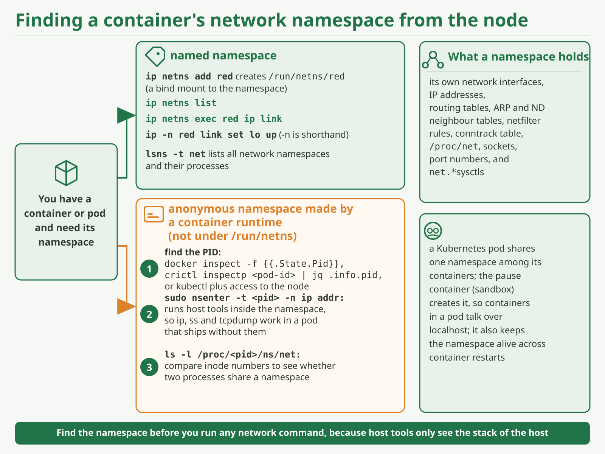

*Figure 2.25.1. A named namespace is entered with ip netns exec, while a runtime-created one is entered by finding the container PID and using nsenter.*

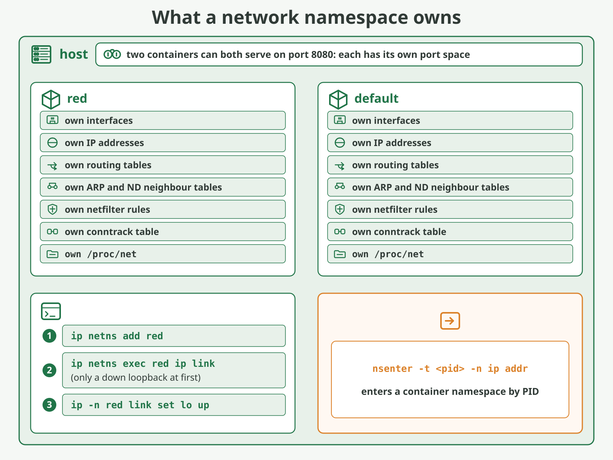

*Figure 2.25.2. A network namespace is a complete independent copy of the network stack, so each container has its own ports, routes and firewall.*

Suppose two containers on one host both want to serve on port 8080. You can run both, because each container has its own port space. That isolation comes from the network namespace, a mechanism you need to understand before anything else in this chapter.

A **network namespace** is a complete, independent copy of the network stack. Each copy has its own network interfaces, IP addresses, routing tables, ARP and ND neighbour tables, netfilter rules, conntrack table, `/proc/net`, sockets, port numbers, and sysctls under `net.*`. Processes inside a namespace see only that namespace. It is like giving each tenant of a building their own private phone exchange, with their own extension numbers, instead of one shared switchboard. The namespace also solves the "one TCP/IP stack per OS" problem that motivated hypervisors, and it does so without a separate kernel.

```bash
sudo ip netns add red                             # creates /run/netns/red (a bind mount to the namespace)
ip netns list
sudo ip netns exec red ip link                    # run any command inside; initially only a down loopback
sudo ip -n red link set lo up                     # '-n' is shorthand for netns exec for ip commands
sudo ip netns exec red bash                       # a shell inside the namespace
sudo ip netns del red
lsns -t net                                       # all network namespaces and their processes
sudo nsenter -t <pid> -n ip addr                  # enter a process's (container's) namespace by PID, run host tools inside
ls -l /proc/<pid>/ns/net                          # identity of a process's netns (compare inode numbers)
```

The commands above create a namespace, run commands inside it, and compare namespace identities. Run them in order, and delete the namespace when you finish.

Container runtimes create anonymous namespaces that do not live under `/run/netns`. To inspect one, find the PID of the container with `docker inspect -f '{{.State.Pid}}'`, `crictl inspectp`, or `kubectl` plus access to the node. Then run `nsenter -t PID -n`. A Kubernetes pod shares one namespace among its containers. The `pause` container, also called the sandbox, creates that namespace, so containers in a pod talk to each other over `localhost`.

### Interfaces across namespaces

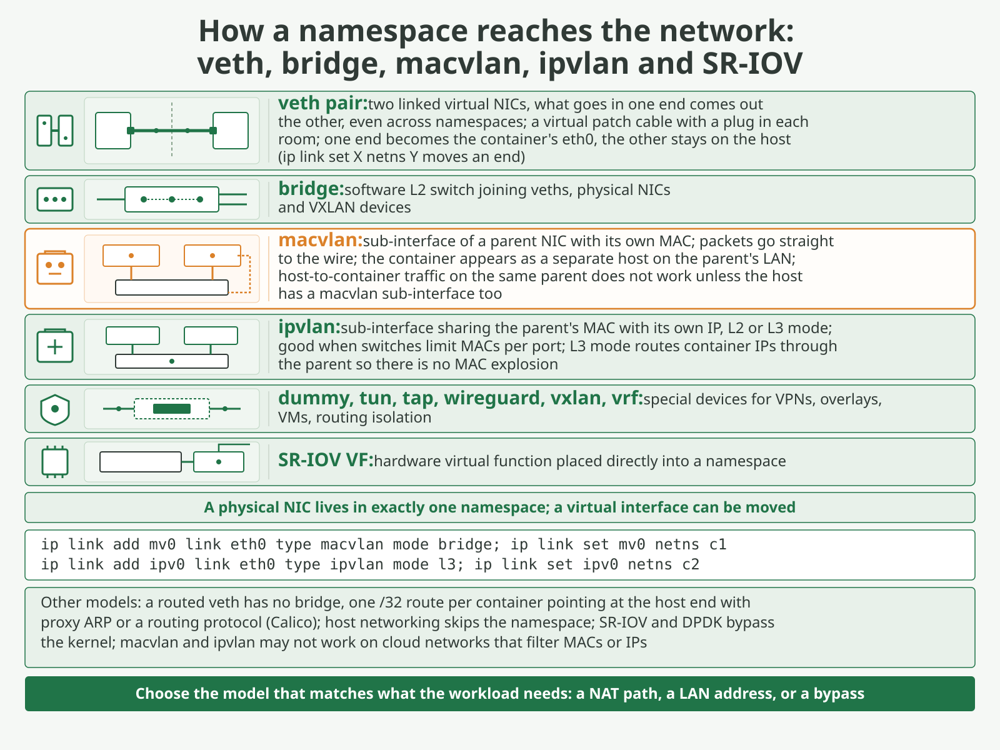

*Figure 2.25.3. A veth is a patch cable between namespaces, a bridge joins them, and macvlan, ipvlan or SR-IOV put a container directly on the parent's network.*

Walk through the moment a new container gets its network. A virtual cable, a veth pair, is created with two ends. One end is pushed into the container's namespace and becomes its eth0. The other end stays on the host, where a bridge or a route can reach it. Whatever goes into one end comes out of the other, so the container's packets travel out through the host side. The steps below perform that wiring by hand, so you can see that the container really is only a namespace plus a cable.

A physical NIC lives in exactly one namespace. A virtual interface can be moved into another namespace with `ip link set X netns Y`. To connect namespaces, you use virtual devices, which the table below describes.

| Device | What it is |
|---|---|
| **veth pair** | Two linked virtual NICs: what goes in one end comes out the other, even across namespaces: a virtual patch cable |
| **bridge** | Software L2 switch joining several interfaces (veths, physical NICs, VXLAN devices) |
| **macvlan** | Sub-interface of a parent NIC with its own MAC; packets go straight to the wire; container appears as a separate host on the parent's LAN |
| **ipvlan** | Sub-interface sharing the parent's MAC with its own IP (L2 or L3 mode); good when switches limit MACs per port |
| **dummy / tun / tap / wireguard / vxlan / vrf** | Special devices used by VPNs, overlays, VMs, routing isolation |
| **SR-IOV VF** | Hardware virtual function placed directly into a namespace |

The veth pair is the basic link between namespaces. Think of it as a short patch cable with one plug in each room: whatever goes into one end comes out of the other. A bridge joins several interfaces together, and macvlan and ipvlan put a container on the network of the parent NIC. Read the table as a menu, where each row answers a different question about how a namespace reaches the network. When a container misbehaves, find its namespace before you run any network command, because host tools only see the stack of the host.

## 2. Building container networking by hand

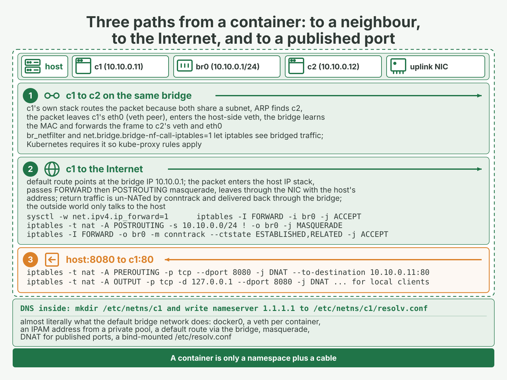

*Figure 2.25.4. Container to container is L2 switching on the bridge, outbound traffic is forwarded and masqueraded, and a published port is DNAT to the container.*

Picture a host with two containers that each believe they are alone on the network. Each has its own address, its own routes and its own ports. The host has to connect them, let them reach the outside, and let the outside reach one chosen port. Container runtimes do this quietly, so people rarely see the parts. Building it once by hand shows you the parts, and after that a CNI plugin or Docker's network driver is just a script you have already run.

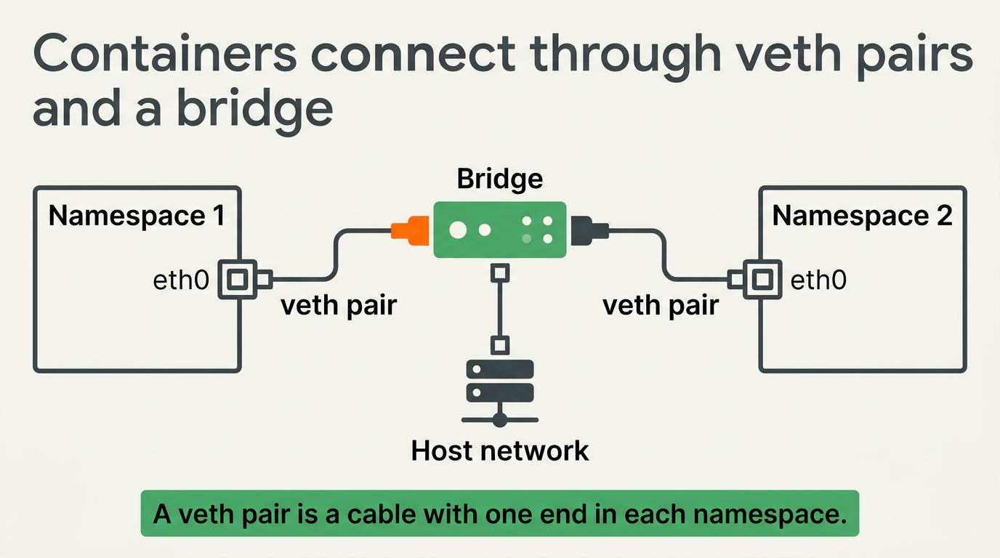

*Figure 2.25.5. Each container namespace is cabled to a bridge by a veth pair.*

Container networking is nothing more than the primitives from the last section, assembled by software. You learn what the software does by building the same thing yourself, once, with plain commands. After that, a CNI plugin or Docker's network driver reads as a long script that you have already run.

The first script creates two containers, `c1` and `c2`, on a host bridge. It adds NAT so they can reach the outside.

```bash
# 1. Two "containers" (namespaces) connected through a bridge on the host, with NAT to the outside
sudo ip link add br0 type bridge ; sudo ip addr add 10.10.0.1/24 dev br0 ; sudo ip link set br0 up
for n in c1 c2; do
  sudo ip netns add $n
  sudo ip link add veth-$n type veth peer name eth0-$n          # host end, container end
  sudo ip link set eth0-$n netns $n                              # move the container end into the namespace
  sudo ip link set veth-$n master br0 ; sudo ip link set veth-$n up
  sudo ip -n $n link set lo up ; sudo ip -n $n link set eth0-$n name eth0 ; sudo ip -n $n link set eth0 up
done
sudo ip -n c1 addr add 10.10.0.11/24 dev eth0 ; sudo ip -n c2 addr add 10.10.0.12/24 dev eth0
sudo ip -n c1 route add default via 10.10.0.1 ; sudo ip -n c2 route add default via 10.10.0.1
sudo ip netns exec c1 ping -c2 10.10.0.12                     # container to container via the bridge (L2 switching)
# 2. Outbound access: forwarding + masquerade for the container subnet
sudo sysctl -w net.ipv4.ip_forward=1
sudo iptables -t nat -A POSTROUTING -s 10.10.0.0/24 ! -o br0 -j MASQUERADE
sudo iptables -I FORWARD -i br0 -j ACCEPT ; sudo iptables -I FORWARD -o br0 -m conntrack --ctstate ESTABLISHED,RELATED -j ACCEPT
sudo ip netns exec c1 ping -c2 8.8.8.8
# 3. Inbound port publishing: host:8080 -> c1:80 (DNAT)
sudo iptables -t nat -A PREROUTING -p tcp --dport 8080 -j DNAT --to-destination 10.10.0.11:80
sudo iptables -t nat -A OUTPUT -p tcp -d 127.0.0.1 --dport 8080 -j DNAT --to-destination 10.10.0.11:80     # for local clients
# 4. DNS inside: per-namespace resolv.conf under /etc/netns/<ns>/resolv.conf
sudo mkdir -p /etc/netns/c1 && echo "nameserver 1.1.1.1" | sudo tee /etc/netns/c1/resolv.conf
```

Each numbered step adds one capability: connectivity through the bridge, outbound access, inbound port publishing, and DNS. Run the steps in order, because later steps depend on the bridge and the addresses from earlier ones.

This is almost literally what the default bridge network of Docker does. It creates `docker0`, a veth for each container, and an IPAM-assigned address from a private pool. It adds a default route via the bridge, masquerade for outbound traffic, DNAT for published ports, and a bind-mounted `/etc/resolv.conf`.

Follow a packet from container A to container B on the same bridge, slowly, one step at a time. The own stack of A routes the packet, because both containers share a subnet, and ARP finds B. The packet leaves through the `eth0` of A, which is the veth peer, and enters the host-side veth. The bridge learns the MAC address and forwards the frame to the veth of B, and then to the `eth0` of B. Netfilter hooks in the bridge path, through `br_netfilter` and `net.bridge.bridge-nf-call-iptables=1`, let iptables see this bridged traffic. Kubernetes requires that setting, so that kube-proxy rules apply to pod-to-pod traffic through bridges.

A packet from A to the internet takes a different path. The default route of A points at the bridge IP, and the packet enters the host IP stack. It passes FORWARD and then POSTROUTING masquerade, and it leaves through the NIC with the address of the host. Return traffic is un-NATed by conntrack and delivered back through the bridge. The outside world never learns that the container exists. It only talks to the host.

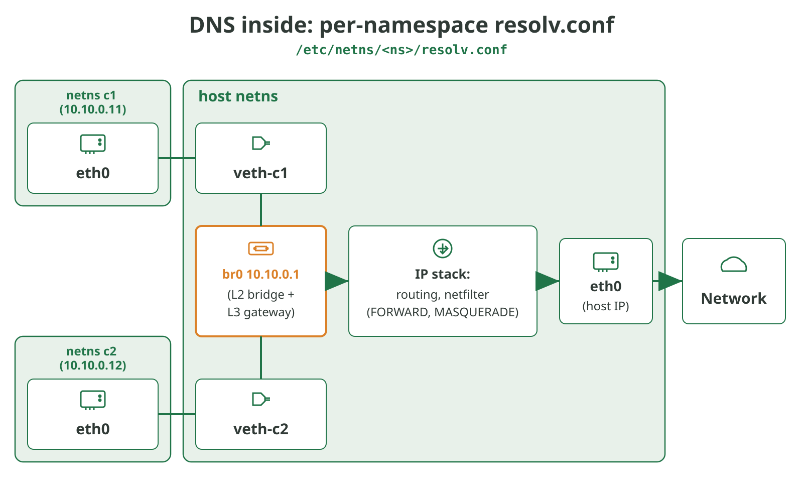

*Figure 2.25.6. DNS inside: per-namespace resolv.conf under /etc/netns/ns/resolv.conf, as a diagram.*

Bridge and NAT are not the only option. A routed veth has no bridge. Instead, it uses one /32 route per container that points at the host end of the veth, with proxy ARP or a routing protocol. This is the model of Calico. Macvlan puts the container directly on the physical LAN with its own MAC address. Host-to-container traffic on the same parent does not work unless the host has a macvlan sub-interface too. Ipvlan L3 routes container IPs through the parent, so there is no MAC explosion. Host networking skips the namespace entirely, and SR-IOV and DPDK bypass the kernel with hardware or user-space paths.

The next commands, which you can run in order, put one container on the LAN with macvlan and another behind an ipvlan L3 interface.

```bash
# macvlan: container directly on the LAN (bridge mode among macvlans on the same parent)
sudo ip link add mv0 link eth0 type macvlan mode bridge ; sudo ip link set mv0 netns c1
sudo ip -n c1 addr add 192.168.1.60/24 dev mv0 ; sudo ip -n c1 link set mv0 up
# ipvlan L3: shared MAC, routed
sudo ip link add ipv0 link eth0 type ipvlan mode l3 ; sudo ip link set ipv0 netns c2
```

If you run the macvlan commands, the container gets its own address on the physical LAN. The ipvlan container shares the MAC address of the parent NIC while keeping its own IP. Choose the model that matches what the workload needs: a NAT path, a LAN address, or a bypass.

## 3. Docker networking

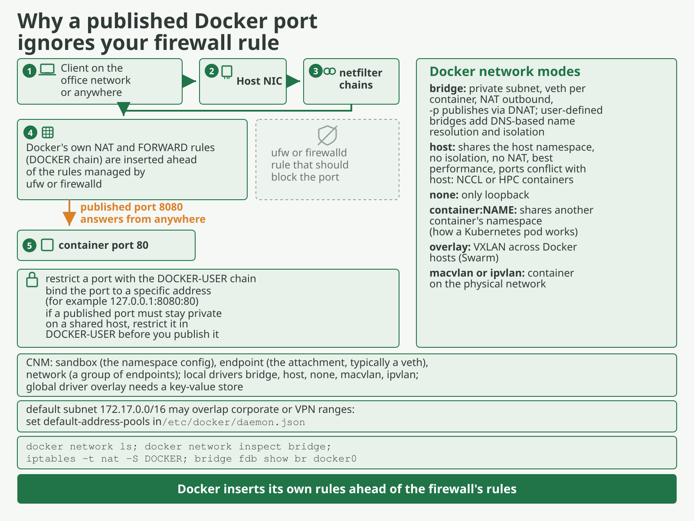

*Figure 2.25.7. Docker's NAT and FORWARD rules sit ahead of ufw and firewalld rules, so restrict published ports with DOCKER-USER or a specific bind address.*

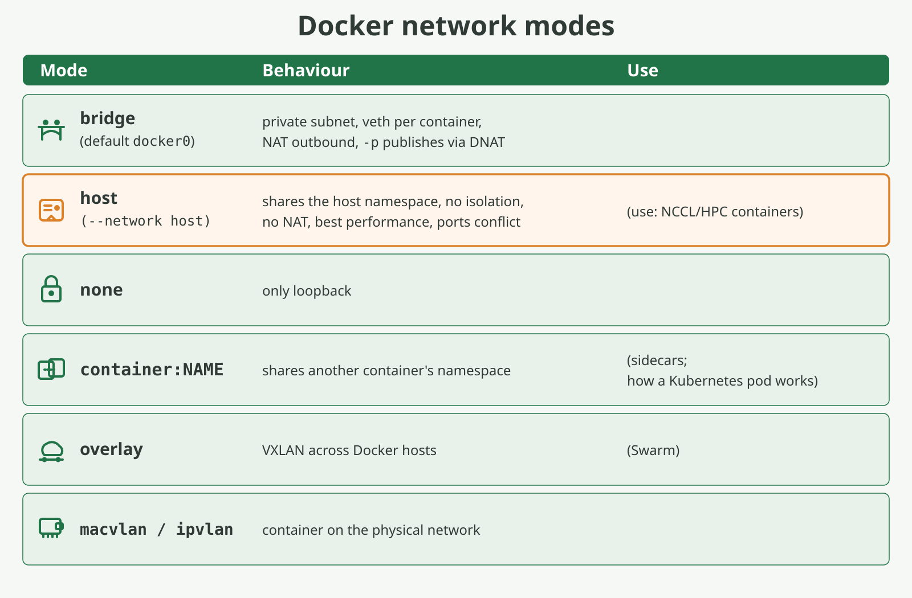

*Figure 2.25.8. Docker offers six network modes, from the default bridge to sharing the host namespace.*

Picture a developer who runs a web server in a container, publishes port 8080, and expects only the office network to reach it. The firewall on the host has a rule that should block outside access, yet the port answers from anywhere. The Docker network model explains why. Docker inserts its own rules ahead of the firewall's rules, so a published port takes a path the firewall never checks. The paragraphs below follow the model from its three concepts to the places where the surprise hides.

Picture a container that publishes port 8080, yet the host firewall seems to ignore the rule you wrote. That is a Docker networking question, and the answer lies in how Docker builds its networks.

Containers began in LXC, which combined cgroups and namespaces. Docker made them popular with a friendly image format, a registry and a runtime. The Open Container Initiative (OCI) later standardised the formats. Its specs are composable, decentralised and minimalist. runc is the reference runtime, and containerd and CRI-O are the container runtimes Kubernetes uses.

The network model of Docker is the container network model of libnetwork, or CNM. It has three concepts. A sandbox is the network namespace configuration of a container. An endpoint is the attachment point of a container to a network, typically a veth. A network is a group of endpoints that can communicate. The drivers come in two kinds. Local drivers (bridge, host, none, macvlan, ipvlan) work per host. The global driver, overlay, needs a distributed key-value store to coordinate hosts.

The table lists the six modes. Each row gives a behaviour and a typical use, so you can match a mode to the job in front of you.

| Mode | Behaviour | Use |
|---|---|---|
| **bridge** (default `docker0`; or user-defined bridges) | Private subnet, veth per container, NAT outbound, `-p` publishes via DNAT; user-defined bridges add DNS-based container name resolution and isolation | Single-host development, simple services |
| **host** (`--network host`) | Container shares the host namespace; no isolation, no NAT, best performance, ports conflict with host | NCCL/HPC containers, performance-critical, packet capture tools |
| **none** | Only loopback | Isolation, custom networking (CNI-like setups), batch jobs without network |
| **container:NAME** | Shares another container's namespace | Sidecars (this is how a Kubernetes pod works) |
| **overlay** | VXLAN across Docker hosts (Swarm) | Multi-host before Kubernetes |
| **macvlan / ipvlan** | Container on the physical network | Legacy apps needing LAN addresses |

The commands below inspect those modes on a running host. They also show the NAT rules and the bridge state that Docker creates.

```bash
docker network ls ; docker network inspect bridge
docker run -d --name web -p 8080:80 nginx ; iptables -t nat -S DOCKER ; ip -br link | grep -E 'docker0|veth'
docker run --rm --network host nicolaka/netshoot ss -tulpn          # debug container with a toolbox
docker run --rm --network container:web nicolaka/netshoot tcpdump -ni eth0     # sniff inside another container's netns
bridge link ; bridge fdb show br docker0 ; cat /proc/sys/net/bridge/bridge-nf-call-iptables
```

Host mode gives the best performance, but it provides no isolation, and the table lists NCCL and HPC containers as its typical use. The `container:` mode is what a Kubernetes pod does internally, with sidecars sharing one namespace.

Published ports can surprise you. Docker inserts its own NAT and FORWARD rules, so published ports bypass firewalls managed by ufw or firewalld. Netfilter and NAT are covered in chapter 2.23. To restrict a port, use `DOCKER-USER` or bind the port to a specific address. The default subnet of Docker, 172.17.0.0/16, may overlap with corporate or VPN ranges. In that case, set `default-address-pools` in `/etc/docker/daemon.json`.

Production GPU clusters rarely use the network features of Docker directly. Kubernetes with CNI takes over that role. If a published port must stay private on a shared host, restrict it in `DOCKER-USER` before you publish it.

## 4. CNI: the Container Network Interface

Kubernetes does not use the CNM of Docker. It uses CNI, a simpler specification that came from CoreOS and now belongs to the CNCF. A CNI **plugin** is an executable. You give it a JSON network configuration and some environment variables that describe the container, and it configures networking for that container. CNI needs no daemon, and it is cross-platform. The whole contract fits in one sentence: when a container starts, the runtime runs the plugin once with the word ADD, and when the container ends, it runs it once with DEL.

### How it works

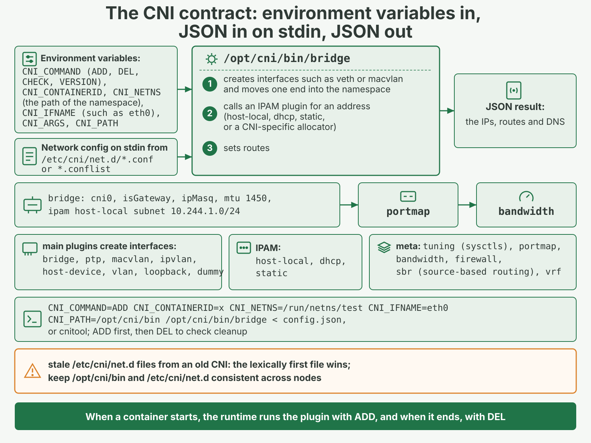

*Figure 2.25.9. A CNI plugin takes CNI_COMMAND and related variables plus JSON on stdin, wires the interface, asks IPAM for an address and returns JSON.*

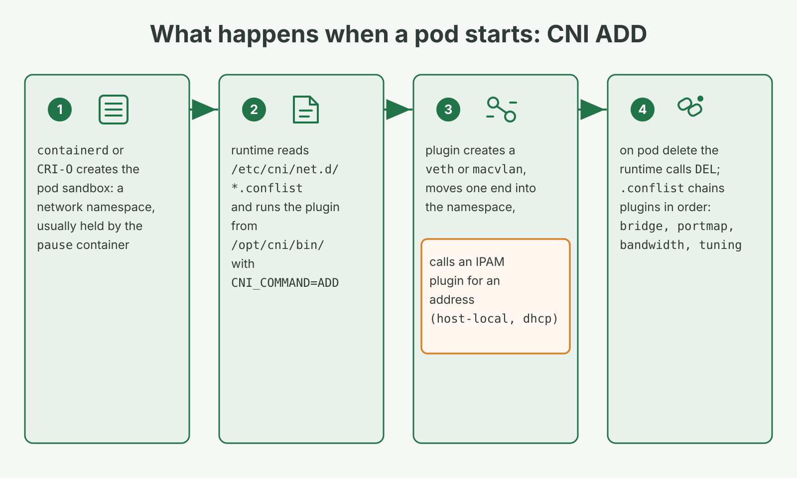

*Figure 2.25.10. The runtime calls the CNI plugin, which wires the interface into the pod namespace and asks IPAM for an address.*

Walk through the life of one new pod, step by step. The runtime creates the empty namespace that the pod will live in. It then looks in the configuration folder and finds the network plugin's instructions. It runs the plugin with the word ADD, and passes in the namespace path and the name of the interface. The plugin creates the cable, asks the address manager for a free address, sets the routes, and reports back what it did. When the pod is deleted, the same plugin runs again with the word DEL, so nothing is left behind.

When a new pod starts, you can trace the steps that the runtime and the plugin take. Each step hands work to the next one.

1. The container runtime, containerd or CRI-O, creates the pod sandbox. That is a network namespace, usually held open by the `pause` container.
2. The runtime reads the CNI configuration in `/etc/cni/net.d/*.conf|*.conflist` and runs the plugin binary from `/opt/cni/bin/`. It sets the environment variables `CNI_COMMAND` (`ADD`, `DEL`, `CHECK`, `VERSION`), `CNI_CONTAINERID`, `CNI_NETNS`, `CNI_IFNAME`, `CNI_ARGS` and `CNI_PATH`. `CNI_NETNS` holds the path of the namespace, and `CNI_IFNAME` names the interface, such as `eth0`. The network config goes to the plugin on stdin.
3. The plugin creates interfaces such as veth or macvlan and moves one end into the namespace. It then calls an **IPAM plugin** for an address. IPAM stands for IP address management. The IPAM plugin can be `host-local`, `dhcp`, `static`, or a CNI-specific allocator. The plugin then sets routes and returns a JSON result with the IPs, routes and DNS.
4. When the pod is deleted, the runtime calls `DEL` to clean up. Plugins can also be chained. A `.conflist` file runs several plugins in order, for example `bridge`, then `portmap`, `bandwidth` and `tuning`.

A bridge-based network with chained plugins looks like the JSON below. Notice the `ipam` block inside the bridge plugin, which hands out addresses from the subnet of the node.

```json
{
  "cniVersion": "1.0.0",
  "name": "mynet",
  "plugins": [
    { "type": "bridge", "bridge": "cni0", "isGateway": true, "ipMasq": true, "mtu": 1450,
      "ipam": { "type": "host-local", "subnet": "10.244.1.0/24", "routes": [ { "dst": "0.0.0.0/0" } ] } },
    { "type": "portmap", "capabilities": { "portMappings": true } },
    { "type": "bandwidth", "capabilities": { "bandwidth": true } }
  ]
}
```

The reference plugins come from containernetworking/plugins, and they fall into three groups. The main plugins create interfaces: `bridge`, `ptp`, `macvlan`, `ipvlan`, `host-device`, `vlan`, `loopback` and `dummy`. The IPAM plugins are `host-local`, `dhcp` and `static`. The meta plugins add extra behaviour, such as `tuning` for sysctls, `portmap`, `bandwidth`, `firewall`, `sbr` for source-based routing, and `vrf`.

You can test a plugin by hand before you trust it. Create a namespace, then run `CNI_COMMAND=ADD CNI_CONTAINERID=x CNI_NETNS=/run/netns/test CNI_IFNAME=eth0 CNI_PATH=/opt/cni/bin /opt/cni/bin/bridge < config.json`, or use `cnitool`. Run `ADD` first, because that call creates the interface and the address. Then run `DEL` to check the cleanup.

### Kubernetes network model (requirements)

Kubernetes makes four assumptions about the network. Each pod gets its own IP. All pods can communicate with all other pods without NAT, including pods on other nodes. Agents on a node, such as kubelet, can reach every pod on that node. Finally, a pod sees its own IP the same way other pods see it. The cluster must satisfy these rules, and the CNI does that work. It can use an overlay (VXLAN, Geneve or IPIP), routing (BGP or host routes), or cloud-native pod IPs from the VPC.

### Common CNI implementations

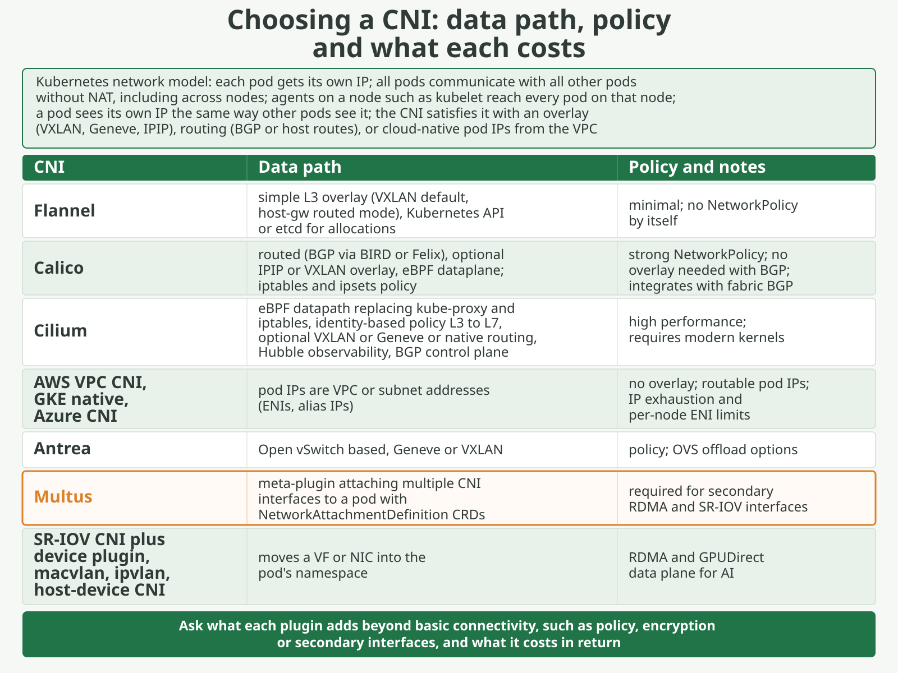

*Figure 2.25.11. Flannel is minimal, Calico and Cilium add strong policy, cloud CNIs use VPC addresses, and Multus attaches the secondary RDMA interfaces.*

Picture three ways to build a house. One builder uses a plain, reliable design that anyone can maintain. Another adds locks and alarms to every room. A third brings its own power and water supply. Each CNI plugin in the table is one of those builders. The table is easier to use when you ask what each plugin adds beyond basic connectivity, such as policy, encryption or secondary interfaces, and what it costs in return.

Many CNI implementations exist, and they differ in their data path and in what they add. The table compares the common ones. Use it as a lookup when you choose a CNI for a cluster.

| CNI | Data path | Notes |
|---|---|---|
| **Flannel** | Simple L3 overlay (VXLAN default; host-gw routed mode) using Kubernetes API/etcd for allocations | Minimal; no NetworkPolicy by itself |
| **Calico** | Routed (BGP via BIRD or Felix), optional IPIP/VXLAN overlay, eBPF dataplane; iptables/ipsets policy | Strong NetworkPolicy; no overlay needed with BGP; scales; integrates with fabric BGP (chapter 2.16) |
| **Cilium** | eBPF datapath replacing kube-proxy/iptables, identity-based policy L3-L7, optional VXLAN/Geneve or native routing, Hubble observability, BGP control plane | High performance; requires modern kernels |
| **AWS VPC CNI / GKE native / Azure CNI** | Pod IPs are VPC/subnet addresses (ENIs, alias IPs) | No overlay; pod IPs routable in the cloud network; IP exhaustion and per-node ENI limits |
| **Antrea** | Open vSwitch-based, Geneve/VXLAN, policy | OVS offload options |
| **Weave, Canal, kube-router, Kube-OVN** | Various | |
| **Multus** | **Meta-plugin** that attaches multiple CNI interfaces to a pod (`NetworkAttachmentDefinition` CRDs) | Required for secondary RDMA/SR-IOV interfaces |
| **SR-IOV CNI + device plugin**, **macvlan/ipvlan/host-device CNI** | Moves a VF/NIC into the pod's namespace | RDMA/GPUDirect data plane for AI |

Flannel is the simplest of these, and it does not enforce NetworkPolicy by itself. Calico and Cilium add strong policy. Multus is the piece you need when a GPU pod requires secondary RDMA or SR-IOV interfaces. Cilium requires modern kernels, so check your node kernels before you choose it.

## 5. Kubernetes pod networking walkthrough

The walkthrough follows a packet in four situations: the same node, different nodes, out to a service or the Internet, and host networking. In each case the question is the same, which is what the packet looks like on every wire it crosses.

### Same node, bridge-based CNI (e.g. bridge/Flannel host-gw)

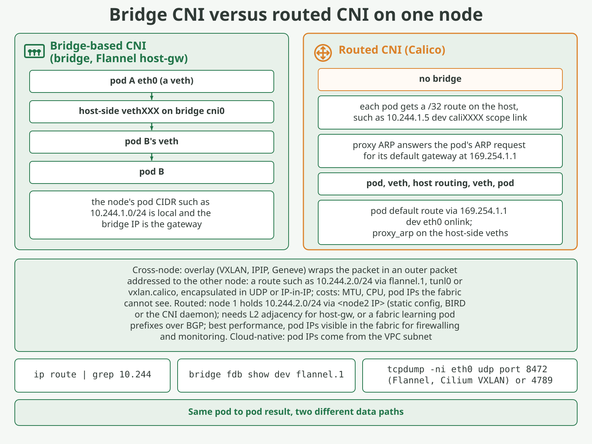

*Figure 2.25.12. A bridge CNI switches pod traffic on cni0, while Calico routes it with a /32 per pod and proxy ARP at 169.254.1.1 and no bridge.*

Start with two pods on one node that share a bridge, and follow the packet as you read. Pod A sends traffic out of its `eth0`, which is a veth. The packet reaches the host-side `vethXXX` on the bridge `cni0`, then the veth of pod B, and finally pod B. The pod CIDR of the node, such as 10.244.1.0/24, is local, and the bridge IP of the node is the gateway.

Routed CNIs take a different path, and you can see it in the routes. Calico gives each pod a /32 route on the host, such as `10.244.1.5 dev caliXXXX scope link`. Proxy ARP answers the ARP request of the pod for its default gateway at 169.254.1.1. Pod-to-pod traffic on the same node then goes pod, veth, host routing, veth, pod, with no bridge at all.

### Different nodes

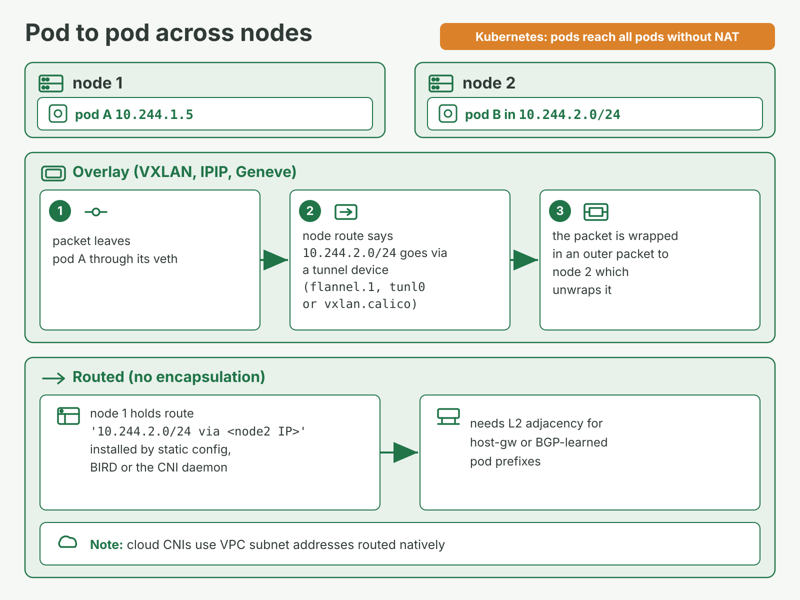

*Figure 2.25.13. Cross-node pod traffic either rides inside an overlay tunnel or follows plain routes to the other node.*

Follow one request from a pod on node 1 to a pod on node 2, step by step. The packet leaves the first pod through its veth and reaches the node's routing table. The route says the destination lives on another node, and it points at a tunnel device. The tunnel wraps the whole packet inside a new outer packet addressed to node 2. Node 2 unwraps it, sees the inner packet is for its local pod, and delivers it. The walkthrough is the same whichever overlay you use. Only the names of the devices and the port numbers change.

With an overlay such as VXLAN, IPIP or Geneve, the packet is wrapped in an outer packet. Take pod A at 10.244.1.5. Its packet goes to the host, where the route says that 10.244.2.0/24 goes via the tunnel device, which might be `flannel.1`, `tunl0` or `vxlan.calico`. The packet is encapsulated in UDP, or in IP-in-IP, and sent to the IP of node 2. Node 2 decapsulates it and delivers it to pod B at 10.244.2.7. The costs are MTU, CPU, and pod IPs that the fabric cannot see. To debug this path, run `ip route | grep 10.244`, `bridge fdb show dev flannel.1`, and `tcpdump -ni eth0 udp port 8472` for Flannel or Cilium VXLAN. For the port `4789` case, run the same `tcpdump` command with `4789` in place of `8472`.

Routed setups skip the encapsulation. Node 1 holds a route such as `10.244.2.0/24 via <node2 IP>`, which static config, BIRD or the CNI daemon installs. This needs L2 adjacency between the nodes for host-gw, or a fabric that learns the pod prefixes over BGP. It gives the best performance, and pod IPs stay visible in the fabric, which makes firewalling and monitoring easier.

In cloud-native setups, the pod IPs you see come from the VPC subnet, and the fabric routes them natively.

### Pod to service and to the outside

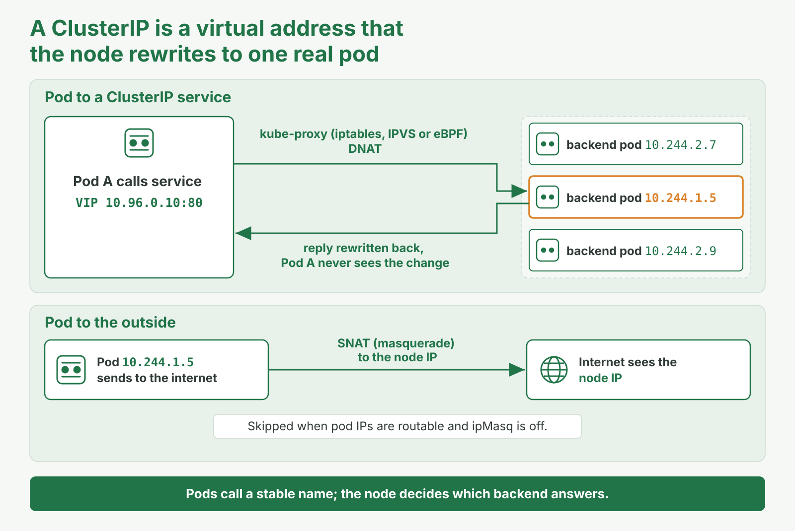

*Figure 2.25.14. A pod calling a ClusterIP is rewritten by kube-proxy to one backend pod, and traffic to the outside is masqueraded to the node IP.*

Picture a pod that calls a service by a stable name. The pod has no idea which backend will answer. The packet is addressed to the service's virtual address, and the node's rules rewrite it to one real pod address chosen from a list. The reply is rewritten back, so the calling pod never sees the change. Traffic to the internet takes a different route, where the node replaces the pod address with its own address. The walkthrough below shows each of these two paths.

Traffic from a pod to a `ClusterIP` goes through kube-proxy, using iptables or IPVS, or through eBPF. These DNAT the traffic to a backend pod, as chapters 2.20 and 2.23 explain. Traffic from a pod to the outside is masqueraded, meaning SNAT to the node IP, unless pod IPs are routable and `ipMasq` is off. External traffic reaches pods through NodePort, LoadBalancer or Ingress.

### Host networking, pause containers, DNS

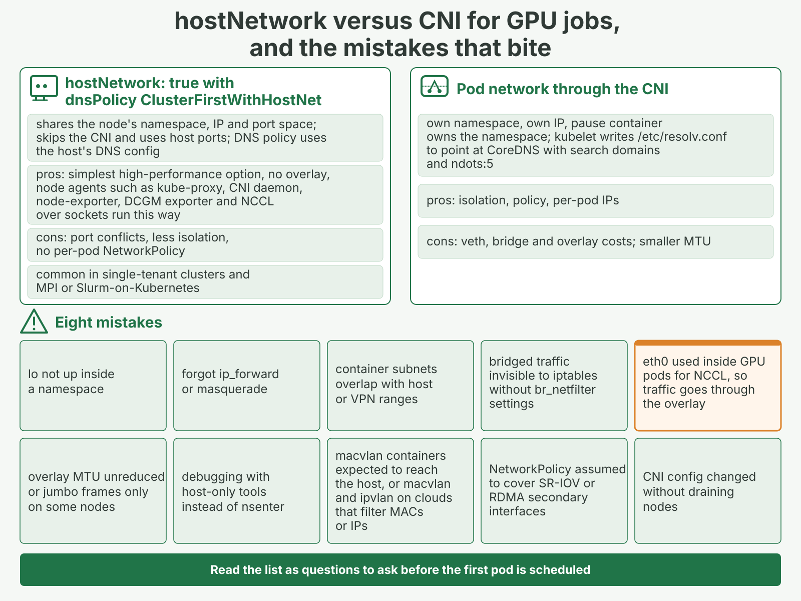

*Figure 2.25.15. hostNetwork gives simple high performance at the cost of isolation and port conflicts, while CNI networking gives isolation and policy at an overlay cost.*

Pods with `hostNetwork: true` share the namespace of the node. They skip the CNI and use host ports. Their DNS policy is `dnsPolicy: ClusterFirstWithHostNet`, which uses the DNS config of the host. Node agents such as kube-proxy, the CNI daemon, node-exporter and the DCGM exporter run this way. So do performance-critical workloads like NCCL over sockets.

Every pod normally has a `pause` container. It owns the namespace and keeps the namespace alive across container restarts. The kubelet writes `/etc/resolv.conf` so that it points at CoreDNS, with search domains and `ndots:5` (chapter 2.8). Kubernetes `Service` and `NetworkPolicy` semantics are covered in Part 5.

Host-network pods share the IP and port space of the node, so check for port conflicts before you schedule them there.

## 6. Networking for GPU and HPC pods

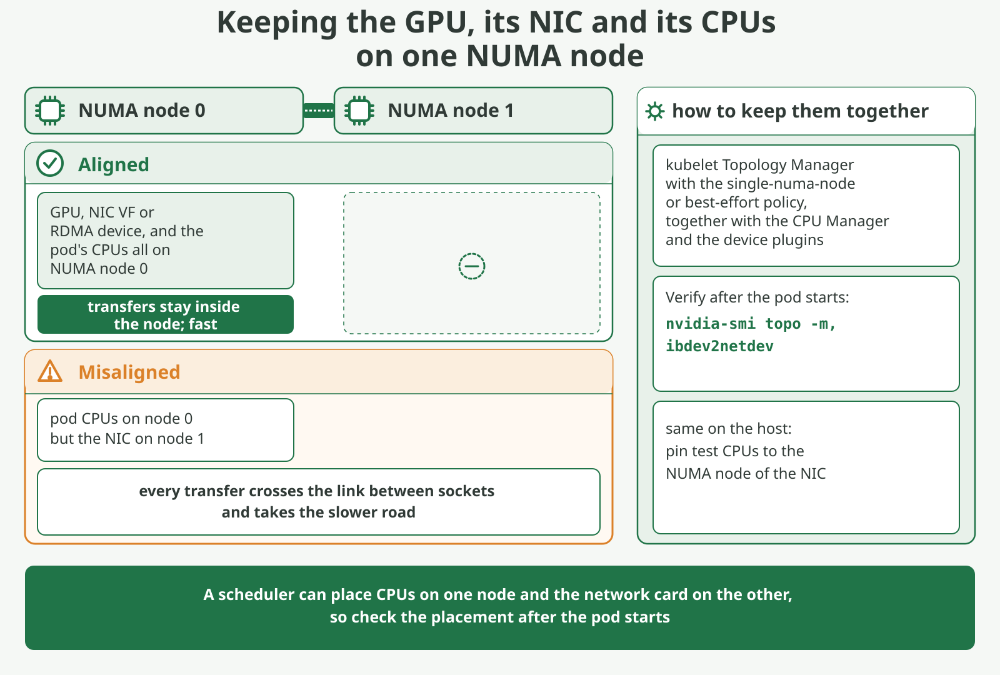

*Figure 2.25.16. The Topology Manager keeps the GPU, NIC and CPUs on one NUMA node so transfers avoid the slower link between sockets.*

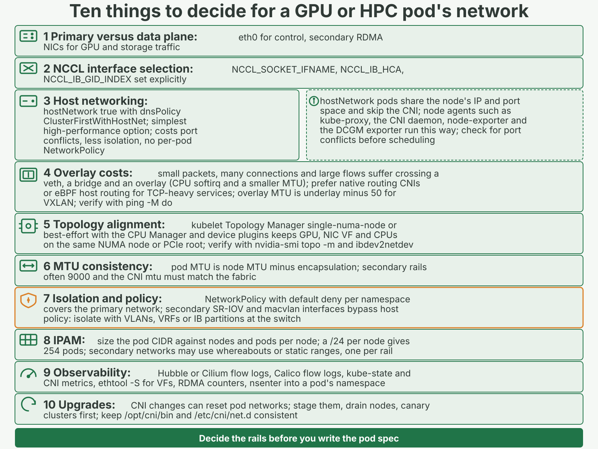

*Figure 2.25.17. Ten decisions shape a GPU pod's network, from rails and NCCL interfaces to NUMA alignment, MTU, policy bypass on secondary NICs and CNI upgrades.*

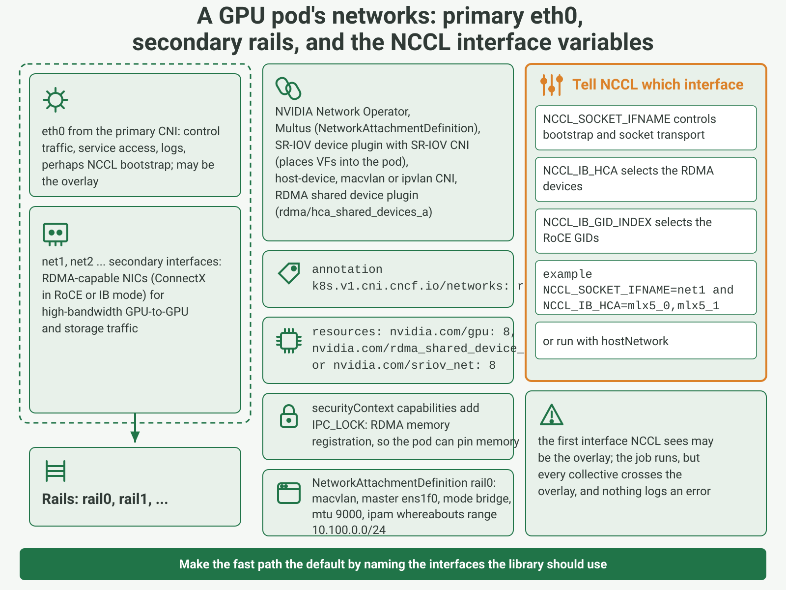

*Figure 2.25.18. A GPU pod needs secondary RDMA interfaces attached through Multus and SR-IOV, and NCCL must be told to use them instead of the eth0 overlay.*

Picture a training job that starts cleanly, passes its health checks, and then runs far slower than the hardware should allow. The logs show that the collective library chose the overlay interface rather than the fast rail. Nothing was broken in the sense of an error. The job took the path it was offered by default. This section is about making the fast path the default, by deciding which network each pod sees, and by naming the interfaces the library should use.

A GPU pod usually needs more than one network. Its primary interface handles control traffic, while the heavy GPU-to-GPU and storage traffic needs faster rails. Think of a hospital that has one entrance for visitors and a separate loading dock for heavy supplies: the same building, two doors, built for different loads. Decide on the rails before you write the pod spec, since the spec refers to them by name. The ten points below follow the pod from its network attachment to its upgrade plan.

1. Primary network versus data plane. The primary CNI interface, `eth0`, carries control traffic, service access, logs, and perhaps NCCL bootstrap. High-bandwidth GPU-to-GPU and storage traffic needs secondary interfaces instead. These are RDMA-capable NICs (ConnectX in RoCE or IB mode) that reach the pod through the NVIDIA Network Operator, Multus (`NetworkAttachmentDefinition`), the SR-IOV device plugin with the SR-IOV CNI (which places VFs into the pod), the host-device, macvlan or ipvlan CNI, and the RDMA shared device plugin (`rdma/hca_shared_devices_a`). The pod requests resources such as `nvidia.com/gpu: 8`, `nvidia.com/rdma_shared_device_a: 1`, or `nvidia.com/sriov_net: 8`, and it sets the annotation `k8s.v1.cni.cncf.io/networks: rail0,rail1,...`.

The manifest below defines a macvlan network for one RDMA rail, plus a pod that attaches to it.

```yaml
# NetworkAttachmentDefinition for a macvlan RDMA rail (illustrative)
apiVersion: k8s.cni.cncf.io/v1
kind: NetworkAttachmentDefinition
metadata: { name: rail0, namespace: training }
spec:
  config: |
    { "cniVersion": "0.3.1", "type": "macvlan", "master": "ens1f0", "mode": "bridge", "mtu": 9000,
      "ipam": { "type": "whereabouts", "range": "10.100.0.0/24" } }
---
apiVersion: v1
kind: Pod
metadata:
  name: trainer-0
  namespace: training
  annotations: { k8s.v1.cni.cncf.io/networks: rail0 }
spec:
  containers:
  - name: pytorch
    image: nvcr.io/nvidia/pytorch:24.xx-py3
    resources: { limits: { nvidia.com/gpu: 1, rdma/hca_shared_devices_a: 1 } }
    securityContext: { capabilities: { add: ["IPC_LOCK"] } }       # RDMA memory registration
```

Notice the `IPC_LOCK` capability at the end. You need it for RDMA memory registration, so the pod can pin memory.

2. NCCL interface selection. NCCL picks network interfaces by name or pattern. `NCCL_SOCKET_IFNAME` controls the bootstrap and socket transport, `NCCL_IB_HCA` selects the RDMA devices, and `NCCL_IB_GID_INDEX` selects the RoCE GIDs. Inside a pod, `eth0` may be the overlay, so set these variables explicitly, for example `NCCL_SOCKET_IFNAME=net1` and `NCCL_IB_HCA=mlx5_0,mlx5_1`. Alternatively, run the job with hostNetwork.

Walk through a training job that starts. NCCL reads its environment, looks at the network interfaces it can see, and picks one for its bootstrap traffic. Inside a pod, the first interface it sees may be the overlay, which is slower than the rail. The job then runs, but every collective crosses the overlay. Setting the interface name explicitly removes the guessing, and the example below shows how to make the choice visible in the pod spec, so anyone reading the spec knows which path the job uses.

3. Host networking for training jobs. This is the simplest high-performance option: `hostNetwork: true` with `dnsPolicy: ClusterFirstWithHostNet`. The costs are port conflicts, less isolation, and no per-pod `NetworkPolicy`. Single-tenant clusters and MPI or Slurm-on-Kubernetes setups often use it.

4. Pod overlay costs. Small packets, many connections and large flows all suffer when they cross a veth, a bridge and an overlay. The cost shows up as CPU softirq work and a smaller MTU. For TCP-heavy services such as inference APIs and data loaders, prefer native routing CNIs or eBPF host routing. Keep the overlay MTU correct, which means the underlay MTU minus 50 for VXLAN, and verify it with `ping -M do`.

Picture a small web service that serves many short requests. Each request crosses the pod's veth, the node bridge and the overlay, and each crossing takes some processor time. The service looks fine at low load and slows down as the request rate climbs. The paragraph above names the costs. Follow one request through them, and you can see why the advice is to prefer native routing for latency-sensitive services, and to check the overlay MTU carefully.

5. Topology alignment. Use the kubelet Topology Manager, with its `single-numa-node` or `best-effort` policy, together with the CPU Manager and the device plugins. That keeps the GPU, its NIC VF or RDMA device, and the CPUs on the same NUMA node or PCIe root. Verify the layout with `nvidia-smi topo -m` and `ibdev2netdev`.

Picture a GPU, its network card and the CPU cores that feed it, all sitting on the same NUMA node. Data moves quickly between them, because the path never crosses the link between sockets. If the scheduler places the pod's CPUs on one node and its network card on the other, every transfer takes the slower road. The steps below describe how the policies keep the three parts together, and how to check the placement after the pod starts.

6. MTU consistency. Pod MTU is the node MTU minus the encapsulation overhead. Secondary RDMA rails often use jumbo frames of 9000, and the CNI config `mtu` must match the fabric.

7. Isolation and policy. `NetworkPolicy`, with a default deny per namespace, covers the primary network. Secondary SR-IOV and macvlan interfaces bypass host policy. Isolate them with VLANs, VRFs or IB partitions at the switch, as chapter 2.21 describes.

8. IPAM. Size the pod CIDR against your node count and your pods per node. A /24 per node gives 254 pods. Secondary networks may use `whereabouts` or static ranges, one per rail.

9. Observability. Use Hubble or Cilium flow logs, Calico flow logs, kube-state and CNI metrics, `ethtool -S` for VFs at the node level, and RDMA counters. Use `nsenter` to inspect the namespace of an individual pod.

10. Upgrades. CNI changes can reset pod networks. Stage them, drain the nodes, and test on canary clusters first. Keep `/opt/cni/bin` and `/etc/cni/net.d` consistent across nodes.

## 7. Debugging container networking

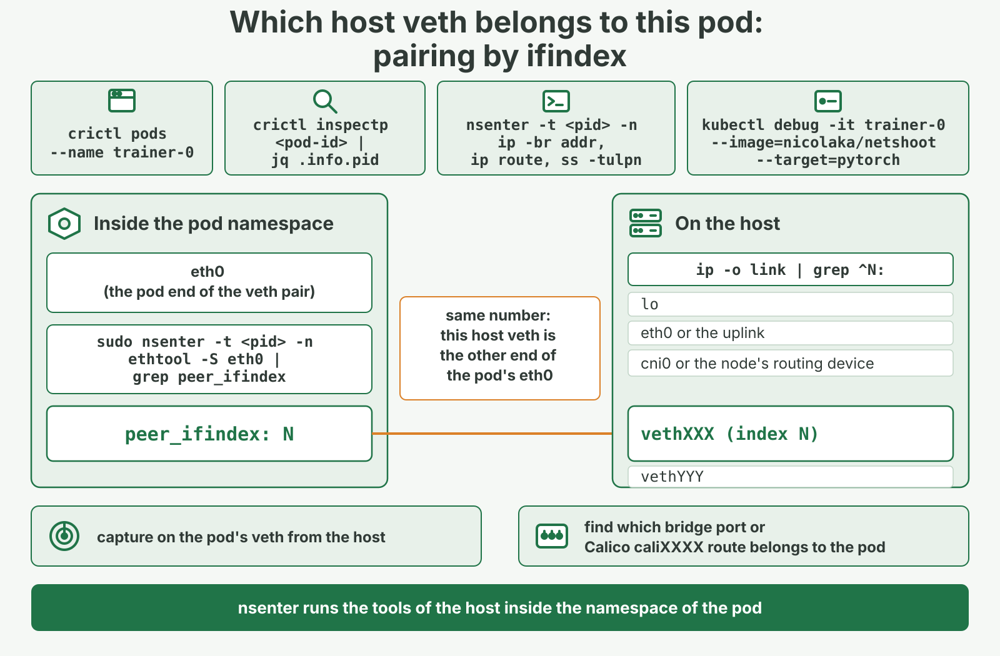

*Figure 2.25.19. The peer_ifindex reported inside a pod matches the index of its veth on the host, which shows where to capture or look for routes.*

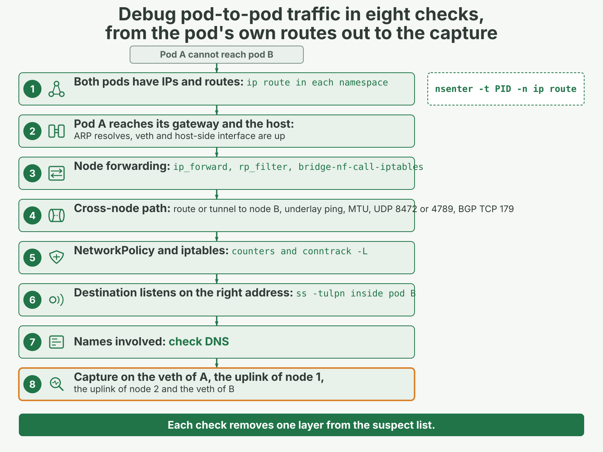

*Figure 2.25.20. Pod-to-pod failures are narrowed by eight checks in order, from pod routes and gateway ARP through forwarding, tunnels, policy and listeners to packet captures.*

Picture an on-call engineer at night with a pod that cannot reach its peer. The fastest route to the answer is to stop guessing and to walk the path, one hop at a time, with the same checks each time. The checklist below does that. The commands run in the pod's namespace, not on the host, so they show the view the pod actually has.

Picture pod A that cannot reach pod B. Both pods report healthy, and both have an address. Someone suggests restarting the pods. This section offers a better habit. You find the namespace of the pod from the node, walk the path one hop at a time, and check each hop before moving on. Each check removes one layer from the suspect list, so the search narrows with every step.

When pod A cannot reach pod B, guessing wastes time. Work through a fixed order of checks instead, starting on the node where the pods run.

The commands below find the network namespace of the pod from the node, then inspect it.

```bash
# Find the pod's netns on the node
crictl pods --name trainer-0 ; crictl inspectp <pod-id> | jq .info.pid         # or: crictl inspect <ctr> | jq .info.pid
sudo nsenter -t <pid> -n ip -br addr ; sudo nsenter -t <pid> -n ip route ; sudo nsenter -t <pid> -n ss -tulpn
sudo nsenter -t <pid> -n tcpdump -ni eth0 -c 20 port 8080                      # capture inside the pod's namespace
# Map pod veth to host veth: ifindex pairing
sudo nsenter -t <pid> -n ethtool -S eth0 | grep peer_ifindex ; ip -o link | grep "^<ifindex>:"
# Ephemeral debug container
kubectl debug -it trainer-0 --image=nicolaka/netshoot --target=pytorch
kubectl exec trainer-0 -- cat /etc/resolv.conf ; kubectl exec trainer-0 -- ip route
# Node-side
ip route | grep -E 'cali|cni|flannel|vxlan|tunl' ; bridge fdb show ; iptables-save | grep -E 'KUBE-|cali-'
cat /etc/cni/net.d/* ; ls /opt/cni/bin ; journalctl -u containerd | grep -i cni ; kubectl -n kube-system logs <cni-pod>
```

Notice that `nsenter` runs the tools of the host inside the namespace of the pod. That is how you can use `ip`, `ss` and `tcpdump` on a pod that ships without them.

Work through the following eight checks in order. Each one rules out a layer before you move to the next.

1. Confirm that both pods have IPs and routes, using `ip route` in each namespace.
2. Confirm that A can reach its gateway and the host. That means the ARP entry resolves, the veth is up, and the host-side interface is up.
3. Check host forwarding (`net.ipv4.ip_forward`), `rp_filter`, and `bridge-nf-call-iptables` on the node.
4. For cross-node traffic, confirm that a route or tunnel to the node of B exists, and that the nodes can reach each other. Check the underlay ping, the MTU, and whether UDP 8472 or 4789, or BGP on TCP 179, is allowed by security groups or firewalls.
5. Check NetworkPolicy and iptables rules, using counters and `conntrack -L`.
6. Confirm that the destination listens on the right address, using `ss -tulpn` inside pod B. A service bound to localhost will not accept traffic from other pods.
7. If names are involved, check DNS.
8. Capture packets on the veth of A, the uplink of node 1, the uplink of node 2 and the veth of B. The captures show where the packet stops.

## 8. Hands-on lab: build container networking and a mini-CNI

Start with the self-checking Python lab, `code/part02/container_netns_cni_lab.py`, which runs on your own machine. It verifies the CNI `ADD`, `CHECK` and `DEL` lifecycle and the `host-local` IPAM subnet allocation (`10.244.1.0/24`). It also checks how the `eth0` `peer_ifindex` of a pod resolves to the host veth, compares `macvlan` with `ipvlan` L3 properties, and audits the RDMA, Multus, `IPC_LOCK` and `NCCL_SOCKET_IFNAME` spec of a GPU pod.

```bash
python3 code/part02/container_netns_cni_lab.py
```

Run the script first, and check that it passes before you move on.

Next, work on a disposable Linux VM with `root`, Docker or containerd, and `kind`. The interactive VM commands in the steps below were not run on live hardware, so treat each one as something to verify on your own machine. The steps run from the plain primitives up to a working CNI and a GPU-style pod, so each one prepares the next.

1. Build the manual bridge network from section 2. Use two namespaces, a bridge, NAT and a port publish. Check it with `ping`, `nc`, `conntrack -L`, and `tcpdump` at each hop: the veth, the bridge and the uplink.
2. Build a routed veth setup in the Calico style. Remove the bridge, give the host `/32` routes per veth, and enable `proxy_arp` on the host-side veths. Then set the pod default route via `169.254.1.1 dev eth0 onlink`, and compare the packet paths.
3. Attach namespaces to macvlan and ipvlan. Observe the host-to-container isolation on the same parent, then add a host macvlan sub-interface to reach them. Compare MAC visibility with ipvlan L3, using `bridge fdb` or the switch view.
4. Build an overlay across two VMs. Use VXLAN between the hosts, with bridges and namespaces from chapter 2.17. Check the MTU, and run `tcpdump udp port 4789`.
5. Write a CNI plugin in shell or Python. It reads JSON from stdin and `CNI_*` environment variables, creates a veth, and moves one end into `CNI_NETNS`. It then assigns an IP from a file-based allocator, adds a default route, and prints the result JSON. Invoke it manually with `CNI_COMMAND=ADD`, then add DEL and CHECK.
6. Run the same web server in bridge, host, none and `container:` modes. Compare `ss`, `ip addr`, the iptables changes and the port behaviour. Inspect `docker0`, the veths and the NAT rules.
7. Create a kind cluster with the default CNI, then switch to Calico or Cilium. Inspect `/etc/cni/net.d`, the pod routes, the tunnel devices and the policies. Trace pod-to-pod traffic across nodes with `tcpdump` on the node containers.
8. Install Multus on kind, and attach a macvlan secondary interface with a dummy parent to a pod. Verify `net1`, the routes, and the `k8s.v1.cni.cncf.io/network-status` annotation. Then set NCCL-style environment variables so that they use `net1`.
9. Run `iperf3` pod-to-pod on the same node and across nodes. Compare hostNetwork, overlay and macvlan. Record throughput, CPU softirq and the MTU effects.
10. Break things on purpose. Introduce an MTU mismatch, remove `ip_forward`, add a policy that blocks DNS, and delete the CNI binary. Diagnose each fault with the checklist from section 7.
11. Clean up the namespaces, bridges and iptables rules.

## 9. Common mistakes

Picture a team that spent a day chasing a slow training job, only to find that the job used the overlay interface, which nobody had named. Each mistake below leaves a similar trail. Read the list as a set of questions to ask before the first pod is scheduled, not after the first complaint.

Eight mistakes come up again and again. Keep them in mind when you debug.

- Forgetting to bring `lo` up inside a namespace is common. So are forgetting `ip_forward` or masquerade, and letting container subnets overlap with host or VPN ranges.
- Assuming bridged traffic is visible to iptables without `br_netfilter` settings. Kubernetes requires those settings.
- Using `eth0` inside GPU pods for NCCL, then wondering why the traffic goes through the overlay.
- Leaving the overlay MTU unreduced, or enabling jumbo frames on only some nodes.
- Debugging with tools that exist only in the host namespace. Use `nsenter` so you can run them inside the right namespace.
- Expecting macvlan containers to reach the host, or expecting macvlan and ipvlan to work on cloud networks that filter MACs or IPs.
- Treating `NetworkPolicy` as if it covers SR-IOV or RDMA secondary interfaces.
- Changing the CNI configuration without draining nodes, or leaving stale `/etc/cni/net.d` files from an old CNI. The lexically first file wins.

## 10. Interview angles

Interviewers ask these questions to see whether you can walk a packet through the layers in your own words. Start from the namespace, then describe the cable, then the bridge or route, then the NAT or tunnel, and finally the policy. Naming the layers in that order is itself a sign of understanding.

Interviewers use these questions to check whether you can explain the layers, not just name them. Practise answering each one out loud, in a few plain sentences.

- "What is a network namespace? What is isolated? How do two containers on a host talk?"
- "Explain veth pairs and bridges; walk a packet from container A to the internet."
- "How does Docker publish a port? What is `docker0`?"
- "What is CNI? Describe ADD/DEL, IPAM, chained plugins. How does kubelet call it?"
- "Compare Flannel, Calico and Cilium: data path, policy, performance."
- "Pod-to-pod traffic across nodes: overlay vs routed; what changes in the fabric?"
- "How do you give a training pod RDMA NICs? What are Multus and SR-IOV for?"
- "NCCL in Kubernetes uses the wrong interface: why and how do you fix it?"
- "How would you debug a pod that cannot reach another pod?"
- "hostNetwork vs CNI: trade-offs for GPU jobs."

## Exercises

Work through these in order. Each one ties back to a section above.

1. A container runtime hides what a namespace isolates. List the eight kernel networking structures that a network namespace isolates, using `ip netns` and `/proc/<pid>/ns/net`.
2. Connect two containers by hand. Write the `ip`, `sysctl` and `iptables` commands from section 2 that connect `c1` (`10.10.0.11/24`) and `c2` (`10.10.0.12/24`) through the host bridge `br0` (`10.10.0.1/24`). Your commands must also add outbound NAT and forward port `8080` to `80`.
3. A kube-proxy rule does not apply to bridged pod traffic. Explain why Kubernetes requires `net.bridge.bridge-nf-call-iptables = 1`.
4. A team must choose how to attach containers to the LAN. Use `evaluate_macvlan_ipvlan_properties()` in `code/part02/container_netns_cni.py` to compare `macvlan` (`mode bridge`), `ipvlan` (`mode l3`), and the routed `veth` of Calico, which uses a `/32` host route and `proxy_arp` with `169.254.1.1`. Then explain why a parent host cannot talk directly to its own macvlan child containers on the same NIC, and how you work around that.
5. A colleague mixes up Docker and Kubernetes networking. Contrast the container network model of Docker, with its sandbox, endpoint and network, and its six network modes (`bridge`, `host`, `none`, `container:<name>`, `overlay`, `macvlan`), with the CNI specification.
6. Using `run_cni_ipam_action()`, trace how containerd or CRI-O calls the plugins in `/opt/cni/bin/`, reading `/etc/cni/net.d/*.conflist` JSON and setting `CNI_COMMAND` to `ADD`, `DEL` or `CHECK`.
7. State the three fundamental rules of the Kubernetes network model. Then trace a cross-node pod-to-pod packet through three setups: a VXLAN overlay, using `flannel.1` and UDP 8472, native BGP routing, as in Calico or Cilium, and cloud-native ENI or alias IPs.
8. A training pod needs several RDMA rails. Using `audit_gpu_pod_rdma_spec()`, explain how to attach high-speed RDMA rails with MTU 9000, named `net1..net8`, to a Kubernetes training pod. The primary CNI interface stays as `eth0`. Use Multus (`NetworkAttachmentDefinition`) and the NVIDIA Network Operator.
9. Explain why `IPC_LOCK`, `NCCL_SOCKET_IFNAME` and `NCCL_IB_HCA` are required for that pod, and why `NetworkPolicy` does not filter secondary SR-IOV or RDMA interfaces.
10. A pod cannot reach its peer and the node is the only place to look. Write the exact node commands that find the host PID of a pod with `crictl inspectp`. Then run `ip route`, `ss -tulpn` and `tcpdump` inside the network namespace of the pod, using `sudo nsenter -t <pid> -n`. Finally, use `resolve_veth_host_peer()`, which runs `ethtool -S eth0 | grep peer_ifindex`, to identify which host veth belongs to the pod.

## Checkpoint questions (20)

<details>
<summary>1. What kernel resources are isolated inside a Linux Network Namespace (`ip netns`), and why does every Kubernetes Pod run a `pause` (sandbox) container?</summary>

A network namespace (`/proc/<pid>/ns/net`) gives its contents an independent copy of eight things. These are the network interfaces (including its own `lo`), IPv4 and IPv6 addresses, routing tables and `ip rule`s, ARP and ND neighbor tables, `netfilter` (`iptables` or `nftables`) rules and the `nf_conntrack` table, the TCP, UDP and Unix socket port space, `/proc/net/*`, and `net.*` sysctls. Kubernetes starts a small `pause` (sandbox) container first. Its only job is to create the Pod's network namespace and hold it open. Every application and sidecar container joins that namespace with `--network container:pause`, and they reach each other over `localhost`. If an app container crashes and restarts, the Pod's IP and `veth` stay in place.
</details>

<details>
<summary>2. What is a `veth` pair, and how do you find which host-side `veth` interface corresponds to a Pod's `eth0`?</summary>

A `veth` (*virtual Ethernet*) pair is a virtual patch cable made of two linked interfaces. A frame sent into one end comes out of the other end immediately, even when the two ends sit in different network namespaces. To map a Pod's `eth0` to its host-side `vethXXXX`, run **`sudo nsenter -t <pod_pid> -n ethtool -S eth0 | grep peer_ifindex`**. You can also run `ip -n <ns> link show eth0` and read the `@if<N>` suffix. Then match that index `<N>` on the host with **`ip -o link | grep "^<N>:"`**.
</details>

<details>
<summary>3. Why does Kubernetes require `net.bridge.bridge-nf-call-iptables = 1` (the `br_netfilter` module) on nodes using a bridge CNI?</summary>

A Linux L2 software bridge, such as `cni0` or `docker0`, normally forwards frames between its veth ports at Layer 2. It does not pass them through L3 `iptables` or `netfilter` hooks. Suppose Pod A on `cni0` reaches a Kubernetes `Service` `ClusterIP` backed by Pod B on the same node. `kube-proxy` DNATs the destination to Pod B. If Pod B's reply were bridged straight at L2, it would skip `netfilter` and `conntrack`. The source address would then not be un-DNATed back to the ClusterIP, and Pod A would reset the connection. Setting `bridge-nf-call-iptables = 1` sends bridged frames through the host's `iptables` and conntrack.
</details>

<details>
<summary>4. Compare a Bridge (`cni0`), a Routed `veth` (`Calico`), `macvlan`, and `ipvlan` (`L2`/`L3`) for connecting containers to the network.</summary>

- **Linux bridge (`cni0` or `docker0`)**: a virtual L2 switch that joins container veths on a node subnet, such as `10.244.1.0/24`.
- **Routed `veth` (Calico)**: no bridge. Each host-side `caliXXXX` veth is a point-to-point L3 link with a `/32` host route, such as `10.244.1.5 dev caliXXXX scope link`. The host answers the Pod's ARP for a dummy link-local gateway, `169.254.1.1`, using `proxy_arp`.
- **`macvlan`**: a sub-interface of a physical NIC with its own unique MAC address on the underlay LAN. It has low overhead and needs no NAT, but it can trip switch port-security MAC limits.
- **`ipvlan` (`mode l2` or `mode l3`)**: a sub-interface that shares the parent physical NIC's MAC address while giving each container a distinct IP. In L3 mode, the parent acts as a pure L3 router with zero broadcast traffic.
</details>

<details>
<summary>5. Why can't a Linux host communicate directly with `macvlan` or `ipvlan` containers created on its own physical parent NIC (`eth0`), and what is the fix?</summary>

By kernel design, `macvlan` and `ipvlan` send outgoing container frames straight toward the physical wire, below the host's `eth0` stack. They only hair-pin frames between sibling `macvlan` sub-interfaces. They never loop packets back up into the parent `eth0` interface. If you need the host to reach its own local `macvlan` containers, create a `macvlan` sub-interface in the host namespace too. Then route the container subnet through that sub-interface.
</details>

<details>
<summary>6. How do you provide a custom `/etc/resolv.conf` to an `ip netns` namespace without modifying the host's `/etc/resolv.conf`?</summary>

Create the file **`/etc/netns/<namespace-name>/resolv.conf`**. Whenever you run `ip netns exec <namespace-name> <cmd>`, `iproute2` creates a private mount namespace for that command. It then bind-mounts `/etc/netns/<namespace-name>/resolv.conf` over `/etc/resolv.conf`, so you never edit the host's own file.
</details>

<details>
<summary>7. Compare Docker's `CNM` (*Container Network Model*) with CNCF's `CNI` (*Container Network Interface*; Networking and Kubernetes, chapter 3).</summary>

- **Docker `CNM` (`libnetwork`)**: defines a **sandbox** (netns), an **endpoint** (veth or port), and a **network**. A long-running daemon, `dockerd`, manages them. The modes are `bridge`, `host`, `none`, `container:<id>`, `macvlan`, and Swarm `overlay`.
- **CNCF `CNI`**: a minimal, runtime-agnostic specification that Kubernetes adopts, along with containerd, CRI-O and Podman. It needs no required daemon. When a pod starts or stops, the container runtime runs a standalone CNI binary from **`/opt/cni/bin/`**. It passes `CNI_COMMAND` (`ADD`, `DEL`, `CHECK`, `VERSION`), `CNI_NETNS`, `CNI_CONTAINERID` and `CNI_IFNAME` as environment variables. It pipes the network JSON from **`/etc/cni/net.d/`** on `stdin`, and it reads the allocated IP and route result from `stdout`.
</details>

<details>
<summary>8. What is a CNI `IPAM` plugin, and what does a chained `.conflist` CNI configuration do?</summary>

A main CNI interface plugin, such as `bridge`, `ptp`, `macvlan` or `sriov`, creates the interface and hands IP allocation to an **IPAM** (*IP Address Management*) sub-plugin. The sub-plugin can be **`host-local`**, which allocates from a node-local subnet stored on disk. It can also be **`whereabouts`**, a cluster-wide, CRD-based IPAM for secondary Multus networks, or **`dhcp`**, or **`static`**. A **`.conflist`** file chains plugins in sequence on `ADD`, and in reverse order on `DEL`. For example, `bridge` creates the veth and assigns the IP, `portmap` programs `hostPort` DNAT, `bandwidth` programs `tc` token-bucket shaping, and `tuning` sets netns `sysctl`s.
</details>

<details>
<summary>9. What happens if two CNI configuration files exist in `/etc/cni/net.d/` on a Kubernetes node?</summary>

The container runtime, containerd or CRI-O, loads the **lexically first** `.conf` or `.conflist` file in `/etc/cni/net.d/`. For example, `05-cilium.conflist` beats `10-flannel.conflist`. If you leave stale config files behind during a CNI migration, they are a classic reason a node comes back after a reboot with the wrong CNI plugin.
</details>

<details>
<summary>10. State the three fundamental rules of the Kubernetes Network Model (Networking and Kubernetes, chapter 3; Production Kubernetes, chapter 5).</summary>

1. **Every Pod gets its own unique IP address**, shared by all containers inside that Pod.
2. **Every Pod can communicate with every other Pod across all nodes without NAT.**
3. **Agents on a node, such as `kubelet`, can communicate with all Pods on that node.** A Pod also sees its own IP address as the same address that other Pods see when they talk to it.
</details>

<details>
<summary>11. Compare `Flannel`, `Calico`, `Cilium`, and `AWS VPC CNI` / `GKE Alias IPs`.</summary>

- **Flannel**: a simple L3 VXLAN (UDP 8472) or `host-gw` CNI. It does not implement `NetworkPolicy` on its own.
- **Calico**: a pure L3 routed CNI, using `veth` `/32` host routes and BGP through BIRD to top-of-rack switches, or an optional IPIP or VXLAN overlay. It offers rich L3 and L4 `NetworkPolicy`, enforced with iptables and ipset or with eBPF.
- **Cilium**: an eBPF-native CNI that replaces the iptables rules of `kube-proxy` with eBPF maps and socket load balancing. It supports native routing or VXLAN and Geneve, enforces identity-based L3, L4 and L7 `NetworkPolicy`, including DNS-aware rules, and provides Hubble observability.
- **AWS VPC CNI and GKE Dataplane V2 (Alias IPs)**: assign first-class cloud VPC IP addresses directly to pods through ENIs or alias ranges. No overlay encapsulation is needed, and pod IPs are natively routable across the VPC. The cost is that pods consume VPC subnet IPs, and they can hit per-instance ENI and IP limits.
</details>

<details>
<summary>12. Why do multi-node GPU training Pods in Kubernetes need secondary networks (`Multus`), and how does the NVIDIA Network Operator wire them up?</summary>

A Pod's primary `eth0` connects to the cluster CNI, which is often a VXLAN overlay or a shared management network. That network lacks hardware RDMA offloads, lossless `PFC` and `ECN`, and rail-aligned topology. **`Multus`** is a meta-CNI plugin. It attaches `eth0` through the primary CNI, then reads the Pod's **`k8s.v1.cni.cncf.io/networks: rail0,rail1,...`** annotation. It then attaches secondary **`net1..net8`** interfaces, which are defined by **`NetworkAttachmentDefinition`** CRDs. The **NVIDIA Network Operator** automates the deployment of Multus, the `whereabouts` IPAM plugin, the **SR-IOV and RDMA Shared Device Plugin** (`rdma/hca_shared_devices_a`), and the NIC drivers and OFED.
</details>

<details>
<summary>13. Why does `NCCL` inside a Kubernetes Pod sometimes fall back to the slow primary `eth0` overlay instead of the RDMA rail interfaces, and how do you prevent it?</summary>

By default, `NCCL` scans the interfaces inside the container namespace for its out-of-band bootstrap and socket transport. It ignores only `lo` and `docker0`. Inside a Pod, the primary CNI interface is named **`eth0`**, so `NCCL` may pick `eth0`, the overlay, instead of the Multus secondary interface **`net1`**. Always set **`NCCL_SOCKET_IFNAME=net1`** (or `^eth0,lo,docker0`) and **`NCCL_IB_HCA=mlx5_0,mlx5_1,...`** explicitly in the Pod spec.
</details>

<details>
<summary>14. Why must a Kubernetes Pod that uses `RDMA` (`RoCEv2` or `InfiniBand`) be granted the `IPC_LOCK` Linux capability?</summary>

RDMA (`ibv_reg_mr`) requires pinning, or locking, memory pages in physical RAM. That lets the NIC's ASIC DMA directly to and from those addresses without the kernel paging them out to swap. In Linux, pinning memory above the default tiny `RLIMIT_MEMLOCK` of `64 KiB` requires the **`CAP_IPC_LOCK`** capability. In the Pod spec, that means `securityContext.capabilities.add: ["IPC_LOCK"]` together with `ulimit -l unlimited`. Without `IPC_LOCK`, `ibv_reg_mr` and `NCCL` fail immediately with `Cannot allocate memory`.
</details>

<details>
<summary>15. What are the trade-offs of running GPU training Pods with `hostNetwork: true` versus `Multus` + `SR-IOV` / `macvlan`?</summary>

- **`hostNetwork: true`** (with `dnsPolicy: ClusterFirstWithHostNet`): the Pod shares the host node's root network namespace directly. It gets instant visibility of all host RDMA NICs, with zero `veth` or overlay overhead and no Multus or SR-IOV complexity. However, all Pods on the node share the same IP and port space, which risks port collisions. These Pods cannot use per-Pod `NetworkPolicy`, and they can see host network sockets.
- **`Multus` + `SR-IOV` / `macvlan`**: each Pod gets its own isolated network namespace, a dedicated `eth0` for Kubernetes Services and `NetworkPolicy`, and dedicated hardware VF or RDMA interfaces, `net1..netN`. This suits multi-tenant isolation and partial-node GPU jobs, such as 2 GPUs plus 2 VFs per Pod.
</details>

<details>
<summary>16. How does the Kubernetes `Topology Manager` (`single-numa-node`) prevent cross-socket PCIe bottlenecks in GPU Pods?</summary>

On a dual-socket 8-GPU server, GPUs 0 to 3 and NICs 0 to 3 sit on NUMA node 0. GPUs 4 to 7 and NICs 4 to 7 sit on NUMA node 1. Without coordination, the GPU device plugin might allocate GPU 0 on node 0, while the SR-IOV or RDMA device plugin allocates NIC 5 on node 1, and the CPU Manager allocates cores on node 1. Every GPUDirect RDMA transfer then crosses the inter-socket UPI or Infinity Fabric link. Setting the kubelet **`Topology Manager`** policy to **`single-numa-node`** forces the CPU, GPU and NIC device plugins to allocate from the exact same NUMA node.
</details>

<details>
<summary>17. Does a Kubernetes `NetworkPolicy` filter traffic on secondary `Multus` `SR-IOV` or `macvlan` RDMA interfaces?</summary>

No. Standard Kubernetes `NetworkPolicy` controllers, such as Calico and Cilium, enforce rules only on the primary CNI interface, `eth0`. Secondary SR-IOV Virtual Functions and `macvlan` interfaces bypass the host software bridge and datapath, and they go straight to the NIC and switch. You must isolate them at the fabric layer, using VLANs, VRFs, InfiniBand `P_Key`s or BlueField DPU policies. A specialised multi-network policy controller can also do this.
</details>

<details>
<summary>18. Why can't you run `tcpdump` or `ip route` inside a minimal/distroless production container via `kubectl exec`, and how does `nsenter` solve it?</summary>

Production AI and microservice images leave out root shells, `tcpdump`, `ss` and `iproute2`. They also lack `CAP_NET_RAW` and `CAP_NET_ADMIN`. Instead of installing debug packages in the container, SSH to the Kubernetes worker node. Find the container's host PID with `PID=$(crictl inspect --output json <cid> | jq .info.pid)`. Then run **`sudo nsenter -t $PID -n tcpdump -ni eth0`**. That enters only the container's network namespace, while running the host's binary with the host's root privileges. As an alternative, use `kubectl debug -it <pod> --image=nicolaka/netshoot`.
</details>

<details>
<summary>19. How do you size the cluster Pod CIDR and per-node Pod CIDR mask (`--node-cidr-mask-size`) in Kubernetes?</summary>

Each node receives a slice of the cluster Pod CIDR, typically a `/24` per node. That gives 256 minus 2, or 254, usable Pod IPs, which is safely above the default `maxPods: 110`. A `/16` cluster CIDR, such as `10.244.0.0/16`, split into `/24`s supports at most 256 nodes. For a cluster of 1,000 or more GPU nodes, allocate at least a `/14` or `/12` cluster CIDR when you create the cluster. That way you never run out of node `/24` blocks.
</details>

<details>
<summary>20. Walk through the 8-step checklist when Pod A on Node 1 cannot reach Pod B on Node 2.</summary>

1. Inspect the Pod A and Pod B IPs and routes, using `nsenter -t <pid> -n ip addr` and `ip route`.
2. Verify that Pod A's veth and its host-side peer, found through `peer_ifindex`, are `UP`, and that ARP resolves.
3. On Node 1, verify `sysctl net.ipv4.ip_forward = 1`, `rp_filter`, and `bridge-nf-call-iptables`.
4. Check Node 1's route to Pod B's `/24` with `ip route get <podB_ip>`. Does it point to the tunnel (`flannel.1` or `cilium_vxlan`), or to a BGP peer via `<node2_ip>`?
5. Test underlay node-to-node reachability and MTU with `ping -M do -s 1472 <node2_ip>`. Verify that firewalls or security groups allow VXLAN (UDP 8472 or 4789) or BGP (TCP 179).
6. Check for `NetworkPolicy` drops with `cilium monitor --type drop` or `iptables -L -v -n`.
7. Verify that the process inside Pod B listens on `0.0.0.0`, not `127.0.0.1`, using `nsenter -t <pidB> -n ss -tulpn`.
8. Capture with `tcpdump` at four points: Pod A `eth0`, the Node 1 uplink, the Node 2 uplink, and Pod B `eth0`.
</details>

## Sources and review notes

- **Sources read in full:**
  - `networking-and-kubernetes` — James Strong and Vallery Lancey, *Networking and Kubernetes*, **Chapters 2 and 3: Container Networking Basics** (why containers, hypervisors vs containers, OCI / `runc` / `containerd` / `CRI-O`, Docker's Container Network Model `CNM` sandbox/endpoint/network, `bridge` / `host` / `none` / `macvlan` / `ipvlan` / `overlay` modes, overlay networking with VXLAN, `CNI` `ADD`/`DEL`/`CHECK` and chained `.conflist` plugins, and common CNIs Cilium / Flannel / Calico / AWS VPC CNI).
  - `production-kubernetes` — Josh Rosso et al., *Production Kubernetes*, **Chapter 5: Pod Networking**.
  - `network-programmability-and-automation-2nd-edition` — Jason Edelman, Scott S. Lowe, and Matt Oswalt, *Network Programmability and Automation*, 2nd ed., **Chapter 4: Cloud** (container networking).
  - `nvidia-devops/volume-01/03-linux-networking-masterclass.md` — migrated the network namespaces deep dive, `veth`, the `veth` CPU bottleneck scenario, SR-IOV and DPDK, and Cilium/eBPF.
- **Run here:** `python3 code/part02/container_netns_cni_lab.py` (11 passed, 0 failed).
- **Explicitly labelled inferences:** The Section 2 manual bridge + `veth` + NAT script, Section 4 `.conflist` JSON, Section 6 `NetworkAttachmentDefinition` + GPU RDMA Pod YAML (`IPC_LOCK`, `rdma/hca_shared_devices_a`, `NCCL_SOCKET_IFNAME`), and Section 7 `nsenter` / `peer_ifindex` debugging workflow synthesize the CNCF CNI specification, Multus, and NVIDIA Network Operator documentation (cross-referenced with Chapters 1.18–1.20, 2.5, 2.8, 2.11, 2.16, 2.17, 2.20, 2.21, 2.23, 2.24, and Part 5, plus original study items 21, 22, 23, 24, 25, 26, 27, 28, 29, 30, 31, 32, 33, 34, 35, 36, 37, 38, 39, and 40).
- **Not verified on live hardware:** All interactive VM, Docker, CNI, and Kubernetes commands (`ip netns`, `nsenter`, `docker`, `crictl`, `kubectl`) are marked and must be executed on a disposable Linux VM or test cluster.
