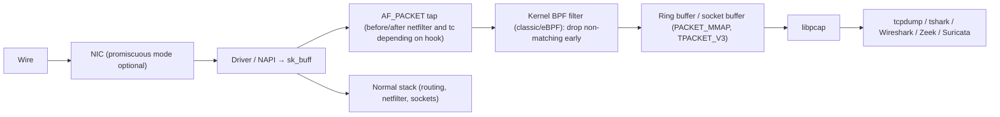

# 2.26 Packet capture from scratch: tcpdump, tshark, Wireshark and BPF-based tracing

| | |
|---|---|
| Level | Intermediate |
| Priority tier | 0 |
| Lab venue | Any Linux VM (root); Wireshark on a laptop |
| Part | Part 2: Networking, from first principles to AI fabrics |
| Status | Drafted, labs **untested** |

## Why this matters for AI infrastructure

Counters tell you *that* something is wrong. Packets tell you *what*. Think of the counters as the smoke alarm and the capture as the security camera: the alarm says there is a fire somewhere, and the footage shows who dropped the match. When a connection resets or a rail goes quiet, you can settle the argument with a capture. Did the SYN leave the host? Did the reply come back? Was the MSS clamped, and did a middlebox strip window scaling? Who sent the RST? You can also check whether PFC pause frames are flooding a rail, whether RoCE traffic carries the right DSCP, and whether the CNP was generated.

Consider a Tuesday afternoon. A checkpoint upload from one GPU node to the storage cluster has slowed to a crawl, and the job log says only that a write timed out. The interface counters look calm. Nothing is dropped, and the error counts have not moved. Those counters have answered one narrow question, which is whether the NIC itself is struggling. They cannot say whether the storage server ever received the write, or whether the reply was lost on the way back. Only a capture can answer that, and it answers packet by packet.

GPU clusters make this harder. You cannot take a capture on a 100 or 400 Gb/s link with a naive `tcpdump`. RDMA traffic bypasses the kernel entirely. Containers hide their interfaces in namespaces, and overlays wrap each packet twice. The story below starts with the question of how a capture works at all, where the kernel hands a copy of each packet to the tool, and why that copy sometimes lies. Then it moves through `tcpdump` and its filters, `tshark` and Wireshark with TLS decryption and VXLAN and RoCE decoding, and capture at scale, from containers and from switches. It ends with eBPF tools such as BCC and bpftrace, which complement captures by tracing the view that the kernel has of packets and sockets.

## Prerequisites and outcomes

You should know TCP/IP from 2.4 to 2.7, and Linux interfaces and counters from 2.22. You also need root access to a Linux host. If you can explain the TCP handshake, what an MTU is, and what a veth interface is, you are ready.

All capture vocabulary is introduced as it appears: promiscuous mode, snaplen, BPF, ring buffers and display filters each get a plain explanation and a small example.

## 1. How packet capture works

Picture a server that sends a reply, and the client says it never arrived. Before you blame the network, you need to know whether the packet ever left the machine, and exactly where a tool could have seen it. A capture is a camera that watches one point on the path. This section explains what the camera sees, what it does not see, and why two cameras on the same path can disagree. Once you know the camera's position, its footage becomes evidence you can trust.

Suppose a packet leaves your server and never reaches the peer. Before you blame the network, you need to know where in the kernel a capture can see that packet. The diagram shows the path a packet takes on the way in.

Here is what a capture actually does when it runs. Your tool asks the kernel for a copy of every packet that crosses one chosen point. The copy is taken from data the kernel is already moving, so the tool does not hold the packet back on its normal path. The packet keeps going to its destination. If a packet vanished before the tap point, the capture shows nothing for it, and that silence is itself a clue. It tells you the loss happened earlier on the path, not inside the application that is waiting for the reply.



Capture is a chain of pieces, and the first piece is the libpcap library. It is the portable capture layer. On Linux it opens an `AF_PACKET` socket, though specialised tools may use `AF_XDP` or DPDK instead. libpcap compiles your capture filter into BPF bytecode and attaches it to that socket. The kernel then discards packets that do not match, which costs very little. The matching packets are read from a memory-mapped ring buffer. In effect, the kernel does the sorting at the door, and only the guests on your list are carried inside.

Follow one ping through this chain to see the order of events. The NIC receives the echo request and hands the frame to its driver. The driver wraps the frame in the kernel's packet structure, the `sk_buff`, and the packet reaches the tap. If a capture is running with a matching filter, a copy goes into the ring buffer. Only then does the normal stack take over and produce the reply. The reply then passes the tap on its way out, so the same capture sees both directions. Each step adds a little time, and the capture adds its own small share on top.

Promiscuous mode lets the NIC accept frames that are not addressed to its own MAC. You need it to see the traffic of other hosts on a hub, a mirror port or a TAP. On a switched network without mirroring, you see only your own traffic, plus broadcast and multicast.

Think of a switch as a sorting office that delivers each letter only to its addressee. A mirror port is the office manager's copy of every letter that passes through one section. If you plug your capture host into the mirror, promiscuous mode lets it read letters it is not addressed to. Without the mirror, the switch never sends you someone else's frames, however promiscuous your NIC is set to be.

Snaplen, set with `-s`, is how many bytes you keep from each packet. The modern tcpdump default is 262144, which keeps the full packet. Truncating with `-s 96` or `-s 128` keeps only the headers. That is far lighter, exposes no payload, and is usually enough for the job.

A worked example makes the trade concrete. Take a web response packet that is a full 1500 bytes long. With `-s 96`, the capture stores only the first 96 bytes. Those bytes hold the Ethernet, IP and TCP headers and a few bytes of payload. The rest of the packet is discarded before it reaches the file. Most of the bytes never touch the disk, and the headers that answer most questions are still there. You give up the body, and in return the file stays small.

Timestamps come from the kernel when a packet is received, in microseconds or nanoseconds. Hardware NIC timestamps are more accurate for latency work. You request them with `tcpdump -j adapter` or `--time-stamp-precision=nano`. Run `ethtool -T eth0` to see whether your NIC supports them.

Where the tap sits changes what you see. On receive, the tap comes before most of the stack but after GRO merging by default. On transmit, the tap comes before the NIC. Checksum offload therefore makes outgoing packets show bad checksums, and TSO makes them look larger than the MTU. The kernel has not yet handed the packet to the NIC, so the checksum has not been filled in, and the NIC will do it later. A capture taken on the sending host is not a byte-exact copy of what reaches the wire. When exact wire frames matter, turn offloads off for a while with `ethtool -K eth0 tso off gso off gro off rx off tx off`, or capture on a mirror port or TAP.

Drop counts tell you where packets were lost. "N packets dropped by kernel" means the buffer of the capture socket overflowed. Raise `-B`, narrow the filter, write to fast storage, or truncate the packets. "N packets dropped by interface" means the NIC dropped them before the capture saw them. Capturing is best effort, and it uses CPU of its own.

A busy host is the usual place to see drops. Suppose you start a capture on a node that is already pushing its CPUs hard, and the summary reports drops by the kernel. The file you hold is missing packets, so any conclusion drawn from it is weak. Stop the capture, reduce the snaplen, narrow the filter, and capture again before you read anything into the first file. A capture that lost packets can look like a healthy network, and that is the most dangerous kind of wrong answer.

### Capture points

Pick the capture point before you start, because each point shows a different slice of the traffic. The table lists the common choices and what each one sees.

| Where | Sees | Notes |
|---|---|---|
| On the host (interface) | Traffic of that interface (post-GRO RX, pre-offload TX) | Easiest; offload artefacts |
| `-i any` | All interfaces, "cooked" (SLL) headers without L2 detail | Convenient; loses VLAN/ordering details; do not use for exact timing |
| Inside a container/pod namespace | That namespace's veth view | `nsenter -t PID -n tcpdump` |
| On a bridge/veth host-side | Traffic crossing between namespaces | Compare both ends of a veth |
| Switch port mirror (SPAN), ERSPAN, TAP | Copy of a link, independent of host stack | Truth source for the wire; mirrored traffic can be dropped under congestion |
| NIC/DPU embedded capture | Hardware-accelerated capture | For RDMA: `tcpdump -i mlx5_0` with `rdma-core` supports RoCE mirror via the NIC; `ibdump` |
| In the kernel (tracepoints, `kfree_skb`, `pwru`) | Packet's path and drop locations without copying | Complements, doesn't replace, pcap |

Read the table as a guide to where your evidence will come from. The `-i any` row is the convenient choice, but it hides the details you need for timing. The switch mirror and TAP rows give you the wire itself, independent of the host.

A simple way to choose a point is to ask which packets you must see, and then pick the closest point that sees them. If the question is whether the server received the request, a capture on the server is the closest point. If the question is whether the request left the client at all, a capture on the client interface shows it, and the offload caveat above still applies. Moving the tap closer to the place you suspect is the habit that makes captures quick to read.

## 2. tcpdump

You can run `tcpdump` on the host where the problem shows up. The commands below cover the common cases, from listing interfaces to rotating files. Each line keeps the flags you need and a short note on what it does.

Picture an on-call engineer on a GPU node at two in the morning. The job on that node has stopped sending heartbeats, and the engineer has only a shell. Everything that follows is what that engineer would type, starting with the smallest command that proves whether a packet arrives at all.

```bash
sudo tcpdump -D                                   # list capture interfaces
sudo tcpdump -ni eth0                             # -n no DNS ; -nn no port names either ; -i interface
sudo tcpdump -ni eth0 -c 100 'tcp port 443'       # stop after 100 packets
sudo tcpdump -nni eth0 -s 96 -w /tmp/c.pcap 'host 10.0.0.5 and tcp'      # write truncated capture to a file (preferred over live reading)
sudo tcpdump -nr /tmp/c.pcap                      # read ; add -tttt (date+time), -ttt (delta), -q (brief), -vvv (verbose), -e (link layer), -X / -XX (hex+ASCII), -A (ASCII)
sudo tcpdump -nn -i eth0 -tttt -e vlan and host 10.0.0.5      # show Ethernet header + VLAN tags
sudo tcpdump -ni eth0 -B 4096 -w - 'port 80' | gzip > /tmp/c.pcap.gz     # kernel buffer 4096 KiB; stream out
sudo tcpdump -ni any -C 100 -W 10 -w /var/tmp/ring.pcap          # ring buffer: 10 files of 100 MB (-C MB, -W count)
sudo tcpdump -ni eth0 -G 300 -w '/var/tmp/%Y%m%d-%H%M%S.pcap'     # rotate every 300 s (time-based)
sudo tcpdump -ni eth0 -Z tcpdump -w /tmp/c.pcap                   # drop privileges after opening
sudo tcpdump -ni eth0 --time-stamp-precision nano -j adapter_unsynced -w /tmp/hw.pcap      # NIC hardware timestamps
sudo tcpdump -d 'tcp port 22'                     # show the compiled BPF bytecode of a filter (-dd/-ddd variants)
```

The flags do most of the work. The `-n` and `-nn` flags stop name lookups, which would otherwise slow the output. The `-w` flag writes to a file, which is safer than reading live. The `-C` and `-W` flags create a ring buffer, and `-G` rotates files on a timer.

Read the sample command from left to right. Take `sudo tcpdump -nni eth0 -s 96 -w /tmp/c.pcap 'host 10.0.0.5 and tcp'` one piece at a time. `sudo` gives the process the right to open a raw socket. `-nni eth0` says no name lookups and listen on the eth0 interface. `-s 96` keeps the first 96 bytes of each packet. `-w` sends the packets to a file rather than the screen. The quoted text is the filter, and the single quotes stop the shell from reading the spaces and the ampersand. Each piece has one job, and you can change one piece without touching the others.

### What tcpdump shows on the wire

Your system normally ignores traffic that is not addressed to one of its MAC addresses. To see everything that crosses the network, `tcpdump` puts the network interface card into promiscuous mode. It then reports every packet it sees. Running `tcpdump` with no arguments produces output like this, which includes an ARP request and a web connection:

```bash
# tcpdump
tcpdump: listening on eth0
20:36:25.771304 arp who-has mikado.example.com tell duplex.example.com
20:36:25.774729 arp reply mikado.example.com is-at 0:2:2d:b:ee:4e
20:36:25.774796 duplex.example.com.48455 > mikado.example.com.www: S 3200063165:3200063165(0) win 5840 <mss 1460,sackOK,timestamp 38815804[|tcp]> (DF)
20:36:25.779283 mikado.example.com.www > duplex.example.com.48455: S 3494716463:3494716463(0) ack 3200063166 win 5792 <mss 1460,sackOK,timestamp 4620[|tcp]> (DF)
20:36:25.779409 duplex.example.com.48455 > mikado.example.com.www: . ack 1 win 5840 <nop,nop,timestamp 38815805 4620> (DF)
20:36:25.779787 duplex.example.com.48455 > mikado.example.com.www: P 1:427(426) ack 1 win 5840 <nop,nop,timestamp 38815805 4620> (DF)
20:36:25.784012 mikado.example.com.www > duplex.example.com.48455: . ack 427 win 6432 <nop,nop,timestamp 4620 38815805> (DF)
20:36:25.845645 mikado.example.com.www > duplex.example.com.48455: P 1:773(772) ack 427 win 6432 <nop,nop,timestamp 4626 38815805> (DF)
20:36:25.845732 duplex.example.com.48455 > mikado.example.com.www: . ack 773 win 6948 <nop,nop,timestamp 38815812 4626> (DF)
9 packets received by filter
0 packets dropped by kernel
```

The first line is an ARP request, asking who owns an address, and the reply follows it. The remaining lines are the TCP packets of the web connection. The last two lines are the summary. They count the packets the filter matched and the packets the kernel dropped.

Read the output the way you would read a short conversation. The first two lines are the two hosts finding each other's link address, because the client needs the server's MAC address before it can send a frame. The third line is the client's SYN, the packet that asks to open a connection. The fourth is the server's SYN-ACK, which says yes and asks for the same in return. The fifth line is the client's bare ACK. Only after those three packets does data start, on the sixth line. The closing summary says that the filter matched nine packets and the kernel dropped none, so the picture is complete.

### Capture filter syntax (pcap-filter)

A capture filter is an expression built from primitives. Each primitive can carry a qualifier, such as a type (`host`, `net`, `port` or `portrange`), a direction (`src`, `dst` or `src or dst`) and a protocol (`ether`, `ip`, `ip6`, `arp`, `tcp`, `udp`, `icmp`, `icmp6` or `vlan`). You join the pieces with `and`/`&&`, `or`/`||` and `not`/`!`, and group them with parentheses when the order matters. Read the expression like a sentence: "host this and port that, but not from there".

Take the expression `host 10.0.0.5 and not port 22` and read it as a sentence. It means packets that involve 10.0.0.5, but not the ones that touch port 22. Now add an `or`. The expression `tcp port 443 or udp port 53` matches two separate groups, and a packet needs to fit only one of them. Putting `and` and `or` side by side without parentheses invites mistakes, so group the parts with parentheses whenever the meaning depends on the order.

The table turns common goals into filters you can copy.

| Goal | Filter |
|---|---|
| One host / either direction | `host 10.0.0.5` ; `src host 10.0.0.5` ; `dst net 10.0.0.0/24` |
| TCP/UDP port or range | `port 443` ; `tcp dst port 22` ; `portrange 5000-5100` |
| Not SSH noise | `not port 22` (essential when capturing over SSH) |
| ICMP / ICMPv6 | `icmp` ; `icmp6` ; `icmp[icmptype] == icmp-unreach` |
| ARP / non-IP | `arp` ; `ether proto 0x8809` (LACP) ; `ether proto 0x88cc` (LLDP) |
| TCP SYN only | `tcp[tcpflags] & tcp-syn != 0` ; SYN without ACK: `tcp[tcpflags] & (tcp-syn\|tcp-ack) == tcp-syn` |
| TCP RST/FIN | `tcp[tcpflags] & (tcp-rst\|tcp-fin) != 0` |
| Large packets / MTU test | `greater 1400` ; `ip[6:2] & 0x2000 != 0` (more fragments) |
| DNS | `udp port 53 or tcp port 53` |
| DHCP | `udp port 67 or udp port 68` |
| VLAN tagged | `vlan` ; `vlan 100` (filter after `vlan` keyword shifts offsets) |
| VXLAN | `udp port 4789` (outer); inner filtering needs Wireshark/tshark or `udp[8:2]` offsets |
| RoCEv2 | `udp dst port 4791` |
| PFC pause frames | `ether proto 0x8808` |
| TTL low | `ip[8] < 5` |
| DSCP EF | `ip[1] & 0xfc == 0xb8` ; ECN CE: `ip[1] & 0x3 == 3` |
| Specific flow | `host 10.0.0.5 and host 10.0.0.9 and tcp port 443` |

Tcpdump prints TCP flags as short letters in each line. `S` means SYN, and `S.` means SYN-ACK. A dot alone means ACK, `P.` means PSH-ACK, `F.` means FIN-ACK, and `R` or `R.` means RST. A typical line looks like this: `10:00:00.123456 IP 10.0.0.2.51234 > 10.0.0.5.443: Flags [S], seq 1000, win 64240, options [mss 1460,sackOK,TS val 1 ecr 0,nop,wscale 7], length 0`.

The flags tell a story when you read them in order. A connection opens with a SYN from the client. The server answers with a SYN-ACK, which carries its own SYN and an acknowledgement of the client's. The client sends a plain ACK to finish the handshake. Data then flows in PSH-ACK packets, which push bytes up to the application. When one side is done, it sends FIN-ACK. A reset with an R means the other side refuses the connection or tears it down at once. If you see a SYN with no reply after it, the story stops at the first line, and the next question is who stayed silent.

Good habits make these captures easier to trust. Capture to a file, filter narrowly, truncate, and leave out your SSH session. Keep the clocks of your hosts in sync with NTP or PTP when you correlate captures, and capture at both ends to see what each side saw. Record the exact command, the host and the interface in your case notes so that someone else can repeat the capture.

Consider why the advice about clocks matters. Two captures, one on each side of a connection, can seem to disagree about the order of events. A server's reply can appear to arrive before the request was sent, only because the two clocks differ. Before you conclude that a packet was reordered, check the clocks. Then match the packets by sequence number rather than by time, because sequence numbers do not depend on any clock.

### Primitives and operators

A filter is built from primitives, which are its basic elements. The table lists the most important ones.

| Primitive | Packet specification |
|---|---|
| `tcp` | TCP packets |
| `udp` | UDP packets |
| `ip` | IPv4 packets |
| `ip6` | IPv6 packets |
| `port` *port* | TCP and/or UDP packets to or from port *port* |
| `host` *host* | Packets to or from host *host* |
| `net` *network* | Packets to or from network *network* |

Operators combine primitives. The `or` operator passes a packet when either side of it is true. The `and` operator requires both sides to be true, and `!` negates a condition. You can group operators with parentheses. Two examples show the difference:

```bash
sudo tcpdump tcp
sudo tcpdump udp or port 80 or port 443
```

The first command shows only TCP packets. The second shows UDP packets, plus any packet on port 80 or port 443. If you do serious work with `tcpdump`, read the `pcap-filter(7)` manual page. Its section on primitives is the reference you will return to.

### Permission to capture

Here is a moment of temptation that comes up often. A developer is sure the API returns a wrong field, and wants to see the whole body in the capture. The capture can show the body, and it can also show a password typed into a plain HTTP form, or a model prompt that a customer wrote in confidence. Before you widen the snaplen or add `-A`, decide what you really need to see. Often the headers answer the question, and the body is data you should not collect at all.

`tcpdump` shows more than most people expect. The output in this chapter includes only the TCP and IP header details. You can also make `tcpdump` print the entire packet contents. Most important network traffic is now encrypted with TLS, but headers and metadata still reveal a lot. Who talked to whom, when, and how much is often enough to tell a story.

Even though most traffic is encrypted, you should not snoop around on a network unless you own it or have permission. Ask before you capture on a network that someone else runs.

## 3. tshark and Wireshark

On a headless server, where there is no desktop to run a GUI, `tshark` is the tool to reach for. It is the command-line version of Wireshark, with the same dissectors, display filters and statistics, and it suits scripts well. A dissector is the piece of code that knows how to read one protocol and label its fields. Wireshark itself, the GUI, is better for interactive analysis of files copied off the host.

Here is a typical sequence on a headless box. You capture on the server to a file with `tcpdump`, copy the file to a laptop, and open it in Wireshark there. Or you run `tshark` on the server alone and let its statistics answer the question. The second route saves the copy and is quick for a first look. The first route gives you the full graphical view when you need to scroll through packets with your own eyes.

```bash
tshark -r c.pcap -q -z io,stat,1                              # packets and bytes per second
tshark -r c.pcap -q -z conv,tcp                               # TCP conversations (bytes, duration)
tshark -r c.pcap -q -z endpoints,ip ; -z http,tree ; -z dns,tree ; -z expert
tshark -r c.pcap -Y 'tcp.analysis.retransmission' -T fields -e frame.time_relative -e ip.src -e ip.dst -e tcp.seq
tshark -r c.pcap -Y 'tcp.stream eq 5' -T fields -e frame.time_delta_displayed -e tcp.flags.str -e tcp.len     # follow one stream
tshark -r c.pcap -qz follow,tcp,ascii,5                       # reconstruct stream 5 content
tshark -i eth0 -f 'port 443' -a duration:30 -w /tmp/t.pcapng  # capture filter (-f) vs display filter (-Y)
tshark -r c.pcap -o tls.keylog_file:/tmp/keys.log -Y http2 -T fields -e http2.headers.path    # decrypt TLS with a key log
editcap -c 100000 big.pcap part.pcap ; mergecap -w all.pcap a.pcap b.pcap ; capinfos c.pcap ; editcap -A "2026-01-01 10:00:00" -B "2026-01-01 10:05:00" in.pcap out.pcap
```

Display filters are richer than capture filters, and they work on packets that are already captured. For example, you can match an IP address, a TCP flag combination, or a retransmission marked by the analysis engine. The filters below cover the common cases: `ip.addr == 10.0.0.5`, `tcp.port == 443`, `tcp.flags.syn == 1 && tcp.flags.ack == 0`, `tcp.analysis.retransmission`, `tcp.analysis.fast_retransmission`, `tcp.analysis.duplicate_ack`, `tcp.analysis.zero_window`, `tcp.analysis.window_full`, `tcp.analysis.lost_segment`, `tcp.window_size_value == 0`, `http.request.method == "POST"`, `dns.flags.rcode != 0`, `tls.handshake.type == 1` (ClientHello), `tls.alert_message`, `vxlan.vni == 10100`, `icmp.type == 3 && icmp.code == 4`, `eth.type == 0x8808` (PFC), `lldp`, `dhcp`, `ib.bth.opcode` / `infiniband` (RoCE: dissector `roce`/`infiniband`), and `frame.time_delta > 0.2`.

Compare two display filters on the same file. `tcp.port == 443` keeps every TCP packet that uses port 443, in either direction. `tcp.flags.syn == 1 && tcp.flags.ack == 0` keeps only the first packet of each new connection. The second is narrower, and it depends on TCP flags that Wireshark reads from each packet after the capture. A capture filter cannot ask that question, because it runs before any stream is assembled. That is why you may use a moderate capture filter on the wire, and then do the fine questions in the display filter.

Wireshark offers more analysis than the command line does. Its Statistics menu covers conversations, endpoints, protocol hierarchy, IO graphs and TCP stream graphs. The Analyze menu opens Expert Information, which flags retransmissions, duplicate ACKs, zero windows, out-of-order segments, full windows and resets. TCP stream graphs show the time-sequence view, throughput, RTT and window scaling. Follow TCP, UDP or TLS stream reassembles a conversation for reading. Decode As maps a port to a dissector, so you can treat UDP 4791 as RoCE or a custom port as VXLAN or GENEVE. To decrypt your own TLS in a lab, set `SSLKEYLOGFILE` in the client, for example `SSLKEYLOGFILE=/tmp/keys.log curl ...`, and point `Edit → Preferences → Protocols → TLS → (Pre)-Master-Secret log filename` at the same file. Setting the time display to the time since the previous displayed packet reveals gaps, and coloring rules, packet comments, exported objects and `File → Export Specified Packets` help you share only the evidence you need.

A first session with a capture file might go like this. Open the file, then choose Statistics and then Conversations to see which pair of hosts carried the most bytes. Pick the conversation that matters and filter on it. Next open Analyze and then Expert Information, which lists retransmissions and resets as coloured entries. Click one, and Wireshark jumps to that packet. You have moved from a file of thousands of packets to one event, and that is the normal order of reading a capture.

**Reading TCP in Wireshark and tshark** is a skill of its own, and a few patterns cover most cases. A healthy connection opens with a three-way handshake. The SYN carries options such as MSS, SACK permitted, timestamps and window scale, the server answers with a SYN-ACK, and the client confirms with an ACK. A missing SYN-ACK points to a drop, a block or a missing route. An RST in place of the SYN-ACK usually means the port is closed. In plain words, silence means someone is ignoring you, and a reset means someone is refusing you.

Imagine a client that waits for an answer after it sends its SYN. In Wireshark you see the same SYN repeated, each copy a little later than the one before. No SYN-ACK ever arrives. The reading is that the server never received the SYN, or its answer never came back. Check the server's capture next. If the SYN is there and no SYN-ACK leaves, the server or a firewall in front of it is ignoring the port. If the SYN never appears on the server, the path between the two hosts is the suspect.

Options matter as well. If the SYN of one side has no window scale and the SYN of the other side does, a middlebox may be stripping options, and throughput is then limited to 64 KB per RTT. Retransmissions come in three kinds: normal, fast and spurious. Three duplicate ACKs trigger a fast retransmit, and SACK blocks show which ranges actually arrived. A zero window means the receiving application is slow to read. A window full result means the sender is limited by the receive window, while bytes in flight below the cwnd means the application itself is the limit.

Think of the window scale option as the width of a pipe. If a SYN-ACK arrives without that option, the connection keeps its window at the 64 KB limit, however fast the link is. The transfer then looks slow for no visible reason. The fix belongs to the middlebox that removed the option, not to the application that waits on the transfer.

Timing gaps tell their own story. A delayed ACK gap of 40 ms often comes from the Nagle algorithm. An RTO gap of 200 ms or more doubles on each retry. Path MTU problems look like segments larger than the path MTU with the DF bit set, followed by an ICMP "fragmentation needed" message (type 3, code 4). If large packets keep being retransmitted with no ICMP reply, you are looking at a black hole. Resets need the same care. A reset whose TTL, IP ID or timing differs from the normal packets of the peer was probably injected by a middlebox. A reset after a long idle period points to a NAT or load balancer timeout, and a reset after data points to an application that closed with unread data.

Suppose a file upload pauses at regular intervals, and each pause looks close to a fifth of a second. Searching the capture for the gaps between data packets shows that same figure again and again. A delay of that kind is almost always a timer at work, not a slow disk. Your job is to name the timer, and the rules above give you the names to check.

Finally, do not chase checksums. A "bad checksum" on the sending host is usually offload at work. Treat it as a real fault only when the receiving side sees it too.

## 4. Decoding the protocols you meet in AI infrastructure

A GPU server talks to many services, and each one leaves its own marks on the wire. When a capture shows a protocol you do not recognise, the table tells you what to look for. Each row names a protocol and the hints that matter in its traffic.

Consider the first minute of a training node. It resolves names, asks DHCP for an address, sends ARP for its gateway, opens TLS to a registry, and then starts NCCL sockets. A capture from that minute holds all of these protocols at once. A reader who does not know a protocol cannot tell a normal exchange from a broken one. The table below is a short dictionary for that minute, so that each unfamiliar packet has a name and a first thing to check.

| Protocol | Capture hints |
|---|---|
| **DNS** | `udp port 53`; look for repeated queries, NXDOMAIN storms (ndots search expansion: `svc.cluster.local` suffix queries), 5 s retransmit gaps, truncated (TC) responses followed by TCP, EDNS size |
| **DHCP** | `udp port 67 or 68`; DORA sequence; options (PXE: option 66/67, vendor class `PXEClient`), relay `giaddr`, rogue server offers |
| **ARP/NDP** | `arp or icmp6`; who-has/is-at, duplicate IP (two MACs for one IP), gratuitous ARP after failover |
| **ICMP** | Unreachables, time exceeded, redirects, PMTU (`icmp[icmptype] == 3`) |
| **TLS** | ClientHello (SNI, ALPN, versions), ServerHello, certificate (visible in TLS 1.2; encrypted in 1.3), alerts, handshake time; decrypt with key logs |
| **HTTP/2, gRPC** | Decrypted frames: HEADERS, DATA, RST_STREAM, GOAWAY; stream concurrency; window updates; `grpc-status` trailers |
| **VXLAN/Geneve/GRE** | Outer headers (VTEP IPs, UDP source port entropy), inner frame; decode-as for non-standard ports; compare inner/outer TTL, DSCP; MTU of inner vs outer |
| **LACP / LLDP** | `ether proto 0x8809` / `0x88cc`: partner state, port ID, VLAN/MTU TLVs |
| **PFC pause** | `ether proto 0x8808`: class-enable vector and quanta; rate of pauses per priority |
| **RoCEv2** | `udp dst port 4791`; BTH opcode (RC SEND/RDMA WRITE/READ, ACK, CNP = 0x81), PSN, destination QP; DSCP/ECN bits in IP header; **NIC-level capture is needed** for traffic the kernel doesn't see (`tcpdump -i mlx5_0` on rdma-core builds, `ibdump`, or switch mirror) |
| **BGP/OSPF/BFD** | `tcp port 179`, `proto 89`, `udp port 3784`; OPEN/UPDATE/KEEPALIVE/NOTIFICATION; BFD control packets, detect times |
| **NCCL bootstrap/sockets** | TCP between ranks; `NCCL_DEBUG=INFO` logs correlate IPs/ports with captures |
| **NFS/iSCSI/NVMe-oF TCP** | RPC XIDs, retransmissions, window sizes, `nconnect` multiple streams |

Keep the table open next to the capture. For RoCEv2, the kernel does not see all of the traffic, so the capture must come from the NIC or from a switch mirror.

## 5. Capturing at scale and in awkward places

Imagine trying to read every letter that passes through a busy sorting office. You could stand by the door and copy every envelope, but your hand would never keep up. A smarter team samples, filters and stores only the letters it needs. High-speed links make the same point for packet capture. The options below run from the simplest habit to the heaviest hardware, and you should climb only as far as the question requires.

Picture a 100 Gb/s link carrying 1500-byte frames. That is about 8 million packets every second, and default `tcpdump` with libpcap cannot keep up with that rate. You have several options, and they get more powerful as you go down the list.

The arithmetic is the first step, and it teaches a good habit. Divide the link speed by the frame size, and you know the packet rate that any capture tool must sustain. At that rate, copying each packet into user space and printing a text line for it is hopeless. Once you know the rate, the options that follow make sense. Each one reduces either the number of packets that reach the slowest part of the chain, or the number of bytes that each packet costs.

1. Capture only what you need, with a tight filter and `-s 96`.
2. Give the kernel more room. A bigger buffer with `-B 65536` helps, and so does writing to a RAM disk or striped NVMe storage. Avoid `-v` parsing and turn off name resolution.
3. Capture per queue or per flow. RSS splits traffic across queues, so you can steer the flow you care about to one queue with `ethtool -N` flow rules.
4. Use capture tools built for speed, such as PF_RING, AF_XDP and DPDK-based tools. These include n2disk, Suricata, `dpdk-pdump`, `xdpdump`, and `bpftool` with XDP capture programs.
5. Use hardware. A switch can mirror traffic by SPAN or ERSPAN to a dedicated capture server with specialised NICs, or a NIC or DPU can do the filtering and timestamping for you.
6. Sample instead of capturing everything, or capture only the headers of selected flows. Sampling works with sFlow, IPFIX or `tcpdump -c`, for example at 1:1000.
7. Use a trigger-based ring. Keep a rolling buffer with `-C -W`, then stop it on an event. The event can come from `-G`, from `inotify`, or from a script that kills tcpdump when an alert fires. This keeps the packets from before the fault.

Imagine an all-reduce that runs at half speed between two hosts, while every ordinary TCP test between them is fast. The host-side tcpdump shows nothing for the RoCE flows, because those packets never enter the kernel stack. The useful capture sits at the NIC or at the switch. The question to ask there is whether the pause frames and the congestion notifications appear at all, and on which priority.

**RDMA and GPU fabrics** need a different path. Kernel `tcpdump` does not see RoCE traffic that bypasses the stack. Use the capture path of the NIC vendor instead. That means Mellanox or NVIDIA `tcpdump` with the RDMA sniffer capability and a dedicated device, or `ibdump` for IB and RoCE. Switch mirror sessions and telemetry such as counters or INT also work. GPUDirect traffic still appears on the wire and at the switch, not in the host kernel. When you diagnose the NIC of a host, capture on a different host or at the switch.

**Containers and Kubernetes** add a layer of namespaces. From the node, you can run `sudo nsenter -t <pid> -n tcpdump -ni eth0 -w /tmp/pod.pcap`. You can also capture on the host-side veth, which you find with `ip -o link | grep veth`, or on the CNI bridge. With `kubectl debug node/<node> -it --image=nicolaka/netshoot`, you get the host namespaces. With `kubectl debug -it <pod> --image=nicolaka/netshoot --target=<container>`, you get an ephemeral container that shares the network namespace of the pod, which needs permissions and the `NET_RAW` and `NET_ADMIN` capabilities. The `kubectl sniff` plugin, ksniff, streams a pod capture into Wireshark. Overlays add more points to check. Capture on the pod veth for the inner packet, on the tunnel device after decapsulation, and on the uplink for the outer, encapsulated packet.

Here is the order of steps for one pod. On the node, find the container's process ID with your container runtime's inspect command. Enter that process's network namespace with `nsenter` and run `tcpdump` there, which sees the pod's own eth0. Then find the matching host-side veth and capture there as well. The two files together show whether a packet left the pod, and whether it reached the node. A missing packet between the two points tells you where to look next.

**Mirroring and TAPs** each have their trade-offs. SPAN mirrors locally, RSPAN carries the mirror over a VLAN, ERSPAN wraps it in GRE and sends it to a remote IP, and sFlow and IPFIX sample it. Mirror ports can drop packets when they are oversubscribed, and mirrored frames may have their VLAN tags stripped or added. Mirror both directions. TAPs, which are optical splitters, are lossless and passive. Linux can mirror too, with `tc qdisc add dev eth0 ingress; tc filter add dev eth0 parent ffff: protocol all matchall action mirred egress mirror dev dummy0`, and then you capture on `dummy0` or send the copy elsewhere.

**Synchronised captures** matter when you measure one-way delay or ordering. Capture at both ends with synchronised clocks. PTP with hardware timestamps is precise, while NTP is only good to about a millisecond. Then align the files in Wireshark by merging them with `mergecap -a`, or by comparing the timestamps of the same packet, matched by IP ID or TCP sequence number.

**Privacy and law** apply to every capture. A capture can contain credentials, tokens, personal data and model prompts. Capture only on systems and networks you are authorised to monitor. Prefer header-only captures, protect and delete the files according to policy, and scrub or anonymise a capture before you share it. The tools for that are tcprewrite, `editcap` and Wireshark masks. Never post a raw capture publicly.

If a fault comes and goes, set up a ring buffer that stops on the event, so the evidence is already on disk when the fault appears.

## 6. BPF-based tracing for networking (BCC and bpftrace)

A capture shows packets on the wire or at an interface. It cannot show what the kernel and your applications do with those packets. That is the job of BPF tracing. With it you can see which process opened which connection, how long a handshake takes, which function dropped a packet, and how retransmits line up with socket state. You can also measure per-process TCP throughput. BPF programs run sandboxed in the kernel, and the kernel verifies them for safety before they run. A capture is the view from the cable. BPF tracing is the view from inside the machine.

Suppose a Python service is slow to connect to its database, and the capture shows that the SYN and SYN-ACK take almost no time on the wire. The delay is somewhere else, inside the machine. A capture cannot see inside a process, so you need a tool that watches the kernel from the inside. That is the situation BPF tracing was built for.

BPF programs attach to probes. **kprobes** and **kretprobes** fire when a kernel function is entered and returns. **uprobes** and **uretprobes** do the same for user-space functions. **Tracepoints** are stable kernel events, such as `tcp:tcp_retransmit_skb`, `sock:inet_sock_set_state`, `skb:kfree_skb` and `net:net_dev_xmit`. USDT provides static probes inside runtimes, and perf events and timers cover the rest. Results are aggregated inside the kernel into maps, such as counts, histograms and stacks, so the overhead stays low.

Here is what happens when you run one of these tools. The tool compiles a small program and hands it to the kernel. The kernel's verifier reads each instruction and rejects anything that could crash the kernel or loop without end. The program is then attached to a probe, such as the entry point of a function. When the event fires, the program runs, updates a counter in a map, and returns. The tool reads that map every second and prints it. Because the counting happens inside the kernel, the tool never has to receive each individual event.

### BCC and bpftrace

BCC, the BPF Compiler Collection, gives you a Python front end with BPF programs written in embedded C. It also comes with many ready-made tools under `/usr/share/bcc/tools`, or with a `-bpfcc` suffix on Debian and Ubuntu. BCC suits complex tools that need argument parsing and custom output. Its single-purpose tools include `tcplife`, `tcpconnect`, `tcpaccept`, `tcpretrans`, `tcpdrop`, `tcpstates`, `tcpconnlat`, `tcptop`, `solisten`, `sockstat`, `biolatency`, `runqlat`, `execsnoop` and `opensnoop`. Its multi-purpose tools, `trace`, `argdist`, `funccount`, `stackcount` and `funclatency`, attach to any function you name. You install the set with `apt install bpfcc-tools linux-headers-$(uname -r)` or `dnf install bcc-tools`. Modern libbpf-tools, which use CO-RE, are lighter, and they need no compiler on the target. Here are some example multi-purpose calls: `sudo funccount 'tcp_*'`, `sudo trace 'tcp_retransmit_skb "skb=%p"'`, `sudo argdist -H 'r::tcp_sendmsg():int:$retval'` for a histogram of bytes sent, and `sudo stackcount -P tcp_drop` to see who triggers drops.

Think of `funccount` as a tally clerk. You name a pattern, such as `tcp_*`, and it counts how often each matching kernel function runs while you watch. If the count for `tcp_retransmit_skb` climbs, you have a retransmit problem. If `tcp_sendmsg` stays quiet while the application is busy, the application is not sending. Each small question gets its own tool, and the tools speak the same language as the function names you already know.

bpftrace is a high-level language for one-liners and short scripts. Its syntax is awk-like, in the form `probe /filter/ { action }`, and it suits quick, ad hoc questions. The one-liners below show the pattern.

Read the first useful one-liner from left to right. `tracepoint:tcp:tcp_retransmit_skb` names the event, which is the moment the kernel resends a segment. The braces hold the action. `@[ntop(args->daddr)]` makes a map keyed by the destination address, converted to readable text. `= count()` adds one each time the event fires. When you stop the tool, the map shows which destinations suffered the most retransmits. You can read the whole thing in one breath, and that is much of the appeal of bpftrace.

```bash
sudo bpftrace -l 'tracepoint:tcp:*'                         # list available probes ; -lv to see arguments
sudo bpftrace -e 'tracepoint:tcp:tcp_retransmit_skb { @[ntop(args->daddr)] = count(); }'          # retransmits per destination
sudo bpftrace -e 'tracepoint:sock:inet_sock_set_state /args->newstate == 1/ { @connect[comm] = count(); }'     # new established TCP by process
sudo bpftrace -e 'kprobe:tcp_sendmsg { @send_bytes[comm] = hist(arg2); }'                          # send size distribution
sudo bpftrace -e 'kretprobe:tcp_recvmsg /retval > 0/ { @recv[comm] = sum(retval); }'               # bytes received per process
sudo bpftrace -e 'tracepoint:skb:kfree_skb { @[args->location] = count(); }' | head               # where packets are freed/dropped (resolve addresses with ksym())
sudo bpftrace -e 'kprobe:tcp_v4_connect { @start[tid] = nsecs; } kretprobe:tcp_v4_connect /@start[tid]/ { @us = hist((nsecs - @start[tid]) / 1000); delete(@start[tid]); }'
sudo bpftrace -e 'tracepoint:net:netif_receive_skb { @pkts[args->name] = count(); } interval:s:1 { print(@pkts); clear(@pkts); }'
sudo bpftrace -e 'uprobe:/usr/lib/x86_64-linux-gnu/libssl.so.3:SSL_write { @[comm] = count(); }'       # TLS writes per process (uprobe)
```

A bpftrace program has a few parts. The probe says what event to watch, and an optional filter in slashes narrows it. The action block uses built-in variables such as `pid`, `tid`, `comm`, `nsecs`, `arg0..argN`, `retval` and `args->field` for tracepoints. Maps, written as `@name[key]`, hold the aggregates, using `count()`, `sum()`, `avg()`, `min()`, `max()`, `hist()`, `lhist()` or `stats()`. The helpers `printf`, `ntop()` for IP addresses, `ksym()` and `usym()` for symbols, and `kstack` and `ustack` do the rest. The `BEGIN`, `END` and `interval` probes handle setup, teardown and periodic output. You can keep a script in a `.bt` file with a shebang line.

Two cautions matter in practice. Kprobe function names and arguments change between kernel versions, so prefer tracepoints, which are stable. Many events per second add overhead, so aggregate inside the kernel and avoid printing each event. The tools also need root, or CAP_BPF and CAP_PERFMON, plus `CONFIG_DEBUG_INFO_BTF` for CO-RE. Inside a container, you reach the debugfs and tracefs of the host and use the PID namespace of the host.

### Using BPF tools in network investigations

The table matches a question to the tool that answers it.

| Question | Tool |
|---|---|
| Which processes make/accept connections, and where? | `tcpconnect`, `tcpaccept`, `sockstat` |
| How long do TCP sessions live, how much do they transfer? | `tcplife` |
| Which flows retransmit, with state? | `tcpretrans` |
| Why were packets dropped (call stack)? | `tcpdrop`, `bpftrace` on `kfree_skb` (drop reasons on newer kernels via `skb:kfree_skb` `reason` field) |
| Handshake (connect) latency per destination | `tcpconnlat` |
| TCP state machine behaviour (TIME_WAIT, SYN_RECV durations) | `tcpstates` |
| Top bandwidth consumers by process | `tcptop` |
| Listening backlog problems | `solisten`, `tcpaccept`, `nstat` ListenOverflows |
| Softirq/hardirq time in the receive path | `softirqs`, `hardirqs` |
| Scheduler delays affecting network apps | `runqlat` |
| Custom: how often is function X called, how slow is it? | `funccount`, `funclatency`, `stackcount` |

BPF also powers several other network pieces. XDP programs filter and forward packets inside the driver. tc BPF classifiers run at ingress and egress. Socket filters, attached with `SO_ATTACH_BPF`, are how capture filters work. CNI datapaths such as Cilium use BPF too. Tools such as `pwru`, which traces an skb through the kernel functions for a given 5-tuple, `bpftool`, which inspects loaded programs and maps, and `xdpdump` belong in the same kit. Treat all of them as a complement to pcap, not a replacement.

## 7. A capture-driven troubleshooting workflow

Picture an intermittent reset that happens on a connection between two services. Nobody can reproduce it on demand, and the logs say only that the peer closed the connection. A capture is the right tool, but only if you set it up before the next reset and know what question it must answer. The workflow below is the order of work that turns a vague complaint into a question a capture can answer.

Walk through the setup for this kind of fault. You put a ring buffer on the client and another on the server, and each one stops when a reset appears, so the packets from before the reset are kept. The next time the reset fires, both files hold the moments before it. Opening the two files together shows whether the reset started on the client, on the server, or on a middlebox between them.

Captures work best when you follow a fixed sequence, because a vague question produces a vague capture. A capture of everything answers nothing, and a capture aimed at one question often answers it in a minute. The steps below take you from a precise question to a verified fix.

A short example shows how the sequence pays off. Suppose the client capture shows a SYN-ACK arriving, and the server capture shows that same SYN-ACK leaving with the same sequence numbers. The packet is gone between the two hosts, not inside the server. Your next question moves to the route and the NAT that sit between them. The pattern is useful because it turns a vague 'connection failed' into one segment of the path that you can inspect.

1. **State the question precisely** ("Does the SYN reach the server? Where is it dropped?").
2. **Choose capture points**: the client, the server, both sides of a firewall, NAT or load balancer, or a switch mirror.
3. **Write the narrowest filter** that answers the question. Leave out your management session, and if the event is intermittent, capture to file with a ring buffer.
4. **Reproduce the problem**, and note the exact times, addresses and the log lines of the application.
5. **Open the files together** and align them by time. Follow one connection, and compare what left A with what arrived at B. Any difference points to the device between them, such as NAT rewriting, MSS clamping, dropped options, injected resets or an MTU mismatch.
6. **Confirm with counters and BPF tools**, using `nstat`, `ss -ti`, `tcpretrans`, `tcpdrop`, `conntrack`, and your firewall counters.
7. **Fix the problem and capture again** to verify that the symptom has gone.

Certain patterns show up again and again, and they point to a cause. A SYN at the server with no SYN-ACK back suggests a server firewall or a full listen queue. A SYN-ACK seen at the server but not at the client suggests the return path, an asymmetric route or NAT. Data sent with repeated retransmissions and no ICMP points to an MTU black hole or a stateful device that drops the packets. Duplicate ACKs and SACK show loss on the path. An RST from a different TTL points to a middlebox. A long idle period followed by a reset points to a timeout. Gaps of exactly 200 ms or 1 s point to RTO or delayed ACK, and DNS answers that arrive after 5 s point to a resolver timeout. A ClientHello followed by nothing suggests TLS interception or an MTU problem, since post-quantum key shares make ClientHellos large. Pause frames at multi-kHz rates on one priority point to a PFC storm. Finally, if ECN-marked packets arrive but no CNP comes back, the DCQCN of the NIC is probably misconfigured.

Use the patterns as first guesses, and confirm each one with a second source. A retransmit storm with no ICMP reply might be an MTU black hole, but a stateful firewall can cause the same picture. Check the firewall counters and the path MTU before you change any setting. A guess that a counter agrees with is a conclusion, and a guess that nothing else supports is only a hypothesis.

## 8. Hands-on lab: capture, read, and decode

Start with the self-checking Python lab, which you can run on your own machine. It checks the byte-offset `pcap-filter` expressions (`tcp[tcpflags]`, `ip[6:2] & 0x2000`, `ip[8]`, and `ip[1]` for DSCP `EF` and ECN `CE`). It also checks the packet rate on a `100 Gb/s` link (`~8.13 Mpps`), the ring-buffer storage with `-s 96`, and a comparison of TCP captures from two endpoints.

The Python lab comes first for a reason. It runs on any machine, and it checks your reading of the byte offsets before you touch a live interface. If an offset is wrong, a filter on a real host quietly matches nothing, and you can spend an hour blaming the network for a mistake in your own expression. Checking the expression on paper first is the cheaper habit.

```bash
python3 code/part02/packet_capture_bpf_lab.py
```

The rest of the lab needs a disposable Linux VM. Use two namespaces or VMs joined by a `veth` pair, with a lab web server running on one side. The interactive VM commands below were not run on live hardware. Work through the steps in order. Early steps teach you to read a healthy trace, so that the later fault traces stand out.

Each step reuses the picture from the step before it. The healthy trace from step 1 is the reference that makes the faulty traces in steps 3 and 4 stand out. Work slowly through the first few steps. A capture you can read calmly on a healthy connection is much easier to read when a fault appears in it.

1. **Handshake and teardown**: capture `curl` to a local nginx. Label the SYN, SYN-ACK, ACK and FIN packets, note the options, and export the stream with `tshark -z follow`.
2. **Filters**: write and test five capture filters, for SYN only, RST, a port range, DSCP EF and VLAN. Verify each one with `tcpdump -d` and hit counts, then write the same logic as Wireshark display filters.
3. **Retransmissions and loss**: add loss with `tc qdisc add dev veth1 root netem loss 2%`. Capture the transfer, and identify the retransmissions, fast retransmit, duplicate ACKs and SACK blocks. Plot the Stevens time-sequence graph, then compare it with a run at 0% loss.
4. **MTU black hole**: set a smaller MTU on a router namespace and drop ICMP type 3 code 4. Send a large transfer and capture it. You should see full-size segments retransmitted again and again. Then fix the problem with MSS clamping and compare the two captures.
5. **Zero window**: run a server that sleeps before it reads. Capture how the window shrinks to zero, and watch for the window probes.
6. **TLS**: run `SSLKEYLOGFILE=/tmp/keys.log curl https://localhost`. Open the capture with the key log, read the decrypted HTTP/2 frames, and observe SNI and ALPN in the ClientHello.
7. **Offload artefacts**: capture on the sender with TSO and checksum offload on, then off. Look for "bad checksum" and 64 KB segments in the first run.
8. **Overlay**: build a VXLAN link, as in chapter 2.17. Capture both the outer and the inner packets, use Decode As for a custom port, and compare the DSCP and TTL values.
9. **Ring buffer and trigger**: run `tcpdump -C 10 -W 5` alongside a script that stops it when the ping loss crosses a threshold. Then check that the packets from before the event are still there.
10. **BPF tools**: run `tcplife`, `tcpconnect`, `tcpretrans` and `tcpdrop`. Write three bpftrace one-liners, for retransmits per destination, a send size histogram and connect latency. Correlate the results with your pcap.
11. **Container capture**: start a container, find its PID, and capture with `nsenter`. Then capture again with `docker run --network container:NAME nicolaka/netshoot tcpdump`.
12. **Clean up and delete captures** when you are done.

Clean up as the last step, and do not skip it. Capture files can hold credentials and request bodies, even when you meant to keep only headers. Delete the files from the lab VM, and remove the key log and the ring-buffer directory too, since they can decrypt the traffic in the captures.

## 9. Common mistakes

Imagine an engineer who runs `tcpdump` live over an SSH session to a busy node. Within seconds the terminal fills with lines, and each line is a new SSH packet that the capture then records and prints again. Nothing is broken on the node, but the capture is useless, and the session slows down. That is the feedback loop the next paragraph describes, and it is the most common self-inflicted problem with live captures.

The first group concerns the command itself. Running `tcpdump` live over SSH without excluding the SSH port creates a feedback loop, because every packet you print is carried over the connection that you are watching, and that produces more packets to print. Name resolution left on is a mistake too. Heavy bpftrace probes, such as a per-packet printf, can hurt a busy production host.

The second group concerns reading the evidence. Outbound bad checksums and giant frames look like network faults, but they are usually offload effects. The expert warnings of Wireshark also need context. An "out of order" flag from a multi-queue capture tells you about the capture, not the network. Do not trust a drop-free result from an overloaded host, and check for "dropped by kernel".

The third group concerns scope and timing. `-i any` hides VLAN and L2 details, so it is poor for timing analysis. Capturing one side only leaves the other side a guess. Captures from unsynchronised clocks cannot be compared reliably. Kernel captures miss RDMA traffic, and you should never decrypt TLS in production or share a raw capture that contains secrets.

Avoid these habits, and the capture is far more likely to show what happened on the wire.

## 10. Interview angles

Each question below comes from the chapter. Use them to check whether you can explain the material out loud. Each one tests a different part of it, from how a filter runs in the kernel to how you would capture RoCE traffic.

- "How does `tcpdump` work? What's a BPF filter and where does it run?"
- "You see a packet with a bad checksum in a capture. Is it a problem?"
- "How would you capture traffic on a busy 100G host without dropping packets?"
- "A connection works for small requests but hangs for large ones; what would the capture show?"
- "How do you read retransmissions, duplicate ACKs, SACK, zero window, RTO in a trace?"
- "How do you capture inside a Kubernetes pod? How about RoCE traffic?"
- "What is the difference between a capture filter and a display filter?"
- "When would you use BCC/bpftrace instead of tcpdump? Give three examples."
- "How do you decrypt TLS in a lab capture?"

## Exercises

Each exercise below takes one part of the chapter and asks you to explain it in your own words, with the commands to back it up.

1. A packet reaches your program and you want to see where a capture taps it. Trace the capture pipeline through the NIC, the driver and `sk_buff`, the `AF_PACKET` tap, the kernel BPF filter (check it with `tcpdump -d`), the `PACKET_MMAP` ring buffer, and libpcap.
2. A capture taken on the sending host shows `[bad tcp cksum]` and `64 KiB` frames. Explain why. Then explain how `"N packets dropped by kernel"` differs from `"N packets dropped by interface"`.
3. Use `evaluate_pcap_byte_offset_filters()` in `code/part02/packet_capture_bpf.py` to write and explain tcpdump filters for these cases. The first is pure SYN packets without SYN-ACK. The second is RST or FIN packets. The third is IPv4 More-Fragments, `ip[6:2] & 0x2000 != 0`. The fourth is DSCP EF, `ip[1] & 0xfc == 0xb8`, and ECN CE, `ip[1] & 0x3 == 3`. The last covers RoCEv2 on `udp dst port 4791`, PFC on `ether proto 0x8808`, LACP on `0x8809`, and LLDP on `0x88cc`.
4. A colleague mixes up two kinds of filter. Contrast the kernel capture filter (`-f`) with the Wireshark and tshark display filter (`-Y`).
5. Write the tshark commands that print per-second I/O statistics with `-z io,stat,1`, TCP conversations with `-z conv,tcp`, and retransmitted segments with `-Y 'tcp.analysis.retransmission'`. Then show how to decrypt TLS 1.3 HTTP/2 traffic in a lab with `SSLKEYLOGFILE`.
6. You must capture on a `100G` to `400G` link. Use `compute_capture_rate_and_ring_storage()` to work out the packet rate on a `100 Gb/s` link with `1500`-byte frames, which is about `8.13 Mpps`. Then work out the disk write rate when frames are truncated to `-s 96` with a `-C 100 -W 10` ring buffer.
7. Explain how you would capture traffic inside a Kubernetes pod with `nsenter` or `kubectl debug`. Then explain how you would capture on a kernel-bypassed RDMA fabric, RoCEv2 or InfiniBand with `ibdump`, `tcpdump -i mlx5_0`, or a switch SPAN, ERSPAN or TAP.
8. You hold simultaneous client and server captures and must say what failed. Use `diagnose_two_side_tcp_capture()` on these cases. In case (a), the SYN appears at both the client and the server, with no SYN-ACK. In case (b), the server sends a SYN-ACK that never reaches the client. In case (c), an RST reaches the client with a TTL different from the normal packets of the server. In case (d), the SYN-ACK has no `wscale` option. In case (e), full-size segments are retransmitted repeatedly, and no ICMP 3/4 replies come back.
9. Explain when to use the BCC tools `tcplife`, `tcpretrans`, `tcpconnlat`, `tcpdrop`, `funccount` and `argdist`, and when to use the bpftrace probes `tracepoint:tcp:tcp_retransmit_skb`, `tracepoint:skb:kfree_skb`, `kprobe:tcp_sendmsg` and `uprobe:libssl.so.3:SSL_write`, instead of tcpdump.
10. Explain why tracepoints are preferred over kprobes.

## Checkpoint questions (20)

<details>
<summary>1. Trace how `tcpdump` captures packets on Linux (`libpcap`, `AF_PACKET`, kernel `BPF`, and `PACKET_MMAP`).</summary>

`tcpdump` hands the work to **libpcap**, which opens an `AF_PACKET` socket on Linux. It compiles your filter string, such as `'tcp port 443'`, into BPF bytecode, which you can inspect with `tcpdump -d`. The filter is attached in the kernel with `SO_ATTACH_BPF`. As the driver and NAPI build `sk_buff`s, the kernel taps the `AF_PACKET` hook and runs the BPF filter there. Non-matching packets are discarded right away at almost no cost. Only matching packets are copied, cut to the `-s` snaplen, into a shared memory-mapped **`PACKET_MMAP`** (`TPACKET_V3`) ring buffer, which tcpdump reads.
</details>

<details>
<summary>2. Why do captures taken on the sending host show `[bad tcp cksum]` and `64 KiB` segments even on a healthy `1500`-MTU network?</summary>

The `AF_PACKET` tap sees outgoing packets in the kernel, before they reach the NIC hardware. With TX checksum offload, the kernel writes only a pseudo-header seed, and the NIC fills in the real TCP checksum on the wire. With TSO (TCP Segmentation Offload) and GSO, the kernel passes a `64 KiB` super-packet through the tap, and the NIC cuts it into `1460`-byte `MSS` frames in hardware. GRO is the receive-side counterpart. Neither effect is a network error, unless the receiving side sees the problem after the wire.
</details>

<details>
<summary>3. At the end of a `tcpdump` run, what is the difference between `"N packets dropped by kernel"` and `"N packets dropped by interface"`?</summary>

- **`N packets dropped by kernel`**: the `AF_PACKET` capture ring buffer overflowed. tcpdump, disk I/O, terminal printing or DNS lookups could not drain the packets fast enough. To fix it, use `-nn`, write to a file with `-w`, truncate headers with `-s 96`, narrow the BPF filter, or increase the buffer with `-B 65536`.
- **`N packets dropped by interface`**: the NIC or driver dropped the packets before they reached the capture tap.
</details>

<details>
<summary>4. Why should you always pass `-nn` and `not port 22` when running `tcpdump` over an interactive SSH session, and why avoid `-i any` for latency analysis?</summary>

Without `-nn`, tcpdump performs reverse DNS (`PTR`) lookups for every IP address and resolves service names too. That stalls the output and creates a storm of DNS packets, which the capture then records. Without `not port 22`, every line tcpdump prints over your SSH session becomes a new SSH packet. tcpdump captures that packet and prints it again, which makes an endless feedback loop. The `-i any` option uses Linux "cooked" (`SLL`) headers. These strip the Layer 2 Ethernet and VLAN details and mix packets from physical NICs, bridges and `veth`s. The same packet can therefore appear several times as it crosses internal hops.
</details>

<details>
<summary>5. How do you configure `tcpdump` to capture header-only packets into a rolling 1 GB ring buffer (`10 x 100 MB` files) or rotate files every 5 minutes?</summary>

- **Size-based ring buffer (`10` files of `100 MB` each, overwriting the oldest)**:
`sudo tcpdump -nni eth0 -s 96 -B 65536 -C 100 -W 10 -w /var/tmp/ring.pcap 'not port 22'`
- **Time-based rotation (every `300` seconds)**:
`sudo tcpdump -nni eth0 -s 96 -G 300 -w '/var/tmp/cap-%Y%m%d-%H%M%S.pcap' 'not port 22'`

Add `-Z tcpdump` to drop root privileges after the socket opens.
</details>

<details>
<summary>6. Write the `pcap-filter` byte-offset expressions to match: (a) pure TCP `SYN`s (no `ACK`), (b) `RST` or `FIN`, (c) DSCP `EF` (`46`), and (d) ECN `CE` (`11b`).</summary>

- **Pure TCP `SYN`**: `'tcp[tcpflags] & (tcp-syn|tcp-ack) == tcp-syn'`
- **TCP `RST` or `FIN`**: `'tcp[tcpflags] & (tcp-rst|tcp-fin) != 0'`
- **DSCP `EF` (`46`)**: `46` shifted left by 2 bits gives `184`, which is `0xb8`. The filter is `'ip[1] & 0xfc == 0xb8'`.
- **ECN `CE` (`3`)**: `3` sits in the bottom 2 bits of the ToS byte. The filter is `'ip[1] & 0x03 == 3'`.
</details>

<details>
<summary>7. What happens to byte offsets when you filter on `vlan` in `tcpdump` (`pcap-filter`), and what are the EtherTypes/ports for `PFC`, `LACP`, `LLDP`, `VXLAN`, and `RoCEv2`?</summary>

When you put the `vlan` keyword in a `pcap-filter` expression, such as `vlan and host 10.0.0.5` or `vlan 100 and tcp port 443`, the filter matches `802.1Q`-tagged frames. It also shifts every later header offset in the expression by `+4` bytes to allow for the VLAN tag. The AI fabric identifiers are these:

- **PFC Pause**: `ether proto 0x8808`
- **LACP**: `ether proto 0x8809`
- **LLDP**: `ether proto 0x88cc`
- **VXLAN**: `udp port 4789`, and `8472` also appears
- **RoCEv2**: `udp dst port 4791`
</details>

<details>
<summary>8. What is the difference between a Capture Filter (`-f`) and a Display Filter (`-Y`) in `tshark` / Wireshark?</summary>

A capture filter, such as `tshark -f 'host 10.0.0.5 and tcp port 443'`, uses libpcap syntax and compiles to kernel BPF. It discards non-matching packets during the live capture, before they reach disk. That is fast and saves disk space, but it cannot filter on stateful Layer 7 fields.

A display filter, such as `tshark -Y 'tcp.analysis.retransmission || http2.headers.status == "500"'`, uses Wireshark's protocol dissectors after the capture, or when you read a file with `-r file.pcap`. It supports stateful TCP analysis and reassembled streams. It also reads inner tunnel headers, such as `vxlan.vni == 10100`, and RoCEv2 fields, such as `ib.bth.opcode == 129`.
</details>

<details>
<summary>9. How do you decrypt TLS 1.2 and TLS 1.3 traffic in Wireshark or `tshark` during a lab investigation?</summary>

TLS 1.3 uses ephemeral Diffie-Hellman, which gives forward secrecy. So the server's private key file cannot decrypt a capture. Instead, set the `SSLKEYLOGFILE` environment variable in the client process. Curl, Chrome, Firefox, Python with OpenSSL, and Go through `KeyLogWriter` all support it:

`SSLKEYLOGFILE=/tmp/keys.log curl https://api.lab.internal/`

Then pass the key log to `tshark` with `tshark -r c.pcap -o tls.keylog_file:/tmp/keys.log -Y http2`. In Wireshark, set the same file under Edit → Preferences → Protocols → TLS → (Pre)-Master-Secret log filename.
</details>

<details>
<summary>10. What do `editcap`, `mergecap`, and `capinfos` do when working with large `.pcap` files?</summary>

- **`capinfos c.pcap`** prints summary metadata: the packet count, file size, capture start and end times, average packet and bit rates, and the snaplen.
- **`editcap`** cuts a huge capture into smaller files by packet count, as in `editcap -c 100000 big.pcap chunk.pcap`, or by time window, as in `editcap -A "2026-10-27 10:00:00" -B "2026-10-27 10:02:00" in.pcap slice.pcap`. It can also remove duplicate packets with `editcap -d`.
- **`mergecap -w merged.pcap a.pcap b.pcap`** merges captures from several interfaces or hosts in chronological timestamp order.
</details>

<details>
<summary>11. In a Wireshark / `tshark` TCP trace, how do you recognize: (a) a middlebox stripping Window Scale, (b) a Receiver bottleneck (`Zero Window`), and (c) Nagle + Delayed ACK stalls?</summary>

(a) **Stripped Window Scale**: the client's SYN includes `wscale 7`, and the server's SYN-ACK, captured on the server, includes `wscale 7` too. But the SYN-ACK that arrives at the client has no `wscale`. That caps the receive window at `65,535` bytes, which shows up as `tcp.analysis.window_full`.

(b) **Receiver bottleneck**: you see `tcp.analysis.zero_window`, because the receiver advertised `win 0`. The sender then sends periodic 1-byte `ZeroWindowProbe` packets until the receiving app reads its socket and the receiver sends a `WindowUpdate`.

(c) **Nagle + Delayed ACK**: recurring gaps of about `40 ms` (`0.040 s`) in `frame.time_delta` appear between a small write, smaller than the MSS, and the receiver's bare ACK. The second part of the request is sent only after that ACK.
</details>

<details>
<summary>12. How do you prove from a packet capture that a `RST` packet was injected by an intermediate firewall/NAT rather than sent by the remote server?</summary>

Compare the `RST` packet's IP TTL, along with its IP Identification sequence and timestamp options, against the TTL of the normal `SYN-ACK` and data packets you already received from that server. Suppose the server's normal packets arrive with `TTL = 58`, six hops away, but the `RST` arrives with `TTL = 63` or `254`, one hop away. Or suppose a capture taken directly on the remote server never shows the server sending that `RST`. Either way, a middlebox such as a firewall, a NAT idle timeout or a DPI appliance forged and injected the `RST`.
</details>

<details>
<summary>13. Why can't standard `tcpdump -ni eth0` capture `RoCEv2` or `InfiniBand` RDMA traffic on a GPU server, and how do you capture it?</summary>

RDMA, whether through `ibverbs` or `GPUDirect RDMA`, bypasses the Linux kernel network stack and the `AF_PACKET` hooks completely. Work requests go straight from user space or the GPU to the ConnectX NIC hardware, over PCIe MMIO and DMA. So you must use one of two methods. The first is NIC hardware sniffer offload, with `ibdump` or `tcpdump -i mlx5_0` through `rdma-core`, or DOCA devlink packet-trap or mirror. The second is switch port mirroring with `SPAN` or `ERSPAN`, or a passive optical `TAP` that sends a copy of the wire to a separate capture host.
</details>

<details>
<summary>14. What do you look for when inspecting a `RoCEv2` (`UDP 4791`) or `PFC` (`0x8808`) capture in Wireshark?</summary>

- **In `PFC` (`eth.type == 0x8808`)**: check the `Class Enable Vector`, which shows the paused priority, from `0` to `7`, for example priority `3`. Then check the `Time` quanta. A value of `0` means `XON`, which resumes traffic, and `65535` is the maximum `XOFF` pause. Watch for pause frames that fire continuously at multi-kHz rates. That pattern is a PFC storm.
- **In `RoCEv2` (`udp.dstport == 4791`, Decode As `RoCE`)**: check the outer IP `DSCP`, `26` against `48`, and the `ECN` bits, `ECT(0)` as `10` against `CE` as `11`. Check the InfiniBand Base Transport Header (`BTH`) `opcode`. It can be `RDMA WRITE`, `ACK`, or the `0x81 = 129` Congestion Notification Packet (`CNP`). Last, check the destination queue pair (`dqpn`) and the 24-bit Packet Sequence Number (`PSN`) for gaps and retransmissions.
</details>

<details>
<summary>15. Compare Switch `SPAN`, `ERSPAN`, and a Passive Optical `TAP` for capturing fabric links.</summary>

- **`SPAN` (local port mirror)**: the switch ASIC copies RX and TX frames from source ports to a local destination port on the same switch.
- **`ERSPAN` (Encapsulated Remote SPAN)**: the switch wraps mirrored frames in `GRE` and routes them over the IP fabric to a remote capture server.

For both SPAN and ERSPAN, a caveat applies. If the mirror destination port is oversubscribed, for example when you mirror both RX and TX of a `400G` link onto a `100G` or `400G` port, the switch drops mirrored packets first.

- **Passive optical `TAP`**: an unpowered optical prism splitter placed inline on the fiber sends an exact physical copy of the light, in both directions, to a capture card. It has zero packet loss and zero added latency, and it keeps bad-CRC and physical errors intact.
</details>

<details>
<summary>16. How do you capture traffic inside a Kubernetes Pod when the container image does not have `tcpdump` installed?</summary>

You can do either of two things. First, SSH to the worker node, find the Pod's host PID with `PID=$(crictl inspectp <pod-id> | jq .info.pid)`, and run `sudo nsenter -t $PID -n tcpdump -nni eth0 -s 96 -w /tmp/pod.pcap`. That runs the node's `tcpdump` binary inside the Pod's network namespace. Second, attach an ephemeral debug container that shares the Pod's network namespace, with `kubectl debug -it <pod> --image=nicolaka/netshoot --target=<container>`. The `kubectl sniff` plugin, ksniff, also works.
</details>

<details>
<summary>17. How do `BCC` and `bpftrace` differ in architecture and use cases (Systems Performance, chapter 15)?</summary>

Both compile instrumentation into verified eBPF kernel bytecode, attached to `kprobes`, `kretprobes`, `tracepoints`, `uprobes` and USDT probes. They differ in what you get from them.

- **`BCC` (*BPF Compiler Collection*)**, along with the modern CO-RE `libbpf-tools`, provides production-ready, parameterised command-line tools. Examples are `tcplife`, `tcpretrans`, `tcpconnlat`, `tcpdrop` and `tcptop`, plus the multi-purpose `funccount`, `trace`, `argdist` and `stackcount`. They are written in C with Python or libbpf.
- **`bpftrace`** is a concise, AWK- and DTrace-like scripting language, in the form `probe /filter/ { @map[key] = count(); }`. It is built for writing one-liners and short scripts on the fly, in seconds.
</details>

<details>
<summary>18. Why should you prefer kernel `tracepoint`s (such as `tracepoint:tcp:tcp_retransmit_skb` and `tracepoint:skb:kfree_skb`) over `kprobe`s when writing `bpftrace` scripts (Systems Performance, chapter 15)?</summary>

`kprobe`s hook internal kernel C function names and register arguments, such as `arg0` and `arg1`. The compiler can rename or inline those functions, and the parameter order can change between Linux kernel versions. Kernel `tracepoint`s are stable, deliberately maintained hook points that kernel developers place. Examples include `tracepoint:tcp:*`, `tracepoint:skb:*`, `tracepoint:sock:*` and `tracepoint:net:*`. Each one has named, typed `args->field` structures, which you can inspect with `sudo bpftrace -lv 'tracepoint:tcp:tcp_retransmit_skb'`.
</details>

<details>
<summary>19. How can you inspect the unencrypted plaintext of an application's TLS traffic on a host WITHOUT having `SSLKEYLOGFILE` enabled?</summary>

Attach a user-space `uprobe` or `uretprobe` directly to the TLS library functions, using bpftrace or BCC's `sslsniff`. Examples are `uprobe:/usr/lib/x86_64-linux-gnu/libssl.so.3:SSL_write` and `SSL_read`, or Go's `crypto/tls.(*Conn).Write`, GnuTLS, or NSS. The probe reads the buffer from the process's memory just before OpenSSL encrypts it, or just after OpenSSL decrypts it.
</details>

<details>
<summary>20. Walk through the 7-step Capture-Driven Troubleshooting Workflow when investigating an intermittent network stall.</summary>

1. **State a falsifiable question**, such as: when the RPC times out after 2s, did the request packet leave Client A, and did it arrive at Server B?
2. **Select simultaneous capture points** on both Client A's and Server B's interfaces, with clocks synchronised by `PTP` or `chrony`.
3. **Write the narrowest BPF capture filter** that excludes SSH, such as `host <A> and host <B> and tcp port <P>`. Truncate headers with `-s 128` and use a rolling ring buffer, `-C 100 -W 10`.
4. **Reproduce the problem or wait for the trigger**, and record the exact timestamp and the client's ephemeral port.
5. **Diff the two `.pcap` files** on that exact 5-tuple, to see what changed or vanished between A and B.
6. **Correlate with kernel counters and eBPF**, using `nstat`, `ss -ti`, `tcpretrans` and `tcpdrop`.
7. **Apply the fix, capture again to prove the problem is gone, and delete the `.pcap` files securely.**
</details>

## Sources and review notes

- **Sources read in full:**
  - `systems-performance-2nd-edition` — Brendan Gregg, *Systems Performance: Enterprise and the Cloud*, 2nd ed., **Chapter 10: Network** (packet sniffing methodology, `tcpdump` and Wireshark, and TCP analysis) and **Chapter 15: BPF** (BCC installation, tool coverage, single- and multi-purpose tools `funccount`/`trace`/`argdist`/`stackcount`/`funclatency`, BCC vs `bpftrace`, `bpftrace` tools, one-liners, programming, and reference).
  - `how-linux-works-3rd-edition` — Brian Ward, *How Linux Works*, 3rd ed., **Chapter 10: Network Applications and Services** (diagnostic tools, `tcpdump` output, filters with primitives and operators, and the caution about snooping).
  - `networking-and-kubernetes` — James Strong and Vallery Lancey, *Networking and Kubernetes*, **Chapter 1: Networking Introduction** (packet inspection and `tcpdump`).
  - `nvidia-devops/volume-01/03-linux-networking-masterclass.md` — migrated advanced `tcpdump`/`tshark` usage, `bpftrace` latency one-liners, `dropwatch` and `perf` for drop analysis, and `ethtool` counters.
- **Run here:** `python3 code/part02/packet_capture_bpf_lab.py` (9 passed, 0 failed).
- **Explicitly labelled inferences:** The Section 1 capture-pipeline Mermaid diagram, Section 2 `pcap-filter` byte-offset table, Section 4 AI-protocol decoding table (`RoCEv2` `UDP 4791` / `CNP 0x81`, `PFC` `0x8808`), and Section 6 `bpftrace` one-liners synthesize `pcap-filter(7)`, `tcpdump(1)`, `tshark(1)`, the Wireshark User's Guide, and the BCC/`bpftrace` reference guides (`-bpfcc` suffix on Debian/Ubuntu, `MLNX_OFED`/DOCA RDMA capture, `ksniff`) (cross-referenced with Chapters 2.5–2.12, 2.15–2.17, 2.19, 2.22–2.25, and 2.30, plus original study items 21, 22, 23, 24, 25, 26, 27, 28, 29, 30, 31, 32, 33, 34, 35, 36, 37, 38, 39, and 40).
- **Not verified on live hardware:** All interactive VM and capture commands (`tcpdump`, `tshark`, `editcap`, `mergecap`, `capinfos`, `bpftrace`, `ibdump`) are marked and must be executed only on systems and networks you own or have explicit written authorization to monitor.
