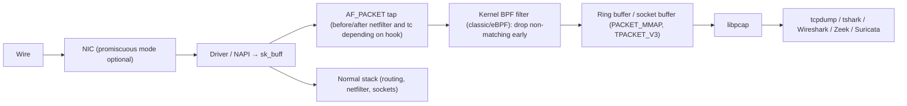

# 2.26 Packet capture from scratch: tcpdump, tshark, Wireshark and BPF-based tracing

| | |
|---|---|
| Level | Intermediate |
| Priority tier | 0 |
| Lab venue | Any Linux VM (root); Wireshark on a laptop |
| Part | Part 2: Networking, from first principles to AI fabrics |
| Status | Drafted, labs **untested** |

## Why this matters for AI infrastructure

Counters tell you *that* something is wrong; packets tell you *what*. A capture settles arguments: did the SYN leave, did the reply arrive, was the MSS clamped, did a middlebox strip window scaling, who sent the RST, are PFC pause frames flooding a rail, is the RoCE traffic actually marked with the right DSCP, did the CNP get generated? On GPU clusters, capture is also the hardest to do right: 100/400 Gb/s links cannot be captured with naive `tcpdump`, RDMA traffic bypasses the kernel entirely, containers hide interfaces in namespaces, and overlays double-wrap packets. This chapter explains how capture works in Linux, how to write precise capture filters, how to use `tcpdump`, `tshark` and Wireshark effectively (including TLS decryption, VXLAN and RoCE decoding), how to capture at scale and from containers and switches, how to read common protocol traces, and how eBPF tools (BCC, bpftrace) complement captures by tracing the kernel's view of packets and sockets.

## Prerequisites and outcomes

You should know TCP/IP (2.4 to 2.7), Linux interfaces and counters (2.22), and have root access to a Linux host.

After this chapter you can:

- Explain how a capture works: libpcap, AF_PACKET, BPF filters in the kernel, promiscuous mode, ring buffers, snaplen, timestamps, and why captures drop packets or show impossible packets (offloads).
- Write capture filters (primitives, qualifiers, operators, byte-offset tests, TCP flags, VLAN, tunnels) and display filters; choose the capture point.
- Use `tcpdump` options (`-i -n -nn -c -w -r -s -e -v -vvv -X -A -tttt -B -C -W -G -Z`) and `tshark` for scripting and statistics.
- Analyse traces in Wireshark: Expert Information, conversations, stream graphs, I/O graphs, follow stream, decode-as, TLS decryption with a key log, VXLAN/GRE/GENEVE, RoCEv2 (BTH), PFC, LLDP, DHCP, DNS.
- Read a TCP trace: handshake, options, retransmissions, duplicate ACKs, zero windows, resets, MTU/MSS problems, delayed ACK.
- Capture at high rates and in containers/Kubernetes (ring buffers, truncation, NIC timestamping, AF_XDP/DPDK tools, port mirroring, TAPs, `kubectl debug`, `nsenter`).
- Use BCC and bpftrace networking tools and write simple bpftrace programs for TCP, sockets and packet drops.
- Handle captures responsibly (privacy, retention, authorisation).

## 1. How packet capture works



- **libpcap** is the portable capture library; it opens an `AF_PACKET` socket on Linux (or `AF_XDP`/DPDK in specialised tools), compiles the user's **capture filter** into BPF bytecode and attaches it to the socket so non-matching packets are discarded in the kernel (cheap), and reads packets from a memory-mapped ring buffer.
- **Promiscuous mode** makes the NIC accept frames not addressed to its MAC (needed to see other hosts' traffic on a hub, mirror port or TAP); on a switched network without mirroring you see only your own, broadcast and multicast traffic.
- **Snaplen** (`-s`) is the number of bytes captured per packet (modern tcpdump default 262144, i.e. full). Truncating (`-s 96` or `-s 128`) captures headers only: far lighter, no payload privacy exposure, and usually enough.
- **Timestamps** come from the kernel at receive time (microsecond or nanosecond), or from hardware NIC timestamps (`tcpdump -j adapter`, `--time-stamp-precision=nano`) which are far more accurate for latency measurements; `ethtool -T eth0` lists support.
- **Capture point semantics**: on RX, the tap is before most of the stack (but after GRO merging by default); on TX, the tap occurs before the NIC (so checksum offload makes outgoing packets show bad checksums and TSO makes them appear larger than the MTU). Therefore captures taken *on the sending host* are not byte-exact copies of what hits the wire. Disable offloads temporarily when exact wire frames matter (`ethtool -K eth0 tso off gso off gro off rx off tx off`), or capture on a mirror port/TAP.
- **Drops**: "N packets dropped by kernel" means the capture socket's buffer overflowed (increase `-B`, narrow the filter, write to fast storage, truncate). "N packets dropped by interface" is the NIC. Capturing is best-effort and itself consumes CPU.

### Capture points

| Where | Sees | Notes |
|---|---|---|
| On the host (interface) | Traffic of that interface (post-GRO RX, pre-offload TX) | Easiest; offload artefacts |
| `-i any` | All interfaces, "cooked" (SLL) headers without L2 detail | Convenient; loses VLAN/ordering details; do not use for exact timing |
| Inside a container/pod namespace | That namespace's veth view | `nsenter -t PID -n tcpdump` |
| On a bridge/veth host-side | Traffic crossing between namespaces | Compare both ends of a veth |
| Switch port mirror (SPAN), ERSPAN, TAP | Copy of a link, independent of host stack | Truth source for the wire; mirrored traffic can be dropped under congestion |
| NIC/DPU embedded capture | Hardware-accelerated capture | For RDMA: `tcpdump -i mlx5_0` with `rdma-core` supports RoCE mirror via the NIC; `ibdump` |
| In the kernel (tracepoints, `kfree_skb`, `pwru`) | Packet's path and drop locations without copying | Complements, doesn't replace, pcap |

## 2. tcpdump

```bash
sudo tcpdump -D                                   # list capture interfaces
sudo tcpdump -ni eth0                             # -n no DNS ; -nn no port names either ; -i interface
sudo tcpdump -ni eth0 -c 100 'tcp port 443'       # stop after 100 packets
sudo tcpdump -nni eth0 -s 96 -w /tmp/c.pcap 'host 10.0.0.5 and tcp'      # write truncated capture to a file (preferred over live reading)
sudo tcpdump -nr /tmp/c.pcap                      # read ; add -tttt (date+time), -ttt (delta), -q (brief), -vvv (verbose), -e (link layer), -X / -XX (hex+ASCII), -A (ASCII)
sudo tcpdump -nn -i eth0 -tttt -e vlan and host 10.0.0.5      # show Ethernet header + VLAN tags
sudo tcpdump -ni eth0 -B 4096 -w - 'port 80' | gzip > /tmp/c.pcap.gz     # kernel buffer 4096 KiB; stream out
sudo tcpdump -ni any -C 100 -W 10 -w /var/tmp/ring.pcap          # ring buffer: 10 files of 100 MB (-C MB, -W count)
sudo tcpdump -ni eth0 -G 300 -w '/var/tmp/%Y%m%d-%H%M%S.pcap'     # rotate every 300 s (time-based)
sudo tcpdump -ni eth0 -Z tcpdump -w /tmp/c.pcap                   # drop privileges after opening
sudo tcpdump -ni eth0 --time-stamp-precision nano -j adapter_unsynced -w /tmp/hw.pcap      # NIC hardware timestamps
sudo tcpdump -d 'tcp port 22'                     # show the compiled BPF bytecode of a filter (-dd/-ddd variants)
```

### Capture filter syntax (pcap-filter)

A filter is an expression of **primitives**, each optionally with **qualifiers** (type `host|net|port|portrange`, direction `src|dst|src or dst`, protocol `ether|ip|ip6|arp|tcp|udp|icmp|icmp6|vlan`), combined with `and`/`&&`, `or`/`||`, `not`/`!` and parentheses.

| Goal | Filter |
|---|---|
| One host / either direction | `host 10.0.0.5` ; `src host 10.0.0.5` ; `dst net 10.0.0.0/24` |
| TCP/UDP port or range | `port 443` ; `tcp dst port 22` ; `portrange 5000-5100` |
| Not SSH noise | `not port 22` (essential when capturing over SSH) |
| ICMP / ICMPv6 | `icmp` ; `icmp6` ; `icmp[icmptype] == icmp-unreach` |
| ARP / non-IP | `arp` ; `ether proto 0x8809` (LACP) ; `ether proto 0x88cc` (LLDP) |
| TCP SYN only | `tcp[tcpflags] & tcp-syn != 0` ; SYN without ACK: `tcp[tcpflags] & (tcp-syn\|tcp-ack) == tcp-syn` |
| TCP RST/FIN | `tcp[tcpflags] & (tcp-rst\|tcp-fin) != 0` |
| Large packets / MTU test | `greater 1400` ; `ip[6:2] & 0x2000 != 0` (more fragments) |
| DNS | `udp port 53 or tcp port 53` |
| DHCP | `udp port 67 or udp port 68` |
| VLAN tagged | `vlan` ; `vlan 100` (filter after `vlan` keyword shifts offsets) |
| VXLAN | `udp port 4789` (outer); inner filtering needs Wireshark/tshark or `udp[8:2]` offsets |
| RoCEv2 | `udp dst port 4791` |
| PFC pause frames | `ether proto 0x8808` |
| TTL low | `ip[8] < 5` |
| DSCP EF | `ip[1] & 0xfc == 0xb8` ; ECN CE: `ip[1] & 0x3 == 3` |
| Specific flow | `host 10.0.0.5 and host 10.0.0.9 and tcp port 443` |

TCP flag text decoding in output: `S` SYN, `S.` SYN-ACK, `.` ACK, `P.` PSH-ACK, `F.` FIN-ACK, `R`/`R.` RST. Typical line: `10:00:00.123456 IP 10.0.0.2.51234 > 10.0.0.5.443: Flags [S], seq 1000, win 64240, options [mss 1460,sackOK,TS val 1 ecr 0,nop,wscale 7], length 0`.

**Rules of thumb**: capture to a file, filter narrowly, truncate, exclude your SSH session, note the clock (sync NTP/PTP across hosts when correlating captures), and capture at *both ends* to see what each side saw. Always record the exact command and host/interface in the case notes.

## 3. tshark and Wireshark

`tshark` is Wireshark's command-line version, with full dissectors, display filters and statistics: excellent for scripting and for headless servers. Wireshark (GUI) is best for interactive analysis of files copied from the host.

```bash
tshark -r c.pcap -q -z io,stat,1                              # packets and bytes per second
tshark -r c.pcap -q -z conv,tcp                               # TCP conversations (bytes, duration)
tshark -r c.pcap -q -z endpoints,ip ; -z http,tree ; -z dns,tree ; -z expert
tshark -r c.pcap -Y 'tcp.analysis.retransmission' -T fields -e frame.time_relative -e ip.src -e ip.dst -e tcp.seq
tshark -r c.pcap -Y 'tcp.stream eq 5' -T fields -e frame.time_delta_displayed -e tcp.flags.str -e tcp.len     # follow one stream
tshark -r c.pcap -qz follow,tcp,ascii,5                       # reconstruct stream 5 content
tshark -i eth0 -f 'port 443' -a duration:30 -w /tmp/t.pcapng  # capture filter (-f) vs display filter (-Y)
tshark -r c.pcap -o tls.keylog_file:/tmp/keys.log -Y http2 -T fields -e http2.headers.path    # decrypt TLS with a key log
editcap -c 100000 big.pcap part.pcap ; mergecap -w all.pcap a.pcap b.pcap ; capinfos c.pcap ; editcap -A "2026-01-01 10:00:00" -B "2026-01-01 10:05:00" in.pcap out.pcap
```

**Display filters** (richer than capture filters): `ip.addr == 10.0.0.5`, `tcp.port == 443`, `tcp.flags.syn == 1 && tcp.flags.ack == 0`, `tcp.analysis.retransmission`, `tcp.analysis.fast_retransmission`, `tcp.analysis.duplicate_ack`, `tcp.analysis.zero_window`, `tcp.analysis.window_full`, `tcp.analysis.lost_segment`, `tcp.window_size_value == 0`, `http.request.method == "POST"`, `dns.flags.rcode != 0`, `tls.handshake.type == 1` (ClientHello), `tls.alert_message`, `vxlan.vni == 10100`, `icmp.type == 3 && icmp.code == 4`, `eth.type == 0x8808` (PFC), `lldp`, `dhcp`, `ib.bth.opcode` / `infiniband` (RoCE: dissector `roce`/`infiniband`), `frame.time_delta > 0.2`.

**Wireshark features worth knowing:** Statistics → Conversations/Endpoints/Protocol Hierarchy/IO Graphs; **Analyze → Expert Information** (warnings for retransmissions, dup ACKs, zero window, out-of-order, window full, RST); **Statistics → TCP Stream Graphs** (time-sequence (Stevens), throughput, RTT, window scaling); **Follow TCP/UDP/TLS stream**; **Analyze → Decode As** (map a port to a dissector, e.g. UDP 4791 to RoCE or a custom port to VXLAN/GENEVE); **Edit → Preferences → Protocols → TLS → (Pre)-Master-Secret log filename** (set `SSLKEYLOGFILE` in the client, e.g. `SSLKEYLOGFILE=/tmp/keys.log curl ...`, to decrypt your own TLS in labs); **Time display format** (since previous displayed packet) to see gaps; coloring rules; packet comments and exported objects; and `File → Export Specified Packets` to share minimal evidence.

**Reading TCP in Wireshark/tshark:**

- Three-way handshake: SYN (options MSS, SACK permitted, timestamps, window scale), SYN-ACK, ACK; missing SYN-ACK = dropped/blocked/no route; RST instead of SYN-ACK = closed port.
- Options in the SYN: absent window scale on one side = a middlebox stripping options (throughput limited to 64 KB/RTT).
- **Retransmission** vs **fast retransmission** vs **spurious retransmission**; **dup ACK** counts (3 triggers fast retransmit); SACK blocks show which ranges arrived.
- **Zero window** (receiver app slow), **window update**, **window full** (sender limited by receive window) vs **bytes in flight < cwnd** (application limited).
- **Delayed ACK** gaps of 40 ms (Nagle interplay), **RTO** gaps of 200 ms+ doubling.
- **MSS/MTU**: look for segments larger than the path MTU with DF set followed by ICMP "fragmentation needed" (type 3 code 4); or large packets repeatedly retransmitted with no ICMP (black hole).
- **Resets**: who sent it (TTL/IP ID/timing differ from the peer's normal packets = middlebox injection), on which event (after idle: NAT/LB timeout; after data: application close with unread data).
- **Checksums**: "bad checksum" in captures on the sending host is usually offload; ignore unless seen on the receiving side.

## 4. Decoding the protocols you meet in AI infrastructure

| Protocol | Capture hints |
|---|---|
| **DNS** | `udp port 53`; look for repeated queries, NXDOMAIN storms (ndots search expansion: `svc.cluster.local` suffix queries), 5 s retransmit gaps, truncated (TC) responses followed by TCP, EDNS size |
| **DHCP** | `udp port 67 or 68`; DORA sequence; options (PXE: option 66/67, vendor class `PXEClient`), relay `giaddr`, rogue server offers |
| **ARP/NDP** | `arp or icmp6`; who-has/is-at, duplicate IP (two MACs for one IP), gratuitous ARP after failover |
| **ICMP** | Unreachables, time exceeded, redirects, PMTU (`icmp[icmptype] == 3`) |
| **TLS** | ClientHello (SNI, ALPN, versions), ServerHello, certificate (visible in TLS 1.2; encrypted in 1.3), alerts, handshake time; decrypt with key logs |
| **HTTP/2, gRPC** | Decrypted frames: HEADERS, DATA, RST_STREAM, GOAWAY; stream concurrency; window updates; `grpc-status` trailers |
| **VXLAN/Geneve/GRE** | Outer headers (VTEP IPs, UDP source port entropy), inner frame; decode-as for non-standard ports; compare inner/outer TTL, DSCP; MTU of inner vs outer |
| **LACP / LLDP** | `ether proto 0x8809` / `0x88cc`: partner state, port ID, VLAN/MTU TLVs |
| **PFC pause** | `ether proto 0x8808`: class-enable vector and quanta; rate of pauses per priority |
| **RoCEv2** | `udp dst port 4791`; BTH opcode (RC SEND/RDMA WRITE/READ, ACK, CNP = 0x81), PSN, destination QP; DSCP/ECN bits in IP header; **NIC-level capture is needed** for traffic the kernel doesn't see (`tcpdump -i mlx5_0` on rdma-core builds, `ibdump`, or switch mirror) |
| **BGP/OSPF/BFD** | `tcp port 179`, `proto 89`, `udp port 3784`; OPEN/UPDATE/KEEPALIVE/NOTIFICATION; BFD control packets, detect times |
| **NCCL bootstrap/sockets** | TCP between ranks; `NCCL_DEBUG=INFO` logs correlate IPs/ports with captures |
| **NFS/iSCSI/NVMe-oF TCP** | RPC XIDs, retransmissions, window sizes, `nconnect` multiple streams |

## 5. Capturing at scale and in awkward places

**High-rate links.** A 100 Gb/s link with 1500-byte frames is ~8 million packets per second: default `tcpdump` + libpcap cannot keep up. Options, in increasing power: (1) capture **only what you need** (tight filter, `-s 96`); (2) bigger kernel buffer (`-B 65536`), write to RAM disk or NVMe striped storage, avoid `-v` parsing, avoid name resolution; (3) capture **per queue / per flow** (RSS splits traffic; steer a flow of interest to one queue with `ethtool -N` flow rules); (4) use PF_RING/AF_XDP/DPDK-based capture tools (n2disk, Suricata, `dpdk-pdump`, `xdpdump`, `bpftool` + XDP capture programs); (5) **hardware**: switch-based mirror/ERSPAN to a dedicated capture server with specialised NICs, or NIC/DPU filtering and timestamping; (6) **sample** instead of capturing everything (sFlow/IPFIX/`tcpdump -c`, 1:1000 sampling), or capture only headers of selected flows; (7) trigger-based ring capture: keep a rolling buffer (`-C -W`) and stop on an event (`-G`, `inotify`, or a script that kills tcpdump when an alert fires), so you have the packets *before* the fault.

**RDMA/GPU fabrics.** Kernel `tcpdump` does not see RoCE traffic that bypasses the stack. Use the NIC vendor's capture path (Mellanox/NVIDIA `tcpdump` with the RDMA sniffer capability and a dedicated device, `ibdump` for IB/RoCE), switch mirror sessions, or telemetry (counters, INT). For GPU Direct, packets still appear on the wire/switch, not in the host kernel. Always capture on a *different* host or at the switch when diagnosing a host's NIC.

**Containers and Kubernetes.** From the node: `sudo nsenter -t <pid> -n tcpdump -ni eth0 -w /tmp/pod.pcap`; capture on the host-side veth (`ip -o link | grep veth`) or the CNI bridge; with `kubectl debug node/<node> -it --image=nicolaka/netshoot` (host namespaces) or `kubectl debug -it <pod> --image=nicolaka/netshoot --target=<container>` (ephemeral container sharing the pod's network namespace; requires permissions, capabilities `NET_RAW`/`NET_ADMIN`); `kubectl sniff` (ksniff plugin) streams a pod capture into Wireshark. Remember overlays: capture on the pod veth (inner), the tunnel device (inner, after decap), and the uplink (outer, encapsulated).

**Mirroring and TAPs.** SPAN (local mirror), RSPAN (VLAN-carried), ERSPAN (GRE-encapsulated mirror to a remote IP), sFlow/IPFIX sampling. Be aware: mirror ports can drop under oversubscription; mirrored frames may be altered (VLAN tags stripped/added); mirror both directions; TAPs (optical splitters) are lossless and passive. Linux can mirror too: `tc qdisc add dev eth0 ingress; tc filter add dev eth0 parent ffff: protocol all matchall action mirred egress mirror dev dummy0` (then capture on `dummy0` or send it elsewhere).

**Synchronised captures.** For one-way delay and ordering, capture at both ends with synchronised clocks (PTP with hardware timestamps; NTP only to ~ms) and align in Wireshark by merging (`mergecap -a`) or by comparing timestamps of the same packet (match by IP ID/TCP seq).

**Privacy and law.** Packet captures can contain credentials, tokens, personal data and model prompts. Capture only on systems and networks you are authorised to monitor; prefer header-only captures; protect and delete files according to policy; scrub or anonymise before sharing (tcprewrite, `editcap`, Wireshark masks); never post raw captures publicly.

## 6. BPF-based tracing for networking (BCC and bpftrace)

Packet capture shows packets on the wire or at an interface. BPF tracing shows what the **kernel and applications** do with them: which process opened which connection, how long handshakes take, which function dropped a packet, retransmits with socket state, per-process TCP throughput. BPF programs run sandboxed in the kernel, are verified for safety, and attach to probes: **kprobes/kretprobes** (kernel function entry/return), **uprobes/uretprobes** (user-space functions), **tracepoints** (stable kernel events such as `tcp:tcp_retransmit_skb`, `sock:inet_sock_set_state`, `skb:kfree_skb`, `net:net_dev_xmit`), **USDT** (static user probes in runtimes), and **perf events/timers**. Output is aggregated in-kernel into **maps** (counts, histograms, stacks) so overhead stays low.

### BCC and bpftrace

- **BCC** (BPF Compiler Collection): Python (or Lua/C++) front-end with embedded C BPF programs, plus a large collection of ready-made tools under `/usr/share/bcc/tools` (or `*-bpfcc` on Debian/Ubuntu). Good for complex tools with argument parsing and custom output. **Single-purpose tools** (`tcplife`, `tcpconnect`, `tcpaccept`, `tcpretrans`, `tcpdrop`, `tcpstates`, `tcpconnlat`, `tcptop`, `solisten`, `sockstat`, `biolatency`, `runqlat`, `execsnoop`, `opensnoop`) and **multi-purpose tools** (`trace`, `argdist`, `funccount`, `stackcount`, `funclatency`) that you point at any function. Install: `apt install bpfcc-tools linux-headers-$(uname -r)` or `dnf install bcc-tools`; modern **libbpf-tools** (CO-RE, no compiler on the target) are lighter. Example multi-purpose usage: `sudo funccount 'tcp_*'`, `sudo trace 'tcp_retransmit_skb "skb=%p"'`, `sudo argdist -H 'r::tcp_sendmsg():int:$retval'` (histogram of bytes sent), `sudo stackcount -P tcp_drop` (who triggers drops).
- **bpftrace**: a high-level language for one-liners and short scripts (awk-like: `probe /filter/ { action }`). Excellent for ad hoc questions.

```bash
sudo bpftrace -l 'tracepoint:tcp:*'                         # list available probes ; -lv to see arguments
sudo bpftrace -e 'tracepoint:tcp:tcp_retransmit_skb { @[ntop(args->daddr)] = count(); }'          # retransmits per destination
sudo bpftrace -e 'tracepoint:sock:inet_sock_set_state /args->newstate == 1/ { @connect[comm] = count(); }'     # new established TCP by process
sudo bpftrace -e 'kprobe:tcp_sendmsg { @send_bytes[comm] = hist(arg2); }'                          # send size distribution
sudo bpftrace -e 'kretprobe:tcp_recvmsg /retval > 0/ { @recv[comm] = sum(retval); }'               # bytes received per process
sudo bpftrace -e 'tracepoint:skb:kfree_skb { @[args->location] = count(); }' | head               # where packets are freed/dropped (resolve addresses with ksym())
sudo bpftrace -e 'kprobe:tcp_v4_connect { @start[tid] = nsecs; } kretprobe:tcp_v4_connect /@start[tid]/ { @us = hist((nsecs - @start[tid]) / 1000); delete(@start[tid]); }'
sudo bpftrace -e 'tracepoint:net:netif_receive_skb { @pkts[args->name] = count(); } interval:s:1 { print(@pkts); clear(@pkts); }'
sudo bpftrace -e 'uprobe:/usr/lib/x86_64-linux-gnu/libssl.so.3:SSL_write { @[comm] = count(); }'       # TLS writes per process (uprobe)
```

Program structure in bpftrace: **probe** (what event), optional **filter** (`/ cond /`), **action block** with built-in variables (`pid`, `tid`, `comm`, `nsecs`, `arg0..argN`, `retval`, `args->field` for tracepoints), **maps** (`@name[key] = count()|sum()|avg()|min()|max()|hist()|lhist()|stats()`), `printf`, `ntop()` for IP addresses, `ksym()/usym()` for symbols, `kstack`/`ustack`, and `BEGIN`/`END`/`interval` probes. Scripts live in `.bt` files with a shebang. **Caveats**: kprobe function names and arguments change across kernel versions (prefer tracepoints, which are stable); lots of events per second add overhead (aggregate in-kernel, avoid printing per event); needs root (or CAP_BPF/CAP_PERFMON) and `CONFIG_DEBUG_INFO_BTF` for CO-RE; in containers, access the host's debugfs/tracefs and use host PID namespace.

### Using BPF tools in network investigations

| Question | Tool |
|---|---|
| Which processes make/accept connections, and where? | `tcpconnect`, `tcpaccept`, `sockstat` |
| How long do TCP sessions live, how much do they transfer? | `tcplife` |
| Which flows retransmit, with state? | `tcpretrans` |
| Why were packets dropped (call stack)? | `tcpdrop`, `bpftrace` on `kfree_skb` (drop reasons on newer kernels via `skb:kfree_skb` `reason` field) |
| Handshake (connect) latency per destination | `tcpconnlat` |
| TCP state machine behaviour (TIME_WAIT, SYN_RECV durations) | `tcpstates` |
| Top bandwidth consumers by process | `tcptop` |
| Listening backlog problems | `solisten`, `tcpaccept`, `nstat` ListenOverflows |
| Softirq/hardirq time in the receive path | `softirqs`, `hardirqs` |
| Scheduler delays affecting network apps | `runqlat` |
| Custom: how often is function X called, how slow is it? | `funccount`, `funclatency`, `stackcount` |

BPF also underpins **XDP** programs (packet filtering/forwarding in the driver), **tc BPF** (classifiers at ingress/egress), **socket filters** (`SO_ATTACH_BPF`, which is how capture filters work), **CNI datapaths** (Cilium), and tools such as `pwru` (packet-where-are-you: traces an skb through the kernel functions for a given 5-tuple), `bpftool` (inspect loaded programs and maps), and `xdpdump`. Treat them as essential complements to pcap.

## 7. A capture-driven troubleshooting workflow

1. **State the question precisely** ("Does the SYN reach the server? Where is it dropped?").
2. **Choose capture points** (client, server, both sides of a firewall/NAT/LB, switch mirror).
3. **Write the narrowest filter** that answers it; exclude your management session; capture to file with a ring buffer if the event is intermittent.
4. **Reproduce** and note exact times, addresses and the application's log lines.
5. **Open the files together**: align by time; follow one connection; compare what left A vs what arrived at B (differences point to the device between them: NAT rewriting, MSS clamping, dropped options, injected resets, MTU).
6. **Confirm with counters and BPF tools** (`nstat`, `ss -ti`, `tcpretrans`, `tcpdrop`, `conntrack`, firewall counters).
7. **Fix and re-capture** to verify the symptom is gone.

Common patterns: SYN seen at the server but no SYN-ACK back = server firewall/listen queue; SYN-ACK seen at server but not client = return path/asymmetric/NAT; data sent but repeated retransmissions without ICMP = MTU black hole or stateful device dropping; duplicate ACKs and SACK = loss on the path; RST from a different TTL = middlebox; long idle then reset = timeout; large gaps of exactly 200 ms/1 s = RTO or delayed ACK; DNS answers arriving after 5 s = resolver timeout; ClientHello followed by nothing = TLS interception/MTU issue with large hello (post-quantum key shares make ClientHellos large); pause frames at multi-kHz on one priority = PFC storm; CNP absence while ECN-marked packets arrive = NIC DCQCN misconfiguration.

## 8. Hands-on lab: capture, read, and decode

First, run the self-checking Python lab (`code/part02/packet_capture_bpf_lab.py`) locally. It verifies byte-offset `pcap-filter` expressions (`tcp[tcpflags]`, `ip[6:2] & 0x2000`, `ip[8]`, `ip[1]` DSCP `EF`/`ECN` `CE`), `100 Gb/s` packet-rate (`~8.13 Mpps`) and `-s 96` ring-buffer storage math, and two-endpoint TCP capture comparison.

```bash
python3 code/part02/packet_capture_bpf_lab.py
```

Next, on a disposable Linux VM using two namespaces/VMs with a `veth` pair and a lab web server (all interactive VM commands below are `untested here`), work through these steps:

1. **Handshake and teardown**: capture `curl` to a local nginx; label SYN/SYN-ACK/ACK/FIN; note options; export a stream with `tshark -z follow`.
2. **Filters**: write and test five capture filters (SYN only, RST, port range, DSCP EF, VLAN); verify with `tcpdump -d` and hit counts; write the same as Wireshark display filters.
3. **Retransmissions and loss**: `tc qdisc add dev veth1 root netem loss 2%`; capture; identify retransmissions, fast retransmit, dup ACKs and SACK blocks; plot the Stevens time-sequence graph; compare with 0% loss.
4. **MTU black hole**: set a smaller MTU on a router namespace, drop ICMP type 3 code 4, send a large transfer; capture to see repeated retransmission of full-size segments; fix with MSS clamping and compare.
5. **Zero window**: server that sleeps before reading; capture the window shrinking to zero and window probes.
6. **TLS**: `SSLKEYLOGFILE=/tmp/keys.log curl https://localhost`; open the capture with the key log and read the decrypted HTTP/2 frames; observe SNI/ALPN in the ClientHello.
7. **Offload artefacts**: capture on the sender with TSO/checksum offload on and off; observe "bad checksum" and 64 KB segments.
8. **Overlay**: build a VXLAN link (chapter 2.17); capture outer and inner; use Decode As for a custom port; compare DSCP/TTL.
9. **Ring buffer and trigger**: run `tcpdump -C 10 -W 5` and a script that stops it when a ping loss threshold is crossed; verify you have the packets before the event.
10. **BPF tools**: run `tcplife`, `tcpconnect`, `tcpretrans`, `tcpdrop`; write three bpftrace one-liners (retransmits per destination, send size histogram, connect latency); correlate with your pcap.
11. **Container capture**: run a container, find its PID, capture with `nsenter`, and with `docker run --network container:NAME nicolaka/netshoot tcpdump`.
12. **Clean up and delete captures.**

## 9. Common mistakes

- Running `tcpdump` live over SSH without excluding the SSH port (feedback loop), or with name resolution on.
- Reading outbound packets' bad checksums or giant frames as network faults (offloads).
- Capturing on the same host that is overloaded and trusting the drop-free result; ignoring "dropped by kernel".
- Using `-i any` for timing analysis; forgetting VLAN/L2 details it hides.
- Capturing only one side; comparing captures from unsynchronised clocks.
- Missing the RDMA traffic because the kernel never sees it.
- Decrypting TLS in production or sharing raw captures that contain secrets.
- Treating Wireshark's expert warnings as faults without context (e.g. "out of order" from multi-queue capture).
- Running heavy bpftrace probes (per-packet printf) on busy production hosts.

## 10. Interview angles

- "How does `tcpdump` work? What's a BPF filter and where does it run?"
- "You see a packet with a bad checksum in a capture. Is it a problem?"
- "How would you capture traffic on a busy 100G host without dropping packets?"
- "A connection works for small requests but hangs for large ones; what would the capture show?"
- "How do you read retransmissions, duplicate ACKs, SACK, zero window, RTO in a trace?"
- "How do you capture inside a Kubernetes pod? How about RoCE traffic?"
- "What is the difference between a capture filter and a display filter?"
- "When would you use BCC/bpftrace instead of tcpdump? Give three examples."
- "How do you decrypt TLS in a lab capture?"

## Exercises

1. **How Linux Packet Capture Works (`libpcap`, `AF_PACKET`, Kernel BPF, Snaplen, and Offload Artefacts):** (a) Trace the capture pipeline from the wire through the NIC, driver/`sk_buff`, `AF_PACKET` tap, kernel BPF filter (`tcpdump -d`), `PACKET_MMAP` ring buffer, and `libpcap`; (b) explain why capturing on a sending host shows `[bad tcp cksum]` and `64 KiB` frames, and distinguish `"N packets dropped by kernel"` from `"N packets dropped by interface"`.
2. **Writing `pcap-filter` Capture Filters and Byte-Offset Expressions:** Using `evaluate_pcap_byte_offset_filters()` in `code/part02/packet_capture_bpf.py`, write and explain the `tcpdump` capture filters for: (a) pure `SYN` packets without `SYN-ACK`, (b) `RST` or `FIN` packets, (c) IPv4 More-Fragments (`ip[6:2] & 0x2000 != 0`), (d) DSCP `EF` (`ip[1] & 0xfc == 0xb8`) and ECN `CE` (`ip[1] & 0x3 == 3`), and (e) RoCEv2 (`udp dst port 4791`), PFC (`ether proto 0x8808`), LACP (`0x8809`), and LLDP (`0x88cc`).
3. **`tcpdump` vs. `tshark` vs. Wireshark, Capture Filters (`-f`) vs. Display Filters (`-Y`), and Lab TLS Decryption:** Contrast kernel capture filters (`-f`) with Wireshark/tshark display filters (`-Y`), write the `tshark` commands to print per-second I/O statistics (`-z io,stat,1`), TCP conversations (`-z conv,tcp`), and retransmitted segments (`-Y 'tcp.analysis.retransmission'`), and show how to decrypt TLS 1.3 HTTP/2 traffic in a lab using `SSLKEYLOGFILE`.
4. **Capturing at `100G`–`400G` Scale, Ring Buffers, Containers, and `RDMA` Fabrics:** Using `compute_capture_rate_and_ring_storage()`, compute the packet rate (`~8.13 Mpps`) on a `100 Gb/s` link with `1500`-byte frames and the disk write rate when truncated to `-s 96` with a `-C 100 -W 10` ring buffer. How do you capture traffic inside a Kubernetes Pod (`nsenter` / `kubectl debug`) and on a kernel-bypassed RoCEv2 / InfiniBand fabric (`ibdump` / `tcpdump -i mlx5_0` / switch `SPAN`/`ERSPAN`/`TAP`)?
5. **Two-Endpoint Capture Correlation and Reading TCP Failure Signatures:** Using `diagnose_two_side_tcp_capture()`, diagnose what failed when comparing simultaneous client and server captures: (a) `SYN` seen at client and server, no `SYN-ACK`; (b) `SYN-ACK` sent by server, not seen at client; (c) `RST` arriving at client with a `TTL` different from the server's normal packets; (d) missing `wscale` option on `SYN-ACK`; and (e) repeated full-size segment retransmissions with zero ICMP `3/4` replies.
6. **Complementing `pcap` with `BCC` and `bpftrace` Kernel Tracing (`SP` Chapter 15):** Explain when to use `BCC` (`tcplife`, `tcpretrans`, `tcpconnlat`, `tcpdrop`, `funccount`, `argdist`) and `bpftrace` (`tracepoint:tcp:tcp_retransmit_skb`, `tracepoint:skb:kfree_skb`, `kprobe:tcp_sendmsg`, `uprobe:libssl.so.3:SSL_write`) instead of `tcpdump`, and explain why `tracepoints` are preferred over `kprobes`.

## Checkpoint questions (20)

<details>
<summary>1. Trace how `tcpdump` captures packets on Linux (`libpcap`, `AF_PACKET`, kernel `BPF`, and `PACKET_MMAP`).</summary>

`tcpdump` calls **`libpcap`**, which opens a Linux **`AF_PACKET` socket**, compiles your capture filter string (e.g., `'tcp port 443'`) into **BPF bytecode** (`tcpdump -d`), and attaches that filter in the kernel (`SO_ATTACH_BPF`). As the driver/NAPI builds `sk_buff`s, the kernel taps a reference to the `AF_PACKET` hook and executes the BPF filter **in-kernel**—discarding non-matching packets immediately at near-zero cost and copying only matching packets (up to `snaplen` `-s` bytes) into a shared memory-mapped **`PACKET_MMAP` (`TPACKET_V3`) ring buffer** read by `tcpdump`.
</details>

<details>
<summary>2. Why do captures taken on the sending host show `[bad tcp cksum]` and `64 KiB` segments even on a healthy `1500`-MTU network?</summary>

Because `AF_PACKET` taps outgoing packets in the kernel **before** they reach the NIC hardware. With **TX checksum offload**, the kernel writes only a pseudo-header seed and the NIC ASIC fills in the real TCP checksum on the wire. With **TSO (`TCP Segmentation Offload`)** and **GSO** (and **GRO** on receive), the kernel passes a `64 KiB` super-packet through the tap and the NIC segments it into `1460`-byte `MSS` frames in hardware. Neither is a network error unless seen on the receiving side after the wire.
</details>

<details>
<summary>3. At the end of a `tcpdump` run, what is the difference between `"N packets dropped by kernel"` and `"N packets dropped by interface"`?</summary>

- **`N packets dropped by kernel`**: the `AF_PACKET` capture ring buffer overflowed because `tcpdump` (or disk I/O / terminal printing / DNS lookups) could not drain captured packets fast enough (fix: pass `-nn`, write to a file `-w`, truncate headers `-s 96`, narrow the BPF filter, and increase buffer size `-B 65536`).\n- **`N packets dropped by interface`**: the NIC or driver dropped packets before they ever reached the capture tap.
</details>

<details>
<summary>4. Why should you always pass `-nn` and `not port 22` when running `tcpdump` over an interactive SSH session, and why avoid `-i any` for latency analysis?</summary>

Without **`-nn`**, `tcpdump` performs reverse DNS (`PTR`) lookups for every IP address (`-n`) and resolves service names (`-nn`), stalling output and generating a storm of DNS packets that get captured too. Without **`not port 22`**, every line `tcpdump` prints over your SSH session generates a new SSH packet, which `tcpdump` captures and prints in an infinite feedback loop. Capturing on **`-i any`** uses Linux "cooked" (`SLL`) pseudo-headers that strip L2 Ethernet/VLAN tags and mix packets from physical NICs, bridges, and `veth`s (causing the same packet to appear multiple times as it crosses internal hops).
</details>

<details>
<summary>5. How do you configure `tcpdump` to capture header-only packets into a rolling 1 GB ring buffer (`10 x 100 MB` files) or rotate files every 5 minutes?</summary>

- **Size-based ring buffer (`10` files of `100 MB` each, overwriting the oldest)**:\n`sudo tcpdump -nni eth0 -s 96 -B 65536 -C 100 -W 10 -w /var/tmp/ring.pcap 'not port 22'`\n- **Time-based rotation (every `300` seconds)**:\n`sudo tcpdump -nni eth0 -s 96 -G 300 -w '/var/tmp/cap-%Y%m%d-%H%M%S.pcap' 'not port 22'`\nAdd `-Z tcpdump` to drop root privileges after opening the socket.
</details>

<details>
<summary>6. Write the `pcap-filter` byte-offset expressions to match: (a) pure TCP `SYN`s (no `ACK`), (b) `RST` or `FIN`, (c) DSCP `EF` (`46`), and (d) ECN `CE` (`11b`).</summary>

- **Pure TCP `SYN`**: `'tcp[tcpflags] & (tcp-syn|tcp-ack) == tcp-syn'`\n- **TCP `RST` or `FIN`**: `'tcp[tcpflags] & (tcp-rst|tcp-fin) != 0'`\n- **DSCP `EF` (`46`, shifted left 2 bits = `184 = 0xb8`)**: `'ip[1] & 0xfc == 0xb8'`\n- **ECN `CE` (`3`, bottom 2 bits of ToS byte)**: `'ip[1] & 0x03 == 3'`.
</details>

<details>
<summary>7. What happens to byte offsets when you filter on `vlan` in `tcpdump` (`pcap-filter`), and what are the EtherTypes/ports for `PFC`, `LACP`, `LLDP`, `VXLAN`, and `RoCEv2`?</summary>

In `pcap-filter`, placing the **`vlan`** keyword in a filter expression (`vlan and host 10.0.0.5` or `vlan 100 and tcp port 443`) matches `802.1Q`-tagged frames **and shifts all subsequent header offsets in the expression by `+4` bytes** to account for the VLAN tag. Key AI-fabric identifiers:\n- **PFC Pause**: `ether proto 0x8808`\n- **LACP**: `ether proto 0x8809`\n- **LLDP**: `ether proto 0x88cc`\n- **VXLAN**: `udp port 4789` (or `8472`)\n- **RoCEv2**: `udp dst port 4791`.
</details>

<details>
<summary>8. What is the difference between a Capture Filter (`-f`) and a Display Filter (`-Y`) in `tshark` / Wireshark?</summary>

- **Capture Filter (`tshark -f 'host 10.0.0.5 and tcp port 443'`)**: uses `libpcap` syntax, compiles to kernel BPF, and discards non-matching packets **during live capture** before they are written to disk (fast and saves disk, but cannot filter on stateful L7 fields).\n- **Display Filter (`tshark -Y 'tcp.analysis.retransmission || http2.headers.status == "500"'`)**: uses Wireshark's protocol dissectors **after capture** (or when reading `-r file.pcap`), supporting stateful TCP analysis, reassembled streams, inner tunnel headers (`vxlan.vni == 10100`), and RoCEv2 (`ib.bth.opcode == 129`).
</details>

<details>
<summary>9. How do you decrypt TLS 1.2 and TLS 1.3 traffic in Wireshark or `tshark` during a lab investigation?</summary>

Because TLS 1.3 uses ephemeral Diffie-Hellman (**forward secrecy**), having the server's private key file is useless for decrypting a capture. Instead, set the **`SSLKEYLOGFILE`** environment variable in the client process (supported by `curl`, Chrome, Firefox, Python/OpenSSL, Go via `KeyLogWriter`):\n`SSLKEYLOGFILE=/tmp/keys.log curl https://api.lab.internal/`\nand pass the ephemeral session key log to `tshark` (`tshark -r c.pcap -o tls.keylog_file:/tmp/keys.log -Y http2`) or Wireshark (*Edit -> Preferences -> Protocols -> TLS -> (Pre)-Master-Secret log filename*).
</details>

<details>
<summary>10. What do `editcap`, `mergecap`, and `capinfos` do when working with large `.pcap` files?</summary>

- **`capinfos c.pcap`**: prints summary metadata (packet count, file size, capture start/end timestamps, average packet rate and bit rate, snaplen).\n- **`editcap`**: slices a huge capture into smaller files by packet count (`editcap -c 100000 big.pcap chunk.pcap`) or time window (`editcap -A "2026-10-27 10:00:00" -B "2026-10-27 10:02:00" in.pcap slice.pcap`), or deduplicates packets (`editcap -d`).\n- **`mergecap -w merged.pcap a.pcap b.pcap`**: merges captures from multiple interfaces or hosts in chronological timestamp order.
</details>

<details>
<summary>11. In a Wireshark / `tshark` TCP trace, how do you recognize: (a) a middlebox stripping Window Scale, (b) a Receiver bottleneck (`Zero Window`), and (c) Nagle + Delayed ACK stalls?</summary>

(a) **Stripped Window Scale**: the client's `SYN` includes `wscale 7`, the server's `SYN-ACK` (captured on the server) includes `wscale 7`, but the `SYN-ACK` arriving at the client lacks `wscale`—capping the receive window at `65,535` bytes (`tcp.analysis.window_full`).\n(b) **Receiver bottleneck**: `tcp.analysis.zero_window` (`win 0` advertised by the receiver), followed by periodic 1-byte `ZeroWindowProbe`s from the sender until the receiving app reads its socket and sends a `WindowUpdate`.\n(c) **Nagle + Delayed ACK**: recurring **`~40 ms` (`0.040 s`) `frame.time_delta` gaps** between a small sub-MSS write and the receiver's bare ACK before the second part of the request is sent.
</details>

<details>
<summary>12. How do you prove from a packet capture that a `RST` packet was injected by an intermediate firewall/NAT rather than sent by the remote server?</summary>

Compare the **`IP TTL`** (and IP Identification sequence / timestamp options) of the **`RST` packet** against the `TTL` of normal `SYN-ACK` / data packets previously received from that remote server. If the server's normal packets arrive with `TTL = 58` (6 hops away) and the `RST` arrives with `TTL = 63` or `254` (1 hop away), or if a capture taken directly on the remote server does not show the server ever sending that `RST`, a middlebox (firewall, NAT idle timeout, or DPI appliance) forged and injected the `RST`.
</details>

<details>
<summary>13. Why can't standard `tcpdump -ni eth0` capture `RoCEv2` or `InfiniBand` RDMA traffic on a GPU server, and how do you capture it?</summary>

Because `RDMA` (`ibverbs` / `GPUDirect RDMA`) bypasses the Linux kernel network stack and `AF_PACKET` hooks completely—work requests go straight from user space/GPU to the ConnectX NIC hardware via PCIe MMIO/DMA. To capture RDMA packets, you must use: (1) **NIC hardware sniffer offload** (`ibdump` or `tcpdump -i mlx5_0` via `rdma-core` / DOCA devlink packet-trap/mirror), or (2) **switch port mirroring (`SPAN` / `ERSPAN`) or a passive optical `TAP`** sending a copy of the wire to a separate capture host.
</details>

<details>
<summary>14. What do you look for when inspecting a `RoCEv2` (`UDP 4791`) or `PFC` (`0x8808`) capture in Wireshark?</summary>

- **In `PFC` (`eth.type == 0x8808`)**: inspect the `Class Enable Vector` (which priority `0..7` is being paused, e.g., Priority `3`) and the `Time` quanta (`0` = `XON` resume, `65535` = max `XOFF` pause), and check if pause frames are firing continuously at multi-kHz rates (PFC storm).\n- **In `RoCEv2` (`udp.dstport == 4791`, Decode As `RoCE`)**: check the outer IP `DSCP` (`26` vs `48`) and `ECN` bits (`ECT(0)` `10` vs `CE` `11`), the InfiniBand **Base Transport Header (`BTH`) `opcode`** (`RDMA WRITE`, `ACK`, or **`0x81 = 129` Congestion Notification Packet `CNP`**), the **Destination Queue Pair (`dqpn`)**, and the 24-bit **Packet Sequence Number (`PSN`)** for gaps/retransmissions.
</details>

<details>
<summary>15. Compare Switch `SPAN`, `ERSPAN`, and a Passive Optical `TAP` for capturing fabric links.</summary>

- **`SPAN` (Local Port Mirror)**: the switch ASIC copies RX/TX frames from source port(s) to a local destination port on the same switch.\n- **`ERSPAN` (Encapsulated Remote SPAN)**: the switch wraps mirrored frames in **`GRE`** and routes them over the IP fabric to a remote capture server.\n*Caveat for both SPAN and ERSPAN*: if the mirror destination port is oversubscribed (e.g., mirroring both RX and TX of a `400G` link onto a `100G` or `400G` port), the switch drops mirrored packets first.\n- **Passive Optical `TAP`**: an unpowered optical prism splitter inserted inline on the fiber that sends an exact physical copy of light in both directions to a capture card with **zero packet loss, zero added latency, and complete preservation of bad-CRC/physical errors**.
</details>

<details>
<summary>16. How do you capture traffic inside a Kubernetes Pod when the container image does not have `tcpdump` installed?</summary>

Either: (1) SSH to the worker node, find the Pod's host PID (`PID=$(crictl inspectp <pod-id> | jq .info.pid)`), and run **`sudo nsenter -t $PID -n tcpdump -nni eth0 -s 96 -w /tmp/pod.pcap`** (which runs the node's `tcpdump` binary inside the Pod's network namespace); or (2) attach an ephemeral debug container sharing the Pod's network namespace with **`kubectl debug -it <pod> --image=nicolaka/netshoot --target=<container>`** (or the `kubectl sniff` / `ksniff` plugin).
</details>

<details>
<summary>17. How do `BCC` and `bpftrace` differ in architecture and use cases (`SP` Chapter 15)?</summary>

Both compile instrumentation into verified **eBPF** kernel bytecode attached to `kprobes`, `kretprobes`, `tracepoints`, `uprobes`, and `USDT` probes:\n- **`BCC` (*BPF Compiler Collection*)** (and modern CO-RE **`libbpf-tools`**): provides production-ready, parameterized CLI tools (`tcplife`, `tcpretrans`, `tcpconnlat`, `tcpdrop`, `tcptop`, plus multi-purpose `funccount`, `trace`, `argdist`, `stackcount`) written in C + Python/libbpf.\n- **`bpftrace`**: a concise AWK/DTrace-like high-level scripting language (`probe /filter/ { @map[key] = count(); }`) designed for writing custom **one-liners** and short scripts on the fly in seconds.
</details>

<details>
<summary>18. Why should you prefer kernel `tracepoint`s (such as `tracepoint:tcp:tcp_retransmit_skb` and `tracepoint:skb:kfree_skb`) over `kprobe`s when writing `bpftrace` scripts (`SP` Chapter 15)?</summary>

**`kprobe`s** hook internal kernel C function names and register arguments (`arg0`, `arg1`), which can be renamed, inlined by the compiler, or have their parameter order changed between Linux kernel versions. **Kernel `tracepoint`s** (`tracepoint:tcp:*`, `tracepoint:skb:*`, `tracepoint:sock:*`, `tracepoint:net:*`) are **stable, deliberately maintained ABI hook points** placed by kernel developers with named, typed `args->field` structures (inspected via `sudo bpftrace -lv 'tracepoint:tcp:tcp_retransmit_skb'`).
</details>

<details>
<summary>19. How can you inspect the unencrypted plaintext of an application's TLS traffic on a host WITHOUT having `SSLKEYLOGFILE` enabled?</summary>

Attach a user-space **`uprobe` / `uretprobe`** (`bpftrace` or BCC `sslsniff`) directly to the TLS library functions in user space—such as **`uprobe:/usr/lib/x86_64-linux-gnu/libssl.so.3:SSL_write`** and **`SSL_read`** (or Go's `crypto/tls.(*Conn).Write` / GnuTLS / NSS)—which intercepts the buffer in the process's memory *right before* OpenSSL encrypts it or *right after* OpenSSL decrypts it.
</details>

<details>
<summary>20. Walk through the 7-step Capture-Driven Troubleshooting Workflow when investigating an intermittent network stall.</summary>

(1) **State a falsifiable question** (*"When the RPC times out after 2s, did the request packet leave Client A, and did it arrive at Server B?"*);\n(2) **Select simultaneous capture points** (both Client A's interface and Server B's interface, with clocks synchronized via `PTP`/`chrony`);\n(3) **Write the narrowest BPF capture filter** excluding SSH (`host <A> and host <B> and tcp port <P>`) with header truncation (`-s 128`) and a rolling ring buffer (`-C 100 -W 10`);\n(4) **Reproduce or wait for the trigger** and record the exact timestamp and client ephemeral port;\n(5) **Diff the two `.pcap` files** on that exact 5-tuple to see what changed or vanished between A and B;\n(6) **Correlate with kernel counters and eBPF** (`nstat`, `ss -ti`, `tcpretrans`, `tcpdrop`); and\n(7) **Apply the fix, re-capture to prove resolution, and securely delete the `.pcap` files**.
</details>

## Sources and review notes

- **Sources read in full:**
  - `systems-performance-2nd-edition` — Brendan Gregg, *Systems Performance: Enterprise and the Cloud*, 2nd ed., **Chapter 10: Network** (packet sniffing methodology, `tcpdump` and Wireshark, and TCP analysis) and **Chapter 15: BPF** (BCC installation, tool coverage, single- and multi-purpose tools `funccount`/`trace`/`argdist`/`stackcount`/`funclatency`, BCC vs `bpftrace`, `bpftrace` tools, one-liners, programming, and reference).
  - `how-linux-works-3rd-edition` — Brian Ward, *How Linux Works*, 3rd ed., **Chapter 10: Network Applications and Services** (diagnostic tools, `tcpdump` output, filters with primitives and operators, and the caution about snooping).
  - `networking-and-kubernetes` — James Strong and Vallery Lancey, *Networking and Kubernetes*, **Chapter 1: Networking Introduction** (packet inspection and `tcpdump`).
  - `nvidia-devops/volume-01/03-linux-networking-masterclass.md` — migrated advanced `tcpdump`/`tshark` usage, `bpftrace` latency one-liners, `dropwatch` and `perf` for drop analysis, and `ethtool` counters.
- **Run here:** `python3 code/part02/packet_capture_bpf_lab.py` (9 passed, 0 failed).
- **Explicitly labelled inferences:** The Section 1 capture-pipeline Mermaid diagram, Section 2 `pcap-filter` byte-offset table, Section 4 AI-protocol decoding table (`RoCEv2` `UDP 4791` / `CNP 0x81`, `PFC` `0x8808`), and Section 6 `bpftrace` one-liners synthesize `pcap-filter(7)`, `tcpdump(1)`, `tshark(1)`, the Wireshark User's Guide, and the BCC/`bpftrace` reference guides (`-bpfcc` suffix on Debian/Ubuntu, `MLNX_OFED`/DOCA RDMA capture, `ksniff`) (cross-referenced with Chapters 2.5–2.12, 2.15–2.17, 2.19, 2.22–2.25, and 2.30, plus original study items 21, 22, 23, 24, 25, 26, 27, 28, 29, 30, 31, 32, 33, 34, 35, 36, 37, 38, 39, and 40).
- **Not verified on live hardware:** All interactive VM and capture commands (`tcpdump`, `tshark`, `editcap`, `mergecap`, `capinfos`, `bpftrace`, `ibdump`) are marked (untested here) and must be executed only on systems and networks you own or have explicit written authorization to monitor.
