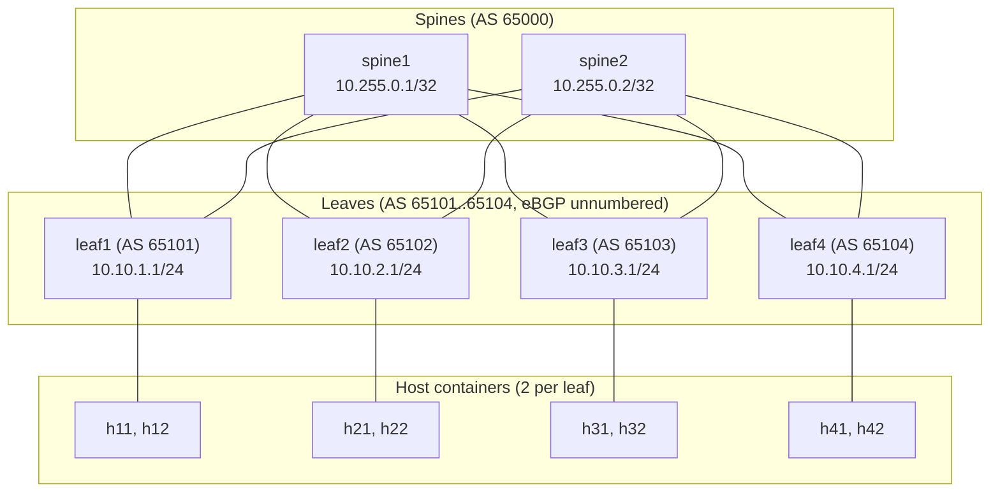

# 2.27 Lab: build network topologies with namespaces, FRR and containerlab

| | |
|---|---|
| Level | Intermediate to advanced |
| Priority tier | 0 |
| Lab venue | One Linux VM (4+ vCPU, 8+ GB RAM, nested virtualisation not required); Docker; containerlab |
| Part | Part 2: Networking, from first principles to AI fabrics |
| Status | Drafted, every lab **untested**: run them, fix what differs on your versions, then record outputs |

## Why this lab chapter exists

Reading about BGP is one thing. Watching a route disappear when you pull a cable is another. You can read that a link failure converges in under a second, and then see, with a running ping, that three pings were lost and the fourth got through, and that fact stays with you in a way a sentence cannot. Networking is learned by building, breaking and measuring it. This chapter turns the theory of chapters 2.2 to 2.26 into a series of reproducible labs on a single VM, and it uses only free software.

A diagram of a fabric is easy to agree with and easy to forget. A running fabric is harder to ignore. When a ping drops and a route table changes under your fingers, you start asking why, and the answer then sticks. The labs in this chapter are built around that moment of surprise. Each one gives you a result to explain before it gives you the explanation.

Linux network namespaces build the smallest topologies. A namespace is a private copy of the network stack, so one machine can pretend to be a whole row of routers and hosts. FRR, which stands for Free Range Routing, runs the routing protocols. containerlab describes a whole fabric as code, so a YAML file defines the nodes, the links and the start-up configuration. Because the fabric is text, you can build it, break it, and rebuild it in minutes.

Think of a namespace as a separate room with its own doors and its own address book. Two rooms cannot talk to each other until someone runs a cable between them, and a veth pair is that cable. Each end of the cable lives in a different room, and whatever goes in one end comes out of the other. Once you see that a namespace is only a room, the rest of the labs are just rooms joined by cables, with a router that chooses which door a packet leaves by.

Network teams use these same techniques to test a change before they touch real switches. They also use them to teach, to reproduce a production incident and to validate automation, which chapters 2.28 and 2.29 cover. The labs here build up in steps. The first two are tiny, three namespaces with a router, then a diamond of routers running OSPF. The third builds a real leaf-spine data-centre fabric with eBGP unnumbered and ECMP. The fourth adds an EVPN-VXLAN overlay with tenant VRFs, the fifth examines tunnels, the sixth places load balancers and anycast on the fabric and breaks it on purpose, and the last turns all of it into tests that a CI system can run. By the end you will have a small fabric that behaves like the ones in the earlier chapters, and a harness that checks it.

## Lab environment

### VM and tooling

Start with a GCP VM running Ubuntu 22.04 or 24.04. An e2-standard-8 or similar machine with a 50 GB disk is enough. Any Linux machine with root access also works. Install the tools below before you run any lab, because every later section assumes they are present.

Why use a VM and not your laptop? Every lab changes routing tables, creates bridges and sets kernel switches such as the forwarding flag. On a laptop those changes leak into your normal network, and one mistake can cut off your own connection. On a disposable VM a mistake costs one teardown, and a fresh start is one command away.

```bash
sudo apt-get update
sudo apt-get install -y docker.io iproute2 bridge-utils iputils-ping iputils-tracepath mtr-tiny tcpdump tshark \
  iperf3 netcat-openbsd nmap jq git curl python3-pip nftables conntrack ethtool dnsutils frr frr-pythontools
sudo systemctl disable --now frr            # we only use the FRR binaries/containers; avoid conflicts on the host
sudo usermod -aG docker $USER && newgrp docker
# containerlab (check https://containerlab.dev for current install instructions)
bash -c "$(curl -sL https://get.containerlab.dev)"
containerlab version
docker pull quay.io/frrouting/frr:10.1.1      # pin an FRR image; verify the tag exists, or use frrouting/frr:latest for a lab
docker pull ghcr.io/hellt/network-multitool    # alpine host image with ping/iperf3/tcpdump/curl/dig
```

The host FRR service is disabled on purpose. The labs use the FRR binaries and containers, and a host service would conflict with them. Check the containerlab install page for the current instructions before you run the install line.

Read the install block as a checklist rather than as a script to run without thought. The first line refreshes the package list. The apt line installs the tools that later experiments call. The systemctl line stops the host routing daemon, and the usermod line lets your account run Docker without sudo. The last lines install containerlab and pull the two images. If one step fails, the later labs fail in confusing ways, so confirm each step before you go on.

Every lab follows the same conventions, so learn them once. They keep the labs tidy and make your notes comparable from one lab to the next.

Here is what the convention does for you. Suppose a leaf is the third one in the fabric. Its server subnet is 10.10.3.0/24, and its address follows the pattern you have just read. When you see an address in a capture, you can place it on the fabric without looking at a diagram, because the address itself says which leaf owns it.

- Keep your work in a directory called `~/netlab`, with one sub-directory per lab.
- Loopbacks come from `10.255.0.0/24`, with one /32 per router. Server subnets follow the pattern `10.10.<leaf>.0/24`. Spines use ASN `65000`, and leaves use `65101..65104`.
- Define the `ns()` helper once, and it runs any command inside a namespace: `ns() { local n=$1; shift; sudo ip netns exec "$n" "$@"; }`.
- Each lab ends with a teardown and with evidence, meaning the commands to run and what you should see. Record the real outputs in your lab notebook, and mark the lab as tested once they match.
- Labs create bridges, namespaces and iptables rules. Run them on a disposable VM, never on a production host.

---

## Lab 1: three namespaces and a router (routing, forwarding, MTU, ICMP)

Picture two hosts that cannot talk to each other, and one machine in the middle that seems connected to both. Why would a router refuse to pass packets, even when its interfaces look correct? This first lab answers that with the smallest network that can show it. You build three namespaces, watch a ping fail, change a single setting, and watch it succeed. Each experiment after that changes one thing and measures what moves.

This lab reproduces the ideas from chapters 2.5 and 2.7, and you can finish it in under five minutes. It is the smallest network that has a router in it: two hosts that cannot see each other, and one router in the middle that can see both. Start by building the three namespaces and their links with the script below.

Read the script in the order it runs. First it creates three namespaces, one each for hA, r and hB, and brings up their loopback interfaces. Then it creates two veth pairs. One end of each pair goes into a host, and the other end goes into the router. It gives each link an address on its own subnet, and the router holds the gateway address on both. Last, it points each host's default route at the router. Nothing forwards yet, and that is exactly why the first ping in the next part fails.

```bash
mkdir -p ~/netlab/lab1 && cd ~/netlab/lab1
cat > up.sh <<'EOF'
#!/bin/bash
set -e
for n in hA r hB; do sudo ip netns add $n; sudo ip -n $n link set lo up; done
sudo ip link add vA type veth peer name rA ; sudo ip link set vA netns hA ; sudo ip link set rA netns r
sudo ip link add vB type veth peer name rB ; sudo ip link set vB netns hB ; sudo ip link set rB netns r
sudo ip -n hA addr add 10.1.0.2/24 dev vA ; sudo ip -n r addr add 10.1.0.1/24 dev rA
sudo ip -n hB addr add 10.2.0.2/24 dev vB ; sudo ip -n r addr add 10.2.0.1/24 dev rB
for d in "hA vA" "r rA" "r rB" "hB vB"; do set -- $d; sudo ip -n $1 link set $2 up; done
sudo ip -n hA route add default via 10.1.0.1 ; sudo ip -n hB route add default via 10.2.0.1
EOF
cat > down.sh <<'EOF'
#!/bin/bash
for n in hA r hB; do sudo ip netns del $n 2>/dev/null; done
EOF
chmod +x up.sh down.sh && ./up.sh
sudo ip netns exec hA ping -c1 10.2.0.2 || echo "expected failure: router not forwarding"
sudo ip netns exec r sysctl -w net.ipv4.ip_forward=1
sudo ip netns exec hA ping -c2 10.2.0.2
sudo ip netns exec r tcpdump -ni rA -e -c4 icmp &   # observe MAC rewrite and TTL decrement
sleep 1; sudo ip netns exec hA ping -c2 10.2.0.2; wait
```

The first ping is expected to fail. The router does not forward packets until you turn on `net.ipv4.ip_forward`, so the failure shows you what forwarding actually does. Without it, the router behaves like a host: it accepts packets addressed to itself and silently discards the rest. Once the sysctl is set, the second ping goes through.

Think of the router as a receptionist who answers only for their own extension. A packet for 10.2.0.2 reaches the router, which is not its destination, and the kernel drops it unless forwarding is on. Setting the sysctl is the switch that tells the receptionist to pass calls along. The second ping is the same packet, sent again with one setting changed. That single change is the lesson of the first step, and every later experiment depends on it.

Run the experiments below and write down what you see. Each one changes a single thing, so the effect is easy to attribute.

Take the first experiment as a worked example. `ip -n hA route get 10.2.0.2` asks the kernel which route a packet to 10.2.0.2 would take. The answer names the default route through 10.1.0.1 on the vA interface. Then `traceroute -n` sends probes with rising TTL values. The first probe expires at the router, which returns a time exceeded message, so the router appears as hop 1. If hop 1 were missing, the trouble would be the router's forwarding, not the far host.

1. Run `ip -n hA route get 10.2.0.2`, then run `traceroute -n 10.2.0.2` from hA. The router should appear as hop 1.
2. Add `ip -n hA route add blackhole 10.2.0.2/32`. Then compare it with `unreachable` and `prohibit`, and read the ICMP codes in tcpdump. Delete the routes when you finish.
3. Create an MTU black hole. Set the MTU on `rB` to 1400 with `ip -n r link set rB mtu 1400`. Ping with `ip netns exec hA ping -M do -s 1472 -c2 10.2.0.2`, and you should get a "message too long" error, which is the fragmentation-needed message. Next, drop ICMP type 3 on r with `nft`. A TCP transfer then hangs. Start an `nc` server in hB, and send data from hA with `head -c 20000 /dev/zero | nc 10.2.0.2 9000`. To fix the hang, clamp the MSS with `iptables -t mangle -A FORWARD ... TCPMSS --clamp-mss-to-pmtu`, or use an nft equivalent.
4. Masquerade the traffic from hA that leaves through rB, and then run `conntrack -L` in r to see the translations.
5. Build asymmetric routing. Add a second router, `r2`, between the hosts, and send the replies through r2. Set `rp_filter=1` on hB, and the replies start to drop. Check the drops with `nstat -z | grep -i ReversePath`. Then fix the problem with loose mode or policy routing.

Read the five experiments as one story. The first two follow a single packet through the router. `ip route get` shows the decision the kernel makes, and the traceroute shows the router answering as the first hop, because a packet's TTL runs out there and the router reports it.

The third experiment is about size. A link has a maximum packet size, its MTU. Think of a mail slot that accepts only envelopes up to a certain width. When rB takes a smaller MTU, a large ping from hA no longer fits. The router should then send back a "message too long" reply, which is the fragmentation-needed signal. If the firewall drops that reply, hA never learns the new limit. It keeps sending packets that are too big, and they vanish without any error. That is the black hole. A TCP transfer behaves the same way, and it looks like a transfer that simply stops. Clamping the MSS is the fix. It tells both ends, during the handshake, to keep segments small enough from the start, so the signal is no longer needed.

The fourth experiment shows what NAT does to a flow. The router rewrites the source address of packets leaving through rB, and it keeps a record of each rewrite. `conntrack -L` prints that record, which is how you check that a reply can find its way back.

The fifth experiment shows the reply path. When the request goes through r and the reply comes back through r2, a strict reverse path check on hB sees a source that does not match the arrival interface, and it drops the packet. `nstat` counts those drops, so you can confirm the cause from the counter rather than guessing. Loose mode or policy routing fixes it, because the check then accepts a reply that arrives on another interface.

Run `./down.sh` when you finish.

---

## Lab 2: install FRR in namespaces and run OSPF (link state)

This lab shows you neighbour states, LSAs, SPF, ECMP and convergence, using only a handful of routers. It runs the FRR binaries directly on the VM, so you do not need containers. If chapter 2.14 felt abstract, this is the lab that makes it concrete, because you can watch two routers move from first hello to a shared map.

Here is what the OSPF daemons do on each link. A router sends a hello at a regular interval. When a hello from the other end arrives, both routers agree that they are neighbours. They then swap their link-state databases, step by step, until both hold the same map. Each router runs the shortest path first calculation on that shared map, and the result goes into the kernel route table. Every step in that chain can be watched in the lab, one state at a time.

The topology is a diamond. Traffic from h1 reaches R4 through R2 or R3, and both paths have equal cost: `h1 - R1 -(R2,R3)- R4 - h2`. Each router is its own namespace, and each one runs its own `frr` daemons from a separate config directory.

Walk through the diamond from h1. R1 has two ways to reach R4, one through R2 and one through R3. When both paths have the same total cost, the shortest path calculation finds both, and the routing table installs both as equal-cost next hops. Traffic is then spread over the two links by a hash of each flow. One connection always sticks to one path, while different connections use both. That is the ECMP you will see in the route table later in this lab.

Build the namespaces, the veth links and the config files first. The `start_frr` helper starts `zebra` and `ospfd` inside one namespace. Every router gets its own PID file, socket and VTY socket, so several routers can run on the same host.

```bash
mkdir -p ~/netlab/lab2 && cd ~/netlab/lab2
# 1) topology script: namespaces, veth links, loopbacks, point-to-point /30s (generate with a loop; keep a table of links)
# 2) per-router FRR: run zebra and ospfd inside each namespace with separate paths
start_frr() { # $1=name
  local n=$1; mkdir -p /tmp/frr/$n
  sudo ip netns exec $n /usr/lib/frr/zebra -d -f ./$n.conf -i /tmp/frr/$n/zebra.pid -z /tmp/frr/$n/zserv.api --vty_socket /tmp/frr/$n 
  sudo ip netns exec $n /usr/lib/frr/ospfd -d -f ./$n.conf -i /tmp/frr/$n/ospfd.pid -z /tmp/frr/$n/zserv.api --vty_socket /tmp/frr/$n
}
# R1.conf (others analogous)
cat > R1.conf <<'EOF'
frr defaults traditional
hostname R1
interface lo
 ip address 10.255.0.1/32
 ip ospf area 0
interface eth12
 ip address 10.0.12.1/30
 ip ospf area 0
 ip ospf network point-to-point
 ip ospf hello-interval 1
 ip ospf dead-interval 4
router ospf
 ospf router-id 10.255.0.1
 auto-cost reference-bandwidth 100000
 maximum-paths 8
EOF
```

Read `start_frr()` one flag at a time. `sudo ip netns exec $n` runs the daemon inside the room for that router, so its interfaces and routes belong to that router alone. `-d` starts the process in the background. `-f ./$n.conf` names the config file it reads, and `-i` names the file that records its process ID, so you can stop it later. `-z` names the socket where zebra and the protocol daemon talk to each other, and `--vty_socket` names the socket that `vtysh` uses when you type commands. Each router therefore gets its own copy of every file it needs, and two routers on one host never overwrite each other.

Next, read `R1.conf` the same way. `interface lo` gives the router a stable identity address, `10.255.0.1/32`, which the other routers use to reach it, no matter which link is up. `ip ospf area 0` places the loopback and the link into the backbone area. `ip ospf network point-to-point` tells OSPF that the link has exactly two ends, so the routers do not need to elect a designated router on it. The hello and dead intervals set how often the two ends greet each other, and how long silence is tolerated before the neighbour is declared dead. The `ospf router-id` is the router's name in the shared map. `auto-cost reference-bandwidth` makes fast links look cheaper than slow ones, and `maximum-paths 8` lets the router install up to eight equal-cost routes, which is what allows the diamond to use both paths.

You can skip hand-started daemons in Lab 3, because containerlab starts them for each container. This lab keeps the namespace version so you can see what a router really is: a network namespace plus routing daemons.

Compare the two ways a router comes to life. In this lab you start the daemons yourself, and you see each piece: a namespace, a config file, a zebra process and an ospfd process. In Lab 3, containerlab hides those pieces inside a container image. The result is the same routing table, so the hand-built version is worth the time. Once you know what the container is doing, you can read its logs and find a missing daemon without guessing.

Work through these experiments. The second is the one that answers the question most people ask first, how long a failure takes to heal.

Consider what the second experiment means in practice. A link fails, traffic stops, and somebody asks how long the outage lasted. The honest answer comes from measurement. The loss count in the ping output gives you the gap in packets, and multiplying that gap by the ping interval gives you the outage time. The hello and dead intervals you set in the config decide the floor below which the outage cannot go. Running the experiment is how you learn whether the number you were quoted is real.

1. Run `vtysh --vty_socket /tmp/frr/R1 -c 'show ip ospf neighbor'` and watch the states move from ExStart to Full. Then run `show ip ospf database` and `show ip route ospf`. R1 should show two equal-cost paths to the loopback of R4.
2. Pull the `veth` between R1 and R2 down. Time the convergence with `ping -i 0.01` from h1 to h2, and watch `ip monitor route` while you do it.
3. Shorten the OSPF timers and add BFD with `bfdd`. Then compare the convergence time with the earlier run.
4. Create an MTU mismatch on one link. Then watch the adjacency get stuck in ExStart or Exchange.
5. Change the interface costs, and watch ECMP collapse to one path.
6. Replace OSPF with IS-IS, using `isisd` and point-to-point links. Give each router a NET in the form `49.0001.0000.0000.000N.00`, then compare its `show isis database` output with the OSPF results.

Here is how to read the first two experiments when you run them. Experiment 1 is a first look at a healthy network. Run the neighbour command and read the state column from top to bottom. `ExStart` is the moment the two routers decide who speaks first. The exchange states are the stretch where they trade their maps, one summary at a time. `Full` means both maps now match, and only then does the route table hold the paths. If the state stops short of `Full` and stays there, the adjacency is stuck, and the MTU mismatch in experiment 4 is one way to get there.

Experiment 2 is the outage question. Pull the link down while the fast ping runs. The ping output then shows a run of lost replies, followed by replies again. Count the lost ones, and multiply by the interval between pings. That gives you the outage as the traffic saw it. `ip monitor route` shows the moment the route changed, so you can compare the route change with the first lost ping. If the two times do not line up, the delay is in the detection, not in the routing.

If you want to see convergence before anything else, start with experiment 2.

---

## Lab 3: leaf-spine fabric with containerlab, eBGP unnumbered, ECMP

Picture a team that wants to test a change to a data-centre fabric before it touches real switches. They cannot afford an outage, and they cannot test on production. A small fabric written as code, running on one virtual machine, gives them a safe copy. This lab builds that copy. It follows the design of chapter 2.16, but now you can start it, change it, and destroy it in minutes.

Why not test on a few real switches? A fabric carries live traffic, and a bad routing change can take out a whole rack. A containerised copy lets the team try the same configuration, watch the same route tables, and throw the attempt away. The fabric you build here is cheap to repeat, and a lesson from one run becomes a check in the next.

Suppose you need to test a change to a data-centre fabric before it reaches production. This lab builds the standard fabric from chapter 2.16 as code. The fabric has 2 spines, 4 leaves and 2 hosts per leaf, which makes 8 hosts in total. Every link is point-to-point and unnumbered.



Before you read the topology file, count its links, because the count is a quick check that you understood the design. For example, each of the 2 spines connects to each of the 4 leaves. That gives 8 uplinks. Each leaf also has 2 host links, which adds 8 more. The file therefore declares 16 links.

Counting is a useful habit with any topology file. Each link line is one cable, and each cable has two ends that must match the interface names on the nodes. A mistyped endpoint is one of the most common reasons a deploy fails. Counting the links first tells you what the file should contain, so you can spot a missing line before the deploy does.

### Topology file `fabric.clab.yml`

```yaml
name: fabric
topology:
  defaults:
    kind: linux
  kinds:
    linux:
      image: quay.io/frrouting/frr:10.1.1
  nodes:
    spine1: { kind: linux, binds: [ "spine1/daemons:/etc/frr/daemons", "spine1/frr.conf:/etc/frr/frr.conf" ] }
    spine2: { kind: linux, binds: [ "spine2/daemons:/etc/frr/daemons", "spine2/frr.conf:/etc/frr/frr.conf" ] }
    leaf1:  { kind: linux, binds: [ "leaf1/daemons:/etc/frr/daemons",  "leaf1/frr.conf:/etc/frr/frr.conf"  ] }
    leaf2:  { kind: linux, binds: [ "leaf2/daemons:/etc/frr/daemons",  "leaf2/frr.conf:/etc/frr/frr.conf"  ] }
    leaf3:  { kind: linux, binds: [ "leaf3/daemons:/etc/frr/daemons",  "leaf3/frr.conf:/etc/frr/frr.conf"  ] }
    leaf4:  { kind: linux, binds: [ "leaf4/daemons:/etc/frr/daemons",  "leaf4/frr.conf:/etc/frr/frr.conf"  ] }
    h11: { kind: linux, image: ghcr.io/hellt/network-multitool, exec: [ "ip addr add 10.10.1.11/24 dev eth1", "ip route replace default via 10.10.1.1" ] }
    h12: { kind: linux, image: ghcr.io/hellt/network-multitool, exec: [ "ip addr add 10.10.1.12/24 dev eth1", "ip route replace default via 10.10.1.1" ] }
    h21: { kind: linux, image: ghcr.io/hellt/network-multitool, exec: [ "ip addr add 10.10.2.11/24 dev eth1", "ip route replace default via 10.10.2.1" ] }
    h22: { kind: linux, image: ghcr.io/hellt/network-multitool, exec: [ "ip addr add 10.10.2.12/24 dev eth1", "ip route replace default via 10.10.2.1" ] }
    h31: { kind: linux, image: ghcr.io/hellt/network-multitool, exec: [ "ip addr add 10.10.3.11/24 dev eth1", "ip route replace default via 10.10.3.1" ] }
    h32: { kind: linux, image: ghcr.io/hellt/network-multitool, exec: [ "ip addr add 10.10.3.12/24 dev eth1", "ip route replace default via 10.10.3.1" ] }
    h41: { kind: linux, image: ghcr.io/hellt/network-multitool, exec: [ "ip addr add 10.10.4.11/24 dev eth1", "ip route replace default via 10.10.4.1" ] }
    h42: { kind: linux, image: ghcr.io/hellt/network-multitool, exec: [ "ip addr add 10.10.4.12/24 dev eth1", "ip route replace default via 10.10.4.1" ] }
  links:
    - endpoints: [ "leaf1:eth1", "spine1:eth1" ]
    - endpoints: [ "leaf1:eth2", "spine2:eth1" ]
    - endpoints: [ "leaf2:eth1", "spine1:eth2" ]
    - endpoints: [ "leaf2:eth2", "spine2:eth2" ]
    - endpoints: [ "leaf3:eth1", "spine1:eth3" ]
    - endpoints: [ "leaf3:eth2", "spine2:eth3" ]
    - endpoints: [ "leaf4:eth1", "spine1:eth4" ]
    - endpoints: [ "leaf4:eth2", "spine2:eth4" ]
    - endpoints: [ "h11:eth1", "leaf1:eth3" ]
    - endpoints: [ "h12:eth1", "leaf1:eth4" ]
    - endpoints: [ "h21:eth1", "leaf2:eth3" ]
    - endpoints: [ "h22:eth1", "leaf2:eth4" ]
    - endpoints: [ "h31:eth1", "leaf3:eth3" ]
    - endpoints: [ "h32:eth1", "leaf3:eth4" ]
    - endpoints: [ "h41:eth1", "leaf4:eth3" ]
    - endpoints: [ "h42:eth1", "leaf4:eth4" ]
```

Read the topology file from the top, since each part does one job. `name: fabric` sets the prefix on every container. That is why the leaf1 container is called `clab-fabric-leaf1`, the name you type after `docker exec` later in this lab. `kind: linux` tells containerlab to start an ordinary Linux container, and the `binds` lines mount each node's `daemons` and `frr.conf` files into the path where FRR looks for them. The `nodes` section lists the boxes, and the `links` section lists the cables. Each link line joins two named ports, such as `leaf1:eth1` and `spine1:eth1`, and containerlab creates one virtual cable, a veth pair, for each line.

The host `exec` lines assume that the data interface is `eth1`. containerlab gives the management interface the name `eth0`, and it names the data links `eth1...`, in the order that each node declares them. Each leaf has two server-facing ports, `eth3` and `eth4`, and you can handle them in two ways. You can address them one at a time, with `eth3` for the first host and `eth4` for the second. Or, for a one-subnet-per-leaf design, you can bridge both into `br0` and put `10.10.N.1/24` on `br0`.

A lived example shows why the names matter. You deploy the fabric, run a ping from h11, and get no reply. The host has an address on one interface, but the route points at the leaf. Your first suspicion is the fabric, and that suspicion is wrong. The likely cause is a naming mismatch, where the exec line ran before the interface existed, or ran against an interface with another name. Look at the host's addresses first. Only when the host shows the address you expect should you look at BGP.

containerlab runs `exec` commands after a node starts. To build `br0` on each leaf, add `exec: [ "ip link add br0 type bridge", "ip link set eth3 master br0", "ip link set eth4 master br0", "ip link set br0 up", "ip link set eth3 up", "ip link set eth4 up" ]` to each leaf node. A start-up script or the `kind: linux` `cmd` option does the same job in practice. Timing matters here. FRR reads `frr.conf` at startup, so create `br0` before FRR starts. If that is not possible, restart FRR after `exec` runs, with `docker exec clab-fabric-leaf1 /usr/lib/frr/frrinit.sh restart`.

### Config generator (Python + Jinja2)

Rather than write each `daemons` and `frr.conf` file by hand, generate them from variables. The lab then scales, and its configuration stays data-driven. This is a preview of chapter 2.28. Adding a ninth leaf then means changing one number, not copying a file and editing six places.

```python
#!/usr/bin/env python3
# gen.py: generate FRR configs for a leaf-spine eBGP-unnumbered fabric
import os, pathlib
from jinja2 import Template

SPINE_ASN = 65000
LEAVES = {f"leaf{i}": {"asn": 65100 + i, "lo": f"10.255.0.{10+i}", "subnet": f"10.10.{i}.1/24"} for i in range(1, 5)}
SPINES = {f"spine{i}": {"lo": f"10.255.0.{i}"} for i in range(1, 3)}

DAEMONS = "zebra=yes\nbgpd=yes\nospfd=no\nbfdd=yes\nvtysh_enable=yes\nzebra_options=\"  -A 127.0.0.1 -s 90000000\"\nbgpd_options=\"   -A 127.0.0.1\"\nbfdd_options=\"   -A 127.0.0.1\"\n"

LEAF = Template("""frr defaults datacenter
hostname {{ name }}
log stdout
interface lo
 ip address {{ lo }}/32
interface br0
 ip address {{ subnet }}
router bgp {{ asn }}
 bgp router-id {{ lo }}
 no bgp ebgp-requires-policy
 bgp bestpath as-path multipath-relax
 neighbor swp peer-group
 neighbor swp remote-as external
 neighbor swp bfd
 neighbor swp timers 3 9
 neighbor eth1 interface peer-group swp
 neighbor eth2 interface peer-group swp
 address-family ipv4 unicast
  redistribute connected route-map CONN
  maximum-paths 8
 exit-address-family
route-map CONN permit 10
 match interface lo
route-map CONN permit 20
 match interface br0
""")

SPINE = Template("""frr defaults datacenter
hostname {{ name }}
log stdout
interface lo
 ip address {{ lo }}/32
router bgp {{ asn }}
 bgp router-id {{ lo }}
 no bgp ebgp-requires-policy
 bgp bestpath as-path multipath-relax
 neighbor swp peer-group
 neighbor swp remote-as external
 neighbor swp bfd
 neighbor swp timers 3 9
 neighbor eth{{ i }} interface peer-group swp
 address-family ipv4 unicast
  redistribute connected route-map CONN
  maximum-paths 8
 exit-address-family
route-map CONN permit 10
 match interface lo
""")

for name, v in LEAVES.items():
    d = pathlib.Path(name); d.mkdir(exist_ok=True)
    (d/"daemons").write_text(DAEMONS)
    (d/"frr.conf").write_text(LEAF.render(name=name, **v))
for name, v in SPINES.items():
    d = pathlib.Path(name); d.mkdir(exist_ok=True)
    (d/"daemons").write_text(DAEMONS)
    (d/"frr.conf").write_text(SPINE.render(name=name, asn=SPINE_ASN, ports=[1,2,3,4], **v))
print("generated")
```

Read `gen.py` in the order it runs. The two dictionaries at the top hold the only values you change. `LEAVES` gives each leaf its ASN, its loopback and its server subnet. The line that builds it loops over the numbers 1 to 4, so one line produces all four leaves, and a fifth leaf means changing that range. `SPINES` gives each spine its loopback, and all spines share one ASN. `DAEMONS` turns on zebra, bgpd and bfdd, and leaves ospfd off, since this fabric runs BGP alone.

Each `Template` is a text pattern with holes. The double braces are the holes, and the render call fills them with a name, an ASN or an address. The `LEAF` template matches the design from chapter 2.16. `neighbor swp peer-group` groups the two uplinks under one name. `remote-as external` lets each session form without anyone typing the neighbour's ASN, because any eBGP neighbour is accepted. `neighbor swp bfd` turns on fast failure detection for every uplink, and `timers 3 9` sets the keepalive and hold times. The `route-map CONN` at the end permits only the loopback and the server subnet to be redistributed into BGP, so the leaf advertises its own identity and its servers, and nothing else. The final loop writes one directory per node, each holding the two files that containerlab mounts.

### Deploy and verify

Generate the configs, deploy the fabric, and then check it from the leaves and the hosts.

Read the verification commands as a sequence of questions. The first asks whether the BGP sessions came up. The second asks what the leaf actually installed in its route table. The third asks whether the BFD sessions are running, which decides how quickly a dead link is noticed. The last two commands test the data path itself, first with a ping and then with a traceroute that shows which spine carried the packet. Work down the list, and stop at the first answer that is wrong.

```bash
cd ~/netlab/lab3 && pip install jinja2 && python3 gen.py
sudo containerlab deploy -t fabric.clab.yml
sudo containerlab inspect -t fabric.clab.yml
docker exec -it clab-fabric-leaf1 vtysh -c 'show bgp summary' -c 'show ip route' -c 'show bfd peers brief'
docker exec clab-fabric-h11 ping -c3 10.10.4.11                         # across the fabric
docker exec clab-fabric-h11 traceroute -n 10.10.4.11                    # leaf1 → spine → leaf4 → host
docker exec clab-fabric-leaf1 ip route show 10.10.4.0/24                # expect 2 next hops (ECMP) via fe80::.. dev eth1 / eth2
docker exec clab-fabric-leaf1 ip route get 10.10.4.11 ipproto tcp sport 40000 dport 80
```

Each command in the block answers one question about the fabric. `containerlab inspect` lists the running nodes, so you can confirm that all of them started before you test anything. `show bgp summary` lists each neighbour and its state. `show ip route` shows what the leaf actually installed, and `show bfd peers brief` shows whether fast failure detection is running on each uplink. The `ping` from h11 tests the data path to a host on another leaf. The `traceroute -n` shows each hop, so you can see that the packet went up to a spine and down to leaf4. The two `ip route` commands read the kernel's own table, and the `ipproto tcp sport 40000 dport 80` part asks which next hop a TCP flow on port 80 would take. Read the output in that order, and a problem shows up at the first command that disagrees with the design.

A healthy fabric looks like this. Every leaf has two ECMP next hops to the subnet and the loopback of every other leaf. Sessions show as Established, with neighbours named after their interfaces. The routes point at `inet6 fe80::...` link-local next hops. To check how the sessions come up, capture an OPEN message with `docker exec clab-fabric-leaf1 tcpdump -ni eth1 -c 20 port 179 -w -`, pipe it into tshark, and locate capability 5, which is the extended next hop.

Read the healthy picture against the checks. Every leaf should show two next hops to a remote subnet, one per spine. Each session should be established. If one session is missing, the route table shows one next hop, and the fabric still carries traffic, but only over half of its paths. That is one of the most common quiet failures in a fabric, and it is why the ECMP check is on the list.

### Experiments

Work through these experiments once the fabric is up. Each one reproduces something from chapters 2.12 and 2.16 that you have so far only read about.

Read the experiments as small stories. The first asks whether the load spreads over both spines. The second asks how long a link failure hurts. The third tests a design choice about ASNs, which decides whether routes can loop. Run each one, record what changed in the route table, and only then move on to the next.

1. **ECMP distribution**: Start `docker exec clab-fabric-h11 iperf3 -c 10.10.4.11 -P 16` and watch the per-link counters on leaf1 with `watch -n1 'ip -s link show eth1; ip -s link show eth2'`. Then repeat the test with `-P 1`. To force a collision, try source ports until `ip route get ... sport N` shows the same next hop for two large flows, sometimes called elephant flows.
2. **Failure and convergence**: Run `ping -i 0.05` from h11 to h41 and leave it running. Take a spine link down with `docker exec clab-fabric-spine1 ip link set eth1 down`, or use `containerlab tools netem` or `docker network disconnect`. Count the lost pings and time how long recovery takes. Repeat the test with BFD disabled and with default timers, and record the results in a table.
3. **ASN design**: Change spine2 to ASN 65001, then create a double failure and show that the valley path is accepted. Revert the change and show that the path is now rejected. Chapter 2.16, section 1 covers the background.
4. **Summarisation black hole**: Add `aggregate-address 10.10.0.0/16 summary-only` on the spines, toward an external router node that you add as `border`. Then fail a leaf-spine link and show the black hole. To fix it, use a conditional advertisement, or remove the aggregation below the spine.
5. **Maintenance drain**: On spine1, run `bgp graceful-shutdown` under `router bgp 65000`. Check that traffic shifts away with zero loss, and then undo the change.
6. **Policy**: Add an inbound prefix-list on the leaves that accepts only `10.10.0.0/16 le 24` and the loopbacks. Then inject a bogus route from an FRR instance running on a host, and confirm that the leaf rejects it.
7. **BGP to the host**: Run FRR on h11 and h12. You can also use the `frrouting/frr` image as the host image. Peer both hosts with leaf1 using unnumbered sessions, and have each one advertise its own /32 plus the anycast VIP `10.99.0.1/32`. Check ECMP from h41 to the VIP, then stop BGP on one host and measure the failover.
8. **Weighted ECMP**: Set link-bandwidth communities and enable weighted multipath, if your FRR version supports it. Then verify the traffic split with iperf3.

Here is how to read the outcomes. Experiment 1 needs many flows at once. With a single flow, one hash picks one path, so the counters on one link climb and the other stays flat. That is correct behaviour, not a fault. With 16 parallel streams, the hash spreads them, and both counters should climb. If one counter stays flat even with 16 streams, check the route table for a missing next hop. Experiment 2 is a timing test. The ping interval sets how fine your measurement is. At 0.05 seconds between pings, each lost reply stands for about one interval of outage, so the count of lost pings tells you the outage length. Compare the table with BFD on and with the default timers, because the gap between the two rows is the value that BFD adds. Experiment 3 changes a single ASN, and it teaches a rule about loops. EBGP rejects a path that carries its own ASN, so when a double failure forces a route through a second spine, the ASN design decides whether that route is accepted or dropped. Revert the change after each step, so the next result is caused by one change only.

Tear the lab down with `sudo containerlab destroy -t fabric.clab.yml --cleanup` when you finish.

---

## Lab 4: EVPN-VXLAN overlay with tenant VRFs on the same fabric

This lab adds the L2 and L3 overlays from chapter 2.17 to the Lab 3 fabric. The underlay does not change. It is the same cables and the same BGP sessions, and the overlay is a new layer of meaning on top of them. Each step runs on the leaves. The first step creates a VLAN-aware bridge and one VXLAN device in external (metadata) mode. It maps VLAN 100 to VNI 10100, which is the L2 segment of tenant A. It also creates a VRF called `tenantA` with an L3 VNI of 5001.

Picture two servers on the same subnet, one behind each of two leaves. An ARP request from one server should reach the other, even though the leaves are not joined at layer 2. The overlay makes that happen. The leaf wraps the Ethernet frame in a VXLAN packet, sends it across the spines, and the far leaf unwraps it. The steps below build that path one piece at a time, so you can check each piece before you add the next.

1. Run these commands inside each leaf, before or while FRR runs. Replace `LOOP` with the leaf loopback.

```bash
# executed inside each leaf (before/while FRR runs); replace LOOP with the leaf loopback
ip link add br0 type bridge vlan_filtering 1 vlan_default_pvid 0
ip link set br0 up
ip link add vxlan0 type vxlan dstport 4789 local LOOP nolearning external vnifilter
ip link set vxlan0 master br0 ; ip link set vxlan0 up
bridge vlan add dev eth3 vid 100 pvid untagged ; bridge vlan add dev eth4 vid 100 pvid untagged
ip link set eth3 master br0 ; ip link set eth4 master br0 ; ip link set eth3 up ; ip link set eth4 up
bridge vlan add dev vxlan0 vid 100 ; bridge vni add dev vxlan0 vni 10100 ; bridge vlan add dev vxlan0 vid 100 tunnel_info id 10100
```

2. Next, configure FRR on each leaf. Add `address-family l2vpn evpn` with `advertise-all-vni`, and activate the peer group. Give VRF `tenantA` the `vni 5001` setting, and add `advertise ipv4 unicast` under `router bgp ... vrf tenantA`. Then set up the anycast gateway. The gateway address `10.100.1.1/24` uses the same MAC on every leaf. You build it with `ip link add link br0 name vlan100 type vlan id 100`, `ip addr add 10.100.1.1/24 dev vlan100`, `ip link set vlan100 address 00:00:5e:00:01:01`, and `ip link set vlan100 master tenantA`.
3. Put h11 and h31 on different leaves, but in the same subnet, `10.100.1.0/24`, which is VLAN 100. They should reach each other at L2 across the fabric. To verify this, run `show evpn vni`, and run `show bgp l2vpn evpn route` to see the type 3 and type 2 routes. Then check `bridge fdb show dev vxlan0`, and capture `tcpdump -ni eth1 udp port 4789`. Finally, watch the ARP traffic on the fabric to confirm ARP suppression.
4. Create tenant B with VNI 10200 and L3 VNI 5002, and give it IP space that overlaps with tenant A. Show that the two tenants stay isolated. Then leak a route between them with a route-target import.
5. Move an IP from h11 to h31 by sending a gratuitous ARP, which migrates the host. Then watch the type 2 route sequence number increase. This is MAC mobility.
6. Break the MTU on purpose. Set the underlay to 1500 and the host MTU to 1500, then show that large packets fail. Fix the problem by raising the underlay to 1600 and lowering the host MTU to 1450.

Read step 1 as a list of small jobs, one per line. `ip link add br0 type bridge vlan_filtering 1` creates a bridge that understands VLAN tags, which is the switch inside the leaf. `ip link add vxlan0 ... external vnifilter` creates one VXLAN device that can carry many VNIs, so you do not need one device per segment. `nolearning` turns off flood-and-learn, since the EVPN control plane will tell the leaves where each MAC lives. `bridge vlan add dev eth3 vid 100 pvid untagged` tells the server port that frames arriving without a tag belong to VLAN 100, which is how a plain server joins the tenant without knowing about VLANs. The `bridge vlan add dev vxlan0 vid 100 tunnel_info id 10100` line is the mapping. It says that VLAN 100 on this leaf travels across the fabric as VNI 10100, and the far leaf maps it back to its own local VLAN.

A picture helps. The server sends an ordinary untagged frame. The leaf puts it in VLAN 100, then in a VXLAN packet tagged with VNI 10100, and then sends that packet across the spines as ordinary IP traffic. The spines never see the server's frame, only an outer IP packet between the two leaves.

Check the syntax before you rely on it. The exact `vnifilter`, single VXLAN device (SVD) and VLAN-to-VNI mapping syntax depends on your kernel version (6.x) and your FRR version (9.x or 10.x). If it does not work, fall back to per-VNI `vxlan` devices, such as `ip link add vxlan100 type vxlan id 10100 local LOOP dstport 4789 nolearning`, and bridge them per VLAN. FRR supports that setup too.

Confirm the bridge and VNI mapping of each leaf before you move on to the FRR configuration.

---

## Lab 5: overlays, VPNs and tunnels with namespaces

Every tunnel adds bytes to each packet, and those bytes lower the usable MTU. A packet that fitted on the plain link no longer fits once an outer header is added, and that is the root of most "it works for ping but not for real traffic" stories. This lab shows you the encapsulation overhead and the path MTU that result from it, using the ideas from chapter 2.17.

A short calculation shows why the lost bytes matter. Suppose a physical link carries a full-size packet exactly at its MTU. A tunnel header then adds bytes on top, so the same packet no longer fits. The sender must either shrink the packet, or the path must allow fragmentation. If neither happens, the transfer stalls, and the stall looks like a random network fault. You will see this in the MTU tests of the first item below.

1. Build two sites, in namespaces `s1` and `s2`, and join them with a router called `core`. Build GRE, IPIP, VXLAN and WireGuard tunnels between `s1` and `s2`, and assign overlay addresses. Ping through each tunnel. Then capture traffic on the core, and compare the outer and inner headers.
2. Compute the usable MTU of each tunnel, and verify it with `ping -M do -s N`. Compare your results with the table in chapter 2.17. Clamp the MSS, and then test a large `iperf3` transfer.
3. Compare the throughput and CPU use of plain routing with the tunnels. Use `mpstat` to measure the CPU. Expect the WireGuard crypto cost to show up here, and test with VXLAN offloads turned off.
4. Show ECMP entropy by sending many flows over a two-path core. GRE and IPIP flows share one path, unless inner-header hashing is enabled with `sysctl net.ipv4.fib_multipath_hash_policy=2`. VXLAN and WireGuard flows spread across both paths by their outer UDP port.
5. Try a segment routing mini-demo. For SRv6, run `ip route add 10.9.9.0/24 encap seg6 mode encap segs fc00:2::1,fc00:3::1 dev eth0` across IPv6 routers that have `seg6_enabled` set. For MPLS, load the modules with `modprobe mpls_router mpls_iptunnel`, and then run `ip route add 10.9.9.0/24 encap mpls 100/200 via inet 10.0.0.2`.

Two of the items need a closer look before you run them. Item 1 is about encapsulation. Each tunnel wraps the original packet in a new header, and the wrapper takes space. Compare the captures from the core. The outer header is the one the core router reads, and the inner header is the one the sites care about. Item 4 is about ECMP, and it explains why one tunnel type can use only one path. A router picks a path by hashing fields from the packet header. GRE and IPIP hide the inner ports behind the outer header, so every flow looks the same to the hash, and all of them take one path. VXLAN and WireGuard put a UDP header on the outside, and that header has ports that vary per flow, so the hash spreads them. Turning on inner-header hashing lets GRE and IPIP spread too, because the hash can then read the inner fields.

Work through the items in order, because item 2 gives you the MTU figures you need before the throughput tests in item 3.

---

## Lab 6: load balancing, anycast and failure testing

Picture a service behind one virtual address, served by several load balancers. One balancer fails in the middle of a busy hour. Users see errors for a short time, and then the errors stop. Was the recovery fast enough for the business? This lab answers that by breaking the service on purpose and writing down exactly what each kind of client experienced.

Consider a client that connects to a virtual address. Behind it, load balancers answer, and one of them fails in the middle of a connection. Whether the client sees an error depends on where the failure happens, and on whether the surviving balancer can tell which backend already holds the connection. The items below make that question measurable, instead of leaving it to a diagram.

This lab combines chapters 2.12, 2.16 and 2.20. You place load balancers and an anycast address on the Lab 3 fabric, then break parts of it on purpose and measure the result. It is the closest the chapter gets to a real incident: something fails while traffic is flowing, and you measure what the users would have felt.

1. On the Lab 3 fabric, run nginx or a small HTTP server on h11 and h12. On another host, add an L4 load balancer node, either HAProxy or IPVS in DR mode. Announce its VIP to the leaf over BGP from FRR. Then verify that remote hosts reach several LB nodes through ECMP.
2. From h41, run `wrk` or `hey` against the VIP. Kill one LB node and one backend, then measure the error rates and the recovery time.
3. Test connection pinning with `grpcurl` or `ghz` against a simple gRPC server, first through L4 and then through L7.
4. Add delay and loss to a leaf-spine link with `tc netem`. Then observe the BGP and BFD behaviour, the TCP throughput with `ss -ti`, and any ECMP imbalance.
5. Finish with a failure matrix. Cover each failure (link, spine, leaf, host NIC, LB node, backend) and each observer (ping, TCP flow, HTTP request). Record the packet loss, the recovery time and what recovered the service.

Item 1 uses a design called direct return, or DR mode, in IPVS. The load balancer changes only the destination MAC address of each packet and sends it on to a chosen backend. The packet still carries the virtual IP as its destination, so each backend must hold that VIP on a local loopback interface, where it accepts the packet. The backend then replies straight to the client, and the reply never passes back through the balancer. That is why the balancer can stay small, and why the backends need the VIP configured by hand.

Items 2 and 3 are measurements. A tool like `hey` or `wrk` sends many requests at a steady rate and records each reply, so you can count the errors in the window when one balancer dies. The gRPC test is different. gRPC keeps one long connection open and sends many calls over it, so an L4 balancer pins the whole connection to one backend, while an L7 balancer can route each call. The two tests show you which layer decides where a client's traffic lands.

Item 4 adds delay and loss with `tc netem`, which is a traffic shaping tool in the kernel. It lets you make a healthy link slow or lossy on purpose, so you can see how BGP, BFD and TCP react to the kind of trouble a real link has, rather than to a clean cut.

Fill in the failure matrix row by row as you go, so the results can be compared side by side.

---

## Lab 7: a validation harness (tests as code)

Goal: make the lab self-checking, so that a topology change is verified automatically. Instead of looking at `show` output and deciding by eye whether the fabric is healthy, you write the question down once, as code, and the machine answers it every time. You will start with a check that needs no lab hardware at all.

The harness turns a verbal claim into a repeatable test. Instead of saying the fabric has ECMP, the script asks each leaf for its next hops and fails if there are fewer than expected. The same script runs after every change, so a regression in a config file shows up as a red line rather than as a slow complaint from a user.

Run the standalone Python lab first. It needs neither Docker nor root. The script checks the containerlab link generator for the Lab 3 fabric, which is a 2-spine by 4-leaf by 2-host design and should produce 16 links. It also checks the FRR eBGP-unnumbered leaf config renderer, and it runs the Lab 7 JSON checks for BGP and ECMP.

```bash
python3 code/part02/containerlab_frr_topologies_lab.py
```

Next comes the check against the running fabric. Deploy the containerlab topology on your lab VM first. The interactive VM and containerlab commands in this chapter were not run on live hardware, so treat the script below as unverified until you run it. Then run `validate.py`.

```python
#!/usr/bin/env python3
# validate.py: assertions about the running containerlab fabric (chapter 2.28/2.29 style)
import json, subprocess, sys

def sh(node, cmd):
    return subprocess.run(["docker", "exec", f"clab-fabric-{node}", "sh", "-c", cmd], capture_output=True, text=True, check=True).stdout

failures = []
def check(ok, msg):
    print(("PASS " if ok else "FAIL ") + msg)
    if not ok: failures.append(msg)

LEAVES = [f"leaf{i}" for i in range(1, 5)]
for leaf in LEAVES:
    summ = json.loads(sh(leaf, "vtysh -c 'show bgp summary json'"))
    peers = summ["ipv4Unicast"]["peers"]
    check(len(peers) == 2 and all(p["state"] == "Established" for p in peers.values()), f"{leaf}: 2 BGP peers Established")
    for other in LEAVES:
        if other == leaf: continue
        idx = other[-1]
        routes = json.loads(sh(leaf, f"vtysh -c 'show ip route 10.10.{idx}.0/24 json'"))[f"10.10.{idx}.0/24"]
        nexthops = routes[0]["nexthops"]
        check(len(nexthops) == 2, f"{leaf}: 2 ECMP next hops to 10.10.{idx}.0/24")
pings = [("h11", "10.10.4.11"), ("h21", "10.10.3.11"), ("h31", "10.10.1.11")]
for h, ip in pings:
    out = sh(h, f"ping -c3 -W1 {ip} | tail -2")
    check("0% packet loss" in out, f"{h} -> {ip} reachable")
sys.exit(1 if failures else 0)
```

Read `validate.py` as three small parts. The `sh()` helper runs a command inside one leaf or host container, using `docker exec`, and returns the text it printed. The `check()` function prints a PASS or FAIL line for each claim and remembers every failure. The main part loops over the four leaves. For each leaf it asks for the BGP summary in JSON, and it checks that exactly two peers exist and that both are `Established`. It then asks the route table for each other leaf's subnet and checks that two next hops are installed, which is the ECMP check from the deploy section. The last loop pings one host per leaf and looks for `0% packet loss` in the summary line. The final `sys.exit` returns 1 when any check failed, and that exit code is what a CI system reads as red or green.

Notice that each check asks a question the design already answers. Nothing in the script guesses. If someone edits a config and removes a neighbour, the first check goes red, and the message names the leaf.

Run the harness in CI. A GitHub Actions job works, as long as the runner can run Docker and containerlab. A self-hosted runner also works. The job deploys the fabric, runs `python3 validate.py`, runs the failure tests, and then destroys the fabric. You can extend the job with three kinds of check. Convergence budgets assert how many pings a link failure may lose. Configuration-drift diffs compare `vtysh -c 'show running-config'` with the generated files. Pcap-based assertions catch anything unexpected, such as an ICMP error that should not appear. For network automation and CI/CD patterns, see chapters 2.28 and 2.29. For Ansible and Terraform integration, see Part 4.

---

## Evidence checklist

Every lab needs a record. A lab that ran once and left no notes cannot be trusted a month later, because nobody remembers what exactly was seen. Write down the exact command and the time you ran it, the output or a screenshot, what the result proves, and what you changed. Keep these records in `labs/part02/` of your handbook repository. Mark a lab as tested in the chapter only after it has run end to end on a clean VM.

Think of the record as the lab's memory. Months from now, a colleague asks whether a change broke ECMP. The record shows the command, the output and the date, so the question has an answer. Without it, the lab is only a story someone told. Write down the FRR version and the containerlab release with each run, because a route output can change between versions.

| Lab | Concepts exercised | Chapters |
|---|---|---|
| 1 | Routing, forwarding, ICMP, MTU, NAT, rp_filter | 2.5, 2.7, 2.9, 2.23 |
| 2 | OSPF/IS-IS, BFD, convergence | 2.13, 2.14 |
| 3 | eBGP unnumbered Clos, ECMP, policy, host BGP, failure | 2.12, 2.15, 2.16, 2.18 |
| 4 | EVPN-VXLAN, VRFs, MAC mobility, MTU | 2.17 |
| 5 | Tunnels, VPN, SRv6/MPLS | 2.17 |
| 6 | Load balancing, anycast, failure matrix | 2.20 |
| 7 | Validation as code | 2.28, 2.29 |

The table shows which concepts each lab exercises and which chapters they come from. Use it to check that every lab you mark as tested has the evidence it needs.

## Troubleshooting the lab itself

When a lab misbehaves, find the symptom in the left column and work through the checks in the right column. The table covers deployment, BGP sessions, routing, EVPN and performance.

Use the table as a set of questions rather than a list of fixes. Each row names a symptom and the first thing to check. The check tells you whether the cause sits in the container, in the routing protocol or on the path. Change one thing at a time, so that the fix you settle on is one you can trust.

| Problem | Check |
|---|---|
| `containerlab deploy` fails | Docker running? image pulled? run as root; name collisions (`containerlab destroy --cleanup`); kernel modules (`modprobe vxlan`, `bridge`) |
| FRR containers start but no BGP | `docker logs`, `daemons` bind mounted correctly, `vtysh -c 'show running-config'`, interface names (`ip -br link`), IPv6 enabled (`sysctl net.ipv6.conf.all.disable_ipv6=0`), RAs on (`ipv6 nd ra-interval`), `frr defaults datacenter` |
| Neighbours stay `Active` | Link-local discovery needs RAs on both ends; check `show ipv6 nd` / `ip -6 neigh`; kernel `accept_ra`; set `neighbor ethX interface remote-as external` correctly |
| Hosts cannot ping across | Gateway on the leaf bridge (`br0` up with address)? Leaf redistributing the `br0` subnet (route-map matches interface name)? Default route in host? `rp_filter`? |
| Only one ECMP path | `maximum-paths`, `multipath-relax`, `fib_multipath_hash_policy`, both peers up, same attributes |
| EVPN routes missing | `advertise-all-vni`, VNI mapped, `l2vpn evpn` activated for peer group, `no bgp ebgp-requires-policy`, kernel features |
| Weird performance | VM CPU steal, Docker bridge overhead, containerlab veth CPU; use fewer parallel flows; don't benchmark absolute numbers on a VM |

Start from the symptom you see, and check the matching row before you change any configuration.

## Exercises

Pick the exercises that match the labs you have already run, and start there.

1. Lab 1 covers three namespaces, routing, the PMTU black hole, NAT and `rp_filter`. Trace the commands that build `hA (10.1.0.2/24) — r — hB (10.2.0.2/24)`. Explain why the initial ping fails before `sysctl -w net.ipv4.ip_forward=1` runs, and what changes in the Ethernet and IP headers as a packet crosses `r`, which `tcpdump -e` lets you see.
2. A TCP transfer hangs after you lower the `rB` MTU to `1400` and drop ICMP Type 3. Explain how that combination creates the hang, and how `TCPMSS --clamp-mss-to-pmtu` fixes it.
3. Lab 2 runs per-namespace FRR `zebra` and `ospfd`, plus `isisd`. Explain how `start_frr()` isolates several FRR router instances on one VM without containers. Show how it does this with per-namespace `-i` PID files, `-z /tmp/frr/$n/zserv.api` Zebra sockets and `--vty_socket /tmp/frr/$n`. Then describe how you trigger and observe an OSPF `ExStart` MTU mismatch in Lab 2.
4. Lab 3 is the leaf-spine fabric built with containerlab. Use `build_clos_clab_links(2, 4, 2)` and `render_frr_ebgp_unnumbered_leaf()` in `code/part02/containerlab_frr_topologies.py` to generate the 16 link endpoint pairs for the 2-spine × 4-leaf × 2-host Clos. Then explain why `route-map CONN` redistributes only `lo` and `br0`.
5. Explain why `br0` must exist before FRR reads `frr.conf` in Lab 3.
6. Lab 4 builds an EVPN-VXLAN overlay. Walk through the commands that create a VLAN-filtering bridge `br0`, a Single VXLAN Device `vxlan0` (`external vnifilter`), VLAN-to-VNI mappings (`vid 100 -> vni 10100`), a distributed anycast gateway (`10.100.1.1/24` with MAC `00:00:5e:00:01:01`), and a tenant VRF, `tenantA`, with `L3VNI 5001`. Then explain how you test MAC mobility across leaves.
7. A tunnel lab shows that GRE and IPIP stay on a single path. Explain why GRE and IPIP tunnels stay on a single underlay ECMP path unless `sysctl net.ipv4.fib_multipath_hash_policy=2` is set, while VXLAN and WireGuard spread across ECMP paths on their own.
8. Design the failure matrix for the anycast load-balancer lab, covering link, spine, leaf, load-balancer node and backend failures.
9. Lab 7 turns the checks into code. Using `validate_frr_bgp_and_ecmp_state()`, explain how `validate.py` queries `vtysh -c 'show bgp summary json'` and `vtysh -c 'show ip route <prefix> json'`. Show how those queries verify BGP peer state and 2-way ECMP across all leaves.
10. Explain how `validate.py` runs as a CI gate in GitHub Actions.

## Checkpoint questions (20)

<details>
<summary>1. Why must you run `sudo systemctl disable --now frr` on the host VM before running namespace or containerlab labs?</summary>

Installing the `frr` package on Ubuntu starts a host-level `zebra`/`bgpd` service in the root network namespace. Disabling that host service stops it from binding ports, changing the host VM's own routing table, or clashing with the per-namespace FRR sockets.
</details>

<details>
<summary>2. In Lab 1, what three things must be configured before `hA` (`10.1.0.2/24`) can ping `hB` (`10.2.0.2/24`) through router namespace `r`?</summary>

Three things are needed. First, `hA` needs a route to `10.2.0.0/24` (or `default`) `via 10.1.0.1`. Second, router namespace `r` needs IP forwarding enabled, with `sudo ip netns exec r sysctl -w net.ipv4.ip_forward=1`. Third, `hB` needs a return route to `10.1.0.0/24` (or `default`) `via 10.2.0.1`.
</details>

<details>
<summary>3. In Lab 1, what does `tcpdump -ni rA -e` vs `tcpdump -ni rB -e` show as a ping packet is routed through `r`?</summary>

The **source and destination IPv4 addresses (`10.1.0.2 -> 10.2.0.2`) remain unchanged**. The **IPv4 `TTL` drops by `1`, from `64` to `63`**, and the IPv4 header checksum is updated. At hop `r`, the **Ethernet source and destination MAC addresses are completely rewritten**, as the `-e` flag shows. The incoming frame carries `rA`'s destination MAC. The outgoing frame carries `rB`'s source MAC and `hB`'s destination MAC.
</details>

<details>
<summary>4. How do `blackhole`, `unreachable`, and `prohibit` routes behave differently when tested in Lab 1?</summary>

All three routes drop the packet, but they differ in what the sender sees.

- `ip route add blackhole 10.2.0.2/32`: silently drops packets. `ping` hangs with 100% loss and zero ICMP messages.
- `ip route add unreachable 10.2.0.2/32`: drops packets and generates **ICMP Type 3 Code 1 (Host Unreachable)**. You see `connect: Network/Host is unreachable`.
- `ip route add prohibit 10.2.0.2/32`: drops packets and generates **ICMP Type 3 Code 13 (Communication Administratively Prohibited)**. You see `ping: Packet filtered`.
</details>

<details>
<summary>5. In Lab 2, what command-line flags allow multiple `zebra` and `ospfd` processes to run simultaneously in different network namespaces on the same host?</summary>

Each namespace gets its own runtime directory, `/tmp/frr/$n`, and three flags keep the processes apart. **`-i /tmp/frr/$n/<daemon>.pid`** sets the PID file. **`-z /tmp/frr/$n/zserv.api`** sets the Unix socket that `ospfd` and `zebra` use to talk to each other. **`--vty_socket /tmp/frr/$n`** lets `vtysh --vty_socket /tmp/frr/R1` reach router `R1`.
</details>

<details>
<summary>6. What is `containerlab`, and how does it wire virtual links between containers?</summary>

containerlab is an open-source topology-as-code tool. It reads a declarative YAML file, the `.clab.yml` file, and starts containers such as `frrouting/frr`, `network-multitool`, or vendor network operating system (NOS) images `cEOS`, `srl` and `sonic-vs`. For each entry in `links:`, it creates a Linux **`veth` pair** on the host. Then it moves each end into the matching container's network namespace.
</details>

<details>
<summary>7. How does `containerlab` name interfaces inside a container?</summary>

containerlab reserves **`eth0`** inside every container for the out-of-band management network. That network connects to the Docker management bridge, so you can SSH or exec into nodes. Data-plane links are named **`eth1`, `eth2`, `eth3`, ...**, matching the endpoint names in the `links:` section of `.clab.yml`.
</details>

<details>
<summary>8. In Lab 3 (`gen.py`), what does `frr defaults datacenter` change in FRR compared to `frr defaults traditional`?</summary>

**`frr defaults datacenter`** applies data-center defaults out of the box. BGP keepalive and hold timers become shorter, at `3 s / 9 s`. The `ebgp-requires-policy` check is disabled or relaxed. IPv6 Router Advertisement intervals are shorter, at `ra-interval 10`, so unnumbered neighbours are discovered quickly. Logging and multipath defaults are tuned for Clos fabrics.
</details>

<details>
<summary>9. In Lab 3, why does `route-map CONN` match only `interface lo` and `interface br0` before `redistribute connected`?</summary>

Without a `route-map` filter, `redistribute connected` would advertise the container's **`eth0` Docker management subnet** into the BGP fabric. It would also advertise any numbered transit link subnets. That pollutes the fabric RIB and can send management traffic over data-plane links. Matching only `lo`, the router's **`/32` loopback**, and `br0`, the rack server's **`/24` subnet**, keeps the fabric RIB clean.
</details>

<details>
<summary>10. What happens in Lab 3 if the leaf bridge `br0` is created AFTER the FRR `zebra`/`bgpd` daemons start, and how do you avoid it?</summary>

If `br0` does not exist when FRR parses `/etc/frr/frr.conf` at container startup, `interface br0` and its IP address, `10.10.N.1/24`, may fail to apply. The subnet may also fail to redistribute until FRR re-reads the interface state.

You have two fixes. Create `br0` in a startup script before you launch `frrinit.sh`. Or restart or reload FRR at the end of the containerlab `exec:` list, with `docker exec clab-fabric-leaf1 /usr/lib/frr/frrinit.sh restart`.
</details>

<details>
<summary>11. When you run `ip route show 10.10.4.0/24` on `leaf1` in Lab 3, what do the next hops look like, and why?</summary>

You see two ECMP `nexthop` lines, and both point to IPv6 link-local addresses: **`via inet6 fe80::... dev eth1 proto bgp metric 20 onlink`** and **`via inet6 fe80::... dev eth2 onlink`**. The session uses **BGP Unnumbered (`RFC 5549` / `RFC 8950` Capability 5)**. So the IPv4 prefix `10.10.4.0/24` is installed with the spines' IPv6 link-local addresses as next hops. The kernel resolves those next hops to MACs through IPv6 Neighbor Discovery.
</details>

<details>
<summary>12. How do you verify in Lab 3 which spine (`eth1` vs. `eth2`) the Linux kernel on `leaf1` will pick for a specific TCP 5-tuple?</summary>

Run **`docker exec clab-fabric-leaf1 ip route get 10.10.4.11 from 10.10.1.11 iif br0 ipproto tcp sport 40000 dport 80`**, with `sysctl net.ipv4.fib_multipath_hash_policy=1` set on the leaf. Then increment `sport`, trying `40001`, `40002` and so on. This reveals two source ports that hash to different spines, or two that collide on the same spine.
</details>

<details>
<summary>13. In Lab 3 Experiment 3, how do you demonstrate the RFC 7938 \"valley path\" (leaf hairpin) bug?</summary>

Change `spine2`'s ASN from `65000` to **`65001`**, so Spine 1 is `65000` and Spine 2 is `65001`. Then bring down `leaf1:eth2`, the link from Leaf 1 to Spine 2, and `leaf4:eth1`, the link from Leaf 4 to Spine 1. Now `leaf1` can reach `leaf4` only along the path **`leaf1 -> spine1 (65000) -> leaf2 (65102) -> spine2 (65001) -> leaf4`**, which hair-pins through `leaf2`. When both spines share **`AS 65000`**, `spine2` rejects that update, because `65000` is already in the `AS_PATH`.
</details>

<details>
<summary>14. In Lab 4, what is the role of `external` and `vnifilter` on `vxlan0` (`Single VXLAN Device`, `SVD`)?</summary>

Creating `vxlan0` with **`external` (collect metadata)** and **`vnifilter`** lets one **`vxlan0` device**, enslaved to the VLAN-aware bridge `br0`, carry hundreds of different VNIs. Each bridge VLAN maps to its own VXLAN VNI. For example, `vid 100` maps to `vni 10100`, and `vid 200` maps to `vni 10200`. You set this up with `bridge vlan add ... tunnel_info id <vni>` and `bridge vni add`. The alternative is a separate `vxlanN` interface for every VNI.
</details>

<details>
<summary>15. In Lab 4, why must the anycast gateway interface `vlan100` (`10.100.1.1/24`) be assigned the exact same MAC address (`00:00:5e:00:01:01`) and bound to VRF `tenantA` on every leaf?</summary>

Binding `vlan100` to VRF `tenantA` with `ip link set vlan100 master tenantA` isolates Tenant A's L3 routing table. It also ties that table to `L3VNI 5001` for Symmetric IRB. Assigning the **identical virtual MAC (`00:00:5e:00:01:01`) and IP (`10.100.1.1/24`)** on every leaf means a host in VLAN 100 can use its local leaf as its first-hop default gateway. It can also move to another leaf without its ARP cache entry becoming invalid.
</details>

<details>
<summary>16. In Lab 5, what does `sysctl net.ipv4.fib_multipath_hash_policy = 2` do for `GRE` and `IPIP` tunnels?</summary>

Policy `0` hashes only the outer L3 IP addresses, and policy `1` hashes the outer L4 5-tuple. GRE uses `proto 47` and IPIP uses `proto 4`. Both have fixed outer tunnel endpoint IPs and no outer UDP or TCP ports. So under policies `0` and `1`, every flow inside the tunnel lands on one underlay ECMP link.

Setting **`fib_multipath_hash_policy = 2`** tells the Linux kernel to hash the inner packet's headers inside IPIP, GRE and SIT tunnels. That restores full ECMP distribution.
</details>

<details>
<summary>17. In Lab 5, how do you add an `SRv6` or `MPLS` source-routed path on Linux using `ip route`?</summary>

Each method uses an `ip route` command with an encapsulation.

- **SRv6 (`encap seg6`)**: enable `net.ipv6.conf.<dev>.seg6_enabled=1`, then run `sudo ip route add 10.9.9.0/24 encap seg6 mode encap segs fc00:2::1,fc00:3::1 dev eth0`.
- **MPLS (`encap mpls`)**: load `mpls_router` and `mpls_iptunnel`, set `net.mpls.platform_labels=10000`, then run `sudo ip route add 10.9.9.0/24 encap mpls 100/200 via inet 10.0.0.2`.
</details>

<details>
<summary>18. In Lab 7 (`validate.py`), why should automation scripts always pass `json` at the end of FRR `vtysh` commands (`vtysh -c 'show bgp summary json'`)?</summary>

Human-readable CLI output changes spacing, column widths and line wraps between FRR versions and prefix lengths. That makes regex or awk scraping fragile. For example, adding **`json`** to the end of a command, such as `show bgp summary json`, `show ip route json`, `show bfd peers json` or `show evpn vni json`, returns structured JSON with a consistent schema. `json.loads()` or `jq` can then assert on it reliably in CI.
</details>

<details>
<summary>19. If FRR containers in Lab 3 start up, but `show bgp summary` shows unnumbered neighbors stuck in `Active`, what are the three things to check?</summary>

BGP Unnumbered learns the peer's `fe80::` link-local address through IPv6 Neighbor Discovery, which uses Router Advertisements (RA). Check three things.

First, IPv6 must be enabled in the container kernel. Confirm `sysctl net.ipv6.conf.all.disable_ipv6=0`, and confirm that `eth1` has a `fe80::` address in `ip -6 addr`.

Second, `zebra` must send IPv6 Router Advertisements on the link. Check `no ipv6 nd suppress-ra` and `frr defaults datacenter`. Confirm that `show ipv6 nd` or `ip -6 neigh` shows the peer's link-local neighbour.

Third, both `zebra=yes` and `bgpd=yes` must be enabled in `/etc/frr/daemons`.
</details>

<details>
<summary>20. Why shouldn't you use a single-VM `containerlab` topology to benchmark absolute `100G` throughput numbers, and what IS it authoritative for?</summary>

In a single-VM containerlab topology, every container shares the VM's vCPUs. Packets cross software `veth` pairs and the Linux kernel bridge and softirq path. So throughput is capped by the VM's vCPU softirq rate, at roughly `~5–20 Gb/s`.

containerlab does run the same control-plane daemons and protocol state machines as physical switches, such as FRR, SONiC and cEOS. That makes it 100% authoritative for checking routing design, ASN plans, route-maps, ECMP next-hop counts, EVPN Route Types 1–5, failure-domain blast radius and CI automation pipelines.
</details>

## Sources and review notes

- **Sources read in full:**
  - `how-linux-works-3rd-edition` — Brian Ward, *How Linux Works*, 3rd ed., **Chapter 9: Understanding Your Network and Its Configuration** (routers, NAT, and firewalls).
  - `computer-networking-problems-and-solutions` — Russ White and Ethan Banks, *Computer Networking Problems and Solutions*, **Chapters 9, 16, and 23** (network virtualization, OSPF/IS-IS/BGP control planes, and resilience).
  - `ai-data-center-network-design-and-technologies` — Dinakaran Setty et al., *AI Data Center Network Design and Technologies*, **Chapter 8: IP Routing for AI/ML Fabrics** (fabric design, eBGP unnumbered, and ECMP).
  - `networking-and-kubernetes` — James Strong and Vallery Lancey, *Networking and Kubernetes*, **Chapters 2 and 3**, and `production-kubernetes` — Josh Rosso et al., *Production Kubernetes*, **Chapter 5** (Linux network namespaces, `veth`, bridges, and containers).
  - `network-programmability-and-automation-2nd-edition` — Jason Edelman, Scott S. Lowe, and Matt Oswalt, *Network Programmability and Automation*, 2nd ed., **Chapter 1** (template generation and validation as code).
  - `nvidia-devops/volume-01/03-linux-networking-masterclass.md` — consulted for namespace, bonding, and troubleshooting scenarios.
- **Run here:** `python3 code/part02/containerlab_frr_topologies_lab.py` (8 passed, 0 failed).
- **Explicitly labelled inferences:** Labs 1–7 (`up.sh`/`down.sh`, `start_frr()`, `fabric.clab.yml`, `gen.py` Jinja2 generator, EVPN `vnifilter` bridge setup, SRv6/MPLS encapsulation, and `validate.py` JSON CI harness) are the author's original constructions synthesizing the FRR and `containerlab` documentation (cross-referenced with Chapters 2.5–2.26, 2.28, and 2.29).
- **Not verified on live hardware:** Every interactive VM, `ip netns`, `frr`, and `containerlab` lab in this chapter is marked; run them on a disposable Linux VM, record the outputs, and verify syntax against your kernel and FRR versions.
