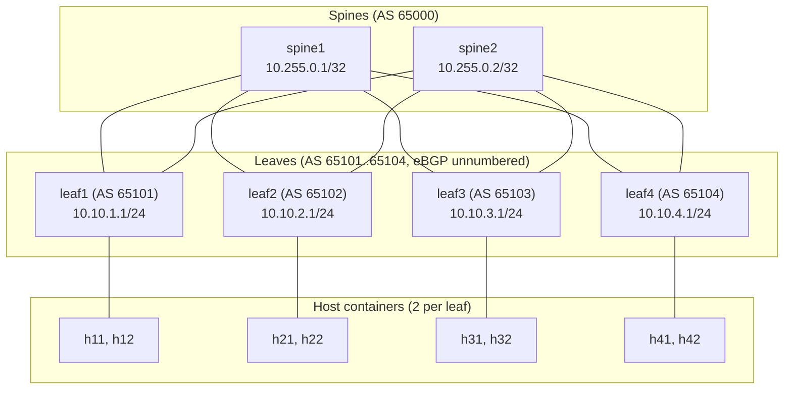

# 2.27 Lab: build network topologies with namespaces, FRR and containerlab

| | |
|---|---|
| Level | Intermediate to advanced |
| Priority tier | 0 |
| Lab venue | One Linux VM (4+ vCPU, 8+ GB RAM, nested virtualisation not required); Docker; containerlab |
| Part | Part 2: Networking, from first principles to AI fabrics |
| Status | Drafted, every lab **untested**: run them, fix what differs on your versions, then record outputs |

## Why this lab chapter exists

Networking is learned by building, breaking and measuring it. This chapter turns the theory of chapters 2.2 to 2.26 into a sequence of reproducible labs on a single VM, using only free software: Linux network namespaces for the smallest topologies, **FRR** (Free Range Routing) for routing protocols, and **containerlab** to describe whole fabrics as code (a YAML file defines nodes, links and start-up configuration). The same techniques are used by network teams to test changes before touching real switches, to teach, to reproduce production incidents, and to validate automation (chapters 2.28, 2.29). By the end you will have a small leaf-spine data-centre fabric with eBGP unnumbered underlay, an EVPN-VXLAN overlay with tenant VRFs, hosts running BGP and anycast services, failure and convergence experiments, and a validation harness you can run in CI.

## Lab environment

### VM and tooling

Use a GCP VM (Ubuntu 22.04 or 24.04, e2-standard-8 or similar, 50 GB disk) or any Linux machine with root access. Install:

```bash
sudo apt-get update
sudo apt-get install -y docker.io iproute2 bridge-utils iputils-ping iputils-tracepath mtr-tiny tcpdump tshark \
  iperf3 netcat-openbsd nmap jq git curl python3-pip nftables conntrack ethtool dnsutils frr frr-pythontools
sudo systemctl disable --now frr            # we only use the FRR binaries/containers; avoid conflicts on the host
sudo usermod -aG docker $USER && newgrp docker
# containerlab (check https://containerlab.dev for current install instructions)
bash -c "$(curl -sL https://get.containerlab.dev)"
containerlab version
docker pull quay.io/frrouting/frr:10.1.1      # pin an FRR image; verify the tag exists, or use frrouting/frr:latest for a lab
docker pull ghcr.io/hellt/network-multitool    # alpine host image with ping/iperf3/tcpdump/curl/dig
```

Conventions used in the labs:

- A working directory `~/netlab`, one sub-directory per lab.
- Addresses: loopbacks `10.255.0.0/24` (one /32 per router), server subnets `10.10.<leaf>.0/24`, ASNs: spines `65000`, leaves `65101..65104`.
- `ns()` helper for namespaces: `ns() { local n=$1; shift; sudo ip netns exec "$n" "$@"; }`.
- Every lab ends with a **teardown** and with **evidence**: commands to run and what you should see. Record real outputs in your lab notebook and mark the lab tested when they match.
- Safety: labs create bridges, namespaces and iptables rules; run on a disposable VM, not on a production host.

---

## Lab 1: three namespaces and a router (routing, forwarding, MTU, ICMP)

Goal: reproduce chapter 2.5 and 2.7 concepts in under five minutes.

```bash
mkdir -p ~/netlab/lab1 && cd ~/netlab/lab1
cat > up.sh <<'EOF'
#!/bin/bash
set -e
for n in hA r hB; do sudo ip netns add $n; sudo ip -n $n link set lo up; done
sudo ip link add vA type veth peer name rA ; sudo ip link set vA netns hA ; sudo ip link set rA netns r
sudo ip link add vB type veth peer name rB ; sudo ip link set vB netns hB ; sudo ip link set rB netns r
sudo ip -n hA addr add 10.1.0.2/24 dev vA ; sudo ip -n r addr add 10.1.0.1/24 dev rA
sudo ip -n hB addr add 10.2.0.2/24 dev vB ; sudo ip -n r addr add 10.2.0.1/24 dev rB
for d in "hA vA" "r rA" "r rB" "hB vB"; do set -- $d; sudo ip -n $1 link set $2 up; done
sudo ip -n hA route add default via 10.1.0.1 ; sudo ip -n hB route add default via 10.2.0.1
EOF
cat > down.sh <<'EOF'
#!/bin/bash
for n in hA r hB; do sudo ip netns del $n 2>/dev/null; done
EOF
chmod +x up.sh down.sh && ./up.sh
sudo ip netns exec hA ping -c1 10.2.0.2 || echo "expected failure: router not forwarding"
sudo ip netns exec r sysctl -w net.ipv4.ip_forward=1
sudo ip netns exec hA ping -c2 10.2.0.2
sudo ip netns exec r tcpdump -ni rA -e -c4 icmp &   # observe MAC rewrite and TTL decrement
sleep 1; sudo ip netns exec hA ping -c2 10.2.0.2; wait
```

Experiments (record what you see):

1. `ip -n hA route get 10.2.0.2`; `traceroute -n 10.2.0.2` from hA (router shows as hop 1).
2. Add `ip -n hA route add blackhole 10.2.0.2/32` and compare with `unreachable` and `prohibit` (ICMP codes in tcpdump); delete them.
3. MTU black hole: `ip -n r link set rB mtu 1400`; `ip netns exec hA ping -M do -s 1472 -c2 10.2.0.2` (expect "message too long" / frag-needed); drop ICMP type 3 on r with `nft` and show a TCP transfer hanging (`nc` server in hB, `head -c 20000 /dev/zero | nc 10.2.0.2 9000` from hA); fix with `iptables -t mangle -A FORWARD ... TCPMSS --clamp-mss-to-pmtu` or an nft equivalent.
4. NAT: masquerade traffic from hA leaving rB; observe `conntrack -L` in r.
5. Asymmetric routing: add a second router `r2` between the hosts, send replies via r2, set `rp_filter=1` on hB, observe drops (`nstat -z | grep -i ReversePath`), then fix with loose mode or policy routing.

`./down.sh` when done.

---

## Lab 2: install FRR in namespaces and run OSPF (link state)

Goal: see neighbour states, LSAs, SPF, ECMP and convergence with a handful of routers, using the FRR binaries on the VM (alternative to containers).

Topology (diamond): `h1 - R1 -(R2,R3)- R4 - h2` with equal-cost paths via R2 and R3. Each router is a namespace with its own `frr` daemons started from a per-router config directory.

```bash
mkdir -p ~/netlab/lab2 && cd ~/netlab/lab2
# 1) topology script: namespaces, veth links, loopbacks, point-to-point /30s (generate with a loop; keep a table of links)
# 2) per-router FRR: run zebra and ospfd inside each namespace with separate paths
start_frr() { # $1=name
  local n=$1; mkdir -p /tmp/frr/$n
  sudo ip netns exec $n /usr/lib/frr/zebra -d -f ./$n.conf -i /tmp/frr/$n/zebra.pid -z /tmp/frr/$n/zserv.api --vty_socket /tmp/frr/$n 
  sudo ip netns exec $n /usr/lib/frr/ospfd -d -f ./$n.conf -i /tmp/frr/$n/ospfd.pid -z /tmp/frr/$n/zserv.api --vty_socket /tmp/frr/$n
}
# R1.conf (others analogous)
cat > R1.conf <<'EOF'
frr defaults traditional
hostname R1
interface lo
 ip address 10.255.0.1/32
 ip ospf area 0
interface eth12
 ip address 10.0.12.1/30
 ip ospf area 0
 ip ospf network point-to-point
 ip ospf hello-interval 1
 ip ospf dead-interval 4
router ospf
 ospf router-id 10.255.0.1
 auto-cost reference-bandwidth 100000
 maximum-paths 8
EOF
```

(Instead of hand-starting daemons you can use containerlab in Lab 3, which does this per container; the namespace approach is shown so you understand what a router "is": a network namespace plus routing daemons.)

Experiments:

1. `vtysh --vty_socket /tmp/frr/R1 -c 'show ip ospf neighbor'` (states ExStart → Full), `show ip ospf database`, `show ip route ospf` (two equal-cost paths from R1 to R4's loopback).
2. Pull `veth` between R1 and R2 down; time convergence with `ping -i 0.01` from h1 to h2 and `ip monitor route`.
3. Shorten OSPF timers; add BFD (`bfdd`); compare convergence.
4. Mismatch MTU on one link; watch the adjacency stick in ExStart/Exchange.
5. Change interface costs; watch ECMP collapse to one path.
6. Replace OSPF with IS-IS (`isisd`, NET `49.0001.0000.0000.000N.00`, point-to-point) and compare `show isis database`.

---

## Lab 3: leaf-spine fabric with containerlab, eBGP unnumbered, ECMP

Goal: build the standard data-centre fabric from chapter 2.16 as code: 2 spines, 4 leaves, 2 hosts per leaf (8 hosts), all links point-to-point and unnumbered.



### Topology file `fabric.clab.yml`

```yaml
name: fabric
topology:
  defaults:
    kind: linux
  kinds:
    linux:
      image: quay.io/frrouting/frr:10.1.1
  nodes:
    spine1: { kind: linux, binds: [ "spine1/daemons:/etc/frr/daemons", "spine1/frr.conf:/etc/frr/frr.conf" ] }
    spine2: { kind: linux, binds: [ "spine2/daemons:/etc/frr/daemons", "spine2/frr.conf:/etc/frr/frr.conf" ] }
    leaf1:  { kind: linux, binds: [ "leaf1/daemons:/etc/frr/daemons",  "leaf1/frr.conf:/etc/frr/frr.conf"  ] }
    leaf2:  { kind: linux, binds: [ "leaf2/daemons:/etc/frr/daemons",  "leaf2/frr.conf:/etc/frr/frr.conf"  ] }
    leaf3:  { kind: linux, binds: [ "leaf3/daemons:/etc/frr/daemons",  "leaf3/frr.conf:/etc/frr/frr.conf"  ] }
    leaf4:  { kind: linux, binds: [ "leaf4/daemons:/etc/frr/daemons",  "leaf4/frr.conf:/etc/frr/frr.conf"  ] }
    h11: { kind: linux, image: ghcr.io/hellt/network-multitool, exec: [ "ip addr add 10.10.1.11/24 dev eth1", "ip route replace default via 10.10.1.1" ] }
    h12: { kind: linux, image: ghcr.io/hellt/network-multitool, exec: [ "ip addr add 10.10.1.12/24 dev eth1", "ip route replace default via 10.10.1.1" ] }
    h21: { kind: linux, image: ghcr.io/hellt/network-multitool, exec: [ "ip addr add 10.10.2.11/24 dev eth1", "ip route replace default via 10.10.2.1" ] }
    h22: { kind: linux, image: ghcr.io/hellt/network-multitool, exec: [ "ip addr add 10.10.2.12/24 dev eth1", "ip route replace default via 10.10.2.1" ] }
    h31: { kind: linux, image: ghcr.io/hellt/network-multitool, exec: [ "ip addr add 10.10.3.11/24 dev eth1", "ip route replace default via 10.10.3.1" ] }
    h32: { kind: linux, image: ghcr.io/hellt/network-multitool, exec: [ "ip addr add 10.10.3.12/24 dev eth1", "ip route replace default via 10.10.3.1" ] }
    h41: { kind: linux, image: ghcr.io/hellt/network-multitool, exec: [ "ip addr add 10.10.4.11/24 dev eth1", "ip route replace default via 10.10.4.1" ] }
    h42: { kind: linux, image: ghcr.io/hellt/network-multitool, exec: [ "ip addr add 10.10.4.12/24 dev eth1", "ip route replace default via 10.10.4.1" ] }
  links:
    - endpoints: [ "leaf1:eth1", "spine1:eth1" ]
    - endpoints: [ "leaf1:eth2", "spine2:eth1" ]
    - endpoints: [ "leaf2:eth1", "spine1:eth2" ]
    - endpoints: [ "leaf2:eth2", "spine2:eth2" ]
    - endpoints: [ "leaf3:eth1", "spine1:eth3" ]
    - endpoints: [ "leaf3:eth2", "spine2:eth3" ]
    - endpoints: [ "leaf4:eth1", "spine1:eth4" ]
    - endpoints: [ "leaf4:eth2", "spine2:eth4" ]
    - endpoints: [ "h11:eth1", "leaf1:eth3" ]
    - endpoints: [ "h12:eth1", "leaf1:eth4" ]
    - endpoints: [ "h21:eth1", "leaf2:eth3" ]
    - endpoints: [ "h22:eth1", "leaf2:eth4" ]
    - endpoints: [ "h31:eth1", "leaf3:eth3" ]
    - endpoints: [ "h32:eth1", "leaf3:eth4" ]
    - endpoints: [ "h41:eth1", "leaf4:eth3" ]
    - endpoints: [ "h42:eth1", "leaf4:eth4" ]
```

(The host `exec` lines assume the link interface is `eth1`; containerlab names the management interface `eth0` and data links `eth1...` in the order links are declared for that node. The leaves' server-facing ports `eth3`/`eth4` are bridged below into one subnet via a Linux bridge, or simply addressed on `eth3` for the first host and `eth4` for the second: for a one-subnet-per-leaf design, create a bridge `br0` on the leaf joining `eth3` and `eth4` with `10.10.N.1/24` on `br0`.)

### Config generator (Python + Jinja2)

Generate all `daemons` and `frr.conf` files from variables so the lab scales and the configuration is data-driven (a preview of chapter 2.28):

```python
#!/usr/bin/env python3
# gen.py: generate FRR configs for a leaf-spine eBGP-unnumbered fabric
import os, pathlib
from jinja2 import Template

SPINE_ASN = 65000
LEAVES = {f"leaf{i}": {"asn": 65100 + i, "lo": f"10.255.0.{10+i}", "subnet": f"10.10.{i}.1/24"} for i in range(1, 5)}
SPINES = {f"spine{i}": {"lo": f"10.255.0.{i}"} for i in range(1, 3)}

DAEMONS = "zebra=yes\nbgpd=yes\nospfd=no\nbfdd=yes\nvtysh_enable=yes\nzebra_options=\"  -A 127.0.0.1 -s 90000000\"\nbgpd_options=\"   -A 127.0.0.1\"\nbfdd_options=\"   -A 127.0.0.1\"\n"

LEAF = Template("""frr defaults datacenter
hostname {{ name }}
log stdout
interface lo
 ip address {{ lo }}/32
interface br0
 ip address {{ subnet }}
router bgp {{ asn }}
 bgp router-id {{ lo }}
 no bgp ebgp-requires-policy
 bgp bestpath as-path multipath-relax
 neighbor swp peer-group
 neighbor swp remote-as external
 neighbor swp bfd
 neighbor swp timers 3 9
 neighbor eth1 interface peer-group swp
 neighbor eth2 interface peer-group swp
 address-family ipv4 unicast
  redistribute connected route-map CONN
  maximum-paths 8
 exit-address-family
route-map CONN permit 10
 match interface lo
route-map CONN permit 20
 match interface br0
""")

SPINE = Template("""frr defaults datacenter
hostname {{ name }}
log stdout
interface lo
 ip address {{ lo }}/32
router bgp {{ asn }}
 bgp router-id {{ lo }}
 no bgp ebgp-requires-policy
 bgp bestpath as-path multipath-relax
 neighbor swp peer-group
 neighbor swp remote-as external
 neighbor swp bfd
 neighbor swp timers 3 9
 neighbor eth{{ i }} interface peer-group swp
 address-family ipv4 unicast
  redistribute connected route-map CONN
  maximum-paths 8
 exit-address-family
route-map CONN permit 10
 match interface lo
""")

for name, v in LEAVES.items():
    d = pathlib.Path(name); d.mkdir(exist_ok=True)
    (d/"daemons").write_text(DAEMONS)
    (d/"frr.conf").write_text(LEAF.render(name=name, **v))
for name, v in SPINES.items():
    d = pathlib.Path(name); d.mkdir(exist_ok=True)
    (d/"daemons").write_text(DAEMONS)
    (d/"frr.conf").write_text(SPINE.render(name=name, asn=SPINE_ASN, ports=[1,2,3,4], **v))
print("generated")
```

Because containerlab's `exec` runs commands after the node starts, add to each leaf node (in the YAML) `exec: [ "ip link add br0 type bridge", "ip link set eth3 master br0", "ip link set eth4 master br0", "ip link set br0 up", "ip link set eth3 up", "ip link set eth4 up" ]` (in practice use a start-up script or the `kind: linux` `cmd`). Note: because FRR reads `frr.conf` at startup, create `br0` *before* FRR starts (or restart FRR after exec: `docker exec clab-fabric-leaf1 /usr/lib/frr/frrinit.sh restart`).

### Deploy and verify

```bash
cd ~/netlab/lab3 && pip install jinja2 && python3 gen.py
sudo containerlab deploy -t fabric.clab.yml
sudo containerlab inspect -t fabric.clab.yml
docker exec -it clab-fabric-leaf1 vtysh -c 'show bgp summary' -c 'show ip route' -c 'show bfd peers brief'
docker exec clab-fabric-h11 ping -c3 10.10.4.11                         # across the fabric
docker exec clab-fabric-h11 traceroute -n 10.10.4.11                    # leaf1 → spine → leaf4 → host
docker exec clab-fabric-leaf1 ip route show 10.10.4.0/24                # expect 2 next hops (ECMP) via fe80::.. dev eth1 / eth2
docker exec clab-fabric-leaf1 ip route get 10.10.4.11 ipproto tcp sport 40000 dport 80
```

Expected: every leaf has two ECMP next hops to every other leaf's subnet and loopback; sessions Established with interface-named neighbours; routes via `inet6 fe80::...` link-local next hops. Capture an OPEN message: `docker exec clab-fabric-leaf1 tcpdump -ni eth1 -c 20 port 179 -w -` piped to tshark; locate capability 5 (extended next hop).

### Experiments

1. **ECMP distribution**: `docker exec clab-fabric-h11 iperf3 -c 10.10.4.11 -P 16` while watching per-link counters on leaf1: `watch -n1 'ip -s link show eth1; ip -s link show eth2'`. Repeat with `-P 1`; engineer a collision (two elephant flows with colliding hash) by trying source ports until `ip route get ... sport N` shows the same next hop.
2. **Failure and convergence**: continuous `ping -i 0.05` from h11 to h41; `docker exec clab-fabric-spine1 ip link set eth1 down` (or `containerlab tools netem` / `docker network disconnect`); count lost pings and time to recover; repeat with BFD disabled and default timers; record in a table.
3. **ASN design**: change spine2 to ASN 65001 and create a double-failure; show the valley path accepted; revert and show it rejected (chapter 2.16 section 1).
4. **Summarisation black hole**: add `aggregate-address 10.10.0.0/16 summary-only` on spines toward an external router node (add `border` node); fail a leaf-spine link; show the black hole; fix with a conditional advertisement or by removing aggregation below the spine.
5. **Maintenance drain**: `bgp graceful-shutdown` on spine1 (`router bgp 65000; bgp graceful-shutdown`), verify traffic shifts with zero loss; undo.
6. **Policy**: add a prefix-list inbound on leaves to accept only `10.10.0.0/16 le 24` and loopbacks; inject a bogus route from a host-run FRR and see it rejected.
7. **BGP to the host**: run FRR in `h11` and `h12` (or use `frrouting/frr` as host image), peer unnumbered with leaf1, advertise each host's /32 and an anycast VIP `10.99.0.1/32` from both; verify ECMP from h41 to the VIP; stop one host's BGP and measure failover.
8. **Weighted ECMP**: set link-bandwidth communities and enable weighted multipath if supported by your FRR version; verify the split with iperf3.

Teardown: `sudo containerlab destroy -t fabric.clab.yml --cleanup`.

---

## Lab 4: EVPN-VXLAN overlay with tenant VRFs on the same fabric

Goal: add L2 and L3 overlays (chapter 2.17) on the Lab 3 fabric.

1. On each leaf create a VLAN-aware bridge and a single VXLAN device in external (metadata) mode, map VLAN 100 → VNI 10100 (tenant A L2), and create a VRF `tenantA` with an L3 VNI 5001:

```bash
# executed inside each leaf (before/while FRR runs); replace LOOP with the leaf loopback
ip link add br0 type bridge vlan_filtering 1 vlan_default_pvid 0
ip link set br0 up
ip link add vxlan0 type vxlan dstport 4789 local LOOP nolearning external vnifilter
ip link set vxlan0 master br0 ; ip link set vxlan0 up
bridge vlan add dev eth3 vid 100 pvid untagged ; bridge vlan add dev eth4 vid 100 pvid untagged
ip link set eth3 master br0 ; ip link set eth4 master br0 ; ip link set eth3 up ; ip link set eth4 up
bridge vlan add dev vxlan0 vid 100 ; bridge vni add dev vxlan0 vni 10100 ; bridge vlan add dev vxlan0 vid 100 tunnel_info id 10100
```

2. FRR on leaves: add `address-family l2vpn evpn` with `advertise-all-vni`, activate the peer group; configure VRF `tenantA` with `vni 5001` and `advertise ipv4 unicast` under `router bgp ... vrf tenantA`; set an anycast gateway (`10.100.1.1/24` with the same MAC on all leaves via `ip link add link br0 name vlan100 type vlan id 100`, `ip addr add 10.100.1.1/24 dev vlan100`, `ip link set vlan100 address 00:00:5e:00:01:01`, `ip link set vlan100 master tenantA`).
3. Put hosts h11 and h31 (different leaves) in the same subnet `10.100.1.0/24` (VLAN 100): they should reach each other at L2 across the fabric. Verify: `show evpn vni`, `show bgp l2vpn evpn route` (type 3, type 2), `bridge fdb show dev vxlan0`, `tcpdump -ni eth1 udp port 4789`, ARP suppression (watch ARP on the fabric).
4. Create tenant B with VNI 10200/L3VNI 5002 and overlapping IP space; show isolation; leak a route with route-target import.
5. Migrate a host (move an IP from h11 to h31 using a gratuitous ARP) and watch the type 2 route sequence number increment (MAC mobility).
6. Break MTU: set the underlay to 1500 and the host MTU to 1500; show large packets fail; fix with underlay 1600 / host 1450.

Note: exact FRR/kernel syntax for `vnifilter`, SVD (single VXLAN device) and VLAN-to-VNI mapping depends on kernel (6.x) and FRR (9.x/10.x) versions; if it does not work, use the older per-VNI `vxlan` devices (`ip link add vxlan100 type vxlan id 10100 local LOOP dstport 4789 nolearning`) bridged per VLAN, which FRR also supports.

---

## Lab 5: overlays, VPNs and tunnels with namespaces

Goal: understand encapsulation overhead and path MTU (chapter 2.17).

1. Two sites (namespaces `s1`, `s2`) joined by a router `core`. Build GRE, IPIP, VXLAN and WireGuard tunnels between `s1` and `s2`; assign overlay addresses; ping through each; capture on the core to show outer vs inner headers.
2. Compute and verify the usable MTU of each tunnel with `ping -M do -s N`; compare to the table in chapter 2.17; clamp MSS and test a large `iperf3` transfer.
3. Compare throughput and CPU (`mpstat`) of plain routing vs tunnels (WireGuard crypto cost, VXLAN offloads off).
4. Show ECMP entropy: send many flows over a two-path core; GRE/IPIP flows share one path unless inner-header hashing is enabled (`sysctl net.ipv4.fib_multipath_hash_policy=2`), while VXLAN/WireGuard spread by outer UDP port.
5. Segment routing mini-demo: `ip route add 10.9.9.0/24 encap seg6 mode encap segs fc00:2::1,fc00:3::1 dev eth0` (SRv6) across IPv6 routers with `seg6_enabled`; or MPLS with `modprobe mpls_router mpls_iptunnel` and `ip route add 10.9.9.0/24 encap mpls 100/200 via inet 10.0.0.2`.

---

## Lab 6: load balancing, anycast and failure testing

Goal: combine chapters 2.12, 2.16, 2.20.

1. In Lab 3's fabric, run nginx or a tiny HTTP server in `h11` and `h12`; add an L4 load balancer node (HAProxy or IPVS in DR mode) in another host, announce the VIP via BGP (FRR) to the leaf; verify ECMP from remote hosts to multiple LB nodes.
2. Run `wrk`/`hey` from `h41` against the VIP; kill one LB node and one backend; measure error rates and recovery.
3. Show connection pinning with a gRPC test (`grpcurl`/`ghz` + a simple gRPC server) through L4 vs L7.
4. Introduce `tc netem` delay and loss on a leaf-spine link and observe BGP/BFD behaviour, TCP throughput (`ss -ti`), and ECMP imbalance.
5. Record a **failure matrix**: for each failure (link, spine, leaf, host NIC, LB node, backend) and each observer (ping, TCP flow, HTTP request), record packet loss, recovery time, and what recovered it.

---

## Lab 7: a validation harness (tests as code)

Goal: make the lab self-checking, so topology changes are verified automatically.

First, run the standalone Python lab (`code/part02/containerlab_frr_topologies_lab.py`) locally (no Docker or root required). It verifies the Lab 3 2-spine × 4-leaf × 2-host containerlab link generator (`16` links), the FRR eBGP-unnumbered leaf config renderer, and the Lab 7 JSON BGP + ECMP validation assertions:

```bash
python3 code/part02/containerlab_frr_topologies_lab.py
```

Next, on your lab VM with the containerlab topology deployed (all interactive VM/containerlab commands in this chapter are `untested here`), run `validate.py`:

```python
#!/usr/bin/env python3
# validate.py: assertions about the running containerlab fabric (chapter 2.28/2.29 style)
import json, subprocess, sys

def sh(node, cmd):
    return subprocess.run(["docker", "exec", f"clab-fabric-{node}", "sh", "-c", cmd], capture_output=True, text=True, check=True).stdout

failures = []
def check(ok, msg):
    print(("PASS " if ok else "FAIL ") + msg)
    if not ok: failures.append(msg)

LEAVES = [f"leaf{i}" for i in range(1, 5)]
for leaf in LEAVES:
    summ = json.loads(sh(leaf, "vtysh -c 'show bgp summary json'"))
    peers = summ["ipv4Unicast"]["peers"]
    check(len(peers) == 2 and all(p["state"] == "Established" for p in peers.values()), f"{leaf}: 2 BGP peers Established")
    for other in LEAVES:
        if other == leaf: continue
        idx = other[-1]
        routes = json.loads(sh(leaf, f"vtysh -c 'show ip route 10.10.{idx}.0/24 json'"))[f"10.10.{idx}.0/24"]
        nexthops = routes[0]["nexthops"]
        check(len(nexthops) == 2, f"{leaf}: 2 ECMP next hops to 10.10.{idx}.0/24")
pings = [("h11", "10.10.4.11"), ("h21", "10.10.3.11"), ("h31", "10.10.1.11")]
for h, ip in pings:
    out = sh(h, f"ping -c3 -W1 {ip} | tail -2")
    check("0% packet loss" in out, f"{h} -> {ip} reachable")
sys.exit(1 if failures else 0)
```

Run in CI (GitHub Actions with a runner that can run Docker and containerlab; or a self-hosted runner): deploy, `python3 validate.py`, run failure tests, destroy. Extend with convergence budgets (assert loss ≤ N pings on link failure), configuration-drift diffs (`vtysh -c 'show running-config'` compared to the generated files), and pcap-based assertions (e.g. no unexpected ICMP errors). See chapters 2.28 and 2.29 for network automation and CI/CD patterns and Part 4 for Ansible/Terraform integration.

---

## Evidence checklist

For each lab record: the exact command and time, the output or screenshot, what it proves, and what you changed. Keep them in `labs/part02/` of your handbook repository. Mark a lab as tested in the chapter only after you have run it end to end on a clean VM.

| Lab | Concepts exercised | Chapters |
|---|---|---|
| 1 | Routing, forwarding, ICMP, MTU, NAT, rp_filter | 2.5, 2.7, 2.9, 2.23 |
| 2 | OSPF/IS-IS, BFD, convergence | 2.13, 2.14 |
| 3 | eBGP unnumbered Clos, ECMP, policy, host BGP, failure | 2.12, 2.15, 2.16, 2.18 |
| 4 | EVPN-VXLAN, VRFs, MAC mobility, MTU | 2.17 |
| 5 | Tunnels, VPN, SRv6/MPLS | 2.17 |
| 6 | Load balancing, anycast, failure matrix | 2.20 |
| 7 | Validation as code | 2.28, 2.29 |

## Troubleshooting the lab itself

| Problem | Check |
|---|---|
| `containerlab deploy` fails | Docker running? image pulled? run as root; name collisions (`containerlab destroy --cleanup`); kernel modules (`modprobe vxlan`, `bridge`) |
| FRR containers start but no BGP | `docker logs`, `daemons` bind mounted correctly, `vtysh -c 'show running-config'`, interface names (`ip -br link`), IPv6 enabled (`sysctl net.ipv6.conf.all.disable_ipv6=0`), RAs on (`ipv6 nd ra-interval`), `frr defaults datacenter` |
| Neighbours stay `Active` | Link-local discovery needs RAs on both ends; check `show ipv6 nd` / `ip -6 neigh`; kernel `accept_ra`; set `neighbor ethX interface remote-as external` correctly |
| Hosts cannot ping across | Gateway on the leaf bridge (`br0` up with address)? Leaf redistributing the `br0` subnet (route-map matches interface name)? Default route in host? `rp_filter`? |
| Only one ECMP path | `maximum-paths`, `multipath-relax`, `fib_multipath_hash_policy`, both peers up, same attributes |
| EVPN routes missing | `advertise-all-vni`, VNI mapped, `l2vpn evpn` activated for peer group, `no bgp ebgp-requires-policy`, kernel features |
| Weird performance | VM CPU steal, Docker bridge overhead, containerlab veth CPU; use fewer parallel flows; don't benchmark absolute numbers on a VM |

## Exercises

1. **Lab 1 (Three Namespaces, Routing, PMTU Black Hole, NAT, and `rp_filter`):** Trace the commands in Lab 1 to build `hA (10.1.0.2/24) — r — hB (10.2.0.2/24)`. Explain why the initial ping fails before `sysctl -w net.ipv4.ip_forward=1`, what changes in the Ethernet and IP headers (`tcpdump -e`) as a packet crosses `r`, and how lowering `rB` MTU to `1400` while dropping ICMP Type 3 creates a TCP hang fixed by `TCPMSS --clamp-mss-to-pmtu`.
2. **Lab 2 (Running Per-Namespace FRR `zebra` and `ospfd` / `isisd`):** Explain how `start_frr()` isolates multiple FRR router instances on a single VM without containers by passing per-namespace `-i` PID files, `-z /tmp/frr/$n/zserv.api` Zebra sockets, and `--vty_socket /tmp/frr/$n`. How do you trigger and observe an OSPF `ExStart` MTU mismatch in Lab 2?
3. **Lab 3 (Containerlab Leaf-Spine Topology-as-Code and Jinja2 FRR Config Generation):** Using `build_clos_clab_links(2, 4, 2)` and `render_frr_ebgp_unnumbered_leaf()` in `code/part02/containerlab_frr_topologies.py`, generate the 16 link endpoint pairs for the 2-spine × 4-leaf × 2-host Clos and explain why `route-map CONN` redistributes only `lo` and `br0`. Why must `br0` be created before FRR reads `frr.conf`?
4. **Lab 4 (EVPN-VXLAN Symmetric IRB and Single-VXLAN-Device `vnifilter`):** Walk through the Lab 4 commands that create a VLAN-filtering bridge `br0`, a Single VXLAN Device `vxlan0` (`external vnifilter`), VLAN-to-VNI mappings (`vid 100 -> vni 10100`), a distributed anycast gateway (`10.100.1.1/24` with MAC `00:00:5e:00:01:01`), and a tenant VRF (`tenantA` with `L3VNI 5001`). How do you test MAC mobility across leaves?
5. **Lab 5 & Lab 6 (Tunnel MTU/Entropy, SRv6/MPLS Encapsulation, and Anycast Load-Balancer Failure Matrix):** (a) Explain why GRE and IPIP tunnels pin to a single underlay ECMP path unless `sysctl net.ipv4.fib_multipath_hash_policy=2` is set, whereas VXLAN and WireGuard spread across ECMP paths automatically; (b) design the Lab 6 failure matrix testing link, spine, leaf, load-balancer node, and backend failures.
6. **Lab 7 (Automated Network Validation as Code in CI):** Using `validate_frr_bgp_and_ecmp_state()`, explain how `validate.py` queries `vtysh -c 'show bgp summary json'` and `vtysh -c 'show ip route <prefix> json'` to verify BGP peer state and 2-way ECMP across all leaves, and how this script runs as a CI gate in GitHub Actions.

## Checkpoint questions (20)

<details>
<summary>1. Why must you run `sudo systemctl disable --now frr` on the host VM before running namespace or containerlab labs?</summary>
Installing the `frr` package on Ubuntu starts a host-level `zebra`/`bgpd` service in the root network namespace. Disabling the host service prevents it from binding ports, modifying the host VM's own routing table, or conflicting with per-namespace FRR sockets.
</details>

<details>
<summary>2. In Lab 1, what three things must be configured before `hA` (`10.1.0.2/24`) can ping `hB` (`10.2.0.2/24`) through router namespace `r`?</summary>
(1) `hA` must have a route to `10.2.0.0/24` (or `default`) `via 10.1.0.1`;\n(2) Router namespace `r` must have IP forwarding enabled (`sudo ip netns exec r sysctl -w net.ipv4.ip_forward=1`); and\n(3) `hB` must have a return route to `10.1.0.0/24` (or `default`) `via 10.2.0.1`.
</details>

<details>
<summary>3. In Lab 1, what does `tcpdump -ni rA -e` vs `tcpdump -ni rB -e` show as a ping packet is routed through `r`?</summary>
The **source and destination IPv4 addresses (`10.1.0.2 -> 10.2.0.2`) remain unchanged**, the **IPv4 `TTL` is decremented by `1` (`64 -> 63`)** (and the IPv4 header checksum is updated), and the **Ethernet source and destination MAC addresses (`-e`) are completely rewritten** at hop `r` (`rA`'s dst MAC -> `rB`'s src MAC and `hB`'s dst MAC).
</details>

<details>
<summary>4. How do `blackhole`, `unreachable`, and `prohibit` routes behave differently when tested in Lab 1?</summary>
- `ip route add blackhole 10.2.0.2/32`: silently drops packets (`ping` hangs with 100% loss and zero ICMP messages).\n- `ip route add unreachable 10.2.0.2/32`: drops packets and generates **ICMP Type 3 Code 1 (Host Unreachable)** (`connect: Network/Host is unreachable`).\n- `ip route add prohibit 10.2.0.2/32`: drops packets and generates **ICMP Type 3 Code 13 (Communication Administratively Prohibited)** (`ping: Packet filtered`).
</details>

<details>
<summary>5. In Lab 2, what command-line flags allow multiple `zebra` and `ospfd` processes to run simultaneously in different network namespaces on the same host?</summary>
Each namespace's `zebra` and `ospfd` processes are given their own isolated runtime directory (`/tmp/frr/$n`) using **`-i /tmp/frr/$n/<daemon>.pid`** (PID file), **`-z /tmp/frr/$n/zserv.api`** (Unix socket for `ospfd` <-> `zebra` IPC), and **`--vty_socket /tmp/frr/$n`** (so `vtysh --vty_socket /tmp/frr/R1` connects to router `R1`).
</details>

<details>
<summary>6. What is `containerlab`, and how does it wire virtual links between containers?</summary>
**`containerlab`** is an open-source topology-as-code tool that reads a declarative YAML file (`.clab.yml`), starts containers (such as `frrouting/frr`, `network-multitool`, or vendor NOS images `cEOS`, `srl`, `sonic-vs`), and connects each entry in `links:` by creating a **Linux `veth` pair on the host** and moving each end into the respective container's network namespace.
</details>

<details>
<summary>7. How does `containerlab` name interfaces inside a container?</summary>
`containerlab` reserves **`eth0`** inside every container for the **out-of-band management network** (connected to the Docker management bridge so you can SSH/exec into nodes), and names data-plane links **`eth1`, `eth2`, `eth3`, ...** matching the exact endpoint names declared in the `links:` section of `.clab.yml`.
</details>

<details>
<summary>8. In Lab 3 (`gen.py`), what does `frr defaults datacenter` change in FRR compared to `frr defaults traditional`?</summary>
**`frr defaults datacenter`** applies aggressive data-center defaults out of the box: shorter BGP keepalive/hold timers (`3 s / 9 s`), `ebgp-requires-policy` disabled (or relaxed), shorter link-local IPv6 Router Advertisement intervals (`ra-interval 10`) for fast unnumbered neighbor discovery, and DFLT logging/multipath defaults suited to Clos fabrics.
</details>

<details>
<summary>9. In Lab 3, why does `route-map CONN` match only `interface lo` and `interface br0` before `redistribute connected`?</summary>
Without a `route-map` filter, `redistribute connected` would advertise the container's **`eth0` Docker management subnet** (and any numbered transit link subnets) into the BGP fabric—polluting the fabric RIB and causing management traffic to route over data-plane links. Matching only `lo` (router `/32` loopback) and `br0` (rack server `/24` subnet) keeps the fabric RIB clean.
</details>

<details>
<summary>10. What happens in Lab 3 if the leaf bridge `br0` is created AFTER the FRR `zebra`/`bgpd` daemons start, and how do you avoid it?</summary>
If `br0` does not exist when FRR parses `/etc/frr/frr.conf` at container startup, `interface br0` and its IP address (`10.10.N.1/24`) may fail to apply or fail to redistribute until FRR re-reads interface state. Either create `br0` in a startup script **before** launching `frrinit.sh`, or restart/reload FRR at the end of containerlab `exec:` (`docker exec clab-fabric-leaf1 /usr/lib/frr/frrinit.sh restart`).
</details>

<details>
<summary>11. When you run `ip route show 10.10.4.0/24` on `leaf1` in Lab 3, what do the next hops look like, and why?</summary>
You see two ECMP `nexthop` lines pointing to **IPv6 link-local addresses (`via inet6 fe80::... dev eth1 proto bgp metric 20 onlink` and `via inet6 fe80::... dev eth2 onlink`)**. Because the session uses **BGP Unnumbered (`RFC 5549` / `RFC 8950` Capability 5)**, the IPv4 prefix `10.10.4.0/24` is installed with the spines' IPv6 link-local addresses as next hops, resolved to MACs via IPv6 Neighbor Discovery.
</details>

<details>
<summary>12. How do you verify in Lab 3 which spine (`eth1` vs. `eth2`) the Linux kernel on `leaf1` will pick for a specific TCP 5-tuple?</summary>
Run **`docker exec clab-fabric-leaf1 ip route get 10.10.4.11 from 10.10.1.11 iif br0 ipproto tcp sport 40000 dport 80`** (with `sysctl net.ipv4.fib_multipath_hash_policy=1` set on the leaf). By incrementing `sport` (`40001, 40002, ...`), you can find two source ports that hash to different spines or two source ports that collide on the same spine.
</details>

<details>
<summary>13. In Lab 3 Experiment 3, how do you demonstrate the RFC 7938 \"valley path\" (leaf hairpin) bug?</summary>
Change `spine2`'s ASN from `65000` to **`65001`** (so Spine 1 is `65000` and Spine 2 is `65001`). Then bring down `leaf1:eth2` (Leaf 1 -> Spine 2) and `leaf4:eth1` (Leaf 4 -> Spine 1). Now `leaf1` can reach `leaf4` only by going **`leaf1 -> spine1 (65000) -> leaf2 (65102) -> spine2 (65001) -> leaf4`**, hair-pinning through `leaf2`. When both spines share **`AS 65000`**, `spine2` rejects that update because `65000` is already in `AS_PATH`.
</details>

<details>
<summary>14. In Lab 4, what is the role of `external` and `vnifilter` on `vxlan0` (`Single VXLAN Device`, `SVD`)?</summary>
Creating `vxlan0` with **`external` (collect metadata)** and **`vnifilter`** allows a **single `vxlan0` netdev** enslaved to a VLAN-aware bridge `br0` to carry **hundreds of different VNIs**, mapping each bridge VLAN (`vid 100`, `vid 200`) to its corresponding VXLAN VNI (`vni 10100`, `vni 10200` via `bridge vlan add ... tunnel_info id <vni>` and `bridge vni add`) instead of creating a separate `vxlanN` interface per VNI.
</details>

<details>
<summary>15. In Lab 4, why must the anycast gateway interface `vlan100` (`10.100.1.1/24`) be assigned the exact same MAC address (`00:00:5e:00:01:01`) and bound to VRF `tenantA` on every leaf?</summary>
Binding `vlan100` to VRF `tenantA` (`ip link set vlan100 master tenantA`) isolates Tenant A's L3 routing table and links it to `L3VNI 5001` for Symmetric IRB. Assigning the **identical virtual MAC (`00:00:5e:00:01:01`) and IP (`10.100.1.1/24`)** on every leaf ensures that any host in VLAN 100 can use its local leaf as its first-hop default gateway and can live-migrate to another leaf without its ARP cache entry becoming invalid.
</details>

<details>
<summary>16. In Lab 5, what does `sysctl net.ipv4.fib_multipath_hash_policy = 2` do for `GRE` and `IPIP` tunnels?</summary>
Policy `0` hashes only outer L3 IPs, and policy `1` hashes outer L4 5-tuples. Because `GRE` (`proto 47`) and `IPIP` (`proto 4`) have fixed outer tunnel endpoint IPs and **no outer UDP/TCP ports**, policies `0` and `1` hash all flows inside the tunnel to a single underlay ECMP link. Setting **`fib_multipath_hash_policy = 2`** instructs the Linux kernel to **hash the INNER packet's headers** inside IPIP/GRE/SIT tunnels, restoring full ECMP distribution.
</details>

<details>
<summary>17. In Lab 5, how do you add an `SRv6` or `MPLS` source-routed path on Linux using `ip route`?</summary>
- **SRv6 (`encap seg6`)**: enable `net.ipv6.conf.<dev>.seg6_enabled=1` and run:\n`sudo ip route add 10.9.9.0/24 encap seg6 mode encap segs fc00:2::1,fc00:3::1 dev eth0`\n- **MPLS (`encap mpls`)**: load `mpls_router` and `mpls_iptunnel`, set `net.mpls.platform_labels=10000`, and run:\n`sudo ip route add 10.9.9.0/24 encap mpls 100/200 via inet 10.0.0.2`.
</details>

<details>
<summary>18. In Lab 7 (`validate.py`), why should automation scripts always pass `json` at the end of FRR `vtysh` commands (`vtysh -c 'show bgp summary json'`)?</summary>
Human-oriented CLI text output changes spacing, column widths, and line wraps across FRR versions and prefix lengths, making regex/awk scraping brittle. Appending **`json`** to `show bgp summary json`, `show ip route json`, `show bfd peers json`, or `show evpn vni json` returns structured, schema-consistent JSON that `json.loads()` or `jq` can assert on reliably in CI.
</details>

<details>
<summary>19. If FRR containers in Lab 3 start up, but `show bgp summary` shows unnumbered neighbors stuck in `Active`, what are the three things to check?</summary>
BGP Unnumbered relies on **IPv6 Neighbor Discovery (`RA`)** to learn the peer's `fe80::` link-local address:\n(1) Verify IPv6 is enabled in the container kernel (`sysctl net.ipv6.conf.all.disable_ipv6=0` and `eth1` has a `fe80::` address in `ip -6 addr`);\n(2) Verify `zebra` is sending IPv6 Router Advertisements on the link (`no ipv6 nd suppress-ra` / `frr defaults datacenter`, and `show ipv6 nd` / `ip -6 neigh` shows the peer's link-local neighbor); and\n(3) Verify both `zebra=yes` and `bgpd=yes` are enabled in `/etc/frr/daemons`.
</details>

<details>
<summary>20. Why shouldn't you use a single-VM `containerlab` topology to benchmark absolute `100G` throughput numbers, and what IS it authoritative for?</summary>
In a single-VM `containerlab` topology, all containers share the VM's vCPUs and forward packets through software `veth` pairs and the Linux kernel bridge/softirq path, so throughput is bounded by VM vCPU softirq rate (`~5–20 Gb/s`). However, `containerlab` runs the **exact same control-plane daemons (`FRR`, `SONiC`, `cEOS`) and protocol state machines** as physical switches—making it 100% authoritative for validating **routing design, ASN plans, route-maps, ECMP next-hop counts, EVPN Route Types 1–5, failure-domain blast radius, and CI automation pipelines**.
</details>

## Sources and review notes

- **Sources read in full:**
  - `how-linux-works-3rd-edition` — Brian Ward, *How Linux Works*, 3rd ed., **Chapter 9: Understanding Your Network and Its Configuration** (routers, NAT, and firewalls).
  - `computer-networking-problems-and-solutions` — Russ White and Ethan Banks, *Computer Networking Problems and Solutions*, **Chapters 9, 16, and 23** (network virtualization, OSPF/IS-IS/BGP control planes, and resilience).
  - `ai-data-center-network-design-and-technologies` — Dinakaran Setty et al., *AI Data Center Network Design and Technologies*, **Chapter 8: IP Routing for AI/ML Fabrics** (fabric design, eBGP unnumbered, and ECMP).
  - `networking-and-kubernetes` — James Strong and Vallery Lancey, *Networking and Kubernetes*, **Chapters 2 and 3**, and `production-kubernetes` — Josh Rosso et al., *Production Kubernetes*, **Chapter 5** (Linux network namespaces, `veth`, bridges, and containers).
  - `network-programmability-and-automation-2nd-edition` — Jason Edelman, Scott S. Lowe, and Matt Oswalt, *Network Programmability and Automation*, 2nd ed., **Chapter 1** (template generation and validation as code).
  - `nvidia-devops/volume-01/03-linux-networking-masterclass.md` — consulted for namespace, bonding, and troubleshooting scenarios.
- **Run here:** `python3 code/part02/containerlab_frr_topologies_lab.py` (8 passed, 0 failed).
- **Explicitly labelled inferences:** Labs 1–7 (`up.sh`/`down.sh`, `start_frr()`, `fabric.clab.yml`, `gen.py` Jinja2 generator, EVPN `vnifilter` bridge setup, SRv6/MPLS encapsulation, and `validate.py` JSON CI harness) are the author's original constructions synthesizing the FRR and `containerlab` documentation (cross-referenced with Chapters 2.5–2.26, 2.28, and 2.29).
- **Not verified on live hardware:** Every interactive VM, `ip netns`, `frr`, and `containerlab` lab in this chapter is marked (untested here); run them on a disposable Linux VM, record the outputs, and verify syntax against your kernel and FRR versions.
