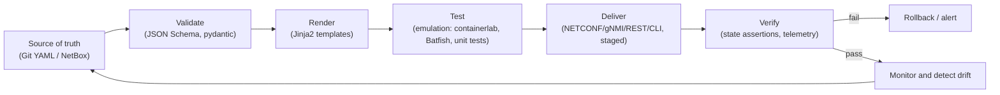

# 2.28 Network automation fundamentals: data models, templates, APIs, NETCONF, gNMI and SDN

| | |
|---|---|
| Level | Intermediate |
| Priority tier | 0 |
| Lab venue | Linux VM with Python 3, containerlab/FRR (chapter 2.27), optional SONiC/Arista cEOS images |
| Part | Part 2: Networking, from first principles to AI fabrics |
| Status | Drafted, labs **untested** |

## Why this matters for AI infrastructure

Picture an AI fabric with thousands of ports, hundreds of switches and tens of thousands of cables. One wrong DSCP-to-queue map, a missing PFC priority, one MTU of 1500 among nine thousands, or a leaf with the wrong ASN can degrade a 10,000-GPU job. Nothing raises an alarm when that happens. The job simply runs a little slower, and somebody spends a week finding out why. Humans typing CLI commands cannot keep a configuration that large consistent, however careful they are, because the mistake is never in the commands they remember, but in the one they typed on a tired Thursday.

Count what one change means on such a fabric. Suppose a new VLAN must exist on every leaf. A person who types it on each switch repeats the same steps again and again, and each repetition is a chance for a typo. The same change, written once as data and applied by a script, is one step with one review. The gain is not speed alone. The second method leaves a record that anyone can read.

That is why you automate the network. Instead of hand-typed configuration, you describe the network as **data (inventory and intent)**. Templates and models turn that data into configuration, and APIs deliver and verify it. Everything lives under version control and is tested before deployment. A new rack then becomes a few lines in a file, and the work of turning those lines into thirty switch configurations is done by a program that never gets tired.

The foundations come in a natural order. First comes the question of what to automate and why so many automation projects hurt people. After that, the history of how devices were managed, from SNMP and screen scraping to model-driven APIs, which explains why the newer interfaces look the way they do. Then the data formats those APIs speak, the models that say what the data may contain, and the templates that turn data into configuration. The chapter then works through the network APIs themselves, from REST and NETCONF to gNMI and streaming telemetry, before stepping back to software-defined networking and its trade-offs. Chapter 2.29 covers the tools (Ansible, Nornir, CI/CD, controllers, VNFs) and architectures.

## Prerequisites and outcomes

You should be comfortable with basic Python (Part 3) and Git. You also need the routing/switching background from chapters 2.4 to 2.18. If you can write a short Python function, read a dictionary, make a Git commit, and explain what a BGP session and a VLAN are, you have what you need.

Everything else is explained as it appears. YAML, JSON and XML, YANG, Jinja2, NETCONF and gNMI each start from a small example you can type and run, and each is introduced with a reason, namely the problem that the older approach had.

## 1. Why automate, and what

### Benefits

Why would a team take on the work? Five benefits usually decide it.

- Simpler architectures and operations. One tested workflow replaces many hand procedures, so operators stop acting as the integration layer between systems.
- Deterministic outcomes. The same input produces the same configuration every time, on every device, so snowflake configurations disappear. A snowflake is a device that is slightly different from all the others, for reasons that nobody remembers.
- Business agility. New racks, tenants, VLANs or BGP peers are provisioned in minutes through a pipeline, not in weeks through tickets.
- Security and lower risk. Compliance is checked continuously, access is audited, changes are reviewed and secrets are handled centrally.
- Scale. Work that grows with the number of devices (O(n) typing) becomes work that grows with the size of the data model.

Network history offers one caution that you should keep in mind. Automating a complex or bad process does not make it simpler. It relocates the complexity, from human-to-device into human-to-automation-to-device, and it can make failures faster and wider. Simplify and standardise first, using regular topologies, a few device roles and a small number of templates. Then automate.

### Types of automation

Automation covers far more than pushing configuration, so know which type a task belongs to before you choose a tool. The table lists each type with examples.

| Type | What it does | Examples |
|---|---|---|
| **Device provisioning** | Day-0/day-1 bring-up: base config, management access, loopbacks, routing | ZTP/ONIE/PXE, templated configs, Ansible, `nvue` |
| **Data collection and enrichment** | Gather inventory, state, counters; add metadata (site, role, tenant) | `show` parsing (TextFSM/ntc-templates), NETCONF/gNMI get, SNMP, NetBox sync |
| **Migrations** | Move from one platform/design to another with verification | Config translation, canary rollouts, pre/post state diffs |
| **Configuration management** | Keep devices matching intended config; push changes | Templates → push → verify → commit |
| **Configuration compliance** | Compare running config with policy/golden config; report or remediate | Batfish, custom diff, `napalm compare_config`, CIS-style rules |
| **State validation** | Check operational state matches intent (BGP up, ECMP width, LLDP neighbours, MTU, optics levels) | pyATS, Suzieq, custom assertions, test suites |
| **Reporting** | Inventory, capacity, compliance dashboards | HTML reports, Grafana, CMDB |
| **Troubleshooting** | Automated data gathering on alarm; guided diagnosis | ChatOps, runbooks as code, packet capture triggers |

Read the table row by row. For each row, you can ask whether the task changes a device or only reads it. Read-only automation, such as data collection or compliance reports, is the safest place to start, because the worst a mistake can do is show a wrong number.

A quick way to place a task in the table is to ask two questions. Does it change a device, or only read one? Does it run once, or again and again on a schedule? A nightly report reads state and changes nothing. A new BGP peer changes a device once. A drift check reads state every hour. Once you have the two answers, you know how much care the task needs before it runs anywhere near production.

### Lessons learned from a network automation outage

Here is the failure pattern that keeps repeating. A job contains a mistake in its data or logic. It runs against every device at once, and every device accepts the change. Management connectivity is then lost, and recovery needs console access everywhere. The same speed that makes automation valuable turns a typo into an outage in seconds.

Imagine a script that removes a prefix list from every spine at the same moment. Within a minute the spines drop the routes that the leaves depend on, and the fabric goes dark for the whole data hall. Nobody meant to break the fabric. The script ran exactly as written, against exactly the wrong input, and it ran everywhere at once. That is the picture behind every rule in the paragraphs that follow.

The remedies are well known, and they all slow the change down on purpose. Start with a canary and staged rollout: one device, then one rack, one pod, and only then everything. Pair the rollout with pre-checks that ask whether the device is healthy and whether the change is safe.

Protect the change itself next. Use post-checks with automatic rollback, and use commit-confirmed or candidate configurations where the platform supports them. A confirmed commit is like a sign-in-or-be-removed rule: the device applies the change, and if nobody confirms within the timer, it quietly goes back. Limit the blast radius with a maximum percentage of devices per batch, batched by failure domain.

Protect your own access too. Keep out-of-band management that does not depend on the production network. Add change windows and freeze rules, review both templates and data in code review, and test in a lab or emulation (chapter 2.27). Treat the automation system itself as production software.

Consider what happens if an automation change breaks the management network. Your only path into the device is gone, and no script can repair a device it cannot reach. An out-of-band console server, reached through a separate network, is the way back in. Test that path before you need it, because the day you need it is the day the change went wrong.

## 2. The evolution of device management interfaces

Picture a script that reads the fourth column of a CLI table to find the interface state. One software release later, a new column appears before it, and the script keeps running without an error. It now reports the wrong state for every interface, and nobody notices for a week. This is why the newer interfaces return structured data with named fields. A missing field is an error you can see, not a silent shift you cannot. The history below shows how each generation tried to fix that kind of fragility.

Walk through what happens to that script. It splits each line on spaces, takes the fourth field, and compares it with the word up. Then a vendor adds a column, and the fourth field becomes something else. The comparison fails quietly, every interface looks down, and the script raises an alarm for nothing. Nobody changed the network. The output format changed, and the script trusted the position of a word instead of its meaning.

Device interfaces have changed a great deal since the 1990s. Each generation was a reaction to the weaknesses of the one before it. The table shows each era, what it gave operators and where it fell short. Read the weaknesses column closely, because those gaps explain why the newer interfaces exist.

| Era | Interface | Strengths | Weaknesses |
|---|---|---|---|
| 1990s | **SNMP** (v1/v2c/v3; MIBs; UDP 161/162 polling and traps) | Ubiquitous for monitoring; standard MIBs | Poor for configuration; polling overhead; numeric OIDs; v2c has weak security; vendor MIB sprawl |
| 1990s to now | **SSH/Telnet and the CLI** ("screen scraping") | Works on everything; what humans use | Unstructured text output; version-dependent; fragile parsing; no transactions |
| 2006+ | **NETCONF** (RFC 6241; XML over SSH, port 830) | Structured, transactional (datastores, candidate, commit, lock, rollback), model-driven (YANG) | XML verbosity; uneven vendor support; stateful sessions |
| 2017+ | **RESTCONF** (RFC 8040; HTTP/HTTPS + JSON/XML on YANG models) | Uses familiar HTTP tooling; easy for developers | Single-target, single-shot (no network-wide transactions, no locking) |
| 2016+ | **gRPC/gNMI** (OpenConfig; HTTP/2 + Protocol Buffers) | Efficient binary encoding, streaming telemetry, multiplexed calls, strong typing | Needs protobuf/gRPC tooling; model support varies |
| now | **Vendor REST APIs and eAPI/NX-API/Meraki/Cumulus NVUE** | Easy and device-specific | Not portable; vary by vendor/version |
| now | **Open networking/Linux NOS** (SONiC, Cumulus, FRR) | Standard Linux tooling (ssh, systemd, files, netlink); Ansible/Python native; Redis-based config DB in SONiC | Different operational model; feature gaps |

Why use APIs instead of the CLI? The CLI is built for human eyes. Its output formats change between releases, parsing needs brittle regexes, and there is no atomic way to apply a multi-line change or roll it back. If the script reads a column by position and a new release adds a column, the script keeps running and quietly reads the wrong number. Model-driven APIs avoid these problems. They return and accept **structured data that conforms to a schema**, so the same code can talk to many devices.

Consider the same question asked two ways. The CLI answers with a table meant for a person, so the script has to guess where each column starts. An API answers with a field named state, and the script reads that field by name. The second version survives a new column, and the first version does not.

Open networking changes the picture further. If the network operating system is Linux, as with SONiC, Cumulus or ONIE-installed images on white-box switches, you can reuse server practices. Those include package management, systemd, configuration files, Git, Ansible and eBPF or netlink observability. The management plane then converges with infrastructure-as-code (Part 4).

Before you pick tools for a switch, check which network operating system it runs. That choice decides which server practices carry over.

## 3. Structured data formats

### Why structured data

Scripts can only act on data they can read reliably. A person can read "Ethernet1 is up, line protocol is up" and understand it at a glance. A script needs to know which word is the name and which is the state. Good automation data is **structured**, so each field has a known name and type. It is also **supported**, with libraries in every language, and **portable**, so you can move it between tools and systems. Compare the text output of `show interface` with the same facts as data.

A person reads the line that says the interface is up, and knows what it means. A program needs a named field with a value it can compare. Structured data gives each fact a name, so the program asks for the field instead of searching the sentence for a word that looks right.

```json
{ "name": "Ethernet1", "admin_state": "up", "oper_state": "up", "mtu": 9214, "speed_gbps": 400,
  "ipv4": [ { "address": "10.0.1.1", "prefix": 31 } ], "counters": { "in_octets": 123456789, "in_errors": 0 } }
```

Keep two kinds of content apart. A **document** is text written for people, with free layout that is meant to be read. **Data** is made of typed fields that a program can query, validate and combine. Data formats fall into two groups. Text formats such as YAML, JSON, XML, TOML, INI and CSV are readable and easy to diff. Binary formats such as Protocol Buffers, Apache Thrift, FlatBuffers, BSON, MessagePack, CBOR and Python pickle are compact and fast.

**Deserialising** decodes text or binary into native objects, and **serialising** encodes them back.

### YAML

YAML is usually the first format people write by hand. It is indentation-based, supports comments (`#`), anchors and aliases, and multi-document files. It is the default for **inventory, variables and intent**, as in Ansible, Kubernetes, NetBox exports and cloud-init.

Read the YAML example as a tree. Indentation says what belongs to what. A key such as `bgp` holds a block of lines indented under it, and the lines under the interface key form a list, where each dash starts a new item. Each two spaces of indentation move you one level deeper. A tab where a space belongs breaks the whole file, and the parser refuses it before any device is touched.

Here is a small leaf inventory. Read it as data: a role, a BGP block and a list of interfaces.

```yaml
# group_vars/leaf.yml
role: leaf
bgp: { asn: 65101, router_id: 10.255.0.11 }
interfaces:
  - { name: Ethernet1, description: to-spine1, mtu: 9214, ipv4: 10.0.1.1/31 }
  - { name: Ethernet2, description: to-spine2, mtu: 9214, ipv4: 10.0.2.1/31 }
vlans: [ 100, 200 ]
```

```python
import yaml                                   # pip install pyyaml
data = yaml.safe_load(open("group_vars/leaf.yml"))     # always safe_load, never load() on untrusted input
print(data["bgp"]["asn"], [i["name"] for i in data["interfaces"]])
yaml.safe_dump(data, open("out.yml", "w"), sort_keys=False)
```

The `safe_load` call is the line to remember. Using it instead of `load` keeps untrusted input from running code.

YAML has traps that catch beginners. Whitespace matters, and tabs are errors. The parser also guesses types. The so-called Norway problem happens when `no` or `NO` becomes boolean false, so a list of country codes quietly turns Norway into the word false. A value such as `010` is read as octal, and `1.10` becomes a float. Quote any string that could be misread, and watch for indentation errors and anchors that hide duplication. Run `yamllint` in CI to catch these early.

### XML

XML is tag-based. It supports attributes, namespaces and schemas, and it is the native encoding of NETCONF and many older APIs. It is more verbose than YAML or JSON, but its strictness is useful when two systems must agree exactly.

Think of XML as a labelled envelope inside another envelope. Each opening tag starts a box, and the closing tag seals it, and boxes nest inside one another. The extra text is the price of that structure. Each box says exactly what it holds, which is why NETCONF chose XML for replies that must be checked against a schema.

```xml
<interface xmlns="urn:ietf:params:xml:ns:yang:ietf-interfaces">
  <name>Ethernet1</name><enabled>true</enabled><mtu>9214</mtu>
</interface>
```

```python
import xml.etree.ElementTree as ET
root = ET.fromstring(xml_text)
ns = {"if": "urn:ietf:params:xml:ns:yang:ietf-interfaces"}
for i in root.findall(".//if:interface", ns): print(i.find("if:name", ns).text)
# or lxml / xmltodict for convenience: xmltodict.parse(xml_text) -> dict
```

For queries and transforms, XML has its own tools. XPath queries XML, and **XSLT** (W3C stylesheets that transform XML into other XML/text) rewrites it. Both are useful for reshaping NETCONF replies.

### JSON

JSON is light and common on the web. Its types are object, array, string, number, boolean and null. It has **no comments** and no trailing commas. It is the default for REST APIs, for RESTCONF (alongside XML), for OpenConfig JSON encodings and for `ip -j` output.

Compare the same fact in JSON. A key called `mtu` holds a number, and the parser turns it straight into a number in the program. Nothing has to be cut out of the surrounding text. A missing key is an error you can catch, instead of a silent blank in the middle of a sentence.

You will meet this pattern often when you work with REST APIs. The next snippet fetches interface data over RESTCONF and parses the JSON reply.

```python
import json, requests
doc = json.loads(text); print(json.dumps(doc, indent=2, sort_keys=True))
r = requests.get("https://sw1/restconf/data/ietf-interfaces:interfaces", auth=("u", "p"), headers={"Accept": "application/yang-data+json"}, verify="/etc/ssl/ca.pem", timeout=10)
r.raise_for_status(); ifaces = r.json()["ietf-interfaces:interfaces"]["interface"]
```

The `raise_for_status` call stops the script on a failed request, before you read any data. Without it, an error page would be parsed as if it were interface data, and the script would fail later in a confusing place.

On the command line, `jq` filters and transforms JSON. Libraries such as `jsonpath` and `jmespath` do the same in code, and `jmespath` is what Ansible and the AWS CLI use. The `json.tool` module is also available.

### Binary formats: Protocol Buffers

**Protocol Buffers**, or protobuf, is a binary format driven by a schema. You define the schema in `.proto` files and compile it into code for many languages. Each field carries a numeric tag. Those tags keep messages compact and keep old and new schema versions compatible. Protobuf is the encoding behind gRPC and gNMI.

A schema starts as a short `.proto` file. This one describes a network interface.

```proto
syntax = "proto3";
message Interface { string name = 1; bool enabled = 2; uint32 mtu = 3; repeated string addresses = 4; }
```

```bash
protoc --python_out=. interface.proto        # generate interface_pb2.py
```

```python
import interface_pb2
i = interface_pb2.Interface(name="Ethernet1", enabled=True, mtu=9214, addresses=["10.0.1.1/31"])
blob = i.SerializeToString(); j = interface_pb2.Interface(); j.ParseFromString(blob)
```

The compile step produces `interface_pb2.py`. The Python code then builds a message, serialises it to bytes and parses it back.

Binary formats win on size and speed, which matters for telemetry at high rates. They also give typed schemas and code generation across languages. They lose on human readability, so when you debug them, use `protoc --decode`, `grpcurl` or JSON mappings. Other formats have their place. **Thrift** handles RPC and serialisation, **FlatBuffers** gives zero-copy access, and **BSON** serves MongoDB. **Pickle** works only in Python and is unsafe on untrusted input, so never unpickle network data.

Think of protobuf as a shorthand that both sides agreed on in advance. Both ends know the schema, so the message can skip the field names and send only numbered fields. A telemetry stream that reports thousands of counters every second spends far fewer bytes this way. The collector decodes it with a fixed recipe, instead of parsing text on every line.

Choose by need. Human-edited, Git-tracked config takes YAML or JSON, web APIs take JSON, and streaming telemetry or RPC takes protobuf.

## 4. Data modelling

Picture a change with an MTU value the switch cannot accept. The command reaches the device, the device rejects it, and the rollout stops halfway through. A data model would have caught the bad value on the engineer's laptop, before any device saw it. This section explains how models describe what data may exist, so bad values are stopped at the earliest point, where they are cheapest to fix.

Here is what a data model adds. Before a value reaches the device, a checker asks three questions. Does the field exist? Is the value of the right type? Does it fall inside the allowed range? Each question is cheap to ask, and each one stops a bad value earlier than the device would. The model is the rule book that the checker reads.

Suppose someone types a nonsense MTU into a file. A **data model** is the formal description that catches it before it reaches a device. It defines what data may exist, including names, types, ranges, relationships and constraints. Tools use it to validate inputs, to generate code and documentation, and to keep different systems consistent. If a format is the alphabet, the model is the grammar: it says which sentences are allowed.

### YANG

YANG is the modelling language for network configuration and state. It is defined in RFC 7950. A YANG module describes a **tree** of containers, lists, leaves and leaf-lists. Each node has a type and constraints, such as ranges, patterns, `must` and `when` rules, and keys. A module can also define RPCs and notifications. The same model is encoded as XML for NETCONF or as JSON for RESTCONF, and gNMI paths refer to it.

Think of YANG as a form that the device publishes. The form has named fields, each field has a type, and some fields have limits. Anyone who fills in the form can see what is allowed before they submit it, and the device rejects anything outside the form.

Here is a small module. It defines one list, `interface`, keyed by name.

```yang
module example-interfaces {
  namespace "urn:example:interfaces"; prefix ex;
  container interfaces {
    list interface {
      key "name";
      leaf name    { type string; }
      leaf enabled { type boolean; default true; }
      leaf mtu     { type uint16 { range "68..9216"; } }
      leaf-list ipv4-address { type string; }
    }
  }
}
```

Read the `leaf` lines first. Each one names a value, its type and any limits. The MTU leaf accepts only values from 68 to 9216.

Now read the rest of the module the same way. `namespace` and `prefix` give the module a unique name, so `ex:` in another file cannot be confused with a different `interfaces` tree. `container interfaces` is a box with no value of its own, and it only groups the list inside it. `list interface` is a table of rows, and `key "name"` says that each row is identified by its name, so two rows cannot share one. The `default true` on `enabled` means that a device uses true when nobody sets the leaf. The `leaf-list` allows several values for one row, such as several addresses on one interface. When you run `pyang -f tree` on this file, the printed tree shows the same boxes, lists and leaves, so you can check the shape before you write any data against it.

Suppose a script sends an MTU value that the model's range does not allow. The device refuses the whole change, and the error names the field. You fix the value, rather than hunting for a silent failure that shows up later as slow traffic.

Three families of models matter. **IETF** models are standards-track, such as `ietf-interfaces`, `ietf-ip` and `ietf-routing`. **OpenConfig** models are operator-driven and vendor-neutral, such as `openconfig-interfaces`, `openconfig-bgp` and `openconfig-network-instance`. They focus on gNMI telemetry. **Native vendor models** expose the own features of each platform, as with Cisco-IOS-XE-native, Junos and Arista EOS.

Several tools work with YANG. `pyang` validates modules, prints a tree with `pyang -f tree`, and can generate XML skeletons and JSON schemas. `yanglint` is the companion checker. `pyangbind` builds Python classes from YANG, and `ygot` does the same for Go. The YANG catalog and the OpenConfig GitHub repository are good places to find models.

### JSON Schema and XSD

For your own data, such as inventory and intent (not device models), use **JSON Schema**. It validates structure and values, and it works with YAML data too.

Consider why this check matters before any device is involved. Inventory says which switch owns which port. A JSON Schema can insist that every switch has a name, a role and a loopback. A file that misses one of those fields fails inside the pipeline, and the device never sees the bad file.

```json
{ "$schema": "https://json-schema.org/draft/2020-12/schema",
  "type": "object", "required": ["hostname", "vlans"],
  "properties": {
    "hostname": { "type": "string", "pattern": "^[a-z0-9-]+$" },
    "dns_servers": { "type": "array", "items": { "type": "string", "format": "ipv4" } },
    "vlans": { "type": "array", "items": { "type": "integer", "minimum": 1, "maximum": 4094 } } } }
```

```python
from jsonschema import validate, ValidationError   # pip install jsonschema
validate(instance=data, schema=schema)              # raises ValidationError with a path to the bad value
```

The `validate` call raises a `ValidationError` that names the path to the bad value, so you can find the problem quickly.

**XSD**, the XML Schema Definition, is the XML equivalent. Protobuf definitions are schemas in their own right, and a tool such as `buf` can lint them and check them for breaking changes. Validate data at the edge of the pipeline, in CI, and again before you push it. Reject any data that fails. Pydantic, `cerberus` and `voluptuous` are Python-native alternatives, covered in Part 3.

Put the schema check in CI so a bad value stops before it reaches a device.

## 5. Templates

Imagine writing a switch configuration by hand for every leaf in a fabric. Thirty leaves are thirty nearly identical files, and the differences hide among the similarities. A **template** avoids that work. It combines **static text with placeholders and logic**, and it renders the configuration from data. Web development made templates popular with Jinja, Django templates and Handlebars. Network automation uses them to generate device configs, reports and API payloads. The value is simple. You write one template per role, such as leaf, spine or border, keep the data per device, and review the template once instead of every config.

Here is the work that a template removes. You write the configuration once, with placeholders where the leaves differ. The engine reads the variables for one leaf, fills the placeholders, and writes a finished file. Then it repeats the work for the next leaf. A change to the template changes every output at once, and a reviewer reads one file rather than one file per leaf.

### Jinja2

Start with the environment. It tells Jinja2 where the templates live and how to treat missing values.

Think of the environment as the workshop settings. It says where the stencils are kept, and what to do when a part is missing. The stencil is the template itself. The environment decides whether a missing part is quietly ignored or stops the job with an error.

```python
from jinja2 import Environment, FileSystemLoader, StrictUndefined
env = Environment(loader=FileSystemLoader("templates"), undefined=StrictUndefined, trim_blocks=True, lstrip_blocks=True)
print(env.get_template("leaf.j2").render(**data))
```

Here is a leaf template. Plain text is the configuration itself, and the tags add the logic.

```jinja
{# templates/leaf.j2 #}
hostname {{ hostname | lower }}
!

interface {{ i.name }}
 description {{ i.description | default("unused") }}
 mtu {{ i.mtu | default(9214) }}
 
 ip address {{ i.ipv4 }}
 
 switchport mode access
 
 {{ "shutdown" if not i.get("enabled", true) else "no shutdown" }}
!

router bgp {{ bgp.asn }}
 router-id {{ bgp.router_id }}

 neighbor {{ n.ip }} remote-as {{ n.asn }}

```

Two flags in the environment matter most. `StrictUndefined` turns a missing variable into an error. `trim_blocks` and `lstrip_blocks` control the whitespace that tags leave behind.

Suppose a leaf template uses `{{ router_id }}`, and the variable is missing from the data. With the strict setting, rendering stops and names the missing variable. Without it, the line comes out empty, and the device gets a configuration with no router ID at all. The strict behaviour costs one error message, and it saves you from a broken device.

Variables use `{{ x.y }}`, comments use `{# ... #}`, and statements use ``. Conditionals (`if/elif/else`) and loops (`for`, `loop.index`, `loop.first`) let the template react to data. A `for` loop can carry an `else` branch that runs when the list is empty. You can iterate over dicts with `.items()`, walk nested data, and test values with `is defined`, `is none` or `is iterable`.

Filters transform values through the pipe symbol, and you can chain them. Built-in filters include `upper`, `lower`, `default`, `join`, `sort`, `unique`, `map`, `selectattr` and `tojson`. Network logic needs more, so you can write **custom filters** in Python. For example, `env.filters["cidr_to_mask"] = fn` converts a CIDR prefix to a netmask, and the `ipaddress` module handles address arithmetic. Ansible adds `ipaddr`, `ansible.utils.ipaddr` and `ipmath`.

Template inheritance uses `` with ``. Includes and macros, such as ``, let you reuse fragments, and you can import shared macros from another file. Whitespace control matters because configs are whitespace-sensitive. Manage it with `trim_blocks`, `lstrip_blocks` and the `-` markers.

Safety comes first. Use `StrictUndefined` so a missing variable raises an error instead of rendering as blank. A blank in the middle of a configuration is dangerous because the result still looks like a configuration, only a wrong one. Autoescape is for HTML, not for configs. Never render untrusted templates. The sandbox option is `jinja2.sandbox.SandboxedEnvironment`.

### Other template languages

Other template languages fit other jobs. **XSLT** transforms XML, such as NETCONF replies or XML configs, with declarative rules like `xsl:template match`, `xsl:for-each`, `xsl:if` and `xsl:sort`. It is built into Junos commit scripts and many XML toolchains. **Go `text/template`** renders structs and maps for Go tools. gNMIc, Terraform providers written in Go and Helm charts all use Go-style templating, and Helm uses Go templates for Kubernetes manifests. **Mako**, **Cheetah**, **Tera** and **Handlebars** appear in specific tools.

Templates have pitfalls of their own. Logic in a template grows hard to maintain, so keep complex logic in Python and keep templates declarative. Always render to a file and **diff** it against the running config. Unit-test templates with fixtures and expected outputs.

### Source of truth and the data pipeline

The most durable design runs as a pipeline. It starts with a **source of truth**, such as NetBox, Nautobot or a Git repository of YAML. The chain then reads: **intent/validated data** (schemas), **templates**, **rendered artefacts**, **delivery** (API, CLI or Ansible), and **verification** (state assertions and telemetry).

Keep three things apart. Inventory covers devices, interfaces, IP and VLAN assignments, and cables. Policy covers BGP design and QoS. Secrets live in a store such as Vault or SOPS.

Data enrichment removes manual addressing errors. For example, a deterministic allocation function can derive the P2P /31 addresses, loopbacks, ASNs and VNIs from the role and index of a device.

Before you write a template, decide which system is the source of truth for its data.

## 6. Working with network APIs

### REST fundamentals

Suppose your script changes an interface and gets back `404`. You need to know what that status code means before you can debug further. REST, short for representational state transfer, is a style of HTTP API. Its main traits are **client-server** design, **stateless** requests where each request carries all the context it needs, and a **uniform interface**. In that interface, resources are identified by URLs and manipulated through standard methods. REST APIs are also cacheable and layered.

Read the response in order. The status line comes first, then the headers, then the body. A 404 tells you the path is wrong before you look at anything else. A 401 would point at the login, and a 500 at the server. Checking the status first saves you from reading a long error body that does not matter to the problem in front of you.

The methods do most of the work. `GET` reads configuration or state. `PUT` creates or replaces a resource, and it is idempotent. Idempotent means that sending the same request twice leaves the device in the same state as sending it once, which is what you want when a retry is needed after a timeout. `PATCH` makes a partial update or merge. `POST` creates a child resource or invokes an action, and it is not idempotent. `DELETE` removes a resource.

Status codes sort into classes. The 2xx class means success, as with 200 OK, 201 Created and 204 No Content. The 4xx class means the client sent something wrong, as with 400 bad request, 401 unauthenticated, 403 forbidden, 404 not found, 409 conflict, 422 unprocessable or 429 rate limited. The 5xx class means the server failed. The 1xx class is informational, and 3xx means redirect. For example, when you see a 404, check the URL and the resource path before you debug anything else.

Many so-called REST network APIs are not strictly RESTful. They use RPC-style endpoints and custom verbs, so treat the documentation of each vendor as the authority.

```bash
curl -sk -u admin:$PW -H 'Accept: application/yang-data+json' https://sw1/restconf/data/ietf-interfaces:interfaces/interface=Ethernet1 | jq .
curl -sk -u admin:$PW -X PATCH -H 'Content-Type: application/yang-data+json' https://sw1/restconf/data/ietf-interfaces:interfaces/interface=Ethernet1 \
     -d '{"ietf-interfaces:interface": {"name": "Ethernet1", "enabled": true, "description": "uplink"}}'
curl -v ... ; curl --cacert ca.pem ... ; curl -w '%{http_code}\n' -o /dev/null -s ...
```

Here is the request, piece by piece. The URL is built from the model. `/restconf/data/` is the root for data, `ietf-interfaces:interfaces` names the container in the model, and `interface=Ethernet1` picks one row from the list by its key. Read the path as a walk down the tree you printed with `pyang`. The `Accept` header asks for JSON that follows the YANG model, and `-u admin:$PW` sends the login with the request. The `-k` flag skips certificate checking, which is handy on a lab box and risky anywhere else, as the next section explains.

The first command reads one interface over RESTCONF and formats the JSON with `jq`. The second sends a PATCH that sets the description to uplink. The last line lists three more options. `-v` shows the full exchange, `--cacert` points at your CA, and `-w` prints only the status code.

The PATCH line shows why the verb matters. PATCH merges, so only the two fields in the body change, and the MTU, the addresses and everything else stay as they were. A PUT to the same path would replace the whole interface, and any field you left out could fall back to its default. Think of PATCH as editing one line of a form, and PUT as handing in a blank form with a few lines filled in. The status code tells you how the device took the request. A 200 or 204 means the change was accepted. A 400 or 422 means the body did not match the model, and the error text usually names the field.

Plan authentication early. Options include HTTP basic over TLS, bearer tokens or API keys, session cookies, and OAuth2 or mTLS for modern controllers. Never turn off TLS verification in production. See chapter 2.10.

### NETCONF

NETCONF, defined in RFC 6241, is a layered protocol. Each layer has its own job.

Start from the bottom of the stack and climb. The transport carries bytes, usually inside SSH. The message layer wraps each request in a framed envelope, so the parser knows where one message ends and the next begins. The operations layer holds the verbs, such as get and edit-config. The content layer holds the data itself, shaped by a YANG model. Each layer answers one question, and a failure in one layer does not change the others.

| Layer | Content |
|---|---|
| Content | Configuration and state data, modelled by YANG (encoded as XML) |
| Operations | `get`, `get-config`, `edit-config`, `copy-config`, `delete-config`, `lock`/`unlock`, `commit`, `discard-changes`, `validate`, `close-session`, `kill-session`, plus RPCs defined by YANG |
| Messages | `<rpc>`, `<rpc-reply>`, `<notification>` (framing with message IDs) |
| Transport | SSH (subsystem `netconf`, default port 830; also TLS, historically BEEP/SOAP) |

Read the table from the bottom up. SSH carries framed messages, the messages carry operations, and the operations act on YANG-modelled content.

Three concepts do most of the work. **Datastores** are `running`, `candidate` and `startup`. You make changes in `candidate`, validate them, and then `commit` them atomically. Think of the candidate as a draft that nobody sees until you press publish. You can add a `confirmed-commit`, which rolls back automatically unless someone confirms it. **Locks** stop two editors from changing the configuration at once. Devices advertise **capabilities** in the hello message, such as `:candidate`, `:validate`, `:confirmed-commit`, `:rollback-on-error`, `:xpath`, `:notification` and the YANG library. Per-node edit operations are `merge`, `replace`, `create`, `delete` and `remove`.

The snippet below edits a candidate configuration safely. It locks the candidate, merges the change, validates it and commits with a timer.

Read the flow as the steps of a careful change. Lock the candidate so that nobody else edits it while you work. Load the change into the candidate, and validate it. Commit with a confirm timer. If the script's later check passes, confirm the commit. If the timer runs out first, the device rolls back. The lock is released at the end either way. Each step protects the step that follows it.

```python
from ncclient import manager                 # pip install ncclient
cfg = """<config><interfaces xmlns="http://openconfig.net/yang/interfaces"><interface>
  <name>Ethernet1</name><config><name>Ethernet1</name><mtu>9214</mtu><description>to-spine1</description></config>
</interface></interfaces></config>"""
with manager.connect(host="sw1", port=830, username="admin", password=PW, hostkey_verify=True, timeout=30) as m:
    print([c for c in m.server_capabilities if "candidate" in c])
    with m.locked("candidate"):
        m.edit_config(target="candidate", config=cfg, default_operation="merge")
        m.validate(source="candidate")
        print(m.compare_config() if hasattr(m, "compare_config") else "")
        m.commit(confirmed=True, timeout="120")       # auto-rollback in 120 s unless confirmed
        # ...verify state; then:
        m.commit()                                    # confirming commit
```

Now walk through the code line by line, since each line does one part of the careful change. `manager.connect` opens a NETCONF session over SSH to port 830. `hostkey_verify=True` makes the client check the device's SSH host key, so it refuses a device it does not recognise. `server_capabilities` is the list the device sent in its hello message, and the `print` line shows whether the device offers a candidate datastore at all. `m.locked("candidate")` takes the lock, and the lock is released when the block ends, even if an error stops the code partway through. `edit_config` loads the XML into the candidate, and `default_operation="merge"` means that existing settings stay in place and only the listed leaves change.

The XML itself matters too. The namespace on `<interfaces>` names the model, here the OpenConfig interfaces model, so the device knows which meaning each tag has. `<mtu>9214</mtu>` is the value the model range checks, and the device will refuse the whole edit if the value falls outside it. `validate` asks the device to check the candidate against its models before anything goes live. The `commit(confirmed=True, timeout="120")` line then applies the candidate to running, but it arms a timer. The final `commit()` is the confirmation, and it makes the change permanent.

Watch the timer. If the script does not confirm within 120 seconds, the device rolls back, so the checks between the two commits must finish in time.

Support differs by vendor. Junos supports NETCONF natively, with a candidate, commit confirmed and a `compare` rollback diff. Cisco IOS XE, NX-OS, IOS XR, Arista EOS and Nokia SR OS support NETCONF with native models, OpenConfig models or both, and their capabilities differ. Always read the capabilities the device advertises, and check its YANG library.

### RESTCONF

RESTCONF, defined in RFC 8040, maps NETCONF datastore operations onto HTTP for YANG-modelled data. A read looks like `GET /restconf/data/<module>:<container>/<list>=<key>`. `PUT/POST/PATCH/DELETE` change data at the same kind of path. Payloads use the media types `application/yang-data+json` or `application/yang-data+xml`, and RPCs go to `/restconf/operations`.

The trade-off is simple. RESTCONF is **single-target, single-shot**. It offers no network-wide transactions, no locking and no candidate datastore, so changes apply directly to running. In return, you get familiar tooling such as curl and requests.

**YANG PATCH**, defined in RFC 8072, is a media type, `application/yang-patch+json`. It carries several edits in one request, and each edit has an edit ID, an operation and a target.

To see which modules a device supports, read `/restconf/data/ietf-yang-library:modules-state`. On some devices, try `yang-library` instead. Cisco IOS XE exposes the full native model plus the IETF and OpenConfig models. Arista and others have RESTCONF in some releases. Check the module list before you write a request.

### gRPC and gNMI

**gRPC**, short for Google RPC, runs over HTTP/2 and uses Protocol Buffers. It is high performance and independent of payload. It supports four communication patterns: unary, server streaming, client streaming and bidirectional streaming. Code generation gives you many languages, and TLS or mTLS comes built in.

Think of a gRPC call as a function call that crosses the network. The client names the method and passes a typed message, and the server returns a typed reply. Because the message has a schema, both sides agree on the field names and types before any data moves, and a wrong type is caught at the boundary.

**gNMI**, the gRPC Network Management Interface from OpenConfig, defines a small service. `Capabilities` reports the supported models, encodings and gNMI version. `Get` reads state or configuration. `Set` updates, replaces or deletes, with transactional semantics for each request. `Subscribe` streams telemetry in `STREAM`, `ONCE` or `POLL` mode, either sampled or on change.

Read a gNMI path the way you read a file path, from left to right. Each slash moves one level down the YANG tree. The `interface[name=Ethernet1]` part picks one row from the list by its key, which is the same idea as the key in the YANG module above. `state` means the operational values the device reports, and `config` means the values you intend. That split is why a path ending in `state/counters` returns live numbers, while one ending in `config/mtu` returns what was configured.

gNMI paths are YANG-based, such as `/interfaces/interface[name=Ethernet1]/state/counters`. Payloads can use the JSON, JSON_IETF, PROTO or ASCII encodings.

Related interfaces extend the family. gNOI covers operations such as reboot, OS install, file and cert. gNSI covers security, gRIBI handles RIB injection, and P4Runtime is also related.

The gNMIc client covers the four gNMI operations from the shell. The flags repeat in every command: the target, the user, the password and `--skip-verify`.

```bash
# gNMIc (openconfig/gnmic): capabilities, get, set, subscribe
gnmic -a sw1:6030 -u admin -p $PW --skip-verify capabilities
gnmic -a sw1:6030 -u admin -p $PW --skip-verify get --path /interfaces/interface[name=Ethernet1]/state/oper-status
gnmic -a sw1:6030 -u admin -p $PW --skip-verify set --update-path /interfaces/interface[name=Ethernet1]/config/mtu --update-value 9214
gnmic -a sw1:6030 -u admin -p $PW --skip-verify subscribe --path /interfaces/interface/state/counters --stream-mode sample --sample-interval 10s
gnmic ... --encoding json_ietf ... ; gnmic ... -e proto
```

Each gNMIc line uses the same connection flags, so read the first line as the pattern. `-a` gives the target address and port, `-u` and `-p` give the login, and `--skip-verify` turns off certificate checking, which again belongs only on a lab box. `capabilities` asks the device which models and encodings it supports, the same question the NETCONF hello answers. `get` reads one path, here the operational status of Ethernet1, and returns its current value. `set` with `--update-path` and `--update-value` changes the MTU, which is the write side of the same model. The encoding flags pick the wire format. `json_ietf` is the JSON that follows the IETF rules, and `-e proto` asks for the binary protobuf encoding.

The `subscribe` line is the telemetry command. It samples interface counters every 10 seconds.

A subscription has three parts. It names the path to watch, it sets a sample interval, and it asks for a mode. The collector then keeps the connection open, and the device pushes a value each time the interval passes. Nothing is polled, so the device never waits for a question it has to answer.

```python
from pygnmi.client import gNMIclient          # pip install pygnmi
with gNMIclient(target=("sw1", 6030), username="admin", password=PW, insecure=False, path_cert="ca.pem") as gc:
    print(gc.capabilities()["supported_models"][:3])
    r = gc.get(path=["/interfaces/interface[name=Ethernet1]/state"])
    gc.set(update=[("/interfaces/interface[name=Ethernet1]/config/mtu", 9214)])
```

Read the pygnmi script as a short story. The `with gNMIclient(...)` block opens a connection and closes it when the block ends, so a script that fails halfway does not leave a session open. `insecure=False` with `path_cert="ca.pem"` tells the client to check the device certificate against your CA file. `capabilities()` returns a dictionary, and the code slices the first few supported models for a quick look. `gc.get` returns the state of one interface as Python data, which you can compare or log. `gc.set` takes a list of pairs, each one a path and a value, so several writes can travel in one call.

The pygnmi version does the same work in code. It reads capabilities, gets interface state and sets an MTU.

### Comparing the model-driven protocols

The three protocols overlap, so compare them on the points that matter for your job.

| | NETCONF | RESTCONF | gNMI |
|---|---|---|---|
| Encoding | XML | JSON or XML | JSON/JSON_IETF/PROTO (protobuf) |
| Transport | SSH (TLS) | HTTP(S) | gRPC over HTTP/2 + TLS |
| Transaction scope | Network-wide capable per session (lock, candidate, commit) | Single target, single shot | Single target, single request (Set is atomic per request), sequenced |
| Streaming telemetry | Notifications (limited) | SSE/notifications (limited) | Native Subscribe (sample/on-change) |
| Model use | YANG | YANG | YANG paths (OpenConfig focus) |
| Tooling | ncclient, Ansible netconf, Netconf-console | curl, requests, Ansible httpapi | gNMIc, pygnmi, Telegraf, vendor SDKs |
| Best for | Configuration with transactions | Simple CRUD, web developers | High-rate telemetry and modern config |

NETCONF sessions can span the network, while RESTCONF and gNMI each work on one target. Choose NETCONF when you need transactions, and choose gNMI for high-rate telemetry.

Model families mature at different speeds. IETF models are standards-track but slow to change. OpenConfig models move fast, with vendor deviations. Native models expose everything a platform offers, but they are not portable. Pragmatic automation uses OpenConfig or IETF where the platform supports them well. It falls back to native models or the CLI where it does not, and it hides those choices behind a thin abstraction layer.

### Streaming (model-driven) telemetry

Streaming telemetry reverses the direction of data. Instead of polling SNMP every minute, the device **pushes** counters and state at high resolution. It is the difference between phoning a friend every hour to ask how they are and having them text you the moment anything changes. In **dial-in**, the collector connects with a gNMI Subscribe. In **dial-out**, the device connects to a collector. The dial-out method is vendor-specific and runs over gRPC or UDP/TCP.

Picture a link that flaps for under a second every few minutes. A poll every minute almost never sees the flap, so the graph looks clean while users complain. A subscription that reports on change sends each state transition as it happens, and the flap appears on the dashboard. The difference is in how often the question is asked, and who is asked to wait.

Data then flows to collectors such as gNMIc, the `gnmi` input of Telegraf, Cisco Pipeline, and Juniper JTI with Telegraf or OpenNTI. From there it reaches time-series stores such as Prometheus through exporters, InfluxDB or VictoriaMetrics. Dashboards and alerts come last, and chapter 2.31 covers them.

The benefits are granularity of 1 to 10 seconds, on-change events for things like link flaps and BGP state, less device CPU than polling at scale, and typed data. Granularity of 1 to 10 seconds is coarse for microbursts, so those need finer sampling. The costs are volume and cardinality, collector scaling, model and path differences across vendors, and clock sync.

Choose the telemetry path by the granularity you need and the volume your collectors can carry.

### Python (and Go) libraries

Pick libraries by task. The table lists the common choices.

| Task | Libraries |
|---|---|
| HTTP/REST | `requests`, `httpx`; Go `net/http` |
| NETCONF | `ncclient`; Go `scrapligo`/`go-netconf` |
| gNMI | `pygnmi`, `grpcio` + generated stubs; Go `gnmic` library / `openconfig/gnmi` |
| CLI over SSH | `netmiko` (multi-vendor), `scrapli` (fast, async), `paramiko` (low level), `pexpect` |
| Multi-vendor abstraction | `napalm` (get_facts, get_bgp_neighbors, compare_config/commit/rollback), `nornir` (tasks and inventory, chapter 2.29) |
| Parsing | `textfsm` + `ntc-templates`, `genie`/`pyATS` parsers, `ttp` |
| Data/modelling | `pyyaml`, `ruamel.yaml`, `jsonschema`, `pydantic`, `pyang`, `pyangbind`, `ipaddress`, `netaddr` |
| Templating | `jinja2` |
| Testing/validation | `pytest`, `batfish` (pybatfish), `suzieq`, `pyATS`, `scapy` |

When a device offers only a CLI, Netmiko is the fallback. This script records the current BGP section, applies one neighbour setting, saves the config and prints the BGP summary as structured data.

```python
from netmiko import ConnectHandler
dev = {"device_type": "arista_eos", "host": "sw1", "username": "admin", "password": PW, "fast_cli": True}
with ConnectHandler(**dev) as c:
    before = c.send_command("show running-config | section router bgp")
    out = c.send_config_set(["router bgp 65101", "neighbor 10.0.1.0 maximum-routes 1000"])
    c.save_config()
    print(c.send_command("show ip bgp summary", use_textfsm=True))     # structured output via ntc-templates
```

Read the Netmiko script in the order it runs. The `dev` dictionary is the connection recipe. `device_type` tells Netmiko which vendor dialect to speak, `fast_cli` turns on a quicker mode, and the password comes from a variable filled at run time, not from the file. The `with ConnectHandler(**dev) as c` line opens the SSH session and closes it at the end of the block. `send_command` records the BGP section of the running configuration first, which gives you a before picture. `send_config_set` then enters configuration mode and sends the neighbour line, and `save_config` writes the change to startup so it survives a reboot. The final `show ip bgp summary` is read as structured data. Keep the before picture in your logs, because it is the only record of what the device looked like before the change.

The `use_textfsm=True` flag turns the raw CLI text into structured data through the ntc-templates library.

Safe scripts follow a few rules. Set timeouts and retries with backoff. Isolate errors per device, so one failure does not silently abort the batch. Make the script idempotent by comparing desired and current state and changing only the difference. Run in `--dry-run` or diff mode by default, and use commit-confirmed, or back up and restore.

Then keep a record and limit the damage. Log every change with a ticket or commit ID. Read secrets from the environment or Vault, never from code. Limit concurrency with threads or asyncio, and batch by failure domain. Verify after each change, and test with unit tests that use mocked devices.

Start every new script in dry-run mode, and remove that default only when the diff looks right.

## 7. Software-defined networking and centralised control planes

Picture a central controller that computes every path for a fabric of hundreds of switches. The controller goes down for an hour during a power problem in its own data hall. The question an engineer should ask before adopting such a design is simple: what do the switches do while the controller is gone? The section below describes the models and their trade-offs, and it keeps returning to that question, because the honest answer shapes the whole design.

Why would anyone move decisions away from the switch? A controller sees the whole fabric in one place, so it can compute a path that no single switch could know about. The price is that each switch now depends on the controller staying reachable. The rest of this section weighs that trade-off, one model at a time.

Network designs have swung between distributed and centralised control planes more than once. SDN is often framed as either/or, with distributed protocols on one side and a controller on the other. Yet every routing protocol is software too. A more useful definition follows. **SDN moves some part of the control plane off the individual forwarding devices and into a logically centralised component.** Here, centralised does not mean carried hop by hop or computed separately by every device. It does not mean a single "god box" either.

### Interfaces

The **southbound interface** sits between the controller and the network devices. Protocols there include BGP, NETCONF and gNMI, PCEP, OpenFlow, P4Runtime, OVSDB, vendor APIs and I2RS. The **northbound interface** sits between the controller and applications or business logic. It runs through REST or gRPC APIs, intent languages and GitOps. A useful picture is a building manager: the manager talks down to the lift engineers in their language, and up to the tenants in theirs.

### Four models of interaction

The four models differ mainly in where the control plane runs. The table lists each one.

Imagine the same link failure under each model. In the first, the switches reroute on their own, and the controller hears about the failure later. In the last, the controller must compute the new path and push it down before traffic moves. The difference lies in who holds the decision when the link breaks, and how long the traffic waits for that decision.

| Model | Description | Examples |
|---|---|---|
| **Distributed** | Control plane runs on the forwarding devices (possibly disaggregated software, but still on the device) | OSPF/IS-IS/BGP everywhere |
| **Augmented** | Distributed control plane remains; off-box processes influence the paths installed in the RIB | PCE, BGP controllers injecting routes, Fibbing, I2RS |
| **Hybrid** | A centralised control plane runs in parallel with the distributed one; each appears to the other as just another control plane | Controller speaking BGP/OpenFlow alongside OSPF |
| **Replace** | No distributed control plane; the controller programs the FIB directly | Classic OpenFlow, P4Runtime fabrics |

Notice that the first model keeps everything on the device, and the last one removes the distributed protocols altogether.

### Division of labour

A control plane supplies three things: **topology**, **reachability** and **policy**. Topology and reachability are tangled together. RIP and EIGRP combine them, and in IS-IS reachability hangs off the shortest-path tree as leaves. Policy is different. It only *modifies* what topology and reachability computed, so it separates cleanly into an upper layer.

Take a packet from one rack to another and ask which of the three things each step needs. Topology says which links exist. Reachability says which destination a link leads toward. Policy says whether the packet may travel that way at all. Separating the three helps you see which part a controller should own, and which part should stay on the switch.

That leads to a common pattern. Keep a distributed lower layer for topology and reachability, because it gives resilience and speed. Add centralised policy for traffic engineering, segmentation and intent.

When you evaluate any SDN design, ask these questions. Which functions are centralised? What happens when the controller, or its connectivity, fails? How fast can it react, how does it scale, and what is the complexity cost?

### Examples

BGP as an SDN works when BGP already runs fabric-wide. A controller joins as an iBGP or eBGP speaker, reads the topology and injects better-metric paths hop by hop. That pins a flow to a chosen path. If you are new to SDN, start here. This is the augmented model, where the same protocol carries both topology and policy. It is simple to deploy. But automating a complicated process does not remove its complexity. It only relocates it.

Picture a situation where BGP-as-SDN earns its keep. A large training job is sending heavy traffic over one spine, and the other spine sits mostly idle. A controller that knows the load can inject a more preferred route for part of the traffic, so the idle spine takes some of the flows. When the job ends, the controller withdraws the route, and the fabric falls back to its normal choice. The switches never learned anything new. They only received a route with a better attribute, through the session they already had.

The attraction of this example is that nothing new has to run on the switches. The controller speaks BGP, the protocol that the fabric already uses. The routes it injects stay in place only as long as its BGP session stays up, so a controller failure removes its routes rather than leaving a device unreachable.

Fibbing takes a different route. In link-state protocols, tags are never used for traffic engineering, because all routers must hold the same database. So Fibbing has a controller join the IGP and inject **fake nodes and links**. These arrive as OSPF external LSAs, which can carry a third-party next hop. The unmodified shortest-path calculation then produces the desired path. For example, a chain of fake nodes with lowered costs and specific forwarding addresses steers traffic from A to H along a longer but desired route. Nothing in the protocols changes. The approach is limited to what external routes can express, and you must watch the scale of the injected LSAs.

Here is the idea in everyday terms. Imagine a road map where every driver uses the same map and picks the shortest route on it. A traffic planner cannot order a driver onto a longer road, but the planner can add a fake road sign to the map, which every driver accepts as real. The drivers still compute their own shortest path, and the fake sign steers them where the planner wants. That is the whole trick. Every router still runs the same algorithm, and only the map has changed. The cost is that the fake signs must stay consistent with the real map, or drivers will be sent down roads that do not exist.

PCEP, the Path Computation Element Protocol, is another augmented example. A central PCE computes paths for MPLS or SR LSPs and tells the headends, called PCCs, through PCEP. The headends then signal or encode those paths, as with SR policies.

I2RS, the Interface to the Routing System, is a standardised programmatic interface. Off-box applications read and write routing state through it. The state is ephemeral, and the interaction is fast and event-driven.

OpenFlow is a southbound protocol that lets a controller install match-action flow entries directly in switch flow tables. That is the replace model. It is powerful, but it had problems with scaling, table size and failure handling. Its ideas live on in P4 and P4Runtime, and in virtual switches such as OVS and OVN.

Controllers also run fabrics and overlays. Examples include EVPN route servers, cloud SDN VPC controllers, Kubernetes CNI control planes, OVN and SD-WAN controllers.

### CAP and subsidiarity

A centralised control plane is, at heart, a distributed database problem. During a network partition, you cannot have both consistency and availability. This is the **CAP theorem**, and partitions are unavoidable, so you must choose. The **subsidiarity principle** gives a practical rule. Make each decision at the lowest level that can make it correctly, and centralise only what truly needs a global view.

Suppose the link between the controller and one rack breaks. The controller still sees the rest of the fabric, and it may decide that the rack is gone. The rack keeps forwarding, and the two sides now hold different pictures of the same network. CAP is the name for the trade you must make in such a split. You can have an answer that is consistent, or an answer that is always available, but during the split you cannot always have both.

In practice, keep fast, local and safety-critical reactions in the distributed layer. Failure detection, ECMP rerouting and fast reroute belong there. Centralise slow-changing, global policy such as traffic engineering, intent and segmentation. Finally, make sure the network keeps forwarding if the controller disappears. Fail static, or fall back to the distributed control plane.

Before you centralise a function, ask what the fabric does when the controller is gone.

## 8. Putting it together: a minimal automation pipeline

The pieces from this chapter fit into one pipeline, shown below. Follow it from left to right, and notice that every stage has a way to say no.



A failed verification leads to rollback or an alert. A passing check moves on to monitoring, and monitoring feeds drift back into the source of truth.

Try this as a mini-project, which the lab below follows. Generate FRR or SONiC-style configs for the leaf-spine fabric from a YAML inventory. Validate the inventory with JSON Schema, and render the configs with Jinja2. Apply them to the containerlab nodes through `docker exec` with vtysh, or through NETCONF-capable images. Finally, assert BGP and ECMP state with a validation script (chapter 2.27, lab 7).

Before you connect the pipeline to a device, make sure the validation stage rejects bad data.

## 9. Hands-on lab: data, templates, and APIs

Start with the self-checking Python lab, which you can run on your own machine. It tests three things. It checks YANG and JSON Schema validation of a switch inventory, including the hostname regex, the VLAN range `1..4094`, the MTU range `68..9216` and the IPv4 prefix. It checks strict template rendering, where `StrictUndefined` raises `KeyError` on a missing variable. It also checks NETCONF `candidate` and `confirmed-commit` auto-rollback behavior.

```bash
python3 code/part02/net_automation_apis_yang_lab.py
```

Run the lab first, so you know the Python checks work before you move on to the VM.

The Python lab uses no devices, so a failure there points at your code and not at a network. Once it passes, any failure on the VM means the device or the lab setup, and you know where to look first.

Next, move to a disposable Linux VM with Python 3 and containerlab with FRR. The interactive VM commands below were not run on live hardware, so verify each one on your own system. Work through these steps in order. They follow the pipeline of section 8: formats first, then schemas and templates, then each kind of API, and last a safe rollout.

1. Start with formats. Write one switch's interface table in YAML, JSON and XML. Convert between them with `yq`, `jq` and `xmltodict`, and round-trip the data through Python. Watch for type differences, such as the YAML Norway problem, and notice that JSON has no comments.
2. Next, write a JSON Schema for the fabric inventory. It should cover the VLAN range, the ASN range, hostnames and IPv4 prefixes. Write failing and passing examples, then add a pytest that validates all files in `inventory/`.
3. Move to templates. Write a leaf template with loops and conditionals. Add a custom filter that converts a CIDR to a netmask, a macro for BGP neighbours and an `extends` base. Render with `StrictUndefined`, trigger the error for a missing variable and show it. Finish with a golden-file test.
4. Build a REST client. Stand up a mock device API with FastAPI or Flask that returns interface JSON. Write a `requests` client that sets timeouts, retries and TLS. Then run a `curl` session that exercises GET, PUT, PATCH and DELETE, along with the error codes.
5. Work with YANG. Write the small module shown above and validate it with `pyang`. Print the tree, generate a JSON schema, and build sample data. Then validate that data against the model with `yanglint`.
6. Next is NETCONF. Run a NETCONF-capable device. An Arista cEOS or Nokia SR Linux container in containerlab works, and so does a Junos vMX or cRPD lab if you are licensed. Use `ncclient` to read capabilities and run `get-config`, then run `edit-config` into candidate. Issue `commit confirmed`, and watch the rollback happen when you do not confirm.
7. Try gNMI against the same SR Linux or cEOS node. Run `capabilities`, `get` and `set` with `gnmic`. Then run a `subscribe` stream into Prometheus with the `output prometheus` setting, and build a Grafana panel of interface counters.
8. Practise the CLI fallback. Use Netmiko or Scrapli against an FRR container with `vtysh`, or against a Linux switch, and parse the output of `show bgp summary json`. Then write an idempotent function that ensures a neighbour exists.
9. Now write a safe rollout. The script applies a change to leaves one at a time, runs post-checks on ECMP width and BGP sessions, and halts and rolls back on failure. Test it with an injected bad change.
10. Finally, build a small controller toy. Use FRR containers and write a Python program that injects a more-preferred route over a BGP session, through ExaBGP or `vtysh`, to pin a path. Verify the path with traceroute, and then discuss the limits.
11. Clean up when you finish.

Some of these steps are easy to read past, so here is what a few of them teach. Step 1 is about formats, and the YAML Norway problem is the classic trap. In YAML 1.1, a bare `NO` is read as the boolean false, so a country code of Norway can silently turn into a false value in your inventory. Quoting the value keeps it a string. Step 6 is the first place where a change can strand a device. The `commit confirmed` line works like a hotel key card that stops working unless you tap it again before the timer runs out. If you do not press it, the device falls back to its last good state on its own. Practise that fallback on purpose, so you know what it looks like before a real outage depends on it. Step 9 is the rollout habit that protects a fleet. Change one leaf, check it, then move on, so a bad change stops at one device instead of reaching all of them.

Do the Python lab first, then work through the VM steps in order.

## 10. Common mistakes

Most automation failures trace back to a short list of mistakes.

The first is parsing CLI output with regexes in production when structured APIs exist, and assuming the CLI format will never change. The second is treating YAML as always safe. Its implicit typing causes trouble, and running `yaml.load` on untrusted data is dangerous.

Here is how the mistake looks in practice. A regex matches the word up in a line, and a vendor later changes the word to established. The regex now matches nothing, and the check passes every time. A structured read would have failed loudly on the missing field, which is the behaviour you want from a check.

Unvalidated data is the third mistake. It flows into templates, missing variables render without an error, and secrets end up in repositories. The fourth is pushing to all devices at once, with no canary, no rollback and no out-of-band access. The fifth is one monolithic template full of logic, with no tests or golden files.

Consider the missing variable from the template section again. Without a check, the output looks complete, and the device accepts a half-written line. The mistake stays silent until traffic fails. A schema check before rendering, together with a strict template, turns that silence into an error at build time, when the fix is cheap.

The sixth mistake is believing that NETCONF-capable means portable. Models and capabilities differ by vendor and version. The seventh is over-centralising, which makes the controller a single point of failure, or under-specifying what happens when it fails. The eighth is automating an undocumented, inconsistent network before you simplify it.

Check your plan against each of these.

## 11. Interview angles

Use these questions to test your understanding before an interview. Answer each in your own words, and name the trade-off, not only the tool.

- "Why NETCONF/gNMI instead of SSH and screen scraping? Differences among NETCONF, RESTCONF and gNMI?"
- "What is YANG? What are IETF vs OpenConfig vs native models?"
- "Design an automation pipeline for a leaf-spine fabric. Where do tests and rollbacks happen?"
- "How would you roll out a global MTU or QoS change safely to 500 switches?"
- "What is idempotency and why does it matter for network automation?"
- "When would you use YAML vs JSON vs protobuf?"
- "What is SDN? Explain augmented vs hybrid vs replace controller models. What happens if the controller fails?"
- "How does streaming telemetry differ from SNMP polling?"
- "How do you validate that the network matches intent?"

## Exercises

Try each exercise on paper first, then check your answer against the chapter. You will see what you can explain and where you still need to read.

1. A manager asks what network automation covers. List the eight types of network automation, and explain why automating a complex, non-standard network relocates complexity rather than removing it.
2. Design a safe rollout for a 500-switch AI fabric change, using canaries, failure-domain batches, pre- and post-checks, `commit confirmed` and out-of-band access.
3. Trace how management moved from SNMP (UDP 161/162) and CLI scraping to NETCONF (RFC 6241, port 830), RESTCONF (RFC 8040) and gNMI.
4. A new teammate asks which data format to pick. Compare YAML (`yaml.safe_load`, and the Norway problem), JSON, XML and Protocol Buffers, and say where each belongs in an automation stack.
5. Bad intent data reaches a template. Using `validate_switch_inventory_schema()` in `code/part02/net_automation_apis_yang.py`, explain how JSON Schema validates intent data before templating. Then explain how YANG (RFC 7950) models containers, lists, leaves and constraints, and compare IETF, `OpenConfig` and native models.
6. A template renders a blank where a variable is missing. Using `render_leaf_config_strict()`, explain why `StrictUndefined` (with `trim_blocks=True, lstrip_blocks=True`) is mandatory when rendering switch configurations. Then contrast Jinja2 with XSLT and Go `text/template`.
7. You must pick a model-driven API. Compare NETCONF, RESTCONF (with YANG Patch, RFC 8072) and gNMI, which offers Capabilities, Get, Set and Subscribe operations, across encoding, transport, transaction scope and telemetry.
8. Using `simulate_netconf_confirmed_commit()`, trace a transactional `ncclient` session: `locked("candidate")`, then `edit_config`, then `validate`, then `commit(confirmed=True, timeout="120")`, and finally `commit()`.
9. Match each Python library to its role: `requests` or `httpx`, `ncclient`, `pygnmi`, `netmiko` or `scrapli`, `napalm`, `textfsm` with `ntc-templates`, `pyang` or `pyangbind`, and `pybatfish` or `suzieq`. Then list the eight engineering rules for writing safe network automation scripts.
10. A vendor pitches a controller. Contrast the four control-plane interaction models, Distributed, Augmented, Hybrid and Replace, with concrete examples: BGP route injection, Fibbing fake LSAs, PCEP, I2RS, `OpenFlow` and P4Runtime.
11. Apply the CAP theorem and the subsidiarity principle to decide which functions in an AI fabric should stay local or distributed, and which belong in a controller.

## Checkpoint questions (20)

<details>
<summary>1. Why does automating a complex or broken manual network often make outages worse, and what are the six safeguards against fleet-wide automation outages (Network Programmability and Automation, chapter 2)?</summary>

Automation does not remove the complexity of a snowflake network. It moves that complexity into scripts and templates. It also gives a single bug the speed to break 500 switches in 2 seconds, instead of 1 switch in 10 minutes. Six safeguards protect you, and you should apply all of them. First, simplify and standardise topologies and roles. Second, validate intent against a strict schema, such as JSON Schema or Pydantic, and test in containerlab and Batfish before production. Third, use canary and staged rollouts bounded by failure domain, one leaf, then one pod, then one spine at a time, never all spines at once. Fourth, run pre-checks and automated post-checks, such as BGP session count, ECMP width and error counters. Fifth, use commit confirmed with automatic rollback if checks or reachability fail. Sixth, keep independent out-of-band (OOB) management access.

</details>

<details>
<summary>2. Why is CLI "screen scraping" over SSH brittle for network automation, and why is SNMP (UDP 161/162) rarely used for configuration?</summary>

The CLI is formatted for human eyes. Column widths wrap, field names change between NOS minor releases, and errors come back as free-form prose. A multi-line CLI paste has no atomic transaction or rollback. SNMP uses numeric OID trees, called MIBs, over UDP. It has poor transactional write support, and `SNMPv2c` community strings give weak security. Polling large tables costs high CPU, and vendor MIBs are inconsistent. You should weigh those costs before you pick SNMP for anything beyond monitoring.

</details>

<details>
<summary>3. What is the "YAML Norway Problem", why must you always call `yaml.safe_load()` instead of `yaml.load()`, and what does JSON lack compared to YAML?</summary>

In YAML 1.1, unquoted strings such as NO, no, off, on and yes are read as booleans. So the country code NO for Norway, or a line such as no shutdown, becomes False. An unquoted 010 is read as octal 8, and 3.10 is read as the float 3.1. Quote any string that could be misread, and lint with yamllint. Always use `yaml.safe_load()`, because `yaml.load()` can create arbitrary Python objects and run code from untrusted input. JSON parses faster and avoids indentation and implicit-typing traps. But JSON has no comments (`#`) and no trailing commas.

</details>

<details>
<summary>4. Why do gRPC and gNMI use Protocol Buffers (protobuf) instead of JSON or XML for high-rate streaming telemetry (Network Programmability and Automation, chapter 8)?</summary>

Protocol Buffers use strongly typed schemas in `.proto` files. `protoc` compiles them into Python, Go or C++ classes. Instead of repeating ASCII key names such as `"in-unicast-pkts"` in every message, protobuf writes compact binary numeric tags. That shrinks the payload by 3 to 10 times. It also cuts the CPU cost of serialising and parsing by about an order of magnitude, and schemas stay compatible when new fields are added. Never use Python pickle on network data, because unpickling untrusted bytes runs arbitrary code.

</details>

<details>
<summary>5. What is `YANG` (`RFC 7950`), what are its four core data-node types, and how do `IETF`, `OpenConfig`, and Native YANG models differ?</summary>

YANG is the standard data modelling language for network configuration (`config true`) and operational state (`config false`). It works the same whatever the encoding: XML for NETCONF, JSON for RESTCONF, or protobuf for gNMI. Its four core data nodes are these. A `leaf` holds one typed value, such as `leaf mtu { type uint16 { range "68..9216"; } }`. A `leaf-list` holds a list of scalar values, such as `leaf-list dns-server`. A `container` groups related nodes. A `list` holds records keyed by one or more leaves, such as `list interface { key "name"; ... }`. IETF models, such as ietf-interfaces, are standards-track RFCs. OpenConfig models, such as openconfig-interfaces and openconfig-bgp, are vendor-neutral and built by hyperscale operators, with a strict `config/` and `state/` container split. Native models expose all of a vendor's features, but they are less portable.

</details>

<details>
<summary>6. How do `pyang` and `JSON Schema` fit into a network CI pipeline?</summary>

`pyang` validates YANG modules with `pyang --strict`. It also renders ASCII hierarchy trees with `pyang -f tree openconfig-interfaces.yang`, so engineers can check exact XPath and gNMI paths. JSON Schema, checked with `jsonschema.validate()` or Pydantic in Python, validates your Git YAML or JSON intent and inventory files, such as `group_vars/` and `host_vars/`, on every pull request. It catches an invalid VLAN such as `5000`, a bad IPv4 CIDR or a missing BGP ASN in CI, before Jinja2 renders a config.

</details>

<details>
<summary>7. In `Jinja2`, what are the three delimiter pairs, why must you enable `StrictUndefined`, and where should complex address logic live (Network Programmability and Automation, chapter 9)?</summary>

The three delimiters are `{{ ... }}` for expressions and variables, `` for control statements such as `for`, `if`, `macro`, and `extends` with `block`, and `{# ... #}` for comments. By default, Jinja2 renders a missing variable as an empty string. That can produce a broken switch config, such as `router bgp` with no ASN. Passing `undefined=StrictUndefined` to `jinja2.Environment` makes Jinja2 raise an `UndefinedError` at once instead. Keep complex IP and subnet logic in tested Python functions or custom filters, not in `.j2` files.

</details>

<details>
<summary>8. Describe the four layers of `NETCONF` (`RFC 6241`, `SSH port 830`) and its three configuration datastores.</summary>

The four layers are transport, messages, operations and content. Transport is SSH over TCP port `830`. Messages are `<rpc>`, `<rpc-reply>` and `<notification>`. Operations include `<get>`, `<get-config>`, `<edit-config>`, `<copy-config>`, `<lock>`, `<unlock>`, `<validate>`, `<commit>` and `<discard-changes>`. Content is YANG-modelled XML data. The three datastores are `running` for the active config, `candidate` as a staging buffer, and `startup` for the next boot. You can edit, validate and diff `candidate` before an atomic commit to `running`.

</details>

<details>
<summary>9. How does NETCONF `commit confirmed` prevent an engineer or script from cutting off management access to a remote switch?</summary>

The call `m.commit(confirmed=True, timeout="120")` moves the candidate into running and starts a 120-second timer. The script then runs its reachability and BGP post-checks, and sends a second, confirming `m.commit()`. If the change breaks the network or firewall so the script cannot send that commit within 120 seconds, the switch rolls running back to the previous configuration on its own. That restores connectivity.

</details>

<details>
<summary>10. Compare `NETCONF`, `RESTCONF` (`RFC 8040`), and `gNMI` across transport, encoding, transaction support, and streaming telemetry (Network Programmability and Automation, chapter 10).</summary>

NETCONF runs over SSH on port 830 and encodes XML. It supports multi-step transactions, datastore locking with `<lock>`, candidate validation and commit confirmed, which makes it the strongest choice for atomic configuration changes. RESTCONF runs over HTTPS and uses JSON or XML, as in `application/yang-data+json`. Each request is stateless, so it offers single-request CRUD through GET, POST, PUT, PATCH and DELETE, plus multi-edit YANG Patch (RFC 8072). It has no lock or commit confirmed across requests. gNMI, the gRPC Network Management Interface, runs over gRPC on HTTP/2 with TLS, on port `6030` or `9339`. It uses Protobuf or JSON_IETF encoding, and it supports Capabilities, Get, a single-request atomic Set, and high-rate streaming telemetry through Subscribe.

</details>

<details>
<summary>11. What are the four `gNMI` RPCs, and what are the three `gNMI Subscribe` streaming modes?</summary>

The four gNMI RPCs are Capabilities, Get, Set and Subscribe. Set covers update, replace and delete. Under Subscribe in `STREAM` mode, a subscription can use one of three modes. `SAMPLE` pushes counters at a fixed interval, such as `--sample-interval 2s` for interface octets, queue watermarks, PFC pauses and ECN marks. `ON_CHANGE` pushes an update immediately, and only when state changes, such as `oper-status` on an interface or `session-state` on a BGP session. `TARGET_DEFINED` lets the switch choose SAMPLE for counters and ON_CHANGE for state leaves.

</details>

<details>
<summary>12. Contrast Dial-In and Dial-Out streaming telemetry.</summary>

In dial-in telemetry, the collector, such as gNMIc or Telegraf, opens the gRPC connection with a Subscribe RPC to each switch on port `6030` or `9339`, and asks for the subscription paths. In dial-out telemetry, the switch opens the outbound gRPC or TCP connection to a central collector cluster and pushes its preset subscriptions. For example, you can run a collector without opening inbound management ports on each switch.

</details>

<details>
<summary>13. When a legacy or specialist device only supports an SSH CLI without structured JSON output, how do `Netmiko` / `Scrapli` and `TextFSM` (`ntc-templates`) turn CLI text into structured data?</summary>

Netmiko and Scrapli handle vendor prompts, paging such as `terminal length 0`, and privilege escalation. Scrapli is fast and async, over SSH or Telnet. The raw CLI output then passes through a TextFSM state-machine template from the open-source ntc-templates library, or through Cisco's Genie or pyATS parser. Netmiko exposes that step through `send_command(..., use_textfsm=True)`. The result is a Python list of dictionaries, not raw text.

</details>

<details>
<summary>14. Define Idempotency in network configuration management and explain why `--dry-run` / diff mode is essential.</summary>

An operation is idempotent if applying it N times gives exactly the same device state as applying it once. When the device is already in the desired state, nothing changes and no session resets. Blindly running `ip addr add` or appending duplicate ACL lines breaks that property, so you should check state before you change it. A `--dry-run`, or check and diff, mode first computes the gap between the intended config and the current running config. Operators and CI pipelines can then review the exact lines to add, change or remove before they commit.

</details>

<details>
<summary>15. How does Open Networking / Linux-based NOS (`SONiC`, `Cumulus Linux`, `FRR`) change network automation?</summary>

On a Linux-based switch, the ports are standard Linux `netdev` interfaces. A hardware abstraction daemon keeps them in sync: `syncd` over SAI, the Switch Abstraction Interface, in SONiC, or `switchd` in Cumulus. The configuration lives in structured files, such as `/etc/network/interfaces`, `/etc/frr/frr.conf`, Cumulus NVUE YAML, or SONiC's Redis `CONFIG_DB`. So you can manage switches with the usual Linux tools: SSH certificates, systemd, Git, Ansible, Python, Prometheus `node_exporter` and containerlab.

</details>

<details>
<summary>16. Define Software-Defined Networking (`SDN`) and contrast the four control-plane interaction models (Computer Networking Problems and Solutions, chapter 18).</summary>

SDN is any architecture that moves some or all control-plane functions off individual forwarding devices and into a logically centralised software component. Devices connect to it through a southbound interface, and applications through a northbound interface. The four models are these. In the distributed model, 100% of the control plane runs on the switches, as with OSPF, IS-IS or BGP. In the augmented model, the distributed plane stays for basic reachability, while an off-box controller injects policies or paths, as with BGP route injection, Fibbing, PCEP or I2RS. In the hybrid model, centralised and distributed control planes run side by side as peers. In the replace model, no distributed routing protocol runs on the switches, and the central controller programs the hardware flow tables directly, as with `OpenFlow` or P4Runtime, which you should study first.

</details>

<details>
<summary>17. In a control plane's three responsibilities (Topology, Reachability, and Policy), why does Policy separate most cleanly into an SDN controller (Computer Networking Problems and Solutions, chapter 18)?</summary>

Topology and reachability are tightly tied to local link events and sub-second failure recovery. Topology is which nodes and links exist. Reachability is which prefixes attach where, along shortest loop-free trees. Policy, such as traffic engineering, elephant-flow steering and multi-tenant segmentation, changes path selection on top of existing reachability. It also benefits from a global view of fabric utilisation. So distributed topology and reachability with centralised policy, the augmented model, is the most resilient combination.

</details>

<details>
<summary>18. How do `BGP-as-an-SDN`, `Fibbing`, and `PCEP` steer paths in an Augmented control plane (Computer Networking Problems and Solutions, chapter 18)?</summary>

BGP as an SDN means an off-box controller peers over iBGP or eBGP, or uses BMP with BGP-LS. It injects more-specific or higher-`LOCAL_PREF` routes, or SRv6 policies, to pin selected flows to specific paths. Fibbing works in an OSPF network where all routers must share an identical link-state database. The controller injects synthetic, fake nodes and links through OSPF External LSAs, with crafted metrics and forwarding addresses. Every router's unmodified Dijkstra SPF calculation then routes traffic along the engineered path. PCEP, the Path Computation Element Protocol, lets a central PCE compute constrained MPLS-TE or Segment Routing paths, SR-MPLS or SRv6, across the fabric. It pushes the SID list to headend routers, which are PCCs.

</details>

<details>
<summary>19. How do the `CAP` Theorem and the Principle of Subsidiarity govern SDN controller design (Computer Networking Problems and Solutions, chapter 18)?</summary>

Network partitions between switches and a central controller are unavoidable, so the CAP theorem forces a choice. A centralised control plane must pick between consistency, which halts forwarding changes when the controller is unreachable, and availability, which keeps forwarding on local or stale state. The principle of subsidiarity says decisions belong at the lowest level that can make them correctly. Keep fast, local survival actions on the switch, such as BFD, link-down ECMP next-hop removal and TI-LFA. Centralise only global optimisation and intent. If you design for controller failure, switches should fail static if the controller crashes, which means they keep their last known good FIB or fall back to distributed routing.

</details>

<details>
<summary>20. Trace the 6-stage Network Automation Pipeline from Source of Truth to Continuous Drift Detection.</summary>

The first stage is the Source of Truth (`SoT`), which holds declarative intent and inventory in Git YAML or NetBox and Nautobot. Next, CI checks every pull request against JSON Schema or Pydantic. Jinja2 with `StrictUndefined` then renders device configs and YANG payloads. Before deployment, the configs are tested in containerlab with `validate.py`, and analysed with the Batfish static analyser. Staged, transactional delivery follows, through NETCONF, gNMI, RESTCONF or Ansible, in canary batches with `commit confirmed`. The last stage checks live BGP, ECMP, MTU and PFC state through gNMI, SuzieQ or pyATS, and alerts on any out-of-band drift.

</details>

## Sources and review notes

- **Sources read in full:**
  - `network-programmability-and-automation-2nd-edition` — Christian Adell, Scott S. Lowe, Jason Edelman, and Matt Oswalt, *Network Programmability and Automation*, 2nd ed., **Chapter 2: Network Automation** (types of automation, benefits, lessons from an outage, evolution from SNMP to APIs, open networking, and the SDN era), **Chapter 8: Data Formats and Data Models** (structured data, YAML/XML/JSON, binary formats and Protocol Buffers, YANG RFC `7950`, JSON Schema, and XSD), **Chapter 9: Templates** (Jinja2, filters, inheritance, XSLT, and Go templates), and **Chapter 10: Working with Network APIs** (REST, NETCONF RFC `6241`, RESTCONF RFC `8040`, YANG Patch RFC `8072`, gRPC and gNMI, comparison, streaming telemetry, and Python/Go clients).
  - `computer-networking-problems-and-solutions` — Russ White and Ethan Banks, *Computer Networking Problems and Solutions*, **Chapter 18: Centralized Control Planes** (definition of software defined, southbound/northbound interfaces, the 4 interaction models distributed / augmented / hybrid / replace, division of labor, BGP as an SDN, Fibbing, I2RS, PCEP, OpenFlow, CAP theorem, and subsidiarity) and **Chapter 26: The Case for Network Automation**.
- **Run here:** `python3 code/part02/net_automation_apis_yang_lab.py` (7 passed, 0 failed).
- **Explicitly labelled inferences:** The Section 3–6 Python/YAML/YANG/Jinja2/`ncclient`/`pygnmi`/`gnmic`/`netmiko` snippets and Section 8 6-stage automation pipeline Mermaid diagram are the author's constructions following RFCs 6241, 7950, 8040, and 8072 and the OpenConfig/gNMI specifications (cross-referenced with Chapters 2.10, 2.16–2.19, 2.27, 2.29, and 2.31, plus original study items 21, 22, 23, 24, 25, 26, 27, 28, 29, 30, 31, 32, 33, 34, 35, 36, 37, 38, 39, and 40).
- **Not verified on live hardware:** All interactive device API commands (`curl`, `ncclient`, `gnmic`, `pygnmi`, `netmiko`, `pyang`, `yanglint`) are marked (untested here) and must be executed against a lab containerlab topology or test switch.
