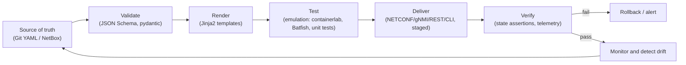

# 2.28 Network automation fundamentals: data models, templates, APIs, NETCONF, gNMI and SDN

| | |
|---|---|
| Level | Intermediate |
| Priority tier | 0 |
| Lab venue | Linux VM with Python 3, containerlab/FRR (chapter 2.27), optional SONiC/Arista cEOS images |
| Part | Part 2: Networking, from first principles to AI fabrics |
| Status | Drafted, labs **untested** |

## Why this matters for AI infrastructure

An AI fabric has thousands of ports, hundreds of switches and tens of thousands of cables, and its configuration must be exactly right: a wrong DSCP-to-queue map, a missing PFC priority, one MTU of 1500 among nine thousands, or a leaf with the wrong ASN can degrade a 10,000-GPU job without a single alarm. Humans typing CLI commands cannot keep that consistent. Network automation replaces hand-typed configuration with **data (inventory and intent), templates and models that turn data into configuration, and APIs that deliver and verify it**, all under version control and tested before deployment. This chapter teaches the foundations: why and what to automate, the evolution of management interfaces (SNMP → CLI scraping → NETCONF/RESTCONF → gNMI), structured data formats and data models (YAML, JSON, XML, Protocol Buffers, YANG, JSON Schema), templating (Jinja2 and others), how to work with network APIs from Python, streaming telemetry, and the software-defined networking idea (centralised control planes) in its several forms. Chapter 2.29 covers the tools (Ansible, Nornir, CI/CD, controllers, VNFs) and architectures.

## Prerequisites and outcomes

You should be comfortable with basic Python (Part 3) and Git, and have the routing/switching background of chapters 2.4 to 2.18.

After this chapter you can:

- Explain the benefits and types of network automation (provisioning, data collection, migrations, configuration management, compliance, state validation, reporting, troubleshooting) and the lessons from automation outages.
- Trace the evolution of device interfaces and compare SNMP, CLI/SSH, NETCONF, RESTCONF, gNMI/gRPC, and vendor REST/eAPI.
- Use YAML, JSON and XML in Python; explain binary formats (Protocol Buffers) and when to use them; separate documents from data.
- Define data models with YANG, JSON Schema and XSD; validate data before use; explain OpenConfig and IETF models.
- Write Jinja2 templates with variables, conditionals, loops, filters, inheritance and macros; know when XSLT or Go templates fit.
- Call REST APIs with `requests`/cURL; use NETCONF with `ncclient`, RESTCONF, and gNMI with gNMIc/pygnmi; use Netmiko/Scrapli/NAPALM for CLI-only devices; consume streaming telemetry.
- Design safe automation: idempotency, dry run/diff, validation, staged rollout, rollback, secrets, concurrency.
- Explain SDN and centralised control planes: southbound/northbound interfaces, distributed vs augmented vs hybrid vs replace models, BGP/PCEP/OpenFlow/Fibbing/I2RS examples, subsidiarity and the CAP trade-offs.

## 1. Why automate, and what

### Benefits

- **Simplified architectures and operations**: one tested workflow replaces many hand procedures; operators stop being the integration layer between systems.
- **Deterministic outcomes**: the same input produces the same configuration every time, on every device, so snowflake configs disappear.
- **Business agility**: new racks, tenants, VLANs or BGP peers are provisioned in minutes through a pipeline instead of weeks through tickets.
- **Security and risk reduction**: configuration compliance is checked continuously, access is audited, changes are reviewed, and secrets are handled centrally.
- **Scale**: operations that scale with the number of devices (O(n) typing) become operations that scale with the size of the data model.

A caution from network history: **automating a complex or bad process does not make it simpler; it relocates the complexity** (from human-to-device into human-to-automation-to-device) and can make failures faster and wider. Simplify and standardise first (regular topologies, a few device roles, a small number of templates), then automate.

### Types of automation

| Type | What it does | Examples |
|---|---|---|
| **Device provisioning** | Day-0/day-1 bring-up: base config, management access, loopbacks, routing | ZTP/ONIE/PXE, templated configs, Ansible, `nvue` |
| **Data collection and enrichment** | Gather inventory, state, counters; add metadata (site, role, tenant) | `show` parsing (TextFSM/ntc-templates), NETCONF/gNMI get, SNMP, NetBox sync |
| **Migrations** | Move from one platform/design to another with verification | Config translation, canary rollouts, pre/post state diffs |
| **Configuration management** | Keep devices matching intended config; push changes | Templates → push → verify → commit |
| **Configuration compliance** | Compare running config with policy/golden config; report or remediate | Batfish, custom diff, `napalm compare_config`, CIS-style rules |
| **State validation** | Check operational state matches intent (BGP up, ECMP width, LLDP neighbours, MTU, optics levels) | pyATS, Suzieq, custom assertions, test suites |
| **Reporting** | Inventory, capacity, compliance dashboards | HTML reports, Grafana, CMDB |
| **Troubleshooting** | Automated data gathering on alarm; guided diagnosis | ChatOps, runbooks as code, packet capture triggers |

### Lessons learned from a network automation outage

Typical failure pattern: an automation job with a mistake in data or logic is applied to all devices at once; every device accepts it; connectivity to management is lost; recovery requires console access everywhere. Remedies: **canary and staged rollouts** (one device, one rack, one pod, then everything), **pre-checks** (is the device healthy? is this change safe?), **post-checks with automatic rollback**, **commit-confirmed / candidate configurations** where the platform supports them, **blast-radius limits** (maximum percentage of devices per batch, per-failure-domain batching), **out-of-band management** that does not depend on the production network, **change windows and freeze rules**, code review of both templates and data, and **tests in a lab/emulation** (chapter 2.27). Treat the automation system itself as production software.

## 2. The evolution of device management interfaces

| Era | Interface | Strengths | Weaknesses |
|---|---|---|---|
| 1990s | **SNMP** (v1/v2c/v3; MIBs; UDP 161/162 polling and traps) | Ubiquitous for monitoring; standard MIBs | Poor for configuration; polling overhead; numeric OIDs; v2c has weak security; vendor MIB sprawl |
| 1990s to now | **SSH/Telnet and the CLI** ("screen scraping") | Works on everything; what humans use | Unstructured text output; version-dependent; fragile parsing; no transactions |
| 2006+ | **NETCONF** (RFC 6241; XML over SSH, port 830) | Structured, transactional (datastores, candidate, commit, lock, rollback), model-driven (YANG) | XML verbosity; uneven vendor support; stateful sessions |
| 2017+ | **RESTCONF** (RFC 8040; HTTP/HTTPS + JSON/XML on YANG models) | Uses familiar HTTP tooling; easy for developers | Single-target, single-shot (no network-wide transactions, no locking) |
| 2016+ | **gRPC/gNMI** (OpenConfig; HTTP/2 + Protocol Buffers) | Efficient binary encoding, streaming telemetry, multiplexed calls, strong typing | Needs protobuf/gRPC tooling; model support varies |
| now | **Vendor REST APIs and eAPI/NX-API/Meraki/Cumulus NVUE** | Easy and device-specific | Not portable; vary by vendor/version |
| now | **Open networking/Linux NOS** (SONiC, Cumulus, FRR) | Standard Linux tooling (ssh, systemd, files, netlink); Ansible/Python native; Redis-based config DB in SONiC | Different operational model; feature gaps |

Why APIs instead of the CLI: the CLI is designed for human eyes; output formats change between releases; parsing requires brittle regexes; there is no atomic way to apply a multi-line change or to roll back. Model-driven APIs return and accept **structured data conforming to a schema**, so the same code can talk to many devices.

**Impact of open networking.** When the network operating system is Linux (SONiC, Cumulus, ONIE-installed images on white-box switches), automation reuses server practices: package management, systemd, configuration files, Git, Ansible, and eBPF/netlink observability. The management plane converges with infrastructure-as-code (Part 4).

## 3. Structured data formats

### Why structured data

Automation needs data that is **structured** (machine-parsable with known fields and types), **supported** (libraries exist in every language), and **portable** (readable across tools and systems). Compare `show interface` text with the same facts as data:

```json
{ "name": "Ethernet1", "admin_state": "up", "oper_state": "up", "mtu": 9214, "speed_gbps": 400,
  "ipv4": [ { "address": "10.0.1.1", "prefix": 31 } ], "counters": { "in_octets": 123456789, "in_errors": 0 } }
```

Distinguish **documents** (human-oriented text/reports: free layout, meant to be read) from **data** (typed fields that can be queried, validated and combined). Categories of data formats: **text-based** (human-readable and diffable: YAML, JSON, XML, TOML, INI, CSV) and **binary** (compact and fast: Protocol Buffers, Apache Thrift, FlatBuffers, BSON, MessagePack, CBOR, Python pickle). Working with them means **deserialising** (decoding text/binary into native objects in memory) and **serialising** (encoding objects back to text/binary).

### YAML

Human-friendly, indentation-based, supports comments (`#`), anchors/aliases, multi-document files; the default format for **inventory, variables and intent** (Ansible, Kubernetes, NetBox exports, cloud-init).

```yaml
# group_vars/leaf.yml
role: leaf
bgp: { asn: 65101, router_id: 10.255.0.11 }
interfaces:
  - { name: Ethernet1, description: to-spine1, mtu: 9214, ipv4: 10.0.1.1/31 }
  - { name: Ethernet2, description: to-spine2, mtu: 9214, ipv4: 10.0.2.1/31 }
vlans: [ 100, 200 ]
```

```python
import yaml                                   # pip install pyyaml
data = yaml.safe_load(open("group_vars/leaf.yml"))     # always safe_load, never load() on untrusted input
print(data["bgp"]["asn"], [i["name"] for i in data["interfaces"]])
yaml.safe_dump(data, open("out.yml", "w"), sort_keys=False)
```

Pitfalls: significant whitespace (tabs are errors), implicit typing (the "Norway problem": `no`/`NO` parsed as boolean false; `010` as octal; `1.10` as a float): quote strings that could be misread; indentation errors; anchors hiding duplication. Use `yamllint` in CI.

### XML

Verbose, tag-based, supports attributes, namespaces and schemas; the native encoding of NETCONF and many older APIs.

```xml
<interface xmlns="urn:ietf:params:xml:ns:yang:ietf-interfaces">
  <name>Ethernet1</name><enabled>true</enabled><mtu>9214</mtu>
</interface>
```

```python
import xml.etree.ElementTree as ET
root = ET.fromstring(xml_text)
ns = {"if": "urn:ietf:params:xml:ns:yang:ietf-interfaces"}
for i in root.findall(".//if:interface", ns): print(i.find("if:name", ns).text)
# or lxml / xmltodict for convenience: xmltodict.parse(xml_text) -> dict
```

XPath and **XSLT** (W3C stylesheets that transform XML into other XML/text) are the XML-native query and templating tools; useful for transforming NETCONF replies.

### JSON

Lightweight, ubiquitous on the web; types: object, array, string, number, boolean, null; **no comments**, no trailing commas. The default for REST APIs, RESTCONF (alongside XML), OpenConfig JSON encodings and `ip -j` output.

```python
import json, requests
doc = json.loads(text); print(json.dumps(doc, indent=2, sort_keys=True))
r = requests.get("https://sw1/restconf/data/ietf-interfaces:interfaces", auth=("u", "p"), headers={"Accept": "application/yang-data+json"}, verify="/etc/ssl/ca.pem", timeout=10)
r.raise_for_status(); ifaces = r.json()["ietf-interfaces:interfaces"]["interface"]
```

Tools: `jq` (filtering/transforming on the CLI), `jsonpath`, `jmespath` (used by Ansible/AWS CLI), `json.tool`.

### Binary formats: Protocol Buffers

**Protocol Buffers (protobuf)** define a schema in `.proto` files, compile to code for many languages, and encode compactly with numeric field tags (forward/backward compatible). They are the encoding of gRPC and gNMI.

```proto
syntax = "proto3";
message Interface { string name = 1; bool enabled = 2; uint32 mtu = 3; repeated string addresses = 4; }
```

```bash
protoc --python_out=. interface.proto        # generate interface_pb2.py
```

```python
import interface_pb2
i = interface_pb2.Interface(name="Ethernet1", enabled=True, mtu=9214, addresses=["10.0.1.1/31"])
blob = i.SerializeToString(); j = interface_pb2.Interface(); j.ParseFromString(blob)
```

Binary formats win on size and speed (telemetry at high rates), typed schemas and cross-language code generation; they lose on human readability and ad hoc debugging (use `protoc --decode`, `grpcurl`, or JSON mappings). Others: **Thrift** (RPC + serialisation), **FlatBuffers** (zero-copy access), **BSON** (MongoDB), **Pickle** (Python-only and unsafe on untrusted input: never unpickle network data). Choose by need: human/Git/config → YAML/JSON; web APIs → JSON; streaming telemetry/RPC → protobuf.

## 4. Data modelling

A **data model** is a formal description of what data may exist: names, types, ranges, relationships, constraints. It lets tools validate inputs before they reach a device, generate code and documentation, and keep different systems consistent.

### YANG

**YANG** (RFC 7950) is the modelling language for network configuration and state. A YANG module defines a **tree** of containers, lists, leaves and leaf-lists with types, constraints (ranges, patterns, `must`/`when`, keys), RPCs and notifications. The same model is encoded as XML (NETCONF) or JSON (RESTCONF) and referenced by gNMI paths.

```yang
module example-interfaces {
  namespace "urn:example:interfaces"; prefix ex;
  container interfaces {
    list interface {
      key "name";
      leaf name    { type string; }
      leaf enabled { type boolean; default true; }
      leaf mtu     { type uint16 { range "68..9216"; } }
      leaf-list ipv4-address { type string; }
    }
  }
}
```

Model families: **IETF** (standards-track, e.g. `ietf-interfaces`, `ietf-ip`, `ietf-routing`), **OpenConfig** (operator-driven, vendor-neutral, `openconfig-interfaces`, `openconfig-bgp`, `openconfig-network-instance`, with gNMI telemetry focus), and **native vendor models** (Cisco-IOS-XE-native, Junos, Arista EOS). Tools: `pyang` (validate, tree view `pyang -f tree`, generate XML skeletons and JSON schemas), `yanglint`, `pyangbind` (Python classes from YANG), `ygot` (Go), the YANG catalog and OpenConfig GitHub repository.

### JSON Schema and XSD

For custom data (your inventory and intent, not device models) **JSON Schema** (usable with YAML data too) validates structure and values:

```json
{ "$schema": "https://json-schema.org/draft/2020-12/schema",
  "type": "object", "required": ["hostname", "vlans"],
  "properties": {
    "hostname": { "type": "string", "pattern": "^[a-z0-9-]+$" },
    "dns_servers": { "type": "array", "items": { "type": "string", "format": "ipv4" } },
    "vlans": { "type": "array", "items": { "type": "integer", "minimum": 1, "maximum": 4094 } } } }
```

```python
from jsonschema import validate, ValidationError   # pip install jsonschema
validate(instance=data, schema=schema)              # raises ValidationError with a path to the bad value
```

**XSD** (XML Schema Definition) is the XML equivalent. **Protobuf** definitions are themselves a schema (and tooling like `buf` lints/breaks-checks them). Validate *at the pipeline edge* (CI) and again before pushing; reject on error. Pydantic, `cerberus`, and `voluptuous` are Python-native alternatives (Part 3).

## 5. Templates

Templates combine **static text with placeholders and logic** to render configuration from data. Web development popularised them (Jinja, Django templates, Handlebars); network automation uses them to generate device configs, reports and API payloads. Value: one template per role (leaf, spine, border), data per device, consistent output, review of templates once instead of every config.

### Jinja2

```python
from jinja2 import Environment, FileSystemLoader, StrictUndefined
env = Environment(loader=FileSystemLoader("templates"), undefined=StrictUndefined, trim_blocks=True, lstrip_blocks=True)
print(env.get_template("leaf.j2").render(**data))
```

```jinja
{# templates/leaf.j2 #}
hostname {{ hostname | lower }}
!

interface {{ i.name }}
 description {{ i.description | default("unused") }}
 mtu {{ i.mtu | default(9214) }}
 
 ip address {{ i.ipv4 }}
 
 switchport mode access
 
 {{ "shutdown" if not i.get("enabled", true) else "no shutdown" }}
!

router bgp {{ bgp.asn }}
 router-id {{ bgp.router_id }}

 neighbor {{ n.ip }} remote-as {{ n.asn }}

```

Key features:

- **Variables** `{{ x.y }}`, **comments** `{# ... #}`, **statements** ``.
- **Conditionals** (`if/elif/else`), **loops** (`for`, `loop.index`, `loop.first`, `else` for empty), iteration over dicts (`.items()`), nested data; **tests** (`is defined`, `is none`, `is iterable`).
- **Filters**: built-ins (`upper`, `lower`, `default`, `join`, `sort`, `unique`, `map`, `selectattr`, `tojson`, `ipaddr`-like via plug-ins) with chaining; **custom filters** in Python (`env.filters["cidr_to_mask"] = fn`) for network logic (netmask conversion, address arithmetic with `ipaddress`); Ansible adds `ipaddr`/`ansible.utils.ipaddr`, `ipmath`.
- **Template inheritance** (`` with ``) and **includes/macros** (``) for reuse; **import** shared macros.
- **Whitespace control** (`trim_blocks`, `lstrip_blocks`, `-` markers) matters because configs are whitespace-sensitive.
- **Safety**: use `StrictUndefined` so missing variables raise errors instead of rendering blanks; autoescape is for HTML, not configs; never render untrusted templates (sandbox: `jinja2.sandbox.SandboxedEnvironment`).

### Other template languages

**XSLT** transforms XML (NETCONF replies, XML configs) with declarative rules (`xsl:template match`, `xsl:for-each`, `xsl:if`, `xsl:sort`) and is built into Junos commit scripts and many XML toolchains; **Go `text/template`** renders structs/maps for Go tools (e.g. gNMIc, Terraform providers in Go, Helm charts use Go templates for Kubernetes manifests); **Mako/Cheetah/Tera/Handlebars** appear in specific tools. Template pitfalls: logic in templates grows unmaintainable; keep complex logic in Python (data preparation), keep templates declarative; always render to a file and **diff** against the running config; unit-test templates with fixtures and expected outputs.

### Source of truth and the data pipeline

A durable design: **source of truth** (NetBox, Nautobot, a Git repository of YAML) → **intent/validated data** (schemas) → **templates** → **rendered artefacts** → **delivery** (API/CLI/Ansible) → **verification** (state assertions, telemetry). Keep inventory (devices, interfaces, IP/VLAN assignments, cables) separate from policy (BGP design, QoS) and from secrets (Vault, SOPS). Data enrichment (e.g. derive the P2P /31 addresses, loopbacks, ASNs, VNIs from role + index using a deterministic allocation function) removes manual addressing errors.

## 6. Working with network APIs

### REST fundamentals

REST (representational state transfer) is a style of HTTP API: **client-server**, **stateless** requests (each carries all needed context), a **uniform interface** (resources identified by URLs, manipulated through standard methods), cacheable, layered. Methods: `GET` (read configuration or state), `PUT` (create or replace a resource, idempotent), `PATCH` (partial update/merge), `POST` (create a child resource or invoke an action; not idempotent), `DELETE`. Response classes: 1xx informational, 2xx success (200 OK, 201 Created, 204 No Content), 3xx redirect, 4xx client error (400 bad request, 401 unauthenticated, 403 forbidden, 404 not found, 409 conflict, 422 unprocessable, 429 rate limited), 5xx server error. Many "REST" network APIs are not strictly RESTful (RPC-style endpoints, custom verbs); treat each vendor's documentation as authoritative.

```bash
curl -sk -u admin:$PW -H 'Accept: application/yang-data+json' https://sw1/restconf/data/ietf-interfaces:interfaces/interface=Ethernet1 | jq .
curl -sk -u admin:$PW -X PATCH -H 'Content-Type: application/yang-data+json' https://sw1/restconf/data/ietf-interfaces:interfaces/interface=Ethernet1 \
     -d '{"ietf-interfaces:interface": {"name": "Ethernet1", "enabled": true, "description": "uplink"}}'
curl -v ... ; curl --cacert ca.pem ... ; curl -w '%{http_code}\n' -o /dev/null -s ...
```

Authentication: HTTP basic over TLS, bearer tokens/API keys, session cookies, OAuth2/mTLS for modern controllers; never disable TLS verification in production (chapter 2.10).

### NETCONF

**NETCONF** (RFC 6241) is a layered protocol:

| Layer | Content |
|---|---|
| Content | Configuration and state data, modelled by YANG (encoded as XML) |
| Operations | `get`, `get-config`, `edit-config`, `copy-config`, `delete-config`, `lock`/`unlock`, `commit`, `discard-changes`, `validate`, `close-session`, `kill-session`, plus RPCs defined by YANG |
| Messages | `<rpc>`, `<rpc-reply>`, `<notification>` (framing with message IDs) |
| Transport | SSH (subsystem `netconf`, default port 830; also TLS, historically BEEP/SOAP) |

Concepts: **datastores** (`running`, `candidate`, `startup`): changes are made to `candidate`, validated, then `commit`ed atomically, optionally with a `confirmed-commit` that auto-rolls back unless confirmed; **locks** prevent concurrent editors; **capabilities** exchanged in the hello message (`:candidate`, `:validate`, `:confirmed-commit`, `:rollback-on-error`, `:xpath`, `:notification`, YANG library); **edit operations** per node (`merge`, `replace`, `create`, `delete`, `remove`).

```python
from ncclient import manager                 # pip install ncclient
cfg = """<config><interfaces xmlns="http://openconfig.net/yang/interfaces"><interface>
  <name>Ethernet1</name><config><name>Ethernet1</name><mtu>9214</mtu><description>to-spine1</description></config>
</interface></interfaces></config>"""
with manager.connect(host="sw1", port=830, username="admin", password=PW, hostkey_verify=True, timeout=30) as m:
    print([c for c in m.server_capabilities if "candidate" in c])
    with m.locked("candidate"):
        m.edit_config(target="candidate", config=cfg, default_operation="merge")
        m.validate(source="candidate")
        print(m.compare_config() if hasattr(m, "compare_config") else "")
        m.commit(confirmed=True, timeout="120")       # auto-rollback in 120 s unless confirmed
        # ...verify state; then:
        m.commit()                                    # confirming commit
```

Vendor notes: Junos supports NETCONF natively (candidate + commit confirmed + `compare` rollback diff); Cisco IOS XE, NX-OS, IOS XR, Arista EOS and Nokia SR OS support NETCONF with native and/or OpenConfig models (capabilities differ); always read the device's advertised capabilities and YANG library.

### RESTCONF

**RESTCONF** (RFC 8040) maps NETCONF datastore operations onto HTTP for YANG-modelled data: `GET /restconf/data/<module>:<container>/<list>=<key>`, `PUT/POST/PATCH/DELETE`, with media types `application/yang-data+json|xml`, and `/restconf/operations` for RPCs. It is **single-target, single-shot**: no network-wide transactions, no locking or candidate datastore (changes apply directly to running), but familiar tooling (curl, requests). **YANG PATCH** (RFC 8072) is a media type (`application/yang-patch+json`) carrying multiple edits in one request with edit IDs, operations and targets. Discover supported modules at `/restconf/data/ietf-yang-library:modules-state` (or `yang-library`). Cisco IOS XE exposes the full native model plus IETF/OpenConfig; Arista and others have RESTCONF in some releases.

### gRPC and gNMI

**gRPC** (Google RPC) uses HTTP/2 and Protocol Buffers: high performance, payload-agnostic, multiple communication patterns (unary, server streaming, client streaming, bidirectional streaming), language independence via code generation, TLS/mTLS built in. **gNMI** (gRPC Network Management Interface, OpenConfig) defines a small service: `Capabilities` (supported models, encodings, gNMI version), `Get`, `Set` (update/replace/delete with transactional semantics for the request), and `Subscribe` (streaming telemetry: `STREAM`, `ONCE`, `POLL`; sampled or on-change). Paths are YANG-based (`/interfaces/interface[name=Ethernet1]/state/counters`), encodings include JSON, JSON_IETF, PROTO, ASCII. Related: **gNOI** (operations: reboot, OS install, file, cert), **gNSI** (security), **gRIBI** (RIB injection), **P4Runtime**.

```bash
# gNMIc (openconfig/gnmic): capabilities, get, set, subscribe
gnmic -a sw1:6030 -u admin -p $PW --skip-verify capabilities
gnmic -a sw1:6030 -u admin -p $PW --skip-verify get --path /interfaces/interface[name=Ethernet1]/state/oper-status
gnmic -a sw1:6030 -u admin -p $PW --skip-verify set --update-path /interfaces/interface[name=Ethernet1]/config/mtu --update-value 9214
gnmic -a sw1:6030 -u admin -p $PW --skip-verify subscribe --path /interfaces/interface/state/counters --stream-mode sample --sample-interval 10s
gnmic ... --encoding json_ietf ... ; gnmic ... -e proto
```

```python
from pygnmi.client import gNMIclient          # pip install pygnmi
with gNMIclient(target=("sw1", 6030), username="admin", password=PW, insecure=False, path_cert="ca.pem") as gc:
    print(gc.capabilities()["supported_models"][:3])
    r = gc.get(path=["/interfaces/interface[name=Ethernet1]/state"])
    gc.set(update=[("/interfaces/interface[name=Ethernet1]/config/mtu", 9214)])
```

### Comparing the model-driven protocols

| | NETCONF | RESTCONF | gNMI |
|---|---|---|---|
| Encoding | XML | JSON or XML | JSON/JSON_IETF/PROTO (protobuf) |
| Transport | SSH (TLS) | HTTP(S) | gRPC over HTTP/2 + TLS |
| Transaction scope | Network-wide capable per session (lock, candidate, commit) | Single target, single shot | Single target, single request (Set is atomic per request), sequenced |
| Streaming telemetry | Notifications (limited) | SSE/notifications (limited) | Native Subscribe (sample/on-change) |
| Model use | YANG | YANG | YANG paths (OpenConfig focus) |
| Tooling | ncclient, Ansible netconf, Netconf-console | curl, requests, Ansible httpapi | gNMIc, pygnmi, Telegraf, vendor SDKs |
| Best for | Configuration with transactions | Simple CRUD, web developers | High-rate telemetry and modern config |

**Network interface development lifecycle:** IETF models are standards-track but slow; OpenConfig models are operator-driven and fast moving with vendor deviations; native models expose everything but are not portable. Pragmatic automation uses OpenConfig/IETF where the platform supports it well and native/CLI where it doesn't, hidden behind a thin abstraction layer.

### Streaming (model-driven) telemetry

Instead of polling SNMP every minute, devices **push** counters and state at high resolution: **dial-in** (collector connects with gNMI Subscribe) or **dial-out** (device connects to a collector, vendor-specific over gRPC or UDP/TCP). Data goes to collectors (gNMIc, Telegraf `gnmi` input, Cisco Pipeline, Juniper JTI + Telegraf/OpenNTI) and time-series stores (Prometheus via exporters, InfluxDB, VictoriaMetrics), then dashboards/alerts (chapter 2.31). Benefits: 1 to 10 s granularity (microburst-adjacent visibility needs more), on-change events (link flaps, BGP state), less device CPU than polling at scale, typed data. Costs: volume (cardinality), collector scaling, model/path differences across vendors, clock sync.

### Python (and Go) libraries

| Task | Libraries |
|---|---|
| HTTP/REST | `requests`, `httpx`; Go `net/http` |
| NETCONF | `ncclient`; Go `scrapligo`/`go-netconf` |
| gNMI | `pygnmi`, `grpcio` + generated stubs; Go `gnmic` library / `openconfig/gnmi` |
| CLI over SSH | `netmiko` (multi-vendor), `scrapli` (fast, async), `paramiko` (low level), `pexpect` |
| Multi-vendor abstraction | `napalm` (get_facts, get_bgp_neighbors, compare_config/commit/rollback), `nornir` (tasks and inventory, chapter 2.29) |
| Parsing | `textfsm` + `ntc-templates`, `genie`/`pyATS` parsers, `ttp` |
| Data/modelling | `pyyaml`, `ruamel.yaml`, `jsonschema`, `pydantic`, `pyang`, `pyangbind`, `ipaddress`, `netaddr` |
| Templating | `jinja2` |
| Testing/validation | `pytest`, `batfish` (pybatfish), `suzieq`, `pyATS`, `scapy` |

Example, safe CLI fallback with Netmiko:

```python
from netmiko import ConnectHandler
dev = {"device_type": "arista_eos", "host": "sw1", "username": "admin", "password": PW, "fast_cli": True}
with ConnectHandler(**dev) as c:
    before = c.send_command("show running-config | section router bgp")
    out = c.send_config_set(["router bgp 65101", "neighbor 10.0.1.0 maximum-routes 1000"])
    c.save_config()
    print(c.send_command("show ip bgp summary", use_textfsm=True))     # structured output via ntc-templates
```

Rules for safe scripts: timeouts and retries with backoff; per-device error isolation (one failure must not abort the batch silently); idempotency (compute desired vs current and change only the difference); `--dry-run`/diff mode by default; commit-confirmed or backup+restore; logging every change with a ticket/commit ID; secrets from environment/Vault (not code); concurrency limits (threads/asyncio, per-failure-domain batches); verification after change; and unit tests with mocked devices.

## 7. Software-defined networking and centralised control planes

Network designs have swung between fully distributed and centralised control planes more than once. "SDN" is often presented as either/or (distributed protocols versus a controller), but every routing protocol is "software"; the useful definition is: **SDN moves some part of the control plane's functionality off the individual forwarding devices into a logically centralised component** ("centralised" meaning not carried hop by hop and not computed independently by every device, rather than a single "god box").

### Interfaces

- **Southbound interface**: between the controller and network devices (BGP, NETCONF/gNMI, PCEP, OpenFlow, P4Runtime, OVSDB, vendor APIs, I2RS).
- **Northbound interface**: between the controller and applications/business logic (REST/gRPC APIs, intent languages, GitOps).

### Four models of interaction

| Model | Description | Examples |
|---|---|---|
| **Distributed** | Control plane runs on the forwarding devices (possibly disaggregated software, but still on the device) | OSPF/IS-IS/BGP everywhere |
| **Augmented** | Distributed control plane remains; off-box processes influence the paths installed in the RIB | PCE, BGP controllers injecting routes, Fibbing, I2RS |
| **Hybrid** | A centralised control plane runs in parallel with the distributed one; each appears to the other as just another control plane | Controller speaking BGP/OpenFlow alongside OSPF |
| **Replace** | No distributed control plane; the controller programs the FIB directly | Classic OpenFlow, P4Runtime fabrics |

### Division of labour

A control plane supplies **topology**, **reachability** and **policy**. Topology and reachability are entangled (RIP and EIGRP combine them; in IS-IS reachability hangs off the shortest-path tree as leaves). **Policy**, however, only *modifies* what topology and reachability computed, so it separates naturally into an upper layer. Hence a common pattern: keep a distributed lower layer (topology + reachability) for resilience and speed, and add centralised policy for traffic engineering, segmentation and intent. Questions to ask of any SDN design: which functions are centralised, what happens when the controller (or its connectivity) fails, how fast can it react, how does it scale, and what is the complexity cost?

### Examples

- **BGP as an SDN**: with BGP already running fabric-wide, a controller joins as an iBGP/eBGP speaker, reads the topology, and *injects* better-metric paths hop by hop to pin a flow to a chosen path (the augmented model, where the same protocol carries topology/reachability and policy). Simple to deploy; but automating a complicated process doesn't remove its complexity, it relocates it.
- **Fibbing**: with link-state protocols, tags are never used for traffic engineering because all routers must hold the same database. Fibbing has a controller join the IGP and inject **fake nodes and links** (OSPF external LSAs that can carry a third-party next hop) so that the unmodified shortest-path computation produces the desired path; for example, a chain of fake nodes with lowered costs and specific forwarding addresses steers A to H along a longer but desired route. No protocol changes; limited to what external routes can express; watch for scale of injected LSAs.
- **PCEP** (Path Computation Element Protocol): a central PCE computes paths for MPLS/SR LSPs and tells headends (PCC) via PCEP; headends signal or encode them (augmented model; SR policies).
- **I2RS** (Interface to the Routing System): a standardised programmatic interface for off-box applications to read and write routing state (RIB), with ephemeral state and fast, event-driven interaction.
- **OpenFlow**: a southbound protocol for controllers to install match-action flow entries directly in switches' flow tables (replace model); powerful but suffered scaling, table-size and failure-handling issues; its ideas live on in P4/P4Runtime and in virtual switches (OVS, OVN).
- **Controller-based fabrics and overlays**: EVPN route servers, cloud SDN (VPC controllers), Kubernetes CNI control planes, OVN, SD-WAN controllers.

### CAP and subsidiarity

A centralised control plane is a distributed database problem: during a partition you cannot have both consistency and availability (the **CAP theorem**, with network partitions inevitable). Hence the **subsidiarity principle**: decisions should be made at the lowest level able to make them correctly, centralising only what truly needs a global view. In practice: keep fast, local, safety-critical reactions (failure detection, ECMP rerouting, fast reroute) in the distributed layer; centralise slow-changing, global-optimisation policy (traffic engineering, intent, segmentation); and make sure the network keeps forwarding if the controller disappears (fail static or fail back to the distributed control plane).

## 8. Putting it together: a minimal automation pipeline



Example mini-project (the lab below): generate FRR/SONiC-style configs for the leaf-spine fabric from a YAML inventory, validate with JSON Schema, render with Jinja2, apply to the containerlab nodes via `docker exec`/vtysh or NETCONF-capable images, and assert BGP/ECMP state with a validation script (chapter 2.27, lab 7).

## 9. Hands-on lab: data, templates, and APIs

First, run the self-checking Python lab (`code/part02/net_automation_apis_yang_lab.py`) locally. It verifies YANG / JSON-Schema switch inventory validation (hostname regex, VLAN `1..4094`, MTU `68..9216`, IPv4 prefix), strict switch template rendering (`StrictUndefined` raising `KeyError` on missing variables), and NETCONF `candidate` + `confirmed-commit` auto-rollback behavior.

```bash
python3 code/part02/net_automation_apis_yang_lab.py
```

Next, on a disposable Linux VM with Python 3 and containerlab/FRR (all interactive VM commands below are `untested here`), work through these steps:

1. **Formats**: represent one switch's interface table in YAML, JSON and XML; convert among them with `yq`, `jq`, `xmltodict`; round-trip through Python; observe type differences (the YAML Norway problem; JSON no comments).
2. **Schema validation**: write a JSON Schema for the fabric inventory (VLAN range, ASN range, hostnames, IPv4 prefixes); write failing and passing examples; add a pytest that validates all files in `inventory/`.
3. **Jinja2**: write a leaf template with loops and conditionals, a custom filter converting a CIDR to netmask, a macro for BGP neighbours, an `extends` base; render with `StrictUndefined`; show the error for a missing variable; build a golden-file test.
4. **REST**: stand up a mock device API (FastAPI/Flask returning interface JSON) and write a client with `requests` (timeouts, retries, TLS), plus a `curl` session exercising GET/PUT/PATCH/DELETE and error codes.
5. **YANG**: write the small module above; validate with `pyang`; print the tree; generate a JSON schema; build sample data and validate it against the model (`yanglint`).
6. **NETCONF**: run a NETCONF-capable device (an Arista cEOS or Nokia SR Linux container in containerlab, or a Junos vMX/cRPD lab if licensed); use `ncclient` to read capabilities, `get-config`, `edit-config` to candidate, `commit confirmed`, and observe rollback by not confirming.
7. **gNMI**: use `gnmic` against SR Linux or cEOS: `capabilities`, `get`, `set`, and a `subscribe` stream into Prometheus (gNMIc `output prometheus`) with a Grafana panel of interface counters.
8. **CLI fallback**: use Netmiko/Scrapli against an FRR container (`vtysh`) or a Linux switch to parse `show bgp summary json`; write an idempotent function that ensures a neighbour exists.
9. **Safe rollout**: write a script that applies a change to leaves one by one with post-checks (ECMP width, BGP sessions), halts on failure and rolls back; test with an injected bad change.
10. **Fibbing/controller toy**: using FRR containers, write a small Python program that injects a more-preferred route via a BGP session (ExaBGP or `vtysh`) to pin a path; verify with traceroute; discuss limits.
11. **Clean up.**

## 10. Common mistakes

- Parsing CLI output with regexes in production when structured APIs exist; assuming CLI formats never change.
- Treating YAML as always safe (implicit typing, `yaml.load` on untrusted data).
- Unvalidated data flowing into templates; missing-variable renders; secrets in repositories.
- Pushing to all devices at once; no canary, no rollback, no out-of-band access.
- One monolithic template full of logic; no tests or golden files.
- Believing NETCONF-capable means portable: models and capabilities differ per vendor and version.
- Over-centralising (controller as a single point of failure) or under-specifying failure behaviour.
- Automating undocumented, inconsistent networks before simplifying them.

## 11. Interview angles

- "Why NETCONF/gNMI instead of SSH and screen scraping? Differences among NETCONF, RESTCONF and gNMI?"
- "What is YANG? What are IETF vs OpenConfig vs native models?"
- "Design an automation pipeline for a leaf-spine fabric. Where do tests and rollbacks happen?"
- "How would you roll out a global MTU or QoS change safely to 500 switches?"
- "What is idempotency and why does it matter for network automation?"
- "When would you use YAML vs JSON vs protobuf?"
- "What is SDN? Explain augmented vs hybrid vs replace controller models. What happens if the controller fails?"
- "How does streaming telemetry differ from SNMP polling?"
- "How do you validate that the network matches intent?"

## Exercises

1. **Why Automate, Automation Outage Lessons, and Interface Evolution (`NPA` Chapter 2):** (a) List the eight types of network automation and explain why automating a complex, non-standard network relocates complexity rather than removing it; (b) design a safe rollout strategy for a 500-switch AI fabric change (canary, failure-domain batching, pre/post checks, `commit confirmed`, OOB access), and trace the evolution from `SNMP` (`UDP 161/162`) and CLI scraping to `NETCONF` (`RFC 6241`, port `830`), `RESTCONF` (`RFC 8040`), and `gNMI`.
2. **Structured Data Formats (`YAML`, `JSON`, `XML`, `Protocol Buffers`) and Data Models (`YANG`, `JSON Schema`):** (a) Compare `YAML` (`yaml.safe_load`, the \"Norway problem\"), `JSON`, `XML`, and `Protocol Buffers`, stating where each belongs in an automation stack; (b) using `validate_switch_inventory_schema()` in `code/part02/net_automation_apis_yang.py`, explain how **JSON Schema** validates intent data before templating and how **YANG (`RFC 7950`)** models device containers, lists, leaves, and constraints (`IETF` vs `OpenConfig` vs native models).
3. **Jinja2 Templating (`StrictUndefined`, Filters, Inheritance, and Macros, `NPA` Chapter 9):** Using `render_leaf_config_strict()`, explain why **`StrictUndefined`** (`trim_blocks=True, lstrip_blocks=True`) is mandatory when rendering switch configurations, and contrast Jinja2 with `XSLT` and Go `text/template`.
4. **Model-Driven Network APIs (`NETCONF`, `RESTCONF`, `gNMI`) and Streaming Telemetry (`NPA` Chapter 10):** (a) Compare `NETCONF`, `RESTCONF` (`YANG Patch` `RFC 8072`), and `gNMI` (`Capabilities`, `Get`, `Set`, `Subscribe`) across encoding, transport, transaction scope, and telemetry; (b) using `simulate_netconf_confirmed_commit()`, trace a transactional `ncclient` session (`locked("candidate")` -> `edit_config` -> `validate` -> `commit(confirmed=True, timeout="120")` -> `commit()`).
5. **Python Automation Libraries and Safe Execution Patterns:** Match each Python library (`requests`/`httpx`, `ncclient`, `pygnmi`, `netmiko`/`scrapli`, `napalm`, `textfsm`/`ntc-templates`, `pyang`/`pyangbind`, `pybatfish`/`suzieq`) to its role, and list the eight engineering rules for writing safe network automation scripts.
6. **SDN and Centralized Control Planes (`CN` Chapter 18):** (a) Contrast the four control-plane interaction models (**Distributed**, **Augmented**, **Hybrid**, and **Replace**) with concrete examples (`BGP` route injection, **Fibbing** fake LSAs, **PCEP**, `I2RS`, `OpenFlow`/`P4Runtime`); (b) apply the **CAP theorem** and the **subsidiarity principle** to decide which functions in an AI fabric should remain local/distributed versus centralized in a controller.

## Checkpoint questions (20)

<details>
<summary>1. Why does automating a complex or broken manual network often make outages worse, and what are the six safeguards against fleet-wide automation outages (`NPA` Chapter 2)?</summary>

Automation does not eliminate the underlying complexity of a snowflake network—it **relocates that complexity** into scripts and templates while giving a single bug the speed to break 500 switches in 2 seconds instead of 1 switch in 10 minutes. Six mandatory safeguards:\n(1) **Simplify and standardize topologies/roles first**;\n(2) **Validate intent data against a strict schema** (`JSON Schema` / Pydantic) and test in **`containerlab` / `Batfish`** before touching production;\n(3) **Canary and staged rollouts** bounded by failure domain (1 leaf -> 1 pod -> 1 spine at a time, never all spines at once);\n(4) **Pre-checks and automated post-checks** (BGP session count, ECMP width, error counters);\n(5) **Transactional `commit confirmed` / automatic rollback** if post-checks or reachability fail; and\n(6) **Independent out-of-band (`OOB`) management access**.
</details>

<details>
<summary>2. Why is CLI \"screen scraping\" over SSH brittle for network automation, and why is `SNMP` (`UDP 161/162`) rarely used for configuration?</summary>

The CLI is formatted for human eyes: column widths wrap, field names change between NOS minor releases, errors are returned as free-form prose, and multi-line CLI paste has no atomic transaction or rollback semantics. **`SNMP`** uses numeric `OID` trees (`MIB`s) over UDP with poor transactional write support, weak security in `SNMPv2c` community strings, high CPU polling overhead on large tables, and inconsistent vendor MIBs.
</details>

<details>
<summary>3. What is the \"YAML Norway Problem\", why must you always call `yaml.safe_load()` instead of `yaml.load()`, and what does JSON lack compared to YAML?</summary>

In YAML 1.1, unquoted strings like **`NO`, `no`, `off`, `on`, and `yes`** are implicitly parsed as **booleans (`False` / `True`)** (so country code `NO` for Norway or `no shutdown` becomes `False`), and unquoted `010` or `3.10` is parsed as octal `8` or float `3.1`. Always quote ambiguous strings and lint with `yamllint`. Always use **`yaml.safe_load()`** because `yaml.load()` can instantiate arbitrary Python objects and execute code on untrusted input. Compared to YAML, **JSON** is faster to parse and free of indentation/implicit-typing traps, but **does not support comments (`#`)** or trailing commas.
</details>

<details>
<summary>4. Why do `gRPC` and `gNMI` use `Protocol Buffers` (`protobuf`) instead of JSON or XML for high-rate streaming telemetry (`NPA` Chapter 8)?</summary>

**Protocol Buffers** define strongly typed schemas in `.proto` files (compiled into Python/Go/C++ classes via `protoc`) and serialize fields using compact **binary numeric field tags** rather than repeating verbose ASCII key names (`"in-unicast-pkts"`) on every message. This shrinks wire payload size by `3–10x`, cuts switch CPU serialization and collector parsing cost by an order of magnitude, and preserves forward/backward schema compatibility when new fields are added. (Never use Python `pickle` on network data: unpickling untrusted bytes executes arbitrary code.)
</details>

<details>
<summary>5. What is `YANG` (`RFC 7950`), what are its four core data-node types, and how do `IETF`, `OpenConfig`, and Native YANG models differ?</summary>

**YANG** is the standard data modeling language for network configuration (`config true`) and operational state (`config false`), independent of whether the wire encoding is XML (`NETCONF`), JSON (`RESTCONF`), or Protobuf (`gNMI`). Its four core data nodes are:\n- **`leaf`**: a single typed value (`leaf mtu { type uint16 { range "68..9216"; } }`);\n- **`leaf-list`**: a list of scalar values (`leaf-list dns-server`);\n- **`container`**: a grouping of related nodes;\n- **`list`**: a collection of records keyed by one or more leaves (`list interface { key "name"; ... }`).\n**`IETF` models** (`ietf-interfaces`) are standards-track RFCs; **`OpenConfig` models** (`openconfig-interfaces`, `openconfig-bgp`) are vendor-neutral models built by hyperscale operators with a strict `config/` + `state/` container split; and **Native models** expose 100% of a specific vendor's NOS features at the cost of portability.
</details>

<details>
<summary>6. How do `pyang` and `JSON Schema` fit into a network CI pipeline?</summary>

**`pyang`** validates YANG modules (`pyang --strict`) and renders compact ASCII hierarchy trees (`pyang -f tree openconfig-interfaces.yang`) so engineers can inspect exact XPath / gNMI paths. **`JSON Schema`** (validated via `jsonschema.validate()` or **Pydantic** in Python) validates your Git YAML/JSON **intent and inventory files** (`group_vars/`, `host_vars/`) on every pull request—catching an invalid VLAN (`5000`), bad IPv4 CIDR, or missing BGP ASN in CI before Jinja2 ever renders a config.
</details>

<details>
<summary>7. In `Jinja2`, what are the three delimiter pairs, why must you enable `StrictUndefined`, and where should complex address logic live (`NPA` Chapter 9)?</summary>

The three Jinja2 delimiters are **`{{ ... }}`** (expressions/variables), **``** (control statements: `for`, `if`, `macro`, `extends`/`block`), and **`{# ... #}`** (comments). By default, Jinja2 renders a misspelled or missing variable as an **empty string (`""`)**—which produces a broken switch config (`router bgp ` with no ASN). Passing **`undefined=StrictUndefined`** to `jinja2.Environment` forces Jinja2 to raise an immediate `UndefinedError` if any variable is missing. Keep complex IP/subnet math in **tested Python pre-processing functions or custom Jinja filters** rather than writing unreadable logic inside `.j2` files.
</details>

<details>
<summary>8. Describe the four layers of `NETCONF` (`RFC 6241`, `SSH port 830`) and its three configuration datastores.</summary>

NETCONF's four layers are: (1) **Transport** (`SSH` over **TCP port `830`**), (2) **Messages** (`<rpc>`, `<rpc-reply>`, `<notification>`), (3) **Operations** (`<get>`, `<get-config>`, `<edit-config>`, `<copy-config>`, `<lock>`/`<unlock>`, `<validate>`, `<commit>`, `<discard-changes>`), and (4) **Content** (YANG-modeled XML data). Its three datastores are **`running`** (currently active config), **`candidate`** (scratchpad staging buffer that can be edited, validated, and diffed before committing atomically to `running`), and **`startup`** (next-boot config).
</details>

<details>
<summary>9. How does NETCONF `commit confirmed` prevent an engineer or script from cutting off management access to a remote switch?</summary>

When `ncclient` executes `m.commit(confirmed=True, timeout="120")`, the switch activates the `candidate` configuration in `running` and starts a **120-second hardware/OS countdown timer**. The automation script then runs its reachability and BGP post-checks and sends a second confirming `m.commit()`. If the change broke the network or firewall so the script can no longer reach the switch to send the confirming commit within 120 seconds, **the switch automatically rolls `running` back to the previous configuration** and restores connectivity.
</details>

<details>
<summary>10. Compare `NETCONF`, `RESTCONF` (`RFC 8040`), and `gNMI` across transport, encoding, transaction support, and streaming telemetry (`NPA` Chapter 10).</summary>

- **`NETCONF`**: SSH (`port 830`), **XML** encoding; supports **stateful multi-step transactions, datastore locking (`<lock>`), `candidate` validation, and `commit confirmed`**, making it strongest for atomic configuration changes.\n- **`RESTCONF`**: HTTPS, **JSON or XML** (`application/yang-data+json`); stateless single-request CRUD (`GET`/`POST`/`PUT`/`PATCH`/`DELETE` + multi-edit **YANG Patch `RFC 8072`**) with no `lock` or `commit confirmed` across requests.\n- **`gNMI` (*gRPC Network Management Interface*)**: **gRPC over HTTP/2 + TLS** (`port 6030`/`9339`), **Protobuf / JSON_IETF** encoding; supports `Capabilities`, `Get`, single-request atomic `Set`, and **high-rate streaming telemetry (`Subscribe`)**.
</details>

<details>
<summary>11. What are the four `gNMI` RPCs, and what are the three `gNMI Subscribe` streaming modes?</summary>

The four gNMI RPCs are **`Capabilities`**, **`Get`**, **`Set`** (`update`, `replace`, `delete`), and **`Subscribe`**. Under `Subscribe` (`STREAM` mode), a subscription path can use:\n(1) **`SAMPLE`**: pushes counters at a fixed periodic interval (e.g., `--sample-interval 2s` for interface octets, queue watermarks, PFC pauses, and ECN marks);\n(2) **`ON_CHANGE`**: pushes an update **immediately and only when the state changes** (e.g., interface `oper-status` or BGP `session-state` transitions); and\n(3) **`TARGET_DEFINED`**: lets the switch choose `SAMPLE` for counters and `ON_CHANGE` for state leaves automatically.
</details>

<details>
<summary>12. Contrast Dial-In and Dial-Out streaming telemetry.</summary>

- **Dial-In Telemetry**: the collector (`gNMIc`, `Telegraf`) initiates the gRPC connection (`Subscribe` RPC) to each switch on port `6030`/`9339` and requests the subscription paths.\n- **Dial-Out Telemetry**: the switch itself initiates the outbound gRPC/TCP connection to the central collector cluster and pushes pre-configured telemetry subscriptions—avoiding opening inbound management ports on switches.
</details>

<details>
<summary>13. When a legacy or specialist device only supports an SSH CLI without structured JSON output, how do `Netmiko` / `Scrapli` and `TextFSM` (`ntc-templates`) turn CLI text into structured data?</summary>

`Netmiko` (`send_command(..., use_textfsm=True)`) and `Scrapli` (fast, async SSH/Telnet) handle vendor prompts, paging (`terminal length 0`), and privilege escalation, and pass the raw CLI output string through a **`TextFSM` state-machine template** (from the open-source **`ntc-templates`** library) or Cisco **`Genie` / `pyATS` parser**—returning a clean Python **list of dictionaries** instead of raw text.
</details>

<details>
<summary>14. Define Idempotency in network configuration management and explain why `--dry-run` / diff mode is essential.</summary>

An operation is **idempotent** if applying it `N` times produces the **exact same device state** as applying it once, with **zero side effects or session resets** when the device is already in the desired state (unlike blindly running `ip addr add` or appending duplicate ACL lines). Running in **`--dry-run` (check/diff) mode** first fetches or computes the delta between the intended config and the current `running` config so operators and CI pipelines can review the exact lines that will be added, modified, or removed before committing.
</details>

<details>
<summary>15. How does Open Networking / Linux-based NOS (`SONiC`, `Cumulus Linux`, `FRR`) change network automation?</summary>

On a Linux-based switch NOS, switch ports are standard Linux `netdev` interfaces synchronized by hardware abstraction daemons (`syncd` over **SAI** *Switch Abstraction Interface* in SONiC, or `switchd` in Cumulus) backed by structured configuration files (`/etc/network/interfaces`, `/etc/frr/frr.conf`, Cumulus `NVUE` YAML, or SONiC's Redis **`CONFIG_DB`**). Engineers can manage switches using standard Linux tools: SSH certificates, `systemd`, Git, Ansible, Python, Prometheus `node_exporter`, and `containerlab`.
</details>

<details>
<summary>16. Define Software-Defined Networking (`SDN`) and contrast the four control-plane interaction models (`CN` Chapter 18).</summary>

**SDN** is any architecture that moves some or all control-plane functions off individual forwarding devices into a logically centralized software component (communicating with devices via a **southbound interface** and with applications via a **northbound interface**). The four interaction models are:\n(1) **Distributed**: 100% of the control plane runs on the switches (`OSPF`/`IS-IS`/`BGP`);\n(2) **Augmented**: the distributed control plane stays in place for basic reachability, while an off-box controller injects policies/paths into it (`BGP` route injection, **Fibbing**, **PCEP**, `I2RS`);\n(3) **Hybrid**: centralized and distributed control planes run side by side as peers;\n(4) **Replace**: no distributed routing protocol runs on the switches; the central controller programs hardware flow tables directly (`OpenFlow`, `P4Runtime`).
</details>

<details>
<summary>17. In a control plane's three responsibilities (*Topology*, *Reachability*, and *Policy*), why does *Policy* separate most cleanly into an SDN controller (`CN` Chapter 18)?</summary>

**Topology** (which nodes and links exist) and **Reachability** (which prefixes attach where along shortest loop-free trees) are tightly coupled to local link events and sub-second failure recovery. **Policy** (traffic engineering, elephant-flow steering, multi-tenant segmentation), however, modifies path selection on top of existing reachability and benefits from a global view of fabric utilization—making **distributed topology/reachability + centralized policy (the Augmented model)** the most resilient combination.
</details>

<details>
<summary>18. How do `BGP-as-an-SDN`, `Fibbing`, and `PCEP` steer paths in an Augmented control plane (`CN` Chapter 18)?</summary>

- **BGP-as-an-SDN**: an off-box controller peers via iBGP/eBGP (or `BMP` + BGP-LS) and injects more-specific or higher-`LOCAL_PREF` routes (or `SRv6` policies) to pin selected flows onto specific paths.\n- **Fibbing**: in an OSPF link-state network where all routers must share an identical LSDB, a controller injects **synthetic (\"fake\") nodes and links via OSPF External LSAs** with crafted metrics and forwarding addresses so that every router's unmodified Dijkstra SPF calculation naturally routes traffic along the desired engineered path.\n- **PCEP (*Path Computation Element Protocol*)**: a central **PCE** computes constrained MPLS-TE or Segment Routing (`SR-MPLS`/`SRv6`) paths across the fabric and pushes the SID list to headend routers (**PCC**s).
</details>

<details>
<summary>19. How do the `CAP` Theorem and the Principle of Subsidiarity govern SDN controller design (`CN` Chapter 18)?</summary>

Because network partitions between switches and a central controller are inevitable (`P`), the **CAP theorem** dictates that a centralized control plane must choose between **Consistency** (halting forwarding Changes if the controller is unreachable) and **Availability** (continuing to forward with local/stale state). The **Principle of Subsidiarity** states that **decisions should be made at the lowest, most local level capable of making them correctly**: keep fast, local survival actions (`BFD`, link-down ECMP next-hop removal, `TI-LFA`) on the switch itself, centralize only global optimization/intent, and ensure switches **fail static** (keep forwarding on their last known good FIB or fall back to distributed routing) if the controller crashes.
</details>

<details>
<summary>20. Trace the 6-stage Network Automation Pipeline from Source of Truth to Continuous Drift Detection.</summary>

(1) **Source of Truth (`SoT`)**: declarative intent and inventory stored in Git YAML and/or **NetBox / Nautobot**;\n(2) **Schema Validation**: CI checks every PR against **JSON Schema / Pydantic**;\n(3) **Artifact Rendering**: **Jinja2 (`StrictUndefined`)** renders device configs / YANG payloads;\n(4) **Pre-Deployment Emulation & Analysis**: test rendered configs in **`containerlab`** (`validate.py`) and static analyzer **`Batfish`**;\n(5) **Staged Transactional Delivery**: push via **NETCONF / gNMI / RESTCONF / Ansible** in canary batches with `commit confirmed`; and\n(6) **Post-Check Verification & Continuous Drift Monitoring**: assert live BGP/ECMP/MTU/PFC state via gNMI/`SuzieQ`/`pyATS` and alert on any out-of-band drift.
</details>

## Sources and review notes

- **Sources read in full:**
  - `network-programmability-and-automation-2nd-edition` — Christian Adell, Scott S. Lowe, Jason Edelman, and Matt Oswalt, *Network Programmability and Automation*, 2nd ed., **Chapter 2: Network Automation** (types of automation, benefits, lessons from an outage, evolution from SNMP to APIs, open networking, and the SDN era), **Chapter 8: Data Formats and Data Models** (structured data, YAML/XML/JSON, binary formats and Protocol Buffers, YANG RFC `7950`, JSON Schema, and XSD), **Chapter 9: Templates** (Jinja2, filters, inheritance, XSLT, and Go templates), and **Chapter 10: Working with Network APIs** (REST, NETCONF RFC `6241`, RESTCONF RFC `8040`, YANG Patch RFC `8072`, gRPC and gNMI, comparison, streaming telemetry, and Python/Go clients).
  - `computer-networking-problems-and-solutions` — Russ White and Ethan Banks, *Computer Networking Problems and Solutions*, **Chapter 18: Centralized Control Planes** (definition of software defined, southbound/northbound interfaces, the 4 interaction models distributed / augmented / hybrid / replace, division of labor, BGP as an SDN, Fibbing, I2RS, PCEP, OpenFlow, CAP theorem, and subsidiarity) and **Chapter 26: The Case for Network Automation**.
- **Run here:** `python3 code/part02/net_automation_apis_yang_lab.py` (7 passed, 0 failed).
- **Explicitly labelled inferences:** The Section 3–6 Python/YAML/YANG/Jinja2/`ncclient`/`pygnmi`/`gnmic`/`netmiko` snippets and Section 8 6-stage automation pipeline Mermaid diagram are the author's constructions following RFCs 6241, 7950, 8040, and 8072 and the OpenConfig/gNMI specifications (cross-referenced with Chapters 2.10, 2.16–2.19, 2.27, 2.29, and 2.31, plus original study items 21, 22, 23, 24, 25, 26, 27, 28, 29, 30, 31, 32, 33, 34, 35, 36, 37, 38, 39, and 40).
- **Not verified on live hardware:** All interactive device API commands (`curl`, `ncclient`, `gnmic`, `pygnmi`, `netmiko`, `pyang`, `yanglint`) are marked (untested here) and must be executed against a lab containerlab topology or test switch.
