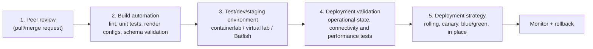
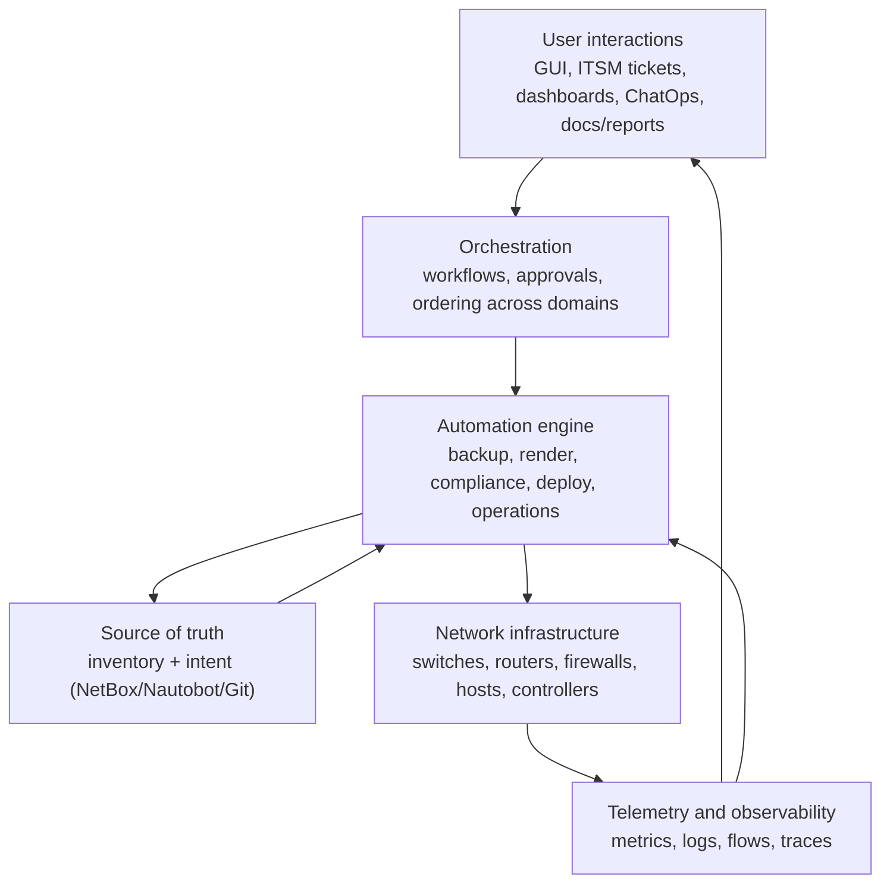

# 2.29 Network automation in practice: Ansible, Nornir, Terraform, CI/CD and automation architecture

| | |
|---|---|
| Level | Advanced |
| Priority tier | 0 |
| Lab venue | Linux VM with containerlab (chapter 2.27), Python, Ansible, Git, a CI runner (GitHub Actions or GitLab CI) |
| Part | Part 2: Networking, from first principles to AI fabrics |
| Status | Drafted, labs **untested** |

## Why this matters for AI infrastructure

Chapter 2.28 gave you the building blocks: data, models, templates, APIs. This chapter assembles them into working systems: which tool to use for which job (Ansible, Nornir, Terraform, vendor controllers), how to structure playbooks and inventories for a fabric of hundreds of switches and thousands of GPU servers, how to put network changes through the same review-test-deploy discipline as software (continuous integration and delivery), and how the whole automation architecture fits together (source of truth, automation engine, observability, orchestration, user interfaces). It also covers virtualised network functions and on-box automation, which show up in service-provider and telco-style AI edge deployments. The end state is a network that is declared in Git, validated in emulation, rolled out in stages and continuously verified against telemetry, which is the only practical way to run an AI fabric of meaningful size.

## Prerequisites and outcomes

You should know the contents of chapter 2.28, basic Ansible and Terraform ideas (Part 4 treats them in depth), and Git.

After this chapter you can:

- Compare Ansible, Nornir, Terraform and vendor/controller automation along the key axes: configuration management vs provisioning, agent vs agentless, declarative vs imperative, push vs pull vs event-driven, mutable vs immutable, state management, extensibility.
- Build Ansible inventories, group/host variables, vault secrets, playbooks and roles for network devices and Linux switches; use check mode, diff, limits, batches (`serial`), idempotent modules and templates; gather facts and run compliance checks.
- Write Nornir inventories and tasks (Netmiko/NAPALM/Scrapli/Jinja2), filter and run threaded tasks, and integrate with a source of truth.
- Describe how Terraform manages network resources (cloud VPCs, firewalls, routers, interconnects, some device providers), state, plan/apply, drift, and where it fits relative to Ansible.
- Design a CI pipeline for networks: peer review, linting and unit tests, build/render, emulation tests, deployment validation, staged rollout (in-place, rolling, canary, blue/green), with rollback.
- Explain the network automation architecture: infrastructure, user interactions (GUI, ITSM, dashboards, ChatOps), source of truth (data quality, modelling, persistence, population, distributed SoT), automation engine (configuration backup, rendering, compliance, deployment; operations such as OS upgrades), telemetry and observability, orchestration.
- Explain on-box automation, network controllers, VNFs and service chaining, intent-based networking, and the complexity trade-offs of automation.

## 1. Choosing automation tools

### The tool landscape

| Tool | Nature | Typical use |
|---|---|---|
| **Ansible** | Agentless, YAML playbooks, push, large module ecosystem (`ansible.netcommon`, vendor collections), idempotent modules | Multi-device config push, facts, compliance, servers + switches in one workflow |
| **Nornir** | Python framework (library, not DSL): inventory + tasks + threaded runner | Complex logic, custom workflows, speed, testability in pure Python |
| **Terraform / OpenTofu** | Declarative infrastructure provisioning with state, providers, plan/apply | Cloud networking (VPC, subnets, firewall rules, routers, VPN, interconnect), some on-prem controllers |
| **Vendor controllers / NMS** | Cisco DNA/NDFC, Juniper Apstra/Mist, Arista CloudVision, NVIDIA UFM/NetQ/Cumulus NVUE, Nokia EDA, SONiC management tooling, Aruba Central | Intent-based fabric operation, validation, lifecycle |
| **Salt / Chef / Puppet** | Agent- or master-based config management | Mostly servers; Salt has network proxy minions |
| **StackStorm, n8n, Temporal, Airflow, ServiceNow Flow** | Event-driven/workflow orchestration | Chain ITSM tickets to automation to validation |
| **Batfish, pyATS/Genie, Suzieq, Hier-config** | Config analysis, test frameworks, observability | Pre-deployment verification, state tests |
| **Git + CI (GitHub Actions, GitLab CI, Jenkins)** | Process engine | Review, test, deploy |

### Axes for comparing them

- **Configuration management vs infrastructure provisioning**: config management converges *existing* machines to a desired configuration (Ansible, Nornir); provisioning creates and destroys *resources* (Terraform); both appear in network work (configure a switch vs create a VPC).
- **Agent-based vs agentless**: network devices rarely run agents, so agentless (SSH, NETCONF, REST, gNMI) tools dominate; server tools (Puppet, Chef) need agents.
- **Centralised vs decentralised**: a control node pushing changes (Ansible, Nornir, Terraform) vs devices pulling their own (ZTP, on-box agents, GitOps pull).
- **Custom vs standards-based protocol**: prefer tools that speak standard device protocols (SSH, NETCONF, gNMI) and standard data formats.
- **DSL vs general-purpose language**: Ansible YAML is quick to start and hard to make complex (loops/conditions in YAML); Python (Nornir) scales to complex logic and tests, at the price of coding skill.
- **Declarative vs imperative**: say *what* the end state is (Terraform, modules with desired state) or *how* to get there (scripts). Declarative needs trustworthy diffing; imperative needs careful idempotence.
- **Extensibility**: modules/collections/plugins vs libraries.
- **Push vs pull vs event-driven**: push on demand or schedule; pull by agents; event-driven (webhooks, syslog, telemetry triggers) for remediation.
- **Mutable vs immutable**: change devices in place (typical for networks) vs replace them with new images/instances (immutable infrastructure; common for servers, cloud, containers; increasingly for white-box switches via re-imaging).
- **State management**: Terraform keeps explicit state (resource addresses to real IDs); Ansible and Nornir are stateless and discover state each run, which avoids state drift problems but cannot detect resources they don't know about.

Pragmatic guidance: use **Terraform** for cloud and controller-managed resources, **Ansible** for broad configuration workflows and mixed server/switch environments, **Nornir/Python** where logic, speed or testing demands code, **vendor controllers** for their own fabrics, and **Git + CI** as the process spine around all of them.

## 2. Ansible for networks

### How it works

Ansible runs on a **control node**, reads an **inventory**, and executes **playbooks** of **tasks** that call **modules** against **hosts**. For Linux servers Ansible connects via SSH, copies a small module, executes it on the target, and removes it. For most network devices there is no Python on the device, so network modules run **on the control node** and talk to the device through a **connection plugin**: `ansible.netcommon.network_cli` (SSH CLI), `ansible.netcommon.netconf`, `ansible.netcommon.httpapi` (REST/eAPI/RESTCONF), `ansible.netcommon.grpc`; set `ansible_connection` and `ansible_network_os` (e.g. `arista.eos.eos`, `cisco.ios.ios`, `junipernetworks.junos.junos`, `cisco.nxos.nxos`). Linux-based switches (Cumulus, SONiC) can use the normal SSH connection or the `nvidia.nvue`/`dellemc.enterprise_sonic` collections. Install: `pip install ansible-core` plus collections via `ansible-galaxy collection install arista.eos cisco.ios ansible.netcommon ansible.utils` (pin versions in `requirements.yml`).

### Inventory

```yaml
# inventory/hosts.yml
all:
  children:
    spine:
      hosts: { spine1: { ansible_host: 10.0.0.1, bgp_asn: 65000 }, spine2: { ansible_host: 10.0.0.2, bgp_asn: 65000 } }
    leaf:
      hosts:
        leaf1: { ansible_host: 10.0.0.11, bgp_asn: 65101 }
        leaf2: { ansible_host: 10.0.0.12, bgp_asn: 65102 }
    eos:
      children: { spine: {}, leaf: {} }
      vars: { ansible_network_os: arista.eos.eos, ansible_connection: ansible.netcommon.network_cli, ansible_become: true, ansible_become_method: enable }
```

Variable scopes and precedence (low to high, simplified): role defaults < inventory group vars (`all` < parent group < child group) < inventory host vars < playbook vars < `vars_files` < role vars < task vars < extra vars (`-e`). Keep per-group variables in `group_vars/<group>.yml` and per-host in `host_vars/<host>.yml`; put design constants in `group_vars/all`. **Dynamic inventory** plugins pull hosts from NetBox, cloud APIs or Nautobot (`netbox.netbox.nb_inventory`), so Git holds playbooks and the source of truth holds devices.

**Secrets**: `ansible-vault encrypt_string 'secret' --name ansible_password` or encrypted vars files (`ansible-vault create group_vars/all/vault.yml`); in CI, supply the vault password from a CI secret or use an external lookup (HashiCorp Vault, cloud secret managers). Never commit plaintext credentials; prefer SSH keys / certificates and short-lived credentials.

### Playbooks, modules and idempotency

```yaml
# playbooks/leaf_config.yml
- name: Configure leaf switches
  hosts: leaf
  gather_facts: false
  serial: "25%"                         # roll through leaves in batches of 25% (fail-fast with max_fail_percentage)
  max_fail_percentage: 0
  vars_files: [ "../vars/qos.yml" ]
  tasks:
    - name: Collect facts
      arista.eos.eos_facts: { gather_subset: [ min ], gather_network_resources: [ interfaces, bgp_global ] }

    - name: Render configuration from template
      ansible.builtin.template:
        src: "templates/{{ ansible_network_os | split('.') | last }}/leaf.j2"
        dest: "build/{{ inventory_hostname }}.cfg"
      delegate_to: localhost
      changed_when: false

    - name: Push configuration idempotently
      arista.eos.eos_config:
        src: "build/{{ inventory_hostname }}.cfg"
        replace: config                  # or 'line'/'block'; only sends the difference
        backup: true
        diff_against: running
        match: line
      register: cfg
      notify: save config

    - name: Validate BGP sessions are established
      arista.eos.eos_command: { commands: [ "show ip bgp summary | json" ] }
      register: bgp
      until: bgp.stdout[0].vrfs.default.peers.values() | map(attribute='peerState') | unique | list == ['Established']
      retries: 12
      delay: 5

  handlers:
    - name: save config
      arista.eos.eos_config: { save_when: modified }
```

Key ideas:

- **Idempotency**: a task describes desired state; running it twice leaves the system unchanged the second time (`changed=0`). Resource modules (`*_interfaces`, `*_bgp_global`, `*_vlans` with `state: merged|replaced|overridden|deleted|gathered|rendered|parsed`) give structured, idempotent control; the generic `*_config` modules diff text lines; `*_command` modules only run commands (not idempotent).
- **Check mode and diff**: `ansible-playbook leaf_config.yml --check --diff` previews changes (support varies by module/platform); always run it in CI before the real run.
- **Limit and tags**: `--limit leaf1,leaf2`, `--limit 'leaf:!leaf4'`, `--tags qos`, `--start-at-task`; verbosity `-v` to `-vvvv` shows connection and module details.
- **Conditionals/loops**: `when: ansible_network_os == 'arista.eos.eos'`, `loop: "{{ interfaces }}"`, `loop_control`, `register`, `failed_when`, `changed_when`, `block/rescue/always` for rollback logic (restore from backup in `rescue`).
- **Roles** package tasks/templates/vars/handlers (`roles/leaf_base`, `roles/bgp_underlay`, `roles/qos_roce`), reusable across fabrics; `ansible-galaxy` for sharing; `meta/main.yml` dependencies.
- **Facts and reports**: `*_facts` modules return model, serial, OS version, hostname, interfaces, config; `ansible.utils.cli_parse` (TextFSM, ttp, pyats) turns `show` output into data; `ansible.utils.validate` checks data against JSON Schema/YANG; use `template` with Jinja to generate HTML/Markdown reports; `ansible.netcommon.cli_config`/`cli_command` are platform-agnostic.
- **Compliance**: gather running config, `ansible.utils.fact_diff` or `ansible.utils.cli_parse` and `assert` against policy; or use `*_config diff_against: intended` to report drift without changing anything (`--check`).
- **Performance**: `forks` (default 5, raise to 50+), `strategy: free`, persistent connections (`ansible_command_timeout`, `ansible_persistent_connect_timeout`), `pipelining`, avoid `gather_facts` where unnecessary, mitogen (for servers).
- **Event-driven Ansible (EDA)**: rulebooks react to events (webhooks, Kafka, alertmanager, syslog) and run playbooks: remediation loops.
- **Tower/AWX (Ansible Automation Platform)**: RBAC, credentials, job templates, schedules, workflows, logging and API for teams.

Testing: `ansible-lint`, `yamllint`, `molecule` for roles (with containers or containerlab), `ansible-playbook --syntax-check`, and rendering templates against fixtures.

### Ansible for Linux GPU servers in the same pipeline

The same inventory can drive host networking: `ansible.builtin.template` for Netplan/NetworkManager/systemd-networkd files, `ansible.posix.sysctl` for sysctls (chapter 2.24), `community.general.nmcli` for NetworkManager, `ansible.builtin.systemd`, and the `nvidia.mlnx_ofed`/vendor roles for NIC firmware and drivers. A single playbook can align fabric-side and host-side MTU, VLANs and routes, and verify end to end with `ping -M do`, `iperf3` and `nccl-tests`. (Part 4 covers Ansible in depth; Part 6 covers cluster provisioning.)

## 3. Nornir

**Nornir** is a Python automation framework: you write regular Python, Nornir provides an **inventory** (hosts, groups, defaults with connection options and data), a **threaded runner**, and **tasks** (functions) whose results are collected as structured objects. It is faster and more testable than YAML playbooks for complex logic.

```yaml
# inventory/hosts.yaml
leaf1: { hostname: 10.0.0.11, groups: [ eos, leaf ], data: { asn: 65101 } }
leaf2: { hostname: 10.0.0.12, groups: [ eos, leaf ], data: { asn: 65102 } }
# inventory/groups.yaml
eos:  { platform: eos, connection_options: { napalm: { extras: { optional_args: { transport: https } } } } }
leaf: { data: { role: leaf } }
# inventory/defaults.yaml
username: automation
password: "{{ env('NET_PASSWORD') }}"        # keep secrets out of files (use a plugin or env)
# config.yaml
inventory: { plugin: SimpleInventory, options: { host_file: inventory/hosts.yaml, group_file: inventory/groups.yaml, defaults_file: inventory/defaults.yaml } }
runner: { plugin: threaded, options: { num_workers: 20 } }
```

```python
from nornir import InitNornir
from nornir_utils.plugins.functions import print_result
from nornir_jinja2.plugins.tasks import template_file
from nornir_napalm.plugins.tasks import napalm_configure, napalm_get
from nornir.core.task import Task, Result

nr = InitNornir(config_file="config.yaml")
leaves = nr.filter(role="leaf")                       # filter by data/group/platform; F() objects for complex filters

def build(task: Task) -> Result:
    rendered = task.run(task=template_file, template="leaf.j2", path="templates/", **task.host.data)
    task.host["config"] = rendered.result
    return Result(host=task.host, result=f"rendered {len(rendered.result)} bytes")

def deploy(task: Task, dry_run: bool = True) -> Result:
    r = task.run(task=napalm_configure, configuration=task.host["config"], replace=False, dry_run=dry_run)
    return Result(host=task.host, result=r.diff, changed=bool(r.diff))

def verify(task: Task) -> Result:
    bgp = task.run(task=napalm_get, getters=["bgp_neighbors"]).result["bgp_neighbors"]["global"]["peers"]
    bad = [p for p, v in bgp.items() if not v["is_up"]]
    return Result(host=task.host, result="OK" if not bad else f"down peers: {bad}", failed=bool(bad))

print_result(leaves.run(task=build))
print_result(leaves.run(task=deploy, dry_run=True))        # show diffs first
# print_result(leaves.run(task=deploy, dry_run=False)); print_result(leaves.run(task=verify))
```

Why Nornir: complete control flow in Python (early exit, per-host branching, complex data manipulation), type hints and unit tests with `pytest`, easy integration with NetBox/pynetbox, tracebacks instead of YAML errors, and speed through threads. Costs: you maintain code; fewer batteries than Ansible's module ecosystem (but plugins exist: `nornir_netmiko`, `nornir_scrapli`, `nornir_napalm`, `nornir_netconf`, `nornir_jinja2`, `nornir_utils`, `nornir_netbox`). Nornir and Ansible combine well (Ansible for common operations, Nornir for custom validators).

## 4. Terraform / OpenTofu for network resources

**Terraform** is declarative: you describe resources in HCL; `terraform plan` computes the diff between the **state file** (what Terraform believes exists) and the desired configuration (and refreshed reality); `terraform apply` executes the plan. Providers translate resources into API calls: cloud networks (`google_compute_network`, `google_compute_subnetwork`, `google_compute_router`, `google_compute_router_nat`, `google_compute_firewall`, `google_compute_vpn_tunnel`, `google_compute_interconnect_attachment`, AWS `aws_vpc`, `aws_security_group`, `aws_ec2_transit_gateway`, Azure equivalents), DNS, load balancers, Kubernetes, and some on-prem controllers/devices (Cisco ACI/NDFC/IOS XE RESTCONF, Juniper Apstra/Mist, NetBox, F5, Palo Alto, Fortinet, Arista CloudVision, Infoblox).

```hcl
resource "google_compute_network" "ai" { name = "ai-fabric" auto_create_subnetworks = false mtu = 8896 }
resource "google_compute_subnetwork" "train" {
  name          = "train-a"
  ip_cidr_range = "10.100.0.0/20"
  region        = "us-central1"
  network       = google_compute_network.ai.id
  private_ip_google_access = true
}
resource "google_compute_firewall" "allow_internal" {
  name      = "allow-internal"
  network   = google_compute_network.ai.name
  direction = "INGRESS"
  allow { protocol = "tcp" } allow { protocol = "udp" } allow { protocol = "icmp" }
  source_ranges = [ "10.100.0.0/16" ]
}
```

Practices: remote state with locking (GCS/S3 + locking), one state per blast-radius (network core vs workloads), modules for reuse, `terraform plan` output as a review artefact in pull requests, policy-as-code checks (OPA/Sentinel/Checkov/tfsec), drift detection (scheduled `plan`), `import` for existing resources, `lifecycle { prevent_destroy = true }` for critical network objects, secrets out of state where possible. Terraform vs Ansible: Terraform excels at **creating and destroying** API-addressable resources with dependency graphs and state; Ansible at **configuring** existing devices and hosts step by step; many teams use Terraform to build the VPC/VMs and Ansible to configure what runs inside (and Part 4 covers both in depth). Immutable approaches (replace a node with a fresh image rather than patch) fit cloud/server layers; switches generally remain mutable, though white-box switches can be re-imaged via ONIE/ZTP.

## 5. Continuous integration and delivery for networks

### Principles

CI/CD brings software practice to network changes: every change is a **commit** in Git, **reviewed** by a peer, **built and tested** automatically, and **deployed** by a pipeline rather than a person at a terminal. Benefits: reliability (tests catch mistakes before production), speed (small, frequent, low-risk changes), auditability, and the ability to respond to changing business needs. Prerequisites that matter more than tools: **simplicity** (standardised designs), **people and process** (review culture, ownership, change windows), and learning to code. *Continuous integration*: merge to the main branch frequently, and test every merge. *Continuous delivery*: the main branch is always deployable. *Continuous deployment*: successful pipelines deploy automatically (often to lower environments first, with approval gates for production in networks). **Test-driven development**: write the test (what should be true after the change) before the change.

### The five components of a network CI pipeline



1. **Peer review**: pull requests on GitHub/GitLab/Gerrit/Bitbucket: required reviewers (CODEOWNERS), protected main branch, checks that must pass; commit messages link to tickets; small PRs; review the *rendered diff* of device configs as well as templates/data (the pipeline posts it as a comment).
2. **Build automation**: triggers on each push/PR; steps: formatting and linting (`yamllint`, `jsonschema` validation of inventory, `ansible-lint`, `flake8/ruff`, `j2lint`, `shellcheck`), unit tests of templates and Python code (`pytest` with golden files), rendering all device configs into build artefacts, static analysis of configs (Batfish: reachability, ACL shadowing, route-policy bugs, ECMP, loops, MTU mismatches). Tools: Jenkins, GitLab CI, GitHub Actions, CircleCI, Buildkite, Argo Workflows.
3. **Test/dev/staging environment**: emulate the network: Vagrant VMs, **containerlab** (containers/VMs from a YAML topology, chapter 2.27), EVE-NG/GNS3/Cisco CML, Terraform-created cloud labs, vendor virtual platforms (cEOS, SR Linux, SONiC-VS, Cumulus VX, vMX/cRPD, vIOS). Use the same templates and data (smaller topology) and the same pipeline; spin up and tear down per run; maintain image versions that match production.
4. **Deployment validation and testing** after applying to the lab (and later to production): **operational state** (BGP neighbours established, expected prefix counts, ECMP width, LLDP neighbours match the plan, interface speeds/MTU/FEC, optics Rx power in range), **basic connectivity** (ping/traceroute between hosts, DNS, DHCP), **end-to-end performance** (iperf3 throughput thresholds, latency, packet loss, `ib_write_bw`/`nccl-tests` in AI fabrics), and negative tests (ACLs deny what they should). Frameworks: `pytest` + `pyATS`/`pytest-ansible`/`scrapli`, Suzieq (state snapshots and asserts), Batfish questions, custom scripts.
5. **Deployment tools and strategies**: **in place** ("change everything at once": appropriate only for trivial, reversible, well-tested changes); **rolling** (batches, each verified before the next; the default for fabrics); **canary** (one device or failure domain first, soak, then expand); **blue/green** (stand up a parallel environment/plane and cut over; natural for multi-plane fabrics and cloud networks). Each strategy needs automated **health checks** and **rollback** (restore from backup/previous Git tag, `commit confirmed`).

### Example GitHub Actions workflow

```yaml
name: network-ci
on:
  pull_request:
  push: { branches: [ main ] }
jobs:
  lint-and-test:
    runs-on: ubuntu-24.04
    steps:
      - uses: actions/checkout@v4
      - uses: actions/setup-python@v5
        with: { python-version: "3.12" }
      - run: pip install -r requirements.txt
      - run: yamllint inventory/ && ansible-lint playbooks/ roles/
      - run: python -m pytest tests/unit -q            # schema validation + template golden files
      - run: python tools/render.py --out build/       # render all configs
      - uses: actions/upload-artifact@v4
        with: { name: configs, path: build/ }
  emulate:
    needs: lint-and-test
    runs-on: ubuntu-24.04                              # use a self-hosted runner with nested resources for big labs
    steps:
      - uses: actions/checkout@v4
      - run: bash -c "$(curl -sL https://get.containerlab.dev)"
      - run: sudo containerlab deploy -t lab/fabric.clab.yml
      - run: ansible-playbook -i lab/inventory.yml playbooks/leaf_config.yml
      - run: python tests/validate.py                  # state assertions (chapter 2.27 lab 7)
      - if: always()
        run: sudo containerlab destroy -t lab/fabric.clab.yml --cleanup
  deploy-canary:
    needs: emulate
    if: github.ref == 'refs/heads/main'
    environment: production-canary                     # required reviewers = approval gate
    runs-on: self-hosted
    steps:
      - uses: actions/checkout@v4
      - run: ansible-playbook -i inventory/prod.yml playbooks/leaf_config.yml --limit canary --diff
      - run: python tests/validate.py --scope canary
```

Notes: use short-lived credentials (OIDC to cloud, Vault) for production deploys; run production jobs on self-hosted runners inside the management network; record artefacts (rendered configs, diffs, test reports); fail closed; keep the pipeline fast (feedback in minutes).

## 6. Network automation architecture

A durable architecture separates concerns into six components:



### User interactions

How people and systems interact: **data in** (requests: a new tenant, VLAN, port enablement, IP allocation) and **data out** (status, reports, alerts, documentation). Interfaces: web GUIs (portals), **ITSM** integration (ServiceNow/Jira ticket triggers a pipeline and reports back), **dashboards** (choose tools for data-source integrations and customisation: Grafana), **ChatOps** (Slack/Teams bots running read-only commands and approved changes with audit), and automatically generated **documentation and reporting** (diagrams, inventory, compliance; "documentation as code").

### Source of truth (SoT)

The SoT stores the data that automation needs: network **inventory** (devices: name, location, type, connection details, status; interfaces; cables), **DCIM** (racks, power, cable traces), **IPAM** (prefixes, VLANs, VRFs, addresses), network **properties** (ASNs, route-targets, DSCP plans), and **configuration templates/intent**. NetBox and Nautobot provide REST and GraphQL APIs (`pynetbox`), custom fields, webhooks, plugins (golden config, device onboarding); Git repositories of YAML are a simpler SoT for small teams. Design concerns:

- **Data quality dimensions**: completeness, consistency, validity (schema), usability, relevance, accuracy. Automation magnifies bad data, so enforce validation on write and reconcile with reality (discovery vs intent) continuously.
- **Data modelling**: a structured approach to define the data you need: understand your network design; define the scope; choose some part of the configuration; sketch the data model; create the configuration templates; start using the model; iterate. Example: model "leaf" as role + ASN + loopback + uplink list, and derive the P2P /31s and BGP neighbours; templates for Cisco IOS and Juniper Junos then share one model.
- **Persistence**: **version control** (Git) fits text/intent, offers history, review and diff, but is poor for relational/queryable data; **databases** (PostgreSQL behind NetBox) fit relationships and queries, constraints and APIs, but need backups and change history features. Many teams use both (DB as SoT for inventory, Git for templates and policy, with sync).
- **Population**: **brownfield** (discover from the live network, parse configs, reconcile; messy) and **greenfield** (design-first, build from data); a hybrid with drift reports is common.
- **Distributed SoT**: real organisations have several authoritative stores (IPAM here, CMDB there, cloud inventory elsewhere). Options: integrate with every data store at use time; consolidate into one SoT; or aggregate behind a facade/API/GraphQL layer. Define data ownership per field.

### Automation engine

Connects the pieces. Choose by supported network interfaces, existing tooling, team skills, and integrations. Core capability, **configuration management** in four stages: **backup** (collect running configs/state to Git regularly and before changes: also `oxidized`/`rancid`), **rendering** (data + templates → intended config), **compliance** (compare running vs intended/policy; report or remediate), **deployment** (apply in a controlled way). Plus **operations** such as NOS upgrades: pre-validate free space and health, make a rollback copy, transfer the new image, activate and reboot, post-validate with ping/traceroute and protocol state, update inventory. Tools: Ansible/Nornir/Terraform/vendor engines.

### Telemetry and observability

Closed loop: automation both feeds and consumes telemetry. Characteristics of modern stacks: flexible data manipulation and enrichment (tags from the SoT), API-driven consumption with powerful query languages (PromQL, Flux, SQL), scale-out capacity, composable services. Inputs: streaming telemetry (gNMI), SNMP where needed, flow records (sFlow/IPFIX), syslog, traces, packet captures on demand, and synthetic probes. Typical pipeline: collectors (Telegraf, gNMIc, Fluent Bit, Vector) → time-series/log stores (Prometheus/VictoriaMetrics/Mimir, Loki/Elastic) → dashboards/alerts (Grafana, Alertmanager) → webhooks into the automation engine for remediation (event-driven). Chapter 2.31 covers monitoring in depth.

### Orchestration

Coordinates multi-step, multi-domain workflows: for example "onboard a new GPU tenant" touches IPAM (allocate prefix), the fabric (VRF/VNI/ACL), firewalls, DNS, identity, Kubernetes (namespace/NetworkPolicy), billing, and ticketing. Orchestrators (Temporal, Airflow, Argo Workflows, StackStorm, ServiceNow, Camunda, Terraform Cloud/Spacelift workflows) provide sequencing, retries, approvals, rollback and visibility. Keep orchestration *thin*: it calls the automation engine and SoT APIs rather than reimplementing device logic.

## 7. On-box automation, controllers, VNFs, intent

### On-box automation

Code runs **on the network device** itself: Cisco EEM and Guest Shell (Python), Junos event policies/op/commit scripts (SLAX/Python/PyEZ), Arista EOS event handlers/eAPI scripts and Python on box, NX-OS Python/Bash, Cumulus/SONiC (full Linux: systemd services/timers, Python, shell, Ansible local mode, Prometheus node exporters), SR Linux agents (NDK). Uses: local automated reaction (shut an interface on a condition, collect diagnostics at the moment of an alarm, auto-remediate), ZTP scripts, health telemetry, and offloading tasks that don't scale centrally. Trade-offs: logic is distributed across devices (harder to version and audit unless distributed from Git by pull), consumes device CPU/memory, and varies per vendor; keep on-box scripts small, signed/versioned, with a central inventory of what runs where.

### Network controllers

Controllers hold a network-wide view and offer a single API for intent and day-2 operations: DC fabric controllers (Cisco NDFC/ACI, Juniper Apstra, Arista CloudVision, Nokia EDA, NVIDIA Unified Fabric Manager for InfiniBand and NetQ for validation), campus/WAN SD-WAN controllers, Kubernetes network controllers (CNI), and cloud SDN. Pros: abstraction, built-in validation, lifecycle management; cons: vendor coupling, opaque behaviour, controller as a failure domain (design fail-static, chapter 2.28 section 7), cost. Automating "on top of" a controller (Terraform provider, REST API, Ansible collection) is often better than automating each switch.

### Automation and complexity

Automation reduces the *interaction surface* between humans and devices, but it **does not reduce complexity in general**; complexity moves into the toolchain, data models, templates and pipeline. Use the state/optimisation/surface lens: automation can add state (SoT, caches, pipeline artefacts), reduce optimisation (abstractions hide device-specific tuning), and reduce or move surfaces (fewer typing mistakes, more integration points). Plan for the new failure modes: bad data, template bugs at scale, pipeline outages, credential compromise of the automation system (a very high-value target: protect it like the network itself), and skill concentration. If you haven't found the trade-off, you haven't looked hard enough.

### Virtualised network functions (VNFs), service chaining, intent

**Network functions virtualisation** runs functions that used to be appliances (routers, firewalls, load balancers, NAT, DPI, IDS/IPS, EPC/UPF, SD-WAN edges) as software on commodity servers (VMs or containers: VNFs and CNFs). Benefits: design flexibility (place functions where needed), **service chaining** (steer traffic through an ordered series of functions, via VLANs/overlays/SR/NSH/policy routing), **scale-out** (add instances instead of bigger boxes, with load balancing/ECMP in front), **faster time to service through automation** (spin up per-tenant firewalls in minutes), centralised policy management, and **intent-based networking** (declare desired outcomes: "tenant A's training pods reach storage with 200 Gb/s and no access to tenant B"; the system compiles intent to configuration, continuously verifies, and remediates). Costs and trade-offs: **throughput** of software datapaths (improve with DPDK, SR-IOV, kernel bypass, NIC offloads, XDP, DPUs, CPU pinning/NUMA/hugepages), **state** (stateful functions and failover/state sync), **optimisation** (generic hardware vs ASICs), **surface** (more layers: hypervisor, vSwitch, orchestrator), licensing and operations. In AI infrastructure, VNF ideas appear as DPU-hosted firewalls and load balancers (BlueField), per-tenant virtual routers at the cluster edge, and service-mesh and gateway functions; the performance-critical data plane (GPU collectives) remains hardware/RDMA.

### From automation to "auto"

The direction of travel is from *scripted automation* (humans trigger runs) to *closed-loop autonomy* (the system detects, decides and acts: self-healing, self-optimising, intent-driven). Prerequisites are exactly this chapter's themes: trustworthy data, tested changes, reliable telemetry, safe rollouts, guardrails, observability of the automation itself. Add AI assistants carefully: they can draft configs and explain traces, but outputs must pass the same validation pipeline, never apply directly to production, and never receive secrets or customer data without controls.

## 8. Hands-on lab: an automation pipeline for the leaf-spine fabric

First, run the self-checking Python lab (`code/part02/net_automation_cicd_tools_lab.py`) locally. It verifies Ansible `serial: "25%"` batch rollout and `max_fail_percentage: 0` fail-fast halting, idempotent configuration diffing and drift detection, and 5-stage network CI/CD pipeline gating.

```bash
python3 code/part02/net_automation_cicd_tools_lab.py
```

Next, on a disposable Linux VM building on Chapter 2.27's containerlab fabric (all interactive VM commands below are `untested here`), work through these steps:

1. **Inventory and SoT**: create `inventory/` YAML (devices, roles, ASNs, loopbacks, links) validated by a JSON Schema; optionally load into NetBox (Docker compose) and use `nb_inventory` as the Ansible dynamic inventory.
2. **Templates**: Jinja2 templates for FRR leaf/spine configs (or SONiC/Arista cEOS if available); unit tests with golden outputs in `tests/unit/`.
3. **Ansible**: roles `base`, `underlay_bgp`, `evpn`; playbook with `serial`, check/diff mode, backups, `rescue` rollback, and post-validation (BGP/ECMP); use vault for credentials; run against containerlab nodes (`ansible_connection: community.docker.docker` for containers or SSH).
4. **Nornir**: re-implement validation and a compliance report in Nornir; compare run time and ergonomics with Ansible; add a custom task checking MTU consistency across all links.
5. **Terraform**: create the GCP VPC, subnets, firewall rules and a Cloud NAT for the lab VM (chapter 2.32 context) and attach outputs to the Ansible inventory; `plan` as a PR artefact; add a drift-detection scheduled workflow.
6. **CI**: implement the GitHub Actions workflow above (self-hosted runner on the lab VM); require green checks; add a Batfish job (pybatfish) asserting no unreachable prefixes and symmetric ECMP.
7. **Failure of the pipeline itself**: inject a bad template change (wrong ASN, MTU typo) and show it blocked at unit tests, at Batfish, at emulation validation, and at canary; show rollback.
8. **Telemetry loop**: deploy gNMIc/Telegraf + Prometheus + Grafana (or FRR exporter); alert on BGP session down; use a webhook to trigger a diagnostic playbook that attaches `show` output to the alert.
9. **ChatOps (optional)**: a minimal bot (Slack/Matrix webhook) that runs read-only validation and posts the result.
10. **Retrospective**: write an architecture diagram (six components), list data owners, failure modes of the automation system, and the credential model.

## 9. Common mistakes

- Choosing the tool before defining the data model, source of truth and process.
- Pushing to all devices at once; no canary; no automatic rollback; no out-of-band access.
- Treating Ansible `*_command` as idempotent; ignoring `changed`/diff semantics; huge shell/regex tasks.
- Secrets in repositories or in rendered artefacts; over-privileged automation accounts; no audit trail.
- Testing only syntax, not behaviour (no emulation, no state assertions).
- A source of truth that drifts from the network (no reconciliation).
- Letting the automation system become a single point of failure with no break-glass procedure.
- Over-orchestrating: reimplementing device logic in a workflow engine.

## 10. Interview angles

- "Ansible vs Nornir vs Terraform for networks: when each?"
- "How do you make a network change idempotent and safe? What happens if the playbook fails halfway?"
- "Design a CI/CD pipeline for switch configuration changes. What tests run where?"
- "What goes in a network source of truth? How do you keep it accurate?"
- "How would you roll out an MTU/QoS change to 500 switches without an outage?"
- "How do you test network automation without production hardware?"
- "What are the risks of network automation, and how do you mitigate them?"
- "What is intent-based networking? What is a network controller's failure mode?"
- "How do on-box and off-box automation differ?"

## Exercises

1. **Choosing Network Automation Tools Across the 10 Design Axes (`NPA` Chapter 12):** Compare **Ansible**, **Nornir**, **Terraform / OpenTofu**, and **Vendor Controllers** (`Apstra`, `CloudVision`, `NVIDIA UFM`/`NetQ`) across the 10 axes in Section 1 (configuration management vs provisioning, agent vs agentless, DSL vs Python, declarative vs imperative, state management).
2. **Ansible for Networks (`connection` Plugins, Variable Precedence, `serial` Batching, and Resource Modules):** (a) Explain why Ansible network modules execute on the **control node** rather than on the switch, and list the four `ansible.netcommon` connection plugins; (b) using `simulate_serial_batch_rollout()` and `compute_idempotent_config_diff()` in `code/part02/net_automation_cicd_tools.py`, trace how `serial: "25%"` and `max_fail_percentage: 0` protect an 8-leaf rollout when `leaf2` fails its BGP post-check.
3. **Nornir Threaded Python Workflows vs. Ansible Playbooks:** Trace the Section 3 Nornir script (`InitNornir`, `nr.filter(role="leaf")`, `build`, `deploy(dry_run=True)`, and `verify` over `num_workers: 20`), and state when pure Python + Nornir is preferred over Ansible YAML.
4. **The Five Components of a Network CI/CD Pipeline and Deployment Strategies (`NPA` Chapter 13):** Using `evaluate_network_ci_pipeline()`, trace a switch config change through the five CI/CD stages (*Peer review -> Build/lint/Batfish -> Containerlab emulation -> Operational/connectivity/performance validation -> Staged deployment*), and compare **in-place**, **rolling**, **canary**, and **blue/green** network deployment strategies.
5. **The Six Components of Network Automation Architecture and Source-of-Truth (`SoT`) Design (`NPA` Chapter 14):** (a) Draw and explain the six components of the Network Automation Architecture (*User Interactions, Orchestration, Source of Truth, Automation Engine, Network Infrastructure, Telemetry & Observability*); (b) list the six dimensions of SoT data quality, compare Git vs relational databases (`NetBox`/`Nautobot`) for persistence, and list the four stages of configuration management plus the five steps of an automated NOS upgrade.
6. **On-Box Automation, Controllers, `VNF`s / Service Chaining, and the Complexity Triangle (`CN` Chapters 26 & 27):** Contrast **on-box** scripts with **off-box** controllers, explain **Virtual Network Functions (`VNF`s / `CNF`s)** and **service chaining** (and how `DPDK`, `SR-IOV`, and **BlueField DPUs** overcome software datapath limits), and evaluate network automation using `CN` Chapter 26's **state / optimization / interaction-surface** trade-off model.

## Checkpoint questions (20)

<details>
<summary>1. What is the fundamental difference between Configuration Management (`Ansible`, `Nornir`) and Infrastructure Provisioning (`Terraform` / `OpenTofu`)?</summary>
**Infrastructure provisioning (`Terraform`)** creates, modifies, and destroys API-driven infrastructure **resources** (cloud VPCs, subnets, security groups, load balancers, controller objects) using an explicit **state file (`terraform.tfstate`)** that maps declared HCL blocks to real-world resource IDs and builds a dependency graph (`plan` / `apply`). **Configuration management (`Ansible`, `Nornir`)** is **stateless** and converges the internal configuration of **existing** switches and servers to a desired state on each run.
</details>

<details>
<summary>2. How does Ansible execute tasks on a network switch differently from how it executes tasks on a Linux server (`NPA` Chapter 12)?</summary>
On a **Linux server**, Ansible connects over SSH, copies a temporary Python script into `/tmp` on the target host, executes it locally on the server's Python interpreter, and deletes it. Because traditional **network switches** do not provide an open shell or Python environment for foreign scripts, Ansible runs network modules **locally on the Ansible control node** and opens a persistent session to the switch using a **connection plugin**: **`ansible.netcommon.network_cli`** (SSH CLI), **`ansible.netcommon.netconf`** (NETCONF XML over SSH 830), **`ansible.netcommon.httpapi`** (RESTCONF / eAPI), or **`ansible.netcommon.grpc`** (`gNMI`). (On Linux-based switches like **Cumulus** and **SONiC**, you can also use standard SSH + Linux/NVUE modules.)
</details>

<details>
<summary>3. State the order of Ansible variable precedence from lowest to highest among role defaults, group vars, host vars, playbook vars, and `-e` extra vars.</summary>
From lowest priority (easiest to override) to highest priority (always wins):\n1. **Role `defaults/main.yml`**\n2. **Inventory `group_vars/all`**\n3. **Inventory parent `group_vars/<group>` -> child `group_vars/<subgroup>`**\n4. **Inventory `host_vars/<hostname>`**\n5. **Playbook `vars:` / `vars_files:`**\n6. **Role `vars/main.yml` and task `vars:`**\n7. **Command-line extra vars (`-e key=value`)** (highest precedence).
</details>

<details>
<summary>4. Compare Ansible's `*_command`, `*_config`, and Network Resource Modules (`*_interfaces`, `*_bgp_global` with `state:`).</summary>
- **`*_command` (`arista.eos.eos_command`)**: executes read-only `show` commands and returns output; **never idempotent for config changes**.\n- **`*_config` (`arista.eos.eos_config`)**: pushes raw CLI configuration lines or a rendered Jinja template (`replace: config|block|line`, `diff_against: running`) by diffing text indentation.\n- **Network Resource Modules (`arista.eos.eos_interfaces`, `eos_vlans`, `eos_bgp_global`)**: model a specific subsystem as structured YAML data and support explicit lifecycle states: **`merged`**, **`replaced`**, **`overridden`**, **`deleted`**, **`gathered`** (read live into facts), **`rendered`**, and **`parsed`**.
</details>

<details>
<summary>5. How do `serial`, `max_fail_percentage`, `--check --diff`, `--limit`, and `block / rescue` make an Ansible network playbook safe for production?</summary>
- **`--check --diff`**: dry-runs the playbook and prints the exact line-by-line configuration diff without modifying any switch.\n- **`--limit canary` (or `--limit 'leaf:!leaf4'`)**: restricts execution to a specific switch or subset.\n- **`serial: "25%"` + `max_fail_percentage: 0`**: rolls out the change in batches of 25% of switches at a time, running post-validation tasks (`until: ... Established`) at the end of each batch and **halting the entire playbook immediately** if any switch in the batch fails.\n- **`block:` / `rescue:`**: wraps the config push and post-check in a `block:` and automatically restores the pre-change backup config in the `rescue:` section if validation fails.
</details>

<details>
<summary>6. How do you manage secrets in Ansible and CI pipelines without committing plaintext passwords to Git?</summary>
Encrypt sensitive variables or files with **`ansible-vault`** (`ansible-vault encrypt group_vars/all/vault.yml` or `encrypt_string`) so they are stored ciphertext-only in Git, and pass the vault decryption key at runtime from a CI secret store; or fetch **short-lived dynamic credentials** at runtime from **HashiCorp Vault**, cloud KMS/Secret Manager, or SSH Certificate Authorities.
</details>

<details>
<summary>7. What is `Nornir`, and when should an infrastructure team choose `Nornir` over `Ansible` (`NPA` Chapter 12)?</summary>
**`Nornir`** is a **100% pure-Python automation framework**: instead of writing logic in YAML DSL loops (`when:`, `loop:`, `set_fact:`), you write normal Python functions (`Task -> Result`) that Nornir executes concurrently across an inventory (`SimpleInventory` or `NetBoxInventory`) using a **threaded worker pool (`num_workers: 20`)**. Choose Nornir when you need **complex branching control flow, custom multi-step validation algorithms, fast parallel execution across hundreds of devices, IDE debugging/type-checking, and standard `pytest` unit tests**.
</details>

<details>
<summary>8. How do you manage `Terraform` state safely when multiple engineers automate cloud and data-center networks?</summary>
(1) Store state in a **remote backend with state locking** (e.g., GCS bucket or S3 + DynamoDB lock, or Terraform Cloud/TacOS) so two engineers or CI jobs can never run `apply` concurrently;\n(2) **Split state files by blast radius and lifecycle** (`core-network/` vs `cluster-a/` vs `firewall-rules/`) so a change to one cluster cannot touch core routers;\n(3) Require **`terraform plan` output** on every pull request with `lifecycle { prevent_destroy = true }` on production VPCs/interconnects; and\n(4) Run scheduled **`terraform plan -detailed-exitcode`** jobs to detect out-of-band configuration drift.
</details>

<details>
<summary>9. List the five components of a Network Continuous Integration (`CI`) pipeline (`NPA` Chapter 13).</summary>
(1) **Peer review**: pull/merge requests with required `CODEOWNERS` review of both code/data and the **rendered device config diff**;\n(2) **Build automation**: automated linting (`yamllint`, `ansible-lint`, `ruff`), **JSON Schema** validation, **Jinja2 golden-file unit tests** (`pytest`), config rendering, and offline static analysis (**`Batfish`**);\n(3) **Test / dev / staging environment**: spinning up an ephemeral virtual fabric (**`containerlab`**, SONiC-VS, cEOS, SR Linux) and applying the candidate change;\n(4) **Deployment validation**: automated assertions on **operational state** (BGP, ECMP, LLDP, MTU), **connectivity** (ping/traceroute), and **performance / negative ACL tests**; and\n(5) **Staged production deployment strategy** (canary -> rolling batches with automated rollback).
</details>

<details>
<summary>10. What does `Batfish` (`pybatfish`) do in a network CI pipeline that `containerlab` does not (and vice versa)?</summary>
**`Batfish`** is an **offline mathematical control-plane and data-plane modeler**: given only the rendered text configuration files of all switches/firewalls in `build/`, it builds a formal model of the RIBs, FIBs, ACLs, and route policies in seconds **without booting any VMs or containers**—proving whether any prefix is unreachable, whether an ACL rule is shadowed, whether BGP policies have loops, or whether ECMP is asymmetric across all possible failure states. **`containerlab`** boots the **actual vendor NOS binaries/containers** and exchanges live wire packets (`BFD`, `BGP Unnumbered RAs`, `EVPN`), catching NOS software bugs and runtime timing issues. Production pipelines run **both**: Batfish first (fast static proof), then containerlab (live NOS test).
</details>

<details>
<summary>11. Compare the four network deployment strategies: In-Place, Rolling, Canary, and Blue/Green (`NPA` Chapter 13).</summary>
- **In-Place ("big bang")**: push to all switches simultaneously—acceptable only in labs or for trivial non-forwarding changes (like adding an SNMP/syslog server).\n- **Rolling**: push in bounded batches (`serial: "25%"`, 1 spine or 1 rack leaf pair at a time), draining before and validating after each batch.\n- **Canary**: deploy to **one single device or non-critical rack first**, bake and monitor telemetry over a soak window, and only then roll out to the rest of the fleet.\n- **Blue/Green**: build or upgrade an entire parallel routing plane / multi-planar fabric (`Plane B`) while traffic runs on `Plane A`, validate `Plane B`, shift traffic over via routing policy/weights, and keep `Plane A` ready for instant cut-back.
</details>

<details>
<summary>12. Name the six components of the Network Automation Architecture (`NPA` Chapter 14) and how they interact.</summary>
(1) **User Interactions** (Web portals, ITSM ServiceNow/Jira tickets, Grafana dashboards, **ChatOps** bots, and auto-generated docs);\n(2) **Orchestration** (thin cross-domain workflow coordinator ordering steps across IPAM, fabric, firewall, and Kubernetes);\n(3) **Source of Truth (`SoT`)** (authoritative store of inventory, DCIM, IPAM, and intent: `NetBox`/`Nautobot` + Git);\n(4) **Automation Engine** (`Ansible`, `Nornir`, `Terraform` executing backup, rendering, compliance, deployment, and NOS upgrades);\n(5) **Network Infrastructure** (switches, routers, DPUs, GPU hosts, controllers); and\n(6) **Telemetry & Observability** (gNMI/Prometheus/Loki closing the loop back to the UI and event-driven automation engine).
</details>

<details>
<summary>13. What data belongs in a Network Source of Truth (`SoT`), and what are the six dimensions of SoT Data Quality (`NPA` Chapter 14)?</summary>
An SoT stores: (1) **Device inventory** (hostnames, roles, sites, platforms, serials), (2) **DCIM** (racks, power, physical cable plan), (3) **IPAM** (VRFs, prefixes, VLANs, `/31` links, loopbacks), and (4) **Routing/Fabric intent** (ASNs, VNIs, QoS/DSCP plans). The six data-quality dimensions are **Completeness**, **Consistency**, **Validity** (conforming to schema), **Usability**, **Relevance**, and **Accuracy** (matching physical reality via continuous reconciliation).
</details>

<details>
<summary>14. Why do many production teams combine a Relational Database (`NetBox` / `Nautobot`) with `Git` for their Source of Truth?</summary>
A **relational database (`PostgreSQL` backing `NetBox` / `Nautobot`)** excels at modeling many-to-many relationships (which cable connects `gpu01:ens1f0` to `leaf1:swp1` in `rack-04`?), enforcing uniqueness/foreign-key constraints on IP/VLAN allocations, and serving GraphQL/REST queries (`nb_inventory`). **`Git`** excels at version-controlling **Jinja2 templates, YANG/JSON schemas, Ansible roles, Nornir code, and high-level policy YAML** with pull-request review, cryptographic commit history, and CI triggers.
</details>

<details>
<summary>15. What are the four stages of Configuration Management and the five steps of an automated Switch NOS Upgrade in the Automation Engine (`NPA` Chapter 14)?</summary>
The four Configuration Management stages are: **(1) Backup** (archive running config to Git/storage), **(2) Rendering** (SoT data + template -> intended config), **(3) Compliance** (diff running vs intended/policy), and **(4) Deployment** (push delta transactionally).\nThe five automated **NOS Upgrade** steps are: **(1) Pre-validate** (check flash disk space, dual power supplies, BGP/ECMP health, and **gracefully drain** the switch), **(2) Backup** config and state snapshot, **(3) Transfer & verify checksum** of the new NOS image, **(4) Activate image & reboot**, and **(5) Post-validate** (verify new OS version, interfaces, LLDP, BGP/ECMP, undrain, and update SoT).
</details>

<details>
<summary>16. Compare On-Box Automation and Off-Box Automation (`CN` Chapter 26).</summary>
- **On-Box Automation**: scripts, agents, or systemd services running **directly on the switch CPU** (Cisco EEM/Guest Shell, Junos commit/event scripts, Arista EOS event handlers, SONiC/Cumulus Python/systemd daemons). Ideal for **Zero-Touch Provisioning (`ZTP`)**, sub-second local reaction to hardware faults, and local telemetry exporters—at the cost of distributing state across hundreds of switch CPUs.\n- **Off-Box Automation**: centralized engines (`Ansible`, `Nornir`, CI runners, controllers) pushing configs and validating state across the fleet from a single version-controlled repository.
</details>

<details>
<summary>17. Analyze Network Automation through the `CN` Chapter 26 \"State, Optimization, and Interaction Surfaces\" lens.</summary>
Every engineering change trades off **State**, **Optimization**, and **Interaction Surfaces**:\n- **Surfaces**: automation shrinks the error-prone *human-to-CLI* surface, but creates a new, high-consequence *human-to-SoT-to-pipeline-to-fleet* surface (making the automation server and Git repo a Tier-0 security asset that must be protected with MFA, RBAC, and signed commits);\n- **Optimization**: standardizing 500 switches onto 2 clean templates intentionally sacrifices one-off per-switch hand-optimizations in exchange for fleet uniformity and lower `MTBM`;\n- **State**: adding an SoT database or Terraform state file introduces a second copy of state that can **drift** from the live network unless continuously reconciled.
</details>

<details>
<summary>18. What are Virtualized Network Functions (`VNF`s / `CNF`s) and Service Chaining, and how do `DPDK`, `SR-IOV`, and `DPU`s overcome their performance bottlenecks (`CN` Chapter 27)?</summary>
**VNFs** (VM-based) and **CNFs** (container-based) replace fixed hardware middleboxes (firewalls, load balancers, NAT gateways, IDS/IPS, SD-WAN edges) with software running on commodity servers, allowing operators to spin up functions on demand and steer traffic through an ordered sequence of functions (**Service Chaining** via EVPN/VXLAN, Segment Routing `SRv6`, or NSH). Because standard kernel network stacks bottleneck on interrupts and memory copies at `100G–400G`, high-speed VNFs use **`SR-IOV`**, **`DPDK`**, **`XDP`/`eBPF`**, or offload the entire virtual router/firewall/load-balancer pipeline onto **hardware `DPU`s (`NVIDIA BlueField`)**.
</details>

<details>
<summary>19. What is Intent-Based Networking (`IBN`), and what are its four closed-loop stages?</summary>
In **Intent-Based Networking** (exemplified by Juniper Apstra, Arista CloudVision, Nokia EDA, and NVIDIA UFM/NetQ), operators declare **high-level business/architectural outcomes** (*"Build a 4-pod rail-optimized RoCEv2 Clos for Tenant A with 1:1 bisection bandwidth and isolated EVPN VRFs"*) rather than device-by-device CLI syntax. An IBN system executes four continuous stages:\n(1) **Translation & Validation**: compiles high-level intent into vendor-specific device configurations;\n(2) **Automated Activation**: deploys the configurations across the fabric;\n(3) **Continuous Assurance / Telemetry**: streams real-time state (`gNMI`, LLDP, BGP, queue counters) and compares it against the declared intent graph; and\n(4) **Closed-Loop Remediation / Alerting**: automatically flags or self-heals cable swaps, config drift, or degraded links.
</details>

<details>
<summary>20. How do you integrate Switch Fabric Automation and Linux GPU Host Networking into a single unified GitOps pipeline?</summary>
Store the cluster's rack/rail wiring plan, VLANs, MTUs (`9000`), DSCP/PFC/ECN profiles (`DSCP 26 -> Prio 3`, `CNP 48 -> Prio 6`), and IP/ASN allocations in **one shared Source of Truth** (`NetBox` or `inventory/fabric.yml`). From that single SoT, the CI pipeline renders **both** the switch configurations (SONiC / Cumulus / EOS via Jinja2) **and** the GPU server host configurations (`Netplan`/`nmcli`, `/etc/iproute2/rt_tables` per-rail policy routing, `mlnx_qos`, `/etc/sysctl.d/99-ai-node-network.conf`), validates the switch topology in `containerlab`/`Batfish`, rolls out in lockstep per rack/rail, and runs an end-to-end verification job (`lldpcli` cabling check + `ping -M do -s 8972` + `ib_write_bw` + `nccl-tests`).
</details>

## Sources and review notes

- **Sources read in full:**
  - `network-programmability-and-automation-2nd-edition` — Christian Adell, Scott S. Lowe, Jason Edelman, and Matt Oswalt, *Network Programmability and Automation*, 2nd ed., **Chapter 12: Automation Tools** (Ansible, Nornir, Terraform; axes for reviewing tools; Ansible framework, inventory, variables, vault, playbooks for networks, templates, idempotency, check mode, facts, compliance, and reports), **Chapter 13: Continuous Integration** (prerequisites, CI basics, the 5 components of a networking pipeline, peer review, build automation, test environments, validation, and deployment strategies), and **Chapter 14: Network Automation Architecture** (user interactions, source of truth data quality / modeling / persistence / population / distributed SoT, automation engine backup / render / compliance / deploy / NOS upgrades, telemetry and observability, and orchestration).
  - `computer-networking-problems-and-solutions` — Russ White and Ethan Banks, *Computer Networking Problems and Solutions*, **Chapter 26: The Case for Network Automation** (automation and complexity state/optimization/surface lens, automation concepts, modern methods, on-box automation, infrastructure automation tools, controllers, deployment, and "from automation to auto") and **Chapter 27: Virtualized Network Functions** (VNFs and CNFs, design flexibility, service chaining, scaling out, automation, centralized policy, intent-based networking, and VNF throughput trade-offs).
  - `ansible-up-and-running-3rd-edition` and `terraform-up-and-running-3rd-edition` — consulted for Ansible and Terraform fundamentals (covered in full in Part 4).
- **Run here:** `python3 code/part02/net_automation_cicd_tools_lab.py` (9 passed, 0 failed).
- **Explicitly labelled inferences:** The Section 2 Ansible leaf playbook (`serial: "25%"`, `arista.eos`), Section 3 Nornir threaded runner script, Section 4 GCP VPC Terraform HCL, and Section 5 GitHub Actions `.github/workflows/network-ci.yml` pipeline (with `containerlab` emulation and canary approval gates) are the author's constructions synthesizing the Ansible, Nornir, Terraform, Batfish, and containerlab documentation (cross-referenced with Chapters 2.16–2.19, 2.24, 2.27, 2.28, 2.31, 2.32, and Part 4, plus original study items 21, 22, 23, 24, 25, 26, 27, 28, 29, 30, 31, 32, 33, 34, 35, 36, 37, 38, 39, and 40).
- **Not verified on live hardware:** All interactive Ansible, Nornir, Terraform, Batfish, and CI commands are marked (untested here) and must be executed against a lab containerlab topology or staging environment.
