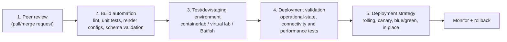
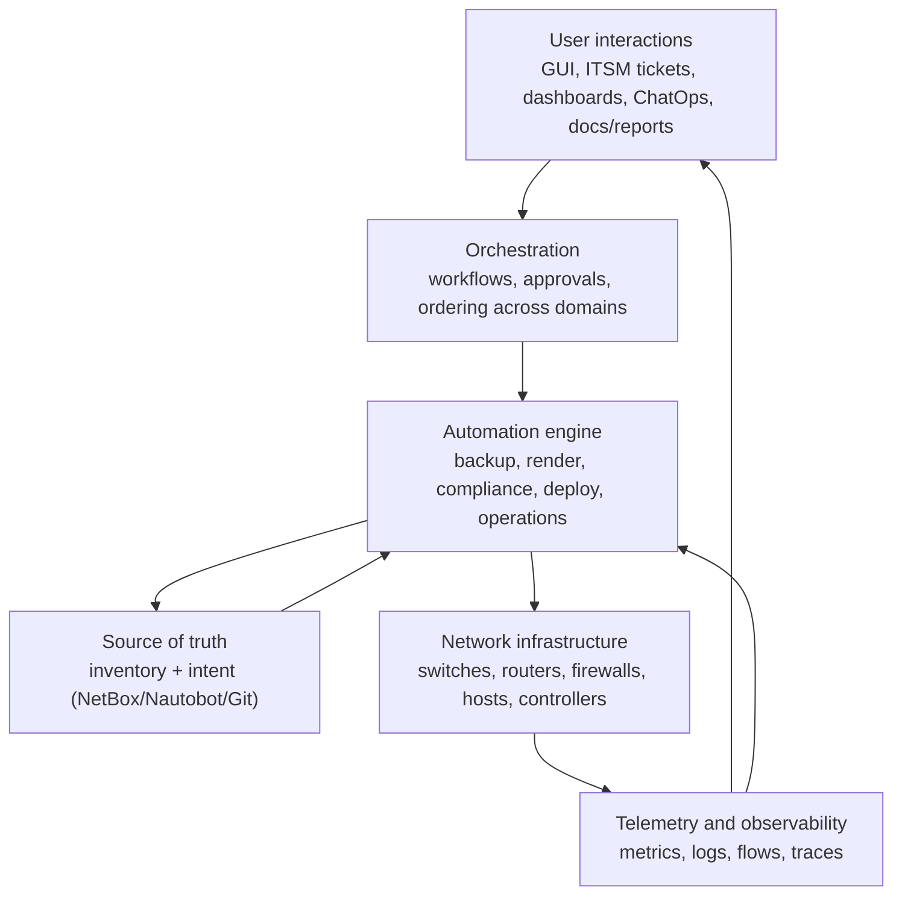

# 2.29 Network automation in practice: Ansible, Nornir, Terraform, CI/CD and automation architecture

| | |
|---|---|
| Level | Advanced |
| Priority tier | 0 |
| Lab venue | Linux VM with containerlab (chapter 2.27), Python, Ansible, Git, a CI runner (GitHub Actions or GitLab CI) |
| Part | Part 2: Networking, from first principles to AI fabrics |
| Status | Drafted, labs **untested** |

## Why this matters for AI infrastructure

Chapter 2.28 gave you the building blocks: data, models, templates and APIs. This chapter puts them together into working systems. Consider a fabric of hundreds of switches and thousands of GPU servers. A single engineer cannot keep that in their head, and a spreadsheet of commands cannot keep it right. You need to know which tool fits which job, whether that is Ansible, Nornir, Terraform or a vendor controller. You also need playbooks and inventories that stay manageable at that size. Network changes should go through the same review, test and deploy discipline as software, which is continuous integration and delivery. The whole architecture has to fit together too: a source of truth, an automation engine, observability, orchestration and user interfaces.

Imagine the parts from chapter 2.28 laid out on a table: a data model, a template and an API client. This chapter is about the machine that runs those parts on a schedule, in the right order, and keeps a record of each run. The parts do the work. The machine makes sure the work happens the same way every time, and that somebody can see what it did.

The chapter also covers virtualised network functions and on-box automation, which appear in service-provider and telco-style AI edge deployments. The end state is a network declared in Git, validated in emulation, rolled out in stages and checked continuously against telemetry. For an AI fabric of meaningful size, that is the only practical way to run it. The way there starts with a plain question, which tool to pick for which job, and then follows a single change through the pipeline that carries it to production.

## Prerequisites and outcomes

You should know the material in chapter 2.28. You should also have basic Ansible and Terraform ideas, which Part 4 covers in depth, and a working knowledge of Git. In short, you should be able to explain what a template and a schema are, what a playbook looks like at a glance, and what a pull request is.

The tools themselves are introduced one at a time. Each section starts from a job that needs doing, such as changing thirty leaves or creating a cloud subnet, and only then shows the tool.

## 1. Choosing automation tools

### The tool landscape

Before you pick a tool, you need to know which job it does. The table below lists the main options. Each one solves a different part of the same problem: a switch needs a new configuration, a cloud network needs a new subnet, or a whole fabric has to stay in a known state.

A quick test works well here. Write the job in one sentence, such as change a device, provision a cloud resource, or check a running state. That sentence usually points to one row of the table, and the rest of the choice follows from that row. If the sentence names two jobs, split the task in two before you pick anything.

| Tool | Nature | Typical use |
|---|---|---|
| **Ansible** | Agentless, YAML playbooks, push, large module ecosystem (`ansible.netcommon`, vendor collections), idempotent modules | Multi-device config push, facts, compliance, servers + switches in one workflow |
| **Nornir** | Python framework (library, not DSL): inventory + tasks + threaded runner | Complex logic, custom workflows, speed, testability in pure Python |
| **Terraform / OpenTofu** | Declarative infrastructure provisioning with state, providers, plan/apply | Cloud networking (VPC, subnets, firewall rules, routers, VPN, interconnect), some on-prem controllers |
| **Vendor controllers / NMS** | Cisco DNA/NDFC, Juniper Apstra/Mist, Arista CloudVision, NVIDIA UFM/NetQ/Cumulus NVUE, Nokia EDA, SONiC management tooling, Aruba Central | Intent-based fabric operation, validation, lifecycle |
| **Salt / Chef / Puppet** | Agent- or master-based config management | Mostly servers; Salt has network proxy minions |
| **StackStorm, n8n, Temporal, Airflow, ServiceNow Flow** | Event-driven/workflow orchestration | Chain ITSM tickets to automation to validation |
| **Batfish, pyATS/Genie, Suzieq, Hier-config** | Config analysis, test frameworks, observability | Pre-deployment verification, state tests |
| **Git + CI (GitHub Actions, GitLab CI, Jenkins)** | Process engine | Review, test, deploy |

Read the table by asking which part of the work each tool owns. Ansible and Nornir push configuration to devices that already exist. Terraform provisions cloud networking and some controller resources. Git and CI are the process that all of them run inside.

Think of a kitchen. One cook chops, one cook bakes, and one checks each plate before it leaves. Each station has its own tool. A team that asks one tool to do all three jobs ends up with a kitchen that is hard to keep clean. The table is a map of those stations, and it is most useful when you use it to say no to a tool that does not fit.

### Axes for comparing them

Start with the two axes that clear up most of the confusion. Configuration management converges existing machines to a desired configuration, which is what Ansible and Nornir do. Provisioning creates and destroys resources, which is the job of Terraform. Both show up in network work, whether you are configuring a switch or creating a VPC. Network devices rarely run agents, so agentless tools that speak SSH, NETCONF, REST or gNMI dominate. Server tools such as Puppet and Chef need agents.

Here is how to place a tool on the two axes. On the first axis, ask whether the tool describes an end state or a list of steps. On the second, ask whether it runs from one control machine or from each device. A tool that describes end states and runs from a control node sits in a different place from one that runs steps on each device, even when both claim to manage networks.

Next, decide who starts the change. A central control node pushes changes out with Ansible, Nornir or Terraform. Devices can instead pull their own configuration, through ZTP, on-box agents or a GitOps pull. Prefer tools that speak standard device protocols and use standard data formats over a custom protocol. The language matters too. Ansible YAML is quick to start but hard to stretch, because loops and conditions written in YAML get awkward. Python, the language Nornir uses, scales to complex logic and tests, but it asks more coding skill of you.

The remaining axes describe how a tool behaves over time. Declarative tools, such as Terraform, say what the end state should be. Imperative tools, such as scripts, say how to get there. Declarative tools depend on trustworthy diffing. Imperative tools depend on careful idempotence, which means a second run changes nothing. Compare modules, collections and plugins with plain libraries when you judge extensibility. Push runs on demand or on a schedule, pull is done by agents, and event-driven runs react to webhooks, syslog or telemetry triggers, often to fix a problem automatically.

Networks usually change devices in place, which is the mutable approach. Immutable infrastructure replaces a node with a new image or instance instead. That is common for servers, cloud and containers, and increasingly for white-box switches that are re-imaged. Finally, state management separates the tools. Terraform keeps an explicit state file that maps resource addresses to real IDs. Ansible and Nornir are stateless and discover what exists on each run. That avoids state drift problems, but they cannot detect resources they do not know about.

Use Terraform for cloud and controller-managed resources, and Ansible for broad configuration workflows across mixed server and switch environments. Reach for Nornir and Python where logic, speed or testing demands code. Vendor controllers manage their own fabrics, and Git with CI forms the process spine around all of them. Pick the tool that fits each job, then let Git and CI tie the work together.

## 2. Ansible for networks

Picture an operator who needs the same change on thirty leaf switches before the end of the day. Typing it into each switch by hand takes hours, and one missed switch causes a fault nobody expects. Ansible lets one description run against all thirty, from one place, and report which ones changed and which did not. The sections below explain how the tool reaches devices that cannot run Python, how it finds them in an inventory, and how it keeps the change safe to repeat.

The usual first attempt is a shell loop over a list of addresses. It works until one leaf stops to ask for a password, and then the loop waits forever on that one host. Ansible handles that case by design, with timeouts for each host and a summary at the end that names the hosts that failed.

### How it works

Suppose you need the same change on every leaf switch in a fabric. Ansible can make that change from one machine, called the control node. It reads an inventory of hosts and runs playbooks. A playbook is made of tasks, and each task calls a module against the hosts.

Walk through one run for a single leaf. Ansible reads the inventory, opens a connection to the switch, renders the template on the control node, sends the result, and then checks whether the device now matches. Each leaf goes through the same steps. The summary at the end shows which hosts changed, which were already correct, and which failed.

With Linux servers, Ansible connects over SSH, copies a small module to the target, runs it there and removes it. Most network devices have no Python to run that module. So network modules run on the control node instead, and they reach the device through a connection plugin. You select the plugin with `ansible_connection`. The choices are `ansible.netcommon.network_cli` for the SSH command line, `ansible.netcommon.netconf`, `ansible.netcommon.httpapi` for REST, eAPI or RESTCONF, and `ansible.netcommon.grpc`. You also set `ansible_network_os`, for example to `arista.eos.eos`, `cisco.ios.ios`, `junipernetworks.junos.junos` or `cisco.nxos.nxos`.

Linux-based switches, such as Cumulus and SONiC, can use a normal SSH connection or the `nvidia.nvue` or `dellemc.enterprise_sonic` collections. To install the tools, run `pip install ansible-core`. Then install the collections with `ansible-galaxy collection install arista.eos cisco.ios ansible.netcommon ansible.utils`, and pin the versions in `requirements.yml`.

### Inventory

An inventory tells Ansible which hosts exist and how they are grouped. The example below puts spines and leaves into groups. Both groups then sit under an `eos` group, which sets the connection and the operating system once for all of them.

Groups matter more than individual hosts. A change that targets the group leaves runs on every leaf at once. A host added to that group later inherits the same change without anyone writing a new playbook line for it.

```yaml
# inventory/hosts.yml
all:
  children:
    spine:
      hosts: { spine1: { ansible_host: 10.0.0.1, bgp_asn: 65000 }, spine2: { ansible_host: 10.0.0.2, bgp_asn: 65000 } }
    leaf:
      hosts:
        leaf1: { ansible_host: 10.0.0.11, bgp_asn: 65101 }
        leaf2: { ansible_host: 10.0.0.12, bgp_asn: 65102 }
    eos:
      children: { spine: {}, leaf: {} }
      vars: { ansible_network_os: arista.eos.eos, ansible_connection: ansible.netcommon.network_cli, ansible_become: true, ansible_become_method: enable }
```

Variables follow a precedence order. In simplified form, from lowest to highest, it runs through role defaults, then inventory group variables (`all`, then the parent group, then the child group), then inventory host variables, playbook variables, `vars_files`, role variables, task variables, and finally extra variables passed with `-e`. Keep per-group variables in `group_vars/<group>.yml` and per-host variables in `host_vars/<host>.yml`. Put design constants in `group_vars/all`. The rule of thumb is that the more specific a variable is, the more power it has to override the general one.

Here is precedence in practice. A default value sits in the role, and an inventory variable overrides it for one group. A command-line variable overrides both for a single run. If a value surprises you, read the layers from the top, and find the highest layer that sets the variable. That layer is the one you are actually running.

Dynamic inventory plugins go a step further. They pull hosts from NetBox, cloud APIs or Nautobot, for example with `netbox.netbox.nb_inventory`. Git then holds the playbooks, and the source of truth holds the devices.

Secrets need their own handling. Encrypt a single value with `ansible-vault encrypt_string 'secret' --name ansible_password`, or keep several values in an encrypted file made with `ansible-vault create group_vars/all/vault.yml`. In CI, supply the vault password from a CI secret, or look the secret up at run time from HashiCorp Vault or a cloud secret manager. Never commit plaintext credentials. Prefer SSH keys or certificates, and short-lived credentials wherever you can.

### Playbooks, modules and idempotency

The playbook below ties these pieces together. It configures leaf switches in batches, collects facts, renders a configuration from a template, pushes only the difference, and then waits for BGP sessions to come up.

```yaml
# playbooks/leaf_config.yml
- name: Configure leaf switches
  hosts: leaf
  gather_facts: false
  serial: "25%"                         # roll through leaves in batches of 25% (fail-fast with max_fail_percentage)
  max_fail_percentage: 0
  vars_files: [ "../vars/qos.yml" ]
  tasks:
    - name: Collect facts
      arista.eos.eos_facts: { gather_subset: [ min ], gather_network_resources: [ interfaces, bgp_global ] }

    - name: Render configuration from template
      ansible.builtin.template:
        src: "templates/{{ ansible_network_os | split('.') | last }}/leaf.j2"
        dest: "build/{{ inventory_hostname }}.cfg"
      delegate_to: localhost
      changed_when: false

    - name: Push configuration idempotently
      arista.eos.eos_config:
        src: "build/{{ inventory_hostname }}.cfg"
        replace: config                  # or 'line'/'block'; only sends the difference
        backup: true
        diff_against: running
        match: line
      register: cfg
      notify: save config

    - name: Validate BGP sessions are established
      arista.eos.eos_command: { commands: [ "show ip bgp summary | json" ] }
      register: bgp
      until: bgp.stdout[0].vrfs.default.peers.values() | map(attribute='peerState') | unique | list == ['Established']
      retries: 12
      delay: 5

  handlers:
    - name: save config
      arista.eos.eos_config: { save_when: modified }
```

Idempotency is the central idea here. A task describes a desired state, so running it twice leaves the system unchanged the second time, which shows up as `changed=0`. Resource modules such as `*_interfaces`, `*_bgp_global` and `*_vlans` take a `state` of `merged`, `replaced`, `overridden`, `deleted`, `gathered`, `rendered` or `parsed`, and give you structured, idempotent control. The generic `*_config` modules diff text lines instead. The `*_command` modules only run commands, so they are not idempotent. An idempotent task is like a thermostat set to a target temperature: it does nothing when the room is already right, instead of adding heat every time you look at it.

Run a task that sets an MTU to a value the device already has. Ansible reads the current value, sees that it matches, and reports the task as ok with no change. Run it again, and the report is the same. A task that is not idempotent would send the command on every run and report a change every time. Real changes would then hide among the noise.

Preview a run before you make it. `ansible-playbook leaf_config.yml --check --diff` shows the changes, although how well this works depends on the module and the platform. Always run it in CI before the real run.

A preview helps only if you read it. The diff lists the lines that would be added or removed. A surprise in the diff is a reason to stop. A clean diff tells you the playbook matches your intent, and an unexpected removal is a reason to check the template before you go on.

To narrow a run, use `--limit leaf1,leaf2`, `--limit 'leaf:!leaf4'`, `--tags qos` or `--start-at-task`. Add `-v` up to `-vvvv` when you need connection and module detail.

Inside a playbook, `when:` runs a task only where a condition holds, such as `when: ansible_network_os == 'arista.eos.eos'`. `loop:` repeats a task over a list, and `loop_control` tunes that loop. `register`, `failed_when` and `changed_when` let you capture a result and decide what counts as a failure or a change. For rollback, `block/rescue/always` can restore from a backup in the `rescue` section.

Roles package tasks, templates, variables and handlers so you can reuse them across fabrics. Examples in this chapter are `roles/leaf_base`, `roles/bgp_underlay` and `roles/qos_roce`. Share roles with `ansible-galaxy`, and declare role dependencies in `meta/main.yml`.

Facts and reports turn device output into data. The `*_facts` modules return the model, serial number, OS version, hostname, interfaces and configuration. `ansible.utils.cli_parse`, which uses TextFSM, ttp or pyats, turns `show` output into data. `ansible.utils.validate` checks that data against JSON Schema or YANG. A Jinja template can produce HTML or Markdown reports, and the `ansible.netcommon.cli_config` and `cli_command` modules work across platforms.

Facts are the bridge between the device and your logic. A task that reads the model of a switch can choose the right commands for that model. A report that collects the same facts from every leaf gives you a table you can compare line by line, which is far easier than reading each device's output in turn.

Compliance works the same way. Gather the running configuration, compare it with `ansible.utils.fact_diff` or `ansible.utils.cli_parse`, and `assert` the result against your policy. Or use `*_config` with `diff_against: intended` to report drift without changing anything. Pair that with `--check`.

Speed matters on large fabrics. `forks` sets how many hosts Ansible works on at once. The default is 5, and you can raise it to 50 or more. `strategy: free`, persistent connections (`ansible_command_timeout`, `ansible_persistent_connect_timeout`), `pipelining`, and skipping `gather_facts` where you do not need it all help. For servers, mitogen is another option.

Think of forks as the number of hands on the job. More hands finish a batch of switches sooner, but more hands also mean more connections to the controller at once. Set the number to what the controller and the devices can handle, and not to the largest number that looks fast on paper.

Event-driven Ansible (EDA) reacts to events instead of waiting for a person. Rulebooks listen for webhooks, Kafka, Alertmanager or syslog events, and run playbooks in response, which gives you remediation loops. Tower and AWX, part of the Ansible Automation Platform, add RBAC, credentials, job templates, schedules, workflows, logging and an API for teams.

Picture a link that goes down at night. Event-driven automation sees the event, runs a matching rulebook entry, and records what it did. Nobody has to wake up to start the playbook, though a person still reviews the record in the morning. Use this only for changes that you have already tested by hand, because an automatic action taken on the wrong event can make an outage larger.

Test the playbook in layers. Run `ansible-lint`, `yamllint` and `ansible-playbook --syntax-check`. Use `molecule` for roles, with containers or containerlab, and render templates against fixtures as well.

Run every playbook with `--check --diff` before the real run, and let CI do that on each change.

### Ansible for Linux GPU servers in the same pipeline

The same inventory can also drive host networking. A template writes Netplan, NetworkManager or systemd-networkd files. `ansible.posix.sysctl` sets sysctls, which chapter 2.24 covers. `community.general.nmcli` manages NetworkManager, `ansible.builtin.systemd` handles services, and the `nvidia.mlnx_ofed` or vendor roles update NIC firmware and drivers. One playbook can keep MTU, VLANs and routes aligned on the fabric side and the host side. It then verifies the path end to end with `ping -M do`, `iperf3` and `nccl-tests`. Part 4 covers Ansible in depth, and Part 6 covers cluster provisioning.

Here is a concrete case. A GPU server's data NIC needs a jumbo MTU that matches its switch port. The inventory names the server, the template writes the network configuration file for the host, and the switch port value comes from the same group. If one of the two values changes and the other does not, jumbo frames fail for that host alone. The mismatch is then the first thing to check.

If one inventory drives both sides, one playbook can keep MTU, VLANs and routes aligned.

## 3. Nornir

Some automation jobs need real control flow: an early exit, a different action for each host, or a data transform that is hard to read in YAML. Nornir is a Python automation framework built for that kind of work. You write regular Python. Nornir supplies an inventory of hosts, groups and defaults, a threaded runner, and tasks. Each task is a function whose results come back as structured objects. For complex logic, this is faster and easier to test than YAML playbooks.

Ask whether your job needs a branch that depends on what the device says. If the answer is yes, a playbook's flat list of tasks becomes awkward. A Python loop can read the answer, stop early, and try a different action for one host. That is the situation Nornir was built for.

Three files describe the hosts and their defaults, and one config file points Nornir at them. Keep the password out of these files and read it from the environment.

```yaml
# inventory/hosts.yaml
leaf1: { hostname: 10.0.0.11, groups: [ eos, leaf ], data: { asn: 65101 } }
leaf2: { hostname: 10.0.0.12, groups: [ eos, leaf ], data: { asn: 65102 } }
# inventory/groups.yaml
eos:  { platform: eos, connection_options: { napalm: { extras: { optional_args: { transport: https } } } } }
leaf: { data: { role: leaf } }
# inventory/defaults.yaml
username: automation
password: "{{ env('NET_PASSWORD') }}"        # keep secrets out of files (use a plugin or env)
# config.yaml
inventory: { plugin: SimpleInventory, options: { host_file: inventory/hosts.yaml, group_file: inventory/groups.yaml, defaults_file: inventory/defaults.yaml } }
runner: { plugin: threaded, options: { num_workers: 20 } }
```

The script below reads the inventory, renders a configuration for each leaf, and previews the deploy with a dry run. The verify step stays commented out until the diffs look right.

```python
from nornir import InitNornir
from nornir_utils.plugins.functions import print_result
from nornir_jinja2.plugins.tasks import template_file
from nornir_napalm.plugins.tasks import napalm_configure, napalm_get
from nornir.core.task import Task, Result

nr = InitNornir(config_file="config.yaml")
leaves = nr.filter(role="leaf")                       # filter by data/group/platform; F() objects for complex filters

def build(task: Task) -> Result:
    rendered = task.run(task=template_file, template="leaf.j2", path="templates/", **task.host.data)
    task.host["config"] = rendered.result
    return Result(host=task.host, result=f"rendered {len(rendered.result)} bytes")

def deploy(task: Task, dry_run: bool = True) -> Result:
    r = task.run(task=napalm_configure, configuration=task.host["config"], replace=False, dry_run=dry_run)
    return Result(host=task.host, result=r.diff, changed=bool(r.diff))

def verify(task: Task) -> Result:
    bgp = task.run(task=napalm_get, getters=["bgp_neighbors"]).result["bgp_neighbors"]["global"]["peers"]
    bad = [p for p, v in bgp.items() if not v["is_up"]]
    return Result(host=task.host, result="OK" if not bad else f"down peers: {bad}", failed=bool(bad))

print_result(leaves.run(task=build))
print_result(leaves.run(task=deploy, dry_run=True))        # show diffs first
# print_result(leaves.run(task=deploy, dry_run=False)); print_result(leaves.run(task=verify))
```

Read the script from the top. `InitNornir` loads the config, and `nr.filter(role="leaf")` picks the leaves. The threaded runner executes each task across those hosts in parallel. `build` renders the template and stores the result on the host. `deploy` runs with `dry_run=True` first, so you see the diff before anything changes. `verify` then checks that every BGP peer is up.

Read the script as a set of steps. First it loads the configuration and the inventory. Then it selects only the leaves. For each leaf it renders the template with that leaf's variables. Finally it prints the result instead of pushing it. Each step is a small function call, so you can stop at any point and inspect what has been built so far.

Nornir gives you full control flow in Python, including early exits, per-host branching and complex data handling. You get type hints and `pytest` unit tests, tracebacks instead of YAML errors, and speed from threads. It also integrates easily with NetBox through pynetbox. The costs are real, though. You maintain the code yourself, and the ecosystem has fewer built-in batteries than the module collection of Ansible. Plugins do exist, including `nornir_netmiko`, `nornir_scrapli`, `nornir_napalm`, `nornir_netconf`, `nornir_jinja2`, `nornir_utils` and `nornir_netbox`. The two tools combine well. Use Ansible for common operations and Nornir for custom validators.

If your job is mostly custom checks and branching, reach for Nornir. If it is mostly standard module calls, keep it in Ansible.

## 4. Terraform / OpenTofu for network resources

Picture a training network that someone changed by hand. A rule was added in the console to fix something urgent, and nobody wrote it down. Terraform keeps a record of what should exist, and it shows where reality has drifted. Terraform is declarative: you describe resources in HCL. `terraform plan` compares the state file, which records what Terraform believes exists, with your desired configuration and the refreshed reality. `terraform apply` then carries out the plan.

Consider why the hand change matters. The console change works, so nobody notices it at first. Months later a rebuild recreates the network from the code, and the rule is missing. The rebuilt network then fails in a way that no code explains, because the code never described that rule. Terraform prevents this by keeping the code and the cloud in step with each other.

Providers translate each resource into API calls. For cloud networks, that includes `google_compute_network`, `google_compute_subnetwork`, `google_compute_router`, `google_compute_router_nat`, `google_compute_firewall`, `google_compute_vpn_tunnel` and `google_compute_interconnect_attachment`. AWS resources include `aws_vpc`, `aws_security_group` and `aws_ec2_transit_gateway`, and Azure has equivalents. Providers also cover DNS, load balancers and Kubernetes. Some on-premises controllers and devices are covered too, such as Cisco ACI, NDFC and IOS XE RESTCONF, Juniper Apstra and Mist, NetBox, F5, Palo Alto, Fortinet, Arista CloudVision and Infoblox.

The example below defines a network, a subnet and a firewall rule that allows internal traffic.

```hcl
resource "google_compute_network" "ai" { name = "ai-fabric" auto_create_subnetworks = false mtu = 8896 }
resource "google_compute_subnetwork" "train" {
  name          = "train-a"
  ip_cidr_range = "10.100.0.0/20"
  region        = "us-central1"
  network       = google_compute_network.ai.id
  private_ip_google_access = true
}
resource "google_compute_firewall" "allow_internal" {
  name      = "allow-internal"
  network   = google_compute_network.ai.name
  direction = "INGRESS"
  allow { protocol = "tcp" } allow { protocol = "udp" } allow { protocol = "icmp" }
  source_ranges = [ "10.100.0.0/16" ]
}
```

The subnet points at the network through `google_compute_network.ai.id`. Terraform reads those references to build its dependency graph.

Store remote state with locking, in GCS or in S3 with locking, so two runs cannot collide. Give each blast radius its own state. The blast radius is how much one change can break, so keep network core apart from workloads. Use modules for reuse, and treat `terraform plan` output as a review artefact in each pull request. Policy-as-code checks with OPA, Sentinel, Checkov or tfsec catch rule violations early. A scheduled `plan` detects drift, `import` brings existing resources under management, and `lifecycle { prevent_destroy = true }` protects critical network objects. Keep secrets out of state where you can.

Terraform and Ansible do different jobs. Terraform excels at creating and destroying resources that an API can address, using dependency graphs and state. Ansible excels at configuring existing devices and hosts step by step. Many teams use Terraform to build the VPC and the VMs, then use Ansible to configure what runs inside them. Immutable approaches, where you replace a node with a fresh image instead of patching it, fit the cloud and server layers. Switches generally stay mutable, although white-box switches can be re-imaged through ONIE or ZTP.

A simple way to decide is to ask what the object is. If it is a cloud resource that an API creates and destroys, Terraform should own it. If it is the configuration inside a running switch or server, Ansible usually owns it. A clear boundary stops the two tools from fighting over the same setting.

Before Terraform touches a production network, make sure someone has reviewed the plan and that the critical objects are protected from destroy.

## 5. Continuous integration and delivery for networks

Picture a single typo in a template, a wrong ASN for one spine, going straight to every switch on a Friday afternoon. The change lands everywhere at once, and the fabric loses its routing. A continuous integration pipeline exists so that the same typo is caught by a test on the engineer's pull request, before it can reach any device. The stages below are the path a change must pass before it earns the right to touch production.

Follow that typo through the pipeline. It enters as a text change in a pull request. A lint step flags the syntax. A test renders the template and compares the output with a known good file. A lab deploy catches a wrong value in a running session. Only then does a canary receive the change. Each stage catches a different kind of mistake, and the stages earlier in the line are cheaper to run.

### Principles

Continuous integration and delivery bring software habits to network changes. Every change becomes a commit in Git. A peer reviews it, automation builds and tests it, and a pipeline deploys it, instead of a person typing at a terminal. You gain reliability, because tests catch mistakes before they reach production. You gain speed, because changes stay small and frequent. You also gain an audit trail and the ability to respond to changing business needs. Tools matter less than three prerequisites: simple, standardised designs, a review culture with clear ownership and change windows, and the willingness to learn to code.

Continuous integration means you merge to the main branch often and test every merge. Continuous delivery means the main branch is always deployable. Continuous deployment means successful pipelines deploy automatically, often to lower environments first, with approval gates in front of production. Test-driven development starts one step earlier. You write the test first, describing what should be true after the change.

Why would a team merge so often? Small changes are easy to review, and a failed merge tells you exactly which change broke the build. Large batched changes hide the cause of a failure inside a crowd of edits, and the search for the cause costs more than the change itself.

### The five components of a network CI pipeline

The diagram below shows how the five components hand work to one another. A change enters on the left as a pull request, and each stage either lets it pass or stops it with a reason.



The first component is peer review. Changes travel through pull requests on GitHub, GitLab, Gerrit or Bitbucket. The pipeline enforces required reviewers from CODEOWNERS, a protected main branch, and checks that must pass. Commit messages link to tickets, and pull requests stay small. Review the rendered diff of device configurations as well as the templates and data, because the pipeline posts that diff as a comment. A reviewer who sees "this change will add this line to these thirty devices" can judge it, where a reviewer shown only a template edit cannot.

Peer review catches the mistake that a single author cannot see. Read a review as a second pair of eyes on the intent, and check the diff for lines that go beyond that intent. A reviewer who reads only the changed files can still miss a setting that now conflicts with a file outside the pull request.

The second is build automation. It runs on every push or pull request. It formats and lints the code with yamllint, jsonschema validation of the inventory, ansible-lint, flake8/ruff, j2lint and shellcheck. It runs unit tests on templates and Python code with pytest and golden files. A golden file is a saved, approved output, and the test fails if the new output differs from it. The stage renders every device configuration into build artefacts, then runs static analysis with Batfish. Batfish checks reachability, ACL shadowing, route-policy bugs, ECMP, loops and MTU mismatches. Tools for this stage include Jenkins, GitLab CI, GitHub Actions, CircleCI, Buildkite and Argo Workflows.

The third is the test, dev and staging environment. Here you emulate the network. Options include Vagrant VMs, containerlab, which builds containers or VMs from a YAML topology (chapter 2.27), EVE-NG, GNS3, Cisco CML, Terraform-created cloud labs, and vendor virtual platforms such as cEOS, SR Linux, SONiC-VS, Cumulus VX, vMX or cRPD, and vIOS. Use the same templates and data on a smaller topology, and run the same pipeline. Spin the lab up and tear it down on each run, and keep image versions that match production.

The fourth is deployment validation. It runs after the change lands in the lab, and again later in production. It checks operational state: BGP neighbours established, expected prefix counts, ECMP width, LLDP neighbours that match the plan, interface speeds, MTU and FEC, and optics Rx power within range. It checks basic connectivity with ping, traceroute, DNS and DHCP. It checks end-to-end performance with iperf3 throughput thresholds, latency, packet loss, and `ib_write_bw` or `nccl-tests` in AI fabrics. Negative tests confirm that ACLs deny what they should. Frameworks for this include pytest with pyATS, pytest-ansible or scrapli, Suzieq state snapshots and asserts, Batfish questions, and custom scripts.

The fifth is the deployment strategy, which decides how the change reaches the fleet. In place changes everything at once, which suits only trivial, reversible, well-tested changes. Rolling works in batches, each verified before the next, and it is the default for fabrics. Canary sends the change to one device or failure domain first, soaks it, and then expands. Blue/green stands up a parallel environment or plane and cuts over to it, which is natural for multi-plane fabrics and cloud networks. Every strategy needs automated health checks and a rollback, such as a restore from backup, a previous Git tag, or `commit confirmed`.

Strategy is where the blast radius gets controlled. A canary limits the first wave to one device. A rolling rollout moves through groups and stops when a check fails. The right choice depends on how much damage a bad change can do, and on how quickly you can see the damage.

### Example GitHub Actions workflow

The workflow below runs lint and tests first, then an emulated lab, then a canary deploy that waits for approval. Each job starts only after the one before it.

```yaml
name: network-ci
on:
  pull_request:
  push: { branches: [ main ] }
jobs:
  lint-and-test:
    runs-on: ubuntu-24.04
    steps:
      - uses: actions/checkout@v4
      - uses: actions/setup-python@v5
        with: { python-version: "3.12" }
      - run: pip install -r requirements.txt
      - run: yamllint inventory/ && ansible-lint playbooks/ roles/
      - run: python -m pytest tests/unit -q            # schema validation + template golden files
      - run: python tools/render.py --out build/       # render all configs
      - uses: actions/upload-artifact@v4
        with: { name: configs, path: build/ }
  emulate:
    needs: lint-and-test
    runs-on: ubuntu-24.04                              # use a self-hosted runner with nested resources for big labs
    steps:
      - uses: actions/checkout@v4
      - run: bash -c "$(curl -sL https://get.containerlab.dev)"
      - run: sudo containerlab deploy -t lab/fabric.clab.yml
      - run: ansible-playbook -i lab/inventory.yml playbooks/leaf_config.yml
      - run: python tests/validate.py                  # state assertions (chapter 2.27 lab 7)
      - if: always()
        run: sudo containerlab destroy -t lab/fabric.clab.yml --cleanup
  deploy-canary:
    needs: emulate
    if: github.ref == 'refs/heads/main'
    environment: production-canary                     # required reviewers = approval gate
    runs-on: self-hosted
    steps:
      - uses: actions/checkout@v4
      - run: ansible-playbook -i inventory/prod.yml playbooks/leaf_config.yml --limit canary --diff
      - run: python tests/validate.py --scope canary
```

A few habits keep this pipeline safe. Use short-lived credentials, such as OIDC to the cloud or Vault, for production deploys. Run production jobs on self-hosted runners inside the management network. Record artefacts such as rendered configs, diffs and test reports. Fail closed, and keep the pipeline fast so feedback arrives in minutes.

Think of credentials as keys that expire. A short-lived token works for one job and then stops working, so a leaked token does little harm. A long-lived password stored in a repository works until someone notices it is there. That is why the workflow avoids the second kind.

Start with the lint and unit test jobs, since they give the fastest feedback, and let the emulation and canary gates build on them.

## 6. Network automation architecture

A durable automation architecture separates its concerns into six components. If one big script does everything, it works until the first change of vendor, tool or team. Separation lets you replace one part without rewriting the rest. The diagram shows how requests flow in and how telemetry flows back.



### User interactions

Every automation system starts with people and other systems asking for things. Data flows in as requests, such as a new tenant, a VLAN, a port enablement or an IP allocation. Data flows out as status, reports, alerts and documentation. The interfaces include web GUIs or portals. ITSM integration, through ServiceNow or Jira, lets a ticket trigger a pipeline and report back. Dashboards need a tool that integrates with your data sources and can be customised, such as Grafana. ChatOps means bots in Slack or Teams that run read-only commands and approved changes, with an audit trail. Generated diagrams, inventory and compliance reports complete the picture. This is documentation as code.

### Source of truth (SoT)

The source of truth stores the data that automation needs. It holds network inventory: device names, locations, types, connection details, status, interfaces and cables. It holds DCIM, meaning racks, power and cable traces. It holds IPAM, meaning prefixes, VLANs, VRFs and addresses. It also holds network properties such as ASNs, route targets and DSCP plans, plus configuration templates and intent. NetBox and Nautobot provide REST and GraphQL APIs, which `pynetbox` reaches from Python. They also offer custom fields, webhooks, and plugins for golden config and device onboarding. For a small team, a Git repository of YAML can serve as a simpler source of truth.

Four design concerns decide whether the source of truth helps or hurts you.

A source of truth that is wrong in one field does more harm than one that is missing a field, because the tools trust what they read. As you read the concerns, ask of each field who writes it and who checks it. A field with no clear owner is usually the one that drifts first.

Data quality has six dimensions: completeness, consistency, validity (conformance to a schema), usability, relevance and accuracy. Automation magnifies bad data. Enforce validation on write, and keep reconciling the source of truth with reality by comparing discovery against intent.

Data modelling is a structured way to decide which data you need. You understand the network design, define the scope, choose one part of the configuration, sketch the data model, create the templates, start using the model, and iterate. For example, you might model a leaf as a role, an ASN, a loopback and an uplink list. From that model you derive the P2P /31s and the BGP neighbours. Templates for Cisco IOS and Juniper Junos can then share one model.

Persistence involves a trade-off. Git fits text and intent well, with history, review and diffs, but it is poor for relational, queryable data. Databases such as PostgreSQL behind NetBox handle relationships, constraints and APIs well, but they need backups and change history features. Many teams use both, with a database as the source of truth for inventory and Git for templates and policy, kept in sync.

Population covers how the data gets in. Brownfield means discovering data from the live network, parsing configs and reconciling them. That work is messy. Greenfield means designing first and building from the data. A hybrid with drift reports is common.

Large organisations rarely have one authoritative store. IPAM may live in one system, the CMDB in another, and cloud inventory in a third. You can integrate with every store at use time, consolidate them into one source of truth, or aggregate them behind a facade, an API or a GraphQL layer. Whichever you choose, define data ownership per field.

### Automation engine

The automation engine connects the pieces. You choose it based on the network interfaces it supports, the tooling you already have, the skills of your team and the integrations it offers. Its core job is configuration management, in four stages. Backup collects running configs and state into Git regularly and before every change. Tools such as oxidized and rancid do this too. Rendering combines data and templates into the intended config. Compliance compares running configs with the intended state or policy, then reports or remediates. Deployment applies the change in a controlled way.

Operations such as NOS upgrades follow their own steps. You pre-validate free space and health, make a rollback copy, transfer the new image, activate it and reboot. Then you post-validate with ping, traceroute and protocol state, and update the inventory. Ansible, Nornir, Terraform and vendor engines are the usual tools for this work.

### Telemetry and observability

Telemetry closes the loop, because automation both feeds it and consumes it. Modern stacks offer flexible data manipulation and enrichment, such as tags from the source of truth. They offer API-driven queries in languages such as PromQL, Flux or SQL, scale-out capacity, and composable services. Inputs include streaming telemetry over gNMI, SNMP where it is still needed, flow records (sFlow or IPFIX), syslog, traces, packet captures on demand, and synthetic probes. A typical pipeline runs collectors such as Telegraf, gNMIc, Fluent Bit or Vector. Those feed time-series or log stores such as Prometheus, VictoriaMetrics or Mimir, and Loki or Elastic. Grafana and Alertmanager then show dashboards and raise alerts. Webhooks send those alerts into the automation engine for event-driven remediation. Chapter 2.31 covers monitoring in depth.

Consider a fabric with no telemetry. A change goes in, and the only signal is a complaint from a user hours later. With telemetry, the automation can read the counters after each step. A rise in errors then becomes a reason to stop the rollout before it reaches the rest of the fleet.

### Orchestration

Orchestration coordinates multi-step workflows across domains. Take onboarding a new GPU tenant. That work touches IPAM to allocate a prefix, the fabric for a VRF, VNI and ACL, firewalls, DNS, identity, Kubernetes for a namespace and NetworkPolicy, billing and ticketing. Orchestrators such as Temporal, Airflow, Argo Workflows, StackStorm, ServiceNow, Camunda, and Terraform Cloud or Spacelift workflows provide sequencing, retries, approvals, rollback and visibility. Keep orchestration thin. It should call the automation engine and the source of truth APIs rather than reimplement device logic.

Onboarding a new GPU server touches many systems. The inventory changes, the address records change, the switch port changes, and the monitoring is switched on. An orchestrator runs those steps in order, waits for each to finish, and undoes the earlier steps if a later one fails. Without it, a person keeps the order in their head, and a missed step surfaces weeks later.

## 7. On-box automation, controllers, VNFs, intent

Picture three places to run the same automation. A script lives on the switch itself, a controller sits above a row of switches, and a function runs as a virtual machine on a server. Each place has a different failure mode, a different owner and a different cost. This section walks through the three choices, and asks for each one what happens when that place fails.

Each place trades one thing for another. On the device, the code sits close to the hardware and reacts fast, but it is hard to update. On a controller, one API serves the whole network, but the controller becomes a dependency. Off-box scripts live in your repository, where they are easy to review, but they reach out over the network to act.

The tools so far all run somewhere else and reach out to the devices. This section turns the question around: what if the code runs on the device, what if a controller sits between you and the devices, and what if the devices themselves are software? Each answer solves a problem and brings a cost.

### On-box automation

Sometimes the code should run on the network device itself. On-box automation means scripts, agents or services running on the own CPU of the switch. Examples include Cisco EEM and Guest Shell, which run Python. Junos event policies and op and commit scripts use SLAX, Python or PyEZ. Arista EOS has event handlers and eAPI scripts, plus Python on box. NX-OS offers Python and Bash. Cumulus and SONiC are full Linux, with systemd services and timers, Python, shell, Ansible local mode and Prometheus node exporters. SR Linux runs agents through NDK.

On-box code has real uses. It can react locally, for example by shutting an interface when a condition is met, or by collecting diagnostics at the moment of an alarm. It runs ZTP scripts, reports health telemetry, and takes on tasks that do not scale centrally. The trade-offs are real, though. Logic spreads across devices, which makes it harder to version and audit unless devices pull their scripts from Git. It consumes device CPU and memory, and it varies by vendor. Keep on-box scripts small, signed and versioned, and keep a central inventory of what runs where.

The cost of on-box code is version drift. Each device runs its own copy, and a fix must reach every copy. A fleet with a dozen different script versions is harder to trust than one with a single versioned tool that runs from a control machine.

### Network controllers

Controllers take a network-wide view and offer one API for intent and day-2 operations. Examples include DC fabric controllers such as Cisco NDFC or ACI, Juniper Apstra, Arista CloudVision, Nokia EDA, and NVIDIA Unified Fabric Manager for InfiniBand, with NetQ for validation. Campus and WAN SD-WAN controllers fall in this group, as do Kubernetes network controllers (CNI) and cloud SDN. The pros are abstraction, built-in validation and lifecycle management. The cons are vendor coupling, opaque behaviour, and the controller itself becoming a failure domain. You design against that with fail-static, covered in chapter 2.28, section 7, and you also pay the cost. Automating on top of a controller, through a Terraform provider, a REST API or an Ansible collection, is often better than automating each switch.

### Automation and complexity

Automation reduces the interaction surface between humans and devices. It does not reduce complexity in general. The complexity moves into the toolchain, the data models, the templates and the pipeline. Use the state, optimisation and surface lens to see where it went. Automation can add state, through the source of truth, caches and pipeline artefacts. It can reduce optimisation, because abstractions hide device-specific tuning. It can reduce or move interaction surfaces, which means fewer typing mistakes but more integration points. Plan for the new failure modes: bad data, template bugs at scale, pipeline outages, credential compromise of the automation system, and skill concentration. The automation system is a very high-value target, so protect it as carefully as the network itself. If you have not found the trade-off yet, you have not looked hard enough.

### Virtualised network functions (VNFs), service chaining, intent

Network functions virtualisation runs functions that used to be appliances as software on commodity servers. Those functions include routers, firewalls, load balancers, NAT, DPI, IDS/IPS, EPC/UPF and SD-WAN edges. They run as VMs or containers, which are called VNFs and CNFs. The benefits are design flexibility, which lets you place functions where you need them, plus service chaining, scale-out, faster time to service, and centralised policy. Service chaining steers traffic through an ordered series of functions, using VLANs, overlays, SR, NSH or policy routing. Scale-out means adding instances instead of bigger boxes, with load balancing or ECMP in front. Automation shortens the time to service. You can spin up a per-tenant firewall in minutes.

Intent-based networking goes a step further. You declare the outcome you want, such as tenant A's training pods reaching storage at 200 Gb/s with no access to tenant B. The system compiles that intent into configuration, verifies it continuously and remediates drift.

Costs and trade-offs come in several forms. Software datapaths limit throughput, and you can improve it with DPDK, SR-IOV, kernel bypass, NIC offloads, XDP, DPUs, CPU pinning, NUMA and hugepages. Stateful functions need failover and state sync. Generic hardware gives up the optimisation that ASICs offer. There are also more layers to operate, from hypervisor to vSwitch to orchestrator, and licensing and operations add to the bill.

In AI infrastructure, these ideas appear as DPU-hosted firewalls and load balancers on BlueField, per-tenant virtual routers at the cluster edge, and service mesh and gateway functions. The performance-critical data plane, the GPU collectives, stays in hardware and RDMA.

### From automation to "auto"

The direction of travel runs from scripted automation, where humans trigger each run, to closed-loop autonomy, where the system detects, decides and acts. Self-healing, self-optimising and intent-driven systems all sit at that end. You reach it only with the foundations of this chapter: trustworthy data, tested changes, reliable telemetry, safe rollouts, guardrails and observability of the automation itself. AI assistants can help here. They can draft configs and explain traces, but their output must pass the same validation pipeline. Never let them apply changes directly to production, and never give them secrets or customer data without controls.

Let automation act without a person only after it has passed the same tests and rollouts as everything else.

Start with alerts that suggest an action, and let a person approve it. Only when the suggested action has been right many times in a row should the system act alone. This gradual step matches how a new engineer earns the right to change production.

## 8. Hands-on lab: an automation pipeline for the leaf-spine fabric

Start on your own machine with the self-checking Python lab. It confirms the Ansible `serial: "25%"` batch rollout and the `max_fail_percentage: 0` fail-fast halt. It also checks idempotent configuration diffing, drift detection, and the five-stage network CI/CD pipeline gating.

Start with the local lab for the same reason as before. It runs without a fabric, so a failure tells you whether your Ansible and template logic is sound. The VM steps then add the parts that only a real fabric can test, such as the session behaviour of a device and the timing of its replies.

```bash
python3 code/part02/net_automation_cicd_tools_lab.py
```

The rest of the lab runs on a disposable Linux VM that builds on the containerlab fabric from chapter 2.27. The interactive VM commands below were not run on live hardware. Work through these ten steps in order. They build the pipeline from the data outward, so a clean inventory and a working playbook come before the tests, the CI and the telemetry loop that depend on them.

1. **Inventory and SoT**: create `inventory/` YAML for devices, roles, ASNs, loopbacks and links, and validate it with a JSON Schema. Optionally load it into NetBox with Docker compose, then use `nb_inventory` as the Ansible dynamic inventory.
2. **Templates**: write Jinja2 templates for FRR leaf and spine configs, or for SONiC or Arista cEOS if you have them. Add unit tests with golden outputs in `tests/unit/`.
3. **Ansible**: build the roles `base`, `underlay_bgp` and `evpn`. Write a playbook that uses `serial`, check and diff mode, backups, a `rescue` rollback, and post-validation of BGP and ECMP. Keep your credentials in vault, and run against the containerlab nodes, using `ansible_connection: community.docker.docker` for containers or SSH.
4. **Nornir**: re-implement the validation and a compliance report in Nornir. Compare run time and ergonomics with Ansible, and add a custom task that checks MTU consistency across all links.
5. **Terraform**: create the GCP VPC, subnets, firewall rules and a Cloud NAT for the lab VM, which fits the chapter 2.32 context. Attach the outputs to the Ansible inventory. Run `plan` as a pull request artefact, and add a scheduled drift-detection workflow.
6. **CI**: implement the GitHub Actions workflow above on a self-hosted runner on the lab VM, and require green checks. Add a Batfish job with pybatfish that asserts no unreachable prefixes and symmetric ECMP.
7. **Failure of the pipeline itself**: inject a bad template change, such as a wrong ASN or an MTU typo. Show that it is blocked at unit tests, at Batfish, at emulation validation and at canary, and then show the rollback.
8. **Telemetry loop**: deploy gNMIc or Telegraf, Prometheus and Grafana, or an FRR exporter. Alert on a BGP session going down, and use a webhook to trigger a diagnostic playbook that attaches `show` output to the alert.
9. **ChatOps (optional)**: if you want, build a minimal Slack or Matrix webhook bot that runs read-only validation and posts the result.
10. **Retrospective**: write an architecture diagram with the six components, and list the data owners, the failure modes of the automation system, and the credential model.

You should do steps 1 to 3 first, because every later step depends on a clean inventory and a working playbook.

A clean inventory makes the templates simple, the templates make the Ansible roles simple, and the roles make the pipeline simple. A mistake at the top of that chain spreads through every step below it, so fix it early, while the cost is still small.

## 9. Common mistakes

Most of these mistakes come from a skipped decision.

Choosing a tool before you define the data model, source of truth and process is a common error. Pushing to every device at once, with no canary, no automatic rollback and no out-of-band access, leaves nothing safe to fall back on.

A team buys a controller first and only then discovers that its inventory is a spreadsheet nobody maintains. The controller trusts the spreadsheet, and every change it makes follows stale data. Writing the data model down first would have shown the gap before any money was spent.

Treating the `*_command` modules of Ansible as idempotent is another, and so is ignoring `changed` and diff semantics. Secrets in repositories or rendered artefacts, over-privileged automation accounts and missing audit trails cause trouble too. Testing only the syntax misses most of the risk, so test behaviour with emulation and state assertions.

Consider why this warning matters. A show command reads state and is safe to repeat, but a command that changes state is not. Ansible cannot tell the two apart from the outside. The playbook then reports the same result whether or not the device changed, and that is how a silent change slips through a run.

A source of truth that drifts from the network misleads every tool that reads it. Give the automation system a break-glass procedure so it is not a single point of failure. Avoid over-orchestrating by keeping device logic out of the workflow engine.

Picture a source of truth that still lists a leaf as a spine. The templates render a spine configuration for it, the pipeline passes the check, and the next rollout breaks the leaf. Every tool did its job correctly on wrong data. The only defence is a regular comparison between the record and the live network.

Settle the data model, the rollout strategy and the path back to a working state before you automate a fleet.

## 10. Interview angles

Use these questions to test your understanding. Each one maps to a section of this chapter. Answer in your own words, and give an example from a fabric you can picture.

- "Ansible vs Nornir vs Terraform for networks: when each?"
- "How do you make a network change idempotent and safe? What happens if the playbook fails halfway?"
- "Design a CI/CD pipeline for switch configuration changes. What tests run where?"
- "What goes in a network source of truth? How do you keep it accurate?"
- "How would you roll out an MTU/QoS change to 500 switches without an outage?"
- "How do you test network automation without production hardware?"
- "What are the risks of network automation, and how do you mitigate them?"
- "What is intent-based networking? What is a network controller's failure mode?"
- "How do on-box and off-box automation differ?"

## Exercises

Work through these in order. Each one has a single situation.

1. A team must choose a tool for network change. Compare Ansible, Nornir, Terraform and OpenTofu on the axes from section 1, such as agent versus agentless and declarative versus imperative.
2. Explain why Ansible network modules run on the control node rather than on the switch. Then list the four `ansible.netcommon` connection plugins.
3. An 8-leaf rollout must stop when one leaf fails. Use `simulate_serial_batch_rollout()` in `code/part02/net_automation_cicd_tools.py` to show how `serial: "25%"` and `max_fail_percentage: 0` behave when `leaf2` fails its BGP post-check.
4. Use `compute_idempotent_config_diff()` to show that running the same change twice makes no second change.
5. Trace the Section 3 Nornir script from `InitNornir` through `nr.filter(role="leaf")`, `build`, `deploy(dry_run=True)` and `verify`, using `num_workers: 20`. Then say when you would prefer Nornir to Ansible YAML.
6. Use `evaluate_network_ci_pipeline()` to trace a switch configuration change through the five CI/CD stages. Name what each of the middle stages checks.
7. A change to the spine layer needs a deployment strategy. Compare in-place, rolling, canary and blue/green deployment for it.
8. Draw the six components of the network automation architecture and show how they connect. Then compare Git with a relational database such as NetBox or Nautobot as a source of truth.
9. List the four stages of configuration management and the five steps of an automated network operating system upgrade.
10. A team debates putting logic on the switches. Contrast on-box scripts with off-box controllers. Then explain how DPDK, SR-IOV and BlueField DPUs overcome the limits of a software datapath.

Write your answer to the exercise you find hardest first. If you get stuck, reread the section the exercise names.

## Checkpoint questions (20)

<details>
<summary>1. What is the fundamental difference between Configuration Management (Ansible, Nornir) and Infrastructure Provisioning (Terraform / OpenTofu)?</summary>

**Infrastructure provisioning** creates, changes and destroys resources that an API controls, such as cloud VPCs, subnets, security groups, load balancers and controller objects. Terraform does this with an explicit state file, `terraform.tfstate`, which maps the HCL blocks you declare to real resource IDs. It builds a dependency graph and works in two steps, `plan` and `apply`. **Configuration management**, which Ansible and Nornir do, is stateless. On each run it converges the internal configuration of existing switches and servers to the desired state.
</details>

<details>
<summary>2. How does Ansible execute tasks on a network switch differently from how it executes tasks on a Linux server (*Network Programmability and Automation*, chapter 12)?</summary>

On a Linux server, Ansible connects over SSH, copies a temporary Python script into `/tmp` on the target, runs it with the server's own Python interpreter, and deletes it. Traditional network switches do not give foreign scripts an open shell or Python, so Ansible runs the network modules locally on the control node. It then opens a persistent session to the switch through a connection plugin. The four choices are `ansible.netcommon.network_cli` for SSH CLI, `ansible.netcommon.netconf` for NETCONF XML over SSH 830, `ansible.netcommon.httpapi` for RESTCONF or eAPI, and `ansible.netcommon.grpc` for gNMI. On Linux-based switches such as Cumulus and SONiC, standard SSH and Linux or NVUE modules also work.
</details>

<details>
<summary>3. State the order of Ansible variable precedence from lowest to highest among role defaults, group vars, host vars, playbook vars, and `-e` extra vars.</summary>

Ansible applies variables from the lowest priority, which you can override most easily, to the highest, which always wins. The order is:
1. Role `defaults/main.yml`
2. Inventory `group_vars/all`
3. Inventory parent `group_vars/<group>`, then child `group_vars/<subgroup>`
4. Inventory `host_vars/<hostname>`
5. Playbook `vars:` and `vars_files:`
6. Role `vars/main.yml` and task `vars:`
7. Command-line extra vars, `-e key=value`, which have the highest precedence
</details>

<details>
<summary>4. Compare Ansible's `*_command`, `*_config`, and Network Resource Modules (`*_interfaces`, `*_bgp_global` with `state:`).</summary>

`*_command` modules, such as `arista.eos.eos_command`, run read-only `show` commands and return the output. They are never idempotent for config changes. `*_config` modules, such as `arista.eos.eos_config`, push raw CLI lines or a rendered Jinja template. They use `replace: config`, `block` or `line` with `diff_against: running`, and they diff the text by indentation. Network Resource Modules, such as `arista.eos.eos_interfaces`, `eos_vlans` and `eos_bgp_global`, model a subsystem as structured YAML. Their lifecycle states are `merged`, `replaced`, `overridden`, `deleted`, `gathered` (which reads the live state into facts), `rendered` and `parsed`.
</details>

<details>
<summary>5. How do `serial`, `max_fail_percentage`, `--check --diff`, `--limit`, and `block / rescue` make an Ansible network playbook safe for production?</summary>

`--check --diff` dry-runs the playbook and prints the exact line-by-line configuration diff without changing any switch. `--limit canary` or `--limit 'leaf:!leaf4'` restricts execution to one switch or a subset. `serial: "25%"` rolls the change out in batches of 25 percent of the switches, and post-validation tasks, such as an `until:` check for `Established`, run at the end of each batch. With `max_fail_percentage: 0`, the whole playbook halts immediately if any switch in a batch fails. `block:` and `rescue:` wrap the config push and the post-check, and `rescue:` restores the pre-change backup config if validation fails.
</details>

<details>
<summary>6. How do you manage secrets in Ansible and CI pipelines without committing plaintext passwords to Git?</summary>

Encrypt sensitive values with `ansible-vault`, using `ansible-vault encrypt group_vars/all/vault.yml` or `encrypt_string`. The stored file is ciphertext only, so Git never holds a plaintext password. Pass the vault decryption key at run time from a CI secret store. Alternatively, you can fetch short-lived dynamic credentials when the job runs, from HashiCorp Vault, a cloud KMS or Secret Manager, or an SSH Certificate Authority.
</details>

<details>
<summary>7. What is Nornir, and when should an infrastructure team choose Nornir over Ansible (*Network Programmability and Automation*, chapter 12)?</summary>

Nornir is a 100% pure-Python automation framework. Instead of YAML loops such as `when:`, `loop:` and `set_fact:`, you write normal Python functions that take a task and return a result. Nornir runs them concurrently across an inventory, which can be `SimpleInventory` or `NetBoxInventory`, using a threaded worker pool with `num_workers: 20`. Choose Nornir when you need complex branching, custom multi-step validation, fast parallel runs across hundreds of devices, IDE debugging and type checking, and standard `pytest` unit tests.
</details>

<details>
<summary>8. How do you manage Terraform state safely when multiple engineers automate cloud and data-center networks?</summary>

Store state in a remote backend with locking, such as a GCS bucket, or S3 with DynamoDB, or Terraform Cloud or TacOS. That way you never have two engineers or CI jobs running `apply` at the same time. Split state files by blast radius and lifecycle, such as `core-network/`, `cluster-a/` and `firewall-rules/`, so a change to one cluster cannot touch the core routers. Require `terraform plan` output on every pull request, and set `lifecycle { prevent_destroy = true }` on production VPCs and interconnects. Finally, run scheduled `terraform plan -detailed-exitcode` jobs to detect out-of-band drift.
</details>

<details>
<summary>9. List the five components of a network continuous integration (CI) pipeline (*Network Programmability and Automation*, chapter 13).</summary>

Peer review comes first, through pull or merge requests with required CODEOWNERS reviewers, who check both the code and data and the rendered device config diff. Build automation follows, with linting (`yamllint`, `ansible-lint`, `ruff`), JSON Schema validation, Jinja2 golden-file unit tests with `pytest`, config rendering, and offline static analysis with Batfish. The third component is the test, dev and staging environment, where you spin up an ephemeral virtual fabric with containerlab, SONiC-VS, cEOS or SR Linux and apply the candidate change. Deployment validation comes fourth, with automated checks of operational state (BGP, ECMP, LLDP, MTU), connectivity (ping and traceroute), and performance and negative ACL tests. The last component is the staged production rollout, which moves from canary to rolling batches with automated rollback.
</details>

<details>
<summary>10. What does Batfish (`pybatfish`) do in a network CI pipeline that containerlab does not (and vice versa)?</summary>

Batfish is an offline model of the control plane and the data plane. It takes the rendered text configs in `build/` and builds a formal model of the RIBs, FIBs, ACLs and route policies in seconds, without booting any VM or container. For example, it can prove whether a prefix is unreachable, whether an ACL rule is shadowed, whether BGP policies loop, or whether ECMP is asymmetric across failure states. containerlab does the opposite job. It boots the real vendor NOS binaries or containers and exchanges live packets, such as BFD, BGP Unnumbered RAs and EVPN, which catches NOS software bugs and runtime timing problems. Production pipelines run both: Batfish first for a fast static proof, then containerlab for the live NOS test.
</details>

<details>
<summary>11. Compare the four network deployment strategies: In-Place, Rolling, Canary, and Blue/Green (*Network Programmability and Automation*, chapter 13).</summary>

In-place, sometimes called the big bang, pushes to every switch at once. That is acceptable only in labs or for trivial, non-forwarding changes, such as adding an SNMP or syslog server. Rolling pushes in bounded batches, such as `serial: "25%"`, or one spine or one rack leaf pair at a time, draining before and validating after each batch. Canary deploys to one device or one non-critical rack first, bakes it and watches telemetry over a soak window, and only then rolls out to the rest. Blue/green builds or upgrades a whole parallel plane, `Plane B`, while traffic runs on `Plane A`. You validate `Plane B`, shift traffic to it with routing policy or weights, and keep `Plane A` ready for an instant cut-back.
</details>

<details>
<summary>12. Name the six components of the Network Automation Architecture (*Network Programmability and Automation*, chapter 14) and how they interact.</summary>

The six components are user interactions, orchestration, the source of truth, the automation engine, network infrastructure, and telemetry and observability. User interactions cover web portals, ITSM tickets from ServiceNow or Jira, Grafana dashboards, ChatOps bots and auto-generated docs. Orchestration is a thin coordinator that orders steps across IPAM, the fabric, the firewall and Kubernetes. The source of truth, NetBox or Nautobot together with Git, stores inventory, DCIM, IPAM and intent. The automation engine, built from Ansible, Nornir and Terraform, runs backup, rendering, compliance, deployment and NOS upgrades. Network infrastructure covers switches, routers, DPUs, GPU hosts and controllers. Telemetry, through gNMI, Prometheus and Loki, closes the loop back to the user interface and the event-driven automation engine.
</details>

<details>
<summary>13. What data belongs in a Network Source of Truth (`SoT`), and what are the six dimensions of SoT Data Quality (*Network Programmability and Automation*, chapter 14)?</summary>

A source of truth stores device inventory (hostnames, roles, sites, platforms and serials), DCIM (racks, power and the physical cable plan), IPAM (VRFs, prefixes, VLANs, `/31` links and loopbacks), and routing and fabric intent (ASNs, VNIs and QoS/DSCP plans). When you judge the data, the six data-quality dimensions are completeness, consistency, validity (conforming to a schema), usability, relevance, and accuracy, which means matching physical reality through continuous reconciliation.
</details>

<details>
<summary>14. Why do many production teams combine a relational database (NetBox or Nautobot) with Git for their Source of Truth?</summary>

A relational database, PostgreSQL behind NetBox or Nautobot, handles many-to-many relationships well. For example, it can answer a question such as which cable connects `gpu01:ens1f0` to `leaf1:swp1` in `rack-04`. It enforces uniqueness and foreign-key constraints on IP and VLAN allocations, and it serves GraphQL and REST queries, as `nb_inventory` does. Git handles text well. It version-controls Jinja2 templates, YANG and JSON schemas, Ansible roles, Nornir code and high-level policy YAML, with pull-request review, a cryptographic commit history and CI triggers. That is why many teams use both.
</details>

<details>
<summary>15. What are the four stages of Configuration Management and the five steps of an automated Switch NOS Upgrade in the Automation Engine (*Network Programmability and Automation*, chapter 14)?</summary>

The four configuration management stages are backup, rendering, compliance and deployment. Backup archives the running config to Git or storage. Rendering combines SoT data with a template to produce the intended config. Compliance diffs the running config against the intended state or policy. Deployment pushes the delta transactionally. The five NOS upgrade steps are pre-validate, backup, transfer and verify, activate and reboot, and post-validate. Pre-validation checks flash disk space, dual power supplies and BGP and ECMP health, and gracefully drains the switch. Backup saves the config and a state snapshot. Transfer verifies the checksum of the new NOS image. Activation switches to the image and reboots. Post-validation confirms the new OS version, interfaces, LLDP, BGP and ECMP, undrains the switch, and updates the SoT.
</details>

<details>
<summary>16. Compare On-Box Automation and Off-Box Automation (*Computer Networking Problems and Solutions*, chapter 26).</summary>

On-box automation runs scripts, agents or systemd services on the switch CPU, as with Cisco EEM and Guest Shell, Junos commit and event scripts, Arista EOS event handlers, or SONiC and Cumulus Python daemons. It suits zero-touch provisioning (ZTP), sub-second local reaction to hardware faults, and local telemetry exporters. The cost is that state spreads across hundreds of switch CPUs. Off-box automation uses central engines, such as Ansible, Nornir, CI runners and controllers, that push configs and validate state across the fleet from one version-controlled repository.
</details>

<details>
<summary>17. Analyze Network Automation through the *Computer Networking Problems and Solutions* chapter 26 "State, Optimization, and Interaction Surfaces" lens.</summary>

Every change trades off state, optimisation and interaction surfaces. Automation shrinks the error-prone human-to-CLI surface. It also creates a new, high-consequence surface, running from a human through the SoT and the pipeline to the fleet. That makes the automation server and the Git repository a Tier-0 security asset, to be protected with MFA, RBAC and signed commits. Optimisation is traded too. Standardising 500 switches onto 2 clean templates gives up one-off hand tuning in exchange for fleet uniformity and a lower `MTBM`. State is the third cost. An SoT database or a Terraform state file is a second copy of state, and it can drift from the live network unless you reconcile it continuously.
</details>

<details>
<summary>18. What are Virtualized Network Functions (VNFs and CNFs) and Service Chaining, and how do DPDK, SR-IOV, and DPUs overcome their performance bottlenecks (*Computer Networking Problems and Solutions*, chapter 27)?</summary>

VNFs run as VMs and CNFs run as containers. Both replace fixed hardware middleboxes, such as firewalls, load balancers, NAT gateways, IDS/IPS and SD-WAN edges, with software on commodity servers. Operators can spin up functions on demand and steer traffic through an ordered sequence of them, which is service chaining. Chaining runs over EVPN/VXLAN, Segment Routing SRv6, or NSH. Standard kernel network stacks bottleneck on interrupts and memory copies at 100G–400G. High-speed VNFs therefore use SR-IOV, DPDK, XDP or eBPF, or they offload the whole virtual router, firewall or load balancer pipeline to a hardware DPU, such as NVIDIA BlueField.
</details>

<details>
<summary>19. What is Intent-Based Networking (IBN), and what are its four closed-loop stages?</summary>

In intent-based networking, as in Juniper Apstra, Arista CloudVision, Nokia EDA, or NVIDIA UFM and NetQ, you declare an outcome, such as "Build a 4-pod rail-optimized RoCEv2 Clos for Tenant A with 1:1 bisection bandwidth and isolated EVPN VRFs." You do not write CLI syntax for each device. The system then runs four stages continuously. First, it translates and validates the intent into vendor-specific device configurations. Second, it activates those configurations across the fabric. Third, it assures the result, streaming live state over gNMI, LLDP, BGP and queue counters and comparing it with the intent graph. Fourth, it remediates in a closed loop, flagging or self-healing cable swaps, config drift and degraded links.
</details>

<details>
<summary>20. How do you integrate Switch Fabric Automation and Linux GPU Host Networking into a single unified GitOps pipeline?</summary>

Store the cluster's rack and rail wiring plan, VLANs, MTUs (`9000`), DSCP, PFC and ECN profiles such as `DSCP 26 -> Prio 3` and `CNP 48 -> Prio 6`, and the IP and ASN allocations in one shared source of truth, such as NetBox or `inventory/fabric.yml`. From that single source, the CI pipeline renders both the switch configs (SONiC, Cumulus or EOS, through Jinja2) and the GPU server host configs. The host side includes Netplan or nmcli files, `/etc/iproute2/rt_tables` for per-rail policy routing, `mlnx_qos`, and `/etc/sysctl.d/99-ai-node-network.conf`. The pipeline validates the switch topology in containerlab and Batfish, rolls out in lockstep per rack or rail, and runs an end-to-end verification job. That job uses `lldpcli` for the cabling check, `ping -M do -s 8972`, `ib_write_bw` and `nccl-tests`.
</details>

## Sources and review notes

- **Sources read in full:**
  - `network-programmability-and-automation-2nd-edition` — Christian Adell, Scott S. Lowe, Jason Edelman, and Matt Oswalt, *Network Programmability and Automation*, 2nd ed., **Chapter 12: Automation Tools** (Ansible, Nornir, Terraform; axes for reviewing tools; Ansible framework, inventory, variables, vault, playbooks for networks, templates, idempotency, check mode, facts, compliance, and reports), **Chapter 13: Continuous Integration** (prerequisites, CI basics, the 5 components of a networking pipeline, peer review, build automation, test environments, validation, and deployment strategies), and **Chapter 14: Network Automation Architecture** (user interactions, source of truth data quality / modeling / persistence / population / distributed SoT, automation engine backup / render / compliance / deploy / NOS upgrades, telemetry and observability, and orchestration).
  - `computer-networking-problems-and-solutions` — Russ White and Ethan Banks, *Computer Networking Problems and Solutions*, **Chapter 26: The Case for Network Automation** (automation and complexity state/optimization/surface lens, automation concepts, modern methods, on-box automation, infrastructure automation tools, controllers, deployment, and "from automation to auto") and **Chapter 27: Virtualized Network Functions** (VNFs and CNFs, design flexibility, service chaining, scaling out, automation, centralized policy, intent-based networking, and VNF throughput trade-offs).
  - `ansible-up-and-running-3rd-edition` and `terraform-up-and-running-3rd-edition` — consulted for Ansible and Terraform fundamentals (covered in full in Part 4).
- **Run here:** `python3 code/part02/net_automation_cicd_tools_lab.py` (9 passed, 0 failed).
- **Explicitly labelled inferences:** The Section 2 Ansible leaf playbook (`serial: "25%"`, `arista.eos`), Section 3 Nornir threaded runner script, Section 4 GCP VPC Terraform HCL, and Section 5 GitHub Actions `.github/workflows/network-ci.yml` pipeline (with `containerlab` emulation and canary approval gates) are the author's constructions synthesizing the Ansible, Nornir, Terraform, Batfish, and containerlab documentation (cross-referenced with Chapters 2.16–2.19, 2.24, 2.27, 2.28, 2.31, 2.32, and Part 4, plus original study items 21, 22, 23, 24, 25, 26, 27, 28, 29, 30, 31, 32, 33, 34, 35, 36, 37, 38, 39, and 40).
- **Not verified on live hardware:** All interactive Ansible, Nornir, Terraform, Batfish, and CI commands are marked (untested here) and must be executed against a lab containerlab topology or staging environment.
