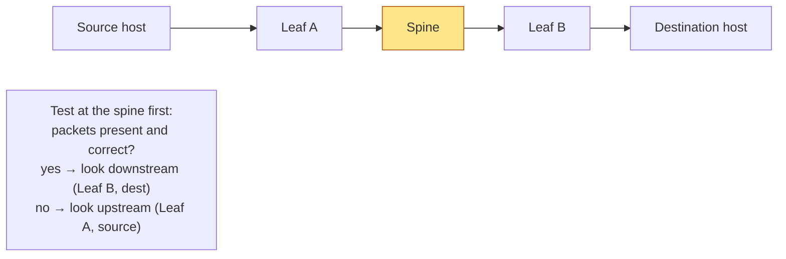
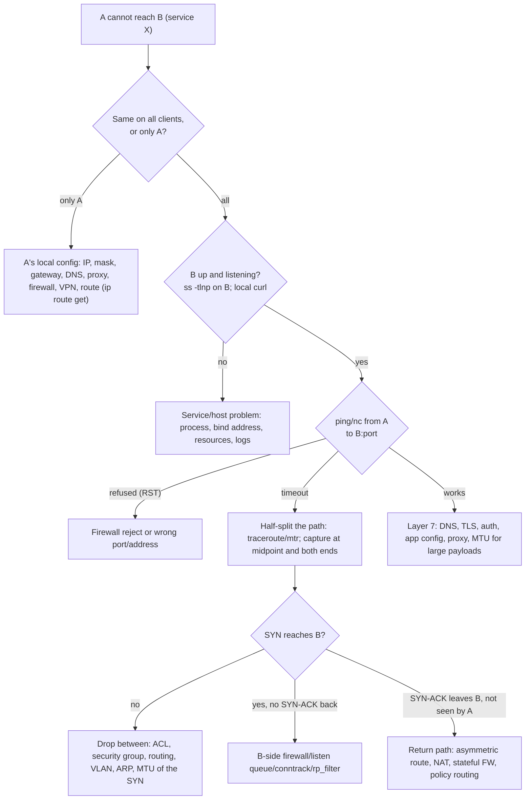

# 2.30 Network troubleshooting: method, models and case studies

| | |
|---|---|
| Level | Advanced |
| Priority tier | 0 |
| Lab venue | Chapter 2.27 containerlab fabric + a Linux VM; fault-injection scripts |
| Part | Part 2: Networking, from first principles to AI fabrics |
| Status | Drafted, labs **untested** |

## Why this matters for AI infrastructure

At 2 a.m. a training job that has consumed 4,000 GPUs for nine days stops making progress. The scheduler says healthy, the GPUs say idle, NCCL logs say a timeout, and everyone suspects the network. The difference between a fifteen-minute fix and a six-hour outage is almost never knowledge of a specific command; it is a **method**: knowing what the system is supposed to do, building the right mental models, choosing the next question wisely, measuring instead of guessing, changing one thing at a time, and capturing what you learn. Troubleshooting is rarely taught, yet it is the skill interviewers probe hardest for senior infrastructure roles ("walk me through how you would debug..."). This chapter teaches a general method (purpose, components, models, half-split, manipulation, simplification, fixing and technical debt), a practical data-collection kit, decision trees for the most common failure classes, and fourteen case studies, from a Linux host through overlays, load balancers and AI fabrics, each with symptoms, investigation, diagnosis and resolution.

## Prerequisites and outcomes

You should have worked through the networking fundamentals (2.2 to 2.10), routing and fabrics (2.13 to 2.19), the Linux toolbox (2.22 to 2.26) and the monitoring concepts in 2.31 (read in parallel).

After this chapter you can:

- State the purpose of the system you are troubleshooting in business terms, enumerate its components, and recognise the combinatorial explosion that makes whole-system knowledge impossible.
- Build and use *how*, *what* and *accurate* models; shift between models and move back up the model tree; avoid model lock-in.
- Apply the half-split method along a signal path; use manipulation to separate correlation from causation; simplify before testing.
- Separate the immediate fix from the permanent fix and manage technical debt; run a blameless post-incident review.
- Collect evidence quickly and safely with a standard diagnostic kit; use decision trees for connectivity, performance, intermittent faults and fabric problems.
- Diagnose the case-study failures (SNAT exhaustion, MTU black holes, conntrack exhaustion, ARP flux and rp_filter, UDP overflow, route dampening, checksum offload, PFC storms, veth bottlenecks, zero window, DNS timeouts, ECMP imbalance, rail mismatch, silent corruption) and generalise to new ones.

## 1. The purpose and the components

### Purpose first

Troubleshooting is an exercise in **narrowing**: start with a broad, imprecise description, move to a focused one, and finally identify something to change. The common failure is to narrow too fast, jump between hypotheses, and forget the overall purpose. **A system is working only if it accomplishes what it is supposed to do**, not if each component's gauges are green. A story from electronics illustrates it: a cable team insisted a repaired cable splice was fine because voltage and resistance readings were correct, while the wind-speed system it fed could not be calibrated; the dispute lasted days until a capacitive crosstalk test, the test that matched the *purpose*, found the splice faulty. For networks: "all links up and BGP established" is not "the all-reduce reaches 90% of line rate". Define success in terms of what the application needs, and measure that.

Also understand the business purpose and be honest about trade-offs: if the business asks for the impossible or the complex, resist the reflex of "how high?" when told to jump; explain the cost and risk.

### Components

A network is hardware (devices, cables, optics, power, cooling), software (operating systems, drivers, firmware), the control plane (protocols and policy), the specifications and designs it was built to, and the requirements of the applications and the business. No one can know every combination of these four or five systems and their interaction surfaces: the **combinatorial explosion** means you cannot hold the whole in your head. The remedy is **abstraction by models**.

## 2. Models

Every model is an incomplete but useful abstraction. Models are a two-edged sword: they make the system understandable and they hide detail, so use the right model for the question and know what it omits. (A black box that you are not allowed to understand cannot be troubleshot, and it hampers troubleshooting of any larger system that includes it.)

### How models (theory)

They explain *how and why things work*: the problem each mechanism solves, the range of possible solutions, and how this implementation applies one. Take BGP peering: *how does BGP manage flow control, error correction and marshalling?* (TCP does flow control and reliability), *how does it manage peer state?* (FSM, timers, keepalives), *how do I configure it to peer?* Many engineers know the second and third but never study the first, which leads to "hunt-and-peck" troubleshooting made of fragments of past incidents. Build how models by reading protocol specifications and design rationales, studying real network designs and their failures, and learning the algorithms and heuristics involved (this handbook's theory chapters are how models). They are often best captured as flow charts or sequence diagrams.

### What models (the state of *your* system)

They describe what is normal here: the signal path of each application (how its packets flow, queue and are processed), the baseline (traffic levels by time of day, SPF run times, jitter and delay per application, ECMP balance, PFC/ECN rates, temperatures, optic power), the normal configuration (intent, kept in a source of truth), the normal reaction to events (what happens when a link fails: expected convergence time, expected loss), and security boundaries. You learn them only by **observing repeatedly**, ideally under real conditions, and by writing the baseline down. You cannot recognise "broken" without knowing "normal". Beware observing only in the lab: a story from radar maintenance shows how checking the obvious, common failure (a resistor that tested shorted) and going home satisfied cost a second day, because a parallel component (an inductor, which always reads as a short on a DC ohmmeter) was the real failure, invisible to the instrument used. Tools have blind spots: know what your instrument cannot see.

### Accurate models

Accuracy means *fit to purpose*, not completeness. The OSI model is good for describing interfaces and for building a stack, and is poor for understanding what is happening where and why; a model that organises functions by problem (error control, flow control, multiplexing recurring at each scope, like RINA) maps better to troubleshooting. Different questions need different models (path, control plane, queues, energy/thermal, application protocol).

### Shifting between models and the model tree

Organise models into a tree from abstract to concrete: *network path* → (*control plane*, *data plane*) → (*convergence*, *shortest paths*; *QoS*, *queueing*, *jitter*) → ... At each step choose the model that fits the evidence, go deeper, and **return to the top** when new evidence changes the picture. The classic mistake is staying deep in one branch (staring at jitter) without asking how another branch (control-plane convergence) could cause it. A recounted incident: an outage investigated first as EIGRP protocol behaviour, then as packet transport, then as router input queues, finally as a broadcast flood from a misinstalled backup server in "server mode" scanning every subnet; each shift changed the model, and the team had to keep the larger purpose in view while chasing a "rogue IP address".

## 3. Half-split, manipulation and simplification

### Half split and move

Randomly hopping among models and tools is common and inefficient. The **half-split method** gives structure:

1. Map the path of the **signal** through the system (the thing you can test: a flow's packets, a neighbour adjacency, jitter at a point, completeness of a stream, a request).
2. Split the path roughly in half.
3. Test the signal at the midpoint: is it correct?
4. If **incorrect**, move toward the **source**; if **correct**, move toward the **destination**.
5. Repeat on the remaining half.

At each test ask: *what is the actual state of the system and the signal here?* and *what should normal look like?* The method forces you to look, compare with the baseline, and return to the larger context regularly, and it avoids diving into a plausible-looking component that is only a symptom. It maps naturally to networks: choose the path of the failing flow (`traceroute`, `ip route get`, ECMP-aware `mtr`), capture at the midpoint (packet capture or counters), and bisect.



### Manipulation: from correlation to causation

You may find that the symptom coincides with an event (jitter starts when SPF runs on router E). Correlation is not causation. To establish cause, **manipulate one variable while holding others constant**: reproduce the suspected trigger on purpose (cause the SPF event by flapping the same link, replay the same traffic) while measuring the signal. If the effect follows, you have a lever; if not, the correlation was a coincidence or a symptom of a deeper cause. Use manipulation also for **learning** what models: change QoS settings on a test flow path and watch how the application reacts. In practice reality is messier: causes interact and cannot always be reproduced, so sometimes you accept correlation and try changes in order of safety and likelihood, but the closer you stay to controlled manipulation the faster and more certain the diagnosis.

### Simplify before testing

With many parallel paths, variables and layers, remove components until the problem goes away or until only a minimal working set remains (disable ECMP to one path, drain a spine, turn off an optional feature, shift traffic to a single rail, bypass the load balancer, test on loopback/namespace). If the problem disappears early, suspect a positive feedback loop, control-plane state velocity, or that the removed component *was* the fault; add components back one at a time until it returns (a built-in manipulation test). If it persists to the minimum, you have narrowed it hugely. It feels counterintuitive to reduce redundancy during an outage; do it only where safe (drain, don't cut) and with change control.

### Fixing the problem, technical debt and learning

Fixing normally has two stages: (1) the **immediate fix** that restores the service (reroute, restart, config rollback, replace a part) and (2) the **permanent fix** that removes the cause (correct design, automation, monitoring, documentation). Teams are tempted to stop after step 1. Unfixed root causes accumulate as **technical debt**: workarounds that stay, undocumented exceptions, manual steps. Record the temporary fix as debt with an owner and date; schedule the permanent fix; after the incident run a **blameless post-incident review**: timeline, what we knew when, what misled us, what detection or tooling was missing, what to change (alerts, runbooks, tests in CI, design). Add the failure to your *what* model (baseline and event library) so the next occurrence is recognised instantly.

## 4. A practical workflow

1. **Stabilise and scope**: Who is affected? Since when? What changed (deploys, config, firmware, traffic, season)? Is data at risk? Declare an incident lead and a communication channel; keep a timeline.
2. **Define the symptom precisely** in measurable terms ("rank 37 to rank 112 all-reduce latency rose from 1.2 ms to 40 ms starting 02:13"), including what *works* (the negative space is the most informative part).
3. **Hypothesise from models**, rank by likelihood and cost to test; prefer cheap, safe, discriminating tests.
4. **Half-split** along the signal path; collect evidence at each point (counters, captures, logs, telemetry).
5. **Manipulate** to confirm cause; simplify where useful.
6. **Mitigate** (immediate fix), verify with the *purpose metric*, communicate.
7. **Permanent fix and learning** (as above).

Generic bottom-up and top-down aids: **bottom-up** (physical → link → network → transport → application) is efficient when many things fail at once or after hardware changes; **top-down** when only one application misbehaves; **divide and conquer / half-split** when the path is long; **follow the path** (trace the actual flow end to end, including NAT, overlay and load balancers); **compare with a working peer** (diff a good and a bad node: configs, firmware, `ethtool`, sysctls, routes, counters: configuration drift is the most common root cause in fleets); **change one thing at a time** and revert failed experiments; **use the packet** (a capture beats opinion).

## 5. The diagnostic kit

Have a standard, scripted, read-only collector so anyone can gather the same evidence in under a minute on any node (and attach it to the ticket):

```bash
#!/bin/bash
# netdiag.sh: read-only network evidence collector (run as root); output to /tmp/netdiag-$(hostname)-$(date +%s)
out=/tmp/netdiag-$(hostname)-$(date +%Y%m%d-%H%M%S); mkdir -p $out; cd $out
{ date; uname -a; uptime; } > sys.txt
ip -br link > ip-link.txt; ip -br addr > ip-addr.txt; ip -d link > ip-link-detail.txt; ip -s -s link > ip-link-stats.txt
ip route show table all > routes.txt; ip -6 route show table all > routes6.txt; ip rule > rules.txt; ip neigh > neigh.txt
ss -s > ss-summary.txt; ss -tanpi > ss-tcp.txt; ss -uanp > ss-udp.txt; ss -tlnp > ss-listen.txt
nstat -az > nstat.txt; cat /proc/net/softnet_stat > softnet.txt; cat /proc/net/dev > netdev.txt
for i in $(ls /sys/class/net | grep -v '^lo$'); do { echo "== $i"; ethtool $i; ethtool -i $i; ethtool -S $i; ethtool -g $i; ethtool -k $i; ethtool -c $i; ethtool -l $i; ethtool -m $i; } > ethtool-$i.txt 2>&1; done
sysctl -a 2>/dev/null | egrep '^net\.(ipv4|ipv6|core|netfilter|bridge)' > sysctl-net.txt
nft list ruleset > nft.txt 2>&1; iptables-save > iptables.txt 2>&1; conntrack -S > conntrack-stats.txt 2>&1; conntrack -C >> conntrack-stats.txt 2>&1
tc -s qdisc > tc-qdisc.txt; tc -s class show > tc-class.txt 2>&1
cat /etc/resolv.conf > resolv.txt; resolvectl status > resolved.txt 2>&1; cat /etc/hosts > hosts.txt
lspci -vv 2>/dev/null | egrep -A3 -i 'ethernet|infiniband|mellanox|nvidia' > lspci-net.txt
dmesg -T | egrep -i 'link|eth|mlx|nic|conntrack|drop|reset|timeout|xid|error' | tail -500 > dmesg-net.txt
journalctl -k --since "-1h" --no-pager > journal-kernel-1h.txt 2>&1
ibstat > ibstat.txt 2>&1; rdma link > rdma-link.txt 2>&1; rdma statistic > rdma-stats.txt 2>&1; nvidia-smi topo -m > gpu-topo.txt 2>&1; nvidia-smi -q -d PERFORMANCE,CLOCK > gpu-q.txt 2>&1
mpstat -P ALL 1 3 > mpstat.txt 2>&1; cat /proc/interrupts > interrupts.txt; cat /proc/softirqs > softirqs.txt
tar czf $out.tgz -C /tmp $(basename $out) && echo "$out.tgz"
```

Plus on-demand: `mtr -n -r -c 100`, `tracepath`, `ping -M do -s N`, short truncated `tcpdump` on suspect interfaces (with a filter, chapter 2.26), `iperf3` and `ib_write_bw` tests between pairs, `nccl-tests` per rail, `tcplife/tcpretrans/tcpdrop` (chapter 2.22/2.26), switch-side counters (`show interface counters errors`, PFC/ECN/queue drops, optics DOM, BGP/BFD state, LLDP).

## 6. Decision trees

### Connectivity: "A cannot reach B"



### Performance: "slow", "stalls", "low throughput"

1. **Quantify** (throughput, latency percentiles, retransmit rate) and compare with the baseline and with the theoretical limit (line rate, BDP).
2. **Which limit?** `ss -ti` limiter flags (cwnd-limited, rwnd-limited, sndbuf-limited, app-limited), CPU (`mpstat`, `top -H`, softirq), memory, disk, NIC (`ethtool -S` drops, pause), switch queues/PFC/ECN, MTU, congestion control.
3. **Which segment?** Test pairs in the path with `iperf3`/`ib_write_bw` (half-split), per rail, per direction.
4. **Loss or latency?** retransmits (`nstat`, `tcpretrans`), RTT (`ss -ti`, `ping`), jitter; check ICMP/TTL.
5. **One flow or all?** ECMP hash collisions, elephant flows, single core limits.
6. **Compare to a healthy node.**

### Intermittent faults

Capture evidence *before* the fault: ring buffer captures (`-C -W`), continuous telemetry, `ping -D -i 0.2` with timestamps, `mtr --report` loops, scheduled `ss`/`nstat` snapshots, switch syslog and counters correlated by time; look for periodicity (timers: 30 s, 60 s, 5 min, 1 h; cron jobs; backups; GC; DHCP lease renewals; conntrack timeouts; BGP dampening; certificate or token expiry), correlation with load, temperature, or specific hosts. Intermittent faults are usually capacity limits, timeouts, flaps, or one bad member of an ECMP/LAG set (traffic that hashes to the bad path fails while others succeed).

### AI-fabric symptoms

| Symptom | First checks |
|---|---|
| One rank slow in all-reduce | Per-rail NIC counters, optics DOM, ECMP/AR imbalance, PFC pauses from/to that host, CPU/NUMA/IRQ on that node, thermal or power throttling |
| Job hangs at init/NCCL timeout | `NCCL_DEBUG=INFO` (interfaces, GID, transport chosen), firewall/security group between nodes, MTU, wrong `NCCL_SOCKET_IFNAME`/`NCCL_IB_HCA`, DNS/hostname resolution, time skew, subnet manager state |
| Throughput half of expected | Link speed/FEC negotiated down, PCIe width, NUMA mismatch, MTU 1500 on one hop, PFC/ECN misconfiguration, oversubscribed tier, ECMP collision |
| Periodic stalls (seconds) | PFC storm, RTO events, BGP/BFD flap, congestion from a competing job, checkpoint write incast on storage network |
| Errors rising without link flap | CRC/FEC counters, dirty or failing optics (DOM Rx power low), bad cable, switch ASIC issue |
| After maintenance | Config drift, wrong cable/rail mapping (LLDP vs plan), firmware mismatch, forgotten drain |

## 7. Case studies

Each case lists symptom, investigation, diagnosis, resolution, and the lesson.

### Case 1: SNAT port exhaustion

*Symptom*: microservices in a private subnet intermittently time out connecting to an external managed database. *Investigation*: the DB is healthy; CPU is low; the NAT gateway's `dmesg` shows no conntrack drops; ~5,000 containers connect through one NAT IP to one DB IP and port. *Diagnosis*: a single source IP has ~60,000 usable ephemeral ports **per destination IP:port**; new connections beyond that cannot get a mapping. *Resolution*: add NAT gateway IPs/ports (Cloud NAT port allocation), use a connection pooler (PgBouncer) to multiplex, shorten TIME_WAIT, reuse connections. *Lesson*: count the tuple dimensions (source IP, destination IP and port) when sizing NAT.

### Case 2: Path MTU black hole

*Symptom*: small queries succeed, large ones hang; `ping` and `telnet port` work. *Investigation*: capture shows the handshake succeeds; a full-sized server packet never reaches the client; no ICMP seen. *Diagnosis*: server MTU 9000, a router in the middle at 1500; the router sends ICMP "fragmentation needed" but a firewall drops all ICMP. *Resolution*: align MTUs, allow ICMP type 3 code 4 (and ICMPv6 type 2), MSS clamp at the edge, `tcp_mtu_probing=1`. *Lesson*: test with `ping -M do -s` and look for the ICMP in the capture (chapter 2.7).

### Case 3: Conntrack table full

*Symptom*: intermittent timeouts for new connections on busy Kubernetes nodes; CPU and bandwidth look fine. *Investigation*: `dmesg`: `nf_conntrack: table full, dropping packet`; `conntrack -C` equals `nf_conntrack_max`; `conntrack -S` shows insert_failed. *Diagnosis*: the established timeout (5 days) keeps dead flows for ever and the table is undersized. *Resolution*: raise max and hash size, lower timeouts, find chatty clients, `notrack` for DNS/east-west flows. *Lesson*: capacity limits in state tables look like random packet loss.

### Case 4: ARP flux and reverse-path filtering on a multi-homed host

*Symptom*: two hosts on the same subnet cannot communicate; `ip neigh` shows INCOMPLETE; captures show ARP requests and replies but the host ignores them. *Diagnosis*: a host with multiple interfaces on one subnet answers ARP for any local IP on any interface (ARP flux), so replies come from the wrong NIC; `rp_filter` strict mode also drops asymmetric traffic. *Resolution*: `arp_ignore=1`, `arp_announce=2`, `rp_filter=2`, source-based routing (chapter 2.24); better, one subnet per NIC. *Lesson*: Linux's weak host model surprises multi-NIC designs.

### Case 5: UDP receive buffer overflow (StatsD/syslog)

*Symptom*: metric graphs show gaps under load; servers not crashing. *Diagnosis*: UDP has no flow control; the receiver's socket buffer (`rmem_default`) overflows; the kernel drops silently (`UdpRcvbufErrors`). *Resolution*: monitor `nstat`/`ss -ump`, raise buffers (`SO_RCVBUF`, `rmem_max`), add receivers with `SO_REUSEPORT`, batch metrics, use TCP where loss matters. *Lesson*: silent loss needs counters; always chart drops.

### Case 6: BGP route dampening after a flapping optic

*Symptom*: management network outages of exactly five minutes, randomly repeating. *Diagnosis*: a failing transceiver flaps a link every few seconds; the host's FRR advertises/withdraws a route; the spine applies route-flap dampening and suppresses the route for a penalty period. *Resolution*: replace the optic (DOM showed bad Rx power); keep dampening because it protects the control plane. *Lesson*: periodic "exact N-minute" outages are timers (dampening, hold-down, lease, cache); find the timer.

### Case 7: TCP checksum offload failure

*Symptom*: `ping` works, SSH hangs after the version exchange; the receiver's capture shows packets with an incorrect checksum. *Diagnosis*: a driver/firmware bug makes the sender's NIC compute wrong checksums with TX offload; the receiver's hardware drops them; the capture tap sees them before the drop. *Resolution*: `ethtool -K eth0 tx off` as a workaround; update driver/firmware. *Lesson*: distinguish benign "bad cksum" on the sender from bad checksums seen at the receiver (chapter 2.26).

### Case 8: PFC storm collapses an NCCL job

*Symptom*: multi-node job runs fine for five minutes then throughput falls to zero; `ib_write_bw` passes when idle. *Investigation*: `ethtool -S` on hosts shows `rx_pause` counters increasing by millions per second. *Diagnosis*: ECN thresholds on switches were set too high, so buffers filled before ECN/CNP could slow senders; switches fired hard PFC pauses, which propagated and froze the fabric. *Resolution*: lower ECN thresholds below the PFC threshold, verify DCQCN on NICs, enable the PFC watchdog, find any stuck endpoint. *Lesson*: ECN must act well before PFC (chapter 2.19).

### Case 9: veth CPU bottleneck in a pod

*Symptom*: a pod with heavy network I/O caps near 15 Gb/s on a 100G host; one core at 100% softirq. *Diagnosis*: traffic across veth pairs is processed in softirq on one CPU per flow. *Resolution*: use host networking, ipvlan/macvlan, SR-IOV or RDMA secondary interfaces, or an eBPF host-routing CNI. *Lesson*: the pod network is a different (slower) data path than the host NIC.

### Case 10: TCP zero window stalls

*Symptom*: file transfer between two nodes stalls for 5 to 10 s, then resumes. *Investigation*: capture shows `TCP Window Size: 0` from the receiver. *Diagnosis*: the receiving application isn't reading fast enough (disk or CPU); the network is fine. *Resolution*: fix the receiver (I/O, CPU, buffering). *Lesson*: zero window blames the receiver's application, not the path.

### Case 11: Asymmetric ECMP and reordering from a host speaking BGP

*Symptom*: a host advertises its loopback to two ToRs; return traffic splits across both, causing reordering and TCP degradation. *Diagnosis*: unequal path latency plus per-packet or poorly keyed load balancing; host-side bond misconfiguration. *Resolution*: consistent per-flow hashing, correct bonding/ECMP policy, equal-length paths. *Lesson*: reordering looks like loss to TCP (dup ACKs, SACK).

### Case 12: Multicast blackhole in an overlay

*Symptom*: a UDP-multicast application works on physical hosts but fails on a Kubernetes overlay. *Diagnosis*: VXLAN overlays and clouds usually don't carry L2 multicast (no IGMP snooping/PIM); *Resolution*: unicast replication in the overlay, EVPN multicast support, or refactor the application. *Lesson*: overlays change what the network can carry.

### Case 13: DNS 5-second delays in Kubernetes

*Symptom*: occasional 5 s latency on external calls. *Diagnosis*: parallel A and AAAA queries from one source port race in conntrack/NAT; one is dropped; the stub waits for its default 5 s timeout; `ndots:5` multiplies the queries. *Resolution*: `single-request-reopen`, NodeLocal DNSCache, lower `ndots`, newer kernel (chapter 2.8). *Lesson*: "exactly N seconds" is a timer: match it to a default.

### Case 14: Silent corruption and a "slow rail" in a GPU cluster

*Symptom*: step times oscillate; one node is consistently 15% slower; no link-down events. *Investigation*: switch counters show FEC-corrected codewords and CRC errors rising on one port; NIC `ethtool -S` shows `rx_corrected_bits`; optics DOM Rx power is marginal; retransmissions on that rail; NCCL logs show the rail completing late. *Diagnosis*: a dirty or failing optic/cable causing high pre-FEC BER; the rail still "works" but with retries and added latency, so every collective waits for it. *Resolution*: clean/replace the fibre or transceiver, verify with BER tests and counters, add alerts on FEC/CRC trends and per-rail bandwidth skew, drain the node until fixed. *Lesson*: in synchronous training the slowest participant sets the pace; monitor trends in error counters, not just link state.

## 8. Hands-on lab: fault-injection exercises

First, run the self-checking Python lab (`code/part02/network_troubleshooting_method_lab.py`) locally. It verifies the half-split binary-search fault isolator across a 5-hop Clos path (`src_host -> leaf_a -> spine -> leaf_b -> dst_host`) and the 14-case-study diagnostic classifier.

```bash
python3 code/part02/network_troubleshooting_method_lab.py
```

Next, using the Chapter 2.27 containerlab fabric on a disposable Linux VM (all interactive VM commands below are `untested here`), have a partner or script inject one fault from the table below and diagnose it with the method and kit:

| # | Injected fault | Injection method |
|---|---|---|
| 1 | MTU mismatch on one link | `ip link set eth2 mtu 1400` on a leaf |
| 2 | Silent packet loss on one ECMP member | `tc qdisc add dev eth1 root netem loss 3%` |
| 3 | One-way link failure | `tc filter` dropping packets in one direction, or `nft` drop on ingress only |
| 4 | Wrong ASN / missing route-map | Edit FRR config and reload |
| 5 | Conntrack exhaustion | Lower `nf_conntrack_max` and generate connections |
| 6 | DNS slow path | Put a dead resolver first in `resolv.conf` |
| 7 | Asymmetric routing | Policy route replies out another NIC, `rp_filter=1` |
| 8 | ECMP hash collision/elephants | Two `iperf3` flows crafted onto one link |
| 9 | Delayed ACK/Nagle | Application sending header and body as separate writes |
| 10 | TCP receive-window starvation | Server that sleeps before `read()` |
| 11 | ARP/neighbour issue | Duplicate IP on the segment |
| 12 | Firewall dropping ICMP | `nft` rule dropping type 3 code 4 |
| 13 | Hot spare disabled / flapping link | `ip link set dev X down/up` loop at 2 s |
| 14 | CPU/IRQ imbalance | Pin all NIC IRQs to one core |

For each: write the symptom as observed by the application, the hypothesis list ranked by likelihood, the half-split points you chose, the evidence that confirmed the cause, the immediate and permanent fixes, and what alert or test would have caught it earlier.

## 9. Common mistakes

- Starting with tools instead of the purpose and a measurable symptom.
- Narrowing too fast; fixating on the first plausible cause ("it's always DNS"); not returning to higher-level models.
- Trusting a single instrument (an ohmmeter that can't see the inductor failure; link-up lights that don't show BER).
- Changing several things at once; no rollback; no notes.
- Treating correlation as cause; skipping manipulation.
- Stopping at the immediate fix; accumulating technical debt; no post-incident review.
- Lacking baselines, so "abnormal" can't be recognised.
- Debugging the network when the application, host, or storage is the bottleneck, or vice versa.
- Not capturing evidence before the symptom disappears (rebooting first).

## 10. Interview angles

- "Walk me through how you troubleshoot a network problem you've never seen." (Purpose, symptom, models, half-split, measurement, manipulation, fix, learn.)
- "Users report slowness. What do you do in the first five minutes?"
- "A connection works for small payloads but hangs for large ones."
- "Training throughput dropped 30% overnight with no alarms; where do you look?"
- "How do you decide whether it's the network or the application?"
- "Describe the worst outage you debugged: what misled you, what finally revealed the cause, what changed afterwards?"
- "How do you prove causation rather than correlation?"
- "What is the difference between an immediate and a permanent fix, and why does it matter?"

## Exercises

1. **Purpose First, Combinatorial Explosion, and *How* vs. *What* vs. *Accurate* Models (`CN` Chapter 24):** (a) Explain why \"all links up and BGP Established\" does not prove a network is working, relating it to the wind-speed cable capacitive crosstalk story; (b) contrast **How models** (protocol theory), **What models** (local baselines and normal behavior, plus instrument blind spots from the storm-radar inductor story), and **Accurate models** (fit to purpose), and explain how to navigate the **model tree** without getting stuck in one branch.
2. **Half-Split Binary Search, Manipulation, Simplification, and Technical Debt (`CN` Chapter 24):** (a) Using `run_half_split_path_search()` in `code/part02/network_troubleshooting_method.py` on `["src_host", "leaf_a", "spine", "leaf_b", "dst_host"]`, trace which hops are probed when `leaf_b` is the first failing hop versus when `leaf_a` is the first failing hop; (b) explain how **controlled manipulation** separates causation from correlation, what it means when a bug disappears during **simplification**, and why stopping at the **immediate fix** accumulates **technical debt**.
3. **The Read-Only `netdiag.sh` Evidence Collector and Connectivity / Performance Decision Trees:** Explain why you must run `netdiag.sh` **before** rebooting a node or restarting daemons, and trace the Section 6 decision tree for \"Host A cannot reach Service X on Host B\" across `Connection refused (RST)` versus `Connection timed out`.
4. **Host, Firewall, and NAT Case Studies (Cases 1–5 and 7):** Using `classify_case_study_symptom()`, state the root cause, diagnostic command/counter, and permanent fix for: Case 1 (SNAT port exhaustion at `~60,000` ports per destination tuple), Case 2 (Path MTU black hole), Case 3 (`nf_conntrack: table full`), Case 4 (multi-NIC ARP flux + `rp_filter=1`), Case 5 (`UdpRcvbufErrors` overflow), and Case 7 (receiver-observed bad TCP checksums).
5. **Routing, Overlay, and Transport Case Studies (Cases 6 and 9–13):** State the root cause and fix for: Case 6 (repeating 5-minute outages from BGP route dampening on a flapping optic), Case 9 (`veth` single-core softirq cap at `~15 Gb/s`), Case 10 (`TCP Window Size: 0`), Case 11 (asymmetric ECMP packet reordering), Case 12 (VXLAN overlay multicast blackhole), and Case 13 (Kubernetes 5-second DNS timeouts).
6. **AI-Fabric Case Studies (Cases 8 and 14: `PFC` Storms and Marginal Optics / Slow Rails):** Compare Case 8 (multi-node `NCCL` job collapsing to zero throughput after 5 minutes with millions of `rx_pause` frames/s because switch ECN thresholds were above PFC `XOFF`) and Case 14 (4,000-GPU training step times dragged down 15% by a single dirty/failing transceiver with low DOM `Rx power` and rising FEC-corrected bits / CRC errors on one rail).

## Checkpoint questions (20)

<details>
<summary>1. What defines whether a network system is \"working\", and what lesson does the wind-speed cable splice story teach (`CN` Chapter 24)?</summary>

**A system is working only if it accomplishes its intended end-to-end purpose for the application and business**—not merely if individual component gauges look green. In the wind-speed instrument story, the cable team insisted their splice was good because DC continuity and resistance passed, yet the splice had high **capacitive crosstalk** that corrupted the AC signal needed by the instrument. In an AI cluster, \"all ports UP and BGP Established\" means nothing if `AllReduce` collectives stall at 10% of line rate.
</details>

<details>
<summary>2. Why is it impossible for any engineer to hold the entire state of a modern network in their head, and how do Models solve this?</summary>

A network combines hardware (ASICs, optics, cables, power/thermal), software (NOS, drivers, firmware), distributed control planes, topology designs, and application workloads—creating a **combinatorial explosion of interaction surfaces**. We cope by using **models**: simplified mental abstractions that intentionally hide irrelevant detail so we can reason about one aspect of the system at a time.
</details>

<details>
<summary>3. Contrast *How* Models, *What* Models, and *Accurate* Models in network troubleshooting (`CN` Chapter 24).</summary>

- ***How* models (Theory)**: explain *how and why protocols and mechanisms work* (e.g., how TCP sliding windows, BGP best-path, or DCQCN ECN/PFC work in principle).\n- ***What* models (Your System's Baseline)**: describe *what is normal in your specific production network*—the exact signal path of each application, baseline latencies, queue depths, ECMP balance, optic power levels, and expected convergence times (learned only by repeated observation and documentation).\n- ***Accurate* models**: models whose level of abstraction is **fit to the question at hand** (for example, RINA's recurring error/flow/multiplexing model or a queue/buffer model rather than the 7-layer OSI chart when debugging microbursts).
</details>

<details>
<summary>4. What lesson does the storm-radar inductor-vs-resistor story teach about diagnostic tools (`CN` Chapter 24)?</summary>

In the radar maintenance story, a technician found a burnt resistor in parallel with an inductor, replaced the resistor, measured `0 Ω` across the pair with a DC ohmmeter, and went home—only for the radar to fail again because the inductor itself had shorted out, and **a DC ohmmeter always reads an inductor as `0 Ω` (a short) whether it is healthy or shorted**. Lesson: **every diagnostic tool has blind spots** (`ping` cannot see a TCP port block or an MTU black hole; host `tcpdump` cannot see kernel-bypassed RDMA or NIC ring drops). Always know what your instrument cannot see.
</details>

<details>
<summary>5. What is the \"Model Tree\", and what is the most common mistake engineers make when navigating it?</summary>

The **model tree** organizes mental models from high-level abstract (`End-to-End Application Path`) down into branches (`Control Plane -> BGP / OSPF / Convergence` vs `Data Plane -> Queues / QoS / Physical Optics`). The classic mistake is **diving deep into one branch (e.g., staring at QoS queue jitter for hours) and never climbing back up to the root of the tree** when new evidence arrives (missing that a flapping control-plane route or a broadcast storm from a misconfigured server is what is filling the queue).
</details>

<details>
<summary>6. State the 5-step Half-Split (Binary Search) troubleshooting method along a signal path.</summary>

(1) **Map the end-to-end path of the signal** (`Source Host -> Leaf A -> Spine -> Leaf B -> Destination Host`);\n(2) **Split the path in half** (at the midpoint, `Spine`);\n(3) **Test the signal at the midpoint** (via packet capture, counters, or synthetic test): is the signal present and healthy here?;\n(4) If **unhealthy at the midpoint**, the fault lies in the **upstream half** (toward the source: `Source Host` or `Leaf A`); if **healthy at the midpoint**, the fault lies in the **downstream half** (toward the destination: `Leaf B` or `Destination Host`); and\n(5) **Repeat** by splitting the remaining half in two (`O(log N)` probes).
</details>

<details>
<summary>7. How do you use \"Manipulation\" to prove that a correlated event is actually the root cause (`CN` Chapter 24)?</summary>

Observing that latency spikes coincided with SPF runs on Router E is **correlation, not causation** (both might be caused by a third factor, such as a power dip or traffic burst). To establish **causation**, **manipulate one variable while holding everything else constant**: trigger an SPF calculation on Router E on purpose in a controlled window while measuring application latency. If latency spikes on command, you have found a causal lever; if not, keep looking.
</details>

<details>
<summary>8. How does \"Simplify Before Testing\" work on a complex multipath fabric, and what does it mean if the problem vanishes as soon as you simplify?</summary>

When a bug occurs across an 8-spine, 8-rail ECMP fabric with overlays and load balancers, temporarily **reduce the active path to a minimal subset** (drain 7 spines so traffic uses 1 spine, test 1 rail with `ib_write_bw`, or bypass the L7 proxy). If the problem **persists** on the minimal path, you have eliminated 80% of the components and can debug a simple 3-node line. If the problem **disappears** when you remove components, either **(a) one of the removed components was the faulty hardware** (add them back one by one to catch the culprit), or **(b) the bug is an emergent interaction / positive feedback loop** (like ECMP reordering or a control-plane flood).
</details>

<details>
<summary>9. What is the difference between an Immediate Fix and a Permanent Fix, and how do unfixed root causes become Technical Debt?</summary>

The **immediate fix (mitigation)** restores production service as fast as possible (draining a bad spine, rebooting a wedged NIC, rolling back a config, raising a limit). The **permanent fix** eliminates the underlying root cause in design, code, automation, and monitoring so the incident cannot recur. Stopping after the immediate fix leaves undocumented workarounds, manual snowflakes, and latent hazards in the system (**technical debt**); always track temporary mitigations with an owner/deadline and conduct a **blameless post-incident review**.
</details>

<details>
<summary>10. Why must you run a read-only diagnostic collector (`netdiag.sh`) BEFORE rebooting a broken node or restarting network daemons?</summary>

Rebooting a server or restarting `frr`/`NetworkManager`/`containerd` **destroys the volatile forensic evidence in RAM**: socket queues (`ss -tanpi`), `conntrack` tables, `ip route`/`ip neigh` state, softnet counters, and kernel ring buffers. Running a 30-second read-only collector (`netdiag.sh`) captures the exact crime scene to a tarball before you mitigate by rebooting.
</details>

<details>
<summary>11. In the Connectivity Decision Tree, what is the first question to ask when Client A cannot reach Service X on Server B, and how do `Connection refused` and `Timed out` diverge?</summary>

First ask **scope**: *"Can OTHER clients reach Service X on Server B, or is ONLY Client A failing?"* (If only A fails, check A's local IP/route/DNS/firewall; if all clients fail, check Server B.) Next, test `nc -zv B port`:\n- **`Connection refused` (`RST` received)**: the network path is open in both directions, and either the daemon on B is not listening (`ss -tlnp`) or a firewall rule is actively rejecting with `TCP RST`.\n- **`Connection timed out` (no reply)**: a packet (`SYN` or `SYN-ACK`) was silently dropped—half-split with `tcpdump` at both ends to see if the `SYN` reached B and if the `SYN-ACK` left B.
</details>

<details>
<summary>12. Whenever an outage or stall lasts for an \"exact round number of seconds or minutes\" (`5 s`, `60 s`, `5 min`), what should you immediately suspect?</summary>

Physical hardware errors are random; **exact round durations are always software or protocol timers**. Examples:\n- **`~40 ms`**: TCP Delayed ACK + Nagle stall;\n- **`200 ms`**: Linux `TCP_RTO_MIN` retransmission timeout;\n- **`1 s`, `3 s`, `7 s`**: Linux TCP `SYN` retransmission backoff (`ListenOverflows` or dropped `SYN`);\n- **`5.0 s`**: `glibc` `/etc/resolv.conf` default DNS query timeout (Case 13);\n- **`60 s` / `300 s` / `350 s`**: `TIME_WAIT` or NAT/load-balancer idle timeout;\n- **`5 minutes` (`300 s`)**: BGP route-flap dampening penalty or ARP/MAC cache aging (Case 6).
</details>

<details>
<summary>13. Summarize the root cause and fix of Case 1 (SNAT Port Exhaustion) and Case 3 (`nf_conntrack` Table Full).</summary>

- **Case 1 (SNAT Port Exhaustion)**: 5,000 containers behind **1 NAT public IP** open connections to the **same single external database `IP:port`**, exhausting the `~60,000` ephemeral source ports available for that `(src_ip, dst_ip, dst_port)` tuple even though `nf_conntrack` is not full. Fix: add multiple SNAT IPs to the NAT gateway pool, deploy a connection pooler (`PgBouncer`), and enable keep-alives.\n- **Case 3 (`nf_conntrack` Table Full)**: total tracked flows across all destinations hit `nf_conntrack_max` (often bloated by the 5-day `432,000 s` default established TCP timeout), logging `nf_conntrack: table full, dropping packet` in `dmesg`. Fix: shorten timeouts (`3600 s`), raise `nf_conntrack_max` + `hashsize`, and `notrack` stateless high-rate flows.
</details>

<details>
<summary>14. Summarize the root cause and fix of Case 4 (Multi-NIC ARP Flux and `rp_filter`).</summary>

Because Linux uses the **weak host model**, a server with multiple NICs on the same subnet (or without source-based policy routing) answers ARP requests for any of its local IPs from whichever NIC processes the broadcast first (**ARP flux**) and routes replies using only the `main` table's default gateway—causing strict Reverse-Path Filtering (`rp_filter = 1`) to silently drop incoming packets (`IPStatsInAddrErrors`). Fix: place each NIC in its own subnet/routing table with `ip rule from <ip> lookup <table>`, and set **`arp_ignore = 1`**, **`arp_announce = 2`**, and **`rp_filter = 2`** (loose).
</details>

<details>
<summary>15. Summarize the root cause and fix of Case 5 (UDP Receive Buffer Overflow) and Case 10 (TCP Zero Window).</summary>

- **Case 5 (UDP Buffer Overflow)**: UDP has no flow control (`rwnd`) or retransmissions; when a telemetry/logging daemon (`StatsD`, `syslog`, `gNMI`/NetFlow collector) cannot `recvfrom()` fast enough during a burst, the kernel socket buffer (`rmem_default`) fills and silently drops datagrams, incrementing **`UdpRcvbufErrors` in `nstat -az`**. Fix: raise `net.core.rmem_max` and `SO_RCVBUF` and scale worker threads with **`SO_REUSEPORT`**.\n- **Case 10 (TCP Zero Window)**: the capture shows `win 0` (`tcp.analysis.zero_window`) sent by the receiver—proving the network is delivering bytes faster than the **receiving application** (blocked on disk I/O, GC, or CPU lock) is reading from its socket.
</details>

<details>
<summary>16. In Case 7 (TCP Checksum Offload Bug), how do you distinguish a real hardware/driver checksum bug from the normal benign `[bad tcp cksum]` seen in `tcpdump`?</summary>

On the **sending host**, `[bad tcp cksum]` in `tcpdump` is completely normal when TX checksum offload is enabled because `AF_PACKET` taps the packet before the NIC computes the checksum. However, if you run `tcpdump` **on the receiving host** (after the packet has crossed the sender's NIC and the physical wire) and **still see bad TCP checksums** (accompanied by `TcpInCsumErrors` in `nstat -az` on the receiver), the sender's NIC driver/firmware has a genuine TX offload bug—mitigate immediately with **`sudo ethtool -K <dev> tx off`** and update the NIC firmware/driver.
</details>

<details>
<summary>17. Summarize the root cause and fix of Case 8 (`PFC` Storm Collapsing an `NCCL` Job).</summary>

A multi-node RoCEv2 training job runs at full speed for 5 minutes until a synchronized collective incast hits a switch whose **ECN marking thresholds (`Kmin`/`Kmax`) were misconfigured higher than its PFC `XOFF` threshold**. Instead of ECN/CNP gently throttling the sending QPs, switch buffers hit `XOFF` first and blast link-level **PFC pause frames (`millions/s` in `ethtool -S rx_pause`)**, pausing entire priority classes hop-by-hop across the leaf-spine fabric. Fix: enforce **`XON < ECN Kmin < ECN Kmax < PFC XOFF`**, verify DSCP-to-priority trust on all NICs/switches, and enable the **PFC watchdog**.
</details>

<details>
<summary>18. Summarize the root cause and fix of Case 9 (Pod `veth` CPU Bottleneck) and Case 11 (Asymmetric Host-BGP ECMP Reordering).</summary>

- **Case 9 (`veth` CPU Bottleneck)**: a single high-throughput TCP flow crossing a container `veth` pair pins one CPU core at `100%` `NET_RX_SOFTIRQ` (`~15 Gb/s` ceiling). Fix: use `hostNetwork: true`, Cilium eBPF host routing, `ipvlan`, or `SR-IOV`/RDMA secondary interfaces.\n- **Case 11 (Asymmetric ECMP Reordering)**: a host advertising a VIP over BGP to two ToRs has per-packet (`balance-rr`) or miskeyed hashing across paths of unequal latency, causing packets of a single TCP flow to arrive out of order and trigger triple-dup-ACK rate cuts. Fix: enforce consistent 5-tuple flow hashing (`layer3+4` / `fib_multipath_hash_policy=1`) and equal-cost paths.
</details>

<details>
<summary>19. Summarize the root cause and fix of Case 14 (Silent Corruption and a \"Slow Rail\" in a 4,000-GPU Cluster).</summary>

In synchronous distributed training (`AllReduce`), **every rank waits at the barrier for the single slowest GPU/rail**. A dirty or degrading optical transceiver on one port of one node has low DOM `Rx power` (`ethtool -m`), causing a high pre-FEC bit error rate (`rx_corrected_bits`), occasional uncorrectable FEC codewords / CRC frame drops, and RDMA go-back-N retransmissions—never flapping the link `DOWN` (so link-down alerts stay green), yet dragging step times down by 15% across all 4,000 GPUs. Fix: alert on **rising FEC/CRC error rates, low DOM optical power, and per-rail RDMA retransmission counters**, cordon/drain the node, and clean or replace the transceiver/fiber.
</details>

<details>
<summary>20. Why is comparing a \"broken\" node against a \"working\" sibling node (`diff`) one of the fastest troubleshooting techniques in AI clusters?</summary>

In a homogeneous GPU cluster where all nodes are built from the same image and cabling plan, **configuration or hardware drift** (one node negotiated `100G` instead of `400G`, one NIC on `MTU 1500`, one missing `ip rule`, one outdated `mlnx_ofed` driver, or one loose optic) accounts for the majority of single-node anomalies. Running `netdiag.sh` on both the slow node and a healthy sibling node in the same rack and diffing their `ethtool`, `sysctl`, `ip route`, and counter outputs surfaces the discrepancy in seconds.
</details>

## Sources and review notes

- **Sources read in full:**
  - `computer-networking-problems-and-solutions` — Russ White and Ethan Banks, *Computer Networking Problems and Solutions*, **Chapter 24: Troubleshooting** (the purpose and the wind-speed cable crosstalk story, the components and combinatorial explosion, *how* / *what* / *accurate* models and the storm-radar inductor vs resistor blind-spot story, shifting between models and the model tree with the EIGRP / backup-server broadcast-storm story, half-split and move, using manipulability, simplify before testing, and immediate vs permanent fix and technical debt).
  - `systems-performance-2nd-edition` — Brendan Gregg, *Systems Performance: Enterprise and the Cloud*, 2nd ed., **Chapters 2 and 10** (USE method, tools method, workload characterization, latency analysis, and TCP analysis).
  - `nvidia-devops/volume-01/03-linux-networking-masterclass.md` — migrated the 14 production networking case studies (SNAT port exhaustion, Path MTU black holes, conntrack exhaustion, ARP flux and `rp_filter`, UDP buffer overflows, BGP route dampening, TCP checksum offload failures, PFC storms, `veth` CPU bottleneck, TCP zero window, asymmetric BGP ECMP, overlay multicast blackhole, 5s DNS race, and marginal optic slow rail).
- **Run here:** `python3 code/part02/network_troubleshooting_method_lab.py` (8 passed, 0 failed).
- **Explicitly labelled inferences:** The Section 5 `netdiag.sh` read-only diagnostic script, Section 6 connectivity and performance decision trees, and Section 8 14-fault injection table are the author's constructions synthesizing Chapters 2.2–2.29 (plus original study items 21, 22, 23, 24, 25, 26, 27, 28, 29, 30, 31, 32, 33, 34, 35, 36, 37, 38, 39, and 40).
- **Not verified on live hardware:** All interactive fault-injection and `netdiag.sh` commands are marked (untested here) and must be executed only in a disposable lab environment.
