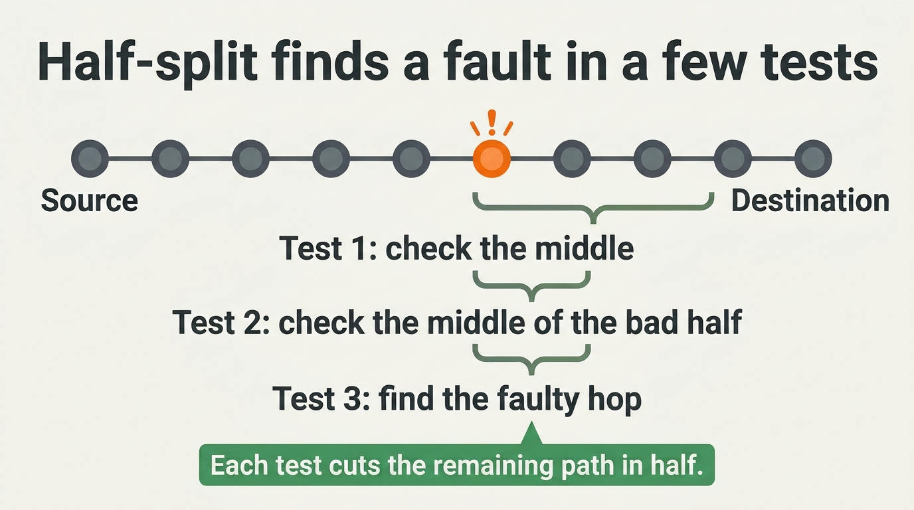
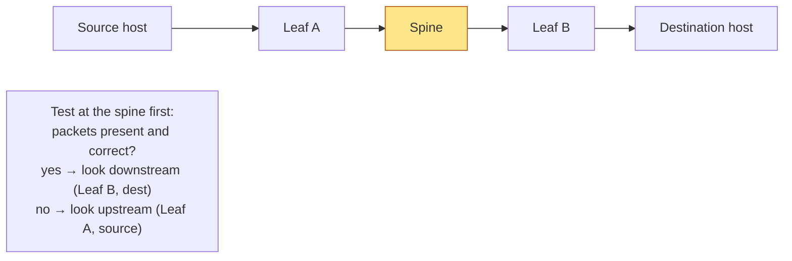
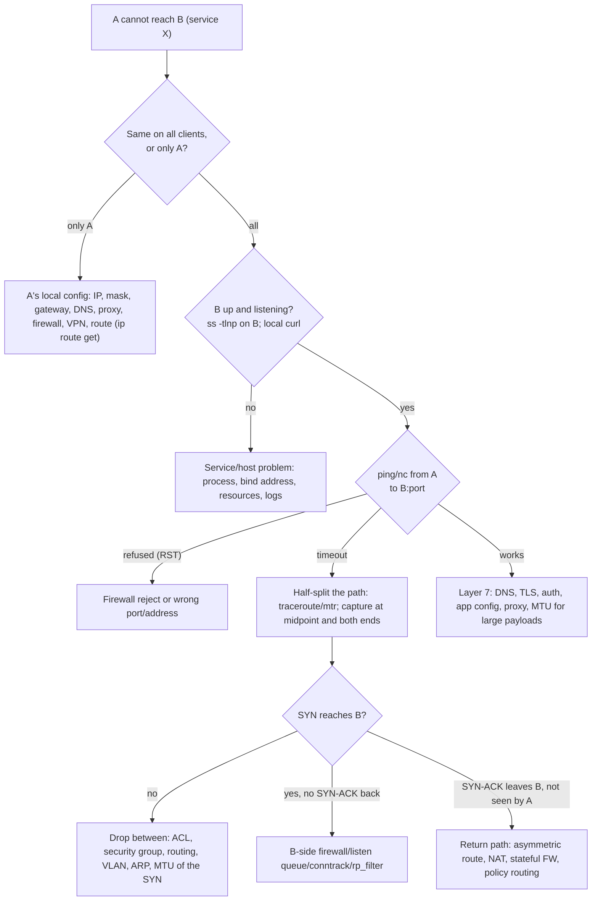

# 2.30 Network troubleshooting: method, models and case studies

| | |
|---|---|
| Level | Advanced |
| Priority tier | 0 |
| Lab venue | Chapter 2.27 containerlab fabric + a Linux VM; fault-injection scripts |
| Part | Part 2: Networking, from first principles to AI fabrics |
| Status | Drafted, labs **untested** |

## Why this matters for AI infrastructure

At 2 a.m. a training job has been running on 4,000 GPUs for nine days, and then it stops making progress. The scheduler says the nodes are healthy. The GPUs say they are idle. NCCL logs show a timeout, so everyone suspects the network. People start to type commands into terminals, and each person has a different theory. The gap between a fifteen-minute fix and a six-hour outage is rarely knowledge of one command. It is a **method**. You need to know what the system should do, build the right mental models, and choose the next question with care. You also measure instead of guessing, change one thing at a time, and record what you learn.

A stopped job with no clear error is the hardest kind of trouble. Nobody can tell whether the network failed, the storage failed, or a process inside a GPU hung. The method in this chapter starts from that uncertainty, and narrows it one test at a time, instead of guessing from the most alarming log line on the screen.

Troubleshooting is rarely taught, yet senior infrastructure interviews probe it hard. A typical question is "walk me through how you would debug...". Behind that question is a simple worry: can this person stay calm and systematic when nothing makes sense? The method in this chapter starts from the purpose of the system and the models in your head. It then adds half-split, manipulation and simplification, and finishes with fixing, technical debt and learning. After that you get a practical data-collection kit and decision trees for the most common failure classes. Finally, there are fourteen case studies. They run from a Linux host through overlays and load balancers to AI fabrics, and each one walks through symptoms, investigation, diagnosis and resolution.

Treat the method as the thing to learn, and the case studies as practice for it.

## Prerequisites and outcomes

Work through the networking fundamentals in 2.2 to 2.10, routing and fabrics in 2.13 to 2.19, and the Linux toolbox in 2.22 to 2.26 before this chapter. You can read 2.31 alongside it, because it covers the monitoring concepts. The method is general, but the examples lean on those chapters: they use sockets, counters, captures, MTU, PFC and ECN as if you had already met them.

The method has plain names for its parts, such as half-split and manipulation, and each is explained with a small story the first time it appears.

## 1. The purpose and the components

### Purpose first

Say you have checked every link and every BGP session, and every light is green. Is the network working? You cannot tell yet. Troubleshooting is an exercise in narrowing. You start with a broad, imprecise description of the problem, move to a focused one, and finally name something to change. The common failure is to narrow too fast, jump between hypotheses, and forget the overall purpose.

Consider an engineer who has checked every link and every BGP session and seen only green. Users still see slow file reads. Green lights are evidence that the parts are up. They are not evidence that the service works. That gap is what the purpose-first rule keeps in view, and it is why the first question in any incident is what the system is for.

**A system is working only if it accomplishes what it is supposed to do.** Green gauges on each component are not enough. A cable team once insisted that a repaired splice was fine, because its voltage and resistance readings were correct. Meanwhile, the wind-speed system the splice fed could not be calibrated. The dispute lasted days. A capacitive crosstalk test finally found the splice faulty, because it matched the purpose of the splice. Everyone had been measuring what was easy to measure, and not what the cable was for.

Networks work the same way. "All links up and BGP established" is not the same as "the all-reduce reaches 90% of line rate." Define success in terms of what the application needs, and measure that.

Make the purpose concrete with a target. Suppose the purpose is that an all-reduce across the fabric finishes at full speed. A link can be up, a session can be established, and the job can still be slow. Only a measurement of the all-reduce answers the purpose question. The measurable target is the thing you check at the very end, after every fix.

Understand the business purpose too, and be honest about trade-offs. If the business asks for something impossible or very complex, do not simply say yes. Explain the cost and the risk.

Trade-offs come up in the middle of an incident. A fix that restores service may leave a risk in place, and the people who own the service should know that before the fix goes in. Write the trade-off down next to the fix, so that the decision stays visible after the incident is over.

### Components

A network is hardware (devices, cables, optics, power and cooling), software (operating systems, drivers and firmware), a control plane (protocols and policy), the specifications and designs it was built to, and the requirements of the applications and the business. Nobody can know every combination of these four or five systems, or every way they interact. The number of combinations grows so fast that you cannot hold the whole thing in your head. The remedy is abstraction by models.

Before you test anything, write down the purpose and one measurable target for it.

## 2. Models

When you troubleshoot, you never see the whole system at once. You work from a model of it, which is a simplified picture in your head, much like a map of a city. Every model is incomplete, and it is still useful. A map that showed every brick would be useless, and a map that omitted the one-way streets would send you the wrong way. A model makes a system understandable, but it also hides detail. So pick the right model for your question, and know what it leaves out. A black box that you are not allowed to understand cannot be troubleshot. It also makes troubleshooting any larger system that contains it much harder.

Picture a doctor who sees a patient only through a few readings. The readings are not the patient, but the doctor uses a picture of how a body works to decide which reading matters. A network engineer does the same. The model is the picture, and the readings are the counters, the logs and the captures.

### How models (theory)

How models explain how and why things work. They cover the problem each mechanism solves, the range of possible solutions, and how this implementation applies one. Take BGP peering. You can ask how BGP manages flow control, error correction and marshalling. TCP handles flow control and reliability for it. You can ask how BGP manages peer state, which involves a finite state machine, timers and keepalives. And you can ask how to configure it to peer.

Protocol theory is the reason a symptom is possible at all. If you know that a BGP session must miss its hold timer before its routes withdraw, you know why a failure takes that long to show up. Without the theory, every delay looks like a new mystery, and you start guessing.

Many engineers know the peer-state and configuration questions, but never study the first one. That gap leads to hunt-and-peck troubleshooting, built from fragments of past incidents. You build how models by reading protocol specifications and design rationales. You also study real network designs and their failures, and learn the algorithms and heuristics behind them. The theory chapters in this handbook are how models. These models are often best captured as flow charts or sequence diagrams.

### What models (the state of your system)

What models describe what is normal in your own system. They cover the signal path of each application, meaning how its packets flow, queue and get processed. They also cover the baseline: traffic levels by time of day, SPF run times, jitter and delay per application, ECMP balance, PFC and ECN rates, temperatures and optic power. The normal configuration lives in a source of truth. The normal reaction to events, such as the expected convergence time and expected loss when a link fails, belongs here too. So do your security boundaries.

A baseline is the what model in practice. Write down the normal retransmit rate, the normal latency and the normal load on one leaf switch. When the number moves, you have a fact to compare. An engineer who has never seen the system can then still tell what changed, because the change is measured against a number on the page.

You learn these models only by observing repeatedly, ideally under real conditions, and by writing the baseline down. You cannot recognise broken without knowing normal. Be careful about observing only in the lab. A story from radar maintenance shows why. A technician checked the obvious, common failure first: a resistor that tested shorted. He fixed it and went home satisfied, which cost a second day. The real failure was an inductor in parallel with that resistor. On a DC ohmmeter, an inductor always reads as a short, so the instrument could not see it. Every tool has blind spots, so know what yours cannot see.

### Accurate models

Accuracy means fit to purpose, not completeness. The OSI model is good for describing interfaces and for building a stack. It is poor for understanding what happens where and why. A model that organises functions by problem fits troubleshooting better. RINA is one example. It treats error control, flow control and multiplexing as things that recur at each scope. Different questions need different models, such as path, control plane, queues, energy and thermal, or application protocol.

A road map that shows only the roads you need is accurate for driving and useless for plumbing. A network model should show the parts that carry the symptom, and leave out the rest until the evidence asks for them.

### Shifting between models and the model tree

Organise your models into a tree that runs from abstract to concrete. The tree starts at the network path. It splits into the control plane and the data plane. Each of those splits again, for example into convergence and shortest paths, or into QoS, queueing and jitter. At each step, choose the model that fits the evidence and go deeper. When new evidence changes the picture, return to the top. The classic mistake is to stay deep in one branch, staring at jitter, without asking how another branch could cause it.

One incident shows how this goes. The team first treated an outage as EIGRP protocol behaviour. Then they treated it as packet transport, then as router input queues. Finally they found a broadcast flood. A backup server had been installed in "server mode", and it was scanning every subnet. Each shift changed the model. The team had to keep the larger purpose in view while chasing a "rogue IP address".

Read this incident as a lesson about the tree. The team stayed at the protocol layer while the evidence kept refusing to fit. Each extra test at that layer cost time without giving a new answer. The turn came only when they climbed back up and asked what sat below the protocol. Climbing earlier would have saved the hours spent inside a protocol that was behaving correctly.

When the evidence stops fitting your current model, climb back to the top of the tree and try another branch.

## 3. Half-split, manipulation and simplification

Picture a long path, several hops from one host to another, with a flow that fails somewhere along it. Testing every hop one by one takes a long time, and a guess can send you down the wrong branch. The techniques in this section narrow the search quickly and with evidence. Each one cuts the problem in a different way, and together they turn a vague failure into a single component you can check.

Why halves and not single hops? A long path takes many tests if you walk it one hop at a time. The same path takes only a handful of tests if each test cuts the remaining path in half. The saving grows with the length of the path, and that is why half-split is the first method to reach for on a long flow.



*Figure 2.30.1. Each test cuts the remaining path in half.*

### Half split and move

Hopping at random between models and tools is common, and it is slow. A flow that fails somewhere between two hosts can send you through a dozen tools in an afternoon. The **half-split method** gives you structure. It is the method behind the old guessing game of finding a number between one and a hundred by asking "higher or lower" and halving the range each time. It works like this:

The search works like finding a name in a printed phone book. You open the middle page, see whether the name comes before or after it, and throw away the half that cannot hold it. Half-split applies the same method to a signal path, with the signal as the thing you test at each point.

1. Map the path of the signal through the system. The signal is something you can test: the packets of a flow, a neighbour adjacency, jitter at one point, the completeness of a stream, or a request.
2. Split the path roughly in half.
3. Test the signal at the midpoint. Is it correct?
4. If it is incorrect, move toward the source. If it is correct, move toward the destination.
5. Repeat on the remaining half.

At each test, ask two questions. What is the actual state of the system and the signal here? What should normal look like? The method forces you to look and compare with the baseline. It also keeps you tied to the larger context, so you do not dive into a plausible component that is only a symptom. The method fits networks well. Choose the path of the failing flow with `traceroute`, `ip route get` or an ECMP-aware `mtr`. Capture at the midpoint with a packet capture or counters, and then bisect.

Take a flow that fails between a spine and a host. The midpoint test is at the leaf. If the leaf's counters show the packet arrived and also left, the fault lies past the leaf, so you move toward the host. If the packet never left the leaf, the fault lies before it, so you move toward the spine. Each answer narrows the path, and a few tests can point at a single device.



In this diagram, the first test happens at the spine. Its answer tells you which half to search next.

### Manipulation: from correlation to causation

Sometimes a symptom coincides with an event. Jitter might start every time SPF runs on router E. Correlation is not causation, though. To establish cause, **manipulate one variable while holding the others constant**. Reproduce the suspected trigger on purpose. For example, cause the SPF event by flapping the same link, or replay the same traffic. Measure the signal while you do it. If the effect follows, you have a lever. If it does not, the correlation was a coincidence or a symptom of a deeper cause.

Correlation is cheap, and causation costs a test. If jitter starts when the routing protocol runs its calculation, that is a lead and not a proof. The manipulation test is to trigger the calculation on purpose, on a quiet device, and see whether jitter follows. If it does, you have a cause. If it does not, you have saved yourself a change to the wrong component.

Manipulation also helps you learn how a model behaves. You can change QoS settings on a test flow path and watch how the application reacts. In practice, reality is messier. Causes interact, and some cannot be reproduced. So you sometimes accept a correlation and try changes in order of safety and likelihood. The closer you stay to controlled manipulation, the faster and more certain your diagnosis becomes.

### Simplify before testing

With many parallel paths, variables and layers, remove components until the problem goes away, or until only a minimal working set remains. You might disable ECMP to one path, drain a spine, turn off an optional feature, shift traffic to a single rail, bypass the load balancer, or test on loopback or a namespace. If the problem disappears early, you have two suspects. The removed component may have been the fault. Or a positive feedback loop or control-plane state velocity may be at work. Add components back one at a time until the problem returns. That is a built-in manipulation test. If the problem persists down to the minimum, you have narrowed it hugely.

Picture a rack with several uplinks, a bonded pair and a firewall in line. Remove the firewall from the path. If the problem vanishes, the firewall is the suspect. Put it back and watch the problem return. Simplify on purpose, and remember to restore what you removed, because a path left changed is a new problem of its own.

Reducing redundancy during an outage feels wrong. Do it only where it is safe. Drain a component rather than cut it, and do it under change control.

### Fixing the problem, technical debt and learning

Fixing usually has two stages. The first is the **immediate fix** that restores service: reroute, restart, roll back a config, or replace a part. The second is the permanent fix that removes the cause: correct design, automation, monitoring and documentation. Teams are tempted to stop after the first stage. Unfixed root causes build up as technical debt. That debt takes the form of workarounds that stay, undocumented exceptions and manual steps.

Think of the immediate fix as a tourniquet and the permanent fix as the surgery. The tourniquet stops the bleeding so the patient survives, and nobody calls it a cure. A reroute or a restart is the tourniquet. The cause, such as a bad optic or a wrong MTU, needs the surgery, and the surgery is scheduled, not skipped.

Record each temporary fix as debt, with an owner and a date, and schedule the permanent fix. After the incident, run a blameless post-incident review. It covers the timeline, what you knew and when, what misled you, and what detection or tooling was missing. It also covers what to change: alerts, runbooks, tests in CI and design. Finally, add the failure to your *what* model, so the next occurrence is recognised at once.

Before you call an incident closed, record the temporary fix as debt and schedule the permanent one.

## 4. A practical workflow

When an alert fires in the middle of the night, the order of your first steps matters. This workflow gives you that order, so that the pressure of the moment does not make you skip a step.

Imagine the same alert handled two ways. In the first, the engineer starts changing settings at once, and the evidence is gone by the time the cause would have shown itself. In the second, the engineer writes down the symptom, saves the counters, and only then changes one thing. The second engineer loses a few minutes and keeps the evidence that tells the real story.

1. Stabilise and scope the problem. Ask who is affected and since when. Ask what changed: deploys, config, firmware, traffic or season. Ask whether any data is at risk. Then name an incident lead and a communication channel, and keep a timeline.
2. Define the symptom in measurable terms. For example: "rank 37 to rank 112 all-reduce latency rose from 1.2 ms to 40 ms starting 02:13." Include what works, because the negative space is often the most informative part.
3. Form hypotheses from your models. Rank them by likelihood and by the cost of testing. Prefer tests that are cheap, safe and discriminating.
4. Half-split along the signal path, and collect evidence at each point with counters, captures, logs and telemetry.
5. Manipulate the system to confirm the cause, and simplify where that helps.
6. Apply the immediate fix, verify it with the purpose metric, and communicate the result.
7. Finish with the permanent fix and the learning described earlier.

Several generic aids help along the way. Work bottom-up (physical → link → network → transport → application) when many things fail at once or after a hardware change. Work top-down when only one application misbehaves. Use divide and conquer, which is half-split, when the path is long. Follow the path: trace the actual flow end to end, including NAT, overlays and load balancers. Compare with a working peer by diffing a good node against a bad one. Check configs, firmware, `ethtool`, sysctls, routes and counters. Configuration drift is the most common root cause in fleets. Change one thing at a time, and revert the experiments that fail. Finally, use the packet, because a capture beats opinion.

Working bottom up is a rule of thumb. Physical problems are the cheapest to rule out, and a loose cable or a dead optic usually shows up in a light or a counter. Check those before spending an hour on routing, because a clean physical layer makes the upper layers easier to read.

Next time you start, write the symptom in measurable terms before you touch a command.

## 5. The diagnostic kit

A kit saves time at 2 a.m., when nobody remembers the right commands. Keep one standard, scripted collector, so anyone can gather the same evidence in under a minute on any node and attach it to the ticket. The script is read-only, so gathering evidence never changes the state you are trying to explain.

A kit is a set of answers you wrote down while you were calm. When the page arrives, you do not have to reinvent the commands. You run the script, attach its output to the ticket, and then read the output with a clear head. The archive is also the evidence you will need if the fault comes back.

```bash
#!/bin/bash
# netdiag.sh: read-only network evidence collector (run as root); output to /tmp/netdiag-$(hostname)-$(date +%s)
out=/tmp/netdiag-$(hostname)-$(date +%Y%m%d-%H%M%S); mkdir -p $out; cd $out
{ date; uname -a; uptime; } > sys.txt
ip -br link > ip-link.txt; ip -br addr > ip-addr.txt; ip -d link > ip-link-detail.txt; ip -s -s link > ip-link-stats.txt
ip route show table all > routes.txt; ip -6 route show table all > routes6.txt; ip rule > rules.txt; ip neigh > neigh.txt
ss -s > ss-summary.txt; ss -tanpi > ss-tcp.txt; ss -uanp > ss-udp.txt; ss -tlnp > ss-listen.txt
nstat -az > nstat.txt; cat /proc/net/softnet_stat > softnet.txt; cat /proc/net/dev > netdev.txt
for i in $(ls /sys/class/net | grep -v '^lo$'); do { echo "== $i"; ethtool $i; ethtool -i $i; ethtool -S $i; ethtool -g $i; ethtool -k $i; ethtool -c $i; ethtool -l $i; ethtool -m $i; } > ethtool-$i.txt 2>&1; done
sysctl -a 2>/dev/null | egrep '^net\.(ipv4|ipv6|core|netfilter|bridge)' > sysctl-net.txt
nft list ruleset > nft.txt 2>&1; iptables-save > iptables.txt 2>&1; conntrack -S > conntrack-stats.txt 2>&1; conntrack -C >> conntrack-stats.txt 2>&1
tc -s qdisc > tc-qdisc.txt; tc -s class show > tc-class.txt 2>&1
cat /etc/resolv.conf > resolv.txt; resolvectl status > resolved.txt 2>&1; cat /etc/hosts > hosts.txt
lspci -vv 2>/dev/null | egrep -A3 -i 'ethernet|infiniband|mellanox|nvidia' > lspci-net.txt
dmesg -T | egrep -i 'link|eth|mlx|nic|conntrack|drop|reset|timeout|xid|error' | tail -500 > dmesg-net.txt
journalctl -k --since "-1h" --no-pager > journal-kernel-1h.txt 2>&1
ibstat > ibstat.txt 2>&1; rdma link > rdma-link.txt 2>&1; rdma statistic > rdma-stats.txt 2>&1; nvidia-smi topo -m > gpu-topo.txt 2>&1; nvidia-smi -q -d PERFORMANCE,CLOCK > gpu-q.txt 2>&1
mpstat -P ALL 1 3 > mpstat.txt 2>&1; cat /proc/interrupts > interrupts.txt; cat /proc/softirqs > softirqs.txt
tar czf $out.tgz -C /tmp $(basename $out) && echo "$out.tgz"
```

Alongside the script, you run a few tools on demand. Use `mtr -n -r -c 100`, `tracepath` and `ping -M do -s N` to check paths and packet sizes. Take a short, truncated `tcpdump` on suspect interfaces, with a filter (chapter 2.26). Run `iperf3` and `ib_write_bw` between pairs of hosts, and `nccl-tests` per rail. Use `tcplife/tcpretrans/tcpdrop` (chapters 2.22 and 2.26) for kernel-side views. On the switch side, check the counters: `show interface counters errors`, PFC, ECN and queue drops, optics DOM, BGP and BFD state, and LLDP.

The repeated view matters for loss. A single ping reports one answer, so a loss that appears only at one hop can be missed. The mtr tool repeats its probes along the path, and a loss that stays in one row points at the hop that owns it. Use the repeated view when the symptom is loss rather than a total failure.

Attach the archive from the script to the ticket before anyone changes the node.

## 6. Decision trees

A decision tree turns a vague complaint into a short series of yes or no questions. You follow the branch that matches your symptom. It does not replace thinking, and it keeps you from skipping the cheap checks while you reach for the clever ones.

Think of a decision tree as a set of signposts. Each question has two answers, and each answer points to a different road. You do not need to know the whole map. You only need the next question, and the answer to it decides the road you take next.

### Connectivity: "A cannot reach B"

Start with scope. Does the failure happen on every client, or only on A? Then follow the diagram from the top.

Suppose only one client fails. You now know the fault is near that client, or on the path from it, and not in the server that every other client reaches. That single answer removes half of the tree, and the remaining questions are shorter because the search space is smaller.



Read the diagram as a set of questions. A refusal (RST) points to a firewall reject or a wrong port or address. A timeout means a packet was lost somewhere, so you half-split the path and capture at the midpoint and both ends. If the connection works, the problem sits higher up, in DNS, TLS, authentication or the application itself.

### Performance: "slow", "stalls", "low throughput"

Slowness has many causes, so work through these steps in order. Each one narrows the search.

Read the steps as a funnel. The first step turns a feeling into a number. The second finds the limit, the third finds the segment that carries it, and the fourth separates loss from delay. Only then does the fifth step ask whether the trouble belongs to one flow or to all of them.

1. Quantify the problem. Measure throughput, latency percentiles and retransmit rate. Compare them with the baseline and with the theoretical limit, such as line rate or BDP.
2. Find the limit. Check the `ss -ti` limiter flags (cwnd-limited, rwnd-limited, sndbuf-limited, app-limited). Then check CPU (`mpstat`, `top -H`, softirq), memory, disk, the NIC (`ethtool -S` drops, pause), switch queues, PFC, ECN, MTU and congestion control.
3. Find the segment. Test pairs along the path with `iperf3` or `ib_write_bw`, halving the path each time, per rail and per direction.
4. Decide between loss and latency. Check retransmits (`nstat`, `tcpretrans`), RTT (`ss -ti`, `ping`) and jitter. Check ICMP and TTL as well.
5. Decide whether one flow or all flows are affected. Look for ECMP hash collisions, elephant flows and single-core limits.
6. Compare with a healthy node.

### Intermittent faults

An intermittent fault is hard, because it is gone by the time you look. So start recording before the fault appears. Use ring buffer captures (`-C -W`), continuous telemetry, `ping -D -i 0.2` with timestamps, `mtr --report` loops, and scheduled `ss` and `nstat` snapshots. Collect switch syslog and counters too, and line them up by time.

Recording is the whole method here. Set up a probe that runs all the time and writes a timestamp for every failure. When the fault returns, you have the moment and the state around it. The question then moves from a feeling to a pattern you can check.

Then look for a pattern. Periodic faults often sit on a timer: 30 s, 60 s, 5 min or 1 h. Check cron jobs, backups, garbage collection, DHCP lease renewals, conntrack timeouts, BGP dampening, and certificate or token expiry. Also check whether the fault follows the load, the temperature or specific hosts.

Intermittent faults are usually capacity limits, timeouts, flaps, or one bad member of an ECMP or LAG set. In that last case, only the traffic that hashes onto the bad path fails, while the rest succeeds.

Each of those four causes leaves a different trace. A capacity limit shows a rising count that flattens at a ceiling. A timeout shows a fixed delay. A flap shows state changes in the logs. A bad member of a group shows one device in the counters that the others do not show.

### AI-fabric symptoms

Symptoms in an AI fabric look different from ordinary network faults. The table lists the first checks for the most common ones.

Ordinary faults often break a connection. AI fabric faults often slow a whole job while every link stays up. A job that runs at half speed for an hour can pass every health check. That is why the table below starts from what the job does, and not from what the links report.

| Symptom | First checks |
|---|---|
| One rank slow in all-reduce | Per-rail NIC counters, optics DOM, ECMP/AR imbalance, PFC pauses from/to that host, CPU/NUMA/IRQ on that node, thermal or power throttling |
| Job hangs at init/NCCL timeout | `NCCL_DEBUG=INFO` (interfaces, GID, transport chosen), firewall/security group between nodes, MTU, wrong `NCCL_SOCKET_IFNAME`/`NCCL_IB_HCA`, DNS/hostname resolution, time skew, subnet manager state |
| Throughput half of expected | Link speed/FEC negotiated down, PCIe width, NUMA mismatch, MTU 1500 on one hop, PFC/ECN misconfiguration, oversubscribed tier, ECMP collision |
| Periodic stalls (seconds) | PFC storm, RTO events, BGP/BFD flap, congestion from a competing job, checkpoint write incast on storage network |
| Errors rising without link flap | CRC/FEC counters, dirty or failing optics (DOM Rx power low), bad cable, switch ASIC issue |
| After maintenance | Config drift, wrong cable/rail mapping (LLDP vs plan), firmware mismatch, forgotten drain |

Read each row as a first move, not a diagnosis. Start with the row that matches your symptom, and widen the search only when its checks come back clean.

## 7. Case studies

The cases below come from production networking work. Each one follows the same path: the symptom, the investigation, the diagnosis, the resolution and a lesson you can carry to the next incident. Read each one in two passes. On the first pass, stop after the symptom and write down the first three things you would check. On the second pass, compare your list with what actually found the problem.

Read each case as a short story with a fixed shape. The symptom comes first, as the user saw it. The evidence follows, in the order it was collected. The cause and the fix come last. Notice where the evidence changed the team's mind, because that moment teaches more than the fix does.

### Case 1: SNAT port exhaustion

Microservices in a private subnet time out now and then when they connect to an external managed database. The database is healthy, and CPU is low. The `dmesg` of the NAT gateway shows no conntrack drops, so the table is not the problem. The investigation then asks how many connections share the gateway. About 5,000 containers connect through one NAT IP to one database IP and port. A single source IP has about 60,000 usable ephemeral ports per destination IP and port. Every connection to that one database needs its own source port on the gateway. Once those ports run out, new connections cannot get a mapping, and they time out. It is a car park with a fixed number of spaces: the traffic is not heavy, but all the spaces are taken.

Walk through what happens. Each outbound connection takes a source port from the NAT gateway's pool. When many connections are open at once, the pool runs low, and a new connection finds no free port to take. The request then waits and times out, even though the external service is healthy and the link has spare capacity. The problem is the pool, not the path.

The fix is to add NAT gateway IPs and ports, for example through Cloud NAT port allocation. You can also use a connection pooler such as PgBouncer to multiplex connections, shorten TIME_WAIT, and reuse connections. The lesson: count the tuple dimensions, meaning source IP, destination IP and port, when you size NAT.

### Case 2: Path MTU black hole

Small queries succeed, but large ones hang. `ping` works, and so does `telnet port`. Those two facts already say a lot: the path is up, and the failure depends on packet size. A capture shows that the handshake succeeds. A full-sized server packet never reaches the client, and no ICMP appears. The server has MTU 9000, but a router in the middle runs at 1500. That router sends an ICMP "fragmentation needed" message, yet a firewall drops all ICMP. The server never learns that its packets are too big, so it keeps retransmitting the same large packet into the same hole.

Here is why the big packets hang while the small ones pass. Each link on the path has its own MTU. Small packets fit everywhere, so nothing needs to change. A large packet with the do-not-fragment flag set cannot fit a smaller link, and the router that must refuse it sends back a message. If that message is blocked, the sender never learns the size it must use, and it keeps resending a packet that cannot pass.

The resolution is to align the MTUs, allow ICMP type 3 code 4 (and ICMPv6 type 2), clamp the MSS at the edge, and set `tcp_mtu_probing=1`. The lesson: test with `ping -M do -s` and look for the ICMP in the capture (chapter 2.7).

### Case 3: Conntrack table full

Busy Kubernetes nodes show intermittent timeouts for new connections, while CPU and bandwidth look fine. A healthy dashboard and unhappy users is the signature of a state table filling up. In `dmesg` you find `nf_conntrack: table full, dropping packet`. The count from `conntrack -C` equals `nf_conntrack_max`, and `conntrack -S` shows insert_failed. Two problems combine here. The established timeout of 5 days keeps dead flows around forever, and the table is too small for the load.

The conntrack table is a notebook of every connection the node is tracking. Each new connection needs a new line. When the notebook fills, the kernel has no room to write and drops the new connection, often without a clear error. Established connections keep working, which is why only new connections fail.

Raise the max and the hash size, lower the timeouts, and find the chatty clients. Use `notrack` for DNS and east-west flows. The lesson: capacity limits in state tables look like random packet loss.

### Case 4: ARP flux and reverse-path filtering on a multi-homed host

Two hosts on the same subnet cannot communicate. `ip neigh` shows INCOMPLETE. The captures show ARP requests and replies, yet the host ignores them. A host with several interfaces on one subnet answers ARP for any local IP on any interface. This is called ARP flux, so the replies leave from the wrong NIC. Strict `rp_filter` mode also drops the asymmetric traffic.

Read the neighbour table as the host's address book. INCOMPLETE means the host asked for a link address and got no answer. When two interfaces share one subnet, the host can answer for the wrong interface, and the other host records the wrong owner. A host with two interfaces on one subnet must decide which one answers, and the default settings decide it badly.

The resolution is to set `arp_ignore=1`, `arp_announce=2` and `rp_filter=2`, and to use source-based routing (chapter 2.24). The better fix is one subnet per NIC. The lesson: the weak host model of Linux surprises multi-NIC designs.

### Case 5: UDP receive buffer overflow (StatsD/syslog)

Metric graphs show gaps under load, yet the servers do not crash. UDP has no flow control and no retransmissions. So when the socket buffer of the receiver (`rmem_default`) overflows, the kernel drops packets silently. It counts them in `UdpRcvbufErrors`.

The receive buffer is a queue with a fixed size. When packets arrive faster than the application empties it, the kernel drops the excess without telling the sender. UDP has no retransmit, so the drop is permanent. The graph gap has the shape of those dropped packets, and the server looks healthy because the kernel did what it was configured to do.

Monitor `nstat` and `ss -ump`, raise the buffers (`SO_RCVBUF`, `rmem_max`), and add receivers with `SO_REUSEPORT`. You can also batch metrics, and use TCP where loss matters. The lesson: silent loss needs counters, so always chart drops.

### Case 6: BGP route dampening after a flapping optic

The management network goes down for exactly five minutes, and the outage repeats at random. A failing transceiver flaps a link every few seconds. Each time, the FRR of the host advertises and then withdraws a route. The spine applies route-flap dampening and suppresses the route for a penalty period.

Dampening works like a teacher who stops listening to a student who keeps interrupting. Each flap adds a penalty to the route. Once the penalty passes a threshold, the route is suppressed for a while, even after the link is stable again. The outage repeats because the suppression holds the route down after the optic has already recovered.

The optic showed bad Rx power on DOM, so you replace it. Keep dampening in place, because it protects the control plane. The lesson: outages of an exact length are timers, such as dampening, hold-down, lease or cache. Find the timer.

### Case 7: TCP checksum offload failure

`ping` works, but SSH hangs after the version exchange. The capture of the receiver shows packets with an incorrect checksum. A driver or firmware bug makes the NIC of the sender compute wrong checksums when TX offload is on. The hardware of the receiver then drops those packets. Your capture tap sees them before the drop.

Ping uses small packets, so it never reaches the path where the offload fails. SSH sends larger segments, and the bad checksum is produced where the driver fills it in. The receiver drops the segment, and the sender waits for an acknowledgement that never comes. Small and large traffic take different code paths, and that difference is the clue.

The workaround is `ethtool -K eth0 tx off`, and the lasting fix is to update the driver and firmware. The lesson: tell apart a harmless "bad cksum" on the sender from bad checksums seen at the receiver (chapter 2.26).

### Case 8: PFC storm collapses an NCCL job

A multi-node job runs fine for five minutes, and then throughput falls to zero. The same fabric passes `ib_write_bw` when it is idle. On the hosts, `ethtool -S` shows `rx_pause` counters rising by millions per second. The ECN thresholds on the switches were set too high. The buffers filled before ECN or CNP could slow the senders. So the switches fired hard PFC pauses, which spread and froze the fabric.

A pause storm spreads backwards through the fabric. One port sends pause frames, the switch holds its traffic, and the buffers behind it fill and send pauses of their own. The chain grows until throughput falls to zero. It stops only when ECN marks the flows early enough to slow them before the pauses start.

The resolution is to lower the ECN thresholds below the PFC threshold, verify DCQCN on the NICs, enable the PFC watchdog, and find any stuck endpoint. The lesson: ECN must act well before PFC (chapter 2.19).

### Case 9: veth CPU bottleneck in a pod

A pod with heavy network I/O tops out near 15 Gb/s on a 100G host, and one core sits at 100% softirq. Each flow crossing a veth pair is processed in softirq on a single CPU. That single CPU sets the ceiling for the pod.

A veth pair is a virtual cable whose two ends are handled by the CPU. Every packet crossing it costs CPU time on one core. When that core is busy, the whole pod slows, even though the physical NIC has plenty of room. Bypass the virtual cable, and the core that did the copying is free for the application.

The resolution is to use host networking, ipvlan or macvlan, SR-IOV, or RDMA secondary interfaces. An eBPF host-routing CNI also works. The lesson: the pod network is a different, slower data path than the host NIC.

### Case 10: TCP zero window stalls

A file transfer between two nodes stalls for 5 to 10 seconds, then resumes. The capture shows `TCP Window Size: 0` coming from the receiver. The receiving application is not reading fast enough, whether because of disk or CPU limits. The network itself is fine.

A zero window is the receiver saying that its buffer is full. The sender must wait, and it sends small probes to ask whether space has opened. While the receiver stays busy, the transfer waits. The stall ends when the application reads again. The network did not fail in this case, and the fix belongs on the receiving host.

Fix the receiver: its I/O, its CPU or its buffering. The lesson: a zero window points at the application of the receiver, not at the path.

### Case 11: Asymmetric ECMP and reordering from a host speaking BGP

A host advertises its loopback to two ToRs. Return traffic then splits across both paths. That reorders packets and degrades TCP. Unequal path latency is one cause, combined with per-packet or poorly keyed load balancing. A bond misconfiguration on the host can make it worse.

Two paths carry one flow in the wrong order when they differ in delay, so the receiver sees segments arrive out of sequence. TCP treats that as loss and slows down. Consistent per-flow hashing keeps each flow on one path, which removes the reordering while the paths stay in use.

The resolution is consistent per-flow hashing, correct bonding and ECMP policy, and equal-length paths. The lesson: reordering looks like loss to TCP, which reacts with duplicate ACKs and SACK.

### Case 12: Multicast blackhole in an overlay

A UDP multicast application works on physical hosts but fails on a Kubernetes overlay. VXLAN overlays and clouds usually do not carry L2 multicast, because they run no IGMP snooping or PIM.

Multicast needs the overlay to copy each frame to every member, and a plain VXLAN underlay does not do that by itself. Without a replication plan, the frame stops at the first tunnel endpoint, and the application sees a blackhole. The application works on physical hosts because the switch floods multicast there.

You can fix it with unicast replication in the overlay, with EVPN multicast support, or by refactoring the application. The lesson: overlays change what the network can carry.

### Case 13: DNS 5-second delays in Kubernetes

External calls show an occasional 5-second latency. Parallel A and AAAA queries leave from one source port. Conntrack and NAT then race the two queries, and one of them is dropped. The stub resolver waits out its default 5-second timeout. And `ndots:5` multiplies the number of queries.

Here is the race the case describes. Linux sends the A and AAAA queries in parallel over the same socket. When both replies arrive at nearly the same moment, one of them can be lost in a race inside the connection table. The resolver then waits for the lost reply, and that wait is the stall the application sees.

The resolution is `single-request-reopen`, NodeLocal DNSCache, a lower `ndots`, or a newer kernel (chapter 2.8). The lesson: an exact N-second delay is a timer, so match it to a default.

### Case 14: Silent corruption and a "slow rail" in a GPU cluster

Step times oscillate across the cluster. One node is consistently 15% slower, and no link has gone down. The switch counters show FEC-corrected codewords and CRC errors rising on one port. The `ethtool -S` output of the NIC shows `rx_corrected_bits`. Optics DOM Rx power is marginal, and that rail sees retransmissions. NCCL logs show the rail finishing late.

Synchronous training waits for its slowest member at every step. One slow rail therefore slows every rank, even though the other rails are healthy. The job looks uniformly slow, and the search for the fault starts in the wrong place unless you compare the numbers rail by rail.

A dirty or failing optic or cable causes a high pre-FEC bit error rate. The rail still works, but with retries and added latency, so every collective waits for it. The resolution is to clean or replace the fibre or transceiver, and verify with BER tests and counters. Add alerts on FEC and CRC trends and on per-rail bandwidth skew. Drain the node until it is fixed. The lesson: in synchronous training the slowest participant sets the pace, so watch trends in error counters, not just link state.

When a new failure looks familiar, compare its symptoms with these cases before you build a new hypothesis.

## 8. Hands-on lab: fault-injection exercises

Start with the self-checking Python lab, and run it on your own machine. It verifies the half-split binary-search fault isolator across a 5-hop Clos path (`src_host -> leaf_a -> spine -> leaf_b -> dst_host`). It also checks the 14-case-study diagnostic classifier.

```bash
python3 code/part02/network_troubleshooting_method_lab.py
```

Next, use the containerlab fabric from chapter 2.27 on a disposable Linux VM. The interactive VM commands below were not run on live hardware. A partner or a script injects one fault from the table, and you diagnose it with the method and the kit. Working with a partner matters: the person who injects the fault knows the answer, and you practise the method without the advantage of having set the trap yourself.

The VM part lets you break things safely. Each fault is injected on purpose, so you know the true cause before you start. Work through the symptom as the application would see it, then through the hypotheses, and only then through the commands. The point is to practise the order of the work, not to be fast.

| # | Injected fault | Injection method |
|---|---|---|
| 1 | MTU mismatch on one link | `ip link set eth2 mtu 1400` on a leaf |
| 2 | Silent packet loss on one ECMP member | `tc qdisc add dev eth1 root netem loss 3%` |
| 3 | One-way link failure | `tc filter` dropping packets in one direction, or `nft` drop on ingress only |
| 4 | Wrong ASN / missing route-map | Edit FRR config and reload |
| 5 | Conntrack exhaustion | Lower `nf_conntrack_max` and generate connections |
| 6 | DNS slow path | Put a dead resolver first in `resolv.conf` |
| 7 | Asymmetric routing | Policy route replies out another NIC, `rp_filter=1` |
| 8 | ECMP hash collision/elephants | Two `iperf3` flows crafted onto one link |
| 9 | Delayed ACK/Nagle | Application sending header and body as separate writes |
| 10 | TCP receive-window starvation | Server that sleeps before `read()` |
| 11 | ARP/neighbour issue | Duplicate IP on the segment |
| 12 | Firewall dropping ICMP | `nft` rule dropping type 3 code 4 |
| 13 | Hot spare disabled / flapping link | `ip link set dev X down/up` loop at 2 s |
| 14 | CPU/IRQ imbalance | Pin all NIC IRQs to one core |

For each fault, you write the symptom as the application sees it. Then list the hypotheses, ranked by likelihood. Record the half-split points you chose and the evidence that confirmed the cause. Finish with the immediate and permanent fixes, and name the alert or test that would have caught the fault earlier.

## 9. Common mistakes

Most of these mistakes come from habit, not missing knowledge. Use the list as a checklist against your own work.

Habits are easier to change than knowledge. A checklist kept beside the terminal, with the first three questions written on it, changes the order of the work more than any new command does.

- You start with tools before knowing the purpose or a measurable symptom.
- You narrow too fast and fixate on the first plausible cause, such as "it's always DNS". You forget to climb back up the models.

A quick test of this habit is to write down two other causes that would produce the same symptom before you run anything. If you cannot name two, you have not yet looked at the problem widely enough.
- You trust a single instrument. An ohmmeter cannot see an inductor failure, and link-up lights do not show BER.
- You change several things at once, with no rollback and no notes.
- You treat correlation as cause, and skip manipulation.
- You stop at the immediate fix, let technical debt build up, and skip the review.
- You have no baselines, so "abnormal" cannot be recognised.
- You debug the network when the application, host or storage is the real bottleneck, or the other way round.
- You do not capture evidence before the symptom disappears, for example by rebooting first.

A reboot erases the evidence the fault left in memory and in the counters. Capture first, even when a reboot would be quicker. The minute spent saving a file often saves the rest of the afternoon.

If you catch yourself doing any of these, write down the symptom and the baseline before your next change.

## 10. Interview angles

These questions test the method in this chapter more than any single command. A good answer touches purpose, symptom, models, half-split, measurement, manipulation, fix and learning.

- "Walk me through how you troubleshoot a network problem you've never seen."
- "Users report slowness. What do you do in the first five minutes?"
- "A connection works for small payloads but hangs for large ones."
- "Training throughput dropped 30% overnight with no alarms; where do you look?"
- "How do you decide whether it's the network or the application?"
- "Describe the worst outage you debugged: what misled you, what finally revealed the cause, what changed afterwards?"
- "How do you prove causation rather than correlation?"
- "What is the difference between an immediate and a permanent fix, and why does it matter?"

Pick two of these questions and answer each one with the method, not with a list of commands.

## Exercises

Each exercise ties back to one part of the chapter. Work through them in order.

1. A colleague says the network is fine because all links are up and BGP is Established. Explain why that does not prove that a network works, and relate your answer to the wind-speed cable story and its capacitive crosstalk. Explain it the way you would to a colleague who has not read the chapter.
2. Contrast How models (protocol theory), What models (local baselines and normal behaviour, plus the instrument blind spots in the storm-radar inductor story) and Accurate models (fit to purpose). Then explain how to move through the model tree without getting stuck in one branch.
3. Run `run_half_split_path_search()` in `code/part02/network_troubleshooting_method.py` on `["src_host", "leaf_a", "spine", "leaf_b", "dst_host"]`. Trace which hops are probed when `leaf_b` is the first failing hop, and then when `leaf_a` is the first failing hop. As you trace the hops, say in one line what each probe tells you.
4. Explain how controlled manipulation separates causation from correlation. Then explain what it means when a bug disappears during simplification, and why stopping at the immediate fix builds technical debt.
5. Explain why you must run `netdiag.sh` before rebooting a node or restarting daemons. Then trace the Section 6 decision tree for "Host A cannot reach Service X on Host B". Follow the path for `Connection refused (RST)` and for `Connection timed out`, and say where the two paths split. Keep your path short, and mark the branch you take at each question.
6. Using `classify_case_study_symptom()`, state the root cause, the diagnostic command or counter, and the permanent fix for each of these. Case 1 is SNAT port exhaustion at about 60,000 ports per destination tuple. Case 2 is the path MTU black hole. Case 3 is `nf_conntrack: table full`. Case 4 is multi-NIC ARP flux with `rp_filter=1`. Case 5 is a `UdpRcvbufErrors` overflow. Case 7 is bad TCP checksums seen by the receiver. Where a case needs two answers, keep the root cause and the fix apart.
7. For Case 6, Case 9 and Case 10, state the root cause and the fix. Case 6 is a repeating 5-minute outage from BGP route dampening on a flapping optic. Case 9 is a `veth` single-core softirq cap at about 15 Gb/s. Case 10 shows `TCP Window Size: 0`. Write each case as a short paragraph you could read aloud.
8. For Case 11, Case 12 and Case 13, state the root cause and the fix. Case 11 is asymmetric ECMP packet reordering. Case 12 is a VXLAN overlay multicast blackhole. Case 13 is the 5-second DNS timeout in Kubernetes. Write each case as a short paragraph you could read aloud.
9. Compare the two AI-fabric cases, Case 8 and Case 14. Case 8 is a multi-node NCCL job that collapses to zero throughput after 5 minutes. It produces millions of `rx_pause` frames per second, because switch ECN thresholds sit above PFC XOFF. Case 14 is a 4,000-GPU training job whose step times are dragged down by 15% by one dirty or failing transceiver. Its DOM Rx power is low, and FEC-corrected bits and CRC errors rise on one rail. Keep the comparison to one paragraph, so you can see where they differ.

## Checkpoint questions (20)

<details>
<summary>1. What defines whether a network system is "working", and what lesson does the wind-speed cable splice story teach (Computer Networking Problems and Solutions, chapter 24)?</summary>

A system is working only when it achieves its intended end-to-end purpose for the application and the business. Green gauges on each component are not enough. In the wind-speed story, the cable team said their splice was good, because DC continuity and resistance passed. But the splice had high **capacitive crosstalk**, which corrupted the AC signal the instrument needed. In an AI cluster, "all ports UP and BGP Established" means little if `AllReduce` collectives stall at 10% of line rate.
</details>

<details>
<summary>2. Why is it impossible for any engineer to hold the entire state of a modern network in their head, and how do Models solve this?</summary>

A modern network mixes hardware (ASICs, optics, cables, power and thermal), software (NOS, drivers, firmware), distributed control planes, topology designs and application workloads. Together they create a **combinatorial explosion of interaction surfaces**. Models help you cope. A model is a simplified mental abstraction that hides irrelevant detail, so you can reason about one aspect at a time.
</details>

<details>
<summary>3. Contrast *How* Models, *What* Models, and *Accurate* Models in network troubleshooting (Computer Networking Problems and Solutions, chapter 24).</summary>

**How models** explain how and why protocols and mechanisms work, such as how TCP sliding windows, BGP best-path or DCQCN ECN and PFC work in principle. **What models** describe what is normal in your own production network. That covers each application's exact signal path, baseline latencies, queue depths, ECMP balance, optic power levels and expected convergence times. You learn them only through repeated observation and documentation. **Accurate models** are fit to the question at hand. For microburst debugging, RINA's recurring error, flow and multiplexing model, or a queue or buffer model, fits better than the 7-layer OSI chart.
</details>

<details>
<summary>4. What lesson does the storm-radar inductor-vs-resistor story teach about diagnostic tools (Computer Networking Problems and Solutions, chapter 24)?</summary>

The technician found a burnt resistor in parallel with an inductor. He replaced the resistor, measured `0 Ω` across the pair with a DC ohmmeter, and went home. The radar failed again, because the inductor had also shorted out. A DC ohmmeter always reads an inductor as `0 Ω`, a short, whether it is healthy or shorted. The lesson is that **every diagnostic tool has blind spots**. `ping` cannot see a TCP port block or an MTU black hole, and host `tcpdump` cannot see kernel-bypassed RDMA or NIC ring drops. Always know what your instrument cannot see.
</details>

<details>
<summary>5. What is the "Model Tree", and what is the most common mistake engineers make when navigating it?</summary>

The **model tree** arranges your mental models from abstract at the top to concrete at the bottom. The top is the end-to-end application path. Its branches include the control plane (BGP, OSPF and convergence) and the data plane (queues, QoS and physical optics). The classic mistake is to dive deep into one branch, such as staring at QoS queue jitter for hours. You then never climb back to the root when new evidence arrives. A flapping control-plane route, or a broadcast storm from a misconfigured server, may be what is filling the queue.
</details>

<details>
<summary>6. State the 5-step Half-Split (Binary Search) troubleshooting method along a signal path.</summary>

1. Map the end-to-end path of the signal: Source Host, Leaf A, Spine, Leaf B and Destination Host.
2. Split the path in half. The midpoint here is the Spine.
3. Test the signal at the midpoint, with a packet capture, counters or a synthetic test. Is it present and healthy?
4. If it is unhealthy at the midpoint, the fault lies in the upstream half, toward the source. If it is healthy, the fault lies in the downstream half, toward the destination.
5. Repeat by splitting the remaining half in two. That takes `O(log N)` probes.
</details>

<details>
<summary>7. How do you use "Manipulation" to prove that a correlated event is actually the root cause (Computer Networking Problems and Solutions, chapter 24)?</summary>

Latency spikes that coincide with SPF runs on Router E are correlation, not causation. A third factor, such as a power dip or a traffic burst, could cause both. To show causation, manipulate one variable and hold everything else constant. Trigger an SPF calculation on Router E on purpose, in a controlled window, while you measure application latency. If latency spikes on command, you have found a causal lever. If it does not, keep looking.
</details>

<details>
<summary>8. How does "Simplify Before Testing" work on a complex multipath fabric, and what does it mean if the problem vanishes as soon as you simplify?</summary>

Suppose a bug shows up across an 8-spine, 8-rail ECMP fabric with overlays and load balancers. Temporarily cut the active paths to a minimal subset. For example, drain 7 spines so that traffic uses one spine, test one rail with `ib_write_bw`, or bypass the L7 proxy. If the problem persists on the minimal path, you have removed 80% of the components. You can now debug a simple 3-node line. If the problem disappears when you remove components, one of two things is true. Either a removed component was the faulty hardware, so add them back one at a time to find it. Or the bug is an emergent interaction or a positive feedback loop, such as ECMP reordering or a control-plane flood.
</details>

<details>
<summary>9. What is the difference between an Immediate Fix and a Permanent Fix, and how do unfixed root causes become Technical Debt?</summary>

The **immediate fix**, also called mitigation, restores production service as fast as possible. Examples include draining a bad spine, rebooting a wedged NIC, rolling back a config, or raising a limit. The permanent fix removes the root cause from the design, code, automation and monitoring, so the incident cannot recur. If you stop after the immediate fix, you leave undocumented workarounds, manual snowflakes and latent hazards behind. That is technical debt. Always track temporary mitigations with an owner and a deadline, and run a blameless post-incident review.
</details>

<details>
<summary>10. Why must you run a read-only diagnostic collector (`netdiag.sh`) BEFORE rebooting a broken node or restarting network daemons?</summary>

A reboot, or a restart of `frr`, `NetworkManager` or `containerd`, destroys volatile evidence held in RAM. That evidence includes socket queues (`ss -tanpi`), `conntrack` tables, `ip route` and `ip neigh` state, softnet counters and kernel ring buffers. A read-only collector takes about 30 seconds to run, and `netdiag.sh` captures the exact scene in a tarball. Run it before you mitigate by rebooting.
</details>

<details>
<summary>11. In the Connectivity Decision Tree, what is the first question to ask when Client A cannot reach Service X on Server B, and how do `Connection refused` and `Timed out` diverge?</summary>

First ask about scope: can other clients reach Service X on Server B, or is only Client A failing? If only A fails, check A's local IP, route, DNS and firewall. If all clients fail, check Server B. Next, run `nc -zv B port`.

- **`Connection refused` (RST received):** the path is open in both directions. Either the daemon on B is not listening (check `ss -tlnp`), or a firewall is actively rejecting with a TCP RST.
- **`Connection timed out` (no reply):** a SYN or SYN-ACK was silently dropped. Half-split with `tcpdump` at both ends to see whether the SYN reached B and whether the SYN-ACK left B.
</details>

<details>
<summary>12. Whenever an outage or stall lasts for an "exact round number of seconds or minutes" (5 s, 60 s, 5 min), what should you immediately suspect?</summary>

Random hardware errors do not keep to exact durations. Exact round durations are always software or protocol timers. The usual suspects are:

- **`~40 ms`:** a TCP Delayed ACK and Nagle stall
- **`200 ms`:** the Linux `TCP_RTO_MIN` retransmission timeout
- **`1 s`, `3 s` or `7 s`:** Linux TCP `SYN` retransmission backoff, caused by `ListenOverflows` or a dropped `SYN`
- **`5.0 s`:** the glibc `/etc/resolv.conf` default DNS query timeout, see Case 13
- **`60 s`, `300 s` or `350 s`:** `TIME_WAIT`, or a NAT or load-balancer idle timeout
- **`5 minutes` or `300 s`:** a BGP route-flap dampening penalty, or ARP/MAC cache aging, see Case 6
</details>

<details>
<summary>13. Summarize the root cause and fix of Case 1 (SNAT Port Exhaustion) and Case 3 (`nf_conntrack` Table Full).</summary>

- **Case 1 (SNAT Port Exhaustion):** About 5,000 containers behind one NAT public IP open connections to the same single external database IP:port. They exhaust the roughly 60,000 ephemeral source ports available for that source IP, destination IP and destination port tuple. This happens even though `nf_conntrack` is not full. The fix is to add multiple SNAT IPs to the NAT gateway pool, deploy a connection pooler (`PgBouncer`), and enable keep-alives.
- **Case 3 (`nf_conntrack` Table Full):** Total tracked flows across all destinations hit `nf_conntrack_max`. The table is often bloated by the 5-day default established TCP timeout of 432,000 s, and the kernel logs `nf_conntrack: table full, dropping packet` in `dmesg`. The fix is to shorten timeouts to `3600 s`, raise `nf_conntrack_max` and `hashsize`, and use `notrack` for stateless high-rate flows.
</details>

<details>
<summary>14. Summarize the root cause and fix of Case 4 (Multi-NIC ARP Flux and `rp_filter`).</summary>

Linux uses the weak host model. So a server with several NICs on one subnet answers ARP requests for any of its local IPs from whichever NIC handles the broadcast first. This is ARP flux. The server also routes replies using only the default gateway in the `main` table. Strict Reverse-Path Filtering (`rp_filter = 1`) then drops the incoming packets silently, and they are counted in `IPStatsInAddrErrors`. The fix is to give each NIC its own subnet and routing table, using `ip rule from <ip> lookup <table>`. Also set **`arp_ignore = 1`**, **`arp_announce = 2`** and **`rp_filter = 2`**, which is loose mode.
</details>

<details>
<summary>15. Summarize the root cause and fix of Case 5 (UDP Receive Buffer Overflow) and Case 10 (TCP Zero Window).</summary>

- **Case 5 (UDP Buffer Overflow):** UDP has no flow control, such as TCP's `rwnd`, and no retransmissions. When a telemetry or logging daemon, such as StatsD, syslog or a gNMI or NetFlow collector, cannot `recvfrom()` fast enough during a burst, the socket buffer (`rmem_default`) fills. The kernel then drops datagrams silently and counts them in **`UdpRcvbufErrors` in `nstat -az`**. The fix is to raise `net.core.rmem_max` and `SO_RCVBUF`, and to scale worker threads with **`SO_REUSEPORT`**.
- **Case 10 (TCP Zero Window):** The capture shows `win 0` from the receiver, flagged as `tcp.analysis.zero_window`. So the network delivers bytes faster than the receiving application can read them from its socket. The application may be blocked on disk I/O, garbage collection or a CPU lock.
</details>

<details>
<summary>16. In Case 7 (TCP Checksum Offload Bug), how do you distinguish a real hardware/driver checksum bug from the normal benign `[bad tcp cksum]` seen in `tcpdump`?</summary>

On the sending host, `[bad tcp cksum]` is normal when TX checksum offload is on, because `AF_PACKET` taps the packet before the NIC computes the checksum. Run `tcpdump` on the receiving host instead. If bad checksums still appear there, after the packet has crossed the sender's NIC and the wire, and `TcpInCsumErrors` rises in `nstat -az` on the receiver, the sender's NIC driver or firmware has a real TX offload bug. Mitigate at once with `sudo ethtool -K <dev> tx off`, then update the NIC firmware and driver.
</details>

<details>
<summary>17. Summarize the root cause and fix of Case 8 (`PFC` Storm Collapsing an `NCCL` Job).</summary>

A multi-node RoCEv2 training job runs at full speed for 5 minutes. Then a synchronized collective incast hits a switch whose ECN marking thresholds, `Kmin` and `Kmax`, are set higher than its PFC `XOFF` threshold. ECN and CNP should slow the sending QPs gently. Instead, the switch buffers reach `XOFF` first. The switch then sends link-level PFC pause frames, which show up at millions/s in `ethtool -S rx_pause`. Those pauses freeze entire priority classes, hop by hop, across the leaf-spine fabric. The fix is to enforce `XON < ECN Kmin < ECN Kmax < PFC XOFF`, verify DSCP-to-priority trust on all NICs and switches, and enable the PFC watchdog.
</details>

<details>
<summary>18. Summarize the root cause and fix of Case 9 (Pod `veth` CPU Bottleneck) and Case 11 (Asymmetric Host-BGP ECMP Reordering).</summary>

- **Case 9 (`veth` CPU Bottleneck):** A single high-throughput TCP flow crosses a container `veth` pair. It pins one CPU core at 100% `NET_RX_SOFTIRQ`, which caps the flow at about 15 Gb/s. The fix is to use `hostNetwork: true`, Cilium eBPF host routing, `ipvlan`, or `SR-IOV` or RDMA secondary interfaces.
- **Case 11 (Asymmetric ECMP Reordering):** A host advertises a VIP over BGP to two ToRs. Per-packet hashing (`balance-rr`), or miskeyed hashing, spreads one TCP flow across paths of unequal latency. Its packets arrive out of order and trigger triple duplicate ACKs, which cut the rate. The fix is consistent 5-tuple flow hashing (`layer3+4` or `fib_multipath_hash_policy=1`) and equal-cost paths.
</details>

<details>
<summary>19. Summarize the root cause and fix of Case 14 (Silent Corruption and a "Slow Rail" in a 4,000-GPU Cluster).</summary>

In synchronous distributed training, `AllReduce` makes every rank wait at the barrier for the single slowest GPU or rail. A dirty or degrading optical transceiver on one port of one node shows low DOM `Rx power` in `ethtool -m`. That causes a high pre-FEC bit error rate, which appears as `rx_corrected_bits`. Some FEC codewords become uncorrectable, and CRC frames drop. RDMA go-back-N retransmissions follow. The link never goes DOWN, so link-down alerts stay green. Yet step times drop by 15% across all 4,000 GPUs. The fix is to alert on rising FEC and CRC error rates, low DOM optical power and per-rail RDMA retransmission counters. Then cordon and drain the node, and clean or replace the transceiver or fiber.
</details>

<details>
<summary>20. Why is comparing a "broken" node against a "working" sibling node (`diff`) one of the fastest troubleshooting techniques in AI clusters?</summary>

In a homogeneous GPU cluster, every node runs the same image and cabling plan. So configuration or hardware drift accounts for most single-node anomalies. Examples include one node that negotiated `100G` instead of `400G`, a NIC on `MTU 1500`, a missing `ip rule`, an outdated `mlnx_ofed` driver, or a loose optic. Run `netdiag.sh` on both the slow node and a healthy sibling in the same rack. Then diff their `ethtool`, `sysctl`, `ip route` and counter outputs. The discrepancy shows up in seconds.
</details>

## Sources and review notes

- **Sources read in full:**
  - `computer-networking-problems-and-solutions` — Russ White and Ethan Banks, *Computer Networking Problems and Solutions*, **Chapter 24: Troubleshooting** (the purpose and the wind-speed cable crosstalk story, the components and combinatorial explosion, *how* / *what* / *accurate* models and the storm-radar inductor vs resistor blind-spot story, shifting between models and the model tree with the EIGRP / backup-server broadcast-storm story, half-split and move, using manipulability, simplify before testing, and immediate vs permanent fix and technical debt).
  - `systems-performance-2nd-edition` — Brendan Gregg, *Systems Performance: Enterprise and the Cloud*, 2nd ed., **Chapters 2 and 10** (USE method, tools method, workload characterization, latency analysis, and TCP analysis).
  - `nvidia-devops/volume-01/03-linux-networking-masterclass.md` — migrated the 14 production networking case studies (SNAT port exhaustion, Path MTU black holes, conntrack exhaustion, ARP flux and `rp_filter`, UDP buffer overflows, BGP route dampening, TCP checksum offload failures, PFC storms, `veth` CPU bottleneck, TCP zero window, asymmetric BGP ECMP, overlay multicast blackhole, 5s DNS race, and marginal optic slow rail).
- **Run here:** `python3 code/part02/network_troubleshooting_method_lab.py` (8 passed, 0 failed).
- **Explicitly labelled inferences:** The Section 5 `netdiag.sh` read-only diagnostic script, Section 6 connectivity and performance decision trees, and Section 8 14-fault injection table are the author's constructions synthesizing Chapters 2.2–2.29 (plus original study items 21, 22, 23, 24, 25, 26, 27, 28, 29, 30, 31, 32, 33, 34, 35, 36, 37, 38, 39, and 40).
- **Not verified on live hardware:** All interactive fault-injection and `netdiag.sh` commands are marked and must be executed only in a disposable lab environment.
