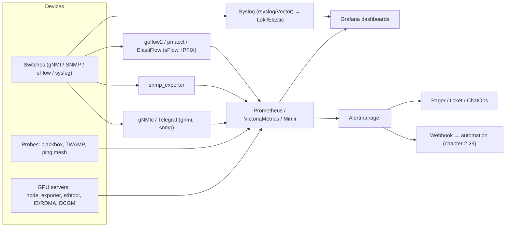

# 2.31 Network monitoring and telemetry for AI data centers

| | |
|---|---|
| Level | Intermediate to advanced |
| Priority tier | 0 |
| Lab venue | Linux VM with Docker (Prometheus, Grafana, gNMIc, node_exporter), containerlab fabric (chapter 2.27) |
| Part | Part 2: Networking, from first principles to AI fabrics |
| Status | Drafted, labs **untested** |

## Why this matters for AI infrastructure

Training and inference clusters depend on a network that must be both fast and *predictable*. The failures that hurt most are not outages but degradations: a single flapping optic, a rail running at half bandwidth, a switch queue that overflows for 50 microseconds every few seconds, a PFC storm that freezes a pod, an ECMP imbalance that slows every collective by 15%. Traditional once-a-minute SNMP graphs average these away. This chapter covers how to **see** the network: the monitoring options (SNMP, syslog, streaming telemetry, flow export, active probes, in-band telemetry, packet mirroring), a practical open-source stack (exporters → Prometheus → Grafana/Alertmanager, with Loki for logs), the signals that matter in AI/ML fabrics (egress buffers, drops, PFC, ECN, CNPs, link quality, per-rail bandwidth skew, latency), how to correlate network and server data, how to design alerts and SLOs, and how to close the loop with automation (chapter 2.29). The server-side GPU observability stack (DCGM, Kubernetes GPU telemetry, tracing) is covered in the observability part of the handbook; this chapter concentrates on the network and its correlation with hosts.

## Prerequisites and outcomes

You should know counters and tools from chapter 2.22, congestion mechanisms from chapter 2.19, the fabric designs in 2.16 and 2.18, and the automation concepts in 2.28 and 2.29.

After this chapter you can:

- Compare SNMP polling, SNMP traps, syslog, streaming telemetry (periodic and on-change), RPC queries, active probes (TWAMP/ICMP/TCP), sFlow/IPFIX/NetFlow, mirroring and in-band telemetry (IFA/INT), with their strengths and costs.
- Deploy a Prometheus-based network monitoring stack: node_exporter (netdev, ethtool, infiniband collectors), snmp_exporter, gNMIc, blackbox exporter, DCGM exporter, Grafana and Alertmanager; write PromQL for rates, errors, saturation and skew.
- Identify the AI-fabric signals (utilisation, egress buffer occupancy, drops per queue, PFC pause rates, ECN marks, CNPs, link flaps, FEC/CRC errors, optics power, latency, entropy/ECMP balance, per-rail bandwidth) and baseline them.
- Design alerts and SLOs that catch degradations without pager fatigue; manage cardinality, retention and cost.
- Correlate switch telemetry with server telemetry and job events to localise stragglers and incidents.
- Describe in-band flow analysis (IFA) and mirroring-on-drop, historical vs real-time monitoring, and corrective-action loops up to autonomous operation.

## 1. What to monitor and why

### Three questions of monitoring

1. **Is it up?** (availability: devices, links, sessions, services)
2. **Is it healthy?** (errors, drops, saturation, latency, temperature, power)
3. **Is it doing its job?** (the purpose metric: collective bandwidth and job completion time, inference latency and error rate)

Use the same structure as troubleshooting (chapter 2.30): the *purpose* metric first, then the USE method (utilisation, saturation, errors) for each interface and queue, and the RED method (rate, errors, duration) for services such as DNS, DHCP, load balancers and the monitoring pipeline itself. Add the **four golden signals** (latency, traffic, errors, saturation) at service level.

### Beyond the network

Data centre health includes power, temperature, humidity, fan speeds, leak detection, PDUs and cooling (DCIM/BMS and Redfish/IPMI telemetry); a GPU cluster's thermal and power state directly affects network optics and GPU throttling. This chapter focuses on IP/RDMA networking, with power and temperature of network devices included as ordinary metrics.

### Baselines and trends

Monitoring without baselines is noise. Record normal ranges per device role and time of day (utilisation, error rates, queue depths, PFC/ECN rates, latency, optics Rx power), and use **historical monitoring** for trends and capacity (a utilisation growth of 10% over two weeks implies when the next upgrade is needed), and **real-time monitoring** (streaming telemetry, sub-second, analysing real-time data per network node including ASIC buffer memory utilisation, switch/router/firewall CPU load, and remaining flash/storage space, where immediate corrective action might involve reducing load on the congested node or shifting traffic) for fast faults. Historical data can be tagged with the corrective actions that worked, which becomes the training data for runbooks and, eventually, automated remediation.

## 2. Monitoring mechanisms

| Mechanism | How it works | Typical granularity | Strengths | Weaknesses |
|---|---|---|---|---|
| **SNMP polling** (v2c/v3) | Collector polls OIDs/MIBs (interface counters, queue stats, buffer use, CPU, memory, FIB/RIB/MAC/TCAM utilisation) | 30 s to 5 min | Universal; standard MIBs; simple | Pull overhead; coarse; slow bulk walks; v2c weak security; vendor MIB gaps; poor for microbursts |
| **SNMP traps/informs** | Device sends events on thresholds (CPU high, link down, PFC rate exceeded) | event-driven | Immediate alarms | Rate limited; thresholds must be pre-set; lossy (UDP) |
| **Syslog** | Device logs severity-coded messages (link flaps, BGP state, hardware faults, config changes) | event-driven | Rich detail, forensic | Unstructured; volume; needs parsing (grok/regex), time sync |
| **Streaming telemetry (gNMI, vendor gRPC/UDP)** | Device pushes structured data periodically or on change, often straight from the forwarding engine | 1 to 10 s typical; sub-second on some platforms | Fine granularity; efficient at scale; typed paths; on-change events | Needs collectors and storage; model differences; cardinality |
| **RPC/API queries** (eAPI, NX-API, RESTCONF, NETCONF `get`) | Scripted structured queries instead of CLI scraping | seconds to minutes | Automatable; good for state checks | Pull model; device CPU |
| **Agent-based active probing** | Probes measure latency/loss/jitter with ICMP, TCP, UDP, **TWAMP**/OWAMP; blackbox exporter; smokeping | 1 to 10 s | Measures what users see; between any two points | Probes ≠ application traffic; consumes bandwidth |
| **sFlow / IPFIX / NetFlow** | Sampled packet headers (sFlow) or flow records (IPFIX/NetFlow) exported to collectors | per-flow, sampled | Who talks to whom; top talkers; application mix; elephant detection | Sampling error; not packet-exact; collector scale |
| **Packet mirroring** (SPAN/ERSPAN, mirror-on-drop) | Copies packets to analysers; **mirror on drop** copies packets the ASIC discards | on demand | Ground truth; drop analysis | Heavy; privacy; mirror loss |
| **In-band telemetry (IFA / INT)** | Metadata added to live packets or clones (per-hop timestamps, queue, congestion) and exported by the egress node | per-packet probe | Per-hop latency and queue state on the real path | Needs ASIC support; header overhead and MTU; ecosystem maturity |
| **Server-side metrics** | node_exporter, NIC/RDMA counters, DCGM (GPU), NCCL logs | 1 to 15 s | Correlates host and job with network | Another pipeline |

In AI networks the same mechanisms are used as elsewhere, but the **required speed** changes: congestion events last microseconds to milliseconds, so seconds-resolution exports capture trends, not events. The industry response is richer on-device processing (hardware counters with high-water marks, microburst detection, histograms), streaming on-change telemetry, in-band probes, and mirror-on-drop, plus edge decisions (adaptive routing, ECN/CNP reaction) that do not wait for a collector. Monitoring explains and tunes; it does not replace the fabric's real-time congestion control.

### Choosing

- Use **SNMP** only where nothing else exists (legacy devices, PDUs, some optical gear) and for traps/syslog as alarms.
- Use **streaming telemetry (gNMI)** as the primary source for modern switches (SONiC, Cumulus, Arista, Juniper, Nokia, Cisco), at 1 to 10 s for counters and on-change for state.
- Run **active probes** between representative host pairs (including cross-rail and cross-pod) to measure real reachability and latency continuously.
- Use **sFlow/IPFIX** at leaf ports for flow visibility (1-in-1000 to 1-in-4000 sampling for 100G+).
- Keep **packet captures** and **mirror-on-drop** for investigation (chapter 2.26).
- Collect **host/NIC/RDMA counters** on every node; they are often the best early indicator and cost nothing on the switch.

## 3. An open-source network monitoring stack



### Prometheus model

Prometheus **pulls** (scrapes) HTTP endpoints exposing metrics in a text format; the data is **time series** identified by a metric name plus **labels** (`ifname`, `device`, `instance`, `rack`, `role`, `tenant`). Metric types: **counter** (monotonic: bytes, errors, drops; use `rate()`), **gauge** (current value: temperature, queue depth), **histogram/summary** (latency distributions). Alertmanager deduplicates, groups, routes and silences alerts. Long-term storage and scale-out options: Thanos, Mimir, Cortex, VictoriaMetrics. For pushed streams (gNMI), a collector converts them into scrapeable metrics (gNMIc's Prometheus output) or remote-writes to storage.

```yaml
# prometheus.yml (fragment)
global: { scrape_interval: 15s, evaluation_interval: 15s }
rule_files: [ "rules/*.yml" ]
scrape_configs:
  - job_name: node
    static_configs: [ { targets: [ "gpu01:9100", "gpu02:9100" ], labels: { role: gpu } } ]
    # or file_sd / kubernetes_sd / consul_sd / netbox http_sd for dynamic targets
  - job_name: gnmic
    scrape_interval: 10s
    static_configs: [ { targets: [ "gnmic:9804" ] } ]
  - job_name: snmp
    metrics_path: /snmp
    params: { module: [ if_mib ], auth: [ public_v3 ] }
    static_configs: [ { targets: [ "pdu1", "legacy-sw1" ] } ]
    relabel_configs:
      - { source_labels: [ __address__ ], target_label: __param_target }
      - { source_labels: [ __param_target ], target_label: instance }
      - { target_label: __address__, replacement: "snmp-exporter:9116" }
  - job_name: blackbox_icmp
    metrics_path: /probe
    params: { module: [ icmp ] }
    static_configs: [ { targets: [ "10.10.1.11", "10.10.4.11" ] } ]
    relabel_configs:
      - { source_labels: [ __address__ ], target_label: __param_target }
      - { source_labels: [ __param_target ], target_label: instance }
      - { target_label: __address__, replacement: "blackbox:9115" }
  - job_name: dcgm
    static_configs: [ { targets: [ "gpu01:9400" ] } ]
```

### Host and NIC metrics (node_exporter)

Enable the relevant collectors and flags:

```bash
node_exporter \
  --collector.netdev --collector.netstat --collector.sockstat --collector.softnet --collector.conntrack \
  --collector.ethtool --collector.ethtool.device-include='^(ens|eth|eno).*' \
  --collector.ethtool.metrics-include='.*(pause|discard|drop|missed|crc|fcs|ecn|cnp|out_of_buffer).*' \
  --collector.infiniband --collector.rdma --collector.thermal_zone --collector.hwmon \
  --collector.netclass --collector.arp --collector.bonding --collector.qdisc --collector.interrupts
```

Key families: `node_network_receive_bytes_total`, `node_network_transmit_bytes_total`, `node_network_receive_errs_total`, `node_network_receive_drop_total`, `node_network_up`, `node_network_speed_bytes`, `node_network_mtu_bytes`, `node_netstat_Tcp_RetransSegs`, `node_netstat_TcpExt_*`, `node_softnet_dropped_total`, `node_softnet_times_squeezed_total`, `node_nf_conntrack_entries` / `_limit`, `node_ethtool_*` (driver counters including PFC and discard counters), `node_infiniband_port_data_transmitted_bytes_total`, `node_infiniband_*_errors_total`, `node_infiniband_port_transmit_wait`-style congestion counters (names vary by version; verify). For RDMA NIC specifics (CNP, ECN, retransmissions, out-of-sequence), use `rdma statistic`, `ethtool -S`, or vendor exporters (NVIDIA's DOCA telemetry service, `mlx5` exporters).

### Switch telemetry with gNMI → Prometheus

```yaml
# gnmic.yaml
username: admin
password: ${GNMI_PASSWORD}
skip-verify: false
tls-ca: /etc/ssl/ca.pem
encoding: json_ietf
targets:
  leaf1:6030: {}
  leaf2:6030: {}
subscriptions:
  if_counters:
    paths: [ "/interfaces/interface/state/counters" ]
    stream-mode: sample
    sample-interval: 10s
  if_state:
    paths: [ "/interfaces/interface/state/oper-status" ]
    stream-mode: on_change
  qos:
    paths: [ "/qos/interfaces/interface/output/queues/queue/state" ]     # vendor/model dependent
    stream-mode: sample
    sample-interval: 5s
outputs:
  prom:
    type: prometheus
    listen: ":9804"
    path: /metrics
    expiration: 60s
    metric-prefix: gnmi
    append-subscription-name: true
    export-timestamps: true
```

SONiC exposes counters via its Redis-based database and exporters (`sonic-exporter`, `gnmi` server); Cumulus/NVUE offers `nv show interface counters` and OpenMetrics endpoints; Arista has streaming via gNMI/TerminAttr (CloudVision); Juniper JTI with Telegraf; Cisco model-driven telemetry/Pipeline. The principle is the same: subscribe, normalise to metrics with consistent labels (`device`, `interface`, `queue`, `role`, `rack`, `rail`, `tenant`), and enrich from the source of truth (NetBox) so dashboards group by role, pod and rail rather than by hostname.

### Flow data

Run `goflow2`, `pmacct`, `ElastiFlow`, or vendor collectors for sFlow/IPFIX; aggregate into top talkers, per-tenant volume, elephant flows, protocol mix (RoCE UDP 4791 vs TCP storage), and entropy (number of distinct 5-tuples per link). Compare ECMP balance by computing per-uplink byte rates from interface counters and flagging skew (below).

### Logs

Collect syslog from switches and `journald`/dmesg from hosts into Loki/Elasticsearch via Vector, Fluent Bit or rsyslog; parse severities and key events (link flap, optic fault, PFC watchdog, BGP neighbour change, BFD down, ECC/Xid); alert on patterns and correlate with metrics by timestamp (time sync via PTP/NTP is essential).

## 4. Signals that matter in an AI/ML fabric

| Signal | Why | Source | Typical alert logic |
|---|---|---|---|
| **Per-port throughput and utilisation** vs capacity | Fabric load, rail skew, ECMP imbalance | gNMI counters, `node_network_*` | Sustained > 85% on uplinks; per-rail rate ratio between max and min > 1.3 during a job |
| **Egress buffer/queue occupancy and high-water marks** | Early sign of congestion before drops | gNMI/ASIC counters (shared and dedicated buffers, per queue) | Occupancy trend rising; high-water mark approaching ECN/PFC thresholds |
| **Drops per queue** (tail drops, WRED drops) | Loss on lossless classes is a fault; on lossy classes a congestion indicator | gNMI, `ethtool -S` | Any drop on the lossless priority; sustained drops elsewhere |
| **PFC pause frames** sent/received per priority and **PFC watchdog** events | Backpressure, storms, deadlock risk | Switch and NIC counters (`rx_prio3_pause`) | Pause rate above baseline for > N s; any watchdog trigger |
| **ECN marks and CNPs** | DCQCN activity: how often senders are told to slow | Switch ECN counters, NIC `np_cnp_sent`/`rp_cnp_handled` | Persistent high CNP rate = chronic congestion; zero CNP with marked packets = misconfiguration |
| **Link state and flaps** | Instability | Syslog, `oper-status` on-change | Any flap on a production link; more than one per hour |
| **Physical-layer quality**: FEC corrected/uncorrected codewords, pre-FEC BER, CRC/FCS errors, symbol errors, optics Rx/Tx power and temperature (DOM) | Predicts failing optics and cables before link-down | gNMI, `ethtool -S`, `ethtool -m`, UFM | Rising corrected FEC rate trend; any uncorrected; Rx power near the sensitivity limit |
| **Latency and loss between host pairs** (probes) and **per-hop latency** (IFA) | User-visible path health | blackbox/TWAMP, IFA | p99 latency > baseline × 2; loss > 0.01% |
| **BGP/BFD/LLDP state** | Control plane and cabling truth | gNMI, FRR exporter | Session down; neighbour count mismatch; LLDP neighbour differs from plan |
| **ECMP/AR balance and flow entropy** | Fat-flow collisions, hash polarization | Interface counters per member, sFlow | Member imbalance (stddev/mean) > threshold under load |
| **Control-plane health**: CPU, memory, TCAM/FIB/MAC utilisation, CoPP drops | Switch health, scale limits | gNMI/SNMP | CPU > 80% sustained; table > 80% full |
| **Environment**: temperature, fans, PSU, power draw | Hardware faults | gNMI/IPMI/Redfish | Threshold + rate of change |
| **Host side**: NIC drops, ring overflows, softirq squeeze, TCP retransmits, RDMA errors/out-of-sequence, conntrack usage, IRQ imbalance | Early indication of host-originated problems | node_exporter, `rdma statistic` | See alert rules below |
| **Job-level**: NCCL timeouts, step time, all-reduce time, straggler rank, GPU utilisation drops | The purpose metric | Application/NCCL logs, DCGM, training framework | Step time > baseline × 1.2 |

Group by **rail**, **pod**, **tenant** and **device role** with labels from the source of truth; most analysis is comparison between peers (one outlier in a rail group is a bad cable; a whole tier shifted is a config or load change).

### Example PromQL

```promql
# Per-interface throughput in Gb/s (hosts)
rate(node_network_receive_bytes_total{device=~"ens.*"}[1m]) * 8 / 1e9
# Utilisation vs negotiated speed
(rate(node_network_transmit_bytes_total{device="ens1f0"}[1m]) * 8) / (node_network_speed_bytes{device="ens1f0"} * 8)
# Error and drop rates
rate(node_network_receive_errs_total[5m]) > 0
rate(node_network_receive_drop_total[5m]) > 0
# TCP retransmit ratio
rate(node_netstat_Tcp_RetransSegs[5m]) / rate(node_netstat_Tcp_OutSegs[5m])
# Softirq pressure on RX path
rate(node_softnet_times_squeezed_total[5m]) > 0
# PFC pause activity (driver-dependent counter names)
sum by (instance, device) (rate(node_ethtool_rx_prio3_pause[1m]))
# Rail skew: max/min throughput across the 8 rails of a node
max by (instance) (rate(node_network_transmit_bytes_total{device=~"ens.*"}[1m])) / min by (instance) (rate(node_network_transmit_bytes_total{device=~"ens.*"}[1m]))
# Switch uplink imbalance across ECMP members (gnmi metric names depend on your model)
stddev by (device) (rate(gnmi_if_counters_out_octets{interface=~"Ethernet(49|50|51|52)"}[1m])) / avg by (device) (rate(gnmi_if_counters_out_octets{interface=~"Ethernet(49|50|51|52)"}[1m]))
# Conntrack headroom
node_nf_conntrack_entries / node_nf_conntrack_limit > 0.8
# Predict link saturation in 4 hours
predict_linear(node_network_transmit_bytes_total[1h], 4*3600)
# InfiniBand backpressure (metric name depends on exporter)
rate(ib_port_xmit_wait_total[5m]) > 1000
# Probe latency and loss (blackbox)
probe_duration_seconds{job="blackbox_icmp"} > 0.002
avg_over_time(probe_success[5m]) < 0.99
```

Remember: aggregate **rates of counters**, not raw counters; use `rate()` over a window of at least 4 scrape intervals; beware counter resets and wrap; for histograms use `histogram_quantile`; avoid high-cardinality labels (full 5-tuples, per-flow IDs) in Prometheus: send flows to a flow store instead.

### Alert rules (examples)

```yaml
groups:
- name: network
  rules:
  - alert: LinkFlapping
    expr: changes(gnmi_if_state_oper_status[10m]) > 2
    for: 1m
    labels: { severity: page }
    annotations: { summary: "{{ $labels.device }} {{ $labels.interface }} flapped", runbook: "https://wiki/runbooks/link-flap" }
  - alert: HostNicDrops
    expr: rate(node_network_receive_drop_total{device=~"ens.*"}[5m]) > 100
    for: 5m
    labels: { severity: ticket }
  - alert: PfcStorm
    expr: sum by (device, interface) (rate(gnmi_qos_pfc_rx_pause_frames[1m])) > 100000
    for: 30s
    labels: { severity: page }
    annotations: { summary: "PFC storm suspected on {{ $labels.device }}/{{ $labels.interface }}" }
  - alert: LosslessQueueDrops
    expr: increase(gnmi_qos_queue_dropped_packets{queue="3"}[5m]) > 0
    labels: { severity: page }
  - alert: RailBandwidthSkew
    expr: (max by (instance) (rate(node_network_transmit_bytes_total{device=~"ens.*"}[2m])) / min by (instance) (rate(node_network_transmit_bytes_total{device=~"ens.*"}[2m]))) > 1.5 and on (instance) max by (instance) (rate(node_network_transmit_bytes_total{device=~"ens.*"}[2m])) > 5e9
    for: 5m
    labels: { severity: ticket }
  - alert: OpticsDegrading
    expr: gnmi_optics_rx_power_dbm < -9 or increase(gnmi_if_fec_corrected_codewords[1h]) > 1e9
    for: 10m
    labels: { severity: ticket }
  - alert: ConntrackNearFull
    expr: node_nf_conntrack_entries / node_nf_conntrack_limit > 0.8
    for: 10m
  - alert: ProbeLoss
    expr: avg_over_time(probe_success[5m]) < 0.98
    for: 5m
```

Alert design principles: alert on **symptoms that need action** (customer/job impact, or imminent failure), not on every cause; use `for:` durations to avoid flaps; tier severity (page vs ticket); include a runbook link and the diagnostic query in the annotation; route by team and failure domain; **group** related alerts (a failing spine produces hundreds of leaf alerts: inhibit them); alert on **absence of data** (`absent()`, target down) because broken monitoring is worse than no monitoring; test alerts (inject faults, chapter 2.30); review noisy alerts weekly.

### SLOs for the network

Define service-level indicators from the user's view: probe success rate between host pairs (e.g. 99.99% over 30 days), all-reduce bandwidth achieved vs target (percentage of time above 90% of baseline), packet loss on lossless classes (zero tolerance), time to detect a failed link (≤ 1 s with BFD), time to restore. Track **error budgets** and use them to prioritise reliability work versus change velocity.

## 5. In-band telemetry: IFA

**In-band Flow Analyzer (IFA)** and its relatives (INT, P4 INT, IOAM) measure the *real* path by adding metadata to packets or clones as they cross the fabric, giving per-hop latency and queue/congestion information at nanosecond-class resolution that polling cannot reach. Roles:

- **Initiator** (typically the ingress leaf): samples traffic of interest and either tags original packets or, more commonly, **clones** them into probe packets carrying an IFA header, an initiator tag, timestamps and device information.
- **Transit** (spines/super-spines): append their own metadata (device ID, ingress/egress ports, queue ID, ingress timestamp, **residence time** in nanoseconds, congestion bit set when ECN marking applies, egress port speed) to the metadata stack.
- **Terminator** (egress leaf or border): removes the metadata, exports it to a collector (for example as IPFIX), and drops the cloned probe; if the original packet was tagged, it is forwarded after stripping.

Packet structure: L2/L3 headers, then the **IFA header** (version, namespace, protocol type, flags, max length), then the original L4 header, then the **IFA metadata header** (action, hop limit) and the **metadata stack** (`draft-kumar-ippm-ifa-08`). The fabric MTU must absorb the extra bytes (jumbo frames normally do). Per-hop latency is derived from receipt timestamps (residence time in nanoseconds plus wire time); congestion info is meaningful only where ECN is enabled on the egress port; accurate latency needs comparable timestamp resolution at all hops, which favours homogeneous hardware per tier; 3-stage and 5-stage IFA deployments differ in how many transit nodes appear. Benefits: probes follow the same path as the real flow, so you find faults and bottlenecks that synthetic agents (different payloads, different hash) miss; live per-hop queue and latency analysis; microsecond accuracy. Limitations: ASIC and software support, multicast handling, overhead, collector scale, and maturity (check standards drafts such as the IETF IFA draft `draft-kumar-ippm-ifa-08` and IOAM RFC 9197).

**Mirror-on-drop.** When the ASIC discards a packet (buffer overflow, ACL, TTL, malformed), the switch can copy the dropped packet (or its header and drop reason) to a collector. This tells you what kind of traffic is lost and why, distinguishing congestion drops from defensive drops (for example control-plane protection when too many ARP requests arrive, or DDoS filters), which is otherwise invisible to counters.

**On-demand mirroring** analyses user content or protocol behaviour for specific flows (chapter 2.26).

## 6. Correlation and corrective actions

### Correlating switch and server telemetry

The big wins come from joining datasets by time and identity: a job's rank → node → NIC → leaf port → spine uplinks. Use consistent labels, a source-of-truth mapping (cable and port inventory from LLDP/NetBox), and unified timestamps. Typical correlation workflows:

- **Straggler hunt**: NCCL/step-time telemetry flags rank 112 as slow → find its node and rail → compare that rail's TX/RX rates, retransmissions, CNP counts, PFC pauses and FEC errors with peers → leaf port counters and optics DOM → resolution (clean optic, move node, drain).
- **Congestion mapping**: ECN/CNP rises on many NICs while a spine uplink shows high utilisation and a growing egress queue → ECMP collision or oversubscribed tier → check flow entropy via sFlow, adaptive routing settings, job placement.
- **Aggregation vs edge**: frame loss and latency differ between aggregation points (spine) and edge (leaf with a subset of servers); compare tiers to localise.
- **Capacity**: trend of peak-hour utilisation per tier and per tenant; alert when forecast to exceed 80% within N weeks.

### Corrective actions

Possible actions, from least to most disruptive: tune thresholds (ECN/PFC), re-hash or steer flows (adaptive routing, DPF/Flex Algo planes, chapter 2.16), shift jobs or tenants (scheduler placement), isolate a suspect node/port/optic (drain, shut), restart a job from checkpoint, fail over to another fabric plane or site. Actions can be taken at several levels: **a single hop** (local reactions like ECN marking, adaptive routing, PFC), **the traffic source** (rate control from congestion signals, SFC/CSIG, chapter 2.19), or a **monitoring platform** that recognises a known pattern and runs a runbook (automation webhook; chapter 2.29). Even when a problem can't be fixed instantly (microsecond congestion), monitoring tells you its *origin and size* so you can make an informed decision: is loss constant or periodic, on one interface or many, on one switch or several, correlated with a job phase? Depending on severity the worst-case decisions can include shutting down the server at the origin of congestion, restarting the learning process at the scheduler, or evacuating to a site with better capacity: know which your applications can tolerate (checkpoint cadence, elastic training).

**Autonomous operation.** As patterns, actions and outcomes accumulate, platforms can progress from alerting, to recommending, to executing approved remediations, to self-driving behaviour; AI/LLM assistants can summarise incidents and propose runbook steps from history. Guard-rails: explicit action allow-lists, rate limits, human approval for risky actions, dry runs, full audit, and always the ability to disable automation. Monitoring only helps if the underlying design (oversubscription, load balancing method, optics quality, congestion control) was right: telemetry cannot rescue an undersized fabric.

## 7. Operating the monitoring system

- **Cardinality**: label combinations multiply (device × interface × queue × priority × tenant). Estimate series counts (devices × metrics × labels); drop unneeded metrics at the collector; avoid per-flow labels; use recording rules for expensive aggregates.
- **Retention and downsampling**: raw 10 s data for days, 1-minute for weeks, 5-minute for a year (Thanos/Mimir/VictoriaMetrics), with high-resolution capture triggered around incidents.
- **Reliability**: the monitoring path should not share fate with what it monitors: out-of-band management network, redundant Prometheus pairs, remote-write to a second site, a "watchdog" always-firing alert that proves the alert pipeline works, and monitoring of the monitors.
- **Time**: clock sync (NTP/PTP) across switches, hosts and collectors; timestamps from the device when possible.
- **Security**: authenticate and encrypt telemetry (gNMI over TLS, SNMPv3, mTLS to Prometheus targets), least-privilege read-only accounts, protect Grafana and Alertmanager, scrub sensitive data from logs.
- **Cost and scale**: telemetry volume (a 64-port switch × 100 counters × 10 s ≈ 640 samples/s per switch, 1,000 switches ≈ 640k samples/s): size storage and ingestion; prefer on-change for state and sampled counters for rates.
- **Dashboards**: one fabric-wide health view (red/green per tier), per-rail and per-tenant views, per-switch detail, host NIC view, job view; design for the on-call at 3 a.m.: top-level traffic lights with links to drilldowns; annotate deploys, maintenance and incidents; keep queries cheap.
- **Process**: runbooks linked from alerts, ownership, review of alert quality, post-incident updates to baselines and alerts (chapter 2.30).

## 8. Hands-on lab: a network observability stack

First, run the self-checking Python lab (`code/part02/network_monitoring_telemetry_lab.py`) locally. It verifies per-rail bandwidth skew (`max/min > 1.5`) and ECMP coefficient-of-variation (`stddev/mean`) detection, In-Band Flow Analyzer (`IFA`) per-hop residence-time and ECN congestion stack analysis, and 1,000-switch Prometheus time-series cardinality (`6.4M` series) and ingestion rate (`640,000` samples/s) sizing.

```bash
python3 code/part02/network_monitoring_telemetry_lab.py
```

Next, on a disposable Linux VM with Docker and the Chapter 2.27 containerlab fabric (all interactive VM commands below are `untested here`), work through these steps:

1. **Stack**: Docker Compose with Prometheus, Alertmanager, Grafana, Loki, node_exporter, blackbox exporter, and gNMIc; load the Prometheus config above.
2. **Hosts**: enable the ethtool, infiniband and softnet collectors on a VM; build a dashboard (throughput, utilisation, errors, drops, retransmits, softnet squeeze, conntrack); generate load with `iperf3` and `tc netem` loss; watch counters respond.
3. **Fabric (containerlab)**: expose FRR/Linux interface counters via node_exporter in each node container (or use SR Linux/cEOS with gNMI); build per-link utilisation and ECMP-balance panels for the leaf-spine fabric; run `iperf3 -P 16` and then engineer a collision to see imbalance.
4. **Alerts**: implement LinkFlapping, HostNicDrops, ConntrackNearFull and ProbeLoss; inject faults (down a link repeatedly, add loss, exhaust conntrack, block ICMP) and verify each fires, with sensible grouping and inhibition; test the Watchdog alert.
5. **Flows**: send sFlow from Open vSwitch or `hsflowd` on a Linux bridge to goflow2/pmacct; build a top-talkers dashboard and detect an elephant flow.
6. **gNMI telemetry**: subscribe to counters (sample) and oper-status (on change) from a gNMI-capable container; chart queue or counter data; compare the 10 s view with a 1 s view during a micro-burst generated with a burst script.
7. **Logs**: forward syslog/FRR logs to Loki; build an alert on BGP neighbour down and correlate it on a dashboard with interface flaps.
8. **Correlation drill**: create a "straggler" by throttling one host rail with `tc`; find it using only dashboards (rail skew, retransmits, probe latency), as in the workflow above; write the post-incident note.
9. **SLO**: define an SLI (probe success between host pairs) and compute an error budget burn rate alert (multi-window, multi-burn-rate).
10. **Cardinality exercise**: estimate series for a 1,000-switch fabric at your chosen labels; reduce by 50% with relabeling and recording rules.
11. **Clean up.**

## 9. Common mistakes

- Relying on 5-minute SNMP averages for a microburst problem; no high-water marks.
- Alerting on every counter increment; no `for:`; no grouping/inhibition; alert fatigue until real alerts are ignored.
- Monitoring link state but not link quality (FEC/CRC/DOM); discovering failing optics only at link-down.
- No baselines; thresholds copied from vendor defaults.
- Telemetry and servers with unsynchronised clocks; no common labels, so correlation is manual.
- Unbounded cardinality (per-flow labels), runaway storage cost.
- Monitoring that depends on the network it monitors; no watchdog.
- Treating monitoring as a substitute for design: congestion control, load balancing and capacity planning come first.
- Giving automation write access to production from an alert without guard-rails.

## 10. Interview angles

- "How would you monitor a 4,000-GPU RoCE fabric? What metrics matter and at what resolution?"
- "SNMP polling vs streaming telemetry: differences and when to use each."
- "How do you detect a slow rail or a failing optic before it takes a job down?"
- "What is IFA/INT and what does it give you that probes don't?"
- "How would you design alerts for PFC storms and ECN/CNP anomalies?"
- "A training job's step time doubled; show how you correlate switch and server telemetry to find the cause."
- "How do you avoid alert fatigue and ensure the monitoring system itself is reliable?"
- "Explain cardinality problems in Prometheus and how you control them."

## Exercises

1. **The Three Monitoring Questions, `USE` / `RED` / Golden Signals, and Comparing the 10 Monitoring Mechanisms (`ADC` Chapter 11):** (a) State the three core questions of network monitoring and explain how `USE`, `RED`, and the Four Golden Signals map onto switches, NICs, and cluster services; (b) compare **SNMP polling/traps**, **syslog**, **gNMI streaming telemetry** (`sample` vs `on_change`), **active probes (`TWAMP`/`blackbox`)**, **`sFlow`/`IPFIX`**, **mirror-on-drop**, and **In-Band Flow Analyzer (`IFA` / `INT`)**, and contrast **historical** vs **real-time** monitoring.
2. **Deploying the Open-Source Network Observability Stack (`node_exporter`, `gNMIc`, `snmp_exporter`, `blackbox`, Prometheus, and Loki):** Write the `node_exporter` flags (`--collector.ethtool`, `--collector.infiniband`, `--collector.softnet`) and `gnmic.yaml` subscription config (`sample` vs `on_change` -> Prometheus `:9804`), and explain how Prometheus `relabel_configs` work for multi-target exporters (`snmp_exporter` `:9116`, `blackbox_exporter` `:9115`).
3. **AI-Fabric Signals, PromQL Queries, and Detecting Rail Skew and ECMP Imbalance:** Using `evaluate_rail_skew_and_ecmp_balance()` in `code/part02/network_monitoring_telemetry.py`, evaluate an 8-rail node where 7 rails transmit at `380 Gb/s` and Rail 3 transmits at `190 Gb/s` (`max/min skew = 2.0 > 1.5`). Write the PromQL expressions for per-rail bandwidth skew, switch uplink ECMP imbalance (`stddev / avg`), lossless queue drops, PFC storm rate, and degrading optical power (`gnmi_optics_rx_power_dbm < -9` or `increase(gnmi_if_fec_corrected_codewords[1h]) > 1e9`).
4. **In-Band Flow Analyzer (`IFA`, `draft-kumar-ippm-ifa-08`) and Mirror-on-Drop (`ADC` Chapter 11):** (a) Using `analyze_ifa_metadata_stack()`, trace how the **Initiator**, **Transit**, and **Terminator** nodes build and export the IFA metadata stack, and identify the bottleneck hop from `[{"device_id": "leaf1", "residence_ns": 650, "ecn_marked": False}, {"device_id": "spine2", "residence_ns": 48500, "ecn_marked": True}, {"device_id": "leaf4", "residence_ns": 700, "ecn_marked": False}]`; (b) explain what **mirror-on-drop** reveals that standard drop counters cannot.
5. **Correlating Switch + Server Telemetry for Straggler Hunts and Multi-Level Corrective Actions:** Walk through the step-by-step data join from a slow training rank (`rank 112`) to the exact switch port and spine uplink, and classify the hierarchy of corrective actions (hop-level ECN/AR -> source-level DCQCN/SFC -> platform runbook drain -> job restart or datacenter evacuation when capacity planning was insufficient).
6. **Operating the Monitoring System at Scale (Cardinality, Retention, Out-of-Band Reliability, and SLOs):** Using `estimate_telemetry_cardinality_and_rate(1000, 64, 100, 10.0)`, calculate the active time-series count (`6.4M`) and sample ingestion rate (`640,000 samples/s`) for a 1,000-switch fabric, explain how to prevent cardinality explosions in Prometheus, and design a Watchdog + `absent()` alert and network SLO error budget.

## Checkpoint questions (20)

<details>
<summary>1. What are the three fundamental questions of network monitoring, and why do 1- to 5-minute `SNMP` polls miss AI-fabric congestion?</summary>

The three questions are: **(1) Is it up?** (availability), **(2) Is it healthy?** (`USE`: utilization, saturation, errors), and **(3) Is it doing its job?** (the application purpose metric: `AllReduce` collective bandwidth, training step time, and inference `TTFT`/`TPOT`). Synchronized GPU collective bursts and incast congestion last **microseconds to milliseconds**: a 60-second or 5-minute SNMP average divides a 10-millisecond 400 Gb/s queue overflow by 60,000 milliseconds, making the link look 2% utilized while collectives are stalling on PFC pauses or retransmits.
</details>

<details>
<summary>2. Compare Historical Monitoring and Real-Time Monitoring in an AI data center (`ADC` Chapter 11).</summary>

- **Historical Monitoring**: aggregates utilization, error trends, and job metrics over days, weeks, and months to drive **capacity planning** (e.g., observing a 10% biweekly growth in inter-pod bandwidth to schedule spine upgrades before saturation), optic lifecycle replacement, and post-mortem correlation.\n- **Real-Time Monitoring**: streams sub-second to 1–10s node and fabric state (ASIC buffer watermark, switch CPU/memory/flash, PFC pause rate, ECN/CNP rate, link flaps) to trigger **immediate operational or automated corrective actions** (draining a degraded link/rail, re-steering flows, or killing a runaway job).
</details>

<details>
<summary>3. Compare `gNMI Streaming Telemetry`, `sFlow` / `IPFIX`, and `TWAMP` / `Blackbox` Active Probes.</summary>

- **`gNMI` Streaming Telemetry**: switches push YANG-modeled counters (`SAMPLE` every 1–10s) and state changes (`ON_CHANGE`) over HTTP/2 + Protobuf to collectors (`gNMIc`, `Telegraf`).\n- **`sFlow` / `IPFIX` (`NetFlow`)**: exports statistically **sampled packet headers** (`1-in-1000` to `1-in-4000` in `sFlow`) or flow-cache records (`IPFIX`) to `goflow2`/`pmacct`, revealing **who is talking to whom (5-tuples), top talkers, elephant flows, and ECMP flow entropy** without exploding Prometheus label cardinality.\n- **`TWAMP` (*Two-Way Active Measurement Protocol*) / `Blackbox` Probes**: synthetic packets sent continuously between representative host pairs across rails and pods to measure real end-to-end **loss, RTT, and jitter** even when no job is running.
</details>

<details>
<summary>4. Which `node_exporter` collectors should be enabled on every Linux GPU server to monitor host networking and RDMA?</summary>

Enable: **`--collector.netdev`** (bytes/packets/errors/drops), **`--collector.netstat`** and **`--collector.sockstat`** (TCP retransmits, `ListenOverflows`, `UdpRcvbufErrors`), **`--collector.softnet`** (`softnet_stat` drops and `time_squeeze`), **`--collector.conntrack`** (`entries` vs `limit`), **`--collector.ethtool`** (filtered to include `pause`, `discard`, `drop`, `rx_missed`, `rx_out_of_buffer`, `crc`, `fcs`, `ecn`, `cnp`), **`--collector.infiniband`** and **`--collector.rdma`** (`port_xmit_wait`, RDMA bytes/errors), **`--collector.bonding`**, and **`--collector.qdisc`**.
</details>

<details>
<summary>5. How does the Prometheus multi-target exporter pattern (`relabel_configs`) work for `snmp_exporter` (`:9116`) and `blackbox_exporter` (`:9115`)?</summary>

Because legacy switches/PDUs and remote probe IPs do not run a Prometheus exporter directly on them, Prometheus scrapes the **exporter daemon (`snmp-exporter:9116/snmp` or `blackbox:9115/probe`)** while passing the actual target device IP as an HTTP query parameter **`?target=<device_ip>`**. The three `relabel_configs` rules: (1) copy `__address__` (`10.10.1.11`) into `__param_target`, (2) copy `__param_target` into the visible `instance` label so metrics are labeled with `instance="10.10.1.11"`, and (3) rewrite `__address__` to the exporter's address (`blackbox:9115`).
</details>

<details>
<summary>6. What are the three Prometheus metric types (`Counter`, `Gauge`, `Histogram`), and why must you apply `rate()` BEFORE summing a Counter across interfaces?</summary>

- **Counter**: a monotonically increasing cumulative total (`_total`, such as `node_network_receive_bytes_total`) that resets to `0` only when the device/driver reboots.\n- **Gauge**: a point-in-time value that can go up or down (temperature, queue occupancy, `node_nf_conntrack_entries`).\n- **Histogram**: buckets observations by latency/size (`_bucket`, `_sum`, `_count`, queried with `histogram_quantile()`).\nYou must **always take `rate(counter[5m])` first and `sum()` second** (`sum by (device) (rate(counter[5m]))`): `rate()` automatically detects and compensates for counter resets on individual series, whereas summing raw counters first mixes series with different start times and hides single-port counter resets.
</details>

<details>
<summary>7. How do you write PromQL expressions to detect Per-Rail Bandwidth Skew on an 8-GPU node and ECMP Uplink Imbalance on a leaf switch?</summary>

- **Per-Rail Bandwidth Skew (`max / min` across the 8 rail NICs `ens1f0..ens8f0` on a node)**:\n`max by (instance) (rate(node_network_transmit_bytes_total{device=~"ens.*"}[2m])) / min by (instance) (rate(node_network_transmit_bytes_total{device=~"ens.*"}[2m])) > 1.5` (gated by `max > 5e9` so idle nodes don't fire).\n- **Switch Uplink ECMP Imbalance (`stddev / avg` across spine uplinks)**:\n`stddev by (device) (rate(gnmi_if_counters_out_octets{interface=~"Ethernet(49|50|51|52)"}[1m])) / avg by (device) (rate(gnmi_if_counters_out_octets{interface=~"Ethernet(49|50|51|52)"}[1m])) > 0.25`.
</details>

<details>
<summary>8. Which physical-layer telemetry signals predict a failing optical transceiver or cable DAYS before the link actually flaps down?</summary>

Monitor three signals via `ethtool -m` / `ethtool -S` and switch `gNMI`: (1) **Optical DOM Receive Power (`rx_power_dbm`)** dropping toward the receiver sensitivity floor (e.g., `< -9 dBm` or `> 3 dB` drop from baseline), plus laser bias current and module temperature; (2) **Rising Pre-FEC Corrected Codewords / Bit Error Rate (`fec_corrected_codewords`)**—indicating the link is surviving only because RS-FEC is working overtime; and (3) **Any Uncorrectable FEC Codewords (`fec_uncorrectable`) or `CRC`/`FCS`/symbol errors**.
</details>

<details>
<summary>9. How do you interpret the four combinations of `ECN Marks`, `CNP` Counters, `PFC Pauses`, and `Lossless Queue Drops` on a RoCEv2 fabric?</summary>

(1) **Moderate `ECN` marks + matching `CNP`s, `0` `PFC` pauses, `0` drops**: **Healthy DCQCN**—transient microbursts are being smoothly rate-controlled by ECN/CNP before buffers fill.\n(2) **High `ECN` marks on switches + `0` `CNP`s generated/handled by NICs**: **Misconfiguration**—either NICs are not marking packets `ECT(0)`, or receiving NICs have DCQCN/CNP generation disabled, or `CNP`s (`DSCP 48`) are being dropped.\n(3) **Spiking `PFC` pauses (`rx_prio3_pause`), `0` drops**: **Incast or hash collision outrunning ECN** (or ECN `Kmin`/`Kmax` set too high above `XOFF`, or a stuck receiver NIC).\n(4) **Any drops (`> 0`) on the lossless RoCE queue (`queue 3`)**: **Critical fault**—missing DSCP trust/PFC priority mapping, insufficient PFC headroom for cable length, or the **PFC watchdog** triggered to break a pause storm.
</details>

<details>
<summary>10. What does `ib_port_xmit_wait_total` (`port_xmit_wait`) measure on an InfiniBand or RoCE RDMA port?</summary>

`port_xmit_wait` counts the number of clock ticks/cycles during which the HCA/switch port had outbound RDMA packets ready to transmit, but was **unable to send them because it was waiting for link-level flow-control credits (InfiniBand credit starvation) or paused by `PFC`**. A high `rate(ib_port_xmit_wait_total[5m])` on a specific port is the #1 hardware indicator of downstream fabric backpressure and congestion spreading.
</details>

<details>
<summary>11. Explain how an In-Band Flow Analyzer (`IFA`, `draft-kumar-ippm-ifa-08` / `INT` / `IOAM` RFC 9197) works across Initiator, Transit, and Terminator nodes (`ADC` Chapter 11).</summary>

Unlike synthetic ping/TWAMP probes (which might hash onto a different ECMP path than the real elephant flow), **IFA** instruments the **actual data flow**:\n- **Initiator (Ingress Leaf)**: samples a packet of the target flow (or clones it) and inserts an **IFA Header** + **IFA Metadata Header**;\n- **Transit Nodes (Spines / Super-Spines)**: as the packet crosses each switch ASIC, the hardware pushes a hop record onto the **IFA Metadata Stack** containing **`device_id`**, **ingress/egress port IDs**, **queue ID**, **ingress timestamp**, **nanosecond residence time** spent inside that switch's buffer, and the **ECN congestion bit**;\n- **Terminator (Egress Leaf)**: strips the IFA headers (or drops the cloned probe) and exports the complete per-hop nanosecond latency and queue trace to the telemetry collector via IPFIX.
</details>

<details>
<summary>12. What is \"Mirror-on-Drop\" (`MoD`), and what problem does it solve (`ADC` Chapter 11)?</summary>

Interface drop counters tell you *how many* packets were dropped on a port, but not *which flows* were dropped or *why*. With **Mirror-on-Drop (`MoD`)**, whenever the switch ASIC discards a packet (due to buffer exhaustion, ACL drop, TTL expiry, unroutable address, or CoPP policing), the hardware encapsulates the dropped packet's headers **plus a hardware drop-reason code and ingress/egress port metadata** and mirrors it to a collector—instantly distinguishing a collective microburst tail-drop from a security ACL drop.
</details>

<details>
<summary>13. Walk through how to correlate Job, Host, and Switch telemetry to isolate a single \"straggler\" rank slowing down a 1,000-GPU training job.</summary>

(1) **Job layer**: training/NCCL telemetry reports step-time regressions and identifies that **`rank 112`** is consistently the last rank to finish `AllReduce` barriers;\n(2) **SoT / Scheduler mapping**: map `rank 112` -> `(node = gpu-node-15, local_gpu = GPU 0, rail_nic = ens1f0 / mlx5_0)`;\n(3) **Host telemetry**: check `gpu-node-15` in Grafana: does `GPU 0` show thermal/power clock throttling (`DCGM`), or does `ens1f0` show **Rail Bandwidth Skew**, RDMA retransmissions, `rx_prio3_pause`, or `fec_corrected` spikes?;\n(4) **Switch telemetry (via LLDP neighbor label)**: inspect `leaf0-rail0:Ethernet15` and its spine uplinks (`DOM Rx power`, queue watermark, ECN/PFC counters) to pinpoint whether the fault is the host cable/optic, the leaf port, or a spine ECMP collision.
</details>

<details>
<summary>14. What are the three levels at which corrective actions can be taken in response to fabric congestion (`ADC` Chapter 11)?</summary>

(1) **Single-Hop / Local Switch Level (nanoseconds to microseconds)**: hardware adaptive routing (`AR`), flowlet switching, ECN marking, and link-level `PFC`;\n(2) **Traffic-Source / Endpoint NIC Level (microseconds)**: sender NIC rate throttling in response to `CNP`s (`DCQCN`), `SFC` (`802.1Qdw`), or `CSIG` in-band signals;\n(3) **Monitoring & Orchestration Platform Level (seconds to minutes)**: automated runbooks that adjust DPF/Flex-Algo traffic engineering weights, cordon/drain a node with a degraded optic, reschedule a job from checkpoint, or—if the entire data center's network capacity was under-provisioned—evacuate workloads to a higher-capacity facility.
</details>

<details>
<summary>15. Calculate the active time-series cardinality and sample ingestion rate for `1,000` 64-port switches exporting `100` counters per port every `10` seconds, and state three ways to control cardinality.</summary>

- **Active time series**: `1,000 switches * 64 ports * 100 counters =` **`6,400,000` (`6.4 million`) time series**;\n- **Ingestion rate**: `6,400,000 / 10 s =` **`640,000` samples/second**.\nControl cardinality by: (1) **never putting unbounded high-cardinality values** (client IP addresses, ephemeral ports, container IDs, or per-flow 5-tuples) into Prometheus labels (send flows to `sFlow`/ClickHouse/Loki instead); (2) **dropping unused metrics/labels at the collector (`metric_relabel_configs`)**; and (3) pre-computing rollups (`by (rack, rail, role)`) using **Prometheus recording rules**.
</details>

<details>
<summary>16. How should time-series retention and downsampling be structured for AI fabric telemetry?</summary>

Use a tiered TSDB architecture (**Thanos**, **Grafana Mimir**, or **VictoriaMetrics**):\n- **Raw high-resolution data (`1 s` to `10 s`)**: retain for **`7` to `14` days** for root-cause debugging of recent job stalls;\n- **`1-minute` downsampled rollups** (`min`, `max`, `avg`, `sum`): retain for **`30` to `90` days**;\n- **`5-minute` / `1-hour` rollups**: retain for **`1+` year** for capacity planning and optic degradation trends.
</details>

<details>
<summary>17. What are the five golden rules for designing Network Alerts that do not cause pager fatigue?</summary>

(1) **Page on user/job-impacting symptoms or imminent failure** (lossless queue drops, PFC storms, link flaps on active rails, SLO burn rate), and send low-urgency degradations (single optic power warning, single redundant PSU fault) to **tickets**;\n(2) Use **`for:` hold durations** (`for: 2m`) so transient 1-second blips do not page;\n(3) Configure **Alertmanager grouping and inhibition** so a spine switch reboot pages **once** for the spine rather than firing 64 separate leaf-link-down pages;\n(4) Include a **direct link to the runbook and dashboard** in every alert annotation; and\n(5) Alert on **`absent()` metrics** and run an always-firing **Dead-Man's-Switch (`Watchdog`)** alert.
</details>

<details>
<summary>18. Why must the monitoring and alerting infrastructure never share fate with the data-center network it monitors?</summary>

If Prometheus, Alertmanager, or the PagerDuty webhook egress routes over the same in-band spine switches or relies on the same in-cluster DNS/overlay that just suffered a outage, **the outage will silence the very alerts meant to wake up the on-call engineer**. Always run scraping and out-of-band management over an **isolated OOB management network**, deploy redundant HA Prometheus/Alertmanager pairs across failure domains, and route external paging via an independent path tested by a continuous **`Watchdog` heartbeat**.
</details>

<details>
<summary>19. Give three concrete Service-Level Indicators (`SLI`s) and `SLO`s for an AI cluster network.</summary>

(1) **End-to-End Fabric Reachability & Latency SLI**: percentage of synthetic `TWAMP`/`blackbox` probes between all rack pairs succeeding with `< 500 µs` RTT (SLO: **`>= 99.99%` over 28 days**);\n(2) **Lossless RoCE Class Integrity SLI**: fraction of 1-minute intervals with `0` packet drops and `0` PFC watchdog triggers on Priority 3 (SLO: **`>= 99.95%`**);\n(3) **Collective Bandwidth Efficiency SLI**: ratio of achieved `nccl-tests` / job `AllReduce` bus bandwidth to hardware baseline (SLO: **`>= 90%` of baseline for `99%` of job runs**).
</details>

<details>
<summary>20. What guardrails are mandatory before allowing an observability platform to trigger automated closed-loop remediation on a production fabric?</summary>

(1) **Strict allow-list of safe, reversible actions** (e.g., triggering a read-only `netdiag.sh` capture, cordoning an unallocated node, or shifting BGP graceful-shutdown weight on a redundant link);\n(2) **Blast-radius and rate-limit caps** (e.g., never auto-drain more than 1 spine or > 5% of leaves without human approval—preventing a bug in telemetry from draining the whole cluster);\n(3) **Pre-check verification** that surviving redundant paths have healthy capacity before draining;\n(4) **Full audit logging and ChatOps notification** of every automated action; and\n(5) A single **global kill-switch** to pause automated actions during incidents.
</details>

## Sources and review notes

- **Sources read in full:**
  - `ai-data-center-network-design-and-technologies` — Dinakaran Setty et al., *AI Data Center Network Design and Technologies*, **Chapter 11: Monitoring and Telemetry** (exploring monitoring options SNMP polling and traps / syslog / streaming telemetry periodic and on-change / In-Band Flow Analyzer `IFA` `draft-kumar-ippm-ifa-08` / RPC query / agent-based TWAMP monitoring / sFlow and IPFIX, historical vs real-time monitoring including ASIC memory / CPU / storage utilization, collector requirements, server and switch telemetry correlation, egress buffer utilization, mirroring on demand and on drop, real-time statistics frame loss / PFC / latency / ECN, IFA initiator/transit/terminator roles and metadata stack, and corrective actions from hop/source tuning to data-center evacuation when capacity planning was inadequate).
  - `systems-performance-2nd-edition` — Brendan Gregg, *Systems Performance: Enterprise and the Cloud*, 2nd ed., **Chapter 10: Network** (USE method and host network telemetry).
  - `network-programmability-and-automation-2nd-edition` — Christian Adell et al., *Network Programmability and Automation*, 2nd ed., **Chapters 10 and 14** (gNMI streaming telemetry and observability architecture).
  - `nvidia-devops/volume-07` — migrated observability masterclass patterns (metrics/logs/traces, PromQL reasoning, cardinality math, InfiniBand/RoCE `port_xmit_wait` backpressure, link flaps, symbol errors, alerting, and SLO practice).
- **Run here:** `python3 code/part02/network_monitoring_telemetry_lab.py` (8 passed, 0 failed).
- **Explicitly labelled inferences:** The Section 3 Prometheus (`prometheus.yml`), `node_exporter`, and `gNMIc` (`gnmic.yaml`) configurations and Section 4 PromQL queries and Alertmanager rules (`LinkFlapping`, `PfcStorm`, `LosslessQueueDrops`, `RailBandwidthSkew`, `OpticsDegrading`) are the author's constructions synthesizing the Prometheus, `node_exporter`, `gNMIc`, and OpenConfig documentation (cross-referenced with Chapters 2.16, 2.18, 2.19, 2.22, 2.26, 2.28–2.30, and Part 10, plus original study items 21, 22, 23, 24, 25, 26, 27, 28, 29, 30, 31, 32, 33, 34, 35, 36, 37, 38, 39, and 40).
- **Not verified on live hardware:** All interactive Docker Compose, Prometheus, `node_exporter`, `gNMIc`, and `sFlow` commands are marked (untested here) and must be verified against the exact metric names of your target exporters and switch NOS versions.
