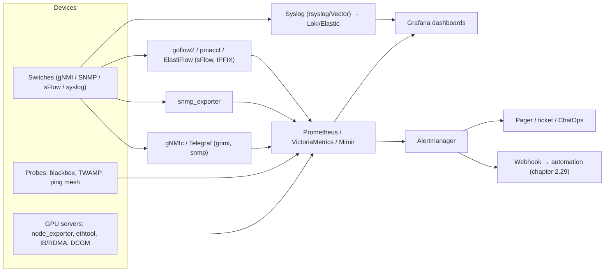

# 2.31 Network monitoring and telemetry for AI data centers

| | |
|---|---|
| Level | Intermediate to advanced |
| Priority tier | 0 |
| Lab venue | Linux VM with Docker (Prometheus, Grafana, gNMIc, node_exporter), containerlab fabric (chapter 2.27) |
| Part | Part 2: Networking, from first principles to AI fabrics |
| Status | Drafted, labs **untested** |

## Why this matters for AI infrastructure

Most network trouble in an AI cluster does not look like an outage. It looks like a slowdown. Consider a single flapping optic, a rail running at half bandwidth, or a switch queue that overflows for 50 microseconds every few seconds. A PFC storm can freeze a pod, and an ECMP imbalance can slow every collective by 15%. Each of these leaves the network technically up. Traditional once-a-minute SNMP graphs average these problems away, so the picture looks calmer than the job feels.

This chapter shows you how to **see** the network. It covers the monitoring options: SNMP, syslog, streaming telemetry, flow export, active probes, in-band telemetry and packet mirroring. Then it builds a practical open-source stack. Exporters feed Prometheus, Prometheus feeds Grafana and Alertmanager, and Loki handles the logs. You will then look at the signals that matter in AI and ML fabrics: egress buffers, drops, PFC, ECN, CNPs, link quality, per-rail bandwidth skew and latency.

Server-side GPU observability, which covers DCGM, Kubernetes GPU telemetry and tracing, lives in the observability part of the handbook. This chapter stays with the network and how it lines up with the hosts. Finally, it shows you how to correlate network and server data, design alerts and SLOs, and close the loop with automation from chapter 2.29.

## Prerequisites and outcomes

Before you start, you should already know the counters and tools from chapter 2.22. You should also know the congestion mechanisms from chapter 2.19, the fabric designs in chapters 2.16 and 2.18, and the automation concepts in chapters 2.28 and 2.29.

By the end of this chapter, you should be able to do the following.

- Compare the monitoring options. You will know what SNMP polling, SNMP traps, syslog, streaming telemetry (periodic and on-change), RPC queries, active probes (TWAMP/ICMP/TCP), sFlow/IPFIX/NetFlow, mirroring and in-band telemetry (IFA/INT) each give you, and what each one costs.
- Deploy a Prometheus-based network monitoring stack. That means node_exporter with its netdev, ethtool and infiniband collectors, snmp_exporter, gNMIc, the blackbox exporter, the DCGM exporter, Grafana and Alertmanager. You will also write PromQL for rates, errors, saturation and skew.
- Identify the AI-fabric signals and baseline them. These are utilisation, egress buffer occupancy, drops per queue, PFC pause rates, ECN marks, CNPs, link flaps, FEC/CRC errors, optics power, latency, entropy/ECMP balance and per-rail bandwidth.
- Design alerts and SLOs that catch degradations without causing pager fatigue. You will also learn how to manage cardinality, retention and cost.
- Correlate switch telemetry with server telemetry and job events, so you can localise stragglers and incidents.
- Describe in-band flow analysis (IFA) and mirroring-on-drop. You will also explain historical versus real-time monitoring, and corrective-action loops up to autonomous operation.

## 1. What to monitor and why

### Three questions of monitoring

Every monitoring setup should answer three questions.

1. **Is it up?** Check the availability of devices, links, sessions and services.
2. **Is it healthy?** Check errors, drops, saturation, latency, temperature and power.
3. **Is it doing its job?** Check the purpose metric itself: collective bandwidth and job completion time, or inference latency and error rate.

Use the same structure as troubleshooting in chapter 2.30. Start with the purpose metric. Then apply the USE method, which covers utilisation, saturation and errors, to each interface and queue. For services such as DNS, DHCP, load balancers and the monitoring pipeline itself, use the RED method, which covers rate, errors and duration. At service level, add the four golden signals: latency, traffic, errors and saturation.

### Beyond the network

Data centre health covers power, temperature, humidity, fan speeds, leak detection, PDUs and cooling. You read these signals from DCIM/BMS and from Redfish/IPMI telemetry. A GPU cluster's thermal and power state directly affects network optics and GPU throttling. This chapter focuses on IP and RDMA networking, and it includes the power and temperature of network devices as ordinary metrics.

### Baselines and trends

Monitoring without baselines is just noise. Record the normal ranges for each device role and time of day. Track utilisation, error rates, queue depths, PFC and ECN rates, latency and optics Rx power. Use historical monitoring for trends and capacity planning. A utilisation growth of 10% over two weeks, for example, tells you when the next upgrade is needed.

Real-time monitoring handles fast faults. It uses streaming telemetry at sub-second speed, and it analyses each network node. That includes ASIC buffer memory utilisation, switch, router and firewall CPU load, and remaining flash or storage space. When a node is congested, the immediate fix might be reducing load on that node or shifting traffic away from it. Historical data can be tagged with the corrective actions that worked. Those tags become the training data for runbooks and, eventually, automated remediation.

Decide which baselines you will record for each device role before you set any threshold.

## 2. Monitoring mechanisms

Each mechanism trades speed, detail and effort in a different way. The table below sets them side by side, so you can see what each one costs before you choose. Read the Strengths and Weaknesses columns first.

| Mechanism | How it works | Typical granularity | Strengths | Weaknesses |
|---|---|---|---|---|
| **SNMP polling** (v2c/v3) | Collector polls OIDs/MIBs (interface counters, queue stats, buffer use, CPU, memory, FIB/RIB/MAC/TCAM utilisation) | 30 s to 5 min | Universal; standard MIBs; simple | Pull overhead; coarse; slow bulk walks; v2c weak security; vendor MIB gaps; poor for microbursts |
| **SNMP traps/informs** | Device sends events on thresholds (CPU high, link down, PFC rate exceeded) | event-driven | Immediate alarms | Rate limited; thresholds must be pre-set; lossy (UDP) |
| **Syslog** | Device logs severity-coded messages (link flaps, BGP state, hardware faults, config changes) | event-driven | Rich detail, forensic | Unstructured; volume; needs parsing (grok/regex), time sync |
| **Streaming telemetry (gNMI, vendor gRPC/UDP)** | Device pushes structured data periodically or on change, often straight from the forwarding engine | 1 to 10 s typical; sub-second on some platforms | Fine granularity; efficient at scale; typed paths; on-change events | Needs collectors and storage; model differences; cardinality |
| **RPC/API queries** (eAPI, NX-API, RESTCONF, NETCONF `get`) | Scripted structured queries instead of CLI scraping | seconds to minutes | Automatable; good for state checks | Pull model; device CPU |
| **Agent-based active probing** | Probes measure latency/loss/jitter with ICMP, TCP, UDP, **TWAMP**/OWAMP; blackbox exporter; smokeping | 1 to 10 s | Measures what users see; between any two points | Probes ≠ application traffic; consumes bandwidth |
| **sFlow / IPFIX / NetFlow** | Sampled packet headers (sFlow) or flow records (IPFIX/NetFlow) exported to collectors | per-flow, sampled | Who talks to whom; top talkers; application mix; elephant detection | Sampling error; not packet-exact; collector scale |
| **Packet mirroring** (SPAN/ERSPAN, mirror-on-drop) | Copies packets to analysers; **mirror on drop** copies packets the ASIC discards | on demand | Ground truth; drop analysis | Heavy; privacy; mirror loss |
| **In-band telemetry (IFA / INT)** | Metadata added to live packets or clones (per-hop timestamps, queue, congestion) and exported by the egress node | per-packet probe | Per-hop latency and queue state on the real path | Needs ASIC support; header overhead and MTU; ecosystem maturity |
| **Server-side metrics** | node_exporter, NIC/RDMA counters, DCGM (GPU), NCCL logs | 1 to 15 s | Correlates host and job with network | Another pipeline |

Speed matters more in AI networks than in most places. The same mechanisms are used everywhere, but the required speed changes. Congestion events last microseconds to milliseconds, so exports at seconds resolution capture trends, not events. The industry responds with richer on-device processing, such as hardware counters with high-water marks, microburst detection and histograms. It also uses streaming on-change telemetry, in-band probes and mirror-on-drop. Edge decisions such as adaptive routing and ECN or CNP reaction do not wait for a collector. Monitoring explains and tunes; it does not replace the fabric's real-time congestion control.

### Choosing

Use SNMP only where nothing else exists, which means legacy devices, PDUs and some optical gear. For those devices, its traps and syslog messages work well as alarms.

Use streaming telemetry (gNMI) as the primary source for modern switches such as SONiC, Cumulus, Arista, Juniper, Nokia and Cisco. Collect counters at 1 to 10 s, and collect state on change.

Run active probes between representative host pairs, including cross-rail and cross-pod pairs. That way, you measure real reachability and latency all the time.

Use sFlow/IPFIX at leaf ports for flow visibility. For 100G+ ports, sample at 1-in-1000 to 1-in-4000.

Keep packet captures and mirror-on-drop for investigation, as chapter 2.26 describes. Collect host, NIC and RDMA counters on every node. They are often the best early indicator, and they cost nothing on the switch.

Decide which of these sources you will run on each class of device before you build any dashboard.

## 3. An open-source network monitoring stack

Read the diagram from left to right. Devices on the left send their data to collectors. The collectors feed a metrics store, and the store feeds Grafana and Alertmanager. Syslog takes its own path to the log store.



### Prometheus model

Prometheus pulls its data. It scrapes HTTP endpoints that expose metrics in a text format. Each piece of data is a time series, identified by a metric name plus labels such as `ifname`, `device`, `instance`, `rack`, `role` and `tenant`. Three metric types matter most. A counter only goes up, as bytes, errors and drops do, so you read it with `rate()`. A gauge holds a current value, such as temperature or queue depth. Histograms and summaries describe latency distributions.

Alertmanager deduplicates, groups, routes and silences alerts. For long-term storage and scale-out, you can use Thanos, Mimir, Cortex or VictoriaMetrics. Pushed streams from gNMI need a collector. That collector either turns them into scrapeable metrics, as the gNMIc Prometheus output does, or remote-writes them to storage.

```yaml
# prometheus.yml (fragment)
global: { scrape_interval: 15s, evaluation_interval: 15s }
rule_files: [ "rules/*.yml" ]
scrape_configs:
  - job_name: node
    static_configs: [ { targets: [ "gpu01:9100", "gpu02:9100" ], labels: { role: gpu } } ]
    # or file_sd / kubernetes_sd / consul_sd / netbox http_sd for dynamic targets
  - job_name: gnmic
    scrape_interval: 10s
    static_configs: [ { targets: [ "gnmic:9804" ] } ]
  - job_name: snmp
    metrics_path: /snmp
    params: { module: [ if_mib ], auth: [ public_v3 ] }
    static_configs: [ { targets: [ "pdu1", "legacy-sw1" ] } ]
    relabel_configs:
      - { source_labels: [ __address__ ], target_label: __param_target }
      - { source_labels: [ __param_target ], target_label: instance }
      - { target_label: __address__, replacement: "snmp-exporter:9116" }
  - job_name: blackbox_icmp
    metrics_path: /probe
    params: { module: [ icmp ] }
    static_configs: [ { targets: [ "10.10.1.11", "10.10.4.11" ] } ]
    relabel_configs:
      - { source_labels: [ __address__ ], target_label: __param_target }
      - { source_labels: [ __param_target ], target_label: instance }
      - { target_label: __address__, replacement: "blackbox:9115" }
  - job_name: dcgm
    static_configs: [ { targets: [ "gpu01:9400" ] } ]
```

### Host and NIC metrics (node_exporter)

Turn on the collectors and flags below. Each one exposes a different slice of the host's network state.

```bash
node_exporter \
  --collector.netdev --collector.netstat --collector.sockstat --collector.softnet --collector.conntrack \
  --collector.ethtool --collector.ethtool.device-include='^(ens|eth|eno).*' \
  --collector.ethtool.metrics-include='.*(pause|discard|drop|missed|crc|fcs|ecn|cnp|out_of_buffer).*' \
  --collector.infiniband --collector.rdma --collector.thermal_zone --collector.hwmon \
  --collector.netclass --collector.arp --collector.bonding --collector.qdisc --collector.interrupts
```

Once the collectors run, a handful of metric families carry most of the signal. Traffic and error counts come from `node_network_receive_bytes_total`, `node_network_transmit_bytes_total`, `node_network_receive_errs_total` and `node_network_receive_drop_total`. Link state and speed come from `node_network_up`, `node_network_speed_bytes` and `node_network_mtu_bytes`. TCP retransmits and softirq pressure come from `node_netstat_Tcp_RetransSegs`, `node_netstat_TcpExt_*`, `node_softnet_dropped_total` and `node_softnet_times_squeezed_total`. Conntrack usage comes from `node_nf_conntrack_entries` and `_limit`. Driver counters, including PFC and discard counters, appear as `node_ethtool_*`. InfiniBand traffic and errors come from `node_infiniband_port_data_transmitted_bytes_total` and `node_infiniband_*_errors_total`. Congestion counters such as `node_infiniband_port_transmit_wait` vary in name by version, so verify them on your build.

For RDMA NIC details such as CNP, ECN, retransmissions and out-of-sequence counts, you have three options: `rdma statistic`, `ethtool -S`, or a vendor exporter such as NVIDIA's DOCA telemetry service or the `mlx5` exporters.

### Switch telemetry with gNMI → Prometheus

```yaml
# gnmic.yaml
username: admin
password: ${GNMI_PASSWORD}
skip-verify: false
tls-ca: /etc/ssl/ca.pem
encoding: json_ietf
targets:
  leaf1:6030: {}
  leaf2:6030: {}
subscriptions:
  if_counters:
    paths: [ "/interfaces/interface/state/counters" ]
    stream-mode: sample
    sample-interval: 10s
  if_state:
    paths: [ "/interfaces/interface/state/oper-status" ]
    stream-mode: on_change
  qos:
    paths: [ "/qos/interfaces/interface/output/queues/queue/state" ]     # vendor/model dependent
    stream-mode: sample
    sample-interval: 5s
outputs:
  prom:
    type: prometheus
    listen: ":9804"
    path: /metrics
    expiration: 60s
    metric-prefix: gnmi
    append-subscription-name: true
    export-timestamps: true
```

Each vendor exposes its counters differently. SONiC serves them from its Redis-based database and exporters, such as `sonic-exporter` and the `gnmi` server. Cumulus, through NVUE, offers `nv show interface counters` and OpenMetrics endpoints. Arista streams over gNMI and TerminAttr, which feeds CloudVision. Juniper uses JTI with Telegraf, and Cisco uses model-driven telemetry/Pipeline. The principle is the same across all of them. You subscribe, normalise the data into metrics with consistent labels, and enrich those labels from the source of truth, which is NetBox. Dashboards then group by role, pod and rail rather than by hostname. The labels to aim for are `device`, `interface`, `queue`, `role`, `rack`, `rail` and `tenant`.

### Flow data

Run `goflow2`, `pmacct`, `ElastiFlow` or a vendor collector to receive sFlow and IPFIX. Aggregate the flows into top talkers, per-tenant volume, elephant flows and the protocol mix. The protocol mix tells you how much RoCE on UDP 4791 you carry compared with TCP storage traffic. Entropy, the number of distinct 5-tuples per link, shows how well the flows spread out. To check ECMP balance, compute per-uplink byte rates from the interface counters, and flag any skew. Section 4 explains which thresholds to use.

### Logs

Collect syslog from switches, and `journald` or dmesg from hosts, into Loki or Elasticsearch. Vector, Fluent Bit or rsyslog can handle the shipping. Parse the severities and the key events, such as link flap, optic fault, PFC watchdog, BGP neighbour change, BFD down and ECC/Xid. Alert on patterns, and correlate them with metrics by timestamp. Time sync through PTP or NTP is essential for that correlation.

Decide which log events deserve a page before you write any log alert.

## 4. Signals that matter in an AI/ML fabric

Not every counter deserves an alert. The table below lists the signals that tell you the most about an AI or ML fabric. For each one, it shows why it matters, where the data comes from and a typical alert rule.

| Signal | Why | Source | Typical alert logic |
|---|---|---|---|
| **Per-port throughput and utilisation** vs capacity | Fabric load, rail skew, ECMP imbalance | gNMI counters, `node_network_*` | Sustained > 85% on uplinks; per-rail rate ratio between max and min > 1.3 during a job |
| **Egress buffer/queue occupancy and high-water marks** | Early sign of congestion before drops | gNMI/ASIC counters (shared and dedicated buffers, per queue) | Occupancy trend rising; high-water mark approaching ECN/PFC thresholds |
| **Drops per queue** (tail drops, WRED drops) | Loss on lossless classes is a fault; on lossy classes a congestion indicator | gNMI, `ethtool -S` | Any drop on the lossless priority; sustained drops elsewhere |
| **PFC pause frames** sent/received per priority and **PFC watchdog** events | Backpressure, storms, deadlock risk | Switch and NIC counters (`rx_prio3_pause`) | Pause rate above baseline for > N s; any watchdog trigger |
| **ECN marks and CNPs** | DCQCN activity: how often senders are told to slow | Switch ECN counters, NIC `np_cnp_sent`/`rp_cnp_handled` | Persistent high CNP rate = chronic congestion; zero CNP with marked packets = misconfiguration |
| **Link state and flaps** | Instability | Syslog, `oper-status` on-change | Any flap on a production link; more than one per hour |
| **Physical-layer quality**: FEC corrected/uncorrected codewords, pre-FEC BER, CRC/FCS errors, symbol errors, optics Rx/Tx power and temperature (DOM) | Predicts failing optics and cables before link-down | gNMI, `ethtool -S`, `ethtool -m`, UFM | Rising corrected FEC rate trend; any uncorrected; Rx power near the sensitivity limit |
| **Latency and loss between host pairs** (probes) and **per-hop latency** (IFA) | User-visible path health | blackbox/TWAMP, IFA | p99 latency > baseline × 2; loss > 0.01% |
| **BGP/BFD/LLDP state** | Control plane and cabling truth | gNMI, FRR exporter | Session down; neighbour count mismatch; LLDP neighbour differs from plan |
| **ECMP/AR balance and flow entropy** | Fat-flow collisions, hash polarization | Interface counters per member, sFlow | Member imbalance (stddev/mean) > threshold under load |
| **Control-plane health**: CPU, memory, TCAM/FIB/MAC utilisation, CoPP drops | Switch health, scale limits | gNMI/SNMP | CPU > 80% sustained; table > 80% full |
| **Environment**: temperature, fans, PSU, power draw | Hardware faults | gNMI/IPMI/Redfish | Threshold + rate of change |
| **Host side**: NIC drops, ring overflows, softirq squeeze, TCP retransmits, RDMA errors/out-of-sequence, conntrack usage, IRQ imbalance | Early indication of host-originated problems | node_exporter, `rdma statistic` | See alert rules below |
| **Job-level**: NCCL timeouts, step time, all-reduce time, straggler rank, GPU utilisation drops | The purpose metric | Application/NCCL logs, DCGM, training framework | Step time > baseline × 1.2 |

Group signals by rail, pod, tenant and device role, using labels from your source of truth. Most of the analysis is a comparison between peers. One outlier in a rail group usually points to a bad cable. When a whole tier shifts, the cause is more likely a config change or a change in load.

### Example PromQL

These queries show the pattern for each signal. Some metric names depend on your exporter or driver, as the comments note.

```promql
# Per-interface throughput in Gb/s (hosts)
rate(node_network_receive_bytes_total{device=~"ens.*"}[1m]) * 8 / 1e9
# Utilisation vs negotiated speed
(rate(node_network_transmit_bytes_total{device="ens1f0"}[1m]) * 8) / (node_network_speed_bytes{device="ens1f0"} * 8)
# Error and drop rates
rate(node_network_receive_errs_total[5m]) > 0
rate(node_network_receive_drop_total[5m]) > 0
# TCP retransmit ratio
rate(node_netstat_Tcp_RetransSegs[5m]) / rate(node_netstat_Tcp_OutSegs[5m])
# Softirq pressure on RX path
rate(node_softnet_times_squeezed_total[5m]) > 0
# PFC pause activity (driver-dependent counter names)
sum by (instance, device) (rate(node_ethtool_rx_prio3_pause[1m]))
# Rail skew: max/min throughput across the 8 rails of a node
max by (instance) (rate(node_network_transmit_bytes_total{device=~"ens.*"}[1m])) / min by (instance) (rate(node_network_transmit_bytes_total{device=~"ens.*"}[1m]))
# Switch uplink imbalance across ECMP members (gnmi metric names depend on your model)
stddev by (device) (rate(gnmi_if_counters_out_octets{interface=~"Ethernet(49|50|51|52)"}[1m])) / avg by (device) (rate(gnmi_if_counters_out_octets{interface=~"Ethernet(49|50|51|52)"}[1m]))
# Conntrack headroom
node_nf_conntrack_entries / node_nf_conntrack_limit > 0.8
# Predict link saturation in 4 hours
predict_linear(node_network_transmit_bytes_total[1h], 4*3600)
# InfiniBand backpressure (metric name depends on exporter)
rate(ib_port_xmit_wait_total[5m]) > 1000
# Probe latency and loss (blackbox)
probe_duration_seconds{job="blackbox_icmp"} > 0.002
avg_over_time(probe_success[5m]) < 0.99
```

Keep a few rules in mind when you write these queries. Aggregate the rates of counters, not the raw counters. Use `rate()` over a window of at least 4 scrape intervals. Watch for counter resets and wrap-around. For histograms, use `histogram_quantile`. Avoid high-cardinality labels in Prometheus, such as full 5-tuples or per-flow IDs. Send flows to a flow store instead.

### Alert rules (examples)

Each rule below carries a severity, so a page and a ticket are handled differently. The rules are examples to adapt, not a finished set.

```yaml
groups:
- name: network
  rules:
  - alert: LinkFlapping
    expr: changes(gnmi_if_state_oper_status[10m]) > 2
    for: 1m
    labels: { severity: page }
    annotations: { summary: "{{ $labels.device }} {{ $labels.interface }} flapped", runbook: "https://wiki/runbooks/link-flap" }
  - alert: HostNicDrops
    expr: rate(node_network_receive_drop_total{device=~"ens.*"}[5m]) > 100
    for: 5m
    labels: { severity: ticket }
  - alert: PfcStorm
    expr: sum by (device, interface) (rate(gnmi_qos_pfc_rx_pause_frames[1m])) > 100000
    for: 30s
    labels: { severity: page }
    annotations: { summary: "PFC storm suspected on {{ $labels.device }}/{{ $labels.interface }}" }
  - alert: LosslessQueueDrops
    expr: increase(gnmi_qos_queue_dropped_packets{queue="3"}[5m]) > 0
    labels: { severity: page }
  - alert: RailBandwidthSkew
    expr: (max by (instance) (rate(node_network_transmit_bytes_total{device=~"ens.*"}[2m])) / min by (instance) (rate(node_network_transmit_bytes_total{device=~"ens.*"}[2m]))) > 1.5 and on (instance) max by (instance) (rate(node_network_transmit_bytes_total{device=~"ens.*"}[2m])) > 5e9
    for: 5m
    labels: { severity: ticket }
  - alert: OpticsDegrading
    expr: gnmi_optics_rx_power_dbm < -9 or increase(gnmi_if_fec_corrected_codewords[1h]) > 1e9
    for: 10m
    labels: { severity: ticket }
  - alert: ConntrackNearFull
    expr: node_nf_conntrack_entries / node_nf_conntrack_limit > 0.8
    for: 10m
  - alert: ProbeLoss
    expr: avg_over_time(probe_success[5m]) < 0.98
    for: 5m
```

Alert on symptoms that need action, such as customer or job impact or imminent failure. Do not alert on every cause. Use `for:` durations so that brief flaps do not wake anyone. Keep page and ticket tiers separate. Put a runbook link and the diagnostic query into each annotation, and route alerts by team and failure domain. Group related alerts. A failing spine can produce hundreds of leaf alerts, so inhibit the children. Alert on absent data too, with `absent()` or a target that is down, because broken monitoring is worse than no monitoring. Test your alerts by injecting faults, as chapter 2.30 describes. Review the noisy ones every week.

### SLOs for the network

Define service-level indicators from the user's view. Probe success rate between host pairs is one example, with a target such as 99.99% over 30 days. All-reduce bandwidth achieved against target is another, measured as the percentage of time above 90% of baseline. Packet loss on lossless classes should have zero tolerance. Time to detect a failed link should be ≤ 1 s with BFD, and time to restore matters too. Track your error budgets, and use them to decide between reliability work and change velocity.

Pick the indicators for your own users before you set any SLO target.

## 5. In-band telemetry: IFA

Polling samples the counters on a timer. In-band telemetry records what a packet actually saw on its way through the fabric. **In-band Flow Analyzer (IFA)** and its relatives, INT, P4 INT and IOAM, do this by adding metadata to packets or clones as they cross the fabric. The result is per-hop latency and queue or congestion information at nanosecond-class resolution, which polling cannot reach. Each node in the path plays one of three roles.

- **Initiator** (typically the ingress leaf) samples the traffic you care about. It either tags the original packets or, more commonly, **clones** them into probe packets. Those probes carry an IFA header, an initiator tag, timestamps and device information.
- **Transit** nodes (spines and super-spines) append their own metadata to the stack. That covers the device ID, ingress and egress ports, queue ID, ingress timestamp, **residence time** in nanoseconds, the congestion bit when ECN marking applies, and the egress port speed.
- **Terminator** (egress leaf or border) removes the metadata and exports it to a collector, for example as IPFIX. It then drops the cloned probe. If the original packet was tagged, it forwards that packet after stripping the metadata.

Each packet carries the L2 and L3 headers, then the **IFA header** (version, namespace, protocol type, flags, max length), then the original L4 header. After that come the **IFA metadata header** (action, hop limit) and the **metadata stack**, which follows `draft-kumar-ippm-ifa-08`. The fabric MTU has to absorb the extra bytes, and jumbo frames normally do.

Per-hop latency comes from receipt timestamps: residence time in nanoseconds plus wire time. Congestion information only means something where ECN is enabled on the egress port. Accurate latency also needs comparable timestamp resolution at every hop, which favours homogeneous hardware within each tier. A 3-stage and a 5-stage IFA deployment differ in how many transit nodes appear.

The benefit is that probes follow the same path as the real flow. Synthetic agents use different payloads and a different hash, so they can miss faults that IFA finds. You also get live per-hop queue and latency analysis, with microsecond accuracy. The limits are ASIC and software support, multicast handling, overhead, collector scale and maturity. Check the standards drafts before you commit, including the IETF IFA draft `draft-kumar-ippm-ifa-08` and IOAM RFC 9197.

**Mirror-on-drop** handles the packets the ASIC throws away. Drops come from buffer overflow, ACLs, TTL or malformed packets. The switch can copy the dropped packet, or just its header and the drop reason, to a collector. That tells you what kind of traffic is lost and why. It also separates congestion drops from defensive drops, such as control-plane protection when too many ARP requests arrive, or DDoS filters. Plain counters cannot show that difference.

**On-demand mirroring** analyses user content or protocol behaviour for specific flows. Chapter 2.26 covers it.

Decide which flows justify the IFA overhead before you enable it on every port.

## 6. Correlation and corrective actions

### Correlating switch and server telemetry

The biggest wins come from joining datasets by time and identity. Follow a job from rank to node, from node to NIC, from NIC to leaf port, and from leaf port to the spine uplinks. To make that possible, use consistent labels, a source-of-truth mapping of cable and port inventory from LLDP/NetBox, and unified timestamps. Four workflows show how this works in practice.

Start with a straggler hunt. NCCL or step-time telemetry flags rank 112 as slow. From there you find its node and rail, and you compare that rail's TX and RX rates, retransmissions, CNP counts, PFC pauses and FEC errors with its peers. Next, check the leaf port counters and optics DOM. The resolution is one of these: clean the optic, move the node, or drain it.

Congestion mapping looks at a wider picture. ECN and CNP rise on many NICs, while a spine uplink shows high utilisation and a growing egress queue. That pattern points to an ECMP collision or an oversubscribed tier. Check the flow entropy through sFlow, the adaptive routing settings and the job placement.

Aggregation versus edge compares two places in the network. Frame loss and latency differ between aggregation points, such as the spine, and the edge, such as a leaf with a subset of servers. Compare the tiers to localise the problem.

Capacity planning uses the trend of peak-hour utilisation per tier and per tenant. Alert when the forecast shows you will exceed 80% within N weeks.

### Corrective actions

Your options run from least to most disruptive. You can tune thresholds for ECN and PFC. You can re-hash or steer flows with adaptive routing, or with DPF and Flex Algo planes, which chapter 2.16 covers. You can shift jobs or tenants through scheduler placement, or isolate a suspect node, port or optic by draining or shutting it. You can restart a job from a checkpoint. The last resort is to fail over to another fabric plane or site.

Actions can happen at three levels. A single hop can react locally, through ECN marking, adaptive routing or PFC. The traffic source can react through rate control driven by congestion signals, such as SFC/CSIG from chapter 2.19. A monitoring platform can recognise a known pattern and run a runbook through an automation webhook, as chapter 2.29 covers.

Some problems cannot be fixed instantly, such as congestion that lasts microseconds. Monitoring still tells you the origin and size of the problem, so you can make a sound decision. Ask whether the loss is constant or periodic. Ask whether it sits on one interface or many, on one switch or several, and whether it lines up with a job phase. Depending on severity, the worst-case decisions include shutting down the server at the origin of congestion, restarting the learning process at the scheduler, or evacuating to a site with better capacity. Know which of these your applications can tolerate, such as the checkpoint cadence or elastic training.

**Autonomous operation** is where the pattern leads. As patterns, actions and outcomes build up, a platform can move from alerting to recommending, then to executing approved remediations, and finally to self-driving behaviour. AI or LLM assistants can summarise incidents and propose runbook steps from history. Put guard-rails around all of it: explicit action allow-lists, rate limits, human approval for risky actions, dry runs, full audit, and always the ability to disable automation. Monitoring only helps if the underlying design was right, including oversubscription, load balancing method, optics quality and congestion control. Telemetry cannot rescue an undersized fabric.

Decide which corrective actions automation may take on its own before you connect any webhook to a remediation.

## 7. Operating the monitoring system

Running the monitoring system is a job of its own. Label combinations multiply fast. Device times interface times queue times priority times tenant can reach very large counts. Estimate your series count as devices times metrics times labels. Then drop the metrics you do not need at the collector, avoid per-flow labels, and use recording rules for expensive aggregates.

Retention decides what you can look back at. Keep raw 10 s data for days, 1-minute data for weeks and 5-minute data for a year. Use Thanos, Mimir or VictoriaMetrics for this downsampling. Trigger high-resolution capture around incidents.

The monitoring path must not share fate with what it monitors. Put it on an out-of-band management network, run redundant Prometheus pairs, and remote-write to a second site. Add a watchdog alert that always fires, which proves the alert pipeline works. Then monitor the monitors.

Clocks need to agree. Sync switches, hosts and collectors with NTP or PTP, and take timestamps from the device when you can.

Telemetry should be authenticated and encrypted. Use gNMI over TLS, SNMPv3 and mTLS to Prometheus targets. Give collector accounts read-only, least-privilege access. Protect Grafana and Alertmanager, and scrub sensitive data from logs.

Telemetry volume adds up quickly. A 64-port switch with 100 counters, sampled every 10 s, produces about 640 samples per second: 64 × 100 ÷ 10. A 1,000-switch fabric then produces about 640k samples per second. Size your storage and ingestion for that figure. Prefer on-change reporting for state and sampled counters for rates.

Dashboards should follow the on-call engineer's path. Build one fabric-wide health view with red and green per tier. Add per-rail and per-tenant views, per-switch detail, a host NIC view and a job view. Design for the on-call engineer at 3 a.m.: top-level traffic lights should link to drilldowns. Annotate deploys, maintenance and incidents, and keep queries cheap.

Finally, link runbooks from alerts, assign ownership, review alert quality, and update baselines and alerts after each incident, as chapter 2.30 describes.

Decide who owns each alert before it goes into the rule set.

## 8. Hands-on lab: a network observability stack

Start with the self-checking Python lab. It runs on your own machine and checks three things. It verifies per-rail bandwidth skew (`max/min > 1.5`) and ECMP coefficient-of-variation (`stddev/mean`) detection. It checks In-Band Flow Analyzer (`IFA`) per-hop residence-time and ECN congestion stack analysis. It also sizes the Prometheus load: for 1,000 switches, the lab gives `6.4M` series and an ingestion rate of `640,000` samples/s.

```bash
python3 code/part02/network_monitoring_telemetry_lab.py
```

Next, move to a disposable Linux VM with Docker and the Chapter 2.27 containerlab fabric. Every interactive VM command below has not been run on live hardware, so treat each step as a starting point. Work through these steps in order.

1. Start the stack with Docker Compose: Prometheus, Alertmanager, Grafana, Loki, node_exporter, the blackbox exporter and gNMIc. Load the Prometheus config shown above.
2. Turn on the ethtool, infiniband and softnet collectors on the VM. Build a dashboard covering throughput, utilisation, errors, drops, retransmits, softnet squeeze and conntrack. Generate load with `iperf3` and `tc netem` loss, then watch the counters respond.
3. Expose FRR or Linux interface counters through node_exporter in each node container, or use SR Linux or cEOS with gNMI. Build per-link utilisation and ECMP-balance panels for the leaf-spine fabric. Run `iperf3 -P 16`, then engineer a collision to see the imbalance.
4. Implement LinkFlapping, HostNicDrops, ConntrackNearFull and ProbeLoss. Inject faults by taking a link down repeatedly, adding loss, exhausting conntrack and blocking ICMP. Verify that each alert fires, with sensible grouping and inhibition. Test the Watchdog alert as well.
5. Send sFlow from Open vSwitch or `hsflowd` on a Linux bridge to goflow2 or pmacct. Build a top-talkers dashboard, and detect an elephant flow.
6. Subscribe to counters in sample mode and oper-status in on-change mode, from a gNMI-capable container. Chart the queue or counter data. Compare the 10 s view with a 1 s view during a microburst generated by a burst script.
7. Forward syslog and FRR logs to Loki. Build an alert on a BGP neighbour going down, then correlate it on a dashboard with interface flaps.
8. Create a straggler by throttling one host rail with `tc`. Find it using only dashboards, looking at rail skew, retransmits and probe latency, as the workflow above describes. Then write the post-incident note.
9. Define an SLI as probe success between host pairs. Compute an error budget burn-rate alert, using multi-window, multi-burn-rate logic.
10. Estimate the series count for a 1,000-switch fabric at the labels you choose. Then reduce that count by 50% with relabeling and recording rules.
11. Tear everything down when you finish.

Working through the steps in order shows you how each signal reaches a dashboard, and where it can fail.

## 9. Common mistakes

- Relying on 5-minute SNMP averages to find a microburst. Those averages carry no high-water marks, so the burst stays hidden.
- Alerting on every counter increment, with no `for:`, grouping or inhibition. The result is alert fatigue, until people ignore the real alerts.
- Monitoring link state but not link quality (FEC, CRC, DOM). Then you find failing optics only when the link goes down.
- Running without baselines, and copying thresholds from vendor defaults.
- Letting telemetry and servers run with unsynchronised clocks, and giving them no common labels. Correlation then becomes a manual job.
- Allowing unbounded cardinality, such as per-flow labels. Storage cost runs away.
- Building monitoring that depends on the network it monitors, with no watchdog.
- Treating monitoring as a substitute for design. Congestion control, load balancing and capacity planning come first.
- Giving automation write access to production from an alert, without guard-rails.

Check your alert set against this list before you call the monitoring finished.

## 10. Interview angles

- "How would you monitor a 4,000-GPU RoCE fabric? What metrics matter and at what resolution?"
- "SNMP polling vs streaming telemetry: differences and when to use each."
- "How do you detect a slow rail or a failing optic before it takes a job down?"
- "What is IFA/INT and what does it give you that probes don't?"
- "How would you design alerts for PFC storms and ECN/CNP anomalies?"
- "A training job's step time doubled; show how you correlate switch and server telemetry to find the cause."
- "How do you avoid alert fatigue and ensure the monitoring system itself is reliable?"
- "Explain cardinality problems in Prometheus and how you control them."

Try answering each question aloud before you check the chapter again.

## Exercises

1. Start by stating the three core questions of network monitoring. Explain how USE, RED and the four golden signals map onto switches, NICs and cluster services. Then compare SNMP polling and traps, syslog, gNMI streaming telemetry (`sample` vs `on_change`), active probes (`TWAMP`/`blackbox`), `sFlow`/`IPFIX`, mirror-on-drop and In-Band Flow Analyzer (`IFA` / `INT`). Finish by contrasting historical and real-time monitoring, as chapter 11 of *AI Data Center Network Design and Technologies* does.
2. Deploy the open-source observability stack: `node_exporter`, `gNMIc`, `snmp_exporter`, `blackbox`, Prometheus and Loki. Write the `node_exporter` flags `--collector.ethtool`, `--collector.infiniband` and `--collector.softnet`. Then write the `gnmic.yaml` subscription config, using `sample` vs `on_change`, with Prometheus output on `:9804`. Last, explain how Prometheus `relabel_configs` work for multi-target exporters such as `snmp_exporter` (`:9116`) and `blackbox_exporter` (`:9115`).
3. Use `evaluate_rail_skew_and_ecmp_balance()` in `code/part02/network_monitoring_telemetry.py` on an 8-rail node. 7 rails transmit at `380 Gb/s`, and Rail 3 transmits at `190 Gb/s`. Check that the result gives `max/min skew = 2.0 > 1.5`. Then write the PromQL for per-rail bandwidth skew, switch uplink ECMP imbalance (`stddev / avg`), lossless queue drops, PFC storm rate, and degrading optical power (`gnmi_optics_rx_power_dbm < -9` or `increase(gnmi_if_fec_corrected_codewords[1h]) > 1e9`).
4. Use `analyze_ifa_metadata_stack()` to trace how the Initiator, Transit and Terminator nodes build and export an In-Band Flow Analyzer (`IFA`, `draft-kumar-ippm-ifa-08`) metadata stack, as chapter 11 of *AI Data Center Network Design and Technologies* describes. Run it on `[{"device_id": "leaf1", "residence_ns": 650, "ecn_marked": False}, {"device_id": "spine2", "residence_ns": 48500, "ecn_marked": True}, {"device_id": "leaf4", "residence_ns": 700, "ecn_marked": False}]` and identify the bottleneck hop. Then explain what mirror-on-drop reveals that standard drop counters cannot.
5. Walk through the step-by-step data join from a slow training rank (`rank 112`) to the exact switch port and spine uplink. Then sort the corrective actions into a hierarchy: hop-level ECN or AR, source-level DCQCN or SFC, a platform runbook drain, and finally a job restart or datacenter evacuation when capacity planning was insufficient.
6. Use `estimate_telemetry_cardinality_and_rate(1000, 64, 100, 10.0)` to calculate the active time-series count (`6.4M`) and the sample ingestion rate (`640,000 samples/s`) for a 1,000-switch fabric. Explain how to prevent cardinality explosions in Prometheus. Then design a Watchdog plus `absent()` alert, and a network SLO error budget.

## Checkpoint questions (20)

<details>
<summary>1. What are the three fundamental questions of network monitoring, and why do 1- to 5-minute `SNMP` polls miss AI-fabric congestion?</summary>

The three questions are these. First, is it up? That asks about availability. Second, is it healthy? Here `USE` covers utilization, saturation and errors. Third, is it doing its job? That means the application purpose metric: `AllReduce` collective bandwidth, training step time, and inference `TTFT` and `TPOT`. Synchronized GPU collective bursts and incast congestion last **microseconds to milliseconds**. A 60-second or 5-minute SNMP average divides a 10-millisecond 400 Gb/s queue overflow by 60,000 milliseconds. The link then looks 2% utilized, even while collectives stall on PFC pauses or retransmits.
</details>

<details>
<summary>2. Compare Historical Monitoring and Real-Time Monitoring in an AI data center (*AI Data Center Network Design and Technologies*, chapter 11).</summary>

- **Historical Monitoring** aggregates utilization, error trends and job metrics over days, weeks and months. You use it for **capacity planning**. For example, a 10% biweekly growth in inter-pod bandwidth tells you when to schedule spine upgrades before saturation. It also guides optic lifecycle replacement and post-mortem correlation.
- **Real-Time Monitoring** streams sub-second to 1–10s node and fabric state. That covers the ASIC buffer watermark, switch CPU, memory and flash, PFC pause rate, ECN/CNP rate and link flaps. It triggers **immediate operational or automated corrective actions**, such as draining a degraded link or rail, re-steering flows or killing a runaway job.
</details>

<details>
<summary>3. Compare `gNMI Streaming Telemetry`, `sFlow` / `IPFIX`, and `TWAMP` / `Blackbox` Active Probes.</summary>

- **`gNMI` Streaming Telemetry** pushes YANG-modeled counters every 1–10s in `SAMPLE` mode, and pushes state changes in `ON_CHANGE` mode. Switches send these over HTTP/2 and Protobuf to collectors such as `gNMIc` or `Telegraf`.
- **`sFlow` / `IPFIX` (`NetFlow`)** export **sampled packet headers** (`1-in-1000` to `1-in-4000` in `sFlow`) or flow-cache records (`IPFIX`) to `goflow2` or `pmacct`. They reveal **who is talking to whom (5-tuples), top talkers, elephant flows and ECMP flow entropy**, without exploding Prometheus label cardinality.
- **`TWAMP` (*Two-Way Active Measurement Protocol*) / `Blackbox` Probes** send synthetic packets between representative host pairs, across rails and pods. They measure real end-to-end **loss, RTT and jitter**, even when no job is running.
</details>

<details>
<summary>4. Which `node_exporter` collectors should be enabled on every Linux GPU server to monitor host networking and RDMA?</summary>

Turn on these collectors on every Linux GPU server. **`--collector.netdev`** covers bytes, packets, errors and drops. **`--collector.netstat`** and **`--collector.sockstat`** cover TCP retransmits, `ListenOverflows` and `UdpRcvbufErrors`. **`--collector.softnet`** covers `softnet_stat` drops and `time_squeeze`. **`--collector.conntrack`** compares `entries` with `limit`. **`--collector.ethtool`** is filtered to include `pause`, `discard`, `drop`, `rx_missed`, `rx_out_of_buffer`, `crc`, `fcs`, `ecn` and `cnp`. **`--collector.infiniband`** and **`--collector.rdma`** cover `port_xmit_wait` and RDMA bytes and errors. Last, enable **`--collector.bonding`** and **`--collector.qdisc`**.
</details>

<details>
<summary>5. How does the Prometheus multi-target exporter pattern (`relabel_configs`) work for `snmp_exporter` (`:9116`) and `blackbox_exporter` (`:9115`)?</summary>

Legacy switches, PDUs and remote probe targets do not run a Prometheus exporter themselves. So Prometheus scrapes the **exporter daemon**, either `snmp-exporter:9116/snmp` or `blackbox:9115/probe`. It passes the real target IP as the HTTP query parameter **`?target=<device_ip>`**. Three `relabel_configs` rules make this work. First, copy `__address__` (`10.10.1.11`) into `__param_target`. Second, copy `__param_target` into the visible `instance` label, so metrics show `instance="10.10.1.11"`. Third, rewrite `__address__` to the exporter's address, `blackbox:9115`.
</details>

<details>
<summary>6. What are the three Prometheus metric types (`Counter`, `Gauge`, `Histogram`), and why must you apply `rate()` BEFORE summing a Counter across interfaces?</summary>

- **Counter** names end in `_total`. A counter is a monotonically increasing cumulative total, such as `node_network_receive_bytes_total`. It resets to `0` only when the device or driver reboots.
- **Gauge** is a point-in-time value that can go up or down, such as temperature, queue occupancy or `node_nf_conntrack_entries`.
- **Histogram** buckets observations by latency or size, using `_bucket`, `_sum` and `_count`. You query it with `histogram_quantile()`.

Always take `rate(counter[5m])` first and `sum()` second, as in `sum by (device) (rate(counter[5m]))`. The reason is that `rate()` detects and compensates for counter resets on each series. Summing raw counters first mixes series with different start times, and that hides single-port counter resets.
</details>

<details>
<summary>7. How do you write PromQL expressions to detect Per-Rail Bandwidth Skew on an 8-GPU node and ECMP Uplink Imbalance on a leaf switch?</summary>

- **Per-Rail Bandwidth Skew** takes `max / min` across the 8 rail NICs `ens1f0..ens8f0` on a node: `max by (instance) (rate(node_network_transmit_bytes_total{device=~"ens.*"}[2m])) / min by (instance) (rate(node_network_transmit_bytes_total{device=~"ens.*"}[2m])) > 1.5`. It is gated by `max > 5e9`, so idle nodes do not fire.
- **Switch Uplink ECMP Imbalance** takes `stddev / avg` across spine uplinks: `stddev by (device) (rate(gnmi_if_counters_out_octets{interface=~"Ethernet(49|50|51|52)"}[1m])) / avg by (device) (rate(gnmi_if_counters_out_octets{interface=~"Ethernet(49|50|51|52)"}[1m])) > 0.25`.
</details>

<details>
<summary>8. Which physical-layer telemetry signals predict a failing optical transceiver or cable DAYS before the link actually flaps down?</summary>

Three signals give you that warning. Read them with `ethtool -m`, `ethtool -S` and switch `gNMI`. First, watch the **optical DOM receive power** (`rx_power_dbm`). Watch for it falling toward the receiver sensitivity floor, such as below `-9 dBm` or a drop of more than `3 dB` from baseline. Also watch the laser bias current and the module temperature. Second, watch rising pre-FEC corrected codewords, shown as `fec_corrected_codewords`, which is also the bit error rate. A rising count means the link survives only because RS-FEC is working overtime. Third, treat any **uncorrectable FEC codewords** (`fec_uncorrectable`), or any `CRC`, `FCS` or symbol errors, as a warning sign.
</details>

<details>
<summary>9. How do you interpret the four combinations of `ECN Marks`, `CNP` Counters, `PFC Pauses`, and `Lossless Queue Drops` on a RoCEv2 fabric?</summary>

Four combinations tell you most of what you need to know about a RoCEv2 fabric.

1. Moderate `ECN` marks with matching `CNP`s, zero `PFC` pauses and zero drops mean healthy DCQCN. Transient microbursts are rate-controlled by ECN and CNP before the buffers fill.
2. High `ECN` marks on switches with zero `CNP`s generated or handled by the NICs point to a misconfiguration. Either the NICs are not marking packets `ECT(0)`, or the receiving NICs have DCQCN or CNP generation disabled. The other possibility is that `CNP`s, marked `DSCP 48`, are being dropped.
3. Spiking `PFC` pauses (`rx_prio3_pause`) with zero drops mean incast or a hash collision is outrunning ECN. It can also mean the ECN `Kmin`/`Kmax` thresholds are set too high above `XOFF`, or that a receiver NIC is stuck.
4. Any drops on the lossless RoCE queue (`queue 3`) are a critical fault. The likely causes are a missing DSCP trust or PFC priority mapping, too little PFC headroom for the cable length, or the **PFC watchdog** firing to break a pause storm.
</details>

<details>
<summary>10. What does `ib_port_xmit_wait_total` (`port_xmit_wait`) measure on an InfiniBand or RoCE RDMA port?</summary>

`port_xmit_wait` counts the clock ticks during which an HCA or switch port had outbound RDMA packets ready but could not send them. The port was waiting for link-level flow-control credits, which is InfiniBand credit starvation, or it was paused by `PFC`. A high `rate(ib_port_xmit_wait_total[5m])` on one port is the number one hardware indicator of downstream backpressure and congestion spreading.
</details>

<details>
<summary>11. Explain how an In-Band Flow Analyzer (`IFA`, `draft-kumar-ippm-ifa-08` / `INT` / `IOAM` RFC 9197) works across Initiator, Transit, and Terminator nodes (*AI Data Center Network Design and Technologies*, chapter 11).</summary>

Unlike synthetic ping or TWAMP probes, which might hash onto a different ECMP path from the real elephant flow, **IFA** instruments the **actual data flow**.

- **Initiator (ingress leaf)** samples a packet of the target flow, or clones it. It then inserts an **IFA Header** and an **IFA Metadata Header**.
- **Transit nodes (spines and super-spines)** push a hop record onto the **IFA Metadata Stack** as the packet crosses each switch ASIC. Each record holds the **`device_id`**, the ingress and egress port IDs, the **queue ID**, the **ingress timestamp**, the **nanosecond residence time** spent in that switch's buffer, and the **ECN congestion bit**.
- **Terminator (egress leaf)** strips the IFA headers, or drops the cloned probe. It exports the complete per-hop nanosecond latency and queue trace to the telemetry collector over IPFIX.
</details>

<details>
<summary>12. What is "Mirror-on-Drop" (`MoD`), and what problem does it solve (*AI Data Center Network Design and Technologies*, chapter 11)?</summary>

Interface drop counters tell you *how many* packets were dropped on a port. They do not tell you which flows were dropped, or why. Mirror-on-Drop (`MoD`) closes that gap. Whenever the switch ASIC discards a packet, the hardware copies the packet's headers, along with a hardware drop-reason code and the ingress and egress port metadata, and mirrors them to a collector. The discard causes include buffer exhaustion, ACL drops, TTL expiry, unroutable addresses and CoPP policing. That lets you tell a collective microburst tail-drop apart from a security ACL drop straight away.
</details>

<details>
<summary>13. Walk through how to correlate Job, Host, and Switch telemetry to isolate a single "straggler" rank slowing down a 1,000-GPU training job.</summary>

1. **Job layer:** training and NCCL telemetry reports step-time regressions. It shows that **`rank 112`** is consistently the last rank to finish `AllReduce` barriers.
2. **Source of truth and scheduler mapping:** map `rank 112` to `node = gpu-node-15`, `local_gpu = GPU 0` and `rail_nic = ens1f0 / mlx5_0`.
3. **Host telemetry:** check `gpu-node-15` in Grafana. Does `GPU 0` show thermal or power clock throttling in DCGM? Or does `ens1f0` show **Rail Bandwidth Skew**, RDMA retransmissions, `rx_prio3_pause` or `fec_corrected` spikes?
4. **Switch telemetry:** use the LLDP neighbor label to find `leaf0-rail0:Ethernet15`. Inspect it and its spine uplinks, looking at `DOM Rx power`, the queue watermark and the ECN and PFC counters. That shows whether the fault sits in the host cable or optic, the leaf port, or a spine ECMP collision.
</details>

<details>
<summary>14. What are the three levels at which corrective actions can be taken in response to fabric congestion (*AI Data Center Network Design and Technologies*, chapter 11)?</summary>

Corrective actions work at three levels, and each one runs on a different timescale.

1. **Single hop, local switch** works in nanoseconds to microseconds. Hardware adaptive routing (`AR`), flowlet switching, ECN marking and link-level `PFC` all act here.
2. **Traffic source, endpoint NIC** works in microseconds. The sender NIC throttles its rate in response to `CNP`s (`DCQCN`), `SFC` (`802.1Qdw`), or `CSIG` in-band signals.
3. **Monitoring and orchestration platform** works in seconds to minutes. Automated runbooks adjust DPF or Flex-Algo traffic engineering weights. They cordon or drain a node with a degraded optic, reschedule a job from checkpoint, or evacuate workloads to a higher-capacity facility. That last step applies only if the whole data center's network capacity was under-provisioned.
</details>

<details>
<summary>15. Calculate the active time-series cardinality and sample ingestion rate for `1,000` 64-port switches exporting `100` counters per port every `10` seconds, and state three ways to control cardinality.</summary>

- **Active time series:** `1,000 switches * 64 ports * 100 counters =` **`6,400,000` (`6.4 million`) time series**.
- **Ingestion rate:** `6,400,000 / 10 s =` **`640,000` samples/second**.

Three ways control cardinality. First, never put unbounded high-cardinality values into Prometheus labels. That covers client IP addresses, ephemeral ports, container IDs and per-flow 5-tuples. Send flows to `sFlow`, ClickHouse or Loki instead. Second, drop unused metrics and labels at the collector, using `metric_relabel_configs`. Third, pre-compute rollups such as `by (rack, rail, role)` with **Prometheus recording rules**.
</details>

<details>
<summary>16. How should time-series retention and downsampling be structured for AI fabric telemetry?</summary>

Use a tiered time-series database, such as **Thanos**, **Grafana Mimir** or **VictoriaMetrics**. Keep three tiers.

- **Raw high-resolution data (`1 s` to `10 s`)** is kept for **`7` to `14` days**. You need it to debug recent job stalls.
- **`1-minute` downsampled rollups** with `min`, `max`, `avg` and `sum` are kept for **`30` to `90` days**.
- **`5-minute` and `1-hour` rollups** are kept for **`1+` year**. They serve capacity planning and optic degradation trends.
</details>

<details>
<summary>17. What are the five golden rules for designing Network Alerts that do not cause pager fatigue?</summary>

Five rules keep network alerts from causing pager fatigue.

1. Page only on symptoms that hit users or jobs, or on imminent failure. Lossless queue drops, PFC storms, link flaps on active rails and SLO burn rate all qualify. Send low-urgency degradations, such as a single optic power warning or a single redundant PSU fault, to tickets.
2. Use `for:` hold durations, such as `for: 2m`, so that a 1-second blip does not page anyone.
3. Configure Alertmanager grouping and inhibition. A spine switch reboot should page **once** for the spine, not fire 64 separate leaf-link-down pages.
4. Put a direct link to the runbook and dashboard in every alert annotation.
5. Alert on `absent()` metrics, and run an always-firing **Dead-Man's-Switch (`Watchdog`)** alert.
</details>

<details>
<summary>18. Why must the monitoring and alerting infrastructure never share fate with the data-center network it monitors?</summary>

Suppose Prometheus, Alertmanager or the PagerDuty webhook egress routes over the same in-band spine switches. Suppose it also relies on the in-cluster DNS or overlay that has just suffered an outage. Then the outage silences the very alerts meant to wake the on-call engineer. Run scraping and out-of-band management over an **isolated OOB management network**. Deploy redundant HA Prometheus and Alertmanager pairs across failure domains. Route external paging through an independent path, and test that path with a continuous **`Watchdog` heartbeat**.
</details>

<details>
<summary>19. Give three concrete Service-Level Indicators (`SLI`s) and `SLO`s for an AI cluster network.</summary>

1. **End-to-end fabric reachability and latency:** the percentage of synthetic `TWAMP` or `blackbox` probes between all rack pairs that succeed with `< 500 µs` RTT. The SLO is **`>= 99.99%` over 28 days**.
2. **Lossless RoCE class integrity:** the fraction of 1-minute intervals with `0` packet drops and `0` PFC watchdog triggers on Priority 3. The SLO is **`>= 99.95%`**.
3. **Collective bandwidth efficiency:** the ratio of achieved `nccl-tests` or job `AllReduce` bus bandwidth to the hardware baseline. The SLO is **`>= 90%` of baseline for `99%` of job runs**.
</details>

<details>
<summary>20. What guardrails are mandatory before allowing an observability platform to trigger automated closed-loop remediation on a production fabric?</summary>

Five guardrails must be in place first.

1. A strict allow-list of safe, reversible actions. Examples are triggering a read-only `netdiag.sh` capture, cordoning an unallocated node, or shifting BGP graceful-shutdown weight on a redundant link.
2. Blast-radius and rate-limit caps. For example, never auto-drain more than 1 spine or more than 5% of leaves without human approval. That stops a telemetry bug from draining the whole cluster.
3. A pre-check that surviving redundant paths have healthy capacity before any drain.
4. Full audit logging and ChatOps notification for every automated action.
5. A single global kill-switch that pauses automated actions during incidents.
</details>

## Sources and review notes

- **Sources read in full:**
  - `ai-data-center-network-design-and-technologies` — Dinakaran Setty et al., *AI Data Center Network Design and Technologies*, **Chapter 11: Monitoring and Telemetry** (exploring monitoring options SNMP polling and traps / syslog / streaming telemetry periodic and on-change / In-Band Flow Analyzer `IFA` `draft-kumar-ippm-ifa-08` / RPC query / agent-based TWAMP monitoring / sFlow and IPFIX, historical vs real-time monitoring including ASIC memory / CPU / storage utilization, collector requirements, server and switch telemetry correlation, egress buffer utilization, mirroring on demand and on drop, real-time statistics frame loss / PFC / latency / ECN, IFA initiator/transit/terminator roles and metadata stack, and corrective actions from hop/source tuning to data-center evacuation when capacity planning was inadequate).
  - `systems-performance-2nd-edition` — Brendan Gregg, *Systems Performance: Enterprise and the Cloud*, 2nd ed., **Chapter 10: Network** (USE method and host network telemetry).
  - `network-programmability-and-automation-2nd-edition` — Christian Adell et al., *Network Programmability and Automation*, 2nd ed., **Chapters 10 and 14** (gNMI streaming telemetry and observability architecture).
  - `nvidia-devops/volume-07` — migrated observability masterclass patterns (metrics/logs/traces, PromQL reasoning, cardinality math, InfiniBand/RoCE `port_xmit_wait` backpressure, link flaps, symbol errors, alerting, and SLO practice).
- **Run here:** `python3 code/part02/network_monitoring_telemetry_lab.py` (8 passed, 0 failed).
- **Explicitly labelled inferences:** The Section 3 Prometheus (`prometheus.yml`), `node_exporter`, and `gNMIc` (`gnmic.yaml`) configurations and Section 4 PromQL queries and Alertmanager rules (`LinkFlapping`, `PfcStorm`, `LosslessQueueDrops`, `RailBandwidthSkew`, `OpticsDegrading`) are the author's constructions synthesizing the Prometheus, `node_exporter`, `gNMIc`, and OpenConfig documentation (cross-referenced with Chapters 2.16, 2.18, 2.19, 2.22, 2.26, 2.28–2.30, and Part 10, plus original study items 21, 22, 23, 24, 25, 26, 27, 28, 29, 30, 31, 32, 33, 34, 35, 36, 37, 38, 39, and 40).
- **Not verified on live hardware:** All interactive Docker Compose, Prometheus, `node_exporter`, `gNMIc`, and `sFlow` commands are marked and must be verified against the exact metric names of your target exporters and switch NOS versions.
