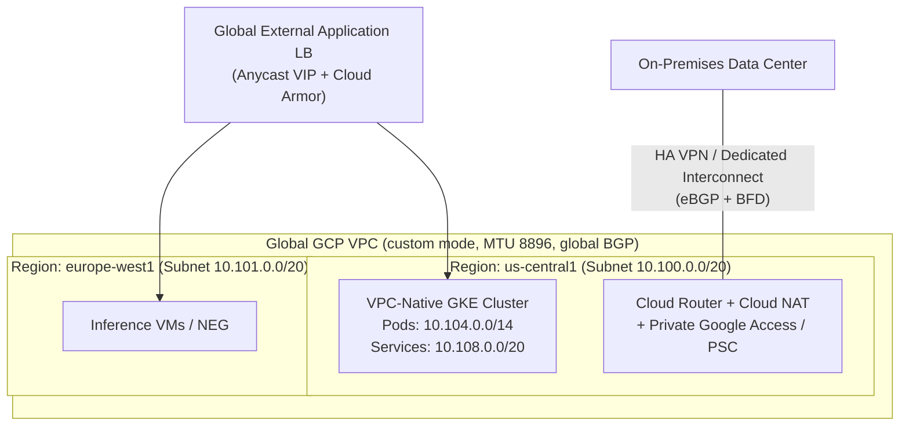

# 2.32 Cloud networking: VPC design, connectivity, load balancers and GCP specifics for AI

| | |
|---|---|
| Level | Intermediate |
| Priority tier | 0 |
| Lab venue | A GCP project with billing (small VMs, VPC, Cloud NAT); costs apply, delete everything afterwards |
| Part | Part 2: Networking, from first principles to AI fabrics |
| Status | Drafted, labs **untested**; service limits, prices and product names change often: verify in current provider documentation |

## Why this matters for AI infrastructure

Much AI work runs in public clouds or hybrid between cloud and on-prem GPU clusters: training bursts on rented H100/H200/B200 nodes, inference endpoints in several regions, datasets in object storage, checkpoints replicated across sites, managed Kubernetes (GKE, EKS, AKS) hosting the serving layer, and private connectivity to corporate data centres. The network design decisions in the cloud are different from on-prem: you do not choose switches, but you do choose address plans, routing, firewalls, peering, NAT, load balancers, private access paths and connectivity to on-premises, and these decisions determine cost (egress charges can dominate), security, latency, availability and whether an 8-GPU node can actually use its high-bandwidth NICs for collectives. This chapter covers cloud computing concepts and the technical and business trade-offs a network engineer must understand, a compact AWS and Azure primer, GCP networking in depth (the user's lab platform), hybrid connectivity, Kubernetes networking in the cloud (GKE), and the specifics of building GPU clusters on cloud networks.

## Prerequisites and outcomes

You should know IP addressing (2.4), routing and BGP basics (2.5, 2.15), NAT and DNS (2.8, 2.9), load balancing (2.20), security basics (2.21) and container networking (2.25).

After this chapter you can:

- Explain IaaS/PaaS/SaaS/FaaS, public/private/hybrid/multicloud, and the cloud's API-driven consumption model.
- Evaluate business drivers (CAPEX to OPEX, agility, elasticity) and trade-offs (infrastructure design still needed, expertise still needed, egress and connectivity costs, specialised hardware, feature creep, lock-in, process change).
- Describe the main technical challenges: latency, populating remote storage, data gravity, choosing among paths to the cloud, securing data in transit, managing secure connections, multitenancy and RBAC, monitoring.
- Map the AWS VPC building blocks (VPC, subnets, route tables, ENI, EIP, security groups, NACLs, IGW, NAT gateway, ELB, EKS networking) and Azure equivalents.
- Design a GCP network: global VPC with regional subnets, custom mode, secondary ranges for GKE, routes, firewall rules and policies, Cloud Router/BGP, Cloud NAT, Cloud VPN and Interconnect, VPC peering, Shared VPC, Private Google Access, Private Service Connect, DNS, load balancer types, network tiers.
- Explain GKE networking (VPC-native clusters, alias IPs, pod and service ranges, Dataplane V2/Cilium, network policy, Services and Ingress/Gateway, NodeLocal DNS) and its pitfalls.
- Design networking for GPU clusters in the cloud: multi-NIC GPU VMs, cluster placement, MTU, GPUDirect over TCP/RDMA offerings, EFA and InfiniBand on other clouds, hybrid connectivity to on-prem, data transfer paths and egress cost control.
- Operate and troubleshoot cloud networks: flow logs, connectivity tests, firewall logs, routes, quotas.

## 1. Cloud computing concepts

**Cloud** here means virtualised infrastructure or services consumed through **self-service**: a portal or API requests resources, and software fulfils the request automatically. Service models:

| Model | You manage | Examples |
|---|---|---|
| **IaaS** | Guest OS up (the provider manages hardware and virtualisation): VMs, disks, VPC networks, load balancers | Compute Engine, EC2, Azure VMs |
| **PaaS** | Application and data (the provider manages runtime and OS): managed databases, Kubernetes control planes, queues | Cloud SQL, GKE (control plane), App Engine, Elastic Beanstalk |
| **FaaS / serverless** | Functions only; scale to zero; pay per execution | Cloud Functions/Run, Lambda |
| **SaaS** | Nothing but configuration/use | Workspace, Office365, Salesforce |

The boundaries blur; do not fixate on labels. **Deployment models**: **public cloud** (infrastructure owned by a third party: AWS, Azure, GCP), **private cloud** (cloud software on your hardware: OpenStack, Kubernetes platforms, VMware), **hybrid** (workloads split across private and public with network interconnect), and **multicloud** (more than one public provider). **APIs** are central: cloud resources, including network resources, are created and changed through APIs, usually via infrastructure as code (Terraform, Pulumi, Deployment Manager, CloudFormation), so network engineers need programming and automation skills (chapters 2.28 and 2.29).

## 2. Business drivers and trade-offs

### Drivers

- **CAPEX → OPEX**: instead of buying switches, servers and facilities (capital), you pay for consumption (operating). Perceived benefits include economies of scale of hyperscalers (bulk purchasing, white-box hardware, deep engineering teams) and reduced need for in-house operational skills for commodity layers.
- **Time to market and agility**: infrastructure in minutes instead of weeks or months; elasticity to follow demand peaks (retail seasons, training runs) rather than permanently over-provisioning for peak, which wastes money in quiet periods and loses business when demand outstrips capacity.

### Trade-offs

**Operational**

- Moving to the cloud **does not remove the need for infrastructure design**: SLAs imply resiliency (multi-zone, multi-region), capacity sizing, security policy per flow, inter-cloud connections and data replication with routing and possibly address translation. Flipping a light switch needs no knowledge of the wiring behind it, until the lights stop working.
- **Experts are still required when infrastructure fails**: complex failure modes (asymmetric routing in hybrid paths, peering transitivity, MTU mismatches over VPN) need deep networking skills.
- **The cost of reaching the cloud** is real: circuits, QoS, landing zones, egress fees, cross-region transfer. Moving petabytes of training data is neither instant nor free.
- **Specialised hardware may be unavailable or differently packaged**: cloud theory treats resources as generic; workloads relying on specific NICs, RDMA fabrics, large-buffer switches, or particular middleboxes must be adapted or use special instance types.
- **Feature creep** increases failure risk: every enabled feature is code that interacts with other features; unused-but-available features are not harmless.

**Business**

- Applications and operations built for traditional infrastructure often need **redesign** (statelessness, autoscaling, managed services, new CI/CD, observability); "lift and shift" copies the old architecture into rented hardware and keeps its costs without the benefits (a square peg in a round hole).
- **Goal mismatch with the outsourcer**: your goal is to deliver your product; the provider's is to maximise your consumption at high margin. Providers add proprietary features that increase **vendor lock-in**; consider portability (Kubernetes, Terraform modules, open standards) and exit costs. This is nothing new in networking (vendors have always differentiated delivery models), but cloud deepens it.
- **Cost surprises**: egress, inter-AZ traffic, NAT gateway processing, load balancer hours, idle GPU reservations, unattached IPs and logs.

## 3. Technical challenges of cloud networking

1. **Latency**: physics and path. Distance to the nearest region/zone and the path taken (public Internet vs private backbone) affect interactive and chatty workloads; collocate compute with data; use regional/global load balancing and CDNs for users; measure with probes (chapter 2.31).
2. **Populating remote storage**: bulk transfer into the cloud (initial dataset ingest, replicas, checkpoints) is limited by link capacity, TCP window/BDP (long fat pipes, chapter 2.6), parallelism and egress charges; use parallel transfer tools (gsutil/rclone with many streams, Storage Transfer Service, Transfer Appliance for petabytes), compress/dedupe, schedule off-peak, and keep incremental syncs.
3. **Data gravity**: data attracts applications; moving large datasets is costly and slow, so compute tends to move to the data, and the cloud holding the data wins future workloads. For AI, place training near the dataset's home region, replicate selectively, and avoid designs that repeatedly pull terabytes across regions or clouds.
4. **Selecting among multiple paths to the public cloud**: Internet (cheap, variable, with VPN overlay), dedicated private connectivity (Direct Connect, Dedicated/Partner Interconnect, ExpressRoute), cloud exchange fabrics/colocation, SD-WAN; choose by bandwidth, latency, SLA, security, cost, and resilience (two diverse paths, BGP failover, SRLG awareness).
5. **Security in the cloud**: *protecting data over public transport* (IPsec/WireGuard VPN, TLS, MACsec on dedicated links, HA VPN over Interconnect), *managing secure connections* (key lifecycle, certificates, tunnel monitoring), the **shared responsibility model** (provider secures the cloud; you secure what you put in it: identity, configuration, data), least-privilege IAM, private access paths so traffic to cloud services doesn't traverse the Internet, and firewalling at multiple layers.
6. **The multitenant cloud**: you share physical hardware with other tenants; isolation is provided by virtualisation and overlays. Understand noisy-neighbour effects (network bandwidth caps per VM, burst limits), tenancy models (sole-tenant nodes), and **role-based access control (RBAC)** on cloud resources (who can change firewall rules, routes, peering), plus organisation policies and guard-rails.
7. **Monitoring cloud networks**: you don't own the devices, so use provider telemetry (flow logs, firewall logs, connectivity tests, load balancer logs, VPN/Interconnect metrics) plus your own probes and host metrics; integrate into your monitoring platform (chapter 2.31).

## 4. AWS and Azure primer (for comparison)

Even if your platform is GCP, interviews and multi-cloud work require knowing the equivalents.

### AWS

- **Region/Availability Zone (AZ)**: regions are geographic; AZs are isolated data centres within a region. Subnets live in **one AZ**.
- **VPC**: regional virtual network with an IPv4 CIDR (and optional IPv6); **subnets** (public if routed to an internet gateway, private otherwise).
- **Route tables**: main and custom; each subnet associates with one; the **local route** (VPC CIDR) is always most specific; routes to IGW, NAT gateway, VPC peering, Transit Gateway, VPN, Direct Connect gateway; gateway route tables for edge association.
- **Elastic Network Interface (ENI)**: attachment point with primary and secondary private IPs, optional EIP per private IP, security groups, MAC and a source/destination check flag (disable for NAT/routers). **Elastic IPs** for static public addresses (soft limits).
- **Security groups** (stateful, allow-only, instance/ENI level, can reference other SGs) and **network ACLs** (stateless, subnet level, ordered allow/deny rules).
- **NAT gateway** (managed, per AZ, for private subnets' outbound), **Internet gateway**, **egress-only IGW** (IPv6), **VPC endpoints** (Gateway endpoints for S3/DynamoDB; Interface endpoints/PrivateLink for services) to keep traffic private.
- **Elastic Load Balancing**: Application (L7), Network (L4), Gateway (L3 appliances), Classic; listeners, rules, target groups, health checks; targets can be instances, IPs, Lambda, pods.
- **Connectivity**: VPC peering (non-transitive), Transit Gateway (hub-and-spoke), Site-to-Site VPN, Direct Connect, Cloud WAN.
- **EKS networking**: managed node groups, Fargate, the **AWS VPC CNI** assigns VPC IPs to pods via ENIs (limits per instance type; prefix delegation), security groups for pods, load balancer controller. **EFA** (Elastic Fabric Adapter) provides OS-bypass networking (SRD protocol) for HPC and NCCL over libfabric; placement groups (cluster) keep instances close.

### Azure

**VNet** (regional) with subnets; **NSGs** (network security groups, stateful, allow/deny, priority), **UDRs** (user-defined routes) and system routes, **Azure Firewall**, **VNet peering** (global peering available), **Virtual WAN**, **VPN Gateway**, **ExpressRoute**, **Load Balancer / Application Gateway / Front Door**, **Private Link**, **AKS** with Azure CNI (pod IPs from VNet) or overlay. GPU HPC VMs (ND-series) offer InfiniBand with SR-IOV in the same scale-set/placement.

## 5. GCP networking in depth

### Global resources and the VPC model



Google Cloud differs from other providers in making many networking resources **global**:

- A **VPC network** is a **global** resource (not tied to a region or zone) in a project. It contains **regional subnets**; instances in different regions of the same VPC communicate over Google's private backbone with their internal IPs, without peering. A **project** can hold multiple VPC networks; **Shared VPC** and **VPC Network Peering** connect them.
- **Subnets** are regional, have a primary IPv4 range and optionally **secondary ranges** (used by GKE for pods and services), may be IPv4 or dual-stack, and can expand but not shrink. Subnet ranges can be any RFC 1918 (and some other) space, but overlapping ranges prevent peering and VPN routing.
- **Auto mode** networks create one subnet per region from a predefined block; **custom mode** networks start empty and give you full control (use custom mode for production). The **default** network (auto mode, with permissive default firewall rules) overlaps other projects' defaults and prevents peering: delete or avoid it.
- **Firewall rules** are VPC-level (global), stateful, apply to instances by **network tags** or **service accounts** (preferred), with priority (0 to 65535, lower first), direction, allow/deny, protocols/ports and source/destination ranges. Implied rules: allow all egress, deny all ingress (lowest priority). **Hierarchical firewall policies** (organisation/folder) and **network firewall policies** add centralised control and FQDN/geo/threat-intelligence/address-group objects; Cloud NGFW adds L7 inspection.
- **Routes**: system-generated subnet routes and a default route to the internet gateway; **custom static routes** (next hop: instance, ILB, VPN tunnel, gateway), **dynamic routes** learned by **Cloud Router** over BGP (regional or global dynamic routing mode); policy-based routes; peering route exchange (custom routes optional).
- **Internal IPs** are auto-assigned or reserved; **external IPs** ephemeral or static (regional/global). Most VMs should have **no external IP**.
- **MTU**: the VPC default is 1460 bytes; configurable up to **8896** per network; ensure all VMs, tunnels and peers agree (VPN MTU is lower: 1460 for classic or 1500 on HA VPN? verify; Interconnect supports 1440/1460/1500/8896 depending on attachment). Mismatched MTU is a classic cause of "small works, large hangs".
- **Network service tiers**: **Premium** (traffic stays on Google's backbone to the edge nearest the user; global load balancing) and **Standard** (regional, cold-potato traffic to the Internet; cheaper).

```bash
# Custom-mode VPC with regional subnets, secondary ranges for GKE, private Google access
gcloud compute networks create ai-vpc --subnet-mode=custom --mtu=8896 --bgp-routing-mode=global
gcloud compute networks subnets create train-us-central1 --network=ai-vpc --region=us-central1 --range=10.100.0.0/20 \
    --secondary-range=pods=10.104.0.0/14,services=10.108.0.0/20 --enable-private-ip-google-access --enable-flow-logs
gcloud compute firewall-rules create allow-internal --network=ai-vpc --allow=tcp,udp,icmp --source-ranges=10.100.0.0/16
gcloud compute firewall-rules create allow-iap-ssh --network=ai-vpc --allow=tcp:22 --source-ranges=35.235.240.0/20     # IAP TCP forwarding
gcloud compute networks subnets list --network=ai-vpc ; gcloud compute routes list --filter="network:ai-vpc"
```

### Outbound access: Cloud NAT and Private Google Access

- **Cloud NAT** (regional, software-defined, attached to a Cloud Router) gives VMs without external IPs outbound Internet access; allocates ports per VM (minimum ports per VM, dynamic port allocation), supports static or auto-allocated external IPs, logging (translations and errors), endpoint-independent mapping. Port exhaustion appears as dropped connections and "OUT_OF_RESOURCES" log entries; mitigate with more IPs/ports, pooling, and Private Google Access / Private Service Connect for Google APIs.
- **Private Google Access** lets VMs with only internal IPs reach Google APIs and services (Cloud Storage, BigQuery, Artifact Registry) via special routes (`restricted.googleapis.com`/`private.googleapis.com` VIPs; DNS config). **Private Service Connect** exposes services (Google APIs, partner or your own services) through an internal endpoint in your VPC with its own IP; **Private Services Access** connects to managed services via VPC peering (Cloud SQL, Filestore).

```bash
gcloud compute routers create nat-router --network=ai-vpc --region=us-central1
gcloud compute routers nats create nat-config --router=nat-router --region=us-central1 --nat-all-subnet-ip-ranges --auto-allocate-nat-external-ips \
    --enable-dynamic-port-allocation --min-ports-per-vm=64 --enable-logging
```

### Connecting networks

| Option | What it is | Notes |
|---|---|---|
| **VPC Network Peering** | Private connectivity between two VPC networks (same or different projects/orgs); non-transitive; no overlapping ranges; exchange of subnet routes (and optionally custom routes) | Low latency, no extra gateways; quota limits; no transitive routing (use NCC or hub VPC) |
| **Shared VPC** | A host project shares subnets with service projects; centralised network admin | Standard for enterprises; IAM per subnet |
| **Cloud VPN (HA VPN)** | IPsec over the Internet with two interfaces, 99.99% SLA with proper topology; BGP via Cloud Router | Per-tunnel bandwidth limits (~3 Gb/s; scale with multiple tunnels/ECMP); MTU constraints |
| **Cloud Interconnect** | Dedicated (10/100 Gb/s ports at colocation facilities) or Partner (50 Mb/s to 50 Gb/s via a provider) private connectivity with VLAN attachments and Cloud Router/BGP; optional HA VPN over Interconnect for IPsec/MACsec | Highest bandwidth/lowest latency; 99.9% / 99.99% SLA topologies need redundant interconnects in two metros; MTU up to 8896 on some attachments |
| **Cross-Cloud Interconnect** | Dedicated link to another cloud (AWS/Azure/OCI) | Multicloud |
| **Network Connectivity Center (NCC)** | Hub-and-spoke control plane: VPN/Interconnect/router appliance/VPC spokes with transitive connectivity, site-to-site data transfer | Route management across sites |
| **Router appliances / SD-WAN** | Third-party NVAs peering with Cloud Router | Special needs |

Hybrid routing basics: on-prem routers peer with Cloud Router using eBGP (private ASN on-prem, Google's 16550 for Partner/ASN for Cloud Router configurable 64512-65534/4200000000+); advertise on-prem prefixes to the cloud (learned as dynamic routes), and VPC subnets back (custom advertisements allowed); use MED/AS-path for primary/backup; use BFD for fast failover; ensure symmetric paths and stateful firewall placement; mind overlapping addresses between clouds and sites (plan one address plan, chapter 2.4).

### DNS

Cloud DNS provides managed public and private zones, **forwarding zones** (to on-prem resolvers), **peering zones**, **response policies**, DNSSEC and inbound forwarding endpoints. Compute Engine VMs use the metadata server resolver (169.254.169.254) with internal names `VM.ZONE.c.PROJECT.internal` (zonal DNS) or global DNS; hybrid DNS is usually the first cloud networking pain point: define forwarding both directions and avoid loops (chapter 2.8).

### Load balancing

| Type | Layer | Scope | Typical use |
|---|---|---|---|
| **Global external Application Load Balancer** | L7 HTTP(S), Envoy-based, Premium tier | Global anycast IP | Public web/API/inference endpoints, multi-region backends, Cloud CDN, Cloud Armor (WAF/DDoS), IAP |
| **Regional external/internal Application LB** | L7 | Regional | Internal microservices, regional endpoints |
| **External proxy Network LB** (TCP/SSL proxy) | L4 proxy | Global/regional | TCP/SSL services with global anycast |
| **External passthrough Network LB** | L4 pass-through (Maglev-based, DSR) | Regional | UDP, non-HTTP, preserve source IP |
| **Internal passthrough Network LB** | L4 pass-through | Regional | Internal TCP/UDP services, next hop for routes |
| **Cross-region internal Application LB** | L7 | Multi-region internal | Internal multi-region apps |

Features: health checks (and firewall rules allowing Google health-check ranges 35.191.0.0/16, 130.211.0.0/22), backend services and NEGs (zonal, serverless, internet, hybrid, and container-native pod NEGs for GKE), URL maps, session affinity, connection draining, outlier detection, traffic management (Envoy config), capacity scaling, logging. For AI inference: global ALB with serverless/pod NEGs for GKE services, GKE Gateway API with `gke-l7-global-external-managed`, long timeouts and streaming (backend service timeout 30 s default: raise for streaming), HTTP/2 end to end for gRPC, and Cloud Armor rate limiting (chapter 2.20).

### Observability and troubleshooting

- **VPC Flow Logs** (sampled flow records per subnet), **Firewall Rules Logging** (hit counts and allow/deny), **Cloud NAT logs**, **Load Balancer logs**, **Packet Mirroring** (collector instances behind an internal LB for IDS/forensics), **Network Intelligence Center**: **Connectivity Tests** (static analysis of paths: reachability and the rule/route that blocks), **Network Topology**, **Performance Dashboard** (latency/packet loss between zones), **Firewall Insights**, **Network Analyzer**.
- Typical checks: effective routes and firewall rules on the VM (`gcloud compute instances network-interfaces ...`, console's "Network analysis"), `gcloud compute networks subnets describe`, `gcloud compute routers get-status`, `gcloud compute vpn-tunnels describe`, `gcloud compute interconnects attachments describe`, IAM permissions (e.g. `compute.networkAdmin`, `compute.securityAdmin`), quotas (`gcloud compute project-info describe`), organisation policies.

```bash
gcloud network-management connectivity-tests create t1 --source-instance=projects/P/zones/us-central1-a/instances/vm-a \
    --destination-instance=projects/P/zones/us-central1-b/instances/vm-b --protocol=TCP --destination-port=443
gcloud network-management connectivity-tests describe t1          # shows reachable/unreachable with the blocking firewall/route
gcloud logging read 'resource.type="gce_subnetwork" AND logName:"vpc_flows"' --limit=5 --format=json
```

## 6. GKE and Kubernetes networking on GCP

- **VPC-native clusters** (alias IPs) are the standard: nodes get IPs from the subnet's primary range; **pods** from a secondary range (each node gets a /24 by default from the pod range; maximum pods per node tuning); **services** (ClusterIPs) from another secondary range. Pod IPs are routable within the VPC and peered networks (no overlay, no NAT inside the VPC), integrate with VPC firewall rules and flow logs, and appear to on-prem if routes are advertised via Cloud Router (custom advertisement of the pod range). Plan ranges generously (pod range sizing limits cluster size and node count) and **non-overlapping** with on-prem.
- **Dataplane V2** (Cilium/eBPF) enables built-in NetworkPolicy enforcement and logging, better observability (Hubble-like), and kube-proxy replacement. Otherwise Calico can enforce NetworkPolicy. Cluster **private** mode removes public IPs from nodes (private nodes) and optionally restricts the control plane endpoint (authorized networks, private endpoint); outbound access via Cloud NAT.
- **Services and Ingress**: `ClusterIP`, `NodePort`, `LoadBalancer` (external/internal passthrough NLB) and **container-native load balancing** with NEGs (load balancer sends straight to pod IPs, avoiding the extra hop and kube-proxy double-NAT, with accurate health checks). **GKE Gateway** (Gateway API) and Ingress provision global or regional Application LBs; `BackendConfig`/`GCPBackendPolicy` set timeouts, affinity, Cloud Armor.
- **DNS**: kube-dns or Cloud DNS for GKE; **NodeLocal DNSCache** to cut latency and conntrack issues (chapter 2.8).
- **Multi-network pods (multi-NIC)**: GKE supports multiple networks per pod (`Network` and `GKENetworkParamSet` resources) so GPU pods can attach additional VPC interfaces (needed for high-bandwidth GPU networking); requires multi-network-capable node pools and the corresponding VM configuration.
- **Egress and cost**: cross-zone pod traffic incurs inter-zone charges; topology-aware routing and zone-aware scheduling reduce them; egress to Internet via Cloud NAT is metered.
- **Network policy defaults**: namespaces are open by default; use default-deny policies (chapter 2.21).

## 7. Networking for GPU clusters in the cloud

### GCP GPU VM generations (verify current names and features)

GCP offers A2 (A100), A3 (H100) and newer families (A3 Mega, A3 Ultra, A4 etc.), each with a different networking design:

- **A3 (H100 8-GPU)**: multiple NICs including gVNIC, with **GPUDirect-TCPX** (a TCP-based GPUDirect path that lets NCCL move GPU memory to the NIC over Ethernet without staging in host memory, via a NCCL plugin and receive-data-path offloads) over dedicated VPC networks for the GPU NICs (commonly four additional VPCs/subnets, one per GPU NIC pair).
- **A3 Mega**: higher bandwidth (up to ~1.8 Tbps) with **GPUDirect-TCPXO** (offload, requires an NCCL plugin and a "fastrak" receive-data-path manager sidecar) and compact placement policies.
- **Newer generations** (for example A3 Ultra / A4) move to RDMA over Converged Ethernet (RoCE) with dedicated RDMA VPC networks and many 400G NICs per node; check the current documentation for the exact network profile (`RDMA` network profile), MTU requirements, and the required NCCL plugin/driver versions.
- Common requirements across these: **multiple VPC networks** (a management/primary VPC plus one or more data VPCs), **MTU 8244 or the documented jumbo value** on the GPU NICs, firewall rules allowing all traffic between GPU NIC subnets, **compact placement policies** (collocated hosts, low latency), correct **NCCL environment** (`NCCL_SOCKET_IFNAME`, plugin variables), and drivers/images from the provider's HPC/DL images; managed offerings (GKE with GPU node pools using `gpudirect-tcpx/tcpxo/rdma` features, Slurm on GCP via Cluster Toolkit, Vertex AI) automate much of this.

Always read the provider's current "create an AI-optimised cluster" guide; the exact flags change between generations.

### AWS, Azure, OCI equivalents

- **AWS**: P4d/P5/P5e/P6 instances with **EFA** (up to 3.2 Tbps on P5) using SRD and libfabric (`aws-ofi-nccl` plugin), cluster placement groups, UltraClusters; Kubernetes via EKS with the EFA device plugin.
- **Azure**: ND H100 v5 and similar with InfiniBand (NDR), SR-IOV, VMSS in one placement/IB domain; AKS node pools with IB.
- **Oracle OCI**: bare-metal GPU instances on RDMA clusters (RoCE v2) with cluster networks.
- Specialist clouds (CoreWeave, Nebius, Lambda): bare-metal Kubernetes with InfiniBand/Spectrum-X fabrics, often better price-performance for training; networking is exposed as VPCs plus the RDMA fabric.

### Design guidance

1. **Address plan first**: non-overlapping CIDRs across clouds, regions, on-prem, GKE pod/service ranges; reserve growth.
2. **Separate planes**: management/control VPC, data (storage) network, GPU data networks; apply least-privilege firewall rules per plane.
3. **Private by default**: no external IPs; Cloud NAT for outbound; Private Google Access/PSC for APIs; IAP or bastion/OS Login for admin access; private GKE clusters.
4. **Data location and egress**: keep datasets, checkpoints and training in the same region (and zone where latency matters); use regional buckets and the backbone; evaluate cross-region replication costs; use Interconnect for sustained hybrid transfer volumes (cheaper egress than Internet in many cases); cache or mirror public datasets/models into your own buckets/registries (Artifact Registry mirror) to avoid repeated egress and NAT port pressure.
5. **MTU everywhere**: set VPC MTU consistently, validate with `ping -M do`, configure GKE/CNI pod MTU, check VPN/Interconnect MTU.
6. **Placement and quotas**: compact placement for GPU jobs; request GPU/IP/forwarding-rule/route quotas early; watch NAT port allocation and subnet exhaustion.
7. **Resilience**: multi-zone subnets and managed instance groups; two Interconnect attachments in different metros with BGP and BFD; regional/global load balancers; avoid single NAT/gateway chokepoints; test failover.
8. **Security**: IAM least privilege for network admin roles; organisation policies (disable default network, restrict external IPs, enforce VPC SC for sensitive data services); firewall rules by service account; flow logs and firewall logging enabled and exported; Cloud Armor in front of public endpoints; DDoS protection.
9. **Observability**: flow logs (sample rates), Connectivity Tests in CI after network changes, probes between zones/regions/on-prem, dashboards of NAT, VPN, Interconnect, LB metrics; integrate with chapter 2.31 stack.
10. **Infrastructure as code**: Terraform modules for VPC, subnets, firewall policy, routers, NAT, VPN/Interconnect, DNS, GKE; policy-as-code checks; no console-only changes (chapter 2.29 and Part 4).

## 8. Hands-on lab: a small GCP network and failure drills

First, run the self-checking Python lab (`code/part02/cloud_vpc_gke_networking_lab.py`) locally (zero cloud cost). It verifies GKE VPC-native secondary range capacity planning (`/20` node subnet + `/14` pod range = `1,024` max nodes and `4,096` Services), VPC Network Peering non-transitivity and CIDR-overlap checks, and GCP Load Balancer health-check firewall range (`35.191.0.0/16`, `130.211.0.0/22`) validation.

```bash
python3 code/part02/cloud_vpc_gke_networking_lab.py
```

Next, in a dedicated GCP lab project with a budget alert (all interactive `gcloud` commands below are `untested here` and billable; delete all resources at the end), work through these steps:

1. **Custom VPC and subnets**: create `lab-vpc` (custom mode, MTU 1460 and later 8896), two subnets in two regions with secondary ranges; delete the default network if present; review effective routes.
2. **Firewall**: create rules for internal traffic, IAP SSH, health checks; test with VMs in each subnet (`ping`, `iperf3`); enable firewall logging and view logs; add a deny rule with higher priority and verify with Connectivity Tests.
3. **Private VMs and NAT**: create VMs without external IPs; show outbound failure; add Cloud Router + Cloud NAT; test; exhaust ports with many connections to one destination (`ab`/`hey`) and read NAT logs; then use Private Google Access to reach Cloud Storage without NAT.
4. **Peering**: create a second VPC (`lab-vpc-b`) with non-overlapping ranges, peer both ways, test reachability; show non-transitivity with a third VPC; add custom route exchange.
5. **HA VPN (optional, billable)**: connect `lab-vpc` to a second VPC or a simulated on-prem (StrongSwan VM) using HA VPN and Cloud Router BGP; observe BGP routes, MTU effects, failover by shutting one tunnel.
6. **Load balancing**: create a managed instance group with a simple HTTP service; front with an internal passthrough LB and a global external Application LB; test health checks (firewall for Google ranges), session affinity, failover by stopping a backend, and timeouts with a slow endpoint.
7. **GKE (optional)**: create a small VPC-native private cluster with Cloud NAT; inspect pod CIDR allocation, create a Service of type LoadBalancer and a Gateway; apply default-deny NetworkPolicy; use NodeLocal DNSCache; test container-native LB.
8. **Observability**: enable VPC flow logs on a subnet and query them in Logging/BigQuery; run Connectivity Tests before and after a rule change; build a simple dashboard of NAT allocation and LB latency.
9. **Cost drill**: estimate egress for moving 50 TB cross-region and to the Internet; compare with Interconnect/transfer appliance options.
10. **Terraform**: reproduce steps 1 to 4 as a Terraform module with `plan` output in a pull request.
11. **Cleanup**: delete in dependency order (LBs, NAT/routers, VMs, peering, subnets, VPCs); verify no leftover static IPs or forwarding rules.

## 9. Common mistakes

- Using the default network (overlapping ranges, permissive rules); overlapping CIDRs that block peering or VPN.
- Assuming VPC peering is transitive; forgetting route/firewall changes on both sides.
- External IPs on every VM; no NAT or private access strategy; NAT port exhaustion.
- Forgetting health-check firewall rules for load balancers; short backend timeouts for streaming inference.
- MTU mismatches across VPN/Interconnect/GKE; jumbo frames assumed end to end.
- Ignoring egress and inter-zone costs in architecture decisions.
- A single Interconnect/VPN with no redundancy; no BFD; asymmetric routing through stateful firewalls.
- Undersized GKE pod ranges; no default-deny policies; unmonitored quotas.
- Running GPU clusters on a single default VPC/NIC and wondering why NCCL is slow; missing placement policies and plugins.

## 10. Interview angles

- "Design the network for an AI platform spanning GCP and an on-prem data centre."
- "Explain GCP's global VPC and how it differs from AWS's regional VPC."
- "VPC peering vs Shared VPC vs Network Connectivity Center vs Private Service Connect."
- "How do VMs without public IPs reach the Internet and Google APIs?"
- "How would you connect on-prem to GCP with 99.99% availability?"
- "What is data gravity and how does it affect where you train?"
- "Pods can't reach an on-prem database: where do you look?" (routes advertisement, firewall, ranges, NAT, MTU.)
- "How do GPU VMs get high-bandwidth networking in the cloud?" (multi-NIC, GPUDirect-TCPX/RDMA, EFA, placement.)
- "What are the main cloud networking cost traps?"

## Exercises

1. **Cloud Computing Models, Business/Operational Trade-Offs, and Technical Challenges (`CN` Chapter 28):** (a) Contrast `IaaS`, `PaaS`, `FaaS`, and `SaaS` across public, private, hybrid, and multicloud deployments; (b) explain the five operational trade-offs and two business trade-offs of public clouds, define **data gravity**, and explain why moving a 500 TB training dataset across clouds or regions repeatedly is an architectural anti-pattern.
2. **Comparing AWS, Azure, and GCP VPC Architectures (`NK` Chapter 6):** Compare how **AWS** (`VPC`, per-AZ subnets, `ENI`s, stateful `Security Groups` vs stateless `NACL`s, `NAT Gateway`, `Transit Gateway`), **Azure** (`VNet`, `NSG`s, `UDR`s, `Virtual WAN`), and **GCP** (global `VPC`, regional subnets, service-account firewall rules, `Cloud Router`, `Cloud NAT`, `NCC`) structure virtual networks.
3. **GCP Outbound Access, Peering Non-Transitivity, Shared VPC, and 99.99% Hybrid Interconnect:** (a) Using `evaluate_vpc_peering_reachability()` in `code/part02/cloud_vpc_gke_networking.py`, prove that if `VPC A` peers with `VPC B` and `VPC B` peers with `VPC C`, `VPC A` **cannot** reach `VPC C` through `B`, and compare **VPC Network Peering**, **Shared VPC**, **Network Connectivity Center (`NCC`)**, and **Private Service Connect (`PSC`)**; (b) design a **99.99% SLA** hybrid connection between an on-prem data center and GCP using **Dedicated/Partner Interconnect** (or **HA VPN**) and **Cloud Router (`eBGP` + `BFD`)**.
4. **GCP Load Balancing, Health-Check Firewall Ranges, and Container-Native `NEG`s:** Using `check_gcp_lb_health_check_firewall()`, explain why every backend VM or GKE node must permit ingress from **`35.191.0.0/16` and `130.211.0.0/22`**, compare **Global External Application LB** (L7 Envoy + Cloud Armor) with **Regional Passthrough Network LB** (L4 Maglev DSR), and explain how **Container-Native Load Balancing (`NEG`s)** eliminates `kube-proxy` double-NAT hops.
5. **GKE VPC-Native Alias IP Sizing and `Dataplane V2`:** Using `plan_gke_vpc_native_capacity("10.100.0.0/20", "10.104.0.0/14", "10.108.0.0/20", 24)`, calculate the maximum number of nodes (`1,024`) and Services (`4,096`) supported by the subnet's primary and secondary ranges, and explain what happens if a GKE Pod tries to reach an on-prem database when the Pod secondary range (`10.104.0.0/14`) is not advertised as a custom route on Cloud Router.
6. **Cloud GPU Cluster Networking (`GPUDirect-TCPX` / `TCPXO` / `RDMA`, AWS `EFA`, and Azure InfiniBand):** Compare the multi-NIC GPU networking architectures of **GCP** (`A3` `GPUDirect-TCPX`, `A3 Mega` `GPUDirect-TCPXO` `~1.8 Tbps`, and `A3 Ultra`/`A4` `400G` RoCE RDMA across dedicated GPU VPCs with compact placement and `MTU 8244`/`8896`), **AWS** (`P5` **EFA** `3.2 Tbps` with `SRD` and `aws-ofi-nccl`), and **Azure** (`NDv5` NDR InfiniBand with SR-IOV).

## Checkpoint questions (20)

<details>
<summary>1. Compare `IaaS`, `PaaS`, `FaaS`, and `SaaS`, and explain the Cloud Shared Responsibility Model (`CN` Chapter 28).</summary>

- **`IaaS`** (Compute Engine, EC2): provider manages physical data centers, switches, servers, and hypervisors; you manage the guest OS, runtime, applications, data, and virtual network configuration (`VPC`, firewall rules, routes, IAM).\n- **`PaaS`** (GKE control plane, Cloud SQL): provider manages the OS and service runtime.\n- **`FaaS` / Serverless** (Cloud Run/Functions, Lambda): provider runs event-driven functions scaling to zero.\n- **`SaaS`**: provider manages the complete application.\nUnder the **Shared Responsibility Model**, the cloud provider secures *the cloud itself* (physical security, hypervisor, underlay fabric), while **you are 100% responsible for securing what you configure in the cloud** (firewall rules, IAM/RBAC, encryption keys, private endpoints, and OS/container patching).
</details>

<details>
<summary>2. Why does \"Lift and Shift\" often disappoint financially and operationally, and what are the five operational trade-offs of cloud networking (`CN` Chapter 28)?</summary>

**\"Lift and Shift\"** copies legacy stateful, monolithic architectures onto rented VMs without adopting autoscaling, ephemeral instances, or cloud-native storage—paying high OPEX rental premiums while keeping all the old operational pain. The five operational trade-offs (`CN` Ch. 28) are: (1) **infrastructure design is still required** (multi-AZ/region resilience, CIDR planning, security policy), (2) **deep networking experts are still required when complex hybrid/overlay faults occur**, (3) **reaching the cloud costs real money** (egress fees, Interconnect circuits, NAT processing), (4) **specialized hardware** (custom RDMA/switch features) is abstracted or restricted to specific SKUs, and (5) **feature creep** increases interaction surfaces.
</details>

<details>
<summary>3. Define \"Data Gravity\" and explain how it dictates AI training and checkpoint architecture in the cloud (`CN` Chapter 28).</summary>

**Data gravity** is the principle that as datasets grow into hundreds of terabytes or petabytes, they become too slow (bounded by WAN bandwidth and TCP BDP) and too expensive (cloud **egress charges** of `$0.02–$0.12/GB`) to move across regions or clouds—so **compute must move to the data's home region**. In AI infrastructure, always place GPU training pools in the exact same cloud region (and zone) as your object-store dataset and checkpoint buckets, mirror container registries (`Artifact Registry`) and Hugging Face weights locally in-region, and replicate only final distilled checkpoints cross-region.
</details>

<details>
<summary>4. How does GCP's VPC scope differ from AWS's VPC and Azure's VNet (`NK` Chapter 6)?</summary>

In **AWS** and **Azure**, a `VPC` / `VNet` is **regional**, and each **subnet is zonal** (pinned to a single Availability Zone `AZ`, e.g., `us-east-1a`). In **Google Cloud (`GCP`)**, a **VPC network is a GLOBAL resource**, and **subnets are REGIONAL** (a single subnet `10.100.0.0/20` in `us-central1` automatically spans all zones `us-central1-a/b/c/f`). Two VMs in `us-central1` and `europe-west1` inside the same GCP VPC communicate directly using their private RFC 1918 IPs over Google's global private backbone without needing VPC peering or a transit gateway.
</details>

<details>
<summary>5. Why should you delete or never use the `default` auto-mode VPC network in production GCP projects?</summary>

Every GCP project's `default` network is an **auto-mode** VPC that pre-creates one `/20` subnet in every region from the exact same hardcoded **`10.128.0.0/9`** block (and includes permissive default firewall rules like `default-allow-internal` and `default-allow-ssh` from `0.0.0.0/0`). Because every project's `default` network uses the **identical IPv4 ranges**, two `default` VPCs can **never be connected via VPC Peering or VPN** due to overlapping CIDRs. Always use **custom-mode VPCs** (`--subnet-mode=custom`) with a centrally planned, non-overlapping CIDR table.
</details>

<details>
<summary>6. How do AWS Security Groups + NACLs compare with GCP VPC Firewall Rules and Policies?</summary>

- **AWS**: combines **Security Groups** (stateful, **allow-only** rules attached to ENIs/instances) and **Network ACLs (`NACL`s)** (stateless, numbered allow/deny rules attached to subnets).\n- **GCP**: **VPC Firewall Rules** (and **Hierarchical / Network Firewall Policies**) are **global, stateful**, support **both `ALLOW` and `DENY`** actions with priorities `0..65535`, and target VMs either across the VPC, by **network tags**, or by cryptographically verified **IAM Service Accounts** (preferred). Every GCP VPC has two implied lowest-priority (`65535`) rules: **allow all egress (`0.0.0.0/0`)** and **deny all ingress (`0.0.0.0/0`)**.
</details>

<details>
<summary>7. How do private GCP VMs (with no external IPs) get: (a) SSH access for administrators, (b) outbound Internet access, and (c) private access to Google APIs (`Cloud Storage`, `Artifact Registry`)?</summary>

(a) **Admin SSH without public IPs**: use **Identity-Aware Proxy (`IAP`) TCP Forwarding** (`gcloud compute ssh vm --tunnel-through-iap`), allowing TCP port `22` ingress **only from Google's IAP range `35.235.240.0/20`**.\n(b) **Outbound Internet access**: attach a regional **Cloud NAT** gateway to a **Cloud Router** (`--enable-dynamic-port-allocation`).\n(c) **Access to Google APIs without touching Cloud NAT or the Internet**: enable **Private Google Access (`--enable-private-ip-google-access`)** on the subnet (routing `private.googleapis.com` `199.36.153.8/30` or `restricted.googleapis.com` `199.36.153.4/30`) or create a **Private Service Connect (`PSC`)** internal endpoint IP inside your VPC.
</details>

<details>
<summary>8. Compare `VPC Network Peering`, `Shared VPC`, `Network Connectivity Center` (`NCC`), and `Private Service Connect` (`PSC`).</summary>

- **`VPC Network Peering`**: direct, non-transitive L3 peering between two non-overlapping VPCs (in the same or different projects/orgs).\n- **`Shared VPC`**: a central **Host Project** owns the VPC and shares specific subnets with multiple application **Service Projects**—allowing central network/security teams to manage one VPC while application teams deploy VMs/GKE clusters into shared subnets.\n- **`Network Connectivity Center (`NCC`)`**: a hub-and-spoke transit framework connecting VPC spokes, HA VPNs, and Interconnect VLAN attachments with **transitive routing**.\n- **`Private Service Connect (`PSC`)`**: projects a producer service (Google APIs, a partner SaaS, or a service in another VPC) as a single **internal `/32` endpoint IP** (or service attachment) inside the consumer VPC—working even when the producer and consumer VPCs have **overlapping IP ranges**.
</details>

<details>
<summary>9. Why is `VPC Network Peering` non-transitive, and what happens if `VPC A` peers with `VPC B` and `VPC B` peers with `VPC C`?</summary>

By design, VPC Network Peering only exchanges routes between directly peered neighbors (`A <-> B` and `B <-> C`): **`VPC A` does NOT learn `VPC C`'s routes through `VPC B`**, and packets from `A` to `C` are dropped. To allow `A` and `C` to communicate, you must either create a direct `A <-> C` peering, use **Network Connectivity Center (`NCC`)** (or AWS Transit Gateway), or route through an explicit next-hop NVA/proxy in `B`.
</details>

<details>
<summary>10. Compare `Cloud VPN` (`HA VPN`), `Partner Interconnect`, and `Dedicated Interconnect`, and state what is required for a `99.99%` availability SLA.</summary>

- **`HA VPN`**: dual-tunnel IPsec VPN over the public Internet (`~3 Gb/s` per tunnel, scaled horizontally via ECMP across multiple tunnels) terminating on **Cloud Router (`eBGP`)**.\n- **`Partner Interconnect`**: `50 Mb/s` to `50 Gb/s` private layer-2/layer-3 circuit provisioned through a connectivity provider (Google ASN `16550`).\n- **`Dedicated Interconnect`**: `10 Gb/s` or `100 Gb/s` private optical cross-connects directly between your router and Google's router at a colocation facility (supports **MACsec** and **HA VPN over Interconnect**).\nTo achieve the **`99.99%` SLA** on Interconnect, you must provision **four redundant VLAN attachments across two separate metropolitan edge availability domains (2 metros × 2 zones)** with active `eBGP` + `BFD` on Cloud Routers.
</details>

<details>
<summary>11. Summarize the GCP Load Balancer taxonomy and explain why backend health checks fail if `35.191.0.0/16` and `130.211.0.0/22` are blocked.</summary>

GCP offers **Application Load Balancers (`ALB`s, L7 Envoy-based)** and **Network Load Balancers (`NLB`s, L4)** in **Proxy** or **Passthrough (Maglev DSR)** modes, scoped as **Global** (anycast VIP on Premium Tier) or **Regional** (External or Internal). Google's centralized health-check probers send TCP/HTTP/gRPC probes from two global source IP blocks: **`35.191.0.0/16` and `130.211.0.0/22`**. If your VPC firewall rules do not allow ingress from those two ranges to your backends, the load balancer marks 100% of backends **unhealthy** and returns `502`/`503`/timeout even when the pods/VMs are running fine.
</details>

<details>
<summary>12. Compare GCP's `Premium` Network Service Tier with the `Standard` Tier.</summary>

- **`Premium Tier` (default)**: ingress client traffic enters **Google's private global fiber backbone at the Point of Presence (`PoP`) closest to the end user** (**cold-potato routing**) and rides Google's low-latency backbone to your region; required for **Global External Load Balancers** (single global anycast VIP across multi-region inference backends) and Cloud CDN.\n- **`Standard Tier`**: traffic traverses the public Internet (**hot-potato routing**) all the way to the GCP region where your VM resides; supports only regional load balancers at a lower per-GB egress price.
</details>

<details>
<summary>13. How does a `VPC-Native` (`Alias IP`) GKE cluster allocate IPs for Nodes, Pods, and Services, and how do secondary ranges cap cluster scale?</summary>

In a **VPC-Native GKE cluster**, each subnet has three CIDR ranges:\n(1) **Primary subnet range** (e.g., `10.100.0.0/20` = `4,092` usable IPs): allocates **Node VM IPs**;\n(2) **Pod secondary range** (e.g., `10.104.0.0/14`): GKE carves out a **`/24` alias IP range (`256` IPs, up to `110` pods) per Node** by default—so a `/14` Pod range supports at most **`2^(24 - 14) = 1,024` Nodes** (if you accidentally size the Pod range as a `/20`, your cluster is hard-capped at `16` Nodes);\n(3) **Service secondary range** (e.g., `10.108.0.0/20` = `4,096` IPs): allocates in-cluster `Service` `ClusterIP`s.\nBecause Pod IPs are native VPC **Alias IPs**, Pods route across the VPC without VXLAN encapsulation.
</details>

<details>
<summary>14. Why can't Pods in a VPC-Native GKE cluster reach an on-premises database over Cloud Interconnect/VPN when the Node VMs themselves CAN reach it, and what is the fix?</summary>

By default, **Cloud Router** advertises a subnet's **primary IP range** (the Node VM IPs) over BGP to on-premises routers, or on-prem firewalls only allow the primary range—so when a Pod sends traffic using its **Pod Alias IP (from the secondary range `10.104.0.0/14`)** without SNAT, the packet reaches the on-prem database, which has **no return route back to `10.104.0.0/14`**. Fix it by configuring **Cloud Router Custom Route Advertisements** to advertise the **GKE Pod secondary CIDR** to on-prem (and permitting it in on-prem firewalls), or by configuring the **`ip-masq-agent`** to SNAT Pod traffic destined for on-prem to the Node's primary IP.
</details>

<details>
<summary>15. What is GKE Container-Native Load Balancing (`NEG`s), and why is it superior to classic `NodePort` load balancing for AI inference?</summary>

Under classic `NodePort` load balancing, the cloud load balancer sends requests to random node IPs on `30000–32767`, and `kube-proxy` `DNAT`s and forwards the packet across a second network hop to whichever node actually runs the Pod (adding latency, losing the client IP via SNAT, and hiding per-pod health). With **Container-Native Load Balancing (`Network Endpoint Groups`, `NEG`s)**, the GKE controller registers the **actual Pod Alias IPs directly as endpoints in the Google Application/Passthrough Load Balancer**—so traffic routes in **1 hop directly from the Google LB to the Pod**, health checks probe the Pod directly, and L7 Envoy load balancing works per Pod.
</details>

<details>
<summary>16. What is `GKE Dataplane V2`?</summary>

**GKE Dataplane V2** is Google Cloud's managed **`Cilium` (`eBPF`)** datapath for GKE: it replaces `kube-proxy` `iptables` with eBPF socket/map service load balancing, provides built-in high-performance **Kubernetes `NetworkPolicy` enforcement and logging** out of the box, and integrates eBPF flow visibility without overlay overhead.
</details>

<details>
<summary>17. How do GCP GPU VMs (`A3`, `A3 Mega`, `A3 Ultra`, `A4`) provide high-bandwidth multi-NIC networking for `NCCL` collectives?</summary>

Instead of a single virtual NIC, 8-GPU GCP VMs attach **multiple Google Virtual NICs (`gVNIC`s) or RDMA NICs** across **separate dedicated VPC networks**:\n- **`nic0` (Management/Primary VPC)**: carries SSH, Kubernetes control plane, storage, and internet/API traffic;\n- **GPU Data NICs (4 or 8 additional VPC networks, `MTU 8244` or `8896`)**: paired 1:1 or 2:1 with the GPUs on their local PCIe switches, using **`GPUDirect-TCPX`** (`A3` H100), **`GPUDirect-TCPXO`** (`A3 Mega`, `~1.8 Tbps` with the `fastrak` receive-data-path sidecar and `NCCL` plugin), or **`RoCE v2 RDMA`** (`A3 Ultra` / `A4` with 8 × `400G` RDMA NICs), combined with **compact placement policies** so VMs sit on the same physical fabric pod.
</details>

<details>
<summary>18. How does AWS's `EFA` (*Elastic Fabric Adapter*) on `P4d`/`P5` GPU instances differ from standard TCP and standard RoCEv2?</summary>

AWS **EFA** (`up to 3.2 Tbps` across 32 × 100G / 8 × 400G adapters on `P5`/`P5e`) provides **OS-bypass RDMA** using Amazon's custom transport protocol called **Scalable Reliable Datagram (`SRD`)** accessed via `libfabric` and the **`aws-ofi-nccl` plugin**. Unlike traditional single-path RoCEv2 (which relies on lossless `PFC` and suffers go-back-N stalls on packet drops or reordering), **SRD sprays packets of a single Queue Pair across many ECMP fabric paths in parallel**, handles out-of-order arrival and fast single-packet retransmission directly in the Nitro NIC hardware, and does not require `PFC`.
</details>

<details>
<summary>19. What does GCP Network Intelligence Center's `Connectivity Tests` (`gcloud network-management connectivity-tests`) do?</summary>

**Connectivity Tests** performs **automated static configuration analysis** of your GCP control plane (routes, VPC firewall rules, hierarchical policies, VPC peering, Cloud NAT, HA VPN, Interconnect, and GKE Alias IPs) **plus optional live data-plane probing** between any specified `(source IP/instance, destination IP/instance, protocol, port)`. It outputs a hop-by-hop trace proving whether a packet will be delivered or **pinpointing the exact firewall rule name, missing route, or peering boundary that drops it**—ideal to run in CI after `terraform apply`.
</details>

<details>
<summary>20. List five cloud networking cost traps on AI platforms and how to avoid them.</summary>

(1) **Internet Egress and Cross-Region Transfer fees**: colocate training compute in the dataset's region and mirror container images/weights into regional **Artifact Registry / GCS buckets**;\n(2) **Cross-Zone (`Inter-AZ`) Pod-to-Pod Traffic**: use **compact placement / single-zone GPU node pools** for tightly coupled training jobs, and enable **Topology-Aware Routing** (`service.kubernetes.io/topology-mode: Auto`) for inference services;\n(3) **Cloud NAT / AWS NAT Gateway per-GB processing charges**: enable **Private Google Access / VPC Gateway Endpoints (`S3`/`GCS`)** so terabytes of storage traffic bypass the NAT gateway completely (at `$0/GB`);\n(4) **Idle Load Balancers and unattached static External IPs**: clean up via Terraform;\n(5) **Unfiltered VPC Flow Logs at 100% sampling**: tune flow-log sampling rates (`0.1` to `0.5`) and filter expressions on high-rate subnets.
</details>

## Sources and review notes

- **Sources read in full:**
  - `computer-networking-problems-and-solutions` — Russ White and Ethan Banks, *Computer Networking Problems and Solutions*, **Chapter 28: Cloud Computing Concepts and Challenges** (SaaS/PaaS/FaaS/IaaS, public/private/hybrid/multicloud, APIs, public cloud business drivers CAPEX to OPEX / agility / elasticity, operational trade-offs design still required / experts still required / cost of reaching the cloud / specialized hardware / feature creep, business trade-offs application redesign vs lift-and-shift / goal mismatch and "all-consuming cloud provider" lock-in, and technical challenges latency / populating remote storage / data gravity / multiple paths / security / multitenancy and RBAC / monitoring).
  - `networking-and-kubernetes` — James Strong and Vallery Lancey, *Networking and Kubernetes*, **Chapter 6: Kubernetes and Cloud Networking** (AWS VPC / regions / AZs / subnets / route tables / ENIs and EIPs / Security Groups and NACLs / NAT and Internet Gateways / Elastic Load Balancers / EKS, Azure VNet / NSGs / AKS, and GCP global VPCs / tiers / regions and zones / subnets / peering and Shared VPC / firewall rules / load balancers / GKE VPC-native alias IPs).
  - `network-programmability-and-automation-2nd-edition` — Jason Edelman, Scott S. Lowe, and Matt Oswalt, *Network Programmability and Automation*, 2nd ed., **Chapter 4: Cloud**.
- **Run here:** `python3 code/part02/cloud_vpc_gke_networking_lab.py` (8 passed, 0 failed).
- **Explicitly labelled inferences:** The Section 5 global GCP VPC Mermaid diagram and `gcloud` CLI setup (`ai-vpc`, `train-us-central1`, `35.235.240.0/20` IAP, `nat-config`, `connectivity-tests`) and Section 7 GPU VM comparisons (`GPUDirect-TCPX`/`TCPXO`/`RDMA`, AWS `EFA` `SRD`, Azure `NDv5` InfiniBand) synthesize provider documentation and Chapters 2.4, 2.5, 2.8, 2.9, 2.15, 2.20, 2.21, 2.25, 2.29, and 2.31 (plus original study items 21, 22, 23, 24, 25, 26, 27, 28, 29, 30, 31, 32, 33, 34, 35, 36, 37, 38, 39, and 40).
- **Not verified on live hardware:** All `gcloud` commands and cloud lab steps are marked (untested here); verify current product names, limits, MTU values, and pricing in official cloud documentation before deploying, and delete all billable lab resources immediately after testing.
