# 2.32 Cloud networking: VPC design, connectivity, load balancers and GCP specifics for AI

| | |
|---|---|
| Level | Intermediate |
| Priority tier | 0 |
| Lab venue | A GCP project with billing (small VMs, VPC, Cloud NAT); costs apply, delete everything afterwards |
| Part | Part 2: Networking, from first principles to AI fabrics |
| Status | Drafted, labs **untested**; service limits, prices and product names change often: verify in current provider documentation |

## Why this matters for AI infrastructure

Suppose a training run on rented H100 nodes is slower than planned, and the bill is higher than the team expected. Both problems can trace back to network decisions. Much AI work now runs in public clouds, or in a mix of cloud and on-prem GPU clusters.

A typical setup looks like this. Training bursts run on rented H100/H200/B200 nodes, inference endpoints sit in several regions, and datasets live in object storage. Checkpoints are replicated across sites, managed Kubernetes (GKE, EKS, AKS) hosts the serving layer, and private links connect everything to corporate data centres.

Network work in the cloud differs from on-prem. You do not choose switches. You do choose address plans, routing, firewalls, peering, NAT, load balancers, private access paths and connectivity to on-premises. Those choices set the cost, and egress charges can dominate that cost. They also set security, latency and availability, and they decide whether an 8-GPU node can actually use its high-bandwidth NICs for collectives.

This chapter covers cloud computing concepts and the technical and business trade-offs a network engineer must understand. Next comes a one-table comparison with AWS and Azure, then GCP networking in depth, since GCP is your lab platform. The chapter closes with hybrid connectivity, Kubernetes networking in the cloud (GKE), and the specifics of building GPU clusters on cloud networks.

## Prerequisites and outcomes

This chapter builds on earlier networking work. Review IP addressing (chapter 2.4), routing and BGP basics (chapters 2.5 and 2.15), NAT and DNS (chapters 2.8 and 2.9), load balancing (chapter 2.20), security basics (chapter 2.21) and container networking (chapter 2.25) first. If a term is unfamiliar to you, go back to those chapters before you continue. You will use every one of them here.

By the end of this chapter, you should be able to:

- Explain IaaS/PaaS/SaaS/FaaS. Explain public/private/hybrid/multicloud deployment. Explain the cloud's API-driven consumption model.
- Evaluate the business drivers. These are CAPEX to OPEX, agility and elasticity.
- Weigh the trade-offs. These include infrastructure design, expertise, egress and connectivity costs, specialised hardware, feature creep, lock-in and process change.
- Describe the main technical challenges. Cover latency, populating remote storage, data gravity, paths to the cloud, securing data in transit, secure connections, multitenancy and RBAC, and monitoring.
- Map the AWS VPC building blocks to Azure. The blocks are VPC, subnets, route tables, ENI, EIP, security groups, NACLs, IGW, NAT gateway, ELB and EKS networking.
- Design a GCP network. Use a global VPC with regional subnets and custom mode. Add secondary ranges for GKE, routes, firewall rules and policies. Add Cloud Router/BGP, Cloud NAT, Cloud VPN and Interconnect.
- Add VPC peering, Shared VPC, Private Google Access and Private Service Connect. Finish with DNS, load balancer types and network tiers.
- Explain GKE networking and its pitfalls. Cover VPC-native clusters, alias IPs, pod and service ranges, Dataplane V2/Cilium, network policy, Services, Ingress/Gateway and NodeLocal DNS.
- Design networking for GPU clusters in the cloud. Cover multi-NIC GPU VMs, cluster placement, MTU and GPUDirect over TCP or RDMA offerings.
- Cover EFA and InfiniBand on other clouds. Plan hybrid connectivity to on-prem, data transfer paths and egress cost control.
- Operate and troubleshoot cloud networks. Use flow logs, connectivity tests, firewall logs, routes and quotas.

## 1. Cloud computing concepts

Picture a team that needs a few servers for one week. Instead of ordering hardware, the team asks a portal or an API for them, and software fulfils the request. In this chapter, **cloud** means virtualised infrastructure or services consumed through that kind of self-service.

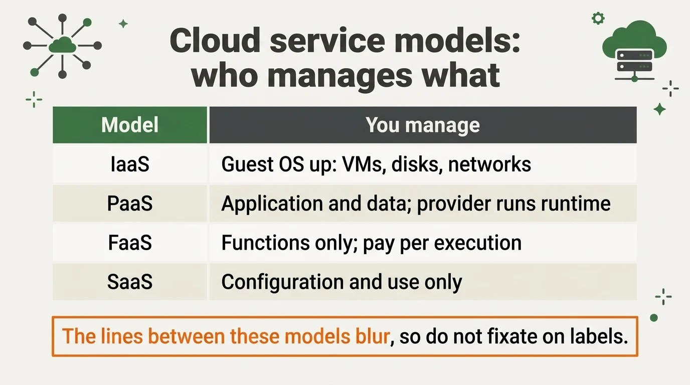
*Figure 2.32.V. The less the provider runs for you, the more of the stack you are responsible for.*


The service models differ in how much you manage yourself. The less the provider runs for you, the more of the stack you are responsible for.

| Model | You manage | Examples |
|---|---|---|
| **IaaS** | Guest OS up (the provider manages hardware and virtualisation): VMs, disks, VPC networks, load balancers | Compute Engine, EC2, Azure VMs |
| **PaaS** | Application and data (the provider manages runtime and OS): managed databases, Kubernetes control planes, queues | Cloud SQL, GKE (control plane), App Engine, Elastic Beanstalk |
| **FaaS / serverless** | Functions only; scale to zero; pay per execution | Cloud Functions/Run, Lambda |
| **SaaS** | Nothing but configuration/use | Workspace, Office365, Salesforce |

The lines between these models blur, so do not fixate on the labels.

Deployment models describe where the infrastructure lives. A public cloud is infrastructure owned by a third party, such as AWS, Azure or GCP. A private cloud runs cloud software on your own hardware, using OpenStack, Kubernetes platforms or VMware. A hybrid setup splits workloads across private and public clouds, joined by a network interconnect. Multicloud means using more than one public provider.

APIs sit at the centre of all of this. Cloud resources, network resources included, are created and changed through APIs, usually with infrastructure as code such as Terraform, Pulumi, Deployment Manager or CloudFormation. That makes programming and automation part of the network engineer's job. This is where chapters 2.28 and 2.29 come in.

## 2. Business drivers and trade-offs

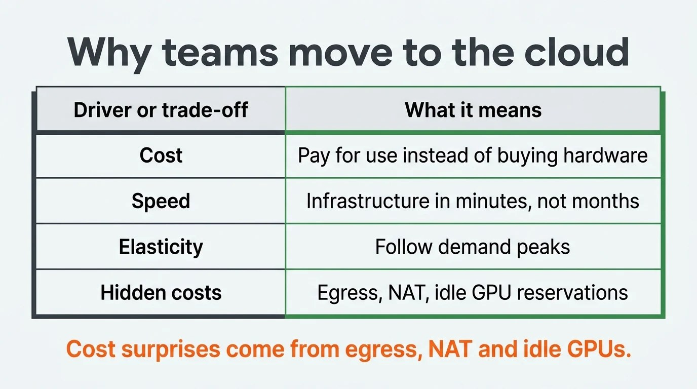
*Figure 2.32.V. Cloud saves on hardware, but egress and idle GPUs can cost more than expected.*


### Drivers

Renting infrastructure changes where the money goes. Instead of buying switches, servers and facilities, you pay for what you use. That moves spending from CAPEX to OPEX. The benefit is said to come from the economies of scale hyperscalers enjoy: bulk purchasing, white-box hardware and deep engineering teams. A second benefit is that you need fewer in-house operational skills for the commodity layers.

Speed is the other driver. Infrastructure arrives in minutes instead of weeks or months. Elasticity lets you follow demand peaks, such as retail seasons or training runs, rather than permanently over-provisioning for the peak. Permanent over-provisioning wastes money in quiet periods. Under-provisioning loses business when demand outstrips capacity.

### Trade-offs

The trade-offs are where teams get surprised, so read this part carefully.

Moving to the cloud does not remove the need for infrastructure design. SLAs still imply resiliency across zones and regions, capacity sizing, a security policy for each flow, inter-cloud connections, and data replication with routing and possibly address translation. Flipping a light switch needs no knowledge of the wiring behind it, until the lights stop working.

Experts are still needed when things break. Complex failures, such as asymmetric routing in hybrid paths, peering transitivity problems or MTU mismatches over VPN, need deep networking skills.

Reaching the cloud costs real money. Circuits, QoS, landing zones, egress fees and cross-region transfer all add up. Moving petabytes of training data is neither instant nor free.

Specialised hardware may be unavailable, or packaged differently. Cloud theory treats resources as generic. Workloads that rely on specific NICs, RDMA fabrics, large-buffer switches or particular middleboxes must be adapted, or they must use special instance types.

Feature creep adds failure risk. Every enabled feature is code that interacts with other features, so an unused feature is not harmless just because nobody calls it.

On the business side, applications built for traditional infrastructure often need redesign. They may need statelessness, autoscaling, managed services, new CI/CD and observability. A lift and shift copies the old architecture onto rented hardware. You keep the old costs without the benefits, which is like forcing a square peg into a round hole.

Your goal and the provider's goal differ. You want to deliver your product. The provider wants to maximise your consumption at a high margin, and it adds proprietary features that deepen vendor lock-in. Weigh portability through Kubernetes, Terraform modules and open standards, along with your exit costs. Vendors have always differentiated their delivery models in networking, and cloud deepens that problem.

Cost surprises come from egress, inter-AZ traffic, NAT gateway processing, load balancer hours, idle GPU reservations, unattached IPs and logs. Watch these from the first day.

## 3. Technical challenges of cloud networking

Seven challenges come up again and again in cloud networking. Each one changes how you design, so take them in turn.

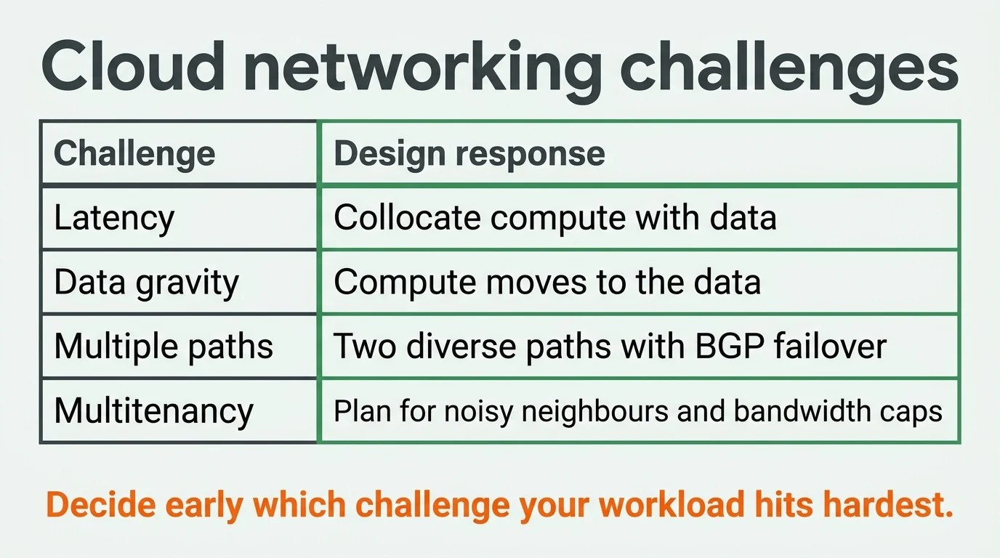
*Figure 2.32.V. Each cloud networking challenge changes the design, so choose the one that bites first.*


1. Latency comes down to physics and path. The distance to the nearest region or zone matters, and so does the route your traffic takes, whether it crosses the public Internet or the provider's private backbone. Both affect interactive and chatty workloads most. Collocate compute with data, use regional or global load balancing and CDNs for users, and measure with probes (chapter 2.31).

2. Populating remote storage means moving bulk data into the cloud. The initial dataset, replicas and checkpoints are limited by link capacity, the TCP window and the bandwidth-delay product (BDP, covered in chapter 2.6 as long fat pipes), parallelism and egress charges. Parallel transfer tools help, such as `gsutil` or `rclone` with many streams, Storage Transfer Service, or Transfer Appliance for petabytes. Compress and deduplicate the data, schedule transfers off-peak, and keep later syncs incremental.

3. Data gravity means data attracts applications. Large datasets are costly and slow to move, so compute tends to move to the data. The cloud that holds the data tends to win future workloads. For AI, place training near the dataset's home region, replicate selectively, and avoid designs that pull terabytes across regions or clouds again and again.

4. Choosing among multiple paths to the public cloud is a trade. The Internet is cheap and variable, and it usually carries a VPN overlay. Dedicated private connectivity comes as Direct Connect, Dedicated or Partner Interconnect, or ExpressRoute. Cloud exchange fabrics, colocation and SD-WAN are further options. Choose by bandwidth, latency, SLA, security, cost and resilience. A good design uses two diverse paths with BGP failover and SRLG awareness, which means knowing which links share a single point of failure.

5. Security in the cloud has several parts. Protecting data over public transport uses IPsec or WireGuard VPNs, TLS, MACsec on dedicated links, and HA VPN over Interconnect. Managing secure connections means handling the key lifecycle, certificates and tunnel monitoring. The shared responsibility model splits the work: the provider secures the cloud, and you secure what you put in it, which means identity, configuration and data. Add least-privilege IAM, private access paths so traffic to cloud services stays off the Internet, and firewalls at several layers.

6. The multitenant cloud means you share physical hardware with other tenants. Virtualisation and overlays provide the isolation, but noisy neighbours still matter. Network bandwidth caps per VM and burst limits can slow you down. Tenancy models, including sole-tenant nodes, are another choice to review. Role-based access control (RBAC) on cloud resources decides who can change firewall rules, routes and peering. Organisation policies and guard-rails add a second layer on top.

7. Monitoring cloud networks is harder because you do not own the devices. You rely on provider telemetry, such as flow logs, firewall logs, connectivity tests, load balancer logs, and VPN or Interconnect metrics. Add your own probes and host metrics, and send everything into your monitoring platform (chapter 2.31).

Decide early which of these seven challenges your workload hits hardest, because that choice shapes the rest of the design.

## 4. AWS and Azure in one table

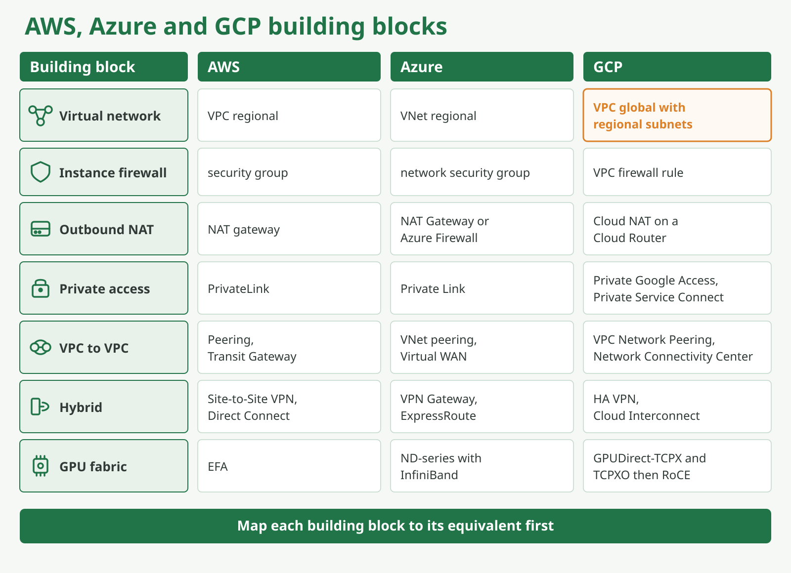

*Figure 2.32.1. Each cloud has an equivalent for every networking building block, with different names.*

Even if your platform is GCP, interviews and multicloud work will ask about AWS and Azure. The table maps each building block to its equivalent, so you can read a design from any of the three clouds.

| Building block | AWS | Azure | GCP |
|---|---|---|---|
| Virtual network | VPC, regional, subnets live in one AZ | VNet, regional | VPC, global, subnets are regional |
| Instance firewall | Security group: stateful, allow-only, per ENI | Network security group: stateful, priority-ordered allow or deny | VPC firewall rule: stateful, global, by tag or service account |
| Subnet firewall | Network ACL: stateless, ordered | NSG on a subnet | Hierarchical and network firewall policies |
| Outbound NAT | NAT gateway, per AZ | NAT Gateway or Azure Firewall | Cloud NAT on a Cloud Router |
| Private access to services | Gateway and interface endpoints, PrivateLink | Private Link | Private Google Access, Private Service Connect |
| VPC to VPC | Peering (non-transitive), Transit Gateway | VNet peering, Virtual WAN | VPC Network Peering (non-transitive), Network Connectivity Center |
| Hybrid links | Site-to-Site VPN, Direct Connect | VPN Gateway, ExpressRoute | HA VPN, Cloud Interconnect |
| Load balancing | Application, Network and Gateway load balancers | Load Balancer, Application Gateway, Front Door | Application and Network load balancers |
| Kubernetes | EKS with the VPC CNI, one VPC IP per pod through ENIs | AKS with Azure CNI or an overlay | GKE VPC-native, alias IPs |
| GPU fabric | EFA, an OS-bypass transport built on the SRD protocol | ND-series VMs with InfiniBand and SR-IOV | GPUDirect-TCPX and TCPXO, then RoCE |

Three AWS details are worth remembering. The instance attachment point is the Elastic Network Interface, which has a source and destination check flag that you turn off for NAT and routers. The per-instance-type ENI limits, and prefix delegation, set how many pods a node can hold under the VPC CNI. Cluster placement groups keep instances close together for EFA.

When you move a design from one cloud to another, map each building block to its equivalent first.

## 5. GCP networking in depth

### Global resources and the VPC model

Google Cloud differs from other providers in one important way. Many of its networking resources are global, so one design can span several regions without extra plumbing. The diagram below shows the shape. One global VPC spans two regions, and the on-premises data centre connects to it.

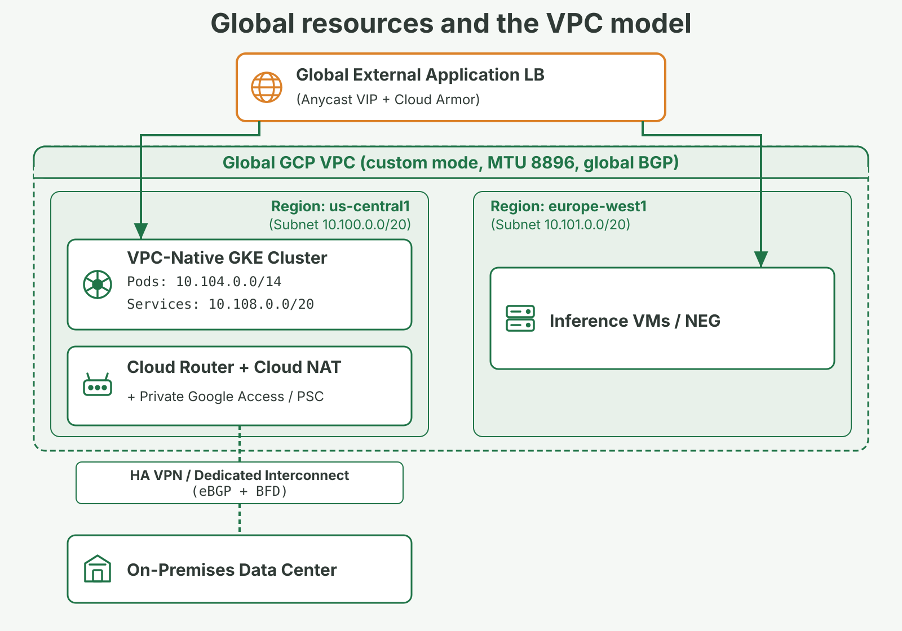

*Figure 2.32.2. Global resources and the VPC model, as a diagram.*

A VPC network is a global resource. It is not tied to a region or a zone, and it lives in a project. The VPC contains regional subnets. Instances in different regions of the same VPC talk over Google's private backbone, using their internal IPs, with no peering needed. A project can hold several VPC networks, and Shared VPC and VPC Network Peering connect them.

Subnets are regional. Each has a primary IPv4 range, and it can have secondary ranges. GKE uses those secondary ranges for pods and services. A subnet can be IPv4 or dual-stack, and it can grow but never shrink. Subnet ranges can use any RFC 1918 space, and some other ranges too. Overlapping ranges, however, block peering and VPN routing.

Auto mode networks create one subnet per region from a predefined block. Custom mode networks start empty, so you control every range. Use custom mode for production. The default network is auto mode with permissive default firewall rules. Its ranges overlap with other projects' defaults, which blocks peering, so delete it or avoid it.

Firewall rules belong to the VPC, are global and are stateful. They target instances by network tags or, preferably, by service accounts. Each rule has a priority from `0` to `65535`, where lower numbers are checked first. It also has a direction, an allow or deny action, protocols and ports, and source or destination ranges. Two implied rules sit at the lowest priority: allow all egress, and deny all ingress. Hierarchical firewall policies set rules at the organisation or folder level. Network firewall policies add FQDN, geo, threat-intelligence and address-group objects. Cloud NGFW adds L7 inspection.

Routes come from several sources. System-generated subnet routes exist, plus a default route to the internet gateway. You add custom static routes with next hops at an instance, an internal load balancer (ILB), a VPN tunnel or a gateway. Cloud Router learns dynamic routes over BGP, in regional or global dynamic routing mode. Policy-based routes and peering route exchange, with custom routes optional, complete the picture.

Internal IPs are assigned automatically or reserved. External IPs are ephemeral or static, and they are regional or global. Most VMs should have no external IP.

MTU is the largest packet a link carries. The VPC default is 1460 bytes, and you can set any value from 1300 to 8896 per network. Every VM, tunnel and peer must agree. Cloud VPN does not support jumbo frames, and its payload MTU is lower than the gateway MTU because of the encapsulation, so read the Cloud VPN MTU considerations page for the exact figure. Interconnect VLAN attachments have their own MTU settings. Google recommends one MTU for all attachments on a VPC and the same value on the VPC itself. A mismatch is the classic cause of "small works, large hangs."

Network service tiers come in two kinds. Premium keeps traffic on Google's backbone until it reaches the edge nearest the user, and it supports global load balancing. Standard is regional, and its traffic reaches the Internet by hot-potato routing: it leaves Google's network at the first opportunity. It costs less.

Here is the setup as commands. Run them in order: the VPC first, then the subnet with its GKE ranges, then the firewall rules.

```bash
# Custom-mode VPC with regional subnets, secondary ranges for GKE, private Google access
gcloud compute networks create ai-vpc --subnet-mode=custom --mtu=8896 --bgp-routing-mode=global
gcloud compute networks subnets create train-us-central1 --network=ai-vpc --region=us-central1 --range=10.100.0.0/20 \
    --secondary-range=pods=10.104.0.0/14,services=10.108.0.0/20 --enable-private-ip-google-access --enable-flow-logs
gcloud compute firewall-rules create allow-internal --network=ai-vpc --allow=tcp,udp,icmp --source-ranges=10.100.0.0/16
gcloud compute firewall-rules create allow-iap-ssh --network=ai-vpc --allow=tcp:22 --source-ranges=35.235.240.0/20     # IAP TCP forwarding
gcloud compute networks subnets list --network=ai-vpc ; gcloud compute routes list --filter="network:ai-vpc"
```

The subnet command enables Private Google Access and flow logs in the same step, so you do not need a second pass for them.

### Outbound access: Cloud NAT and Private Google Access

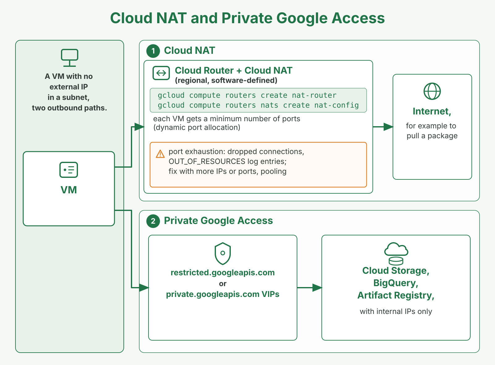

*Figure 2.32.3. Cloud NAT gives private VMs Internet egress, while Private Google Access reaches Google APIs over internal IPs.*

A training VM with no external IP still sometimes needs the Internet, for example to pull a package. Cloud NAT and Private Google Access solve two different versions of that problem.

Cloud NAT is a regional, software-defined service attached to a Cloud Router. It gives VMs without external IPs outbound Internet access. Each VM gets a minimum number of ports, through dynamic port allocation. You can use static or auto-allocated external IPs. Logging records translations and errors, and the mapping is endpoint-independent.

Port exhaustion is the failure to watch for. It shows up as dropped connections and `OUT_OF_RESOURCES` log entries. Fix it with more IPs or ports, with pooling, and with Private Google Access or Private Service Connect for Google APIs.

Private Google Access lets VMs with only internal IPs reach Google APIs and services, such as Cloud Storage, BigQuery and Artifact Registry. It works through special routes, the `restricted.googleapis.com` and `private.googleapis.com` VIPs, plus DNS configuration. Private Service Connect exposes a service, whether a Google API, a partner service or your own, through an internal endpoint in your VPC with its own IP. Private Services Access connects managed services such as Cloud SQL and Filestore through VPC peering.

The NAT setup takes two steps: create a router, then attach the NAT to it.

```bash
gcloud compute routers create nat-router --network=ai-vpc --region=us-central1
gcloud compute routers nats create nat-config --router=nat-router --region=us-central1 --nat-all-subnet-ip-ranges --auto-allocate-nat-external-ips \
    --enable-dynamic-port-allocation --min-ports-per-vm=64 --enable-logging
```

The `--enable-logging` flag is what gives you the NAT logs you will read in the lab.

### Connecting networks

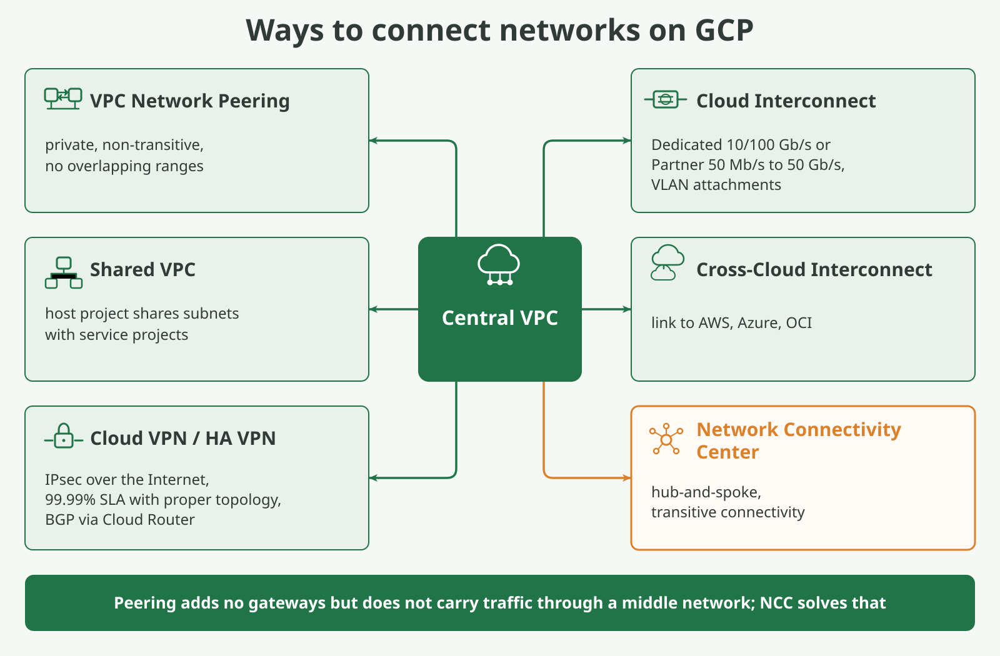

*Figure 2.32.4. Each option trades bandwidth, isolation and transitivity, and NCC is the hub that provides transitive connectivity.*

When one VPC is not enough, you connect networks. The right option depends on the bandwidth you need, how isolated the networks must be, and whether the traffic can cross the Internet.

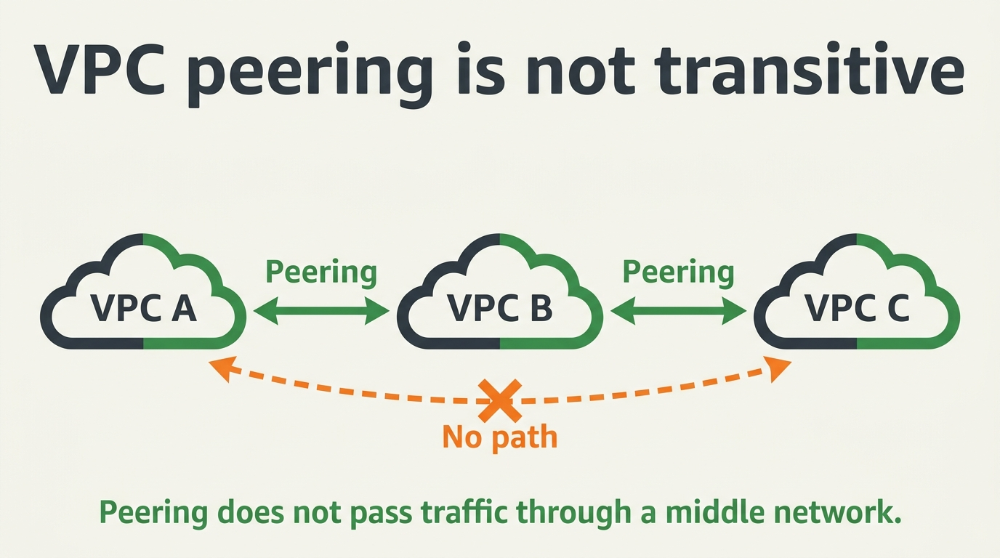

*Figure 2.32.5. A and C cannot reach each other through B.*

| Option | What it is | Notes |
|---|---|---|
| **VPC Network Peering** | Private connectivity between two VPC networks (same or different projects/orgs); non-transitive; no overlapping ranges; exchange of subnet routes (and optionally custom routes) | Low latency, no extra gateways; quota limits; no transitive routing (use NCC or hub VPC) |
| **Shared VPC** | A host project shares subnets with service projects; centralised network admin | Standard for enterprises; IAM per subnet |
| **Cloud VPN (HA VPN)** | IPsec over the Internet with two interfaces, 99.99% SLA with proper topology; BGP via Cloud Router | Per-tunnel bandwidth limits (~3 Gb/s; scale with multiple tunnels/ECMP); MTU constraints |
| **Cloud Interconnect** | Dedicated (10/100 Gb/s ports at colocation facilities) or Partner (50 Mb/s to 50 Gb/s via a provider) private connectivity with VLAN attachments and Cloud Router/BGP; optional HA VPN over Interconnect for IPsec/MACsec | Highest bandwidth/lowest latency; 99.9% / 99.99% SLA topologies need redundant interconnects in two metros; MTU up to 8896 on some attachments |
| **Cross-Cloud Interconnect** | Dedicated link to another cloud (AWS/Azure/OCI) | Multicloud |
| **Network Connectivity Center (NCC)** | Hub-and-spoke control plane: VPN/Interconnect/router appliance/VPC spokes with transitive connectivity, site-to-site data transfer | Route management across sites |
| **Router appliances / SD-WAN** | Third-party NVAs peering with Cloud Router | Special needs |

Peering is quick to set up and adds no extra gateways, but it does not carry traffic through a middle network. NCC is the option that solves that.

Hybrid routing is where most of the detail sits. On-prem routers peer with Cloud Router using eBGP. The on-prem side uses a private ASN. Google's side uses ASN `16550` for Partner, and the Cloud Router ASN is configurable in the ranges `64512` to `65534` or `4200000000` and up. Advertise on-prem prefixes into the cloud, where they appear as dynamic routes, and advertise VPC subnets back, with custom advertisements allowed. Use MED or AS-path to set primary and backup paths, and use BFD for fast failover. Keep paths symmetric, and place stateful firewalls with care. Overlapping addresses between clouds and sites cause trouble, so plan one address plan (chapter 2.4).

### DNS

Hybrid DNS is usually the first cloud networking pain point you meet. Cloud DNS offers managed public and private zones, forwarding zones to on-prem resolvers, peering zones, response policies, DNSSEC and inbound forwarding endpoints. Compute Engine VMs use the metadata server resolver at `169.254.169.254`. Their internal names follow `VM.ZONE.c.PROJECT.internal` for zonal DNS, or they use global DNS. Define forwarding in both directions, and avoid loops (chapter 2.8).

### Load balancing

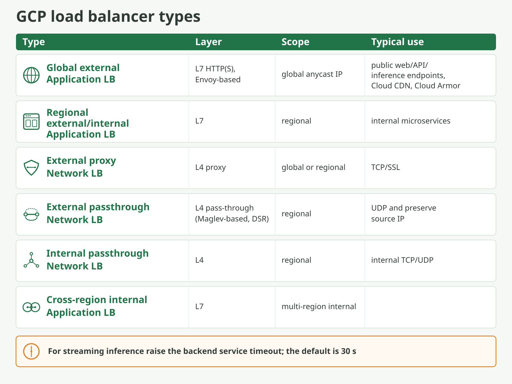

*Figure 2.32.6. GCP load balancers differ by layer and scope, from global L7 to regional L4 passthrough.*

Users reach your service through one address, and the load balancer picks a healthy backend. GCP offers several types, and each fits a different layer and scope.

| Type | Layer | Scope | Typical use |
|---|---|---|---|
| **Global external Application Load Balancer** | L7 HTTP(S), Envoy-based, Premium tier | Global anycast IP | Public web/API/inference endpoints, multi-region backends, Cloud CDN, Cloud Armor (WAF/DDoS), IAP |
| **Regional external/internal Application LB** | L7 | Regional | Internal microservices, regional endpoints |
| **External proxy Network LB** (TCP/SSL proxy) | L4 proxy | Global/regional | TCP/SSL services with global anycast |
| **External passthrough Network LB** | L4 pass-through (Maglev-based, DSR) | Regional | UDP, non-HTTP, preserve source IP |
| **Internal passthrough Network LB** | L4 pass-through | Regional | Internal TCP/UDP services, next hop for routes |
| **Cross-region internal Application LB** | L7 | Multi-region internal | Internal multi-region apps |

Every type shares the same building blocks. These are health checks, backend services and NEGs, URL maps, session affinity, connection draining, outlier detection, traffic management through Envoy config, capacity scaling, and logging. Health checks come from Google's probers, so your firewall rules must allow the ranges `35.191.0.0/16` and `130.211.0.0/22`. Backends can be zonal, serverless, internet, hybrid or container-native pod NEGs for GKE.

For AI inference, a few settings matter most. Use a global ALB with serverless or pod NEGs for GKE services, and use the GKE Gateway API with `gke-l7-global-external-managed`. Raise the backend service timeout for streaming, since its default is 30 s. Use HTTP/2 end to end for gRPC, and add Cloud Armor rate limiting (chapter 2.20). For streaming inference, check the backend timeout before anything else.

### Observability and troubleshooting

When a packet disappears on GCP, you cannot walk to a switch and read its port. You use logs and analysis tools instead.

Several logs tell you what happened. VPC Flow Logs record sampled flow data per subnet. Firewall Rules Logging shows hit counts and allow or deny decisions. Cloud NAT logs and load balancer logs add their own views. Packet Mirroring copies traffic to collector instances behind an internal LB, for IDS and forensics. Network Intelligence Center adds Connectivity Tests, which analyse paths statically to find the rule or route that blocks them. It also offers Network Topology, a Performance Dashboard for latency and packet loss between zones, Firewall Insights and Network Analyzer.

Use these commands to check each layer:

- `gcloud compute instances network-interfaces ...` shows the effective routes and firewall rules on a VM. The console's "Network analysis" view does the same job.
- `gcloud compute networks subnets describe` shows the subnet.
- `gcloud compute routers get-status` shows the router state.
- `gcloud compute vpn-tunnels describe` and `gcloud compute interconnects attachments describe` show the VPN and Interconnect side.
- IAM permissions such as `compute.networkAdmin` and `compute.securityAdmin` decide who can make these changes.
- `gcloud compute project-info describe` shows quotas, and organisation policies complete the picture.

A connectivity test answers the question for you: will this packet get through, and if not, which rule stops it?

```bash
gcloud network-management connectivity-tests create t1 --source-instance=projects/P/zones/us-central1-a/instances/vm-a \
    --destination-instance=projects/P/zones/us-central1-b/instances/vm-b --protocol=TCP --destination-port=443
gcloud network-management connectivity-tests describe t1          # shows reachable/unreachable with the blocking firewall/route
gcloud logging read 'resource.type="gce_subnetwork" AND logName:"vpc_flows"' --limit=5 --format=json
```

Run the test again after each rule change, because the output names the blocking firewall or route. Turn on flow logs and firewall logging for the subnets you care about before an incident starts.

## 6. GKE and Kubernetes networking on GCP

The ranges you choose for a GKE cluster on day one decide how far the cluster can grow. Pod range sizing limits the cluster's size and node count, so plan generously.

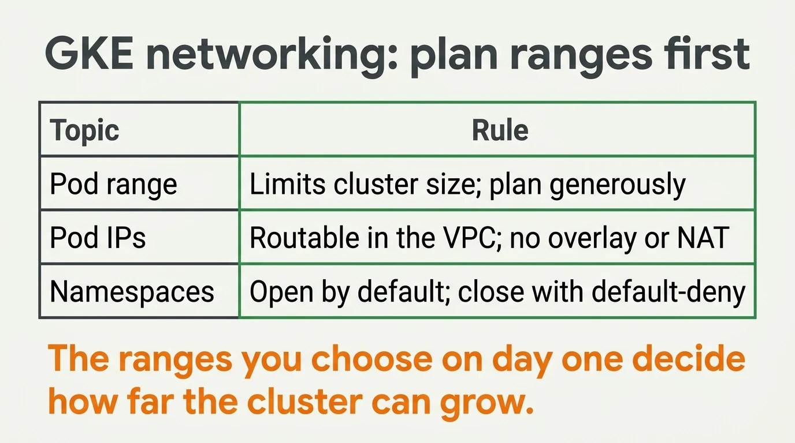
*Figure 2.32.V. Range sizing on GKE is a day-one decision that is hard to reverse later.*


VPC-native clusters, which use alias IPs, are the standard. Nodes take IPs from the subnet's primary range. Pods take IPs from a secondary range, and each node gets a `/24` from that range by default, which you can tune with the maximum pods per node. Services (ClusterIPs) come from another secondary range. Pod IPs are routable inside the VPC and in peered networks. There is no overlay and no NAT inside the VPC, so pods work with VPC firewall rules and flow logs. Pods appear on-prem only if you advertise the pod range through Cloud Router with a custom advertisement. Keep the ranges non-overlapping with on-prem.

Dataplane V2 (Cilium/eBPF) enforces NetworkPolicy and logs it. It also gives better observability, with Hubble-like views, and it can replace kube-proxy. Calico is the other option for NetworkPolicy enforcement. Private mode removes public IPs from the nodes, which become private nodes. It can also restrict the control plane endpoint, through authorised networks or a private endpoint. Outbound traffic then goes through Cloud NAT.

Services come in several types. `ClusterIP`, `NodePort` and `LoadBalancer` are the common ones, and `LoadBalancer` uses an external or internal passthrough NLB. Container-native load balancing with NEGs sends traffic straight to pod IPs. That skips an extra hop and the kube-proxy double NAT, and it gives more accurate health checks. GKE Gateway (Gateway API) and Ingress provision global or regional Application LBs. `BackendConfig` and `GCPBackendPolicy` set timeouts, affinity and Cloud Armor.

For DNS, GKE uses kube-dns or Cloud DNS. NodeLocal DNSCache reduces latency and conntrack issues (chapter 2.8).

Multi-network pods let a pod attach to more than one VPC network, through the `Network` and `GKENetworkParamSet` resources. GPU pods need this to attach the extra VPC interfaces for high-bandwidth GPU networking. The node pools must support multiple networks, and the VM must be configured to match.

Cost follows the traffic. Cross-zone pod traffic is charged between zones, and topology-aware routing and zone-aware scheduling reduce that charge. Egress to the Internet through Cloud NAT is metered.

Namespaces are open by default, so close them with default-deny policies (chapter 2.21).

## 7. Networking for GPU clusters in the cloud

When the GPUs in a job run collectives, the network path decides how fast the job finishes. A single default NIC can leave expensive hardware idle. This section shows how each provider builds that path.

### GCP GPU VM generations

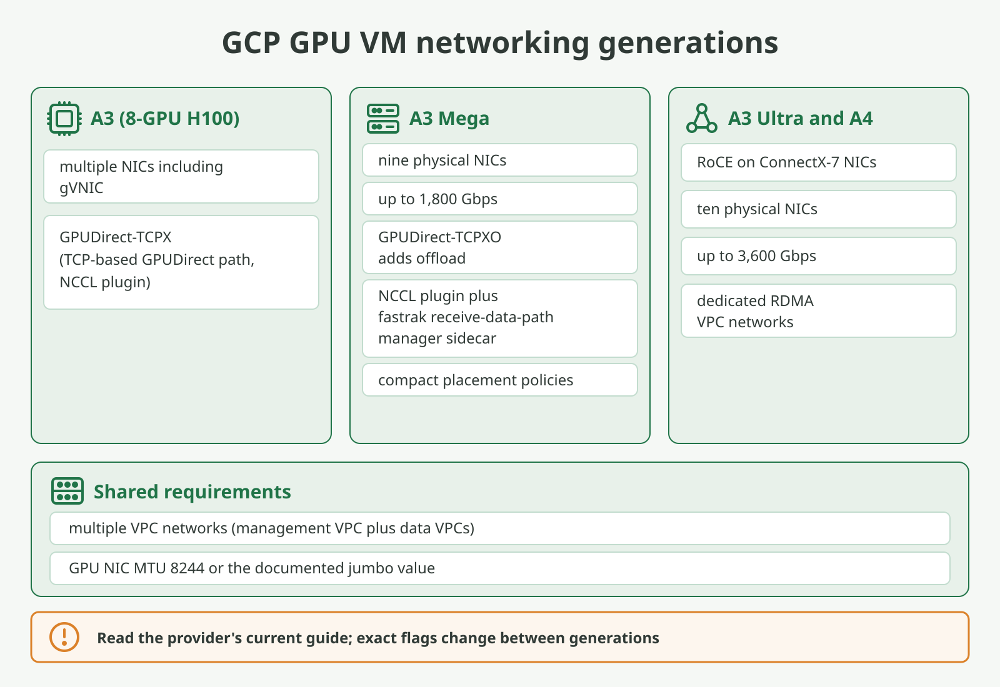

*Figure 2.32.7. Newer GCP GPU VM families move from TCP-based GPUDirect to RoCE with more NICs and bandwidth.*

GCP offers A2 for the A100, A3 for the 8-GPU H100, and newer families such as A3 Mega, A3 Ultra and A4. Each has its own networking design.

A3 uses multiple NICs, including gVNIC, and runs GPUDirect-TCPX. That is a TCP-based GPUDirect path. It lets NCCL move GPU memory to the NIC over Ethernet, without staging it in host memory. It works through an NCCL plugin and receive-data-path offloads. The GPU NICs sit on dedicated VPC networks, one VPC per GPU NIC. The A3 High machine type has five physical NICs and up to 1,000 Gbps of network bandwidth.

A3 Mega goes further, with nine physical NICs and up to 1,800 Gbps. It uses GPUDirect-TCPXO, which adds offload. That needs an NCCL plugin and a `fastrak` receive-data-path manager sidecar. It also uses compact placement policies.

Newer generations, such as A3 Ultra and A4, move to RDMA over Converged Ethernet (RoCE) on ConnectX-7 NICs. They have ten physical NICs and up to 3,600 Gbps, and they use dedicated RDMA VPC networks. Check the current documentation for three things: the exact network profile, which for these is the `RDMA` profile, the MTU requirements, and the NCCL plugin and driver versions you need.

These generations share a set of requirements. They need multiple VPC networks: a management or primary VPC, plus one or more data VPCs. The GPU NICs need an MTU of `8244`, or the documented jumbo value. Firewall rules must allow all traffic between the GPU NIC subnets. Compact placement policies keep the hosts close together for low latency. Set the NCCL environment correctly, with `NCCL_SOCKET_IFNAME` and the plugin variables. Use drivers and images from the provider's HPC or DL images. Managed offerings do much of this for you: GKE with GPU node pools using the `gpudirect-tcpx/tcpxo/rdma` features, Slurm on GCP through Cluster Toolkit, and Vertex AI.

Always read the provider's current guide for creating an AI-optimised cluster, because the exact flags change between generations.

### AWS, Azure, OCI equivalents

AWS uses P4d, P5, P5e and P6 instances with EFA. On P5, the bandwidth reaches 3.2 Tbps. EFA runs on SRD and libfabric, through the `aws-ofi-nccl` plugin. Cluster placement groups and UltraClusters keep the instances together. You run Kubernetes through EKS with the EFA device plugin.

Azure's ND H100 v5 and similar VMs use InfiniBand (NDR) with SR-IOV. A VM scale set (VMSS) sits in one placement, or one IB domain. AKS node pools can use InfiniBand too.

Oracle OCI offers bare-metal GPU instances on RDMA clusters that use RoCE v2, with cluster networks.

Specialist clouds such as CoreWeave, Nebius and Lambda offer bare-metal Kubernetes with InfiniBand or Spectrum-X fabrics. They often give better price-performance for training. You get networking as VPCs plus the RDMA fabric.

### Design guidance

Ten rules cover most of the choices. Start with the first one, because every later decision depends on the address plan.

1. Make the address plan first. Use non-overlapping CIDRs across clouds, regions, on-prem, and GKE pod and service ranges, and reserve room for growth.
2. Separate the planes. Keep management and control in their own VPC, the data (storage) network in another, and the GPU data networks apart from both. Apply least-privilege firewall rules to each plane.
3. Keep everything private by default. Give VMs no external IPs, and use Cloud NAT for outbound traffic. Use Private Google Access or PSC for APIs. Admin access goes through IAP, a bastion or OS Login, and GKE clusters should be private.
4. Keep data near compute. Keep datasets, checkpoints and training in the same region, and in the same zone where latency matters. Use regional buckets and the backbone, and evaluate the cost of cross-region replication. For sustained hybrid transfer volumes, consider Interconnect, which is cheaper than Internet egress in many cases. Cache or mirror public datasets and models in your own buckets or registries, such as an Artifact Registry mirror. That avoids repeated egress and NAT port pressure.
5. Keep the MTU consistent. Set the VPC MTU the same everywhere, and check it with `ping -M do`. Configure the GKE or CNI pod MTU, and check the VPN and Interconnect MTUs.
6. Plan placement and quotas. Use compact placement for GPU jobs. Request GPU, IP, forwarding-rule and route quotas early, and watch NAT port allocation and subnet exhaustion.
7. Build for resilience. Use multi-zone subnets and managed instance groups. Run two Interconnect attachments in different metros, with BGP and BFD. Use regional or global load balancers, avoid single NAT or gateway chokepoints, and test failover.
8. Lock down security. Give network admin roles least privilege, and enforce organisation policies. Disable the default network, restrict external IPs, and enforce VPC SC for sensitive data services. Write firewall rules by service account, and enable and export flow logs and firewall logging. Put Cloud Armor in front of public endpoints, and add DDoS protection.
9. Make the network observable. Set flow-log sample rates, and run Connectivity Tests in CI after network changes. Run probes between zones, regions and on-prem, and build dashboards for NAT, VPN, Interconnect and LB metrics. Feed them into the chapter 2.31 stack.
10. Manage it as code. Write Terraform modules for the VPC, subnets, firewall policy, routers, NAT, VPN or Interconnect, DNS and GKE. Add policy-as-code checks, and make no console-only changes (chapter 2.29 and Part 4).

## 8. Hands-on lab: a small GCP network and failure drills

Start with the Python lab, which you can run for free. It runs on your own machine at zero cloud cost, and it checks the capacity arithmetic and the rules from this chapter. The lab covers three things. First, GKE VPC-native capacity. The `/14` pod range, cut into one `/24` per node, allows `1,024` nodes, and the `/20` Services range holds `4,096` Services. Second, VPC Network Peering non-transitivity and CIDR overlap checks. Third, validation of the load balancer health-check firewall ranges, `35.191.0.0/16` and `130.211.0.0/22`.

```bash
python3 code/part02/cloud_vpc_gke_networking_lab.py
```

Next, move to a dedicated GCP lab project with a budget alert. The interactive `gcloud` commands below were not run against a live project, and each one is billable. Delete all resources at the end. Work through these steps in order, and you will build the network before you break it.

1. Start by creating `lab-vpc` in custom mode, with MTU `1460` and later `8896`. Add two subnets in two regions with secondary ranges. Delete the default network if one is present, and then review the effective routes.
2. Add firewall rules for internal traffic, IAP SSH and health checks. Test them with VMs in each subnet, using `ping` and `iperf3`. Enable firewall logging and read the entries. Then add a deny rule with higher priority, and confirm the result with Connectivity Tests.
3. Create VMs with no external IPs, and show that outbound access fails. Add Cloud Router and Cloud NAT, then test again. To exhaust ports, open many connections to one destination with `ab` or `hey`, and read the NAT logs. Finish by using Private Google Access to reach Cloud Storage without NAT.
4. Create a second VPC, `lab-vpc-b`, with non-overlapping ranges. Peer the two in both directions and test reachability. Then show non-transitivity with a third VPC, and add custom route exchange.
5. Connect `lab-vpc` to a second VPC, or to a simulated on-prem network built from a StrongSwan VM, using HA VPN and Cloud Router BGP. This step is optional and billable. Watch the BGP routes and the MTU effects, then test failover by shutting down one tunnel.
6. Build a managed instance group with a simple HTTP service. Put it behind an internal passthrough LB and a global external Application LB. Test the health checks, which need firewall rules for the Google ranges, and test session affinity. Stop one backend to test failover, and use a slow endpoint to test timeouts.
7. Optionally, create a small VPC-native private cluster with Cloud NAT. Inspect the pod CIDR allocation, then create a Service of type `LoadBalancer` and a Gateway. Apply a default-deny NetworkPolicy, use NodeLocal DNSCache, and test container-native LB.
8. Turn on VPC flow logs for a subnet, and query them in Logging or BigQuery. Run Connectivity Tests before and after a rule change. Build a simple dashboard of NAT allocation and LB latency.
9. Estimate the egress cost of moving 50 TB cross-region and to the Internet. Compare that with the Interconnect and transfer appliance options.
10. Turn steps 1 to 4 into a Terraform module, and include the `plan` output in a pull request.
11. Clean up in dependency order: load balancers first, then NAT and routers, then VMs, peering, subnets and VPCs. Verify that no leftover static IPs or forwarding rules remain.

## 9. Common mistakes

The mistakes below come up often enough to be worth a checklist.

- Using the default network brings overlapping ranges and permissive rules. Overlapping CIDRs can block peering or VPN.
- You may assume VPC peering is transitive, which is a mistake. Forgetting route and firewall changes on both sides is another.
- Giving every VM an external IP, or having no NAT or private access strategy, leads to NAT port exhaustion.
- Forgetting the health-check firewall rules for load balancers is common. So is using short backend timeouts for streaming inference.
- MTU mismatches across VPN, Interconnect or GKE are a common trap. Assuming jumbo frames work end to end is another.
- Ignoring egress and inter-zone costs in architecture decisions.
- Relying on a single Interconnect or VPN with no redundancy, no BFD, or asymmetric routing through stateful firewalls.
- Undersized GKE pod ranges, no default-deny policies, or unmonitored quotas.
- Running GPU clusters on a single default VPC or NIC, then wondering why NCCL is slow. Missing placement policies and plugins cause the same problem.

Check your current design against this list before the next change goes out.

## 10. Interview angles

These questions test whether you can reason about a design, not just recite product names. Answer each one in two or three sentences before you look at the chapter again.

- Design the network for an AI platform that spans GCP and an on-prem data centre.
- Explain GCP's global VPC, and how it differs from AWS's regional VPC.
- Compare VPC peering, Shared VPC, Network Connectivity Center and Private Service Connect.
- How do VMs without public IPs reach the Internet and Google APIs?
- How would you connect on-prem to GCP with 99.99% availability?
- What is data gravity, and how does it affect where you train?
- Pods cannot reach an on-prem database. Where do you look? Check route advertisement, firewall rules, address ranges, NAT and MTU.
- How do GPU VMs get high-bandwidth networking in the cloud? Think about multi-NIC designs, GPUDirect-TCPX or RDMA, EFA and placement.
- What are the main cloud networking cost traps?

## Exercises

1. Your team plans to copy a 500 TB training dataset to a second cloud every week. Explain why this is an architectural anti-pattern, and define data gravity in your answer.
2. A colleague knows AWS and must now build on GCP. List three differences between a GCP global VPC and an AWS VPC that will surprise them.
3. VPC A peers with VPC B, and VPC B peers with VPC C. Use `evaluate_vpc_peering_reachability()` in `code/part02/cloud_vpc_gke_networking.py` to show that A cannot reach C through B. Then name the option you would use instead if A, B and C all need to talk.
4. Design a hybrid link between an on-prem data centre and GCP that meets a 99.99% availability target. Say which connection type you would choose, and which routing and failure-detection protocols run over it.
5. Use `plan_gke_vpc_native_capacity("10.100.0.0/20", "10.104.0.0/14", "10.108.0.0/20", 24)` to find the maximum number of nodes and Services. The answer is 1,024 nodes and 4,096 Services. Then explain which of the three ranges sets each limit.
6. A GKE Pod cannot reach an on-prem database, although the node VMs can. Explain why, and say what you would advertise from Cloud Router to fix it. The Pod secondary range is `10.104.0.0/14`.
7. Backend VMs behind a load balancer show as unhealthy. Use `check_gcp_lb_health_check_firewall()` to explain why every backend must allow ingress from `35.191.0.0/16` and `130.211.0.0/22`.
8. Choose between the Global External Application Load Balancer and the Regional Passthrough Network Load Balancer for a gRPC API that needs Cloud Armor. Explain how Container-Native Load Balancing with NEGs changes the path to the Pod.
9. Compare how GCP, AWS and Azure give a GPU VM its high-speed network. Name the technology each cloud uses, such as GPUDirect-TCPX on GCP, EFA on AWS and InfiniBand on Azure. Then say why the GCP designs ask for compact placement.

Start with exercise 5 if you want the arithmetic before the design questions. Write your answers as you go, so you can check them against the chapter.

## Checkpoint questions (20)

<details>
<summary>1. Compare IaaS, PaaS, FaaS and SaaS, and explain the Cloud Shared Responsibility Model.</summary>

IaaS, such as Compute Engine or EC2, means the provider manages the physical data centres, switches, servers and hypervisors. You manage the guest OS, the runtime, the applications, the data and the virtual network configuration: the VPC, firewall rules, routes and IAM.

PaaS, such as the GKE control plane or Cloud SQL, means the provider manages the OS and the service runtime.

FaaS, also called serverless, covers Cloud Run/Functions and Lambda. The provider runs event-driven functions that scale to zero.

SaaS means the provider manages the complete application.

Under the Shared Responsibility Model, the provider secures the cloud itself, including physical security, the hypervisor and the underlay fabric. You are 100% responsible for securing what you configure in the cloud. That covers firewall rules, IAM and RBAC, encryption keys, private endpoints, and OS and container patching.
</details>

<details>
<summary>2. Why does lift and shift often disappoint financially and operationally, and what are the five operational trade-offs of cloud networking?</summary>

Lift and shift copies legacy, stateful, monolithic architectures onto rented VMs. It does not adopt autoscaling, ephemeral instances or cloud-native storage. You pay high OPEX rental premiums, and you keep all the old operational pain.

The five operational trade-offs are these. First, infrastructure design is still required, for multi-AZ and multi-region resilience, CIDR planning and security policy. Second, deep networking experts are still needed when complex hybrid or overlay faults occur. Third, reaching the cloud costs real money, in egress fees, Interconnect circuits and NAT processing. Fourth, specialised hardware, such as custom RDMA or switch features, is either abstracted away or restricted to specific SKUs. Fifth, feature creep increases the number of interaction surfaces.
</details>

<details>
<summary>3. Define data gravity and explain how it dictates AI training and checkpoint architecture in the cloud.</summary>

Data gravity is the principle that datasets grow heavy. At hundreds of terabytes or petabytes, they are too slow to move, because WAN bandwidth and TCP BDP limit the speed. They are also too expensive, because cloud egress charges run `$0.02–$0.12/GB`. So compute must move to the data's home region.

For AI, place GPU training pools in the same cloud region and zone as your object-store dataset and checkpoint buckets. Mirror container registries (`Artifact Registry`) and Hugging Face weights locally, in the same region. Replicate only the final, distilled checkpoints across regions.
</details>

<details>
<summary>4. How does GCP's VPC scope differ from AWS's VPC and Azure's VNet?</summary>

In AWS and Azure, a VPC or VNet is regional, and each subnet is zonal. A subnet is pinned to a single Availability Zone (AZ), such as `us-east-1a`.

In Google Cloud, a VPC network is a global resource, and subnets are regional. A single subnet, `10.100.0.0/20` in `us-central1`, spans every zone in the region automatically, `us-central1-a/b/c/f`.

For example, two VMs, one in `us-central1` and one in `europe-west1`, inside the same GCP VPC can talk directly over their private RFC 1918 IPs. They use Google's global private backbone, so no VPC peering or transit gateway is needed.
</details>

<details>
<summary>5. Why should you delete or never use the default auto-mode VPC network in production GCP projects?</summary>

Every GCP project's default network is an auto-mode VPC. It creates one `/20` subnet in every region, all taken from the same hardcoded `10.128.0.0/9` block. It also includes permissive default firewall rules, such as `default-allow-internal` and `default-allow-ssh` from `0.0.0.0/0`.

Because every project's default network uses identical IPv4 ranges, two default VPCs can never be connected through VPC Peering or VPN, due to overlapping CIDRs. Always use custom-mode VPCs, with `--subnet-mode=custom` and a centrally planned, non-overlapping CIDR table.
</details>

<details>
<summary>6. How do AWS Security Groups and NACLs compare with GCP VPC firewall rules and policies?</summary>

AWS combines Security Groups with Network ACLs (NACLs). Security Groups are stateful and allow-only, and they attach to ENIs or instances. NACLs are stateless numbered allow and deny rules, attached to subnets.

GCP uses VPC firewall rules, plus hierarchical or network firewall policies. They are global and stateful. They support both `ALLOW` and `DENY` actions, with priorities from `0` to `65535`. They target VMs across the whole VPC, by network tags, or by IAM service accounts, which are cryptographically verified and preferred. Every GCP VPC has two implied rules at the lowest priority, `65535`. One allows all egress to `0.0.0.0/0`. The other denies all ingress from `0.0.0.0/0`.
</details>

<details>
<summary>7. How do private GCP VMs with no external IPs get (a) SSH access for administrators, (b) outbound Internet access, and (c) private access to Google APIs such as Cloud Storage and Artifact Registry?</summary>

For admin SSH, use Identity-Aware Proxy (IAP) TCP Forwarding. Run `gcloud compute ssh vm --tunnel-through-iap`, and allow TCP port `22` ingress only from Google's IAP range, `35.235.240.0/20`.

For outbound Internet access, attach a regional Cloud NAT gateway to a Cloud Router, with `--enable-dynamic-port-allocation`.

For Google APIs, without touching Cloud NAT or the Internet, enable Private Google Access on the subnet with `--enable-private-ip-google-access`. It routes `private.googleapis.com` at `199.36.153.8/30`, or `restricted.googleapis.com` at `199.36.153.4/30`. Alternatively, create a Private Service Connect (PSC) internal endpoint IP inside your VPC.
</details>

<details>
<summary>8. Compare VPC Network Peering, Shared VPC, Network Connectivity Center (NCC) and Private Service Connect (PSC).</summary>

VPC Network Peering is direct, non-transitive Layer 3 peering between two non-overlapping VPCs, in the same or different projects or organisations.

Shared VPC has a host project that owns the VPC and shares specific subnets with several service projects. A central network team can manage one VPC, while application teams deploy VMs and GKE clusters into the shared subnets.

NCC is a hub-and-spoke transit framework. It connects VPC spokes, HA VPNs and Interconnect VLAN attachments, with transitive routing.

PSC projects a producer service, such as a Google API, a partner SaaS or a service in another VPC, as one internal `/32` endpoint IP, or as a service attachment, inside the consumer VPC. It works even when the producer and consumer VPCs have overlapping IP ranges.
</details>

<details>
<summary>9. Why is VPC Network Peering non-transitive, and what happens if VPC A peers with VPC B and VPC B peers with VPC C?</summary>

Peering only exchanges routes between directly peered neighbours. Here those are `A <-> B` and `B <-> C`. VPC A does not learn VPC C's routes through VPC B, so packets from A to C are dropped.

To let A and C communicate, you can create a direct `A <-> C` peering. You can also use Network Connectivity Center (NCC) or AWS Transit Gateway, or route through an explicit next-hop NVA or proxy in B.
</details>

<details>
<summary>10. Compare Cloud VPN (HA VPN), Partner Interconnect and Dedicated Interconnect, and state what is required for a 99.99% availability SLA.</summary>

HA VPN is a dual-tunnel IPsec VPN over the public Internet. Each tunnel carries about `~3 Gb/s`, and you scale horizontally with ECMP across several tunnels. It terminates on Cloud Router using eBGP.

Partner Interconnect is a private layer 2 or layer 3 circuit, from 50 Mb/s to 50 Gb/s, provisioned through a connectivity provider. Google's ASN is `16550`.

Dedicated Interconnect is a private optical cross-connect of 10 Gb/s or 100 Gb/s. It runs directly between your router and Google's router at a colocation facility. It supports MACsec and HA VPN over Interconnect.

To reach the 99.99% SLA on Interconnect, provision four redundant VLAN attachments across two separate metropolitan edge availability domains. That means two metros, with two zones each. Run active eBGP and BFD on the Cloud Routers.
</details>

<details>
<summary>11. Summarize the GCP load balancer taxonomy, and explain why backend health checks fail if `35.191.0.0/16` and `130.211.0.0/22` are blocked.</summary>

GCP offers Application Load Balancers (ALBs), which are L7 and Envoy-based, and Network Load Balancers (NLBs), which are L4. Each comes in Proxy or Passthrough (Maglev DSR) mode. Each is scoped as Global, using an anycast VIP on the Premium Tier, or as Regional, either External or Internal.

Google's centralised health-check probers send TCP, HTTP or gRPC probes from two global source blocks: `35.191.0.0/16` and `130.211.0.0/22`. If your VPC firewall rules do not allow ingress from those two ranges to your backends, the load balancer marks 100% of backends unhealthy. It then returns `502`, `503` or timeouts, even when the pods or VMs run fine.
</details>

<details>
<summary>12. Compare GCP's Premium Network Service Tier with the Standard Tier.</summary>

Premium is the default tier. Ingress client traffic enters Google's private global fibre backbone at the point of presence (PoP) closest to the end user. That is cold-potato routing, and the traffic rides the backbone to your region. Premium is required for Global External Load Balancers, which give a single global anycast VIP across multi-region inference backends, and for Cloud CDN.

Standard sends traffic over the public Internet all the way to the GCP region where the VM lives. That is hot-potato routing. It supports only regional load balancers, at a lower per-GB egress price.
</details>

<details>
<summary>13. How does a VPC-native (alias IP) GKE cluster allocate IPs for nodes, pods and services, and how do secondary ranges cap cluster scale?</summary>

In a VPC-native GKE cluster, each subnet has three CIDR ranges.

The primary subnet range, such as `10.100.0.0/20`, gives `4,092` usable IPs, and it assigns the node VM IPs.

The pod secondary range, such as `10.104.0.0/14`, gives each node a `/24` alias IP range by default. That is `256` IPs per node, for up to `110` pods. The arithmetic is `2^(24 - 14) = 1,024`, so a `/14` pod range supports at most 1,024 nodes. If you size the pod range as a `/20` by mistake, the cluster is hard-capped at `16` nodes.

The service secondary range, such as `10.108.0.0/20`, gives `4,096` IPs for in-cluster Service ClusterIPs.

Because pod IPs are native VPC alias IPs, pods route across the VPC without VXLAN encapsulation.
</details>

<details>
<summary>14. Why can't Pods in a VPC-native GKE cluster reach an on-premises database over Cloud Interconnect or VPN when the node VMs can, and what is the fix?</summary>

By default, Cloud Router advertises a subnet's primary IP range over BGP to on-premises routers. That range holds the node VM IPs. On-prem firewalls may also allow only the primary range.

For example, when a pod sends traffic from its alias IP in the secondary range, `10.104.0.0/14`, and the traffic is not SNAT-ed, the packet reaches the database. But the database has no return route back to `10.104.0.0/14`.

The fix has two options. One is to configure Cloud Router custom route advertisement, so the GKE pod secondary CIDR is advertised to on-prem, and to permit it in the on-prem firewalls. The other is to configure the `ip-masq-agent`, so pod traffic bound for on-prem is SNAT-ed to the node's primary IP.
</details>

<details>
<summary>15. What is GKE Container-Native Load Balancing (NEGs), and why does it suit AI inference better than classic NodePort load balancing?</summary>

With classic NodePort load balancing, the cloud load balancer sends requests to random node IPs on ports `30000–32767`. Then kube-proxy rewrites the destination with DNAT and forwards the packet across a second network hop, to whichever node runs the pod. That adds latency, loses the client IP through SNAT, and hides per-pod health.

With Container-Native Load Balancing, which uses Network Endpoint Groups (NEGs), the GKE controller registers the actual pod alias IPs as endpoints in the Google load balancer. Traffic goes in one hop, straight from the Google LB to the pod. Health checks probe the pod directly, and L7 Envoy load balancing works per pod.
</details>

<details>
<summary>16. What is GKE Dataplane V2?</summary>

GKE Dataplane V2 is Google Cloud's managed Cilium (eBPF) datapath for GKE. It replaces kube-proxy iptables with eBPF socket and map service load balancing. It also gives built-in, high-performance Kubernetes NetworkPolicy enforcement and logging, out of the box. It adds eBPF flow visibility, with no overlay overhead.
</details>

<details>
<summary>17. How do GCP GPU VMs (A3, A3 Mega, A3 Ultra, A4) provide high-bandwidth multi-NIC networking for NCCL collectives?</summary>

Instead of a single virtual NIC, an 8-GPU GCP VM attaches several Google Virtual NICs (gVNICs) or RDMA NICs, spread across separate dedicated VPC networks.

The first NIC, `nic0`, sits on the management or primary VPC. It carries SSH, the Kubernetes control plane, storage, and internet and API traffic.

The GPU data NICs run on four or eight additional VPC networks, with an MTU of `8244` or `8896`. Each NIC pairs one-to-one or two-to-one with the GPUs on its local PCIe switch. The transport depends on the generation. A3 (H100) uses GPUDirect-TCPX. A3 Mega uses GPUDirect-TCPXO, which reaches about 1.8 Tbps with the `fastrak` receive-data-path sidecar and an NCCL plugin. A3 Ultra and A4 use RoCE v2 RDMA, with 8 × 400G RDMA NICs.

Compact placement policies keep the VMs on the same physical fabric pod.
</details>

<details>
<summary>18. How does AWS EFA (Elastic Fabric Adapter) on P4d and P5 GPU instances differ from standard TCP and standard RoCEv2?</summary>

AWS EFA provides OS-bypass RDMA on P5 and P5e. It reaches up to 3.2 Tbps across 32 × 100G or 8 × 400G adapters. It uses Amazon's own transport, Scalable Reliable Datagram (SRD), accessed through libfabric and the `aws-ofi-nccl` plugin.

Traditional single-path RoCEv2 depends on lossless PFC. It stalls with go-back-N recovery when packets drop or arrive out of order. SRD sprays the packets of a single Queue Pair across many ECMP fabric paths in parallel. It handles out-of-order arrival and fast single-packet retransmission in the Nitro NIC hardware, and it does not need PFC.
</details>

<details>
<summary>19. What does GCP Network Intelligence Center's Connectivity Tests (`gcloud network-management connectivity-tests`) do?</summary>

Connectivity Tests runs an automated static analysis of your GCP control plane. It checks routes, VPC firewall rules, hierarchical policies, VPC peering, Cloud NAT, HA VPN, Interconnect and GKE alias IPs. It can also run live data-plane probing between a chosen source and destination, given an IP or instance, a protocol and a port.

The output is a hop-by-hop trace. It proves whether a packet will be delivered. If not, it pinpoints the exact firewall rule name, missing route or peering boundary that drops it. That makes it a good fit for CI, run after `terraform apply`.
</details>

<details>
<summary>20. List five cloud networking cost traps on AI platforms and how to avoid them.</summary>

1. Internet egress and cross-region transfer fees. Colocate training compute with the dataset's region, and mirror container images and weights into regional Artifact Registry or GCS buckets.
2. Cross-zone (inter-AZ) pod-to-pod traffic. Use compact placement or single-zone GPU node pools for tightly coupled training jobs. Turn on topology-aware routing (`service.kubernetes.io/topology-mode: Auto`) for inference services.
3. Cloud NAT and AWS NAT gateway per-GB processing charges. Turn on Private Google Access or VPC gateway endpoints for S3 and GCS, so terabytes of storage traffic skip the NAT gateway entirely, at `$0/GB`.
4. Idle load balancers and unattached static external IPs. Clean them up with Terraform.
5. Unfiltered VPC Flow Logs at 100% sampling. Tune the sampling rate, from `0.1` to `0.5`, and add filter expressions on high-rate subnets.
</details>

## Sources and review notes

- **Sources read in full:**
  - `computer-networking-problems-and-solutions` — Russ White and Ethan Banks, *Computer Networking Problems and Solutions*, **Chapter 28: Cloud Computing Concepts and Challenges** (SaaS/PaaS/FaaS/IaaS, public/private/hybrid/multicloud, APIs, public cloud business drivers CAPEX to OPEX / agility / elasticity, operational trade-offs design still required / experts still required / cost of reaching the cloud / specialized hardware / feature creep, business trade-offs application redesign vs lift-and-shift / goal mismatch and "all-consuming cloud provider" lock-in, and technical challenges latency / populating remote storage / data gravity / multiple paths / security / multitenancy and RBAC / monitoring).
  - `networking-and-kubernetes` — James Strong and Vallery Lancey, *Networking and Kubernetes*, **Chapter 6: Kubernetes and Cloud Networking** (AWS VPC / regions / AZs / subnets / route tables / ENIs and EIPs / Security Groups and NACLs / NAT and Internet Gateways / Elastic Load Balancers / EKS, Azure VNet / NSGs / AKS, and GCP global VPCs / tiers / regions and zones / subnets / peering and Shared VPC / firewall rules / load balancers / GKE VPC-native alias IPs).
  - `network-programmability-and-automation-2nd-edition` — Jason Edelman, Scott S. Lowe, and Matt Oswalt, *Network Programmability and Automation*, 2nd ed., **Chapter 4: Cloud**.
- **Run here:** `python3 code/part02/cloud_vpc_gke_networking_lab.py` (8 passed, 0 failed).
- **Explicitly labelled inferences:** The Section 5 global GCP VPC Mermaid diagram and `gcloud` CLI setup (`ai-vpc`, `train-us-central1`, `35.235.240.0/20` IAP, `nat-config`, `connectivity-tests`) and Section 7 GPU VM comparisons (`GPUDirect-TCPX`/`TCPXO`/`RDMA`, AWS `EFA` `SRD`, Azure `NDv5` InfiniBand) synthesize provider documentation and Chapters 2.4, 2.5, 2.8, 2.9, 2.15, 2.20, 2.21, 2.25, 2.29, and 2.31 (plus original study items 21, 22, 23, 24, 25, 26, 27, 28, 29, 30, 31, 32, 33, 34, 35, 36, 37, 38, 39, and 40).
- **Not verified on live hardware:** All `gcloud` commands and cloud lab steps were not run on live hardware; verify current product names, limits, MTU values, and pricing in official cloud documentation before deploying, and delete all billable lab resources immediately after testing.
- **Verified against vendor documentation (2026-11-12):** Google Cloud VPC MTU page (default 1,460 bytes, range 1,300 to 8,896, Cloud VPN has no jumbo frame support) and the accelerator-optimized machines page (A3 High 1,000 Gbps with 5 NICs, A3 Mega 1,800 Gbps with 9, A3 Ultra and A4 3,600 Gbps with 10 on RoCE).
