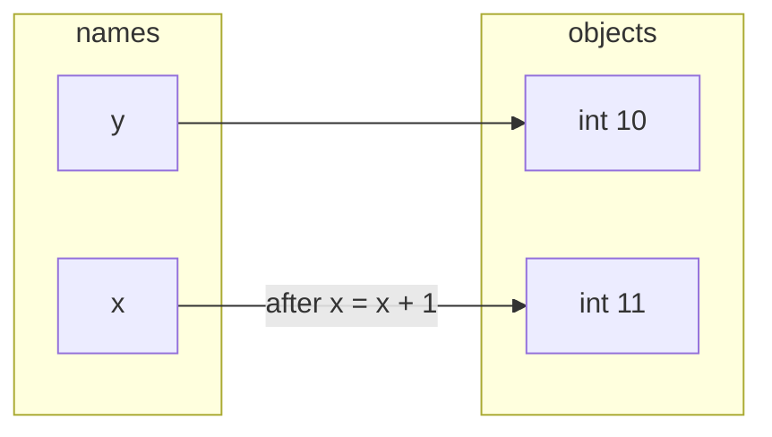

# 3.1 Python core: types, control flow, functions

| | |
|---|---|
| Level | Beginner |
| Priority tier | 0 |
| Lab venue | Any machine with Python 3.11 or newer |
| Part | Part 3: Python for infrastructure |
| Status | Drafted, labs **untested** |

## Why this matters for AI infrastructure

Python is the connective tissue of AI infrastructure. Training code, data pipelines, Kubernetes operators, Slurm wrappers, Prometheus exporters, Redfish clients, network automation, Ansible modules, benchmark harnesses and inference servers are all written in it. An infrastructure engineer does not need to be a language lawyer, but needs a precise mental model: what an object is, why a "variable" is only a label, why a default argument can leak state between calls for the lifetime of a long-running service, how scoping decides which name you are touching, and how to write small functions whose behaviour you can predict and test. This chapter builds that foundation from first principles and ties each idea to infrastructure code. Chapters 3.2 to 3.11 build on it: packaging, idioms, classes and typing, files and subprocesses, concurrency, APIs, CLIs and exporters, testing, data/ML essentials, and the machinery behind frameworks.

## Prerequisites and outcomes

You should be comfortable at a Unix shell and have written a script in some language. No prior Python is assumed.

After this chapter you can:

- Explain how CPython runs a program (source to bytecode to the virtual machine), the difference between running a script, importing a module, and using the REPL, and how to run Python on a server or in CI.
- Explain the object model: everything is an object with an identity, a type and a value; names are references; mutability matters; `is` versus `==`; interning; garbage collection by reference counting plus a cycle collector.
- Use numbers (int, float, Decimal, Fraction, complex, bool), strings (immutable Unicode text, slicing, methods, formatting, f-strings), bytes, and the core collections (list, tuple, dict, set, frozenset) with their complexity and pitfalls.
- Write assignments and expressions (unpacking, augmented assignment, chained comparison, walrus operator), `if`/`elif`/`else`, the `match` statement, `while` and `for` loops with `break`/`continue`/`else`, and basic iteration over dictionaries and files.
- Define functions: parameters, defaults (and the mutable default trap), keyword-only and positional-only parameters, `*args` and `**kwargs`, return values, docstrings, annotations, lambdas, closures, recursion limits, and scope resolution (LEGB, `global`, `nonlocal`).
- Read documentation (`help`, `pydoc`, docstrings), measure code with `timeit`, and avoid common infrastructure bugs.

## 1. How Python runs programs

### The execution model

Python is an **interpreted, byte-compiled** language in its reference implementation, **CPython**. When you run `python script.py`:

1. The interpreter reads the source and **compiles** it to **bytecode**, a compact instruction list for a stack-based virtual machine. Bytecode for imported modules is cached in `__pycache__/*.pyc`; for a script run directly it is compiled each time.
2. The **Python Virtual Machine (PVM)** executes the bytecode in a loop. There is no separate compile-link-run cycle: execution begins immediately, and errors in code that is never executed are not found until it runs.
3. The **import system** finds, loads and executes module code once and caches it in `sys.modules`.

Other implementations exist (PyPy with a JIT, MicroPython, Jython, GraalPy), and CPython 3.13+ adds an experimental JIT and an optional free-threaded build without the global interpreter lock; for infrastructure you will almost always use CPython and should treat the version as a deployment parameter (pin it).

```bash
python3 --version
python3 -c 'import sys; print(sys.version); print(sys.executable); print(sys.path[:3])'
python3 -m dis -- <(echo 'x = 1 + 2')     # disassemble to bytecode (or: python3 -c "import dis; dis.dis('x=1+2')")
python3 -X importtime -c 'import json'     # where import time goes
```

### Ways to run code

| Way | Command | Use |
|---|---|---|
| Interactive REPL | `python3` (better: `ipython`, `bpython`, `python3 -q`) | Exploration, debugging |
| Script | `python3 tool.py arg1 arg2` | Automation scripts |
| Module | `python3 -m package.module` | Package entry points, `-m venv`, `-m pip`, `-m http.server`, `-m json.tool`, `-m pytest` |
| One-liner | `python3 -c 'print(1)'` | Quick checks in shell scripts |
| Executable script | First line `#!/usr/bin/env python3`, `chmod +x` | Command-line tools |
| Notebook | Jupyter | Data/ML exploration (chapter 3.10) |
| Embedded | Frameworks calling your code | Web servers, operators, Airflow |

Running a file also sets `__name__ == "__main__"`; importing it sets `__name__` to the module name. The standard guard keeps a file usable as both library and script:

```python
def main() -> int:
    print("hello")
    return 0

if __name__ == "__main__":
    raise SystemExit(main())
```

Exit codes matter for infrastructure: `0` success, non-zero failure; CI systems, systemd, cron and Kubernetes jobs all key off them. `raise SystemExit(code)` and `sys.exit(code)` are equivalent. Uncaught exceptions exit with status 1 and print a traceback to standard error.

### Python versions, `python` vs `python3`, and installation

Use the distribution's `python3` for system scripts, but for applications use an isolated, pinned interpreter in a virtual environment (chapter 3.2). Never `pip install` into the system Python; distributions manage it. Check `python3 -m site` and `pip --version` to know which interpreter you are really using.

## 2. Objects, names and references

### Everything is an object

In C, a variable is a named piece of memory. In Python, **objects** live in memory and **names are labels (references) bound to them**. Every object has:

- an **identity** (`id(obj)`; in CPython the memory address, constant for the object's lifetime),
- a **type** (`type(obj)`; it determines the behaviour and cannot normally change),
- a **value** (its content).

```python
x = 10
print(id(x), type(x), x)      # int object with value 10
y = x                         # y is another label on the SAME object
x = x + 1                     # creates a new int object 11 and rebinds x; y still refers to 10
print(x, y)                   # 11 10
```



Assignment never copies objects; it **binds names to objects**. This single fact explains most "mysterious" Python behaviour.

### Mutability

- **Immutable** objects cannot change after creation: `int`, `float`, `complex`, `bool`, `str`, `bytes`, `tuple` (of immutables), `frozenset`, `None`, `range`. Operations produce new objects.
- **Mutable** objects can change in place: `list`, `dict`, `set`, `bytearray`, most user-defined class instances.

```python
a = [1, 2, 3]
b = a              # two names, one list
b.append(4)
print(a)           # [1, 2, 3, 4]: a changed too, because it is the same object
c = a.copy()       # shallow copy: new list, same element objects (also a[:], list(a))
import copy
d = copy.deepcopy(a)   # recursively copies nested mutable structures
```

**Shallow vs deep copy**: `copy.copy` duplicates the container but shares the elements; with nested structures (a dict of lists) you can still mutate the shared inner lists. Deep copy duplicates everything (and handles cycles) at a cost.

**Equality vs identity**: `==` compares values (calls `__eq__`); `is` compares identity. Use `is` only for singletons: `x is None`, `x is True` (rarely). Small integers (about -5 to 256) and many short strings are **interned** by CPython, so `is` on them sometimes appears to work; never rely on it.

**Tuples** are immutable containers, but contain references: `t = ([1], 2)` cannot change which objects it holds, yet `t[0].append(5)` mutates the list inside it. A tuple is hashable only if all its elements are.

### Reference counting and garbage collection

CPython frees an object when its **reference count** drops to zero (immediate, deterministic for non-cyclic garbage), and a **cycle collector** (`gc` module) periodically handles reference cycles. `del name` removes a binding, not necessarily the object. Practical consequences: files and sockets should be closed explicitly (use `with`), `__del__` is a poor cleanup mechanism, memory growth in long-running services often comes from references you still hold (caches, globals, closures, exception tracebacks stored somewhere), and weak references (`weakref`) are available for caches. `sys.getrefcount`, `tracemalloc` and `objgraph` help diagnose leaks.

### Dynamic typing and duck typing

Names have no type; objects do. A name can be rebound to an object of any type, and type checks happen when an operation is attempted ("duck typing": if it supports the operation, it works). Python is **strongly typed** (`"1" + 1` raises `TypeError`; no silent coercion) and **dynamically typed**. Optional **type hints** (chapter 3.4) document and statically check intent without changing runtime behaviour.

## 3. Numbers and expressions

| Type | Notes |
|---|---|
| `int` | Arbitrary precision; no overflow; `0x1f`, `0o17`, `0b101`, `1_000_000` (underscores allowed) |
| `float` | IEEE 754 double (about 15 to 17 significant digits); `0.1 + 0.2 != 0.3`; `math.isclose`; `float("inf")`, `nan` (never equals itself) |
| `complex` | `3 + 4j`; rarely used in infra |
| `bool` | Subclass of `int`: `True == 1`; truthiness |
| `decimal.Decimal` | Exact decimal arithmetic for money/billing; construct from strings |
| `fractions.Fraction` | Exact rational numbers |

Operators: `+ - * / // % **`; `/` is always true division (float); `//` floors toward negative infinity (`-7 // 2 == -4`); `%` result has the sign of the divisor; `divmod(a, b)`; `round()` rounds half to even (`round(2.5) == 2`); bitwise `& | ^ ~ << >>` (useful for IP/mask and flags: `0xFF & addr`). Comparison chains work: `1 <= x < 10`. Use `math` (`ceil`, `floor`, `sqrt`, `log2`, `isclose`), `statistics` (`mean`, `median`, `quantiles`), and `random` (not for security: use `secrets`).

```python
# Infrastructure arithmetic examples
gib = 1024 ** 3
disk_bytes = 3_840_755_982_336
print(f"{disk_bytes / gib:.1f} GiB")                       # 3577.0 GiB
free_pct = 100 * free / total if total else 0.0            # guard divide by zero
timeout = base * 2 ** attempt                              # exponential backoff
pages, rem = divmod(total_items, 100)                      # pagination
```

Beware: floating-point rounding for metrics and thresholds (compare with tolerance), integer division for percentages (`//` vs `/`), and `bool` being an `int` (`True + True == 2`). The `ipaddress` module (chapter 3.5) handles IP arithmetic correctly; do not hand-roll it with strings.

## 4. Strings and bytes

A `str` is an **immutable sequence of Unicode code points**. `bytes` is an immutable sequence of integers 0 to 255 (raw data); `bytearray` is its mutable form. Text and bytes are different types: you **encode** text to bytes (`s.encode("utf-8")`) and **decode** bytes to text (`b.decode("utf-8")`); mixing them raises `TypeError`. Files, sockets and subprocess pipes deal in bytes unless opened in text mode with an encoding (chapter 3.5 covers this in depth).

```python
s = "GPU-0 temp=71C"
s[0], s[-1], s[0:5], s[::-1]          # indexing and slicing (immutable: s[0] = "x" is an error)
len(s); "temp" in s; s.startswith("GPU")
s.upper(), s.lower(), s.strip(), s.split(" "), "-".join(["a", "b"]), s.replace("C", "°C")
s.partition("="), s.rsplit("=", 1), s.splitlines(), s.find("x"), s.index("t"), s.count("0")
"%s has %d GPUs" % ("node1", 8)                  # legacy printf-style
"{} has {} GPUs".format("node1", 8)              # str.format
name, n = "node1", 8
f"{name} has {n} GPUs; load={0.756:.1%}; id={n:04d}; hex={255:#x}; width=[{name:>10}]; {n=}"   # f-strings (preferred)
```

Key points:

- **Immutability** means `+=` in a loop builds a new string each time (quadratic in the worst case); collect parts in a list and `"".join(parts)`.
- **Slicing** `s[start:stop:step]` is half-open; negative indices count from the end; out-of-range slices don't raise.
- **Raw strings** `r"C:\path\n"` avoid escape processing (regexes, Windows paths); **triple-quoted** strings span lines; **bytes literals** `b"\x00\xff"`.
- **Formatting mini-language** inside f-strings: `:>10`, `:^10`, `:08.3f`, `:,` thousands separators, `:%`, `!r` for repr (`f"{value!r}"` is essential in log messages and error text to show quoting and whitespace).
- **`str` vs `repr`**: `str(x)` is for humans, `repr(x)` for developers (unambiguous).
- Use `str.removeprefix/removesuffix`, `casefold` for case-insensitive comparison, `unicodedata.normalize` for Unicode equivalence.
- **Security**: never build shell commands or SQL by string formatting from untrusted input (injection); use argument lists with `subprocess` and parameterised queries.
- **Regular expressions** (`re`) for parsing logs and outputs: `re.compile(r"...")`, `search`, `fullmatch`, `findall`, `finditer`, named groups `(?P<name>...)`, `re.VERBOSE`; prefer structured outputs (`--json`, `ip -j`, `kubectl -o json`) over parsing text.

```python
import re
LINE = re.compile(r"(?P<ts>\S+ \S+) (?P<host>\S+) (?P<proc>\w+)\[(?P<pid>\d+)\]: (?P<msg>.*)")
m = LINE.match("Oct 24 01:02:03 gpu01 sshd[1234]: Failed password for root")
if m:
    print(m["host"], int(m["pid"]), m["msg"])
```

## 5. Core collections

| Type | Literal | Properties | Typical use | Costs |
|---|---|---|---|---|
| `list` | `[1, 2, 3]` | Ordered, mutable, indexable, allows duplicates | Sequences of results, queues (small) | Index O(1); append amortised O(1); insert/delete at front O(n); `in` O(n) |
| `tuple` | `(1, 2)` or `1, 2` | Ordered, immutable, hashable if elements are | Fixed records, dict keys, multiple return values | Index O(1) |
| `dict` | `{"a": 1}` | Mapping, insertion-ordered (3.7+), keys must be hashable | Config, JSON-like data, indexes | Lookup/insert O(1) average |
| `set` | `{1, 2}`; empty is `set()` | Unordered unique elements, mutable | Membership tests, dedupe, set algebra | `in` O(1) average |
| `frozenset` | `frozenset({1})` | Immutable set, hashable | Dict keys of sets | |
| `collections.deque` | `deque([1,2])` | Double-ended queue | O(1) at both ends: queues, sliding windows | |
| `collections.Counter`, `defaultdict`, `OrderedDict`, `ChainMap` | | Specialised mappings | Counting, grouping | |
| `array`, `bytearray`, `memoryview` | | Compact numeric arrays / binary buffers | Binary protocols | |

```python
nodes = ["gpu01", "gpu02", "gpu03"]
nodes.append("gpu04"); nodes.extend(["gpu05"]); nodes.insert(0, "login"); nodes.remove("gpu02"); last = nodes.pop()
nodes.sort(); nodes.sort(key=len, reverse=True); sorted(nodes); nodes.reverse(); nodes[1:3]; nodes[::2]
a, *rest = nodes                    # unpacking with star
first, second = ("x", "y")          # tuple unpacking
a, b = b, a                         # swap

cfg = {"name": "leaf1", "asn": 65101}
cfg["mtu"] = 9214; cfg.get("vlan", 100); cfg.setdefault("tags", []).append("rack1")
for k, v in cfg.items(): ...; list(cfg); cfg.keys() & {"asn", "mtu"}      # views support set operations
merged = {**defaults, **overrides}; merged2 = defaults | overrides         # 3.9+ merge; later wins
cfg.pop("mtu", None); del cfg["name"]; cfg.update(asn=65102)

up = {"gpu01", "gpu02"}; expected = {"gpu01", "gpu02", "gpu03"}
missing = expected - up; extra = up - expected; both = up & expected; either = up | expected; symmetric = up ^ expected
```

Important behaviours:

- **Dict keys must be hashable** (immutable-ish): strings, numbers, tuples of hashables, frozensets; lists and dicts cannot be keys. Dicts preserve insertion order.
- **Never modify a collection while iterating over it** (`for x in lst: lst.remove(x)` skips elements; mutating a dict's size during iteration raises `RuntimeError`): iterate over a copy or build a new collection.
- **Aliasing traps**: `grid = [[0] * 3] * 3` creates three references to the same inner list; use `[[0] * 3 for _ in range(3)]`. `d = dict.fromkeys(keys, [])` shares one list across all keys.
- **Membership**: use sets or dicts for repeated `in` checks on large data; `x in list` is linear.
- **`sorted` and `list.sort`**: stable; `key=` takes a function (`key=lambda n: (n.rack, n.name)`), `reverse=True`; `operator.itemgetter/attrgetter` are faster than lambdas.
- **Slicing** returns copies (shallow). `len`, `min`, `max`, `sum`, `any`, `all`, `enumerate`, `zip`, `reversed`, `sorted` are universal helpers.
- **`collections.Counter`**: `Counter(error_codes).most_common(5)`; **`defaultdict(list)`** to group: `by_rack[rack].append(node)`.

### Truthiness and `None`

Empty containers, `0`, `0.0`, `""`, `None` and `False` are falsy; everything else is truthy. Prefer `if not items:` to `if len(items) == 0:`; use `is None` / `is not None` when `0` or empty are valid values (`if timeout is None: timeout = 30`, not `if not timeout`). `None` is the single null object, the default return value of functions without `return`.

## 6. Files (preview)

Files are opened with `open()` and should always be managed by `with` so they close even on errors; text mode needs an explicit encoding on infrastructure systems to avoid locale surprises.

```python
from pathlib import Path
with open("/etc/hostname", encoding="utf-8") as f:
    hostname = f.read().strip()
for line in Path("/var/log/syslog").open(encoding="utf-8", errors="replace"):   # lazy iteration: one line at a time
    if "error" in line.lower(): print(line.rstrip())
Path("/tmp/out.txt").write_text("hello\n", encoding="utf-8")
```

Chapter 3.5 treats files, paths, text/bytes, `subprocess`, `shutil`, `tempfile`, JSON/YAML/CSV and robust system scripting.

## 7. Statements and syntax

### Structure

Python uses **indentation** (4 spaces, never tabs mixed with spaces) to delimit blocks; a colon introduces a block. Statements end at the newline; continuation with brackets or a backslash. Comments start with `#`. `pass` is a no-op placeholder. Compound statements nest. Use a formatter (`black` or `ruff format`) and linter (`ruff`, `flake8`) so style is never debated (chapter 3.9).

### Assignment forms

```python
x = 1                       # basic
x = y = 0                   # chained (same object)
a, b = 1, 2                 # tuple unpacking
first, *middle, last = [1, 2, 3, 4]       # extended unpacking
(h, m), s = (10, 20), 30    # nested
x += 1                      # augmented (for mutable objects this mutates in place: lst += [1] is lst.extend)
if (n := len(items)) > 10:  # walrus (3.8+): assign inside expressions
    print(n)
x: int = 5                  # annotation (no runtime enforcement)
```

### `if` / `elif` / `else` and conditional expressions

```python
if state == "ready":
    ...
elif state in {"starting", "pending"}:
    ...
else:
    ...
mode = "prod" if env == "production" else "dev"          # ternary
target = os.environ.get("CLUSTER") or "staging"          # or-defaulting (beware falsy valid values)
if 1024 <= port <= 65535 and not is_reserved(port): ...
```

`and`/`or` short-circuit and return one of their operands (not necessarily a bool). `not`, `in`, `not in`, `is`, `is not` are the other boolean/comparison operators.

### The `match` statement (3.10+)

Structural pattern matching destructures values; useful for parsing commands, API events and heterogeneous data.

```python
def handle(event: dict) -> str:
    match event:
        case {"type": "node_down", "node": str(name)}:
            return f"drain {name}"
        case {"type": "temp", "value": float(v)} if v > 85:
            return "throttle"
        case {"type": "gpu", "ids": [first, *_]}:
            return f"first gpu {first}"
        case {"type": t}:
            return f"unhandled {t}"
        case _:
            return "unknown"
match cmd.split():
    case ["start", service]: ...
    case ["stop", service, *flags]: ...
    case ["status"]: ...
```

Patterns: literals, captures, wildcards `_`, sequences, mappings, class patterns `Point(x=0, y=0)`, alternatives `|`, guards `if`. It is not a C-style switch; the first matching case wins and names are bound.

### `while` and `for` loops

```python
while not ready():                    # condition loop
    time.sleep(2)
for node in nodes:                    # iterate any iterable
    ...
for i, node in enumerate(nodes, start=1): ...
for a, b in zip(names, ips, strict=True): ...         # strict raises if lengths differ (3.10+)
for k, v in sorted(cfg.items()): ...
for i in range(0, 100, 10): ...       # range is lazy
for attempt in range(1, 6):
    try:
        connect(); break              # break leaves the loop
    except OSError:
        time.sleep(2 ** attempt)
else:
    raise RuntimeError("gave up")     # else runs only if the loop did NOT break
```

`continue` skips to the next iteration; the loop `else` clause is Python's "no break happened" branch, ideal for search and retry loops. Prefer `for` over `while` with indices; use `enumerate`, `zip`, `itertools` for patterns. Avoid infinite `while True` loops without a clear exit path and timeout; add backoff and jitter for retries.

### The iteration protocol (preview)

`for` calls `iter(obj)` to get an iterator, then repeatedly `next()` until `StopIteration`. Lists, tuples, dicts (keys), sets, strings, files (lines), `range`, generators and many library objects are iterable. Iterators are **single-use**: once exhausted they yield nothing. File objects and generators therefore stream data lazily, which is how a script processes a 50 GB log with constant memory (chapter 3.3 goes deep on iterators, generators and comprehensions).

### Comprehensions (preview)

```python
squares = [n * n for n in range(10) if n % 2 == 0]
by_name = {n.name: n for n in nodes}
unique_racks = {n.rack for n in nodes}
lazy = (line for line in f if "ERROR" in line)         # generator expression: lazy
```

## 8. Functions

### Definition, calls and return

```python
def gib(nbytes: int, *, decimals: int = 1) -> float:
    """Convert bytes to GiB (1024**3)."""
    return round(nbytes / 1024**3, decimals)

gib(3_840_755_982_336)            # positional
gib(10**12, decimals=2)           # keyword-only argument
```

A function is an **object** (first class): it can be assigned, stored in data structures, passed to and returned from other functions. `def` executes at definition time (creates the function object and binds the name). A function without `return` returns `None`; `return a, b` returns a tuple. A function should do one thing, have a clear name (verb phrase), and a docstring describing arguments, return value, side effects and exceptions.

### Parameters

| Form | Example | Meaning |
|---|---|---|
| Positional-or-keyword | `def f(a, b)` | Call as `f(1, 2)` or `f(b=2, a=1)` |
| Default | `def f(a, b=10)` | Used if omitted; **evaluated once at definition time** |
| `*args` | `def f(*args)` | Extra positional arguments collected in a tuple |
| `**kwargs` | `def f(**kwargs)` | Extra keyword arguments collected in a dict |
| Keyword-only | `def f(a, *, b)` | Parameters after `*` must be passed by name |
| Positional-only | `def f(a, b, /, c)` | Parameters before `/` cannot be passed by name (3.8+) |

Calling-side unpacking: `f(*args_list, **kwargs_dict)`; `print(*items, sep=", ")`. Argument matching order: positional, then keyword; duplicates raise `TypeError`. Prefer keyword-only parameters for booleans and options (`deploy(app, *, dry_run=True)`) so calls read clearly.

### The mutable default argument trap

Default values are evaluated **once**, when `def` runs. A mutable default is shared by every call:

```python
def add_node(ip, nodes=[]):            # BUG
    nodes.append(ip); return nodes
add_node("10.0.0.1"); add_node("10.0.0.2")      # second call returns both: state leaked between calls

def add_node_safe(ip, nodes=None):     # idiom
    if nodes is None:
        nodes = []
    nodes.append(ip); return nodes
```

In a long-running Kubernetes operator, web service or Lambda container, this leaks state across requests and across tenants: one of the most common production Python bugs. The same applies to defaults like `{}` and `set()`, and to defaults computed at import time (`now=datetime.now()` is evaluated once). Linters (`ruff B006`) flag it.

### Scope: LEGB

Name lookup follows **L**ocal, **E**nclosing function, **G**lobal (module), **B**uilt-in. Assignment inside a function makes the name local to that function unless declared `global` or `nonlocal`.

```python
counter = 0
def bump():
    global counter          # rebind the module-level name
    counter += 1
def make_counter():
    n = 0
    def inc():
        nonlocal n          # rebind the enclosing function's variable
        n += 1
        return n
    return inc               # a CLOSURE: inc remembers n
c = make_counter(); c(); c()      # 1, 2
```

Reading a global needs no declaration; assigning to it without `global` creates a local (and reading it earlier in the same function raises `UnboundLocalError`). Prefer passing values and returning results over mutable globals; module-level constants (UPPER_CASE) are fine.

**Late binding in closures**: `[lambda: i for i in range(3)]` all see the final `i`; bind with a default argument (`lambda i=i: i`) or `functools.partial`.

### Lambdas, higher-order functions

```python
nodes.sort(key=lambda n: (n["rack"], n["name"]))
squares = list(map(lambda x: x * x, range(5)))        # comprehensions are usually clearer
alive = list(filter(None, results))                    # drop falsy
from functools import partial, reduce
ping3 = partial(ping, count=3)
total = reduce(lambda a, b: a + b, values, 0)
```

`lambda` is a single-expression anonymous function; for anything longer, write a named `def`. `sorted`, `max`, `min` take `key=`. `functools` offers `partial`, `lru_cache`/`cache` (memoisation), `wraps`, `singledispatch`; `operator` offers `itemgetter`, `attrgetter`, `add`.

### Recursion and limits

Functions can call themselves; CPython has no tail-call optimisation and a recursion limit (default 1000, `sys.getrecursionlimit()`); deep recursion raises `RecursionError`. Use iteration or an explicit stack for tree walks over large structures (directory trees, dependency graphs).

### Docstrings, annotations, introspection

A string literal as the first statement is the **docstring** (`func.__doc__`, shown by `help(func)`); follow a convention (Google or NumPy style; reStructuredText for Sphinx). **Annotations** (`def f(x: int) -> str:`) are stored in `__annotations__` and used by tools (mypy, pyright, FastAPI, pydantic) but not enforced at runtime. Introspection helpers: `type`, `dir`, `vars`, `getattr`, `hasattr`, `callable`, `inspect.signature`.

### Generators (preview)

A function containing `yield` returns a lazy iterator, suspending its state between values:

```python
def read_lines(path):
    with open(path, encoding="utf-8", errors="replace") as f:
        for line in f:
            yield line.rstrip("\n")

errors = sum(1 for l in read_lines("/var/log/syslog") if "ERROR" in l)
```

Generators let you process arbitrarily large inputs (log files, object listings, paginated APIs) in constant memory; chapter 3.3 covers them thoroughly.

## 9. Documentation, introspection and benchmarking

### Finding help

```python
help(str.split); help("json"); dir(list)         # in the REPL
```

```bash
python3 -m pydoc json.dumps          # terminal docs
python3 -m pydoc -b                  # local web docs server (3.x)
pip show requests ; pip list ; python3 -c 'import requests,sys; print(requests.__file__)'
```

Official docs (docs.python.org: tutorial, library reference, language reference, HOWTOs), PEP index (PEP 8 style, PEP 20 "Zen of Python" via `import this`, PEP 257 docstrings, PEP 484 typing), and package docs on their sites are the authorities. Learn to read tracebacks bottom-up (the last line is the exception; the frame above it is where it was raised) and to use `breakpoint()` / `pdb` (`python3 -m pdb script.py`, commands `n s c p l bt q`).

### Benchmarking

Measure before optimising. Use `timeit` for micro-benchmarks and `cProfile`/`py-spy` for programs:

```bash
python3 -m timeit -s 'xs = list(range(10_000))' 'sum(xs)'
python3 -m timeit -s 'xs = list(range(10_000))' 'total = 0' 'for x in xs: total += x'
python3 -m cProfile -s cumtime script.py | head -20
```

```python
import timeit
timeit.repeat("x in s", setup="s=set(range(10000)); x=9999", number=100_000, repeat=5)    # take the min of several repeats
```

Pitfalls: measuring once, warm-up and caching effects, tiny inputs, measuring I/O instead of computation, optimising code that isn't on the hot path. For infrastructure tools the usual real gains come from algorithms and I/O (batching, concurrency, avoiding repeated subprocess calls, using sets/dicts) rather than micro-optimisation.

## 10. Infrastructure patterns using the core

### Safe environment configuration

```python
import os, sys

def env_int(name: str, default: int) -> int:
    raw = os.environ.get(name)
    if raw is None or raw == "":
        return default
    try:
        return int(raw)
    except ValueError:
        raise SystemExit(f"{name} must be an integer, got {raw!r}")

CLUSTER = os.environ.get("CLUSTER", "staging")
RETRIES = env_int("RETRIES", 3)
TOKEN = os.environ["API_TOKEN"]                 # KeyError if missing: fail fast, never default secrets
```

### Retry with backoff and jitter

```python
import random, time

def retry(fn, *, attempts=5, base=0.5, cap=30.0, exceptions=(OSError,)):
    for attempt in range(1, attempts + 1):
        try:
            return fn()
        except exceptions as exc:
            if attempt == attempts:
                raise
            delay = min(cap, base * 2 ** (attempt - 1)) * random.uniform(0.5, 1.5)
            print(f"attempt {attempt} failed: {exc!r}; retrying in {delay:.1f}s", file=sys.stderr)
            time.sleep(delay)
```

### Parse and aggregate a log without loading it

```python
from collections import Counter
codes = Counter()
with open("access.log", encoding="utf-8", errors="replace") as f:
    for line in f:
        parts = line.split()
        if len(parts) > 8 and parts[8].isdigit():
            codes[parts[8]] += 1
print(codes.most_common(5))
```

### Compare desired and actual state (set algebra)

```python
desired = {"gpu01", "gpu02", "gpu03", "gpu04"}
actual = {n["name"] for n in api_nodes if n["state"] == "Ready"}
print("missing:", sorted(desired - actual), "unexpected:", sorted(actual - desired))
```

### Data shaping

```python
nodes = [{"name": "gpu01", "rack": "r1", "gpus": 8}, {"name": "gpu02", "rack": "r1", "gpus": 8}, {"name": "gpu03", "rack": "r2", "gpus": 4}]
by_rack = {}
for n in nodes:
    by_rack.setdefault(n["rack"], []).append(n["name"])
gpus_per_rack = {r: sum(n["gpus"] for n in nodes if n["rack"] == r) for r in by_rack}
```

## 11. Common mistakes

- Treating names as boxes: mutating a list through an alias, then wondering why "another" variable changed.
- Mutable default arguments; module-level mutable state in services; default values computed at import time.
- Comparing with `is` instead of `==` (except `None`); using `==` with floats; relying on `round` or integer interning.
- Modifying a collection while iterating over it; using `list` for membership tests on large data.
- Building strings by `+=` in loops; building commands or queries by string interpolation of untrusted input.
- Catching exceptions too broadly or silently (`except: pass`) so failures become silent data loss (chapter 3.5).
- Using `from module import *`; shadowing built-ins (`list`, `dict`, `id`, `type`, `input`) with variable names.
- Mixing tabs and spaces; unversioned global `pip install` into the system Python.
- Trusting dynamic types without validation at boundaries (API input, config files, environment variables).
- Optimising without measuring.

## 12. Lab: Python core on a Linux box (untested)

1. **Environment**: check `python3 --version`, create a scratch directory; run a script, a module (`-m json.tool`), and a one-liner; add a `__main__` guard and exit codes; see exit status with `echo $?`.
2. **Object model**: write `ids.py` showing `id()` changes for ints/strings, aliasing of lists, shallow vs deep copy of a dict of lists, `is` vs `==`, tuple containing a list, and interning surprises; explain each output in comments.
3. **Mutable default**: reproduce the bug in a small "request handler" simulation; fix it; add a test asserting independence between calls (use plain `assert`).
4. **Numbers and strings**: convert byte counts to human units; parse `"85C"`, `"71 %"`, `"1.5Gi"`; implement a `human(n)` and `parse_size(s)` pair with tests; show float comparison with `math.isclose` and `Decimal` for billing.
5. **Collections**: given a list of node dicts, compute per-rack GPU totals, nodes missing from an expected set, duplicate hostnames (Counter), the top 3 racks, and a stable sorted report; time `in` on list vs set with `timeit` for 10^5 elements.
6. **Control flow**: implement `classify(event)` with `match`; implement a retry loop with `for ... else` and exponential backoff with jitter (use a fake flaky function); implement a `while` polling loop with a timeout using `time.monotonic()`.
7. **Functions**: write `deploy(app, *, replicas=1, dry_run=True)` with keyword-only options; show `*args/**kwargs` forwarding; make a closure counter and a late-binding bug and fix it; use `functools.lru_cache` on a pure function; read `help()` of your functions.
8. **Scope**: demonstrate `UnboundLocalError`, `global`, `nonlocal`; refactor a global-state script into functions with explicit parameters.
9. **Generators**: stream a large synthetic log (generate 5 million lines) with a generator pipeline and measure memory (`/usr/bin/time -v`) versus `readlines()`.
10. **Profiling**: profile a deliberately slow script with `cProfile`; fix the hot spot; re-measure.
11. **Debugging**: introduce a bug; find it with `breakpoint()` and `pdb`; practise reading tracebacks.
12. **Clean up** scratch files.

Mark tested only after execution.

## 13. Interview angles

- "Explain how variables work in Python. What happens on `b = a` for a list? For an int?"
- "What is the mutable default argument problem? Why does it matter in a long-running service?"
- "`is` versus `==`? When is `is` correct?"
- "What is the difference between a shallow and a deep copy?"
- "How does Python resolve names? What are `global` and `nonlocal`?"
- "What is a closure? Give an example and a pitfall."
- "How would you process a 100 GB log file with a small memory footprint?"
- "What does `for ... else` do?"
- "How are `*args` and `**kwargs` used? What are keyword-only parameters for?"
- "How do you decide between a list, a set and a dict?"
- "Why is `str += ...` in a loop slow? What is the alternative?"
- "What is the GIL and how does it affect your scripts?" (Answered in chapter 3.6.)

## 14. Checkpoint questions (40)

1. What does CPython compile source to? **A:** Bytecode run on a stack-based virtual machine.
2. Where are `.pyc` files stored? **A:** `__pycache__`.
3. What does `if __name__ == "__main__":` do? **A:** Runs code only when the file is executed, not imported.
4. What exit code means success? **A:** 0.
5. What is a Python variable? **A:** A name bound to an object.
6. Three attributes of every object? **A:** Identity, type, value.
7. Does assignment copy? **A:** No; it binds a name to the same object.
8. Name three immutable types. **A:** int, str, tuple (also float, bytes, frozenset).
9. Name three mutable types. **A:** list, dict, set.
10. `is` versus `==`? **A:** Identity versus equality of value.
11. Shallow copy ways? **A:** `copy.copy`, `list.copy`, `a[:]`, `dict.copy`.
12. What does deepcopy do? **A:** Recursively copies nested objects.
13. How does CPython free objects? **A:** Reference counting plus a cycle collector.
14. Is Python strongly or weakly typed? **A:** Strongly (and dynamically) typed.
15. What does `/` return for ints? **A:** A float (true division).
16. What does `//` do for negatives? **A:** Floors toward negative infinity.
17. Why `0.1 + 0.2 != 0.3`? **A:** Binary floating-point representation.
18. When use `Decimal`? **A:** Exact decimal arithmetic such as money.
19. `str` versus `bytes`? **A:** Unicode text versus raw byte sequence.
20. How to convert between them? **A:** `encode` and `decode` with an encoding.
21. Why not `s += x` in loops? **A:** Creates a new string each time; use `join`.
22. What do f-strings add? **A:** Inline expressions and format specs.
23. What does `repr` do? **A:** Unambiguous developer representation.
24. Complexity of `x in list` vs `x in set`? **A:** O(n) versus O(1) average.
25. Can lists be dict keys? **A:** No; keys must be hashable.
26. How to merge dicts, later wins? **A:** `{**a, **b}` or `a | b`.
27. Why not modify a list while iterating? **A:** Elements are skipped; use a copy or build a new list.
28. What's wrong with `[[0]*3]*3`? **A:** Shared inner list references.
29. Falsy values? **A:** `None`, `False`, `0`, `0.0`, empty containers and strings.
30. When to use `is None`? **A:** When 0/empty are valid values.
31. What is `match` for? **A:** Structural pattern matching.
32. What does loop `else` mean? **A:** Runs if the loop finished without `break`.
33. What does `enumerate` give? **A:** (index, item) pairs.
34. What does `zip(strict=True)` do? **A:** Raises if iterables differ in length.
35. What is the mutable default trap? **A:** Defaults evaluated once and shared across calls.
36. What is LEGB? **A:** Local, Enclosing, Global, Built-in lookup order.
37. `global` versus `nonlocal`? **A:** Rebind a module name versus an enclosing function's name.
38. What is a closure? **A:** A function that retains variables from its enclosing scope.
39. What is a keyword-only parameter? **A:** One after `*` that must be passed by name.
40. What does `yield` make a function? **A:** A generator producing values lazily.

## 15. Sources and review notes

**Written in original words.** Principal sources:

- Mark Lutz, *Learning Python*, 6th ed. (parts I to IV): how Python runs programs, object types, numbers, dynamic typing, strings, lists and dictionaries, tuples and files, statements, assignments, `if` and `match`, loops, iterations and comprehensions, documentation and benchmarking interludes, function basics, scopes, arguments, function odds and ends.
- Luciano Ramalho, *Fluent Python*, 2nd ed.: data model preview, sequences, object references, mutability and recycling (referenced in later chapters).
- The author's own `nvidia-devops` repository, volume 02 (Python fundamentals for infrastructure): variables and the mutability trap, the mutable default argument scenario, conditional defaults, generators for large logs, `pathlib` and `subprocess` previews.
- Adell et al., *Network Programmability and Automation*, 2nd ed., chapter 6 (Python for network engineers) informed the infrastructure-flavoured examples.
- Code examples are the author's constructions.

**Flagged for verification before publishing:** version-specific features (`match` in 3.10, `zip(strict=True)`, dict `|` in 3.9, free-threading status), CPython recursion defaults, `timeit` output interpretation, and every command and snippet; all labs are **untested**.
