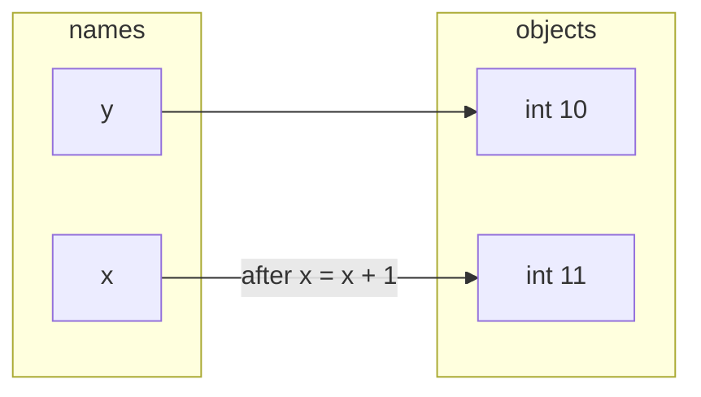

# 3.1 Python core: types, control flow, functions

| | |
|---|---|
| Level | Beginner |
| Priority tier | 0 |
| Lab venue | Any machine with Python 3.11 or newer |
| Part | Part 3: Python for infrastructure |
| Status | Drafted, labs **untested** |

## Why this matters for AI infrastructure

Python is the connective tissue of AI infrastructure. Training code, data pipelines, Kubernetes operators, Slurm wrappers, Prometheus exporters, Redfish clients, network automation, Ansible modules, benchmark harnesses and inference servers are all written in it. An infrastructure engineer does not need to be a language lawyer, but needs a precise mental model: what an object is, why a "variable" is only a label, why a default argument can leak state between calls for the lifetime of a long-running service, how scoping decides which name you are touching, and how to write small functions whose behaviour you can predict and test. This chapter builds that foundation from first principles and ties each idea to infrastructure code. Chapters 3.2 to 3.11 build on it: packaging, idioms, classes and typing, files and subprocesses, concurrency, APIs, CLIs and exporters, testing, data/ML essentials, and the machinery behind frameworks.

## Prerequisites and outcomes

You should be comfortable at a Unix shell and have written a script in some language. No prior Python is assumed.

After this chapter you can:

- Explain how CPython runs a program (source to bytecode to the virtual machine), the difference between running a script, importing a module, and using the REPL, and how to run Python on a server or in CI.
- Explain the object model: everything is an object with an identity, a type and a value; names are references; mutability matters; `is` versus `==`; interning; garbage collection by reference counting plus a cycle collector.
- Use numbers (int, float, Decimal, Fraction, complex, bool), strings (immutable Unicode text, slicing, methods, formatting, f-strings), bytes, and the core collections (list, tuple, dict, set, frozenset) with their complexity and pitfalls.
- Write assignments and expressions (unpacking, augmented assignment, chained comparison, walrus operator), `if`/`elif`/`else`, the `match` statement, `while` and `for` loops with `break`/`continue`/`else`, and basic iteration over dictionaries and files.
- Define functions: parameters, defaults (and the mutable default trap), keyword-only and positional-only parameters, `*args` and `**kwargs`, return values, docstrings, annotations, lambdas, closures, recursion limits, and scope resolution (LEGB, `global`, `nonlocal`).
- Read documentation (`help`, `pydoc`, docstrings), measure code with `timeit`, and avoid common infrastructure bugs.

## 1. How Python runs programs

### The execution model

Python is an **interpreted, byte-compiled** language in its reference implementation, **CPython**. When you run `python script.py`:

1. The interpreter reads the source and **compiles** it to **bytecode**, a compact instruction list for a stack-based virtual machine. Bytecode for imported modules is cached in `__pycache__/*.pyc`; for a script run directly it is compiled each time.
2. The **Python Virtual Machine (PVM)** executes the bytecode in a loop. There is no separate compile-link-run cycle: execution begins immediately, and errors in code that is never executed are not found until it runs.
3. The **import system** finds, loads and executes module code once and caches it in `sys.modules`.

Other implementations exist (PyPy with a JIT, MicroPython, Jython, GraalPy), and CPython 3.13+ adds an experimental JIT and an optional free-threaded build without the global interpreter lock; for infrastructure you will almost always use CPython and should treat the version as a deployment parameter (pin it).

```bash
python3 --version
python3 -c 'import sys; print(sys.version); print(sys.executable); print(sys.path[:3])'
python3 -m dis -- <(echo 'x = 1 + 2')     # disassemble to bytecode (or: python3 -c "import dis; dis.dis('x=1+2')")
python3 -X importtime -c 'import json'     # where import time goes
```

### Ways to run code

| Way | Command | Use |
|---|---|---|
| Interactive REPL | `python3` (better: `ipython`, `bpython`, `python3 -q`) | Exploration, debugging |
| Script | `python3 tool.py arg1 arg2` | Automation scripts |
| Script then REPL | `python3 -i script.py` | Runs `script.py` and drops into the `>>>` prompt in the same namespace |
| Module | `python3 -m package.module` | Package entry points, `-m venv`, `-m pip`, `-m http.server`, `-m json.tool`, `-m pytest` |
| One-liner | `python3 -c 'print(1)'` | Quick checks in shell scripts |
| Executable script | First line `#!/usr/bin/env python3`, `chmod +x` | Command-line tools |
| Notebook | Jupyter | Data/ML exploration (chapter 3.10) |
| Embedded | Frameworks calling your code | Web servers, operators, Airflow |

Passing the `-i` flag (`python3 -i script.py` `(untested here)`) executes `script.py` from top to bottom and then opens the interactive `>>>` prompt in that same global namespace, whether the script finishes normally or stops on an unhandled exception. You can immediately inspect variable values, call functions defined in the script, or launch `pdb.pm()` for postmortem debugging without adding temporary `print` calls.

Inside an interactive session or another script, you can also run a file's code in two very different ways:

- **`import` and `importlib.reload(mod)`:** In the book's example, `import script1` finds `script1.py`, compiles it to bytecode, and executes its top-level statements inside a separate module namespace object (`script1`). Because imports run only once per process (`sys.modules` caches the loaded module), repeating `import script1` does nothing; to re-run the file after editing it, call `from importlib import reload; reload(script1)` `(untested here)`. Every top-level assignment in `script1.py` stays isolated as an attribute (`script1.x`) unless explicitly copied.
- **`exec(open('script1.py').read())`:** The built-in `exec()` compiles and runs a string of Python statements unconditionally each time it is called, without importing a module or needing `reload()`. By default, however, `exec(open('script1.py').read())` `(untested here)` runs the file's code directly in the caller's current namespace—as if the file's lines were pasted at the call site. In the book's example, if your session has `x = 999` and `script1.py` assigns `x = 'hacked'`, running `exec(open('script1.py').read())` silently overwrites your local `x` with `'hacked'` (unless you pass explicit namespace dictionaries to `exec`).

Running a file also sets `__name__ == "__main__"`; importing it sets `__name__` to the module name. The standard guard keeps a file usable as both library and script:

```python
def main() -> int:
    print("hello")
    return 0

if __name__ == "__main__":
    raise SystemExit(main())
```

Exit codes matter for infrastructure: `0` success, non-zero failure; CI systems, systemd, cron and Kubernetes jobs all key off them. `raise SystemExit(code)` and `sys.exit(code)` are equivalent. Uncaught exceptions exit with status 1 and print a traceback to standard error.

### Python versions, `python` vs `python3`, and installation

Use the distribution's `python3` for system scripts, but for applications use an isolated, pinned interpreter in a virtual environment (chapter 3.2). Never `pip install` into the system Python; distributions manage it. Check `python3 -m site` and `pip --version` to know which interpreter you are really using.

## 2. Objects, names and references

### Everything is an object

In C, a variable is a named piece of memory. In Python, **objects** live in memory and **names are labels (references) bound to them**. Every object has:

- an **identity** (`id(obj)`; in CPython the memory address, constant for the object's lifetime),
- a **type** (`type(obj)`; it determines the behaviour and cannot normally change),
- a **value** (its content).

```python
x = 10
print(id(x), type(x), x)      # int object with value 10
y = x                         # y is another label on the SAME object
x = x + 1                     # creates a new int object 11 and rebinds x; y still refers to 10
print(x, y)                   # 11 10
```



Assignment never copies objects; it **binds names to objects**. This single fact explains most "mysterious" Python behaviour.

### Mutability

- **Immutable** objects cannot change after creation: `int`, `float`, `complex`, `bool`, `str`, `bytes`, `tuple` (of immutables), `frozenset`, `None`, `range`. Operations produce new objects.
- **Mutable** objects can change in place: `list`, `dict`, `set`, `bytearray`, most user-defined class instances.

```python
a = [1, 2, 3]
b = a              # two names, one list
b.append(4)
print(a)           # [1, 2, 3, 4]: a changed too, because it is the same object
c = a.copy()       # shallow copy: new list, same element objects (also a[:], list(a))
import copy
d = copy.deepcopy(a)   # recursively copies nested mutable structures
```

**Shallow vs deep copy**: `copy.copy` duplicates the container but shares the elements; with nested structures (a dict of lists) you can still mutate the shared inner lists. Deep copy duplicates everything (and handles cycles) at a cost.

**Equality vs identity**: `==` compares values (calls `__eq__`); `is` compares identity. Use `is` only for singletons: `x is None`, `x is True` (rarely). Small integers (about -5 to 256) and many short strings are **interned** by CPython, so `is` on them sometimes appears to work; never rely on it.

**Tuples** are immutable containers, but contain references: `t = ([1], 2)` cannot change which objects it holds, yet `t[0].append(5)` mutates the list inside it. A tuple is hashable only if all its elements are.

### Reference counting and garbage collection

CPython frees an object when its **reference count** drops to zero (immediate, deterministic for non-cyclic garbage), and a **cycle collector** (`gc` module) periodically handles reference cycles. `del name` removes a binding, not necessarily the object. Practical consequences: files and sockets should be closed explicitly (use `with`), `__del__` is a poor cleanup mechanism, memory growth in long-running services often comes from references you still hold (caches, globals, closures, exception tracebacks stored somewhere), and weak references (`weakref`) are available for caches. `sys.getrefcount`, `tracemalloc` and `objgraph` help diagnose leaks.

### Dynamic typing and duck typing

Names have no type; objects do. A name can be rebound to an object of any type, and type checks happen when an operation is attempted ("duck typing": if it supports the operation, it works). Python is **strongly typed** (`"1" + 1` raises `TypeError`; no silent coercion) and **dynamically typed**. Optional **type hints** (chapter 3.4) document and statically check intent without changing runtime behaviour.

## 3. Numbers and expressions

| Type | Notes |
|---|---|
| `int` | Arbitrary precision; no overflow; `0x1f`, `0o17`, `0b101`, `1_000_000` (underscores allowed) |
| `float` | IEEE 754 double (about 15 to 17 significant digits); `0.1 + 0.2 != 0.3`; `math.isclose`; `float("inf")`, `nan` (never equals itself) |
| `complex` | `3 + 4j`; rarely used in infra |
| `bool` | Subclass of `int`: `True == 1`; truthiness |
| `decimal.Decimal` | Exact decimal arithmetic for money/billing; construct from strings |
| `fractions.Fraction` | Exact rational numbers |

Operators: `+ - * / // % **`; `/` is always true division (float); `//` floors toward negative infinity (`-7 // 2 == -4`); `%` result has the sign of the divisor; `divmod(a, b)`; `round()` rounds half to even (`round(2.5) == 2`); bitwise `& | ^ ~ << >>` (useful for IP/mask and flags: `0xFF & addr`). Comparison chains work: `1 <= x < 10`. Use `math` (`ceil`, `floor`, `sqrt`, `log2`, `isclose`), `statistics` (`mean`, `median`, `quantiles`), and `random` (not for security: use `secrets`).

### Operator precedence hierarchy

When an expression mixes operators without parentheses, Python groups subexpressions from highest precedence (tightest binding) to lowest precedence. Operators on the same row group from left to right, except `**` (which groups right to left) and comparisons (which chain left to right).

| Precedence (highest to lowest) | Operators | Description |
|---|---|---|
| 1 (highest) | `(...)`, `[...]`, `{...}` | Tuple/parenthesized expression/generator expression, list/list comprehension, dict/set/comprehensions |
| 2 | `x[i]`, `x[i:j:k]`, `x(...)`, `x.attr` | Indexing, slicing, call, attribute reference |
| 3 | `await x` | Await expression (`async` functions) |
| 4 | `x ** y` | Power (exponentiation; right-associative) |
| 5 | `-x`, `+x`, `~x` | Unary negation, identity, bitwise NOT (inversion) |
| 6 | `x * y`, `x @ y`, `x / y`, `x // y`, `x % y` | Multiplication/repetition, matrix multiplication, true division, floor division, remainder/format |
| 7 | `x + y`, `x - y` | Addition/concatenation, subtraction/set difference |
| 8 | `x << y`, `x >> y` | Bitwise left and right shift |
| 9 | `x & y` | Bitwise AND, set intersection |
| 10 | `x ^ y` | Bitwise XOR, set symmetric difference |
| 11 | `x \| y` | Bitwise OR, set union, dictionary merge |
| 12 | `x in y`, `x not in y`, `x is y`, `x is not y`, `x < y`, `x <= y`, `x > y`, `x >= y`, `x == y`, `x != y` | Membership, object identity, magnitude/subset/superset comparisons, value equality |
| 13 | `not x` | Logical negation |
| 14 | `x and y` | Logical AND (short-circuit) |
| 15 | `x or y` | Logical OR (short-circuit) |
| 16 | `x if y else z` | Ternary conditional selection |
| 17 | `lambda args: expression` | Anonymous function generation |
| 18 | `x := y` | Named assignment expression (walrus operator) |
| 19 (lowest) | `yield x`, `yield from x` | Generator function `send` protocol |

### Floor division (`//`, `math.floor`) versus truncation (`math.trunc`, `int`)

The `//` operator is often loosely called truncating division, but it actually performs **floor division**: it rounds the result down toward $-\infty$ (the closest whole number less than or equal to the true quotient). By contrast, **truncation** (`math.trunc()` and `int()`) drops the fractional part and rounds toward zero. For positive numbers, floor and truncation give the same answer; for negative numbers, they differ by 1:

```python
import math

# In the book's examples (untested here):
math.floor(2.5), math.floor(-2.5)     # (2, -3)  -- rounds down toward -infinity
math.trunc(2.5), math.trunc(-2.5)     # (2, -2)  -- truncates fractional digits toward zero

5 / 2, 5 / -2                         # (2.5, -2.5)
5 // 2, 5 // -2                       # (2, -3)  -- floor division rounds down
5 // 2.0, 5 // -2.0                   # (2.0, -3.0)
math.trunc(5 / -2), int(5 / -2)       # (-2, -2) -- truncates toward zero
```

```python
# Infrastructure arithmetic examples
gib = 1024 ** 3
disk_bytes = 3_840_755_982_336
print(f"{disk_bytes / gib:.1f} GiB")                       # 3577.0 GiB
free_pct = 100 * free / total if total else 0.0            # guard divide by zero
timeout = base * 2 ** attempt                              # exponential backoff
pages, rem = divmod(total_items, 100)                      # pagination
```

Beware: floating-point rounding for metrics and thresholds (compare with tolerance), integer division for percentages (`//` vs `/`), and `bool` being an `int` (`True + True == 2`). The `ipaddress` module (chapter 3.5) handles IP arithmetic correctly; do not hand-roll it with strings.

## 4. Strings and bytes

A `str` is an **immutable sequence of Unicode code points**. `bytes` is an immutable sequence of integers 0 to 255 (raw data); `bytearray` is its mutable form. Text and bytes are different types: you **encode** text to bytes (`s.encode("utf-8")`) and **decode** bytes to text (`b.decode("utf-8")`); mixing them raises `TypeError`. Files, sockets and subprocess pipes deal in bytes unless opened in text mode with an encoding (chapter 3.5 covers this in depth).

```python
s = "GPU-0 temp=71C"
s[0], s[-1], s[0:5], s[::-1]          # indexing and slicing (immutable: s[0] = "x" is an error)
len(s); "temp" in s; s.startswith("GPU")
s.upper(), s.lower(), s.strip(), s.split(" "), "-".join(["a", "b"]), s.replace("C", "°C")
s.partition("="), s.rsplit("=", 1), s.splitlines(), s.find("x"), s.index("t"), s.count("0")
"%s has %d GPUs" % ("node1", 8)                  # legacy printf-style
"{} has {} GPUs".format("node1", 8)              # str.format
name, n = "node1", 8
f"{name} has {n} GPUs; load={0.756:.1%}; id={n:04d}; hex={255:#x}; width=[{name:>10}]; {n=}"   # f-strings (preferred)
```

Key points:

- **Immutability** means `+=` in a loop builds a new string each time (quadratic in the worst case); collect parts in a list and `"".join(parts)`.
- **Slicing** `s[start:stop:step]` is half-open; negative indices count from the end; out-of-range slices don't raise.
- **Raw strings** `r"C:\path\n"` avoid escape processing (regexes, Windows paths); **triple-quoted** strings span lines; **bytes literals** `b"\x00\xff"`.
- **Formatting mini-language** inside f-strings: `:>10`, `:^10`, `:08.3f`, `:,` thousands separators, `:%`, `!r` for repr (`f"{value!r}"` is essential in log messages and error text to show quoting and whitespace).
- **`str` vs `repr`**: `str(x)` is for humans, `repr(x)` for developers (unambiguous).
- **`string.Template` for safe, simple `$` substitutions**: Alongside `%`, `str.format`, and f-strings, the standard library's `string` module provides `Template`, which substitutes `$name` or `${name}` placeholders from keyword arguments or a dictionary without supporting arbitrary inline Python expressions (making it safer for user-supplied or file-loaded templates):

```python
import string
from string import Template

# In the book's example (untested here):
t = string.Template('The $num ${tool}s')
t.substitute(num=4, tool='formatter')             # 'The 4 formatters'
t.substitute(dict(num=4, tool='formatter'))       # 'The 4 formatters'

# Infrastructure example (untested here):
Template('$host has ${gpus} GPUs').substitute(host='node1', gpus=8)
# safe_substitute leaves missing placeholders intact instead of raising KeyError:
Template('$host has ${gpus} GPUs').safe_substitute(host='node1')  # 'node1 has ${gpus} GPUs'
```

- **Fast multi-character replacement and deletion (`str.maketrans` and `str.translate`)**: While `S.replace(old, new[, count])` replaces one substring at a time, `S.maketrans(x[, y[, z]])` builds a character-code translation mapping for `S.translate(map)`. A one-argument `dict` maps characters (or code points) to replacement strings or `None` (to delete); two equal-length strings `x` and `y` map each character `x[i]` to `y[i]`, and an optional third string `z` lists characters to delete in a single pass:

```python
# (untested here)
table = str.maketrans(':-', '__', ' ()')   # map ':' and '-' to '_', delete spaces and parens
'gpu-01: (rack-2)'.translate(table)        # 'gpu_01_rack_2'
```

- Use `str.removeprefix/removesuffix`, `casefold` for case-insensitive comparison, `unicodedata.normalize` for Unicode equivalence.
- **Security**: never build shell commands or SQL by string formatting from untrusted input (injection); use argument lists with `subprocess` and parameterised queries.
- **Regular expressions** (`re`) for parsing logs and outputs: `re.compile(r"...")`, `search`, `fullmatch`, `findall`, `finditer`, named groups `(?P<name>...)`, `re.VERBOSE`; prefer structured outputs (`--json`, `ip -j`, `kubectl -o json`) over parsing text.

```python
import re
LINE = re.compile(r"(?P<ts>\S+ \S+) (?P<host>\S+) (?P<proc>\w+)\[(?P<pid>\d+)\]: (?P<msg>.*)")
m = LINE.match("Oct 24 01:02:03 gpu01 sshd[1234]: Failed password for root")
if m:
    print(m["host"], int(m["pid"]), m["msg"])
```

## 5. Core collections

| Type | Literal | Properties | Typical use | Costs |
|---|---|---|---|---|
| `list` | `[1, 2, 3]` | Ordered, mutable, indexable, allows duplicates | Sequences of results, queues (small) | Index O(1); append amortised O(1); insert/delete at front O(n); `in` O(n) |
| `tuple` | `(1, 2)` or `1, 2` | Ordered, immutable, hashable if elements are | Fixed records, dict keys, multiple return values | Index O(1) |
| `dict` | `{"a": 1}` | Mapping, insertion-ordered (3.7+), keys must be hashable | Config, JSON-like data, indexes | Lookup/insert O(1) average |
| `set` | `{1, 2}`; empty is `set()` | Unordered unique elements, mutable | Membership tests, dedupe, set algebra | `in` O(1) average |
| `frozenset` | `frozenset({1})` | Immutable set, hashable | Dict keys of sets | |
| `collections.deque` | `deque([1,2])` | Double-ended queue | O(1) at both ends: queues, sliding windows | |
| `collections.Counter`, `defaultdict`, `OrderedDict`, `ChainMap` | | Specialised mappings | Counting, grouping | |
| `array`, `bytearray`, `memoryview` | | Compact numeric arrays / binary buffers | Binary protocols | |

```python
nodes = ["gpu01", "gpu02", "gpu03"]
nodes.append("gpu04"); nodes.extend(["gpu05"]); nodes.insert(0, "login"); nodes.remove("gpu02"); last = nodes.pop()
nodes.sort(); nodes.sort(key=len, reverse=True); sorted(nodes); nodes.reverse(); nodes[1:3]; nodes[::2]
a, *rest = nodes                    # unpacking with star
first, second = ("x", "y")          # tuple unpacking
a, b = b, a                         # swap

cfg = {"name": "leaf1", "asn": 65101}
cfg["mtu"] = 9214; cfg.get("vlan", 100); cfg.setdefault("tags", []).append("rack1")
for k, v in cfg.items(): ...; list(cfg); cfg.keys() & {"asn", "mtu"}      # views support set operations
merged = {**defaults, **overrides}; merged2 = defaults | overrides         # 3.9+ merge; later wins
cfg.pop("mtu", None); del cfg["name"]; cfg.update(asn=65102)

up = {"gpu01", "gpu02"}; expected = {"gpu01", "gpu02", "gpu03"}
missing = expected - up; extra = up - expected; both = up & expected; either = up | expected; symmetric = up ^ expected
```

Important behaviours:

- **Dict keys must be hashable** (immutable-ish): strings, numbers, tuples of hashables, frozensets; lists and dicts cannot be keys. Dicts preserve insertion order.
- **Never modify a collection while iterating over it** (`for x in lst: lst.remove(x)` skips elements; mutating a dict's size during iteration raises `RuntimeError`): iterate over a copy or build a new collection.
- **Aliasing traps**: `grid = [[0] * 3] * 3` creates three references to the same inner list; use `[[0] * 3 for _ in range(3)]`. `d = dict.fromkeys(keys, [])` shares one list across all keys.
- **Membership**: use sets or dicts for repeated `in` checks on large data; `x in list` is linear.
- **`sorted` and `list.sort`**: stable; `key=` takes a function (`key=lambda n: (n.rack, n.name)`), `reverse=True`; `operator.itemgetter/attrgetter` are faster than lambdas.
- **Slicing** returns copies (shallow). `len`, `min`, `max`, `sum`, `any`, `all`, `enumerate`, `zip`, `reversed`, `sorted` are universal helpers.
- **`collections.Counter`**: `Counter(error_codes).most_common(5)`; **`defaultdict(list)`** to group: `by_rack[rack].append(node)`.

### Truthiness and `None`

Empty containers, `0`, `0.0`, `""`, `None` and `False` are falsy; everything else is truthy. Prefer `if not items:` to `if len(items) == 0:`; use `is None` / `is not None` when `0` or empty are valid values (`if timeout is None: timeout = 30`, not `if not timeout`). `None` is the single null object, the default return value of functions without `return`.

## 6. Files (preview)

Files are opened with `open()` and should always be managed by `with` so they close even on errors; text mode needs an explicit encoding on infrastructure systems to avoid locale surprises.

```python
from pathlib import Path
with open("/etc/hostname", encoding="utf-8") as f:
    hostname = f.read().strip()
for line in Path("/var/log/syslog").open(encoding="utf-8", errors="replace"):   # lazy iteration: one line at a time
    if "error" in line.lower(): print(line.rstrip())
Path("/tmp/out.txt").write_text("hello\n", encoding="utf-8")
```

Chapter 3.5 treats files, paths, text/bytes, `subprocess`, `shutil`, `tempfile`, JSON/YAML/CSV and robust system scripting.

## 7. Statements and syntax

### Structure

Python uses **indentation** (4 spaces, never tabs mixed with spaces) to delimit blocks; a colon introduces a block. Statements end at the newline; continuation with brackets or a backslash. Comments start with `#`. `pass` is a no-op placeholder. Compound statements nest. Use a formatter (`black` or `ruff format`) and linter (`ruff`, `flake8`) so style is never debated (chapter 3.9).

### Statement syntax compared with C-like languages

If you learned to code in C, Java or JavaScript, your fingers already know how to write an `if` statement. Python asks for a little less typing and uses a different layout. Knowing which habits to drop saves you from quiet surprises later. Here is the same test written both ways.

```
if (x > y) {
x = 1;
y = 2;
}
```

```python
if x > y:
    x = 1
    y = 2
```

The Python version is less cluttered. It has fewer syntax parts, and that is by design. Python is a scripting language, and one of its goals is to make your life easier by asking for less typing. Less typing also leaves less room for mistakes.

#### What Python adds: the colon

Python adds one new piece to the C-like pattern: the colon. A compound statement is a statement that holds other statements inside it. Every compound statement follows the same shape. You write a header line, end it with a colon, and indent the nested block underneath.

The colon is required. Forgetting it is probably the most common mistake new Python programmers make, and you will likely forget it at least once. Python stops with an error message, and most Python-friendly editors make the mistake easy to spot.

```
>>> if x
if x
^
SyntaxError: expected ':'
```

After a while, typing the colon becomes a habit you do without thinking. That habit can leak into your C-like code, and the compiler there will complain about it.

#### What Python removes

C-like languages make you write three things that Python does not need. The first is parentheses around the test in an `if`. In C-like code you write `if (x < y)`. In Python you write `if x < y`, and it works the same way. Python accepts extra parentheses, since any expression can sit inside them. The Python way is to leave them out, because they only add typing.

The second is the semicolon. In Python, the end of a line ends the statement on that line, so `x = 1` needs no terminator. You may keep semicolons if you want, because they also separate statements on one line. The Pythonic habit is to drop them. In this role they are useless noise.

The third is the braces. You do not type `begin` and `end`, `then` and `endif`, or `{` and `}` around a nested block. You indent all the statements in one block the same distance to the right. Python reads that physical indentation to find where a block starts and stops.

```python
if x > y:
    x = 1
    y = 2
```

Python does not care whether you indent with spaces or tabs, or how far you indent. One nested block can be indented differently from another. The only rule is that every statement in one block must line up. If they do not, Python stops with an error, and your code will not run until you fix the indentation.

```
>>> if True:
... a = 1
... b = 2
b = 2
^
IndentationError: unindent does not match any outer indentation level
```

#### Why indentation is part of the syntax

Many programmers from C-like languages find the indentation rule strange at first. Python makes it part of the syntax on purpose. It pushes you to line up code in columns that match its logic. Code like that is easier to read, change and reuse, by you and by others.

Old C++ programs show the problem without this rule. Imagine a `while` loop that the first programmer indented four spaces. The next programmer indented it further right, and the one after that indented it less. Over the years the visual shape of the code stopped matching its logic, and the braces at the end hid the mismatch.

C has a classic trap of the same kind. In this code the `else` pairs with the inner `if`, even though it looks like it belongs to the outer one.

```
if (x)
if (y)
statement1;
else
statement2;
```

Python avoids this trap. The `else` lines up with the `if` it belongs to, and that is the one that runs.

```python
if x:
    if y:
        statement1
else:
    statement2
```

In a sense, Python is WYSIWYG: what you see is what you get. The way the code looks is the way it runs, no matter who wrote it. Some companies enforce consistent indentation in C even though C does not require it. Their tools check indentation when code is checked in, and an inconsistent check-in can trigger an automated email to the author and perhaps to the manager.

Most programmer-friendly editors understand Python indentation. In IDLE, lines are indented for you inside a nested block, and Backspace removes one level. You can set how far IDLE indents. Four spaces is common, but the choice is yours, unless your company has set a standard. Indent further right for deeper blocks, and less to close a block.

Do not mix tabs and spaces in the same block. Use one or the other. Python raises an error for inconsistent use of tabs and spaces. Mixing them in any language is risky, because another person's editor may show a tab at a different width. In the end, if you indent consistently and drop the braces, your code follows Python's rules.

#### Special cases

Two rules cover most Python code. The end of a line ends its statement. Nested statements are grouped by their indentation. Python also has a few special rules that add flexibility. They are not required, and you should use them sparingly.

You can put several statements on one line by separating them with semicolons. This is the only place in Python where semicolons are required.

```python
a = 1; b = 2; print(a + b) # Three statements on one line
```

Only simple statements can share a line this way, such as assignments and calls to `print` or other functions. Compound statements like `if` and `while` must stay on lines of their own.

The reverse also works. Put part of a statement inside parentheses, square brackets or curly braces, and the statement can span several lines. Python keeps reading until it reaches the closing part of the pair.

```python
mylist = [1111, # Continuation lines
2222, # Any code in (), [], {}
3333]
```

Curly braces let dictionaries, sets and comprehensions span lines. Parentheses handle tuples, function calls and expressions. The indentation of continuation lines does not matter, though lining them up helps readers. Comments work in continuation lines too, and every nested bracket must close before the run ends.

Parentheses are the catch-all tool. Any expression can be wrapped in them, so you can drop to the next line inside them. This works inside compound statements too.

```python
X = (A + B +
C + D)

if (A == 1 and
B == 2 and
C == 3):
    print('hack' * 3)
```

An older rule lets a statement continue when the line ends in a backslash.

```python
X = A + B + \
C + D # An error-prone older alternative
```

Programmers now discourage this. Backslashes are hard to notice and maintain. Nothing, not even a space or a comment, may follow the backslash. If you forget it, the next line can silently run as its own statement. In this example, `C + D` would run by itself. In Python, use brackets instead of backslashes.

The body of a compound statement can also sit on the header line, after the colon.

```python
if x > y: print(x)
```

This lets you write single-line `if`, `while` and `for` statements. Like the semicolon rule, it works only when the body holds simple statements. Larger statements, and the `else` part of an `if`, still need lines of their own. Several simple statements separated by semicolons also work, but people frown on it.

Even though these rules are optional, keep most statements on their own lines and indent nested blocks as a habit. Your code will be easier to read and change. Some profiling and coverage tools also cannot tell squeezed statements apart. The one-line `if` that breaks out of a loop is a common exception, and you will see it in the next example. Otherwise, keep things simple.

#### Statements at a glance

Python has a set of statements. Each one has its own purpose and its own syntax. Many share common patterns, and some roles overlap. The table below is a quick lookup. You do not need to memorize it.

| Statement | Role | Example |
|---|---|---|
| Assignment | Creating references | `a, b = 'python', 3.12`; `a = (b := next()) + more` |
| Calls and other expressions | Running functions | `log.write('app crash')` |
| `print` | Printing objects | `print(hack, code, file=log)` |
| `if/elif/else` | Selecting actions | Multi-line, see below |
| `match/case` | Multiway selections | Multi-line, see below |
| `for/else` | Iteration | Multi-line, see below |
| `while/else` | General loops | Multi-line, see below |
| `pass` | Empty placeholder | Multi-line, see below |
| `break` | Loop exit | Multi-line, see below |
| `continue` | Loop continue | Multi-line, see below |
| `def` | Functions and methods | Multi-line, see below |
| `return` | Functions results | Multi-line, see below |
| `yield` | Generator functions | Multi-line, see below |
| `global` | Namespaces | Multi-line, see below |
| `nonlocal` | Namespaces | Multi-line, see below |
| `async` | Coroutine designator | Multi-line, see below |
| `await` | Coroutine transfer | `await asyncio.sleep(1)` |
| `import` | Module access | `import sys` |
| `from` | Attribute access | `from sys import stdin as f` |
| `class` | Building objects | Multi-line, see below |
| `try/except/finally` | Catching exceptions, termination actions | Multi-line, see below |
| `raise` | Triggering exceptions | `raise EndSearch(location)` |
| `assert` | Debugging checks | `assert X > Y, 'X too small'` |
| `with` | Context managers | Multi-line, see below |
| `del` | Deleting references | `del data[k]`, `del data[i:j]`, `del obj.attr`, `del variable` |
| `type` | Type hinting alias | `type vector = list[float]` |

The multi-line examples from the table are shown here.

```python
# if/elif/else
if 'python' in text:
    read(text)

# match/case
match edition:
    case 6:
        print(2024)

# for/else
for x in myiterable:
    print(x)

# while/else
while x := file.readline():
    print(x)

# pass
if 'python' not in text:
    pass

# break
while True:
    if exittest(): break

# continue
while True:
    if skiptest(): continue

# def
def f(a, b, c=2, *more):
    print(a + b + c)

# return
def f(a, b, c=2, *more):
    return a + b + c

# yield
def gen(n):
    for i in n: yield i*2

# global
x = 1
def function():
    global x; x = 2

# nonlocal
def outer():
    x = 1
    def inner():
        nonlocal x; x = 2

# async
async def consumer(a, b):
    await producer()

# class
class Subclass(Superclass):
    classAttr = []
    def method(self): pass

# try/except/finally
try:
    action()
except:
    print('action error')

# with
with open('data') as file:
    process(file)
```

The table leaves out a few fine points. Assignment has many forms, and the next section covers them. The `:=` operator is an expression, not a statement. `print` is really a built-in function, not a statement. People usually call it on a line by itself, so it is grouped here anyway.

`yield` and `await` are expressions too. Scripts may assign or use their results. They are reserved words, unlike `print`. Most words in statements and expressions are reserved, so `and`, `in`, `if`, `for` and `while` cannot be variable names. Newer statements use soft reserved words, such as `match`, `case` and `type`. These are reserved only inside the statements they belong to. `async` and `await` are not soft words.

### Assignment forms

```python
x = 1                       # basic
x = y = 0                   # chained (same object)
a, b = 1, 2                 # tuple unpacking
first, *middle, last = [1, 2, 3, 4]       # extended unpacking
(h, m), s = (10, 20), 30    # nested
x += 1                      # augmented (for mutable objects this mutates in place: lst += [1] is lst.extend)
if (n := len(items)) > 10:  # walrus (3.8+): assign inside expressions
    print(n)
x: int = 5                  # annotation (no runtime enforcement)
```

### `print()` call format and stream redirection

In Python 3, `print` is a built-in function (normally called as an expression statement returning `None`) with the signature:

```python
print([object, ...][, sep=' '][, end='\n'][, file=sys.stdout][, flush=False])
```

It converts each positional `object` to a string using `str()`, joins them with `sep` (default `' '`), appends `end` (default `'\n'`), and writes the result to `file.write()` (default `sys.stdout`), optionally forcing buffered output to flush immediately when `flush=True`. All four configuration options (`sep`, `end`, `file`, `flush`) are keyword-only and may appear in any order after the objects being printed:

```python
import sys

# In the book's examples (untested here):
x, y, z = 'python', 3.12, ['lp6e']
print(x, y, z, sep='...', end='!\n')                # python...3.12...['lp6e']!
print('Bad!' * 8, file=sys.stderr, flush=True)      # write to standard error and flush

# Per-call stream redirection with file= (leaves sys.stdout untouched):
log = open('log2.txt', 'w')
print(1, 2, 3, file=log)
log.close()

# Manual process-wide stream redirection by reassigning sys.stdout:
temp = sys.stdout                                   # save original stream (or use sys.__stdout__)
sys.stdout = open('log.txt', 'a')                   # redirect every print() in the process
print('lp6e was here')
print(1, 2, 3)
sys.stdout.close()
sys.stdout = temp                                   # restore original stream
```

Prefer `file=log` (or `file=sys.stderr`) for per-call redirection so you do not have to save and restore `sys.stdout`. Any object that implements a `write(string)` method can be used as `file=` or assigned to `sys.stdout`.

### `if` / `elif` / `else` and conditional expressions

```python
if state == "ready":
    ...
elif state in {"starting", "pending"}:
    ...
else:
    ...
mode = "prod" if env == "production" else "dev"          # ternary
target = os.environ.get("CLUSTER") or "staging"          # or-defaulting (beware falsy valid values)
if 1024 <= port <= 65535 and not is_reserved(port): ...
```

`and`/`or` short-circuit and return one of their operands (not necessarily a bool). `not`, `in`, `not in`, `is`, `is not` are the other boolean/comparison operators.

### The `match` statement (3.10+)

Structural pattern matching destructures values; useful for parsing commands, API events and heterogeneous data.

```python
def handle(event: dict) -> str:
    match event:
        case {"type": "node_down", "node": str(name)}:
            return f"drain {name}"
        case {"type": "temp", "value": float(v)} if v > 85:
            return "throttle"
        case {"type": "gpu", "ids": [first, *_]}:
            return f"first gpu {first}"
        case {"type": t}:
            return f"unhandled {t}"
        case _:
            return "unknown"
match cmd.split():
    case ["start", service]: ...
    case ["stop", service, *flags]: ...
    case ["status"]: ...
```

Patterns: literals, captures, wildcards `_`, sequences, mappings, class patterns `Point(x=0, y=0)`, alternatives `|`, guards `if`. It is not a C-style switch; the first matching case wins and names are bound.

### `while` and `for` loops

```python
while not ready():                    # condition loop
    time.sleep(2)
for node in nodes:                    # iterate any iterable
    ...
for i, node in enumerate(nodes, start=1): ...
for a, b in zip(names, ips, strict=True): ...         # strict raises if lengths differ (3.10+)
for k, v in sorted(cfg.items()): ...
for i in range(0, 100, 10): ...       # range is lazy
for attempt in range(1, 6):
    try:
        connect(); break              # break leaves the loop
    except OSError:
        time.sleep(2 ** attempt)
else:
    raise RuntimeError("gave up")     # else runs only if the loop did NOT break
```

`continue` skips to the next iteration; the loop `else` clause is Python's "no break happened" branch, ideal for search and retry loops. Prefer `for` over `while` with indices; use `enumerate`, `zip`, `itertools` for patterns. Avoid infinite `while True` loops without a clear exit path and timeout; add backoff and jitter for retries.

### The iteration protocol (preview)

`for` calls `iter(obj)` to get an iterator, then repeatedly `next()` until `StopIteration`. Lists, tuples, dicts (keys), sets, strings, files (lines), `range`, generators and many library objects are iterable. Iterators are **single-use**: once exhausted they yield nothing. File objects and generators therefore stream data lazily, which is how a script processes a 50 GB log with constant memory (chapter 3.3 goes deep on iterators, generators and comprehensions).

### Comprehensions (preview)

```python
squares = [n * n for n in range(10) if n % 2 == 0]
by_name = {n.name: n for n in nodes}
unique_racks = {n.rack for n in nodes}
lazy = (line for line in f if "ERROR" in line)         # generator expression: lazy
```

### Example: an interactive loop

Here is a realistic problem. A user types lines into a console window, and your program answers each line until the user types `stop`. You might be sending input to a database, or reading numbers for a calculation. Either way you need a read, evaluate, print loop, much like Python's own REPL. The usual starting point looks like this.

```python
while True:
    reply = input('Enter text:')
    if reply == 'stop': break
    print(reply.upper())
```

The code uses a few ideas you have already seen and some new ones. The `while` loop is Python's most general loop. It has the word `while`, a test, and a nested block that repeats while the test is true. The test here is `True`, which is always true, so the loop runs forever unless something stops it.

The `input` built-in function reads a line from the keyboard. It shows its optional string as a prompt and returns what the user typed, as a string.

The one-line `if` uses the special rule for nested blocks. Its body sits after the colon on the header line. The `break` statement jumps out of the loop right away, and the program continues after the loop. Without it, this `while` would never end.

A session with this script looks like this.

```
Enter text:python
PYTHON
Enter text:312
312
Enter text:stop
```

Python 3.8 added the `:=` named-assignment expression, which the book covers later. It assigns a name and also returns the value. With it, the loop header can fetch, assign and test in one line. It needs nested parentheses here and is less obvious than the traditional form, so use it with care.

```python
while (reply := input('Enter text:')) != 'stop':
    print(reply.upper())
```

Suppose you now want to square a number instead of changing its case. Maybe you are writing an age program that teases its users. Trying to power a string fails.

```
>>> reply = '40'
>>> reply ** 2
TypeError: unsupported operand type(s) for ** or pow(): 'str' and 'int'
```

Input from a user always arrives as a string. Python will not convert types inside an expression unless all the operands are numeric. So you convert the text yourself first.

```
>>> int(reply) ** 2
1600
```

Now the loop can do the math. Save this in a file and run it. The REPL needs a blank line after the `while`, and it runs one statement at a time, so the final `print` would not make sense there.

```python
while True:
    reply = input('Enter text:')
    if reply == 'stop': break
    print(int(reply) ** 2)
print('Bye')
```

```
Enter text:2
4
Enter text:40
1600
Enter text:stop
Bye
```

The last `print` is not indented under the loop, so it is not part of the loop body. It runs once, after the loop exits.

Now try bad input.

```
Enter text:xxx
ValueError: invalid literal for int() with base 10: 'xxx'
```

The `int` function raises an exception here, which is Python's way of flagging an error. To guard against it, check the string first with the `isdigit` method of string objects.

```
>>> S = '40'
>>> T = 'xxx'
>>> S.isdigit(), T.isdigit()
(True, False)
```

This also gives you an excuse to nest statements more deeply. A full `if` statement can handle the bad input.

```python
while True:
    reply = input('Enter text:')
    if reply == 'stop':
        break
    elif not reply.isdigit():
        print('Bad!' * 8)
    else:
        print(int(reply) ** 2)
print('Bye')
```

The `if` statement is a light tool for logic in scripts. Its full form starts with the word `if`, a test and a block. It can add one or more `elif` tests, which mean "else if", each with its own block. It can end with an optional `else` block as a default. Python runs the first block whose test is true, working from the top down. If none are true, it runs the `else` block.

The `if`, `elif` and `else` parts line up, so they belong to one statement. The whole `if` is indented under the `while`, so it is part of the loop. Nesting like this feels natural after some practice.

```
Enter text:5
25
Enter text:xxx
Bad!Bad!Bad!Bad!Bad!Bad!Bad!Bad!
Enter text:10
100
Enter text:stop
Bye
```

The script now catches bad input before it fails. The error message is crude, and you would improve it before handing the code to a quality-assurance team. But `stop` still exits, and valid numbers are still squared.

The `try` statement is the most general way to handle errors in Python. You will study it in depth later. As a preview, here is the same logic written with `try`.

```python
while True:
    reply = input('Enter text:')
    if reply == 'stop': break
    try:
        num = int(reply)
    except:
        print('Bad!' * 8)
    else:
        print(num ** 2)
print('Bye')
```

This version works the same way. Instead of checking for errors first, the code assumes the conversion will work. It wraps the conversion in a handler for the case when it does not. In short, you do not detect the error. You respond when one happens.

A `try` statement follows the same pattern as `if` and `while`. It has the word `try` and the main block. Then comes an `except` part with the handler code, and an `else` part that runs when no exception occurs. Python runs the `try` part first, then either the `except` part or the `else` part. The `else` here belongs to the `try`, because its indentation lines up with `try`. The `if` is a one-liner that ends at the `break`, so the `else` cannot apply to it.

Because `try` can catch any error, it cuts down the checking code you have to write. If `print` cannot fail, the loop gets shorter.

```python
while True:
    reply = input('Enter text:')
    if reply == 'stop': break
    try:
        print(int(reply) ** 2)
    except:
        print('Bad!' * 8)
print('Bye')
```

If you want floating-point numbers too, `try` is much easier than manual checks. Call `float` and catch its exceptions.

```python
while True:
    reply = input('Enter text:')
    if reply == 'stop': break
    try:
        print(float(reply) ** 2)
    except:
        print('Bad!' * 8)
print('Bye')
```

Strings have no `isfloat` method. The exception approach spares you from writing an up-front check for every possible float format. Floats come in many faces, so that check would be a hard job. With this version you can enter a wider range of numbers, and errors and exits still work as before.

```
Enter text:50
2500.0
Enter text:40.5
1640.25
Enter text:1.23E-100
1.5129e-200
Enter text:hack
Bad!Bad!Bad!Bad!Bad!Bad!Bad!Bad!
Enter text:stop
Bye
```

Note: `eval` would also work in place of `float` here. It runs any expression, so an input of `2 ** 100` would be legal. That power carries the same security risks as before. If you cannot trust the source of a string, use narrow tools like `int` and `float`. The built-in `exec` is similar to `eval`, but it runs a statement and returns no result. Its `compile` call turns a code string into a bytecode object for speed. Run `help` on any of these for details.

Nesting can go deeper. This version branches again, and prints `low` for valid numbers below 20.

```python
while True:
    reply = input('Enter text:')
    if reply == 'stop':
        break
    elif not reply.isdigit():
        print('Bad!' * 8)
    else:
        num = int(reply)
        if num < 20:
            print('low')
        else:
            print(num ** 2)
print('Bye')
```

This adds an `if` inside the `else` of another `if`, and that sits inside the loop. When code is conditional or repeated, you indent it further to the right. The net effect is like the earlier versions, with `low` for small numbers.

```
Enter text:19
low
Enter text:20
400
Enter text:hack
Bad!Bad!Bad!Bad!Bad!Bad!Bad!Bad!
Enter text:stop
Bye
```

Every statement in this example follows the rules from earlier in this section. Keep one statement per line, indent each block the same amount, and use the special cases only when they help.

## 8. Functions

### Why use functions

Suppose the same ten lines of code are pasted into five places in a script. Then you find a bug in those lines. You now have to find and fix all five copies, and you might miss one. A function removes that risk, because the logic lives in one place and every caller uses it.

Functions are the simplest way to package logic you want to use more than once. Most of the code we have written so far runs right away, from top to bottom. A function lets us defer that code and run it as many times as we need. Because the operation lives in one copy, a later change means updating one copy, not many scattered ones.

Functions also help you split a big system into smaller pieces. Think about making a pizza from scratch. You mix the dough, roll it out, add toppings and bake it. A pizza-making robot would need one function for each of those subtasks. Small pieces are easier to build and test on their own than one giant process.

Functions can also become methods. In general, a function describes how to do something, not what it is done to. When a function is paired with an object, it gives that object its own behavior. Classes are largely packages of these functions, and you will see that in the classes material later in this part.

### The function toolbox at a glance

Python gives you a small set of statements and expressions for writing functions. The table below lists each one with a short example. You do not need to master them today, but it helps to know what each one is for.

| Statement or expression | Example |
|---|---|
| Call expressions | `myfunc('hack', tool=python, *versions)` |
| `def` | `def printer(message): print('Hello', message)` |
| `return` | `def adder(a, b=1, *c): return a + b + c[0]` |
| `lambda` | `funcs = [lambda x: x**2, lambda x: x**3]` |
| `global` | `def changer(): global x; x = 'new'` |
| `nonlocal` | `def changer(): nonlocal x; x = 'new'` |
| `yield` | `yield i ** 2` inside a `def` that loops over `range(x)` |
| Generator expressions | `(i ** 2 for i in range(x))` |
| `async/await` | `async def consumer(a, b): await producer(b)` |
| Decorators and annotations | `@tracer` above `def func(a: 'hack' = None) -> None` |

The basic tools are `def`, `return` and `lambda`. `def` creates a function and assigns it to a name. `return` sends a result back to the caller. `lambda` creates a small function and hands it back as the result of an expression, without giving it a name.

The advanced tools change how names and results behave. `global` lets a function assign a module-level name, which is otherwise local to the function. `nonlocal` lets a function assign a name from the function that encloses it, so it can keep state without a shared global name. `yield` sends a value back, remembers where it stopped, and resumes later.

`async` and `await` pause a waiting function so other tasks can run. This matters when a function waits on slow input or output. We will treat these tools lightly here and return to them when we study generators and coroutines.

### Definition, calls and return

```python
def gib(nbytes: int, *, decimals: int = 1) -> float:
    """Convert bytes to GiB (1024**3)."""
    return round(nbytes / 1024**3, decimals)

gib(3_840_755_982_336)            # positional
gib(10**12, decimals=2)           # keyword-only argument
```

A function is an **object** (first class): it can be assigned, stored in data structures, passed to and returned from other functions. `def` executes at definition time (creates the function object and binds the name). A function without `return` returns `None`; `return a, b` returns a tuple. A function should do one thing, have a clear name (verb phrase), and a docstring describing arguments, return value, side effects and exceptions.

### def runs at runtime

In many compiled languages, a function exists before the program starts. Python works differently. A `def` is a statement that runs when Python reaches it, and it creates the function object at that moment.

Because `def` is a real statement, you can place it inside an `if`. This lets a program choose which version of a function to build:

```python
if test:
    def func():        # Define func this way
        ...
else:
    def func():        # Or else this way
        ...
func()                 # Call the version selected and built
```

One way to think about this is that `def` works much like `=`. It assigns a name at runtime. The body of the function does not run until the function is called.

The function's name is only a label. What matters is the object it refers to:

```python
othername = func       # Assign function object
othername()            # Call func again
```

Functions are objects, so you can also attach your own attributes to them. This can store information for later use:

```python
def func(): ...        # Create + assign function object
func()                 # Call object via its name
func.attr = value      # Attach attributes
```

Functions do not support every operation that other objects do. They still sit in the same category as every other object. You can pass them around and store them in other objects, which turns out to be very useful.

### lambda makes an anonymous function

Some functions are only one expression long. A full `def` feels heavy for them. The `lambda` expression gives you a small function in one line:

```python
name = lambda arg1, arg2,… argN: expression
name(val1, val2,… valN)
```

The header of a `lambda` takes the same arguments as a `def`, but without parentheses. The code after the colon must be a single expression. That expression is the whole body and also the return value, so you never write `return` inside a `lambda`.

A `lambda` does not assign itself to a name. It returns the new function as the result of the whole expression. That is why people call it anonymous, meaning unnamed. You can save the result in a variable if you want, or pass it straight to another piece of code.

Why have a second way to make a function? A `lambda` can go where a `def` cannot, such as inside a call or in an object literal. A `def` handles larger jobs and can be referred to by name. A `lambda` is a small convenience for simple cases.

Python now has expression forms for several statements. `lambda` stands in for `def`, `:=` for `=`, the `if`/`else` ternary for `if`, and a comprehension for `for`. A `lambda` is limited to one expression, but it can use any of these forms to build assignments, logic and loops.

### A first example: times

Writing a small function shows the basics from both sides. The definition creates the function. The call runs its body. Here is a function named `times` that returns the product of its two arguments. The `...` prompts are left out so you can paste it:

```
>>> def times(x, y):      # Create and assign function
...     return x * y      # Body executed when called
```

When Python runs this `def`, it creates a function object and assigns it to the name `times`. For something this small, typing it into the REPL is enough. A `lambda` can do the same job when you assign it to a name:

```
>>> times = lambda x, y: x * y
```

Both forms make function objects that work the same way. Neither one runs the function on its own. You call it by adding parentheses after the name, with the arguments inside them:

```
>>> times(2, 4)           # Arguments in parentheses
8
```

Arguments are passed by assignment. So `x` gets `2`, `y` gets `4`, and the body runs. The body runs fresh on every call. The `return` sends back the product, which the REPL prints here. To keep the result, assign it to a variable:

```
>>> x = times(3.14, 4)    # Save the result object
>>> x
12.56
```

Now call the same function with different kinds of objects:

```
>>> times('Py', 4)        # Functions are "typeless"
'PyPyPyPy'
```

This time the function means something different. The `*` operator multiplies numbers, and it also repeats sequences. Because we do not limit the types of variables, arguments or return values, `times` can multiply two numbers or repeat a string. What the function does depends on what you pass in.

### Polymorphism in Python

The meaning of `x * y` in `times` depends on what `x` and `y` are. The same function multiplies two numbers, or repeats a string. Python leaves that choice to the objects. The `*` operator simply routes the work to the objects it is given. This idea is called polymorphism: an operation behaves differently depending on the objects it works on.

Python uses this idea everywhere. Printing, indexing and `*` all change behavior with the object. As long as an object supports the expected interface, which is also called a protocol, a function can process it. Any two objects that support `*` will work with `times`. That includes classes you have not written yet.

If an object does not support the operation, Python raises an exception on its own. You get this for free:

```
>>> times('not', 'quite')
TypeError: can't multiply sequence by non-int of type 'str'
```

For this reason, adding your own error checks is often pointless. A type check would limit the function to only the types you tested for. The `type` built-in can test types, but doing so breaks the flexibility your code could have had. In Python, your code should care about the interface, not the specific data type.

The trade-off is that you test more. Python finds some errors later than a statically typed compiled language would. In return, you write less code and get functions that are much more flexible.

### A second example: intersecting sequences

An earlier loop collected the items that two strings had in common. It worked only on the two variables it was written for. Copying that loop wherever it was needed is a poor fix. Each copy would need its own edits, and any change to the algorithm would mean changing every copy.

The better fix is to put the loop inside a function. That gives four benefits:

- You can run the function as many times as you like.
- Callers pass in any two sequences, so the function works on any pair.
- If the algorithm changes, you edit one place.
- A module file lets any program on your machine import and reuse the function.

Example 16-1 shows the function in a module file called `inter1.py`:

```python
def intersect(seq1, seq2):
    res = []                 # Start empty
    for x in seq1:           # Scan seq1
        if x in seq2:        # Common item?
            res.append(x)    # Add to end
    return res
```

The change from the earlier loop is small. The original logic goes under a `def` header, and the objects it works on become parameters. Because the function computes a result, a `return` sends that result back to the caller.

Before you call it, run the `def`. Here the function comes from a module, so we import it. You may need to work in the file's folder so the REPL can find it:

```
>>> from inter1 import intersect    # Get function from module
>>> s1 = 'HACK'
>>> s2 = 'CHOK'
>>> intersect(s1, s2)               # Pass two strings
['H', 'C', 'K']
```

The algorithm is simple. For every item in the first argument, if that item is also in the second argument, append it to the result. The output is a list of the characters the two strings share.

The function is not perfect. It could be faster, because it uses naive nested loops. It is also not a true mathematical intersection, since the result can contain duplicates. Python's set objects already offer an intersection with `&`, so the function is not required at all. It is still a useful demo.

The same collector-loop pattern fits in one list comprehension:

```
>>> [x for x in s1 if x in s2]
['H', 'C', 'K']
```

The comprehension also works as the body of a `lambda`, even though the `def` version runs to five lines:

```
>>> intersect = lambda seq1, seq2: [x for x in seq1 if x in seq2]
>>> intersect(s1, s2)
['H', 'C', 'K']
```

This works as a demo, but a `lambda` adds little in a role this simple. Lambdas will prove more useful later in this part.

Like `times`, `intersect` is polymorphic. It works on any types that support the interface it needs:

```
>>> x = intersect([1, 2, 3], (1, 4))    # Pass mixed types
>>> x                                   # Saved result object
[1]
```

Here the arguments are a list and a tuple, and the function still finds the common item. The first argument must support the `for` loop. The second must support the `in` membership test. That covers strings, lists, files, dictionaries, and any class you write that supports these operations.

A note on files: the function always works when you intersect the lines from `file.readlines()`. Intersecting an open file directly can fail, because a file is single-pass. After you read it to the end, you must rewind it, for example with `file.seek(0)`, or open it again.

If you pass in an object without the right interface, Python raises an exception:

```
>>> intersect([1, 2, 3], 1)
TypeError: argument of type 'int' is not iterable
```

Numbers do not support the interface, so this is exactly what we want. A type test of our own would only repeat Python's check and limit the function's scope.

### Parameters

| Form | Example | Meaning |
|---|---|---|
| Positional-or-keyword | `def f(a, b)` | Call as `f(1, 2)` or `f(b=2, a=1)` |
| Default | `def f(a, b=10)` | Used if omitted; **evaluated once at definition time** |
| `*args` | `def f(*args)` | Extra positional arguments collected in a tuple |
| `**kwargs` | `def f(**kwargs)` | Extra keyword arguments collected in a dict |
| Keyword-only | `def f(a, *, b)` | Parameters after `*` must be passed by name |
| Positional-only | `def f(a, b, /, c)` | Parameters before `/` cannot be passed by name (3.8+) |

Calling-side unpacking: `f(*args_list, **kwargs_dict)`; `print(*items, sep=", ")`. Argument matching order: positional, then keyword; duplicates raise `TypeError`. Prefer keyword-only parameters for booleans and options (`deploy(app, *, dry_run=True)`) so calls read clearly.

#### Formal parameter-ordering rules in `def` and `lambda` headers

In a function definition (`def` or `lambda`), the parameter list consists of four optional sections that must appear in strict left-to-right order:

```python
def func(pos_only, /, normal, *args, kw_only, **kwargs): ...
```

1. **Positional-only parameters** (`[positional-only-arguments, /]`): one or more parameters before `/` that must be passed by position.
2. **Positional-or-keyword parameters** (`[positional-or-keyword-arguments]`): normal parameters that callers can pass either by position or by keyword.
3. **Positional collector and keyword-only parameters** (`[* -or- *positional-collector, [keyword-only-arguments]]`): either a bare `*` or a single `*name` tuple collector, optionally followed by parameters that must be passed by keyword only.
4. **Keyword collector** (`[**keyword-collector]`): a single `**name` dict collector, which must appear last.

Any non-starred parameter can specify a `name=expression` default, but before `*` (across both positional-only and normal parameters), once one parameter has a default, every subsequent parameter up to `*` must also have a default (`def f(a, b=2, /, c):` is a `SyntaxError`). After `*` or `*args`, keyword-only parameters can freely mix parameters with and without defaults (`def kwonly(a, *, b=2, c, d=4):` is valid because keyword-only arguments never match by position). In the book's example combining all four sections (`(untested here)`):

```python
def f(a, /, b, c=3, *ps, e=4, **ks):
    print(f'{a=}, {b=}, {c=}, {ps=}, {e=}, {ks=}')

f(0, 1, 2, 3, 4, e=5, f=6, g=7)
# a=0, b=1, c=2, ps=(3, 4), e=5, ks={'f': 6, 'g': 7}
```

#### Call-site argument-ordering rules

In a function call, arguments must follow three ordering rules:

1. All plain positional arguments (`value`) must appear before any plain keyword arguments (`name=value`).
2. Multiple `*iterable` positional unpackings and multiple `**mapping` keyword unpackings are allowed in a single call (Python 3.5+).
3. All positional arguments and `*iterable` unpackings must precede `**mapping` unpackings (`func(*[1], **dict(b=2, c=3), *[4])` raises `SyntaxError: iterable argument unpacking follows keyword argument unpacking`).

```python
# In the book's examples (untested here):
def func(a, b, c, d): print(a, b, c, d)

func(*[1], *(2,), **dict(c=3), **{'d': 4})   # 1 2 3 4
func(*[1], 2, **dict(c=3), d=4)              # 1 2 3 4
```

### The mutable default argument trap

Default values are evaluated **once**, when `def` runs. A mutable default is shared by every call:

```python
def add_node(ip, nodes=[]):            # BUG
    nodes.append(ip); return nodes
add_node("10.0.0.1"); add_node("10.0.0.2")      # second call returns both: state leaked between calls

def add_node_safe(ip, nodes=None):     # idiom
    if nodes is None:
        nodes = []
    nodes.append(ip); return nodes
```

In a long-running Kubernetes operator, web service or Lambda container, this leaks state across requests and across tenants: one of the most common production Python bugs. The same applies to defaults like `{}` and `set()`, and to defaults computed at import time (`now=datetime.now()` is evaluated once). Linters (`ruff B006`) flag it.

### Local variables

Look at the names inside `intersect`. The variable `res` is a local variable. It is visible only to code inside the function, and it exists only while the call runs.

Python treats every name assigned inside a function as local by default. In `intersect`, that covers all the names in the `def`:

- `res` is assigned, so it is local.
- `seq1` and `seq2` are arguments, and arguments are passed by assignment, so they are local too.
- The `for` loop assigns each item to `x`, so `x` is local.

All of these names appear when the call starts and disappear when it ends. The `return` sends back the result object, but the name `res` goes away. The `lambda` version works the same way for its arguments. Its compact form hides the loop variable, unless you export it with a nested `:=`.

Because of this, a function's variables do not clash with names elsewhere in the program. They also do not remember values between calls. The object a function returns lives on, but other state needs a different technique. The scope rules below show how to keep state when you need it.

### Scope: LEGB

Name lookup follows **L**ocal, **E**nclosing function, **G**lobal (module), **B**uilt-in. Assignment inside a function makes the name local to that function unless declared `global` or `nonlocal`.

```python
counter = 0
def bump():
    global counter          # rebind the module-level name
    counter += 1
def make_counter():
    n = 0
    def inc():
        nonlocal n          # rebind the enclosing function's variable
        n += 1
        return n
    return inc               # a CLOSURE: inc remembers n
c = make_counter(); c(); c()      # 1, 2
```

Reading a global needs no declaration; assigning to it without `global` creates a local (and reading it earlier in the same function raises `UnboundLocalError`). Prefer passing values and returning results over mutable globals; module-level constants (UPPER_CASE) are fine.

**Late binding in closures**: `[lambda: i for i in range(3)]` all see the final `i`; bind with a default argument (`lambda i=i: i`) or `functools.partial`.

### Lambdas, higher-order functions

```python
nodes.sort(key=lambda n: (n["rack"], n["name"]))
squares = list(map(lambda x: x * x, range(5)))        # comprehensions are usually clearer
alive = list(filter(None, results))                    # drop falsy
from functools import partial, reduce
ping3 = partial(ping, count=3)
total = reduce(lambda a, b: a + b, values, 0)
```

`lambda` is a single-expression anonymous function; for anything longer, write a named `def`. `sorted`, `max`, `min` take `key=`. `functools` offers `partial`, `lru_cache`/`cache` (memoisation), `wraps`, `singledispatch`; `operator` offers `itemgetter`, `attrgetter`, `add`.

### Recursion and limits

Functions can call themselves; CPython has no tail-call optimisation and a recursion limit (default 1000, `sys.getrecursionlimit()`); deep recursion raises `RecursionError`. Use iteration or an explicit stack for tree walks over large structures (directory trees, dependency graphs).

### Docstrings, annotations, introspection

A string literal as the first statement is the **docstring** (`func.__doc__`, shown by `help(func)`); follow a convention (Google or NumPy style; reStructuredText for Sphinx). **Annotations** (`def f(x: int) -> str:`) are stored in `__annotations__` and used by tools (mypy, pyright, FastAPI, pydantic) but not enforced at runtime. Introspection helpers: `type`, `dir`, `vars`, `getattr`, `hasattr`, `callable`, `inspect.signature`.

### Generators (preview)

A function containing `yield` returns a lazy iterator, suspending its state between values:

```python
def read_lines(path):
    with open(path, encoding="utf-8", errors="replace") as f:
        for line in f:
            yield line.rstrip("\n")

errors = sum(1 for l in read_lines("/var/log/syslog") if "ERROR" in l)
```

Generators let you process arbitrarily large inputs (log files, object listings, paginated APIs) in constant memory; chapter 3.3 covers them thoroughly.

## 9. Documentation, introspection and benchmarking

### Finding help

```python
help(str.split); help("json"); dir(list)         # in the REPL
```

```bash
python3 -m pydoc json.dumps          # terminal docs
python3 -m pydoc -b                  # local web docs server (3.x)
pip show requests ; pip list ; python3 -c 'import requests,sys; print(requests.__file__)'
```

Official docs (docs.python.org: tutorial, library reference, language reference, HOWTOs), PEP index (PEP 8 style, PEP 20 "Zen of Python" via `import this`, PEP 257 docstrings, PEP 484 typing), and package docs on their sites are the authorities. Learn to read tracebacks bottom-up (the last line is the exception; the frame above it is where it was raised) and to use `breakpoint()` / `pdb` (`python3 -m pdb script.py`, commands `n s c p l bt q`).

### Benchmarking

Measure before optimising. Use `timeit` for micro-benchmarks and `cProfile`/`py-spy` for programs:

```bash
python3 -m timeit -s 'xs = list(range(10_000))' 'sum(xs)'
python3 -m timeit -s 'xs = list(range(10_000))' 'total = 0' 'for x in xs: total += x'
python3 -m cProfile -s cumtime script.py | head -20
```

```python
import timeit
timeit.repeat("x in s", setup="s=set(range(10000)); x=9999", number=100_000, repeat=5)    # take the min of several repeats
```

Pitfalls: measuring once, warm-up and caching effects, tiny inputs, measuring I/O instead of computation, optimising code that isn't on the hot path. For infrastructure tools the usual real gains come from algorithms and I/O (batching, concurrency, avoiding repeated subprocess calls, using sets/dicts) rather than micro-optimisation.

## 10. Infrastructure patterns using the core

### Safe environment configuration

```python
import os, sys

def env_int(name: str, default: int) -> int:
    raw = os.environ.get(name)
    if raw is None or raw == "":
        return default
    try:
        return int(raw)
    except ValueError:
        raise SystemExit(f"{name} must be an integer, got {raw!r}")

CLUSTER = os.environ.get("CLUSTER", "staging")
RETRIES = env_int("RETRIES", 3)
TOKEN = os.environ["API_TOKEN"]                 # KeyError if missing: fail fast, never default secrets
```

### Retry with backoff and jitter

```python
import random, time

def retry(fn, *, attempts=5, base=0.5, cap=30.0, exceptions=(OSError,)):
    for attempt in range(1, attempts + 1):
        try:
            return fn()
        except exceptions as exc:
            if attempt == attempts:
                raise
            delay = min(cap, base * 2 ** (attempt - 1)) * random.uniform(0.5, 1.5)
            print(f"attempt {attempt} failed: {exc!r}; retrying in {delay:.1f}s", file=sys.stderr)
            time.sleep(delay)
```

### Parse and aggregate a log without loading it

```python
from collections import Counter
codes = Counter()
with open("access.log", encoding="utf-8", errors="replace") as f:
    for line in f:
        parts = line.split()
        if len(parts) > 8 and parts[8].isdigit():
            codes[parts[8]] += 1
print(codes.most_common(5))
```

### Compare desired and actual state (set algebra)

```python
desired = {"gpu01", "gpu02", "gpu03", "gpu04"}
actual = {n["name"] for n in api_nodes if n["state"] == "Ready"}
print("missing:", sorted(desired - actual), "unexpected:", sorted(actual - desired))
```

### Data shaping

```python
nodes = [{"name": "gpu01", "rack": "r1", "gpus": 8}, {"name": "gpu02", "rack": "r1", "gpus": 8}, {"name": "gpu03", "rack": "r2", "gpus": 4}]
by_rack = {}
for n in nodes:
    by_rack.setdefault(n["rack"], []).append(n["name"])
gpus_per_rack = {r: sum(n["gpus"] for n in nodes if n["rack"] == r) for r in by_rack}
```

## 11. Common mistakes

- Treating names as boxes: mutating a list through an alias, then wondering why "another" variable changed.
- Mutable default arguments; module-level mutable state in services; default values computed at import time.
- Comparing with `is` instead of `==` (except `None`); using `==` with floats; relying on `round` or integer interning.
- Modifying a collection while iterating over it; using `list` for membership tests on large data.
- Building strings by `+=` in loops; building commands or queries by string interpolation of untrusted input.
- Catching exceptions too broadly or silently (`except: pass`) so failures become silent data loss (chapter 3.5).
- Using `from module import *`; shadowing built-ins (`list`, `dict`, `id`, `type`, `input`) with variable names.
- Mixing tabs and spaces; unversioned global `pip install` into the system Python.
- Trusting dynamic types without validation at boundaries (API input, config files, environment variables).
- Optimising without measuring.

## 12. Hands-on lab: Python core on a Linux box

First, run the self-checking Python lab (`code/part03/python_core_fundamentals_lab.py`) locally. It verifies floor division (`5 // -2 == -3`) vs truncation (`math.trunc(5 / -2) == -2`), shallow vs deep copy on nested dicts/lists, `str.maketrans`/`str.translate` and `string.Template`, the `nodes=None` safe default argument idiom, and `LEGB` closures with `nonlocal`.

```bash
python3 code/part03/python_core_fundamentals_lab.py
```

Next, on any machine with Python 3.11+ (all interactive shell steps below are `untested here`), work through these exercises:

1. **Environment**: check `python3 --version`, create a scratch directory; run a script, a module (`-m json.tool`), and a one-liner; add a `__main__` guard and exit codes; see exit status with `echo $?`.
2. **Object model**: write `ids.py` showing `id()` changes for ints/strings, aliasing of lists, shallow vs deep copy of a dict of lists, `is` vs `==`, tuple containing a list, and interning surprises; explain each output in comments.
3. **Mutable default**: reproduce the bug in a small "request handler" simulation; fix it; add a test asserting independence between calls (use plain `assert`).
4. **Numbers and strings**: convert byte counts to human units; parse `"85C"`, `"71 %"`, `"1.5Gi"`; implement a `human(n)` and `parse_size(s)` pair with tests; show float comparison with `math.isclose` and `Decimal` for billing.
5. **Collections**: given a list of node dicts, compute per-rack GPU totals, nodes missing from an expected set, duplicate hostnames (Counter), the top 3 racks, and a stable sorted report; time `in` on list vs set with `timeit` for 10^5 elements.
6. **Control flow**: implement `classify(event)` with `match`; implement a retry loop with `for ... else` and exponential backoff with jitter (use a fake flaky function); implement a `while` polling loop with a timeout using `time.monotonic()`.
7. **Functions**: write `deploy(app, *, replicas=1, dry_run=True)` with keyword-only options; show `*args/**kwargs` forwarding; make a closure counter and a late-binding bug and fix it; use `functools.lru_cache` on a pure function; read `help()` of your functions.
8. **Scope**: demonstrate `UnboundLocalError`, `global`, `nonlocal`; refactor a global-state script into functions with explicit parameters.
9. **Generators**: stream a large synthetic log (generate 5 million lines) with a generator pipeline and measure memory (`/usr/bin/time -v`) versus `readlines()`.
10. **Profiling**: profile a deliberately slow script with `cProfile`; fix the hot spot; re-measure.
11. **Debugging**: introduce a bug; find it with `breakpoint()` and `pdb`; practise reading tracebacks.
12. **Clean up** scratch files.

## 13. Interview angles

- "Explain how variables work in Python. What happens on `b = a` for a list? For an int?"
- "What is the mutable default argument problem? Why does it matter in a long-running service?"
- "`is` versus `==`? When is `is` correct?"
- "What is the difference between a shallow and a deep copy?"
- "How does Python resolve names? What are `global` and `nonlocal`?"
- "What is a closure? Give an example and a pitfall."
- "How would you process a 100 GB log file with a small memory footprint?"
- "What does `for ... else` do?"
- "How are `*args` and `**kwargs` used? What are keyword-only parameters for?"
- "How do you decide between a list, a set and a dict?"
- "Why is `str += ...` in a loop slow? What is the alternative?"
- "What is the GIL and how does it affect your scripts?" (Answered in chapter 3.6.)

## Exercises

1. **CPython Execution Model, `-i`, `import` + `reload` vs. `exec()`, and `__main__` Exit Codes (`LP` Chapter 3):** (a) Trace what happens when CPython runs `python3 script.py` versus `import script1`, where `.pyc` bytecode is cached, and what `python3 -i script.py` does; (b) contrast `import script1` / `importlib.reload(script1)` with `exec(open('script1.py').read())` when the caller has a local variable `x = 999`, and write the standard `if __name__ == "__main__":` exit-code pattern.
2. **Objects, References, Mutability, Shallow vs. Deep Copy, and `is` vs. `==` (`FP` Chapter 6):** Using `demonstrate_shallow_vs_deep_copy()` in `code/part03/python_core_fundamentals.py`, explain why mutating `original["rack1"].append("gpu03")` also mutates `original.copy()["rack1"]` but does not affect `copy.deepcopy(original)["rack1"]`. When is `is` valid in Python, and why must you never use `is` to compare integers or strings?
3. **Numbers, Operator Precedence, and Floor Division (`//`) vs. Truncation (`math.trunc`, `LP` Chapter 5):** Using `compare_floor_vs_trunc()`, compare `5 / -2`, `5 // -2`, `math.floor(-2.5)`, `math.trunc(-2.5)`, and `int(-2.5)`. Why does `0.1 + 0.2 != 0.3`, how does `round(2.5)` behave, and when should you use `math.isclose()` versus `decimal.Decimal`?
4. **Strings vs. Bytes, f-Strings, `string.Template`, and `str.maketrans` / `str.translate` (`LP` Chapter 7):** (a) Explain the difference between `str` and `bytes` and why `s += part` in a loop is an anti-pattern; (b) using `sanitize_and_render_host_template()`, show how `str.maketrans(':-', '__', ' ()')` and `str.translate()` normalize labels in one pass and how `string.Template` (`substitute` vs `safe_substitute`) differs from f-strings.
5. **Collections Complexity, Aliasing Traps, `print()` Stream Redirection, `match`, and `for ... else` (`LP` Chapters 8–13):** (a) Compare `list`, `tuple`, `dict`, and `set` lookup/append costs, explain the `[[0] * 3] * 3` and `dict.fromkeys(keys, [])` aliasing bugs, and compare per-call `print(..., file=log)` with reassigning `sys.stdout`; (b) write a retry loop using `for attempt in range(1, 6): ... else:` and explain when the `else:` block runs.
6. **Formal Parameter/Call Ordering Rules, the Mutable Default Trap, and `LEGB` Closures (`LP` Chapters 16–19):** (a) State the 4-section parameter order `(pos_only, /, normal, *args, kw_only, **kwargs)` in `def` headers and the 3 call-site unpacking rules; (b) using `add_node_safe()` and `make_nonlocal_counter()`, explain why `def add_node(ip, nodes=[]):` leaks state across calls in a long-running service, how **LEGB** resolves names, and how to fix late-binding `[lambda: i for i in range(3)]`.

## Checkpoint questions (20)

<details>
<summary>1. How does CPython execute a `.py` file, and when are `.pyc` bytecode files written to `__pycache__/`?</summary>

CPython first compiles Python source code into platform-independent **bytecode** instructions (`dis.dis()`) and then executes those instructions on the stack-based **Python Virtual Machine (`PVM`)**. When a file is **imported** as a module (`import mod`), CPython saves its compiled bytecode in **`__pycache__/mod.cpython-312.pyc`** so subsequent runs skip recompilation if the `.py` timestamp matches; when a file is executed directly as the top-level script (`python3 script.py`), its bytecode is compiled in memory and not saved to `__pycache__/`.
</details>

<details>
<summary>2. Compare `python3 -i script.py`, `import script1` (+ `importlib.reload`), and `exec(open('script1.py').read())` (`LP` Chapter 3).</summary>

- **`python3 -i script.py`**: runs `script.py` to completion (or unhandled exception) and immediately opens the interactive `>>>` REPL **inside that script's global namespace** for inspection and postmortem debugging.\n- **`import script1`**: runs `script1.py` **only once per process** (cached in `sys.modules`) inside an **isolated module namespace** (`script1.x`); re-running after edits requires `importlib.reload(script1)`.\n- **`exec(open('script1.py').read())`**: compiles and runs the file's code unconditionally on every call, but executes **directly inside the caller's current namespace** by default—silently overwriting any caller variables with matching names (`x = 'hacked'`).
</details>

<details>
<summary>3. What are the three attributes of every Python object, and what does `b = a` actually do?</summary>

Every Python object has: (1) an **identity** (`id(obj)`, its memory address in CPython, constant for its lifetime), (2) a **type** (`type(obj)`, which defines its operations and mutability), and (3) a **value**. In Python, variables are not memory boxes—they are **names (labels) bound to objects**. The assignment `b = a` **never copies the object**; it simply binds the label `b` to the exact same object that `a` currently references (`a is b` is `True`).
</details>

<details>
<summary>4. Classify Python's built-in types into Immutable and Mutable, and explain the \"tuple containing a list\" nuance.</summary>

- **Immutable**: `int`, `float`, `complex`, `bool`, `str`, `bytes`, `tuple`, `frozenset`, `range`, `None`.\n- **Mutable**: `list`, `dict`, `set`, `bytearray`.\nA **`tuple`** is immutable in that **the sequence of object references it holds cannot be rebound, grown, or shrunk**. However, if a tuple holds a reference to a *mutable* object (`t = ([1, 2], "a")`), the list inside it can still be mutated in place (`t[0].append(3)` succeeds), and such a tuple is **not hashable** (cannot be used as a `dict` key or `set` element).
</details>

<details>
<summary>5. Contrast a Shallow Copy (`a.copy()`, `list.copy`, `dict.copy`, `a[:]`, `copy.copy(a)`) and a Deep Copy (`copy.deepcopy(a)`).</summary>

A **shallow copy** (`list.copy`, `dict.copy`, `a[:]`, `copy.copy(a)`) constructs a new outer container (`list` or `dict`) and populates it with **references to the exact same child objects** held by the original—so mutating a nested list (`d["rack1"].append("gpu03")`) mutates both the original and the shallow copy. **`copy.deepcopy()`** recursively traverses and duplicates all nested containers and elements (tracking object IDs in a memo dictionary to preserve shared structure and avoid infinite loops on reference cycles).
</details>

<details>
<summary>6. What is the difference between `==` and `is`, and why does `a is b` appear to work for `256` but fail for `257`?</summary>

- **`==`** compares **object values** (by calling `__eq__()`).\n- **`is`** compares **object identity (`id(a) == id(b)`)**—whether both names point to the exact same object in memory.\nAs an internal optimization, CPython pre-allocates (**interns**) a small array of integer objects from **`-5` to `256`** and short identifier-like strings. Never use `is` for numbers or strings; use `is` / `is not` **only for singletons like `None`** (`if x is None:`).
</details>

<details>
<summary>7. How does CPython manage memory and garbage collection?</summary>

CPython uses **deterministic reference counting** as its primary mechanism: the instant an object's reference count (`sys.getrefcount()`) drops to `0`, its memory is freed immediately. Because two objects referencing each other in an isolated cycle (`a.peer = b; b.peer = a`) keep each other's reference count `>= 1` even when unreachable from the program, CPython supplements reference counting with a generational **cycle detector (`gc` module)** that periodically finds and collects unreachable reference cycles.
</details>

<details>
<summary>8. How does Floor Division (`//`, `math.floor()`) differ from Truncation (`math.trunc()`, `int()`) on negative numbers (`LP` Chapter 5)?</summary>

- **Floor division (`a // b` and `math.floor(x)`)** rounds down toward **$-\infty$** (the largest integer `<=` the exact quotient): `5 // 2 == 2`, and **`5 // -2 == -3`** (`math.floor(-2.5) == -3`).\n- **Truncation (`math.trunc(x)` and `int(x)`)** strips the fractional part toward **zero**: `math.trunc(2.5) == 2`, and **`math.trunc(-2.5) == -2`** (`int(5 / -2) == -2`).\nAlso remember that Python's `round(x)` uses **round-half-to-even (banker's rounding)**: `round(2.5) == 2` and `round(3.5) == 4`.
</details>

<details>
<summary>9. State the relative operator precedence of `**`, unary `-`, `* / // %`, `+ -`, bitwise `& ^ |`, comparisons `== < in is`, and logical `not` -> `and` -> `or` (`LP` Chapter 5).</summary>

From highest (tightest binding) to lowest:\n`()` / `[]` / `{}` -> indexing/calls/attributes `x[i]` `x()` `x.attr` -> **`**`** (right-associative; note that `-2 ** 2 == -(2 ** 2) == -4` because `**` binds tighter than unary `-`) -> unary `+x -x ~x` -> `* @ / // %` -> `+ -` -> shifts `<< >>` -> bitwise `&` -> `^` -> `|` -> comparisons `< <= > >= == != is in` (chained) -> **`not`** -> **`and`** -> **`or`** -> ternary `if/else` -> `lambda` -> walrus `:=` -> `yield`.
</details>

<details>
<summary>10. Why is `str` concatenation with `+=` inside a loop slow, and how do `string.Template` and `str.maketrans`/`str.translate` work (`LP` Chapter 7)?</summary>

Because `str` is immutable, `s += chunk` allocates a new buffer and copies the growing string on every iteration (unless CPython's in-place refcount optimization applies); collecting parts in a list and calling **`"".join(parts)`** allocates the final buffer once in `O(n)` time.\n- **`string.Template('$host has ${gpus} GPUs')`**: substitutes `$name` placeholders via `.substitute()` or `.safe_substitute()` without evaluating arbitrary Python code (safe for user-supplied templates).\n- **`str.maketrans(x, y, z)` + `s.translate(table)`**: translates every character in `x` to `y` and deletes every character in `z` in a single fast C pass.
</details>

<details>
<summary>11. Compare the time complexity of `x in c` across `list`/`tuple` versus `set`/`dict`, and explain why `[[0] * 3] * 3` is a bug.</summary>

Membership testing (`x in c`) on a `list` or `tuple` scans elements linearly in **`O(n)`** time, whereas `x in s` on a **`set` or `dict`** computes a hash and looks up the bucket in **`O(1)` average time** (`10,000x` faster on 100,000 items).\nIn `grid = [[0] * 3] * 3`, the outer `* 3` does **not** create three independent inner lists—it creates a list containing **three references to the exact same inner list**, so `grid[0][0] = 9` sets column 0 of all three rows to `9`. Always write **`[[0] * 3 for _ in range(3)]`**.
</details>

<details>
<summary>12. What is the full signature of Python 3's `print()` function, and how do you redirect output per call versus process-wide (`LP` Chapter 11)?</summary>

`print(*objects, sep=' ', end='\n', file=sys.stdout, flush=False)`:\n- **Per-call redirection (preferred)**: pass any file-like object with a `.write(str)` method to **`file=`** (e.g., `print("error", file=sys.stderr, flush=True)` or `print(line, file=log_file)`).\n- **Process-wide redirection**: save `orig = sys.stdout` (or use `sys.__stdout__`), assign `sys.stdout = open('log.txt', 'a')`, and restore `sys.stdout = orig` (or use `contextlib.redirect_stdout(f)`).
</details>

<details>
<summary>13. When does the `else:` block of a Python `for` or `while` loop execute, and how is it used in infrastructure retry/search loops?</summary>

A loop's **`else:` block executes if and only if the loop terminates normally (exhausting the iterable or `while` condition becoming false) WITHOUT hitting a `break` statement**. In a bounded retry or search loop (`for attempt in range(1, 6):`), when `connect()` succeeds you `break` out of the loop (skipping `else:`); if all 5 attempts fail without `break`ing, the `else:` clause runs and raises `RuntimeError("all retries exhausted")` with zero flag variables needed.
</details>

<details>
<summary>14. How does Python 3.10+ Structural Pattern Matching (`match` / `case`) differ from a C `switch` statement?</summary>

Unlike a C `switch` on integer constants (with fall-through), Python's **`match` / `case`** destructures arbitrary nested data structures (mappings `case {"type": "temp", "value": float(v)} if v > 85:`, sequences `case ["stop", service, *flags]:`, class instances, and OR patterns `|`), **binds matched sub-parts to local variables**, supports `if` guard clauses, never falls through, and uses `_` as the wildcard catch-all.
</details>

<details>
<summary>15. State the exact four-section parameter ordering rule in Python `def` headers and the three call-site argument ordering rules (`LP` Chapter 18).</summary>

In `def func(pos_only, /, normal, *args, kw_only, **kwargs):`:\n(1) **Positional-only parameters** (before `/`),\n(2) **Positional-or-keyword parameters** (between `/` and `*`),\n(3) **`*` or `*args` positional collector followed by Keyword-only parameters** (after `*`), and\n(4) **`**kwargs` keyword collector** (always last).\nBefore `*`, once a parameter has a `=default`, all following parameters up to `*` must also have defaults; after `*`, keyword-only parameters can mix defaults freely. At the **call site**: plain positionals come before plain keywords, and all `*iterable` unpackings must precede `**mapping` unpackings.
</details>

<details>
<summary>16. Explain the Mutable Default Argument Trap (`def add_node(ip, nodes=[]):`) and how to fix it.</summary>

Default argument expressions in `def` are evaluated **exactly once when the `def` statement executes at module import time**, not on each function call. The single list object created for `nodes=[]` is stored on the function object (`add_node.__defaults__`) and **reused across every call that omits `nodes`**—leaking state across requests and tenants in long-running daemons. Always use **`None` as the sentinel default** and allocate the mutable object inside the function body:\n`def add_node(ip, nodes=None):`\n`    if nodes is None: nodes = []`
</details>

<details>
<summary>17. Explain the `LEGB` scope lookup rule, why `UnboundLocalError` occurs, and the difference between `global` and `nonlocal`.</summary>

Python resolves unqualified variable names across four nested scopes in order: **(1) `L`ocal** (current function), **(2) `E`nclosing** (any outer `def`/`lambda` functions), **(3) `G`lobal** (the module), and **(4) `B`uilt-in** (`builtins` module: `len`, `open`, `Exception`).\n- Any assignment (`x = ...` or `x += 1`) inside a function makes `x` a **Local** variable across that entire function at compile time; if you read `x` on a line before assigning to `x` without declaring `global x` or `nonlocal x`, Python raises **`UnboundLocalError`**.\n- **`global x`** tells Python that assignments to `x` rebind the **module-level (`G`)** name.\n- **`nonlocal x`** tells Python that assignments to `x` rebind the name in the nearest **enclosing function (`E`)** scope.
</details>

<details>
<summary>18. What is the \"Late-Binding Closure Trap\" (`[lambda: i for i in range(3)]`), and how do you fix it?</summary>

In `funcs = [lambda: i for i in range(3)]`, the inner `lambda` looks up the name `i` in the enclosing scope **when the lambda is called**, not when it is created. By the time you call `[f() for f in funcs]`, the loop has finished and `i` is `2`, so it returns **`[2, 2, 2]`** instead of `[0, 1, 2]`. Fix it by capturing the current value of `i` as a **default argument** evaluated at creation time: **`[lambda i=i: i for i in range(3)]`**.
</details>

<details>
<summary>19. How does a Generator Function (`yield`) process a 100 GB log file in constant RAM?</summary>

A function containing **`yield`** does not execute its body when called; instead, it returns a **generator iterator object**. On each `next()` call from a `for` loop, the generator runs only until the next `yield`, returns that single item, and **suspends its local stack frame in place**. Reading a 100 GB file line-by-line through a chain of generators (`for line in f:` -> `yield parsed`) holds **only one line in memory at a time (`O(1)` RAM)** instead of `readlines()`'s `O(N)` list allocation.
</details>

<details>
<summary>20. Why should infrastructure scripts read required secrets with `os.environ["API_TOKEN"]` instead of `os.environ.get("API_TOKEN", "default")`, and why check `is None` for numeric defaults?</summary>

Using `os.environ["API_TOKEN"]` **fails fast at startup with a clear `KeyError`** if the secret was not injected, rather than silently connecting with an empty or hardcoded fallback token. For optional numeric settings (like `timeout = 0` or `retries = 0`), testing `if not timeout:` treats valid **`0` as falsy** and overwrites it with the default; always test **`if timeout is None:`**.
</details>

## Sources and review notes

- **Sources read in full:**
  - `learning-python-6th-edition` — Mark Lutz, *Learning Python*, 6th ed., **Parts I to IV** (specifically `Chapter 3. How You Run Programs`, `Chapter 10. Introducing Python Statements` (statement syntax, the indentation rules, the statement table, special cases and the interactive loop examples), `Chapter 5. Numbers and Expressions`, `Chapter 7. String Fundamentals`, `Chapter 11. Assignments, Expressions, and Prints`, `Chapter 16. Function Basics`, and `Chapter 18. Arguments`: `-i` interactive flag, `import`/`reload` vs `exec(open(...).read())`, object identity/type/value, operator precedence hierarchy, floor division vs truncation, dynamic typing, `string.Template`, `str.maketrans`/`str.translate`, lists/dicts/tuples/files, `print()` call format and `sys.stdout` stream redirection, `if` and `match`, loops and `else`, iterations and comprehensions, documentation and benchmarking interludes, function basics, LEGB scopes, and formal parameter- and call-ordering rules).
  - `fluent-python-2nd-edition` — Luciano Ramalho, *Fluent Python*, 2nd ed., **Chapter 6: Object References, Mutability, and Recycling**.
  - `network-programmability-and-automation-2nd-edition` — Christian Adell et al., *Network Programmability and Automation*, 2nd ed., **Chapter 6: Python**.
  - `nvidia-devops` (`volume-02/00-python-fundamentals-for-infrastructure-masterclass.md`) — migrated the variables and mutability trap, mutable default argument scenario, conditional defaults, generators for large logs, and `pathlib`/`subprocess` previews.
- **Run here:** `python3 code/part03/python_core_fundamentals_lab.py` (9 passed, 0 failed).
- **Explicitly labelled inferences:** The Section 10 infrastructure patterns (`env_int`, `retry` with exponential backoff and jitter, streaming log `Counter`, and set-algebra state reconciliation) are the author's constructions connecting core Python semantics to Chapters 3.2–3.11 (plus original study items 21, 22, 23, 24, 25, 26, 27, 28, 29, 30, 31, 32, 33, 34, 35, 36, 37, 38, 39, and 40).
- **Not verified on live hardware:** Interactive shell one-liners and VM profiling commands (`/usr/bin/time -v`, `pdb`) are marked (untested here) where not executed by `python_core_fundamentals_lab.py`.
