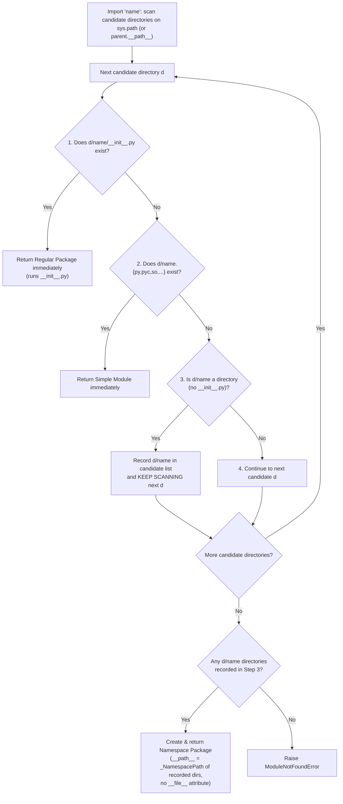

# 3.2 Modules, packages, virtual environments and packaging

| | |
|---|---|
| Level | Beginner to intermediate |
| Priority tier | 0 |
| Lab venue | Any machine with Python 3.11 or newer, internet access for PyPI (or a mirror) |
| Part | Part 3: Python for infrastructure |
| Status | Drafted, labs **untested** |

## Why this matters for AI infrastructure

Most "it works on my machine" failures in ML and infrastructure code are packaging failures: a different NumPy ABI, a PyTorch wheel built for CUDA 12.1 on a node with a 12.4 driver, a transitive dependency that moved overnight, a system Python that a distribution upgrade changed underneath a cron job. Reproducible environments are also a security and compliance topic (what exactly runs in production?) and a performance topic (container image size, import time, cold start). This chapter covers how Python finds and runs code (modules, packages, the import system), how to isolate and reproduce environments (venv, pip, uv, pip-tools, Poetry, conda), how to structure and ship your own tools (pyproject.toml, wheels, entry points, private indexes), and the specific problems of Python on GPU machines and in containers.

## Prerequisites and outcomes

You should know the core language (chapter 3.1) and basic shell and Git.

After this chapter you can:

- Explain what a module, package, namespace package and script are; how `import` searches and caches (`sys.path`, `sys.modules`, finders/loaders, `.pyc`), absolute vs relative imports, `__init__.py`, `__all__`, `__main__`, circular imports and how to avoid them.
- Design a project layout (src layout), write `pyproject.toml`, define dependencies, optional extras, console-script entry points and plugin entry points.
- Create and use virtual environments; use `pip`, `pip-tools`, `uv`, Poetry/PDM/Hatch, pipx and conda appropriately; pin and lock dependencies, verify hashes, audit vulnerabilities.
- Build and publish wheels and sdists; use private indexes and mirrors; version with SemVer/CalVer; understand platform tags (manylinux, CUDA local versions).
- Deal with system Python (PEP 668 "externally managed"), multiple Python versions (pyenv, uv python, deadsnakes), containers, and the ABI/CUDA problems of ML packages.
- Debug import errors, dependency conflicts and "wrong interpreter" problems.

## 1. Modules

A **module** is a single Python file (or a built-in/extension module) providing a namespace of names. Importing it **executes its top-level code once** and caches the resulting module object. Modules are the unit of code reuse and of namespace separation.

```python
# util.py
import math
PI_APPROX = 3.14159
def circle_area(r): return math.pi * r * r
print("util loaded")       # side effects at import time: avoid in libraries
```

```python
import util                       # binds the name util to the module object
from util import circle_area      # binds the function name directly
from util import circle_area as area
import util as u
import os.path as osp
```

- `import X` runs the module body the first time; later imports in the same process reuse `sys.modules["X"]` (so a module's global state is a **process-wide singleton**).
- `from X import *` imports all public names (everything in `__all__` if defined): avoid except in `__init__` re-exports; it pollutes namespaces and defeats linters.
- Module attributes: `__name__`, `__file__`, `__doc__`, `__package__`, `__spec__`, `__all__`; inspect with `dir(module)`.
- **Reloading** (`importlib.reload`) re-executes the module in the same namespace; it is a development convenience, not a production update mechanism.
- Keep import-time code cheap and side-effect free: no network calls, no reading config files, no starting threads, no heavy imports at module top level in CLI tools (import inside functions when startup time matters; measure with `python -X importtime`).

### `import` versus `from`: shared references, cross-file mutation, and `reload()`

When a program grows beyond a single script, you split it into a top-level script file (`a.py`) that orchestrates execution and one or more module files (`b.py`, `c.py`) that define reusable tools as attributes. Suppose `b.py` defines `def job(tool): print(tool, 'coder')` and `a.py` runs `import b; b.job('Python')` to print `Python coder`. Module filenames should end in `.py`, and because the filename without `.py` becomes a Python variable name on import, both module filenames and package folder names must follow standard variable naming rules: letters, digits, and underscores only, with no spaces or reserved keywords (`import if` raises a `SyntaxError`). Alongside your own modules, Python ships with roughly 300 standard-library modules (`len(sys.stdlib_module_names)` in Python 3.10+) plus statically linked C built-ins (`sys.builtin_module_names`, such as `sys`, where `sum(1 for m in sys.builtin_module_names if m[0] != '_')` counts the 11 public built-in names) and frozen startup modules (`os` in Python 3.11+).

Both `import` and `from` are executable runtime statements—not compile-time declarations like C's `#include`—so they can appear inside `if sometest: from moduleA import name else: from moduleB import name` branches or `try` blocks and are resolved only when execution reaches them. Conceptually, `from module import name1, name2` runs `import module`, assigns `name1 = module.name1` and `name2 = module.name2` in the importer's scope, and deletes `module` (`del module`) from the importer's scope. Note also that `from module import *` can only be used at the top level of a module file and raises a `SyntaxError` inside a `def` function body because it would prevent Python from statically determining the function's local variables at compile time. Because `from` copies object references into local variables rather than creating a two-way link back to the source module, rebinding, in-place mutation, name collisions, and reloading behave differently:

- **Rebinding a copied name vs mutating a module attribute:** Assigning `x = 99` (or `X = 88` in the book's `nested.py` example `X = 99; def printer(): print(X)`) after `from mod import x` only rebinds the importer's local variable; `mod.x` is unchanged and `printer()` still prints `99`. To change the attribute inside the loaded module itself so other importers see the new binding, qualify through the module object (`import nested; nested.X = 88`).
- **Mutating a shared mutable object in place:** If `y` refers to a mutable object such as a list, mutating it in place (`y[0] = 'hack'`) modifies the shared list object itself and is visible in both the importer and the source module.
- **When `import` (or `as` renaming) is required:** If two modules `M.py` and `N.py` both define `def func(): ...`, running `from M import func` followed by `from N import func` in `O.py` silently overwrites the first reference so `func()` calls `N.func` only. To use both, you must either keep the enclosing module namespaces distinct (`import M, N; M.func(); N.func()`) or rename them with the `as` clause (`from M import func as mfunc; from N import func as nfunc`). Conceptually, `import modulename as name` runs `import modulename; name = modulename; del modulename`, and `from modulename import attrname as name` runs `from modulename import attrname; name = attrname; del attrname`. This `as` clause also lets you shorten long package paths (`import dir1.dir2.mod as mod`) or alias a renamed library (`import newname as oldname`).
- **Why `importlib.reload(mod)` does not update `from` imports:** `reload(mod)` is a function (moved from a Python 2 built-in to `imp.reload` to `importlib.reload` in Python 3) that takes an already loaded module object—or `reload(sys.modules['changer'])`—and re-executes the module file's top-level statements in place, overwriting `mod.__dict__` without deleting and recreating the module object. In the book's `changer.py` example (`message = 'First version'; def printer(): print(message)` edited to `message = 'After editing'; def printer(): print('reloaded:', message)`), a second `import changer` does nothing because `changer` is already in `sys.modules`, whereas `from importlib import reload; reload(changer)` updates `changer.printer()` in place. Callers that access attributes via `changer.printer()` immediately see the updated objects, whereas callers that previously ran `from changer import printer` still hold references to the old function object acquired before the reload until they re-run `from changer import printer`.

```python
# In the book's init.py, share.py, and changer.py examples (untested here):
# init.py: print('hello'); flag = 1 -> runs once on first import; second import init keeps init.flag = 2
# share.py:
# x = 1
# y = [1, 2]

from share import x, y       # copies references into the importer's namespace
x = 'hack'                   # rebinds only the importer's local x; share.x is still 1
y[0] = 'hack'                # mutates the shared list in place; share.y is now ['hack', 2]

import share
share.x = 23                 # mutates the module attribute across files
```

### Module namespaces (`__dict__`), lexical scoping, and downward attribute paths

Every top-level assignment in a module file (`=`, `def`, `class`, `import`) creates an attribute in the module's namespace, which lives on after the import completes as a standard Python dictionary exposed at `module.__dict__` (or `vars(module)`). In the book's `spaces.py` example (`print('starting to load...'); import sys; var = 23; def func(): pass; class klass: pass; print('done loading.')`), importing `spaces` executes the statements top to bottom and populates `spaces.__dict__` with built-in dunder metadata (`__name__`, `__doc__`, `__package__`, `__loader__`, `__spec__`, `__file__`, `__cached__`, `__builtins__`) alongside `'sys'`, `'var'`, `'func'`, and `'klass'`. For any module, `spaces.var` and `spaces.__dict__['var']` return the same value (`23`), `vars(spaces) == spaces.__dict__` is `True`, and `dir(spaces) == sorted(spaces.__dict__)` is `True`:

```python
# Inspecting user-assigned names in a module namespace (LP Ch. 23 spaces.py, untested here):
# >>> list(name for name in spaces.__dict__ if not name.startswith('__'))
# ['sys', 'var', 'func', 'klass']
# >>> dir(spaces) == sorted(spaces.__dict__) == sorted(vars(spaces))
# True
```

Attribute qualification (`X.Y.Z`) and lexical scope lookup (`LEGB`) follow distinct rules:
- **Unqualified names (`X`)** search the current file's lexical scopes (**L**ocal, **E**nclosing, **G**lobal, **B**uilt-in). Imports never grant upward visibility: an imported module cannot see names in the file that imported it, and a function's global scope is forever the module file where that `def` was physically written. In the book's `lex1.py` (`X = 88; def f(): global X; X = 99`) and `lex2.py` (`X = 11; import lex1; lex1.f(); print(X, lex1.X)`), running `python3 lex2.py` prints `11 99` because `lex1.f()` mutates `lex1.X` (`99`) without touching `lex2.X` (`11`).
- **Qualified attribute paths (`X.Y.Z`)** find the leftmost name `X` via `LEGB`, and then traverse object attribute dictionaries from left to right (`getattr(getattr(X, 'Y'), 'Z')`). Because `import` assigns module objects to attributes inside the importing module, namespaces nest downward along import chains. In the book's `nest3.py` (`X = 3`), `nest2.py` (`X = 2; import nest3; print(X, end=' '); print(nest3.X)`), and `nest1.py` (`X = 1; import nest2; print(X, end=' '); print(nest2.X, end=' '); print(nest2.nest3.X)`), running `python3 nest1.py` prints `2 3` followed by `1 2 3` because `nest1` can traverse `nest2.nest3.X` downward even though `nest3` cannot see `nest2` or `nest1` (and note that `nest1` cannot write `import nest2.nest3` unless `nest2` is a directory package).

### Data hiding (`_X`, `__all__`, `__getattr__`, `__dir__`), `__future__`, and `__name__ == '__main__'`

Python modules work best when designed with **high cohesion** (a unified purpose) and **low coupling** (communicating via function arguments and return values rather than mutating globals across files). Because every code snippet in Python executes inside some module (even the interactive REPL runs inside the built-in module `__main__`), Python modules have no enforced `private` keyword; all top-level names are exported attributes. Two conventions control what `from module import *` copies out, and two special module hooks customize dynamic attribute lookup:

- **Single leading underscore (`_X`):** When `__all__` is not defined, `from module import *` skips any top-level name starting with a single underscore (in the book's `unders.py` example `a, b, _c, _d = 1, 2, 3, 4`, `from unders import *` copies only `a` and `b`, whereas `from unders import _c` and `import unders; unders._d` still access `_c` and `_d`).
- **Explicit export list (`__all__`):** Assigning a list of name strings to `__all__` at the top level of a module tells `from module import *` to copy **only** those listed names—taking precedence over the `_X` rule (in the book's `alls.py` example `__all__ = ['a', '_c']; a, b, _c, _d = 1, 2, 3, 4`, `from alls import *` copies `a` and `_c`, but not `b` or `_d`). Neither `_X` nor `__all__` blocks explicit access via `import alls; alls.b, alls._d` or `from alls import a, b, _c, _d`.
- **Module-level `__getattr__` and `__dir__` (Python 3.7+, PEP 562):** If a module defines `def __getattr__(name):`, Python calls it whenever an outside client fetches an attribute `mod.name` (or `from mod import name`) that does not exist in `mod.__dict__`; defining `def __dir__():` customizes the list returned by `dir(mod)` (replacing the older trick of replacing `sys.modules[__name__]` with a class instance). Inside the module itself, bare global variable lookups do **not** trigger `__getattr__` (`print(test)` inside `gamod.py` raises `NameError`), and assigning `gamod.hack = 'real'` from outside creates a real key in `gamod.__dict__` that bypasses `__getattr__` on future reads (a later proposal to add module-level `__setattr__` was rejected by the Python steering committee):

```python
# In the book's Example 25-3 gamod.py (tested in code/part03/python_modules_packaging_lab.py):
var = 2                               # real attribute returned directly from __dict__
def __getattr__(name):                # undefined attribute fetches routed here
    print(f'(virtual {name})', end=' ')
    match name:
        case 'test':
            return name * var         # gamod.test -> 'testtest'
        case 'hack' | 'code':
            return name.upper()       # gamod.hack -> 'HACK', gamod.code -> 'CODE'
        case _:
            raise AttributeError(f'{name} is undefined')

def __dir__():
    return ['var', 'test', 'hack', 'code']
```

- **Gradual language migrations (`from __future__ import featurename`):** Placed as the very first executable statement in a module (after any docstring or comments), `from __future__ import ...` turns on per-module compiler features (such as `from __future__ import annotations` or historical `generator_stop` / Python 2-to-3 bridges); feature names are kept permanently in `__future__` so older imports never break on newer Pythons.
- **Dual-mode files (`if __name__ == '__main__':`):** Python sets each module's built-in `__name__` attribute to `'__main__'` when the file is executed directly as a top-level script (`python3 dualmode.py` or `python3 minmax.py`), and to the module's import name (`'dualmode'` or `'minmax'`) when imported by another file. Wrapping self-test or CLI runner logic (`def minmax(test, *args): ...` with `lessthan` and `grtrthan` in the book's `minmax.py`) inside `if __name__ == '__main__':` lets the same file serve as both an importable library and a self-testing standalone script (distinct from a package directory's `__main__.py` bundle entry point).

When a module is first imported (or reloaded), Python executes its top-level statements sequentially from top to bottom:

- **Top-level code** runs immediately as Python reaches each line and cannot reference names assigned lower in the file.
- **Function bodies (`def`)** do not run until the function is called. A function can reference names defined later in the file as long as those definitions have executed by the time the function is called:

```python
# In the book's forward-reference example (untested here):
# func1()              # NameError: func1 not yet assigned

def func1():
    print(func2())     # OK when called after func2 is defined

# func1()              # NameError: func2 not yet assigned when func1 runs here

def func2():
    return "Hello"

func1()                # OK: both func1 and func2 have been assigned -> prints "Hello"
```

### Module introspection (`mydir.py`), dynamic string imports, and transitive reloaders (`reloadall.py`)

Because Python exposes module internals as ordinary attributes and dictionaries, you can write metaprograms that inspect, import, and reload other modules generically:

- **Six ways to reach the same module attribute:** Once `import minmax, sys` has run, all six expressions evaluate to the exact same function object (`True` when chained with `is`):
  `minmax.lessthan is minmax.__dict__['lessthan'] is vars(minmax)['lessthan'] is sys.modules['minmax'].lessthan is getattr(minmax, 'lessthan') is sys.modules['minmax'].__dict__['lessthan']`.
  The book's `mydir.py` (`Example 25-6`, with `sepchr = '-'`, `seplen = 60`, and `def listing(module, verbose=True, unders=True):`) iterates `for (count, attr) in enumerate(sorted(module.__dict__)):` to format an indexed attribute inventory of any module (`listing(mydir)` or `listing(tkinter, unders=False)`), and tools like `mydir.listing` can be preloaded into interactive sessions via the `PYTHONSTARTUP` environment variable.
- **Importing a module by runtime name string (`exec` vs `__import__` vs `importlib.import_module`):** Because `import 'string'` is a `SyntaxError` and `x = 'string'; import x` looks for `x.py`, loading a module whose name arrives as a runtime string (from a CLI flag, config file, or plugin registry) uses one of three tools:
  1. `exec('import ' + modname)` compiles and executes an import statement in the current scope (slowest, and never run on untrusted strings).
  2. `mod = __import__(modname)` calls the built-in import hook directly.
  3. `mod = importlib.import_module(modname)` is the preferred standard-library wrapper.
  **Crucial difference on dotted package paths:** For `'email.message'`, `__import__('email.message')` returns the **leftmost top-level package** (`<module 'email'>`), whereas `importlib.import_module('email.message')` returns the **rightmost target submodule** (`<module 'email.message'>`, and also accepts a `package=` argument to resolve leading-dot relative imports).
- **Transitive module reloading (`reloadall.py`, `reloadall2.py`, `reloadall3.py`):** If module `ra.py` (`import rb; X = 1`) imports `rb.py` (`import rc; Y = 2`) which imports `rc.py` (`Z = 3`), calling `importlib.reload(ra)` reloads **only `ra`**—leaving `ra.rb.Y` and `ra.rb.rc.Z` with their old values because `import rb` inside `ra.py` is a no-op once `rb` is in `sys.modules`. To reload an entire import graph transitively, the book's `reloadall.py` walks `module.__dict__.values()`, checks `type(attrobj) == types.ModuleType`, wraps `reload(module)` inside a defensive `try / except` (`tryreload`, because built-in or special modules like `sys.monitoring` in Python 3.12 cannot be reloaded and raise an exception), and tracks visited modules in a `visited` dictionary or `set()` to avoid infinite loops on circular imports or redundant diamond paths. The book contrasts three implementations: `reloadall.py` (recursive with a `visited = {}` dict), `reloadall2.py` (refactored recursive over `obj.__dict__.values()` with a `visited = set()`), and `reloadall3.py` (non-recursive explicit stack using `while objects: next = objects.pop()` and `objects.extend(next.__dict__.values())`), verifying order-neutral equivalence via `set(res2) == set(res3)` across `os.popen('python3 reloadall.py tkinter').readlines()`.

### How imports work (3 steps) and the 5-component module search path

When a program imports a module for the first time, Python checks `sys.modules` (`sys.modules['os'] is os`) and, if not already loaded, executes **three runtime steps**:
1. **Find it:** Locate the module file (or package directory, C extension `.so`/`.pyd`, frozen module, or ZIP component) via the finders on `sys.meta_path`, which scan the module search path (`sys.path`) from left to right after first checking built-in modules (`sys.builtin_module_names`) and frozen modules.
2. **Compile it (maybe):** If a source `.py` file is found, check `__pycache__/` for a usable `.pyc` bytecode file matching three criteria: (a) a compatible bytecode format **magic number**, (b) an up-to-date source check via either the default **timestamp-based** (last-modified timestamp and file size) or **hash-based** (`compileall` / `py_compile` with `--check-hash-based-pycs`) header, and (c) the running interpreter's **implementation and version tag** in the filename (allowing `codefile.cpython-312.pyc`, `codefile.cpython-38.pyc`, and `codefile.pypy310.pyc` to coexist in `__pycache__/` without contention). Note that Python only writes `.pyc` files for **imported** modules, never for the top-level script launched directly (unless precompiled via `python3 -m compileall -b -l .` for bytecode-only delivery).
3. **Run it:** Execute the compiled bytecode from top to bottom in the new module object's namespace.

Python initializes the `sys.path` list at startup by concatenating **five search-path components** in order:

1. **The home directory of the program (automatic):** The directory containing the top-level script being run (or `''`, representing the current working directory, in the interactive REPL and `-c`/`-m` invocations; note that import search paths are completely separate from `os.getcwd()` used for relative file I/O).
2. **`PYTHONPATH` directories (configurable):** A colon-separated (`:` on Unix/macOS, e.g., `/Users/me/pycode/utilities:/Volumes/ssd/pycode/package1`) or semicolon-separated (`;` on Windows, e.g., `C:\Users\me\pycode\utilities;d:\pycode\package1`) list of user directories (or `.zip` archives) set in the shell environment (`export PYTHONPATH=...`).
3. **Standard-library directories (automatic):** The directories (and `python312.zip`) holding Python's standard library (`PYTHONHOME` can relocate these).
4. **The `site-packages` directory (automatic):** Where third-party extensions are installed by `pip`.
5. **Any `.pth` path-file directories (configurable):** Plain text files with a `.pth` suffix (such as `mypath.pth`) placed inside `site-packages` listing one directory per line; the `site` module appends these directories near the end of `sys.path` for all users of that Python installation (whereas a `._pth` file overrides default `sys.path` computation). Programs running under restricted service accounts (such as a web server user `nobody` that cannot rely on shell `PYTHONPATH` settings) can also mutate `sys.path` at runtime via `sys.path.append('/Users/me/pycode4')` or `sys.path.insert(0, ...)` for the duration of that process.

```bash
python3 -c 'import sys; print("\n".join(sys.path))'
python3 -c 'import json, sys; print(json.__file__)'
python3 -m site        # shows sys.path, user site, and whether a venv is active
PYTHONPATH=/opt/mylib python3 app.py        # extend the path (prefer proper installation)
```

**Shadowing trap**: a local file named like a standard or installed module (`json.py`, `random.py`, `requests.py`, `test.py`) shadows the real one because the script directory is first on `sys.path`; the symptom is baffling `AttributeError`s or circular import errors. Name your files carefully and never run Python from inside a directory that contains such files when importing the real ones. (The same advice applies to untrusted download directories: Python executes whatever it imports; use `python -I` for isolated mode.)

### `.pyc` and bytecode caches

Compiled bytecode is cached in `__pycache__/name.cpython-312.pyc`, invalidated by source timestamp or hash. For containers and read-only file systems you can pre-compile (`python -m compileall`), set `PYTHONDONTWRITEBYTECODE=1` to skip writing, or use `PYTHONPYCACHEPREFIX` to relocate caches.

## 2. Packages

A **package** is a directory of modules, importable as a hierarchical namespace. When you write a dotted import path like `import dir1.dir2.mod` or `from dir1.dir2.mod import var`, the leftmost name (`dir1`) must live inside a container directory (`dir0`) on `sys.path`, while the remaining period-separated names map platform-neutrally to subdirectories (`dir0/dir1/dir2/mod.py` on Unix or `dir0\dir1\dir2\mod.py` on Windows). You can never write filesystem syntax like `import C:\dir1` or `import /Users/me/dir1` directly in an `import` statement; platform paths belong in `sys.path` / `PYTHONPATH` / `.pth`, and dotted identifiers belong in `import`.

```text
myops/
├── __init__.py          # makes it a regular package; runs on first import
├── config.py
├── clients/
│   ├── __init__.py
│   ├── redfish.py
│   └── slurm.py
└── cli.py
```

```python
import myops.config
from myops.clients import redfish
from myops.clients.slurm import submit
```

### Why packages exist: resolving `system1/utilities.py` vs `system2/utilities.py`

In the book's *A Tale of Two Systems* (`LP` Chapter 24), suppose `system1/` contains `utilities.py`, `main.py`, and `other.py`, and `system2/` also contains its own `utilities.py`, `main.py`, and `other.py`. As long as you launch `python3 system1/main.py` or `python3 system2/main.py` separately, each script's home directory is first on `sys.path`, so `import utilities` loads its own file without conflict. However, if a third script `mycode/myfile.py` needs functions from **both** `utilities.py` files and you add both `system1` and `system2` to `PYTHONPATH`, the linear left-to-right scan of `sys.path` always picks whichever directory appears first—making the second `utilities.py` unreachable. Placing both directories under a common `root/` on `sys.path` solves the collision cleanly via package imports (`import system1.utilities; import system2.utilities; system1.utilities.function('hack'); system2.utilities.function('code')`),just as standard-library packages (`from email.message import Message`, `from tkinter.filedialog import askopenfilename`, `from http.server import CGIHTTPRequestHandler`) isolate their modules inside package namespaces.

### Dotted package walkthrough (`dir0/dir1/dir2/mod.py`), `__init__.py` roles, and `__main__.py`

Consider the book's nested package structure `dir0/dir1/mod.py` (`var = 'hack'; print('Loading dir1.mod')`) and `dir0/dir1/dir2/mod.py` (`var = 'code'; print('Loading dir1.dir2.mod')`), with `dir1/__init__.py` (`var = 'Python'; print('Running dir1.__init__.py')`) and `dir1/dir2/__init__.py` (`var = 3.12; print('Running dir1.dir2.__init__.py')`):

- **Importing a root package does not automatically load nested submodules:** Because folder module objects do not go back to the filesystem on attribute fetches, running `import dir1` alone and then evaluating `dir1.dir2.mod.var` raises `AttributeError: module 'dir1' has no attribute 'dir2'`. You must explicitly import the full dotted path (`import dir1.dir2.mod`, which runs `dir1/__init__.py`, then `dir1/dir2/__init__.py`, then `dir1/dir2/mod.py` on first import), or shorten access with `from dir1.dir2.mod import var`, `from dir1.dir2 import mod`, or `import dir1.dir2.mod as mod`. Similarly, `reload(dir1)` only reloads `dir1/__init__.py`, not `dir1.dir2` or `dir1.dir2.mod` unless you use a transitive reloader (`reload_all(dir1)`).
- **The four roles of `__init__.py`:** (1) *Package initialization hook* run automatically the first time Python imports through that directory; (2) *Module namespace initialization* providing the attribute dictionary for the directory's module object (`dir1.var == 'Python'`, `dir1.dir2.var == 3.12`, or holding `__version__` and re-exporting public symbols); (3) *Package indicator for search* declaring a regular package so it wins precedence over accidental same-named directories later on `sys.path`; and (4) *`from package import *` export control* via `__all__ = ['mod']`, which lists the nested submodules that `from dir1 import *` should automatically import (note that package `__init__.py` files are completely distinct from class `__init__` constructor methods).
- **Package `__main__.py` bundle execution vs `python3 -m`:** Adding `dir1/__main__.py` (`print('Executing dir1.__main__.py')`) and `dir1/dir2/__main__.py` lets users launch a folder (or a `.zip` archive on `sys.path`) like an application bundle:
  - Direct directory execution (`python3 dir1` or `python3 dir1/dir2`) runs `__main__.py` directly **without** running the package's `__init__.py` and sets the script's home directory to `dir1/`.
  - Module-mode execution (`python3 -m dir1` or `python3 -m dir1.dir2`) activates the full package machinery, running `dir1/__init__.py` (and `dir1/dir2/__init__.py`) first before executing `__main__.py`.
- **Relative imports (`from . import mod`) vs absolute package imports (`import dir1.mod`) in `__main__.py`:**
  1. If `dir1/__main__.py` writes a plain `import mod` (`Example 24-7`), `python3 dir1` and `python3 dir1/__main__.py` succeed (because `dir1/` is the home directory), but `python3 -m dir1` fails with `ModuleNotFoundError: No module named 'mod'` because absolute imports skip the enclosing package.
  2. If `dir1/__main__.py` writes a relative import `from . import mod` (`Example 24-8`), `python3 -m dir1` and `python3 -m dir1.__main__` succeed, but `python3 dir1` and `python3 dir1/__main__.py` fail with `ImportError: attempted relative import with no known parent package`. Relative imports (`from . import module`, `from .module import name`, `from .. import module`, `from ..module import name`) work **only** in `from` statements inside package components, search **only** the enclosing package hierarchy (skipping `sys.path` and built-in/frozen prechecks so external modules cannot shadow package internals), and cannot be run as direct scripts.
  3. If `dir1/__main__.py` writes a full package-root path `import dir1.mod` (or `from dir1 import mod`, `Example 24-9`) with the container directory on `sys.path` (`export PYTHONPATH=.`), **all four launch commands** (`python3 dir1`, `python3 dir1/__main__.py`, `python3 -m dir1`, and `python3 -m dir1.__main__`) succeed.

### Four import models, PEP 420 namespace packages (`__path__`), and the 4-step search algorithm

Over Python's evolution, four import models emerged: (1) *Basic modules* (`import module`), (2) *Basic / regular packages* (`import folder.folder.module` with `__init__.py`), (3) *Package-relative imports* (`from . import module`), and (4) *Namespace packages* (PEP 420, `import anyfolder.anyfolder.module` without `__init__.py`, potentially spanning multiple directories).

To reconcile regular packages, simple modules, and namespace packages, Python runs a **four-step module search algorithm** across the candidate directories (`sys.path` at the top level, or the parent package's `__path__` for nested imports):



Notice the critical precedence rule in Step 3: when Python sees a bare directory `d/name` without `__init__.py`, it **does not stop**—it records `d/name` and continues scanning the rest of `sys.path`. Only if the entire scan finishes without finding a regular package (`d/name/__init__.py` in Step 1) or a simple module (`d/name.py` in Step 2) anywhere on `sys.path` does Python assemble a **namespace package** whose `__path__` attribute (`_NamespacePath([...])`, with no `__file__` attribute) virtually concatenates all recorded directories. Even an empty `__init__.py` file therefore guarantees that your package is selected in Step 1 rather than being overridden by a module later on `sys.path` or merged into a namespace package.

In the book's split-directory namespace demo (`Examples 24-10` to `24-12`), `ns/part1/sub/mod1.py` (`print('Loading ns/part1/sub/mod1')`) and `ns/part2/sub/mod2.py` (`print('Loading ns/part2/sub/mod2')`) sit in two separate parent directories with no `__init__.py` files anywhere. Setting `export PYTHONPATH=ns/part1:ns/part2` and running `import sub.mod1; import sub.mod2` creates a single virtual namespace package `sub` (`<module 'sub' (namespace) from ['.../ns/part1/sub', '.../ns/part2/sub']>`), and adding `from . import mod2` inside `ns/part1/sub/mod1.py` resolves `mod2` across the physical directory boundary into `ns/part2/sub/mod2.py`.

### Circular (`recursive`) imports: why `import recur1` fails while `import recur2` succeeds

When two modules import each other, Python does **not** enter an infinite loop because it registers the new module object in `sys.modules` **before** executing the file's top-level statements. However, a circular `from` import can catch a module while its namespace is only partially initialized. In the book's `recur1.py` (`Example 25-11`: `X = 1; import recur2; Y = 2`) and `recur2.py` (`Example 25-12`: `from recur1 import X; from recur1 import Y`):

- Running `import recur1` in the REPL executes `X = 1` in `recur1`, then jumps into `import recur2` **before** `Y = 2` has run. Inside `recur2`, `from recur1 import X` succeeds, but `from recur1 import Y` raises `ImportError: cannot import name 'Y' from partially initialized module 'recur1' (most likely due to a circular import)`.
- Converse case: restarting Python and running `import recur2` first (or running `python3 recur1.py` as a top-level script, where `recur1` is `__main__` rather than `sys.modules['recur1']` so `recur2` is the first module imported) imports `recur1` from top to bottom during `from recur1 import X`, completing `X = 1` (since `recur2` is already in `sys.modules`, `import recur2` is a no-op) and `Y = 2` before `from recur1 import Y` executes.
- **Fixes:** break the cycle by extracting shared helpers into a third module, use `import recur1` and qualify `recur1.Y` inside functions (after both modules finish loading), move the `from` import to the bottom of the file or inside a function body, or guard type-annotation-only imports with `if typing.TYPE_CHECKING:`.
- **Lazy imports and plugin discovery**: `importlib.import_module("pkg.plugins." + name)`, `importlib.metadata.entry_points(group="myops.plugins")` allow extension without hard-coded imports (section 6).
- **Data files** inside packages: use `importlib.resources.files("myops") / "templates/x.j2"` instead of paths relative to `__file__`, so zip/wheel installs work.

### Typical project layout (src layout)

```text
myops/
├── pyproject.toml
├── README.md
├── LICENSE
├── src/
│   └── myops/
│       ├── __init__.py
│       ├── __main__.py
│       └── ...
├── tests/
│   └── test_config.py
├── docs/
└── .github/workflows/ci.yml
```

The **src layout** forces you to install the package (`pip install -e .`) to import it in tests, which catches packaging mistakes (missing files, wrong imports) that the flat layout hides because the project root is on `sys.path`.

## 3. Virtual environments

A **virtual environment** is a directory with its own `site-packages` and a `python` executable (symlink or copy) that isolates a project's dependencies from the system and from other projects. Without one, `pip install` modifies shared state and different tools require conflicting versions.

```bash
python3 -m venv .venv                       # create (needs python3-venv package on Debian/Ubuntu)
source .venv/bin/activate                    # sets PATH and VIRTUAL_ENV; 'deactivate' to leave
python -c 'import sys; print(sys.prefix, sys.base_prefix)'     # differ inside a venv
.venv/bin/python -m pip install requests     # no activation needed: call the interpreter directly (best in scripts, cron, systemd)
python -m pip list ; python -m pip freeze > requirements.txt
rm -rf .venv                                 # envs are disposable; never commit them
```

Rules of thumb:

- One environment per project (or per tool); recreate rather than repair.
- Use `python -m pip` (not bare `pip`) so you know which interpreter you install into; `which python` after activation.
- Systemd units, cron jobs and CI should call `/path/to/.venv/bin/python` explicitly; do not rely on activation.
- **Never `sudo pip install`** and avoid installing into the distribution's Python: modern distributions mark it **externally managed** (PEP 668: `error: externally-managed-environment`); use a venv, `pipx` for CLI tools (`pipx install ansible-lint` creates an isolated env per tool), or the distribution package (`apt install python3-yaml`) for system scripts.
- `--system-site-packages` lets a venv see system packages (needed for some distribution-provided bindings like `python3-apt` or GPU vendor packages), at the cost of isolation.
- Environments are tied to the interpreter that created them; upgrading the base Python can break them (rebuild).
- Activate scripts exist for bash/zsh/fish/PowerShell; `direnv` or `uv run` automate activation per directory.

### Managing Python versions

`pyenv` (builds interpreters under `~/.pyenv`), `uv python install 3.12` (downloads standalone builds), Debian/Ubuntu `deadsnakes` PPA, `conda`/`mamba`, or container base images. Pin the minor version in `pyproject.toml` (`requires-python = ">=3.10,<3.13"`), CI matrices and Dockerfiles. The oldest supported Python and deprecation policy of your dependencies (NumPy, PyTorch drop old versions yearly) set your support window.

## 4. Installing and managing dependencies

### pip

```bash
python -m pip install requests                  # latest compatible
python -m pip install "requests>=2.31,<3"       # version specifiers (PEP 440): ==, !=, >=, <=, ~=2.31 (compatible release), *
python -m pip install -r requirements.txt       # from a file
python -m pip install -e .                      # editable install of the current project (dev)
python -m pip install --upgrade pip setuptools wheel
python -m pip install 'torch==2.4.0' --index-url https://download.pytorch.org/whl/cu121   # alternate index (CUDA wheels)
python -m pip install --extra-index-url https://pypi.example.com/simple internal-lib       # additional index: dependency confusion risk!
python -m pip install --require-hashes -r requirements.txt   # integrity-verified install
python -m pip install --no-cache-dir --no-deps pkg           # container tuning / manual resolution
python -m pip check                              # report broken dependency requirements
python -m pip show -f pkg ; python -m pip download pkg -d wheelhouse/ ; python -m pip wheel . -w dist/
python -m pip uninstall pkg ; python -m pip cache purge
```

pip's **resolver** (since 20.3) backtracks to find a consistent set; failures print `ResolutionImpossible` with the conflicting constraints. **Extras**: `pip install "myops[redfish,slurm]"`. **Constraints files** (`-c constraints.txt`) restrict versions without adding requirements. **Environment markers**: `pywin32; sys_platform == "win32"`, `importlib-metadata; python_version < "3.10"`.

### Declaring dependencies: libraries vs applications

- A **library** declares *abstract* compatible ranges (`requests>=2.28,<3`) so it composes with other packages.
- An **application / deployment** needs a *concrete lockfile*: exact versions of everything (including transitive dependencies) with hashes, so every machine installs the same bits.

```bash
# pip-tools: compile abstract requirements into a fully pinned, hashed lock
pip install pip-tools
printf 'requests>=2.31\npyyaml\nprometheus-client\n' > requirements.in
pip-compile --generate-hashes requirements.in -o requirements.txt
pip-sync requirements.txt                       # make the environment match exactly (removes extras)

# uv (Rust, fast pip/pip-tools/venv replacement)
uv venv ; uv pip install -r requirements.txt ; uv pip compile requirements.in -o requirements.txt --generate-hashes
uv init app ; uv add requests ; uv lock ; uv sync ; uv run python main.py ; uv tool install ruff
# Poetry / PDM / Hatch: project managers with lockfiles (poetry.lock, pdm.lock, uv.lock)
poetry init ; poetry add requests ; poetry lock ; poetry install ; poetry run pytest
```

Why locking matters: an unpinned transitive dependency can change between a CI run and a production rollout, and a compromised or yanked release can enter silently. Practices: commit lockfiles, update deliberately (Dependabot/Renovate pull requests with CI), use hashes, install from a vetted mirror (Artifactory/Nexus/devpi) in production, run `pip-audit` / `safety` for known vulnerabilities, generate an SBOM (`cyclonedx-py`, `syft`), and beware of **dependency confusion** (an internal package name published on PyPI by an attacker: use `--index-url` to your index only, or scoped names/namespaces) and **typosquatting**.

### conda / mamba

`conda` (and faster `mamba`/`micromamba`) manage Python itself plus non-Python libraries (CUDA toolkit pieces, MKL, compilers, `ffmpeg`) from channels (`conda-forge`, `nvidia`, `pytorch`); common in data science and on HPC systems where compiled stacks matter. Prefer one tool per environment: mixing `pip` and `conda` installs in the same environment causes subtle breakage; install conda packages first, then pip packages that conda lacks, and never run `pip` as root. Export with `conda env export --from-history` or `conda-lock` for reproducibility.

### Choosing

| Situation | Tool |
|---|---|
| Quick script with a few dependencies | `python -m venv` + `pip` (or `uv`) |
| Application, reproducible deployment | `pip-tools` or `uv pip compile`/`uv lock` + hashes; container image |
| Library you publish | `pyproject.toml` + Hatch/Flit/setuptools; ranges not pins |
| Global CLI tools | `pipx` / `uv tool` |
| Heavy native scientific stack, HPC | conda/mamba, or system modules (Lmod) + venv |
| Multi-version testing | `tox` / `nox` / CI matrix |

## 5. Packaging your own code

### `pyproject.toml`

The standard (PEP 517/518/621) project file declares the build backend and metadata:

```toml
[build-system]
requires = ["hatchling>=1.24"]
build-backend = "hatchling.build"

[project]
name = "myops"
version = "0.3.1"                       # or dynamic = ["version"] from the package or VCS tags
description = "Operations tooling for the GPU cluster"
readme = "README.md"
requires-python = ">=3.10"
license = { text = "Apache-2.0" }
authors = [{ name = "Platform Team", email = "platform@example.com" }]
dependencies = ["requests>=2.31,<3", "pyyaml>=6", "prometheus-client>=0.20"]
classifiers = ["Programming Language :: Python :: 3", "Operating System :: POSIX :: Linux"]

[project.optional-dependencies]
redfish = ["python-redfish-library>=3"]
dev = ["pytest>=8", "ruff", "mypy", "pip-tools"]

[project.scripts]                         # console_scripts entry points: create 'myops' command
myops = "myops.cli:main"

[project.entry-points."myops.plugins"]    # plugin entry points discovered by importlib.metadata
gpu = "myops.plugins.gpu:Plugin"

[tool.hatch.build.targets.wheel]
packages = ["src/myops"]

[tool.ruff]
line-length = 100
[tool.pytest.ini_options]
testpaths = ["tests"]
```

Other backends: `setuptools` (still common; legacy `setup.py`/`setup.cfg` exist), `flit`, `poetry-core`, `pdm-backend`, `maturin` (Rust extensions), `scikit-build-core` (CMake extensions). Tool configuration (ruff, pytest, mypy, black, coverage) lives in `[tool.*]` tables.

### Building, installing, publishing

```bash
python -m pip install build twine
python -m build                       # creates dist/myops-0.3.1.tar.gz (sdist) and dist/myops-0.3.1-py3-none-any.whl (wheel)
python -m twine check dist/*
python -m twine upload --repository-url https://pypi.example.com/ dist/*   # private index; or 'uv publish'
python -m pip install dist/myops-0.3.1-py3-none-any.whl
python -m pip install -e ".[dev]"     # editable + extras for development
```

- **Wheel** (`.whl`): a prebuilt zip installed by unzipping (fast, no build step). Filename tags: `name-version-pythontag-abitag-platformtag`, e.g. `numpy-1.26.4-cp311-cp311-manylinux_2_17_x86_64.whl`. `py3-none-any` is pure Python. **manylinux** wheels run on most Linux distributions with a compatible glibc; **musllinux** wheels target Alpine (musl). If no compatible wheel exists, pip builds from the **sdist**, which needs compilers and headers (the usual reason an install takes 10 minutes or fails in a slim container).
- **Local version labels** (PEP 440 `+cu121`) are used by PyTorch index wheels to mark CUDA builds.
- **Versioning**: SemVer (`MAJOR.MINOR.PATCH`) for libraries, CalVer (`2026.10.1`) for tools; derive from Git tags (`hatch-vcs`, `setuptools-scm`) to avoid forgetting to bump; keep a changelog.
- **Console scripts**: the `[project.scripts]` table makes the installer create a launcher in the environment's `bin/`; this is how `pip`, `black` and `pytest` are exposed. The target function (`main()`) should return an exit code or call `sys.exit`.
- **Zipapps**: `python -m zipapp myapp -m "myops.cli:main"` or `shiv`/`pex` build single-file executables bundling dependencies, handy for shipping tools to servers without internet (Python still required). **PyInstaller**/`Nuitka` create standalone binaries.
- **Private indexes**: run a PyPI-compatible server (devpi, Artifactory, Nexus, GCP Artifact Registry, AWS CodeArtifact, GitLab/GitHub packages); configure clients via `pip.conf` / `PIP_INDEX_URL` / `uv` index settings; authenticate with tokens (keyring helpers), not passwords in files; mirror public packages you rely on.
- **Signing and provenance**: PyPI trusted publishing (OIDC from GitHub Actions, no long-lived tokens), Sigstore attestations, `pip install --require-hashes`.

### Native extensions

Packages with C/C++/Rust/CUDA code (NumPy, PyTorch, cryptography, grpcio) ship compiled `.so` files in wheels; they bind to the Python ABI (`cp311` tags or the stable ABI `abi3`), to the CPU architecture (x86_64, aarch64 for Grace/ARM hosts), to libc, and for GPU packages to CUDA runtime versions and the NVIDIA driver. This is where reproducibility gets hard.

## 6. Plugins and entry points

Entry points let installed distributions advertise components to other programs without imports being hard-coded (pytest plugins, Ansible/Click commands, Prometheus collectors).

```python
from importlib.metadata import entry_points, version, metadata
for ep in entry_points(group="myops.plugins"):       # discover
    plugin_cls = ep.load()                            # imports 'myops.plugins.gpu:Plugin'
    plugin_cls().register(registry)
print(version("myops"), metadata("myops")["Summary"])
```

Design guidance: define a small base class or Protocol (chapter 3.4) for plugins; load lazily; isolate failures (one broken plugin should not crash the host: catch and log); document the entry-point group name as part of the public API.

## 7. Python packaging on GPU and ML systems

- **PyTorch/TensorFlow/JAX wheels are CUDA-specific.** PyTorch publishes separate wheels per CUDA minor version on dedicated indexes (e.g. `https://download.pytorch.org/whl/cu121`); the default PyPI wheel bundles a CUDA runtime via `nvidia-*-cu12` packages (large). The **driver** on the host must be new enough for the CUDA runtime in the wheel (driver forward compatibility: a newer driver runs older CUDA runtimes; the reverse fails with "CUDA driver version is insufficient"). `torch.version.cuda`, `torch.cuda.is_available()`, `nvidia-smi` (driver and max supported CUDA), and `python -c "import torch; print(torch.__file__)"` verify.
- **Do not mix a system CUDA toolkit with wheel-bundled runtimes unintentionally**: `LD_LIBRARY_PATH` pointing to a different CUDA can load the wrong `libcudart`/`libcublas`/`libnccl`. Prefer wheel-bundled libraries or the NGC container's consistent stack.
- **NGC containers** (`nvcr.io/nvidia/pytorch:24.xx-py3`) bundle Python, PyTorch, CUDA, cuDNN, NCCL, Apex, TransformerEngine and tuned builds; use them as base images and add your pure-Python dependencies with a constraints file derived from the image (`pip freeze` inside) so you don't accidentally replace the tuned PyTorch with a PyPI wheel (the classic "pip install broke torch" incident).
- **ABI hazards**: NumPy 2.x changed the C ABI; packages compiled against NumPy 1.x fail with "module compiled using NumPy 1.x cannot be run in NumPy 2.x". Pin consistently; rebuild extensions; use `pip check`.
- **Architectures**: aarch64 (Grace Hopper/Blackwell hosts, Apple silicon) may lack wheels for some packages; sdist builds take long and need toolchains; verify wheel availability early (`pip download --only-binary=:all: --platform manylinux2014_aarch64 ...`).
- **Compilation**: building flash-attn, apex, xformers or custom CUDA extensions requires matching `nvcc`, a compatible GCC, correct `TORCH_CUDA_ARCH_LIST` (e.g. `9.0` for Hopper), enough RAM (`MAX_JOBS`), and takes tens of minutes; cache built wheels (`pip wheel`, `wheelhouse/`, internal index) instead of rebuilding on every node.
- **HPC**: use environment modules (Lmod) for compilers/MPI/CUDA and create venvs/conda envs on shared filesystems carefully (metadata-heavy `import` storms on Lustre/NFS slow startup; copy environments to node-local NVMe, use `python -X importtime`, zipimport, or container images; set `PYTHONDONTWRITEBYTECODE` on read-only paths; keep large packages (torch) in a squashfs/container image).
- **Slurm/Kubernetes**: bake environments into images or shared read-only locations; pin by digest; avoid `pip install` at job start (network dependency, rate limits, non-reproducible).
- **Offline/air-gapped**: build a wheelhouse (`pip download -r requirements.txt -d wheelhouse`), mirror indexes, and install with `--no-index --find-links wheelhouse`.

## 8. Containers and system integration

```dockerfile
FROM python:3.12-slim AS build
ENV PIP_NO_CACHE_DIR=1 PYTHONDONTWRITEBYTECODE=1
WORKDIR /src
COPY requirements.txt .
RUN python -m venv /opt/venv && /opt/venv/bin/pip install --require-hashes -r requirements.txt
COPY pyproject.toml ./ ; COPY src/ src/
RUN /opt/venv/bin/pip install --no-deps .

FROM python:3.12-slim
COPY --from=build /opt/venv /opt/venv
ENV PATH=/opt/venv/bin:$PATH PYTHONUNBUFFERED=1
USER 10001
ENTRYPOINT ["myops"]
```

Notes: multi-stage builds keep compilers out of the runtime image; pin base images by digest; run as non-root; `PYTHONUNBUFFERED=1` so logs appear immediately; `PYTHONFAULTHANDLER=1` for crash tracebacks; copy `requirements.txt` before sources to leverage layer caching; slim vs alpine: Alpine uses musl and often lacks wheels (slow builds, subtle differences); distroless images reduce attack surface. For systemd services use a venv path in `ExecStart=/opt/myops/.venv/bin/myops`, `Environment=PYTHONUNBUFFERED=1`, a dedicated user, and `ProtectSystem=` hardening (chapter 1.15).

**System packages vs pip**: for scripts that must run on stock hosts, prefer the distribution's Python and its packaged libraries (`python3-yaml`, `python3-requests`, `python3-psutil`); otherwise ship a venv or zipapp. `ansible` itself uses the system or a venv interpreter (`ansible_python_interpreter`) on targets.

## 9. Troubleshooting imports and environments

| Symptom | Likely cause | Fix |
|---|---|---|
| `ModuleNotFoundError: No module named 'x'` | Wrong interpreter/venv; package not installed; typo; running from a different directory | `which python`, `python -m pip show x`, activate venv, install, `python -c 'import sys; print(sys.path)'` |
| `ImportError: cannot import name 'y' from 'x'` | Version mismatch or circular import or shadowing | Check `x.__file__` and version; look for local `x.py`; restructure imports |
| `AttributeError: module 'x' has no attribute ...` | Shadowed module (`random.py`, `requests.py`) or old version | Rename file; remove `__pycache__`; check version |
| `attempted relative import with no known parent package` | Running a package file as a script | `python -m pkg.module` |
| `externally-managed-environment` | PEP 668 on system Python | Use venv/pipx/distribution package |
| `ResolutionImpossible` | Conflicting constraints | Read the chain; relax pins; use `pip install -vv`; upgrade the culprit; separate environments |
| Works in shell, fails in cron/systemd | Different PATH/interpreter/env | Use absolute venv python path; set `Environment=`; log `sys.executable` |
| `GLIBC_2.xx not found` / illegal instruction | Wheel built for newer glibc/CPU | Use matching manylinux tag/container; build from source |
| `CUDA driver version is insufficient` | Wheel CUDA runtime newer than driver | Upgrade driver or use older CUDA wheel (`cu118`) |
| `numpy.core.multiarray failed to import` / ABI error | NumPy 1/2 mismatch | Align versions; rebuild extensions |
| Slow imports / startup | Heavy top-level imports, network filesystem | `-X importtime`, lazy imports, local copy, container |
| Different behaviour on two nodes | Unpinned dependency drift | Lockfile, hashes, image digests, `pip freeze` diff |

Useful commands: `python -m pip debug --verbose` (supported tags), `python -c 'import platform; print(platform.platform(), platform.machine())'`, `ldd $(python -c 'import torch,os;print(os.path.dirname(torch.__file__)+"/lib/libtorch_cuda.so")')`, `pipdeptree` (dependency tree), `pip index versions pkg`, `python -m trace --listfuncs`, `strace -f -e trace=openat python -c 'import x' 2>&1 | grep -v ENOENT` to see where an import comes from.

## 10. Lab: environments and a packaged tool

First, run the self-checking Python lab (`code/part03/python_modules_packaging_lab.py`) locally. It verifies `import` vs `from` reference copying and `reload()` (`LP` Ch. 23 & 25), the 4-step import search precedence algorithm (`regular_package` with `__init__.py` and `simple_module` beating bare PEP 420 `namespace_package` directories, `LP` Ch. 24), `_X` vs `__all__` export precedence (`unders.py` and `alls.py`), module-level `__getattr__` and `__dir__` (`gamod.py`), `__import__('email.message')` vs `importlib.import_module('email.message')`, and recursive vs explicit-stack transitive reloaders (`reloadall2.py` vs `reloadall3.py`).

```bash
python3 code/part03/python_modules_packaging_lab.py
```

Next, on any machine with Python 3.11+ (all interactive shell steps below are `untested here`), work through these exercises:

1. **Import system**: create `a.py`, `b.py` importing each other (circular, as in `recur1.py` / `recur2.py`) and observe errors; refactor. Create a local `random.py` and see shadowing; remove it. Also write `mymod.py` (`LP` Part V exercises) exporting `countLines(name)`, `countChars(name)`, and `test(name)` (with a `file.seek(0)` single-open variant and an `if __name__ == '__main__':` self-test), import it from `myclient.py`, and package it inside `mypkg/`. Print `sys.path`, `sys.modules` size and use `-X importtime` on a heavy import.
2. **Packages**: build the `myops` package skeleton above with subpackages, relative and absolute imports, `__all__`, `__main__.py`; run with `python -m myops`; reproduce the relative-import-as-script error and explain it.
3. **Virtual environments**: create two venvs with conflicting versions of a library (for example `requests==2.25.1` and the latest); show isolation; call the interpreter directly without activation; inspect `sys.prefix`; try `sudo pip install` on a throwaway VM and note PEP 668 behaviour; use `pipx` for a CLI tool.
4. **Dependency management**: write `requirements.in` with unpinned deps; compile with `pip-compile --generate-hashes`; sync; remove a package and observe `pip-sync` cleaning; do the same with `uv` and compare speed; run `pip-audit`.
5. **pyproject and wheels**: write `pyproject.toml` (Hatch or setuptools), a console script and an entry-point plugin; build sdist and wheel; unzip the wheel and inspect `METADATA`, `entry_points.txt`, `RECORD`; install in a clean venv; run the command; install editable and modify code live.
6. **Private index**: run `devpi-server` (or a local `pypiserver`) in a container; upload your wheel; install it with `--index-url`; demonstrate dependency confusion risk with `--extra-index-url` and the mitigation.
7. **Reproducibility**: build a Docker image with hashed requirements; rebuild after a transitive release (simulate by editing a pin) and compare `pip freeze`; pin the base image by digest; measure image size and import time; add a multi-stage build.
8. **GPU packaging (needs a GPU VM)**: create a venv with a CUDA-specific PyTorch wheel; verify `torch.cuda.is_available()`; break it deliberately with a mismatched `LD_LIBRARY_PATH`; compare with an NGC container; write the `pip check`/`pip freeze` audit commands you would run on every node.
9. **Systemd/cron**: run the tool as a systemd service with the absolute venv interpreter, a dedicated user and `Environment=PYTHONUNBUFFERED=1`; show the same job failing with bare `python3` and fix it.
10. **Clean up** environments and containers.

## 11. Common mistakes

- Installing with `sudo pip`, or into the system Python; using bare `pip` against an unknown interpreter.
- Committing `.venv` or not committing lockfiles; relying on "latest" at deploy time.
- Naming files after standard modules; running scripts from directories with stray `.py` files.
- Heavy work at import time; global state initialised in `__init__.py`.
- Pinning libraries too tightly (breaking downstream users) or applications too loosely (non-reproducible).
- Mixing conda and pip installs carelessly; mixing system CUDA with wheel CUDA.
- Using `--extra-index-url` with private package names; downloading and running unpinned packages on production hosts.
- Installing at runtime in containers and jobs (network flakiness, drift, security).
- Forgetting aarch64 and glibc compatibility; assuming wheels exist.

## 12. Interview angles

- "What happens when you `import x`? Where does Python look?"
- "Difference between a module, a package and a namespace package?"
- "Why use virtual environments? How do you make an environment reproducible?"
- "What is a wheel versus an sdist? What do the tags mean?"
- "How would you deliver a Python tool to 500 servers? To an air-gapped cluster?"
- "A job works on one node and fails on another with the same code. What do you check?" (interpreter, packages, lockfile, CUDA/driver, glibc, CPU, env vars.)
- "How do you avoid dependency confusion and supply-chain risks?"
- "`pip install` of an ML package broke PyTorch in the container; why and how do you prevent it?"
- "How do console scripts and entry points work?"

## Exercises

1. **The 3-Step Import Pipeline, 5-Component Search Path, and Timestamp vs. Hash `.pyc` Files (`LP` Chapter 22):** (a) Trace the three steps Python executes on the first `import b` (after checking `sys.modules`, `sys.builtin_module_names`, and frozen modules) and list the five components concatenated into `sys.path`; (b) explain the three checks Python applies to `__pycache__/codefile.cpython-312.pyc` before skipping compilation, contrast timestamp-based `.pyc` files with hash-based `.pyc` files (`compileall` / `--check-hash-based-pycs`), and explain why top-level scripts do not write `.pyc` files unless `python3 -m compileall -b -l .` is used.
2. **`import` vs. `from` Reference Semantics, Lexical Scoping (`lex1.py`/`lex2.py`), Downward Qualification (`nest1..3.py`), and `reload()` (`LP` Chapter 23):** Using `simulate_import_vs_from_and_reload()` in `code/part03/python_modules_packaging.py`, explain why `from share import x, y; x = 'hack'; y[0] = 'hack'` leaves `share.x == 1` while mutating `share.y` to `['hack', 2]`, why `importlib.reload(share)` updates `share.x` in place without updating `copied_x`, and why `lex1.f()` in `lex2.py` prints `11 99`.
3. **Packages, `__init__.py` & `__main__.py` Modes, Relative vs. Absolute Imports, and the 4-Step Namespace Search Algorithm (`LP` Chapter 24):** (a) Contrast running `python3 dir1` versus `python3 -m dir1` when `dir1/__main__.py` contains `import mod`, `from . import mod`, or `import dir1.mod` (`export PYTHONPATH=.`); (b) using `resolve_four_step_import_search()`, trace the 4-step candidate scan across `['/ns/part1', '/ns/part2']` and explain why adding `/ns/part2/sub/__init__.py` or `/ns/part2/sub.py` overrides a bare directory `/ns/part1/sub` earlier on `sys.path`.
4. **Data Hiding (`_X`, `__all__`, `__getattr__`, `__dir__`), Dynamic String Imports, and Transitive Reloaders (`LP` Chapter 25):** Using `filter_from_star_exports()`, `build_dynamic_getattr_module()`, `compare_dunder_import_vs_import_module()`, `transitive_reload_recursive()`, and `transitive_reload_stack()`, explain: (a) how `__all__ = ['a', '_c']` overrides `_X` in `from alls import *` and how `gamod.py`'s `__getattr__` and `__dir__` work; (b) why `__import__('email.message')` returns `'email'` while `importlib.import_module('email.message')` returns `'email.message'`; and (c) why `reload(ra)` does not reload `rb` or `rc` and how `reloadall2.py` (recursive) and `reloadall3.py` (explicit stack) solve this.
5. **Virtual Environments, PEP 668, Lockfiles (`pip-tools`, `uv`), `pyproject.toml`, and Entry Points:** (a) Explain how `python3 -m venv .venv` isolates packages (`sys.prefix` vs `sys.base_prefix`), why systemd/cron jobs should invoke `/path/to/.venv/bin/python` directly, and why PEP 668 raises `externally-managed-environment`; (b) contrast abstract version ranges in `pyproject.toml` (`dependencies = ["requests>=2.31,<3"]`) with hashed lockfiles (`pip-compile --generate-hashes` / `pip-sync` / `uv lock`), and show how `[project.scripts]` and `[project.entry-points."myops.plugins"]` work with `importlib.metadata.entry_points`.
6. **Wheels (`manylinux`), Dependency Confusion, and GPU / Container Packaging:** (a) Decode the wheel filename `numpy-1.26.4-cp311-cp311-manylinux_2_17_x86_64.whl` vs `py3-none-any.whl` and `+cu121`, and explain why `--extra-index-url` creates a dependency confusion risk compared to `--index-url`; (b) diagnose why `CUDA driver version is insufficient` or `module compiled using NumPy 1.x cannot be run in NumPy 2.x` occurs on a GPU node and how multi-stage Docker builds and NGC constraints prevent it.

## Checkpoint questions (20)

<details>
<summary>1. What is a module, and how do `from mod import x` and `import mod` differ when rebinding `x`, mutating a shared list `y`, or calling `importlib.reload(mod)` (`LP` Chapters 23 & 25)?</summary>

A module is a file (or built-in/extension) providing a namespace executed top-to-bottom once on first import (`sys.modules`). Conceptually, `from share import x, y` runs `import share; x = share.x; y = share.y; del share`:
- **Rebinding (`x = 'hack'` or `X = 88` in `nested.py`):** only rebinds the local variable in the importer; `share.x` (`1`) and `nested.X` (`99`) are unchanged. To change a variable across files, qualify through the module (`import share; share.x = 23`).
- **In-place mutation (`y[0] = 'hack'`):** mutates the shared list object referenced by both modules (`share.y` becomes `['hack', 2]`).
- **`importlib.reload(changer)`:** re-executes the module file in place in its existing `changer.__dict__`; clients using `changer.printer()` see the new function immediately, whereas clients that ran `from changer import printer` still hold a stale reference to the old function until they re-run `from changer import printer`.
</details>

<details>
<summary>2. What are the three runtime steps of an `import` operation, and what five components make up `sys.path` (`LP` Chapter 22)?</summary>

When a module is not yet cached in `sys.modules` (and is not a statically linked built-in in `sys.builtin_module_names` or a frozen module like `os`), Python:
1. **Finds** the module's file by scanning `sys.path` from left to right.
2. **Compiles** the `.py` source to `.pyc` bytecode in `__pycache__/` (if no up-to-date `.pyc` with a matching magic number, timestamp+size or `--check-hash-based-pycs` hash, and interpreter tag like `cpython-312` exists; top-level scripts do not save `.pyc` files unless `python3 -m compileall -b -l .` is used).
3. **Runs** the module's top-level statements sequentially from top to bottom to populate its namespace.
The five components concatenated into `sys.path` are: (1) the top-level script's **home directory** (or `''` CWD in REPL/`-c`/`-m`, separate from `os.getcwd()`), (2) **`PYTHONPATH`** directories, (3) **standard-library** directories (`PYTHONHOME`), (4) **`site-packages`**, and (5) directories listed in **`.pth` path files** (`site` module; or overridden by `._pth` / mutated at runtime via `sys.path.append`).
</details>

<details>
<summary>3. How are module namespaces stored internally, and how does lexical scoping (`lex1.py`/`lex2.py`) differ from downward attribute qualification (`nest1..3.py`) (`LP` Chapter 23)?</summary>

Every module's namespace is stored as a dictionary at **`module.__dict__`** (also returned by `vars(module)`), where `dir(module) == sorted(module.__dict__) == sorted(vars(module))` is `True`.
- **Lexical scoping (`LEGB`):** Unqualified names inside a function search only the physical file where that `def` was written; imports never grant upward visibility (`lex1.f()` in `lex2.py` updates `lex1.X` to `99`, leaving `lex2.X` at `11`).
- **Downward qualification (`X.Y.Z`):** Finds `X` via `LEGB` and then traverses object attributes from left to right (`nest1.py` importing `nest2` which imports `nest3` can read `nest2.nest3.X` to print `1 2 3`, even though `nest3` cannot see `nest2` or `nest1`).
</details>

<details>
<summary>4. What is the shadowing trap, and when must you use `import` (or `as`) instead of `from`?</summary>

Because the script's home directory is the **first entry (`sys.path[0]`)** on `sys.path`, naming a local file `json.py`, `random.py`, `requests.py`, or `test.py` shadows the standard-library or third-party module of the same name (`AttributeError` or circular import failure). You must use `import M, N` (`M.func()`, `N.func()`) or the `as` renaming clause (`from M import func as mfunc; from N import func as nfunc`) whenever two modules define the same attribute name, because running `from M import func` followed by `from N import func` overwrites `func` in the importer's scope.
</details>

<details>
<summary>5. What are the four roles of `__init__.py` in a package, and why does `import dir1` followed by `dir1.dir2.mod.var` fail (`LP` Chapter 24)?</summary>

A package directory's `__init__.py`:
1. Runs **package initialization code** on the first import through that directory.
2. Populates the **module attribute namespace** for the directory object (`dir1.var`).
3. Declares the directory as a **regular package**, giving it Step-1 search precedence over bare directories and modules later on `sys.path`.
4. Controls `from package import *` submodule loading via **`__all__ = ['mod']`**.
Because directory module objects do not automatically query the filesystem on attribute access, `import dir1` loads only `dir1/__init__.py`; accessing `dir1.dir2.mod.var` raises `AttributeError` unless you explicitly run `import dir1.dir2.mod` (or `from dir1.dir2 import mod`).
</details>

<details>
<summary>6. How does launching a package via `python3 dir1` differ from `python3 -m dir1`, and how do `import mod`, `from . import mod`, and `import dir1.mod` behave in `dir1/__main__.py` (`LP` Chapter 24)?</summary>

- **`python3 dir1` (or `python3 dir1/__main__.py`)** runs `__main__.py` directly as a script **without** running `dir1/__init__.py` and sets `sys.path[0]` to `dir1/`.
- **`python3 -m dir1` (or `python3 -m dir1.__main__`)** runs the full package machinery: it executes `dir1/__init__.py` first and then runs `dir1/__main__.py` inside package context.
Consequently, inside `dir1/__main__.py`:
1. `import mod` works for `python3 dir1` but fails under `python3 -m dir1` (`ModuleNotFoundError`).
2. `from . import mod` works for `python3 -m dir1` but fails under `python3 dir1` (`ImportError: attempted relative import with no known parent package`).
3. `import dir1.mod` (or `from dir1 import mod`) with `dir1`'s container on `sys.path` (`export PYTHONPATH=.`) works in **both** launch modes.
</details>

<details>
<summary>7. Walk through Python's 4-step import search algorithm and explain how PEP 420 namespace packages (`__path__`) work (`LP` Chapter 24).</summary>

For each candidate directory `d` on `sys.path` (or on a parent package's `__path__`):
1. If `d/name/__init__.py` exists, immediately import and return a **regular package**.
2. If `d/name.{py,pyc,so,...}` exists, immediately import and return a **simple module**.
3. If `d/name` is a directory (without `__init__.py`), **record `d/name` and keep scanning** the remaining candidate directories.
4. Otherwise continue to the next candidate directory.
Only if the entire scan finishes without returning in Step 1 or Step 2 and at least one directory was recorded in Step 3 does Python create and return a **PEP 420 namespace package** whose `__path__` (`_NamespacePath([...])`, with no `__file__`) virtually concatenates all recorded directories (such as `ns/part1/sub` and `ns/part2/sub`).
</details>

<details>
<summary>8. How do `_X`, `__all__`, `__getattr__`, and `__dir__` control module attribute access and exports (`LP` Chapter 25)?</summary>

- **`_X` (`unders.py`):** When `__all__` is absent, `from module import *` skips top-level names beginning with a single underscore.
- **`__all__` (`alls.py`):** When `__all__ = ['a', '_c']` is defined, `from module import *` copies **only** the listed names—taking precedence over `_X`. Neither blocks explicit `import` or `from module import _d`.
- **`__getattr__(name)` and `__dir__()` (`gamod.py`, Python 3.7+):** External lookups of undefined attributes (`gamod.test`, `gamod.hack`, or `from gamod import code`) call `__getattr__(name)` dynamically, while `dir(gamod)` calls `__dir__()`. In-file bare global lookups do not call `__getattr__`, and external assignments (`gamod.hack = 'real'`) bind a real attribute in `__dict__`.
</details>

<details>
<summary>9. How do `exec`, `__import__`, and `importlib.import_module` differ when importing a module by runtime string name (`LP` Chapter 25)?</summary>

Because `import 'string'` is a `SyntaxError` and `x = 'string'; import x` looks for `x.py`, dynamic string imports use:
- `exec('import ' + modname)`: compiles and runs code in the current scope (slow and unsafe on untrusted input).
- `__import__('email.message')`: returns the **leftmost top-level package** (`<module 'email'>`).
- `importlib.import_module('email.message')`: the preferred standard-library call, which returns the **rightmost target module** (`<module 'email.message'>`) and supports relative imports when passed a `package=` argument.
</details>

<details>
<summary>10. Why does `importlib.reload(ra)` fail to reload nested imports `rb` and `rc`, and how do `reloadall.py`, `reloadall2.py`, and `reloadall3.py` reload transitively (`LP` Chapter 25)?</summary>

`importlib.reload(ra)` re-executes only `ra.py`; when `ra.py` runs `import rb`, `rb` is already in `sys.modules` so Python reuses the old `rb` (and `rc`) without reloading them. A **transitive reloader** walks `module.__dict__.values()`, filters for `type(obj) == types.ModuleType`, wraps `reload(obj)` in a defensive `try / except` (`tryreload`, avoiding crashes on unreloadable modules like `sys.monitoring`), and tracks visited modules in a `visited` dict (`reloadall.py`) or `set()` (`reloadall2.py` recursive, `reloadall3.py` non-recursive explicit stack using `objects.pop()` and `objects.extend()`) so cycles and diamond imports are reloaded once.
</details>

<details>
<summary>11. In `LP` Chapter 25's circular import example (`recur1.py`: `X = 1; import recur2; Y = 2` and `recur2.py`: `from recur1 import X; from recur1 import Y`), why does `import recur1` fail while `import recur2` and `python3 recur1.py` succeed?</summary>

Python registers a module in `sys.modules` before running its body:
- **`import recur1`:** executes `X = 1`, then enters `import recur2` before `Y = 2` has run; `recur2`'s `from recur1 import Y` finds `recur1` in `sys.modules` while partially initialized and raises `ImportError: cannot import name 'Y' from partially initialized module 'recur1'`.
- **`import recur2` (or `python3 recur1.py` where `recur1` runs as `__main__` so `recur2` is the first imported module):** `recur2`'s first line `from recur1 import X` imports `recur1`, which runs `X = 1`, treats `import recur2` as a no-op (already in `sys.modules`), and finishes `Y = 2` before returning to `recur2`'s `from recur1 import Y`. Fix circular imports by restructuring shared code, using `import recur1` and qualifying `recur1.Y` inside functions, deferring `from` to functions/bottom of file, or using `typing.TYPE_CHECKING`.
</details>

<details>
<summary>12. Why use the `src/` layout (`src/myops/__init__.py`) and `importlib.resources` for package data files?</summary>

In a flat layout (`myops/__init__.py` in the repository root), running `pytest` from the repository root puts `''` on `sys.path[0]`, importing the local source folder directly and hiding broken `pyproject.toml` packaging or missing files. The **`src/` layout** (`src/myops/`) forces you to install the package (`python -m pip install -e .`) before importing `myops`, catching packaging defects immediately in CI. Reading bundled files via **`importlib.resources.files("myops") / "templates/x.j2"`** instead of `__file__` path manipulation works reliably across wheels, zipimports, and editable installs.
</details>

<details>
<summary>13. How does a virtual environment (`python3 -m venv .venv`) work, how do you run it in systemd/cron without `activate`, and what are PEP 668 and `pipx`?</summary>

A **virtual environment** creates an isolated directory with its own interpreter link (`.venv/bin/python`, setting `sys.prefix != sys.base_prefix`) and private `site-packages`. Activation (`source .venv/bin/activate`) merely prepends `.venv/bin` to `PATH`; in **systemd units, cron jobs, and CI**, call **`/path/to/.venv/bin/python`** (and `/path/to/.venv/bin/python -m pip`) directly without activating. **PEP 668** (`error: externally-managed-environment`) prevents `pip` from modifying OS-managed system Python packages (`apt`/`dnf`); use a project `.venv` for apps/libraries and **`pipx`** (or `uv tool`) to install standalone CLI tools (`ansible-lint`, `ruff`) into isolated per-tool environments.
</details>

<details>
<summary>14. Contrast declaring dependencies for a reusable library versus a deployed application, and explain `pip-compile --generate-hashes`, `pip-sync`, and `uv`.</summary>

- **Libraries** declare **abstract version ranges** in `pyproject.toml` (`dependencies = ["requests>=2.28,<3"]`) so downstream consumers can resolve compatible versions across multiple libraries.
- **Applications / deployments** commit a **concrete, hash-pinned lockfile** (`requirements.txt` or `uv.lock`) pinning every direct and transitive dependency to an exact version and SHA-256 digest (`--require-hashes`).
- **`pip-compile --generate-hashes requirements.in -o requirements.txt`** resolves abstract requirements into a hashed lockfile; **`pip-sync requirements.txt`** installs missing packages, upgrades/downgrades mismatched versions, and **uninstalls any extra packages** not in the lockfile; and **`uv`** is a fast Rust replacement for `venv`, `pip`, `pip-tools`, and `pipx`.
</details>

<details>
<summary>15. Why shouldn't you carelessly mix `conda` and `pip` in the same environment, and what is a dependency confusion attack?</summary>

`conda`/`mamba` resolves both Python packages and native C/CUDA libraries (`conda-forge`, `nvidia`), whereas `pip` only sees Python package metadata (`dist-info`); running `pip` and `conda` back and forth can overwrite shared libraries and leave the environment inconsistent (if you must combine them, install all `conda` packages first, run `pip` last, and export with `conda-lock`).
In a **dependency confusion attack**, you use `--extra-index-url https://internal.example.com/simple` to install a private package (`internal-lib`), and an attacker registers `internal-lib` with a higher version number on public PyPI; because `pip` checks **both** indexes and picks the highest version, it downloads and executes the attacker's public package. Mitigate by pointing `--index-url` exclusively at a private mirror/proxy (Artifactory, Nexus, devpi) that namespaces or blocks internal names.
</details>

<details>
<summary>16. What does `pyproject.toml` define, and how do console-script entry points (`[project.scripts]`) and plugin entry points (`[project.entry-points]`) work?</summary>

Defined by **PEPs 517, 518, and 621**, `pyproject.toml` declares the `[build-system]` backend (`hatchling`, `setuptools`, `flit`, `maturin`), standard `[project]` metadata (`name`, `version`, `requires-python`, `dependencies`, `[project.optional-dependencies]`), and `[tool.*]` configurations (`ruff`, `pytest`, `mypy`).
- **`[project.scripts]`** (`myops = "myops.cli:main"` using `module:function` syntax): causes `pip` to generate an executable wrapper in `.venv/bin/myops` that imports `myops.cli` and passes `main()`'s return value to `sys.exit()`.
- **`[project.entry-points."myops.plugins"]`** (`gpu = "myops.plugins.gpu:Plugin"`): registers discoverable metadata inspected at runtime via **`importlib.metadata.entry_points(group="myops.plugins")`** and loaded lazily via `ep.load()`.
</details>

<details>
<summary>17. Contrast a Wheel (`.whl`) and a Source Distribution (`sdist`), and decode the tags in `numpy-1.26.4-cp311-cp311-manylinux_2_17_x86_64.whl` and `2.4.0+cu121`.</summary>

- An **`sdist` (`.tar.gz`)** contains raw source code and `pyproject.toml`, requiring `pip` to run a build backend (and C/C++/Rust/CUDA compilers if native extensions exist) on the target machine.
- A **Wheel (`.whl`, PEP 427)** is a pre-built ZIP archive unpacked directly into `site-packages` with zero compilation.
In `numpy-1.26.4-cp311-cp311-manylinux_2_17_x86_64.whl`: `cp311` is the CPython 3.11 interpreter tag, the second `cp311` is the CPython 3.11 C ABI tag (versus `abi3` stable ABI or `none` for pure Python `py3-none-any`), and `manylinux_2_17_x86_64` guarantees compatibility with any x86_64 Linux distribution carrying **`glibc >= 2.17`** (whereas Alpine Linux uses `musllinux`). In `torch==2.4.0+cu121`, **`+cu121`** is a PEP 440 **local version label** identifying a build linked against CUDA 12.1.
</details>

<details>
<summary>18. How do CUDA driver forward compatibility, `LD_LIBRARY_PATH`, NGC containers, and NumPy 2.x ABI changes affect ML/GPU Python packaging?</summary>

- **CUDA driver vs runtime:** The host's kernel NVIDIA driver (`nvidia-smi`) is **forward-compatible** with older CUDA runtimes in wheels (a CUDA 12.4 driver can run a `+cu121` wheel), but a wheel built for a newer CUDA runtime than the host driver fails with `CUDA driver version is insufficient`.
- **`LD_LIBRARY_PATH` and NGC containers:** Pointing `LD_LIBRARY_PATH` at a mismatched system `/usr/local/cuda` can load the wrong `libcudart`/`libcublas`/`libnccl`. On **NGC PyTorch containers** (`nvcr.io/nvidia/pytorch:24.xx-py3`), export a constraints file (`pip freeze > constraints.txt`) and install extras with `pip install -c constraints.txt ...` so `pip` never replaces the container's custom-tuned `torch` with a generic PyPI wheel.
- **NumPy 2.x ABI:** C extensions compiled against NumPy 1.x headers fail on NumPy 2.x unless rebuilt or constrained.
</details>

<details>
<summary>19. Why should you never run `pip install` at Slurm/Kubernetes job startup or import massive venvs directly off Lustre/NFS at scale?</summary>

Running `pip install` at job start introduces external network dependencies, PyPI rate-limiting failures, slow compilation, and version drift across nodes; for **offline/air-gapped** or production clusters, pre-build a **wheelhouse** (`pip download -r requirements.txt -d wheelhouse/`) and install with `pip install --no-index --find-links wheelhouse/` or bake hashed dependencies into a container image pinned by sha256 digest. On 1,000+ GPU Slurm jobs, importing `torch` from a shared Lustre/NFS `venv` triggers millions of small `stat()`/`openat()` metadata calls (**import storm**); stage the environment onto node-local NVMe, pack it into a SquashFS / container image, and profile slow imports with **`python3 -X importtime`**.
</details>

<details>
<summary>20. What are the best practices for packaging Python applications into production Docker containers?</summary>

1. Use a **multi-stage build** (`FROM python:3.12-slim AS build` — prefer `-slim` glibc images over Alpine `musl` so `manylinux` wheels install without compiling from source) to build `/opt/venv` with `pip install --require-hashes -r requirements.txt` (`COPY requirements.txt .` before `COPY src/ src/` to maximize Docker layer caching), and `COPY --from=build /opt/venv /opt/venv` into a clean runtime stage without compilers.
2. Set **`PYTHONDONTWRITEBYTECODE=1`**, **`PIP_NO_CACHE_DIR=1`**, **`PYTHONUNBUFFERED=1`** (so `stdout`/`stderr` logs flush immediately to container logs without block buffering), and **`PYTHONFAULTHANDLER=1`** (to dump C-level segfault tracebacks).
3. Run as a **non-root `USER`** (`USER 10001`) and pin base images by digest.
</details>

## Sources and review notes

- **Sources read in full:**
  - `learning-python-6th-edition` — Mark Lutz, *Learning Python*, 6th ed., **Part V: Modules and Packages** (`Chapter 22. Modules: The Big Picture`, `Chapter 23. Module Coding Basics`, `Chapter 24. Module Packages`, and `Chapter 25. Module Odds and Ends` read in full): `a.py`/`b.py`/`c.py` architecture, `sys.stdlib_module_names` (`300`) and `sys.builtin_module_names`, 3-step import execution (`sys.modules`, timestamp-based vs hash-based `.pyc` in `__pycache__` with magic number and interpreter tags `cpython-312`/`cpython-38`/`pypy310`, `compileall -b -l`), 5-part `sys.path` (`PYTHONPATH`, `PYTHONHOME`, `site-packages`, `.pth` and `._pth` files), `import` vs `from` vs `from *` (`init.py`, `share.py`, `spaces.py`, `lex1.py`/`lex2.py`, `nest1..3.py`, `changer.py` and `importlib.reload`), package imports (`dir0/dir1/dir2/mod.py`, `system1`/`system2` `utilities.py`, `__init__.py` 4 roles, `__main__.py` direct vs `-m` launch modes, relative vs absolute imports, PEP 420 namespace packages `ns/part1/sub` and `ns/part2/sub` with `_NamespacePath` and the 4-step search algorithm), data hiding (`_X` in `unders.py`, `__all__` in `alls.py`, module `__getattr__` and `__dir__` in `gamod.py`), `__future__`, `__name__ == '__main__'` (`dualmode.py`, `minmax.py`), `as` extension, module introspection (`mydir.py` and `PYTHONSTARTUP`), dynamic string imports (`exec`, `__import__`, `importlib.import_module`), transitive reloaders (`reloadall.py`, `reloadall2.py`, `reloadall3.py`), circular import gotchas (`recur1.py`, `recur2.py`), and Part V `mymod.py`/`myclient.py`/`mypkg` exercises.
  - `nvidia-devops` (`volume-02/00-python-fundamentals-for-infrastructure-masterclass.md` and `volume-02/03-python-tooling-operations-masterclass.md`) and packaging standards (PEP 420, 427, 440, 503/691, 517/518, 562, 621, 668).
- **Run here:** `python3 code/part03/python_modules_packaging_lab.py` (8 passed, 0 failed).
- **Explicitly labelled inferences:** The `myops` `pyproject.toml`, multi-stage Dockerfile, and Section 6–9 GPU/container packaging checklists are the author's constructions applying PEP packaging standards and *Learning Python* Part V semantics to AI infrastructure operations (plus original study items 21, 22, 23, 24, 25, 26, 27, 28, 29, 30, 31, 32, 33, 34, and 35).
- **Not verified on live hardware:** Interactive `pip`, `uv`, `pip-tools`, `poetry`, `conda`, `build`, `twine`, `devpi-server`, Docker, and GPU VM commands (`cu118`, `cu121`, `24.xx-py3`, `2.25.1`, `0.20`, `0.3.1`, `20.3`, `2026.10.1`, `10001`, `500`) are marked (`untested here`) where not executed by `python_modules_packaging_lab.py`.
