# 3.2 Modules, packages, virtual environments and packaging

| | |
|---|---|
| Level | Beginner to intermediate |
| Priority tier | 0 |
| Lab venue | Any machine with Python 3.11 or newer, internet access for PyPI (or a mirror) |
| Part | Part 3: Python for infrastructure |
| Status | Drafted, labs **untested** |

## Why this matters for AI infrastructure

A training job fails on one node and runs fine on another, even though the code is identical. Most failures like this are packaging failures. A NumPy build may not match the binary interface that other packages expect. A PyTorch wheel built for CUDA 12.1 may land on a node with a 12.4 driver. A transitive dependency may move overnight. A distribution upgrade may change the system Python under a cron job.

Packaging is a security and compliance question as well, because you need to know exactly what runs in production. It is a performance question too. Container image size, import time and cold start all depend on how the code is packaged.

This chapter starts with how Python finds and runs code, covering modules, packages and the import system. It then shows how to isolate and reproduce environments with venv, pip, uv, pip-tools, Poetry and conda. Finally, it covers how to structure and ship your own tools with pyproject.toml, wheels, entry points and private indexes. It ends with the specific problems of Python on GPU machines and in containers.

## Prerequisites and outcomes

You should already know the core language covered in chapter 3.1. You should also be comfortable with basic shell use and Git. Nothing here assumes that you have packaged software before.

After this chapter, you should be able to do the following.

- Explain what a module, package, namespace package and script are. Describe how `import` searches and caches code, using `sys.path`, `sys.modules`, finders and loaders, and `.pyc` files.
- Tell absolute imports from relative ones, use `__init__.py`, `__all__` and `__main__` correctly, and recognize and avoid circular imports.
- Design a project layout (src layout), write `pyproject.toml`, and define dependencies, optional extras, console-script entry points and plugin entry points.
- Create and use virtual environments. Choose among pip, pip-tools, uv, Poetry, PDM, Hatch, pipx and conda as each job requires. Pin and lock dependencies, verify hashes and audit vulnerabilities.
- Build and publish wheels and sdists. Use private indexes and mirrors, version with SemVer or CalVer, and read platform tags such as manylinux and CUDA local versions.
- Handle system Python under PEP 668 "externally managed" rules, multiple Python versions (pyenv, uv python, deadsnakes), containers, and the ABI and CUDA problems of ML packages.
- Debug import errors, dependency conflicts and "wrong interpreter" problems.

## 1. Modules

Suppose a small ops script grows until it needs a second file. The helpers now live somewhere else, and suddenly you need to know what runs when, and which file can see which name. That question is the whole of the import system, and it starts with the module.

A module is a single Python file. It can also be a built-in or extension module. Either way, it provides a namespace of names. Think of a namespace as a labelled box: every name the module defines goes into that box, and other files reach in by the box's name.

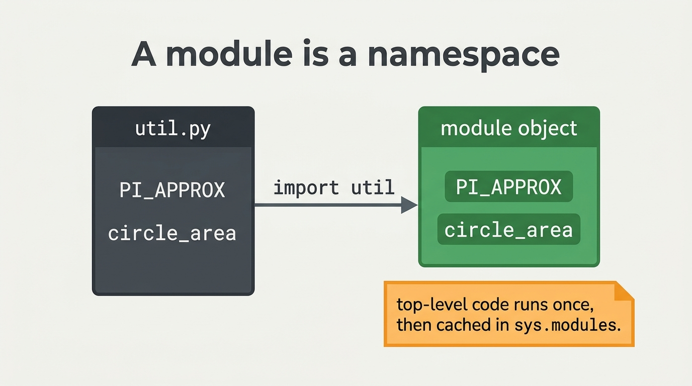

*Figure 3.2.1. A module is a namespace. Importing util.py runs its top-level code once and caches the module object in sys.modules.*

Importing a module runs its top-level code once. Python then caches the module object, so the second import costs almost nothing. Modules are the unit of code reuse, and they keep names separate from one another.

```python
# util.py
import math
PI_APPROX = 3.14159
def circle_area(r): return math.pi * r * r
print("util loaded")       # side effects at import time: avoid in libraries
```

Each of these import forms binds a name in a different way. Read them as five different choices about what your code can see.

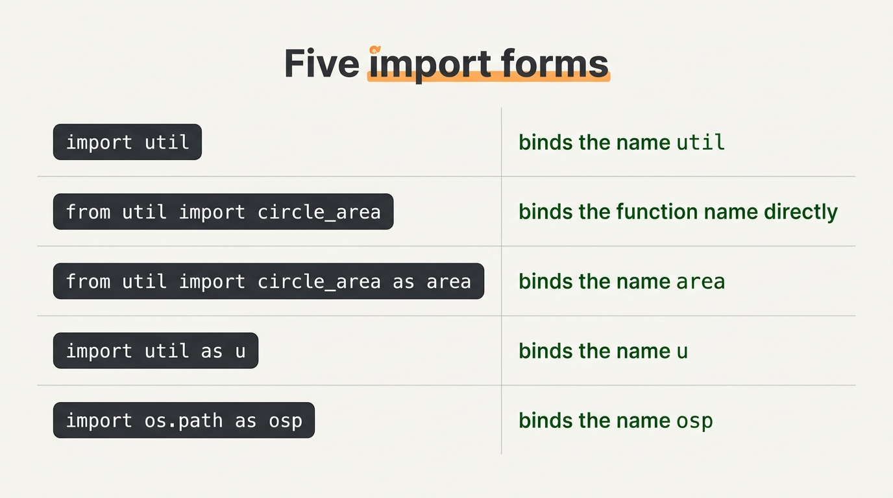

*Figure 3.2.2. Five import forms and the name each one binds.*

```python
import util                       # binds the name util to the module object
from util import circle_area      # binds the function name directly
from util import circle_area as area
import util as u
import os.path as osp
```

The first import runs the module body. Later imports in the same process reuse the entry in `sys.modules["X"]`, which is the table of modules already loaded. That makes a module's global state a process-wide singleton, so every importer shares the same state.

Avoid `from X import *` in most code. It imports every public name, or everything in `__all__` when that list exists. Its main use is re-exporting names from an `__init__` file. Outside that case, it fills the namespace with names you did not ask for, and it makes linters less useful.

A module carries attributes such as `__name__`, `__file__`, `__doc__`, `__package__`, `__spec__` and `__all__`. Run `dir(module)` to list them. For development, `importlib.reload` runs the module again in the same namespace. It is handy while you edit, but it is not a way to update a running production system.

Keep the work done at import time small. Avoid network calls, config file reads, thread starts and heavy imports at the top of a module. In command-line tools, move a heavy import into the function that needs it when startup time matters. You can measure the cost with `python -X importtime`.

### `import` versus `from`: shared references, cross-file mutation, and `reload()`

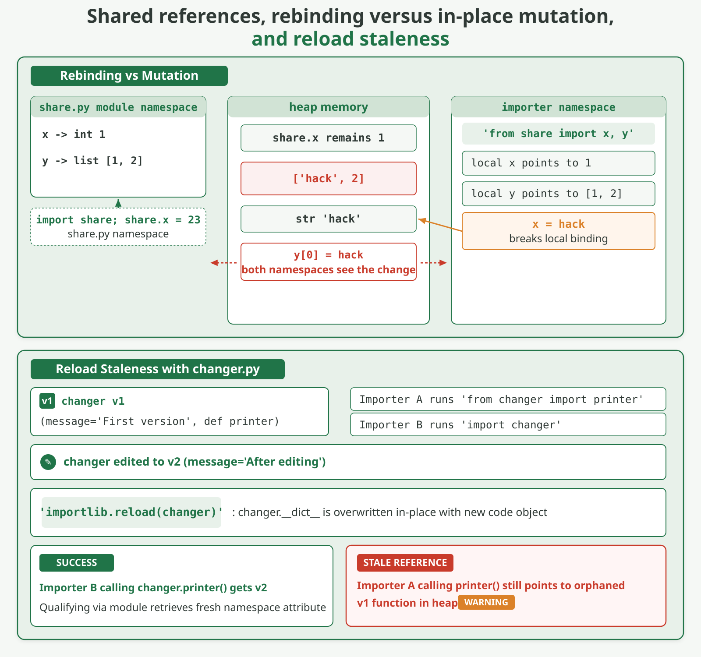

*Figure 3.0.0. Rebinding a name imported with from stays local, in-place mutation affects all importers sharing the heap object, and reload leaves from-bound references pointing to stale functions.*

When a program grows past one script, you split it. A top-level script such as `a.py` runs the work. Module files such as `b.py` and `c.py` define reusable tools as attributes. Suppose `b.py` defines `def job(tool): print(tool, 'coder')`. If `a.py` runs `import b; b.job('Python')`, it prints `Python coder`.

Module filenames must end in `.py`. Python turns the filename, without `.py`, into a variable name on import. So the name must follow ordinary variable rules: letters, digits and underscores only, with no spaces and no reserved keywords. Writing `import if` raises a `SyntaxError`. Package folder names follow the same rule.

Python also ships with many modules of its own, so a fresh interpreter is never empty. In Python 3.10 and later, `len(sys.stdlib_module_names)` gives roughly 300 standard-library modules. The `sys.builtin_module_names` list holds the modules built into the interpreter. Counting its public entries, `sum(1 for m in sys.builtin_module_names if m[0] != '_')`, gives 11. Frozen startup modules, such as `os` in Python 3.11 and later, come with the interpreter too.

Both `import` and `from` are runtime statements. They are not compile-time declarations like C's `#include`. You can put them inside an `if` branch or a `try` block. Python resolves them only when execution reaches them.

A `from` statement works in steps. The statement `from module import name1, name2` runs `import module`. Then it assigns `name1 = module.name1` and `name2 = module.name2` in the importer's scope. Finally it deletes `module` from that scope.

A `from module import *` statement is allowed only at the top level of a module file. Inside a `def` body it raises a `SyntaxError`. Python must know a function's local names at compile time, and a star import would hide them.

Because `from` copies object references, it does not create a live link to the source module. This matters in four situations. Rebinding a copied name, mutating a shared object, colliding names and reloading each behave differently.

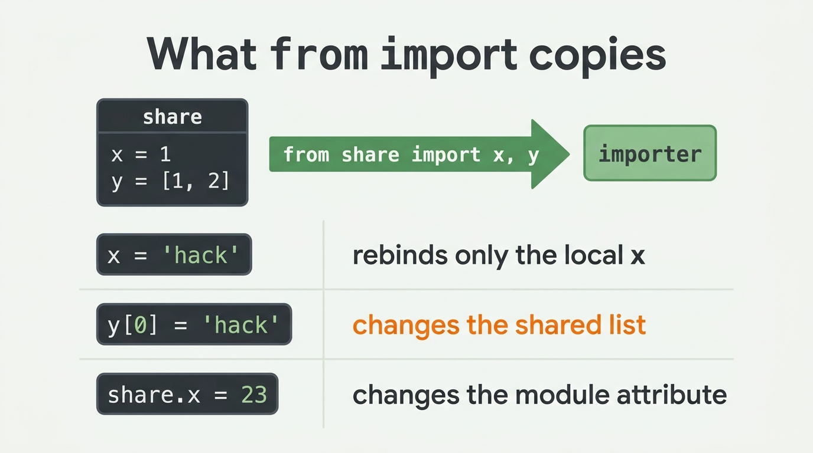

*Figure 3.2.3. What from-import copies: rebinding a name stays local, mutating a shared object is visible everywhere.*

Rebinding changes only your local name. Assigning `x = 99` after `from mod import x` changes only the importer's variable. The module's `mod.x` stays the same. The same holds for `X = 88` in a module `nested.py`, where `printer()` still prints `99`. To change the module's own value, so that other importers see it, go through the module object: `import nested; nested.X = 88`.

Mutation is different. If `y` refers to a list, then `y[0] = 'hack'` changes the one list that both modules share. Both the importer and the source module see the change.

Name collisions can hide a function. Suppose `M.py` and `N.py` both define `def func(): ...`. Then `from M import func` followed by `from N import func` in `O.py` overwrites the first reference. From then on, `func()` calls only `N.func`. To use both, keep the namespaces apart with `import M, N` and call `M.func()` and `N.func()`. Or rename them with `as`, as in `from M import func as mfunc`.

The `as` clause works like this. The statement `import modulename as name` runs `import modulename`, sets `name = modulename`, and then deletes `modulename`. The clause also shortens long package paths, as in `import dir1.dir2.mod as mod`. It can alias a renamed library as well.

Reloading does not fix `from` imports. The function `reload(mod)` takes a module object that is already loaded. It runs the file's top-level statements again, in place. It overwrites `mod.__dict__` without deleting the module object. The function moved from a Python 2 built-in to `imp.reload`, and then to `importlib.reload` in Python 3.

The book's `changer.py` example shows the effect. The first version sets `message = 'First version'` and defines `printer` to print `message`. After you edit the file, the second version sets `message = 'After editing'`. Its `printer` prints `reloaded:` before the message. A second `import changer` does nothing, because `changer` is already in `sys.modules`. Running `from importlib import reload; reload(changer)` updates `changer.printer()` in place. Code that calls `changer.printer()` sees the new version at once. Code that ran `from changer import printer` keeps the old function. It must run that import again to get the new one.

```python
# In the book's init.py, share.py, and changer.py examples:
# init.py: print('hello'); flag = 1 -> runs once on first import; second import init keeps init.flag = 2
# share.py:
# x = 1
# y = [1, 2]

from share import x, y       # copies references into the importer's namespace
x = 'hack'                   # rebinds only the importer's local x; share.x is still 1
y[0] = 'hack'                # mutates the shared list in place; share.y is now ['hack', 2]

import share
share.x = 23                 # mutates the module attribute across files
```

Read the code above as four separate effects. The `from` line copies references. The `x` line changes only the local name. The `y` line changes the shared list. The final `share.x` line changes the module itself.

### Module namespaces (`__dict__`), lexical scoping, and downward attribute paths

Every top-level assignment in a module creates an attribute, and `def`, `class` and `import` all count. The namespace lives on after the import finishes. Python stores it as a dictionary at `module.__dict__`, which `vars(module)` also returns.

The book's `spaces.py` example makes this concrete. Its body prints `starting to load...`, imports `sys`, sets `var = 23`, defines `func` and `klass`, and prints `done loading.`. After the import, the namespace holds metadata names such as `__name__`, `__doc__`, `__package__`, `__loader__`, `__spec__`, `__file__`, `__cached__` and `__builtins__`. It also holds `'sys'`, `'var'`, `'func'` and `'klass'`.

For any module, `spaces.var` and `spaces.__dict__['var']` return the same value, `23`. The expression `vars(spaces) == spaces.__dict__` is `True`. So is `dir(spaces) == sorted(spaces.__dict__)`.

```python
# Inspecting user-assigned names in a module namespace (LP Ch. 23 spaces.py):
# >>> list(name for name in spaces.__dict__ if not name.startswith('__'))
# ['sys', 'var', 'func', 'klass']
# >>> dir(spaces) == sorted(spaces.__dict__) == sorted(vars(spaces))
# True
```

Two different rules govern name lookup. An unqualified name, such as `X`, is searched through the current file's scopes. Python checks the local, enclosing, global and built-in scopes, in that order. This is the LEGB rule, and it never leaves the file that holds the name.

Imports never give upward visibility. An imported module cannot see names in the file that imported it. A function's global scope is always the module file where its `def` was written.

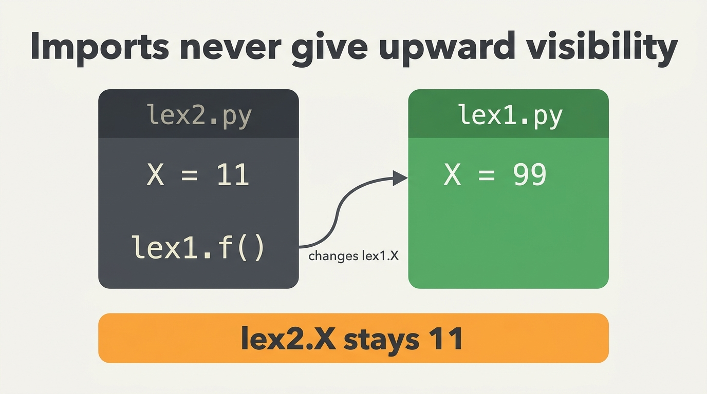

*Figure 3.2.4. Imports never give upward visibility. Calling lex1.f() changes lex1.X to 99 and leaves lex2.X at 11.*

The book's `lex1.py` and `lex2.py` examples show this. In `lex1.py`, `X = 88` and `def f(): global X; X = 99`. In `lex2.py`, `X = 11`, then `import lex1`, then `lex1.f()`, then `print(X, lex1.X)`. Running `python3 lex2.py` prints `11 99`. The call to `lex1.f()` changes `lex1.X` to `99`. It leaves `lex2.X` at `11`.

A qualified path, such as `X.Y.Z`, works differently. Python finds the leftmost name, `X`, by the same LEGB rule. Then it reads each attribute from left to right. Because `import` stores a module object as an attribute of the importing module, namespaces nest downward along an import chain.

The book's `nest` files show the downward path. `nest3.py` sets `X = 3`. `nest2.py` sets `X = 2`, imports `nest3`, and prints `X` and `nest3.X`. `nest1.py` sets `X = 1`, imports `nest2`, and prints `X`, `nest2.X` and `nest2.nest3.X`. Running `python3 nest1.py` prints `2 3` from `nest2`, then `1 2 3` from `nest1`.

So `nest1` can reach `nest2.nest3.X`, even though `nest3` cannot see `nest2` or `nest1`. Writing `import nest2.nest3` in `nest1` fails, unless `nest2` is a directory package.

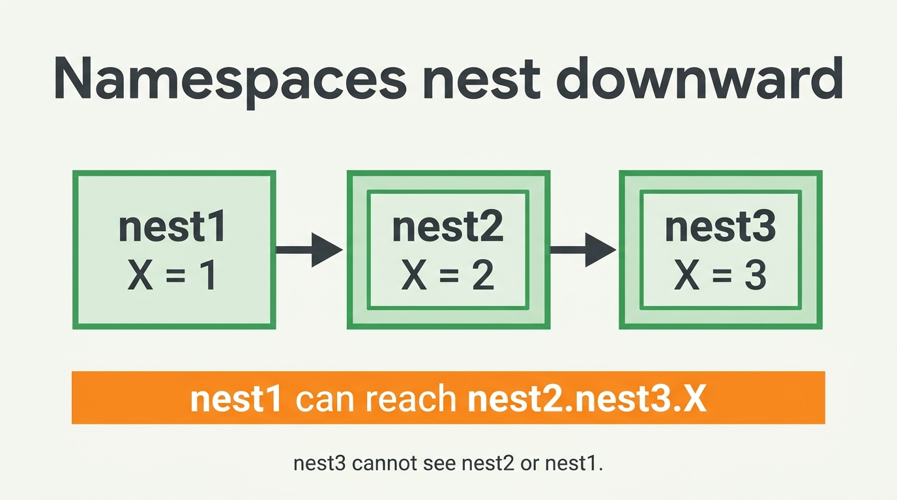

*Figure 3.2.5. Namespaces nest downward: nest1 can reach nest2.nest3.X, but nest3 cannot see nest2 or nest1.*

### Data hiding (`_X`, `__all__`, `__getattr__`, `__dir__`), `__future__`, and `__name__ == '__main__'`

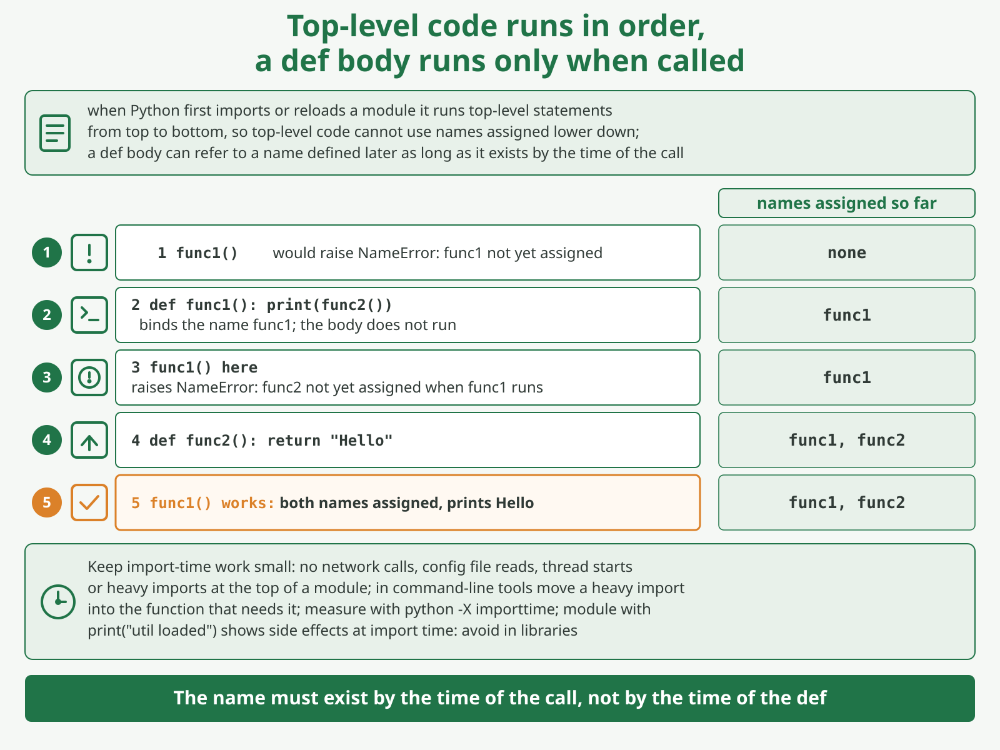

*Figure 3.2.6. A def only binds a name when it runs, so func1 can call func2 later, but calling func1 before func2 is assigned fails.*

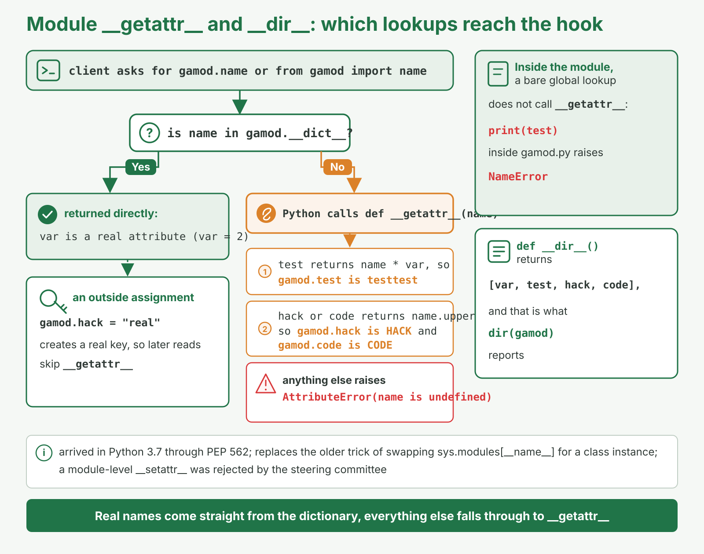

*Figure 3.2.7. Only names missing from the module dictionary reach __getattr__, and a bare global lookup inside the module never does.*

Python has no enforced `private` keyword for modules. Every top-level name is an exported attribute. Instead, the design goals are high cohesion and low coupling. High cohesion means the parts of a module belong together. Low coupling means it depends on as little outside itself as possible. A module should have one clear purpose. It should pass data through function arguments and return values, not change another file's globals.

Even the interactive prompt runs inside a module. It is the built-in module `__main__`. So every piece of code you write lives in some module.

Two conventions control what `from module import *` copies. Two special hooks control dynamic lookup. Start with the conventions.

A single leading underscore marks a name as private for star imports. Without `__all__`, `from module import *` skips every top-level name that starts with `_`. Take a module `unders.py` in which `a, b, _c, _d = 1, 2, 3, 4` is followed by `from unders import *`. That copies only `a` and `b`. Explicit imports still reach `_c` and `_d`, as in `from unders import _c` or `import unders; unders._d`.

An explicit export list is stronger. Assigning a list of names to `__all__` tells star imports to copy only those names. This rule overrides the underscore rule. In a module `alls.py`, `__all__ = ['a', '_c']` means `from alls import *` copies `a` and `_c`, but not `b` or `_d`. Neither rule blocks direct access, such as `import alls; alls.b, alls._d`.

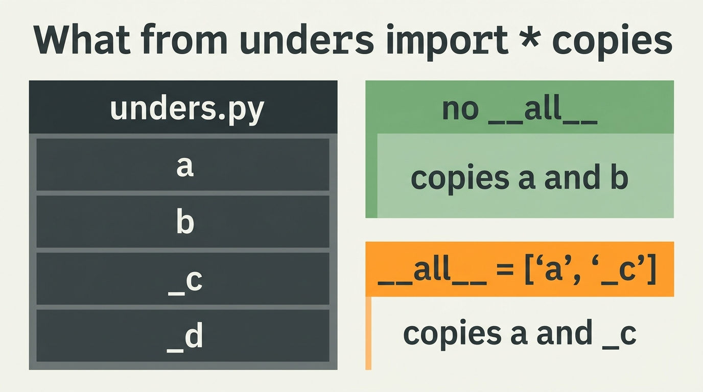

*Figure 3.2.8. What from unders import * copies, with and without an __all__ list.*

Module-level `__getattr__` and `__dir__` add dynamic attributes. These arrived in Python 3.7, through PEP 562. If a module defines `def __getattr__(name):`, Python calls it whenever a client asks for `mod.name` and that name is not in `mod.__dict__`. The call also happens for `from mod import name`. Defining `def __dir__():` changes what `dir(mod)` returns. This replaces an older trick that swapped `sys.modules[__name__]` for a class instance.

Inside the module, a bare global lookup does not call `__getattr__`. So `print(test)` inside `gamod.py` raises `NameError`. An outside assignment, such as `gamod.hack = 'real'`, creates a real key in `gamod.__dict__`. Later reads of `hack` skip `__getattr__`. The Python steering committee rejected a later proposal to add a module-level `__setattr__`.

```python
# In the book's Example 25-3 gamod.py (tested in code/part03/python_modules_packaging_lab.py):
var = 2                               # real attribute returned directly from __dict__
def __getattr__(name):                # undefined attribute fetches routed here
    print(f'(virtual {name})', end=' ')
    match name:
        case 'test':
            return name * var         # gamod.test -> 'testtest'
        case 'hack' | 'code':
            return name.upper()       # gamod.hack -> 'HACK', gamod.code -> 'CODE'
        case _:
            raise AttributeError(f'{name} is undefined')

def __dir__():
    return ['var', 'test', 'hack', 'code']
```

In this file, `var` is a real attribute, so it comes straight from the dictionary. Any other lookup falls through to `__getattr__`. The `__dir__` function supplies the names that `dir(gamod)` reports.

Next, `from __future__ import ...` turns on compiler features for one module. It must be the first executable statement, after any docstring or comments. Examples include `from __future__ import annotations` and the historical `generator_stop` and Python 2-to-3 bridges. Python keeps these feature names in `__future__` permanently. So older imports keep working on newer Pythons.

The `__name__ == '__main__'` test lets one file serve two purposes. When you run a file directly, as in `python3 dualmode.py` or `python3 minmax.py`, Python sets its `__name__` to `'__main__'`. When another file imports it, `__name__` becomes the module's import name, such as `'dualmode'` or `'minmax'`.

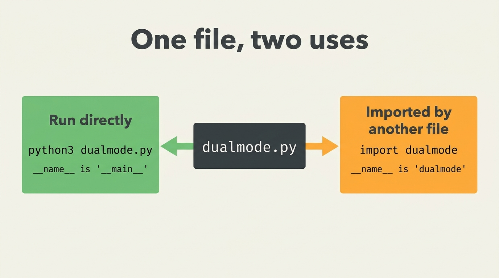

*Figure 3.2.9. One file, two uses: Python sets __name__ to '__main__' when you run the file and to the module name when you import it.*

Put your self-tests or command-line logic under `if __name__ == '__main__':`. The file then works as an importable library and as a standalone script. The book's `minmax.py` defines `def minmax(test, *args): ...` along with `lessthan` and `grtrthan`. This is different from a package's `__main__.py`, which is a bundle entry point.

When Python first imports a module, or reloads it, it runs the top-level statements from top to bottom. Top-level code runs as Python reaches each line, so it cannot use names assigned lower down. A `def` body does not run until something calls the function. That function can refer to a name defined later, as long as the name exists by the time of the call.

The book's forward-reference example shows both sides.

```python
# In the book's forward-reference example:
# func1()              # NameError: func1 not yet assigned

def func1():
    print(func2())     # OK when called after func2 is defined

# func1()              # NameError: func2 not yet assigned when func1 runs here

def func2():
    return "Hello"

func1()                # OK: both func1 and func2 have been assigned -> prints "Hello"
```

Calling `func1()` before `func2` exists fails. Calling it after both definitions exist works, and it prints `Hello`.

### Module introspection (`mydir.py`), dynamic string imports, and transitive reloaders (`reloadall.py`)

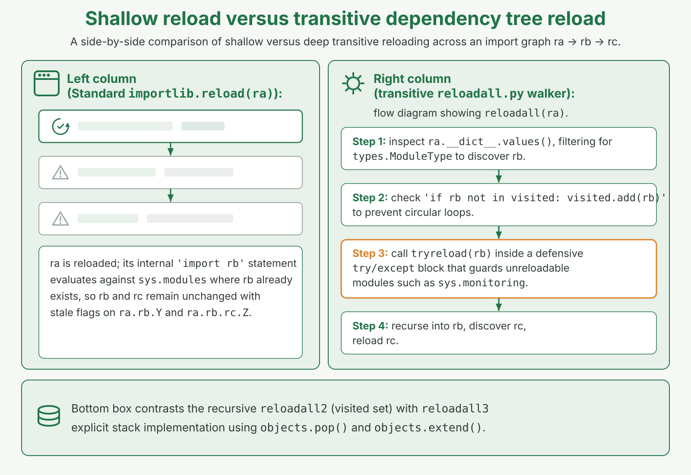

*Figure 3.0.0. Standard reload updates only the target module, while transitive reloaders walk the module dictionary, guard against circular dependencies with a visited set, and refresh nested imports.*

Everything so far assumed that you know the name of the module you want. Python also exposes module internals as ordinary attributes and dictionaries. That lets you write code that inspects, imports and reloads other modules. You do not need to know their names in advance. Three techniques follow.

The first technique is reaching one attribute by several routes. After `import minmax, sys`, the six expressions below return the same function object. Chaining them with `is` gives `True`.

`minmax.lessthan is minmax.__dict__['lessthan'] is vars(minmax)['lessthan'] is sys.modules['minmax'].lessthan is getattr(minmax, 'lessthan') is sys.modules['minmax'].__dict__['lessthan']`

A small inventory module `mydir.py` sets `sepchr = '-'` and `seplen = 60`. It defines `def listing(module, verbose=True, unders=True):`. Its loop, `for (count, attr) in enumerate(sorted(module.__dict__)):`, prints an indexed inventory of any module. You can call `listing(mydir)` or `listing(tkinter, unders=False)`. Tools like `mydir.listing` can also load into interactive sessions through the `PYTHONSTARTUP` environment variable.

The second technique is importing a module by a runtime string. A module name can arrive from a command-line flag, a config file or a plugin registry. A plain string is not a name, so `import 'string'` is a `SyntaxError`. Also, `x = 'string'; import x` looks for `x.py`. It does not look for the module the string names. Use one of three tools instead.

1. `exec('import ' + modname)` compiles and runs an import statement in the current scope. It is the slowest option, and you should never run it on untrusted strings.
2. `mod = __import__(modname)` calls the built-in import hook directly.
3. `mod = importlib.import_module(modname)` is the preferred wrapper in the standard library.

Dotted names expose a difference between the last two. For `'email.message'`, `__import__('email.message')` returns the leftmost top-level package, `<module 'email'>`. The function `importlib.import_module('email.message')` returns the rightmost target submodule, `<module 'email.message'>`. It also accepts a `package=` argument, which resolves relative imports that begin with a dot.

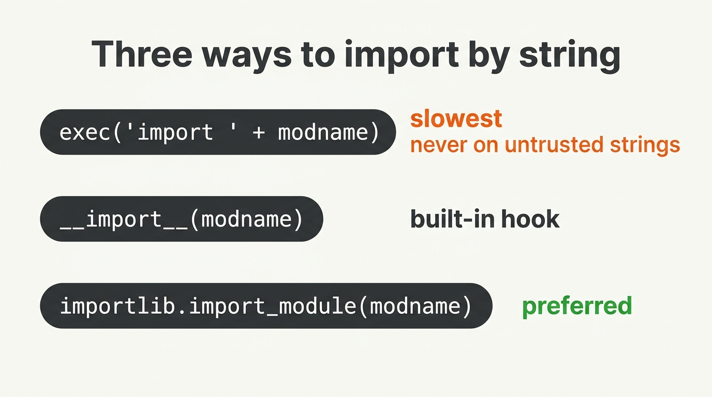

*Figure 3.2.10. Three ways to import a module from a runtime string. Prefer importlib.import_module.*

The third technique reloads a whole import graph. Suppose `ra.py` sets `X = 1` and runs `import rb`. Suppose `rb.py` sets `Y = 2` and runs `import rc`. And suppose `rc.py` sets `Z = 3`. Calling `importlib.reload(ra)` reloads only `ra`. The values `ra.rb.Y` and `ra.rb.rc.Z` keep their old values. The `import rb` inside `ra.py` does nothing once `rb` is in `sys.modules`.

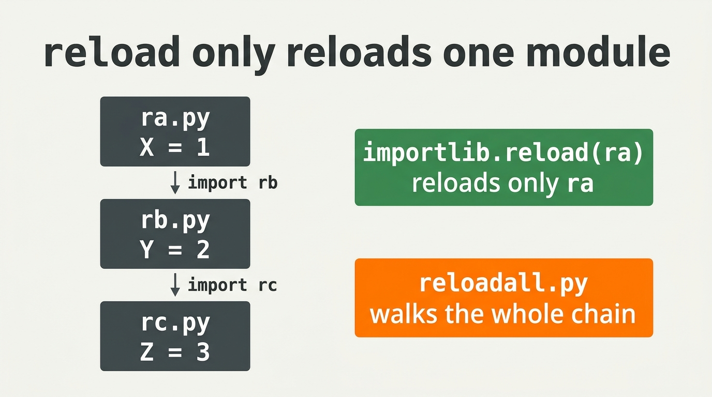

*Figure 3.2.11. importlib.reload reloads only one module. The book's reloadall.py walks the whole import chain.*

The book's `reloadall.py` walks `module.__dict__.values()`. It keeps only entries where `type(attrobj) == types.ModuleType`. It calls `reload(module)` inside a defensive `try / except`, called `tryreload`. That guard matters, because some special modules, such as `sys.monitoring` in Python 3.12, cannot be reloaded. The walker also records visited modules, in a `visited` dictionary or `set()`. Without that record, circular imports would loop forever.

The book compares three versions. `reloadall.py` recurses with a `visited = {}` dictionary. `reloadall2.py` recurses over `obj.__dict__.values()` with a `visited = set()`. `reloadall3.py` avoids recursion. It uses an explicit stack, with `while objects: next = objects.pop()` and `objects.extend(next.__dict__.values())`.

The book checks that the second and third versions agree, ignoring order. It compares `set(res2) == set(res3)` using output from `os.popen('python3 reloadall.py tkinter').readlines()`.

### How imports work (3 steps) and the 5-component module search path

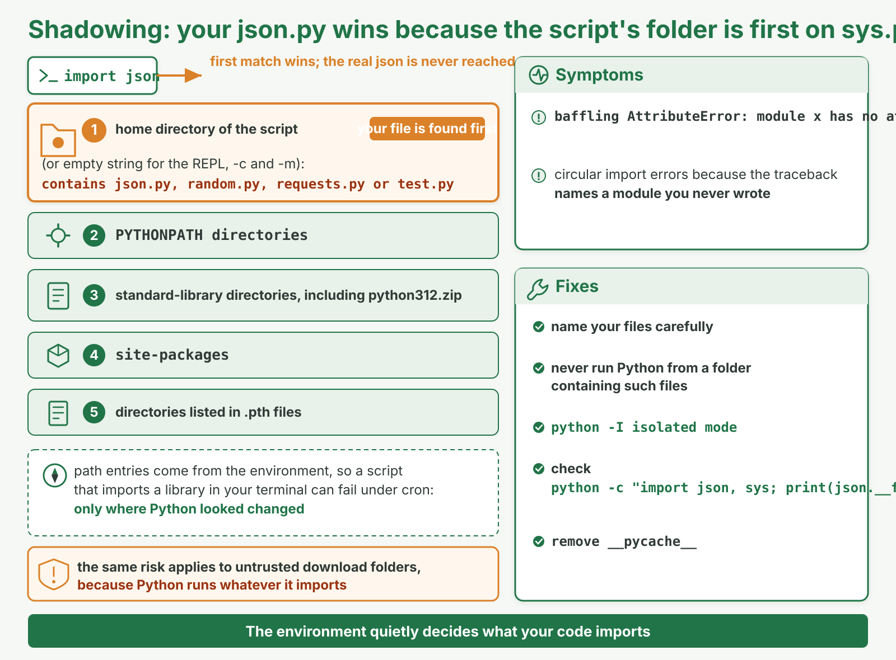

*Figure 3.2.12. The script's own folder is searched first, so a local file named like a standard module silently replaces it.*

Here is the failure that starts most packaging arguments. A script imports a library happily in your terminal and fails under cron, and the only thing that changed is where Python looked. The search path is built from the environment, so the environment quietly decides what your code imports.

When a program imports a module for the first time, Python checks `sys.modules` first. For example, `sys.modules['os'] is os` is `True` once `os` has loaded. If the module is not loaded yet, Python runs three steps.

First, Python finds the module. It uses the finders on `sys.meta_path`. These look for a file, a package directory, a C extension (a `.so` or `.pyd` file), a frozen module or a ZIP component. The finders scan the module search path, `sys.path`, from left to right. Before that scan, Python checks the built-in and frozen modules.

Second, Python compiles the module if it needs to. For a source `.py` file, Python checks `__pycache__/` for a usable `.pyc` bytecode file. Three conditions decide whether the cached file can be used. The magic number must match the interpreter. The source check must pass, by timestamp and file size, or by a hash written with `compileall` or `py_compile` and `--check-hash-based-pycs`. The interpreter's implementation and version tag must match the filename.

Those tags let several files sit side by side. For example, `codefile.cpython-312.pyc`, `codefile.cpython-38.pyc` and `codefile.pypy310.pyc` can coexist in one `__pycache__/` folder. Python writes a `.pyc` file only for imported modules. It never writes one for the top-level script you launch directly. The exception is precompiling with `python3 -m compileall -b -l .`, which is done for bytecode-only delivery.

Third, Python runs the bytecode from top to bottom, inside the new module object's namespace.

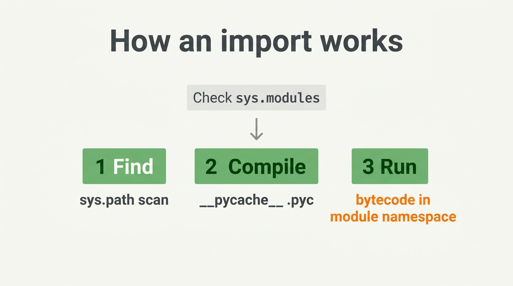

*Figure 3.2.13. How an import works: check sys.modules first, then find, compile and run.*

Python builds `sys.path` at startup from five components. They appear in this order.

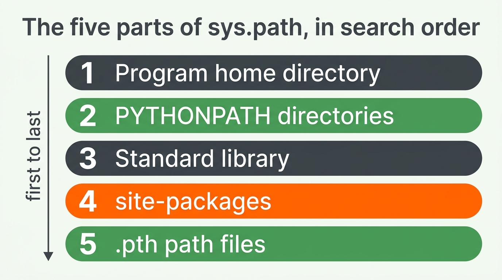

*Figure 3.2.14. The five parts of sys.path, from first searched to last searched.*

1. The home directory of the program. This is the folder that holds the top-level script. In the REPL, and with `-c` or `-m`, the home directory is `''`, the current working directory. Import search paths are separate from `os.getcwd()`, which controls relative file I/O.
2. The `PYTHONPATH` directories. On Unix and macOS they are separated by colons, as in `/Users/me/pycode/utilities:/Volumes/ssd/pycode/package1`. On Windows they are separated by semicolons, as in `C:\Users\me\pycode\utilities;d:\pycode\package1`. Set them with `export PYTHONPATH=...`. Each entry can also be a `.zip` archive.
3. The standard-library directories, including `python312.zip`. `PYTHONHOME` can move them.
4. The `site-packages` directory, where `pip` installs third-party code.
5. The directories listed in `.pth` path files. A `.pth` file, such as `mypath.pth`, is plain text, with one directory per line. The `site` module appends these directories near the end of `sys.path`, for every user of that installation. A `._pth` file overrides the default computation instead.

A program can also change `sys.path` while it runs. It can call `sys.path.append('/Users/me/pycode4')` or `sys.path.insert(0, ...)`. This helps when a restricted service account, such as the web server user `nobody`, cannot depend on shell `PYTHONPATH` settings. The change lasts for that process only.

```bash
python3 -c 'import sys; print("\n".join(sys.path))'
python3 -c 'import json, sys; print(json.__file__)'
python3 -m site        # shows sys.path, user site, and whether a venv is active
PYTHONPATH=/opt/mylib python3 app.py        # extend the path (prefer proper installation)
```

Run these commands to see the search path for yourself. The first prints every entry, in order. The second shows which file `json` actually loads. The third shows whether a virtual environment is active.

**Shadowing trap**: a local file named like a standard or installed module shadows the real one. Imagine a project folder that holds `json.py`, `random.py`, `requests.py` or `test.py`. The script's directory comes first on `sys.path`, so Python imports your file instead. The symptoms are baffling `AttributeError`s or circular import errors, because the traceback names a module you never wrote. Name your files carefully. Never run Python from a folder containing such files when you want the real modules. The same risk applies to untrusted download folders, because Python runs whatever it imports. For isolated mode, use `python -I`.

### `.pyc` and bytecode caches

Python caches compiled bytecode in `__pycache__/name.cpython-312.pyc`. This is the cache that saves the compile step on a later import. The cache is invalidated when the source's timestamp or hash changes. On a read-only file system, or in a container, you have three options. You can precompile with `python -m compileall`. You can set `PYTHONDONTWRITEBYTECODE=1` to stop writing caches. Or you can use `PYTHONPYCACHEPREFIX` to move the caches somewhere else. Choose one before you deploy, so the cache behaves the same on every machine.

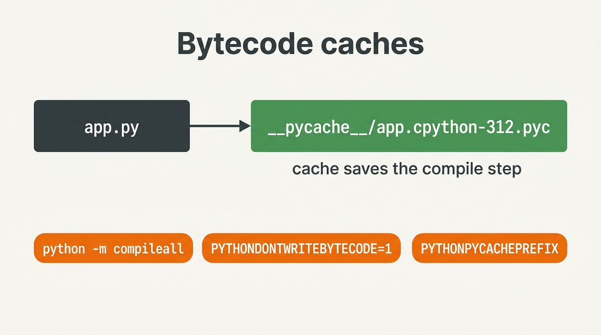

*Figure 3.2.15. Bytecode caches: __pycache__ saves the compile step, and three options control it on read-only systems.*

## 2. Packages

A module keeps its names apart from other modules. A package does the same job one level up, for whole folders, so two projects can each keep a `utilities.py` without fighting over the name.

A package is a directory of modules. Python imports it as a hierarchical namespace, which means names that nest, the way folders nest inside folders. Take the dotted path `import dir1.dir2.mod`. The leftmost name, `dir1`, must sit inside a container directory, `dir0`, that is on `sys.path`. The remaining names map to subdirectories. So the code lives in `dir0/dir1/dir2/mod.py` on Unix, or in `dir0\dir1\dir2\mod.py` on Windows.

An `import` statement never takes a file system path. Writing `import C:\dir1` or `import /Users/me/dir1` is invalid. Platform paths belong in `sys.path`, in `PYTHONPATH` or in `.pth` files. Dotted names belong in `import`.

A typical package looks like this.

```text
myops/
├── __init__.py          # makes it a regular package; runs on first import
├── config.py
├── clients/
│   ├── __init__.py
│   ├── redfish.py
│   └── slurm.py
└── cli.py
```

Each import below reaches a different level of this tree. The first loads a module from the top level. The other two go one or two folders deeper.

```python
import myops.config
from myops.clients import redfish
from myops.clients.slurm import submit
```

### Why packages exist: resolving `system1/utilities.py` vs `system2/utilities.py`

Name collisions are the reason packages exist. Picture two systems in one project. The folder `system1/` holds `utilities.py`, `main.py` and `other.py`. The folder `system2/` holds its own copies of all three names.

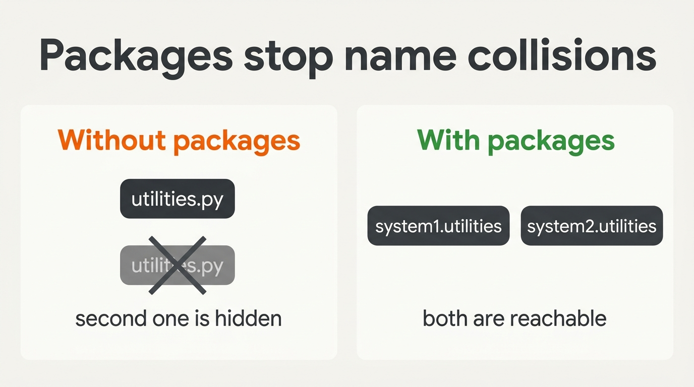

*Figure 3.2.16. Packages stop name collisions: system1.utilities and system2.utilities are both reachable.*

If you run `python3 system1/main.py` or `python3 system2/main.py` on its own, each script works. Its own folder is first on `sys.path`, so `import utilities` finds the right file. Each script lives in its own small world, and the small world is enough.

The trouble starts with a third script, `mycode/myfile.py`. Suppose it needs functions from both `utilities.py` files. If you add both folders to `PYTHONPATH`, the scan of `sys.path` always takes the first match. The second `utilities.py` becomes unreachable, because no import name can point at it.

The fix is to put both folders under a common `root/` on `sys.path`. Then each file has its own package path, as in `import system1.utilities; import system2.utilities; system1.utilities.function('hack'); system2.utilities.function('code')`. The standard library works the same way. Imports such as `from email.message import Message`, `from tkinter.filedialog import askopenfilename` and `from http.server import CGIHTTPRequestHandler` each keep their modules inside a package namespace.

### Dotted package walkthrough (`dir0/dir1/dir2/mod.py`), `__init__.py` roles, and `__main__.py`

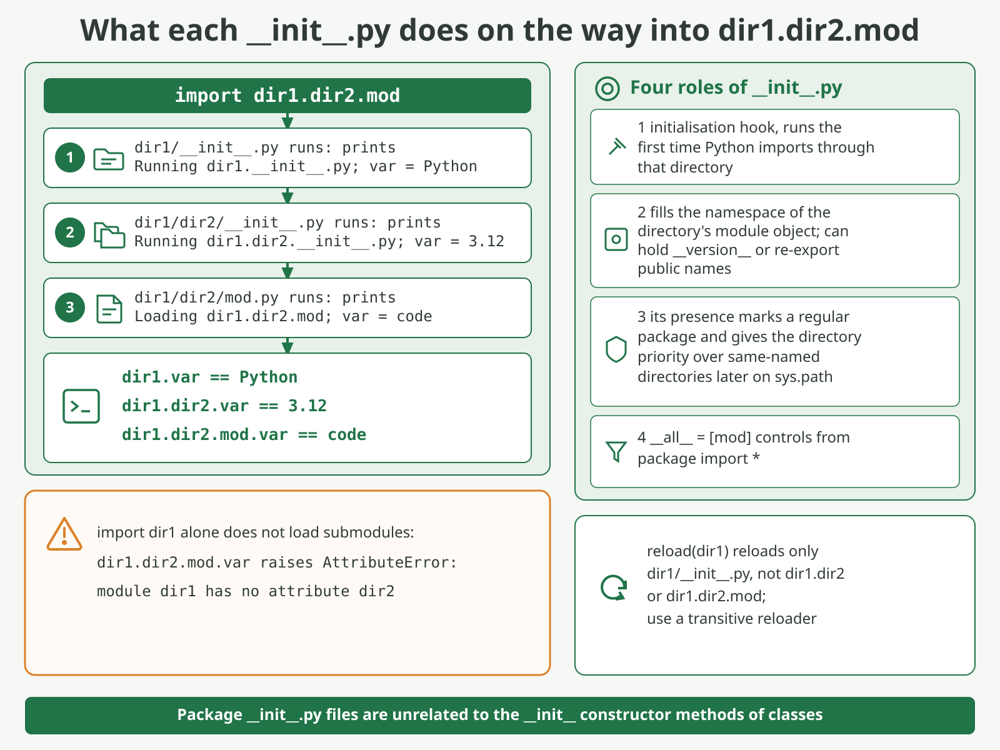

*Figure 3.2.17. A dotted import runs each folder's __init__.py in order, while importing the root package alone does not load its submodules.*

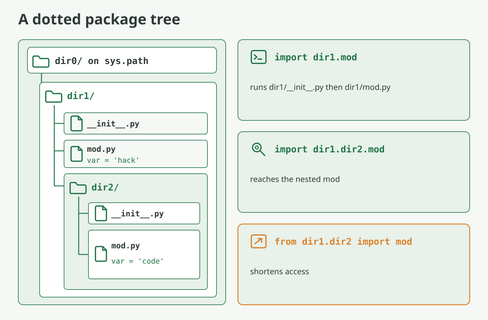

*Figure 3.2.18. A dotted package tree: each dot in an import names a folder, and each folder's __init__.py runs on the way in.*

The book's nested package gives us a small tree to walk through. Four files matter. `dir0/dir1/mod.py` sets `var = 'hack'` and prints `Loading dir1.mod`. `dir0/dir1/dir2/mod.py` sets `var = 'code'` and prints `Loading dir1.dir2.mod`. `dir1/__init__.py` sets `var = 'Python'` and prints `Running dir1.__init__.py`. And `dir1/dir2/__init__.py` sets `var = 3.12` and prints `Running dir1.dir2.__init__.py`.

Importing a root package does not load its submodules. A folder's module object does not check the file system when you read an attribute. So `import dir1`, followed by `dir1.dir2.mod.var`, raises `AttributeError: module 'dir1' has no attribute 'dir2'`. You need the full dotted import, `import dir1.dir2.mod`. On the first import, that runs `dir1/__init__.py`, then `dir1/dir2/__init__.py`, then `dir1/dir2/mod.py`.

You can also shorten the access. Use `from dir1.dir2.mod import var`, `from dir1.dir2 import mod`, or `import dir1.dir2.mod as mod`. Reloading works the same way. A call to `reload(dir1)` reloads only `dir1/__init__.py`. It leaves `dir1.dir2` and `dir1.dir2.mod` alone, unless you use a transitive reloader such as `reload_all(dir1)`.

Each `__init__.py` plays four roles. First, it runs as an initialization hook the first time Python imports through that directory. Second, it fills the namespace of the directory's module object. That is why `dir1.var == 'Python'` and `dir1.dir2.var == 3.12`. It can also hold `__version__` or re-export public names. Third, its presence marks a regular package. That gives the directory priority over same-named directories later on `sys.path`. Fourth, `__all__ = ['mod']` controls `from package import *`. It names the submodules that a star import should load. Package `__init__.py` files are unrelated to the `__init__` constructor methods of classes.

Adding a `__main__.py` lets users run a folder like an application bundle. The book adds `dir1/__main__.py` with `print('Executing dir1.__main__.py')`, and `dir1/dir2/__main__.py` as well. Run `python3 dir1` or `python3 dir1/dir2` and Python executes `__main__.py` directly. It skips the package's `__init__.py`, and the script's home directory becomes `dir1/`.

Run `python3 -m dir1` or `python3 -m dir1.dir2` instead, and Python uses the full package machinery. It runs `dir1/__init__.py`, and then `dir1/dir2/__init__.py`, before it runs `__main__.py`. A `.zip` archive on `sys.path` can be launched the same way.

What `__main__.py` can import depends on how you launch it, and this is the most confusing corner of packages. Take three versions in turn.

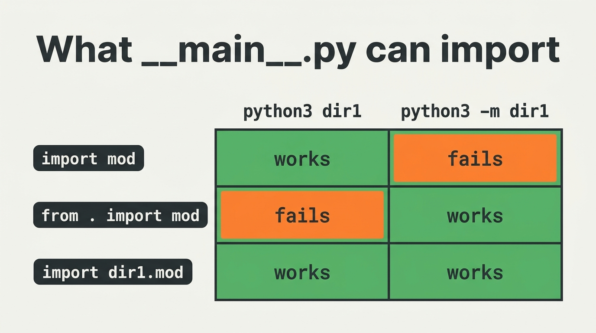

*Figure 3.2.19. Which import styles work in dir1/__main__.py for each way of launching it.*

If `dir1/__main__.py` contains a plain `import mod`, then `python3 dir1` and `python3 dir1/__main__.py` both succeed. The home directory is `dir1/`, so `mod` is found. But `python3 -m dir1` fails with `ModuleNotFoundError: No module named 'mod'`. Absolute imports skip the enclosing package.

If `dir1/__main__.py` uses a relative import, `from . import mod`, the outcome flips. `python3 -m dir1` and `python3 -m dir1.__main__` succeed. But `python3 dir1` and `python3 dir1/__main__.py` fail with `ImportError: attempted relative import with no known parent package`. Relative forms include `from . import module`, `from .module import name`, `from .. import module` and `from ..module import name`. They work only inside packages. They search only the enclosing package hierarchy. They skip `sys.path` and the built-in and frozen checks, so an outside module cannot shadow a package's internals. They cannot run as direct scripts.

If `dir1/__main__.py` uses the full package path, `import dir1.mod` or `from dir1 import mod`, and the container directory is on `sys.path` through `export PYTHONPATH=.`, then all four launch commands work. Those are `python3 dir1`, `python3 dir1/__main__.py`, `python3 -m dir1` and `python3 -m dir1.__main__`.

### Four import models, PEP 420 namespace packages (`__path__`), and the 4-step search algorithm

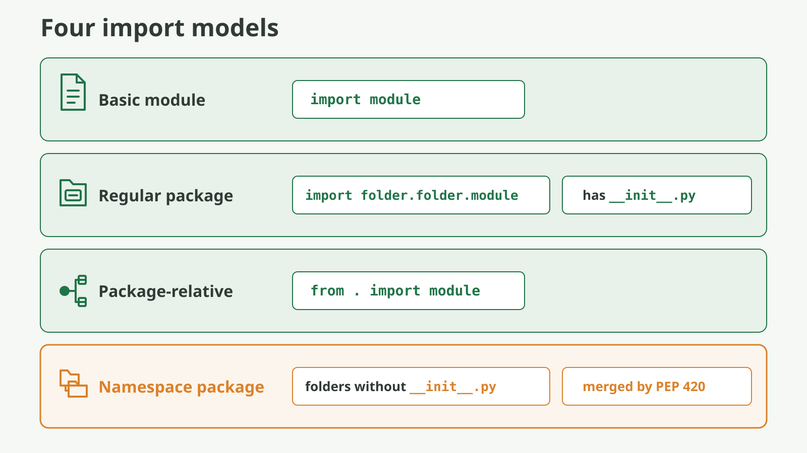

*Figure 3.2.20. Python's four import models, from a basic module to a PEP 420 namespace package.*

Python has four import models, which developed over time. Basic modules use `import module`. Basic, or regular, packages use `import folder.folder.module`, with an `__init__.py` file. Package-relative imports use `from . import module`. Namespace packages, defined by PEP 420, use `import anyfolder.anyfolder.module` with no `__init__.py`, and they can span several directories. These four models explain most of the import errors you will meet.

To handle all four, Python runs a four-step search. It checks each candidate directory in turn. At the top level, the candidates come from `sys.path`. For a nested import, they come from the parent package's `__path__`.

In step 2, Python looks for a file such as `d/name.py`, or a compiled form such as `d/name.pyc` or `d/name.so`.

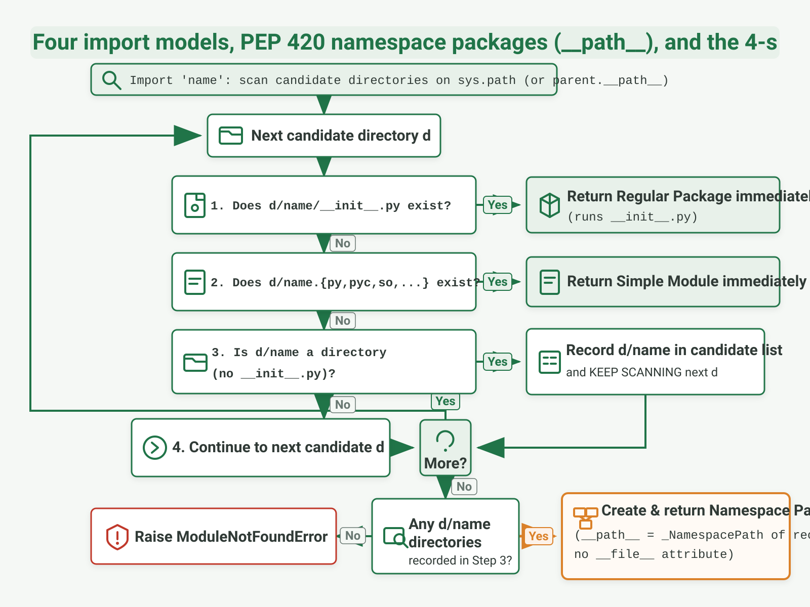

*Figure 3.2.21. Four import models, PEP 420 namespace packages (__path__), and the 4-step search algorithm, as a diagram.*

The diagram hides one rule that matters most. In step 3, a bare directory without `__init__.py` does not end the search. Python records that directory and keeps scanning. Only when the whole scan finishes, with no regular package in step 1 and no simple module in step 2, does Python build a namespace package. Its `__path__` is a `_NamespacePath` that joins every recorded directory, and it has no `__file__` attribute.

This rule has a practical effect. An empty `__init__.py` file makes step 1 succeed for your package. So a module later on `sys.path` cannot override your package, and your package is not merged into a namespace package.

A split-directory demo shows the namespace case. The file `ns/part1/sub/mod1.py` prints `Loading ns/part1/sub/mod1`. The file `ns/part2/sub/mod2.py` prints `Loading ns/part2/sub/mod2`. The two sit in separate parent folders, and neither folder has an `__init__.py`.

For example, set `export PYTHONPATH=ns/part1:ns/part2`, then run `import sub.mod1` and `import sub.mod2`. Python builds one virtual namespace package called `sub`. It is shown as `<module 'sub' (namespace) from ['.../ns/part1/sub', '.../ns/part2/sub']>`. Adding `from . import mod2` inside `ns/part1/sub/mod1.py` reaches across the folder boundary into `ns/part2/sub/mod2.py`.

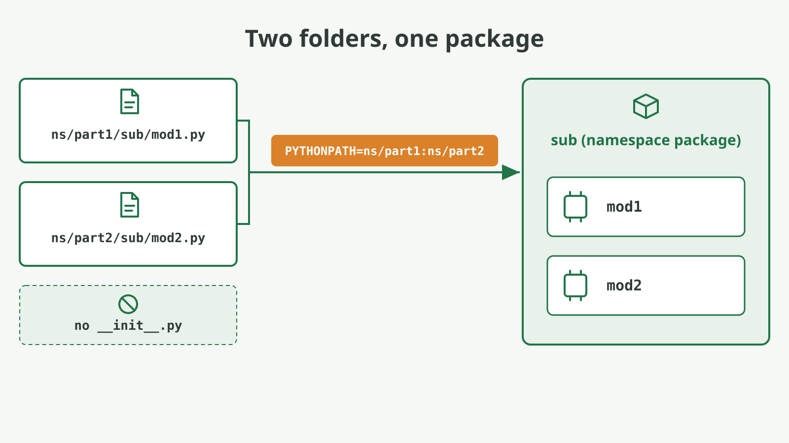

*Figure 3.2.22. Two folders, one package: with no __init__.py, Python merges both sub directories into one namespace package.*

### Circular (`recursive`) imports: why `import recur1` fails while `import recur2` succeeds

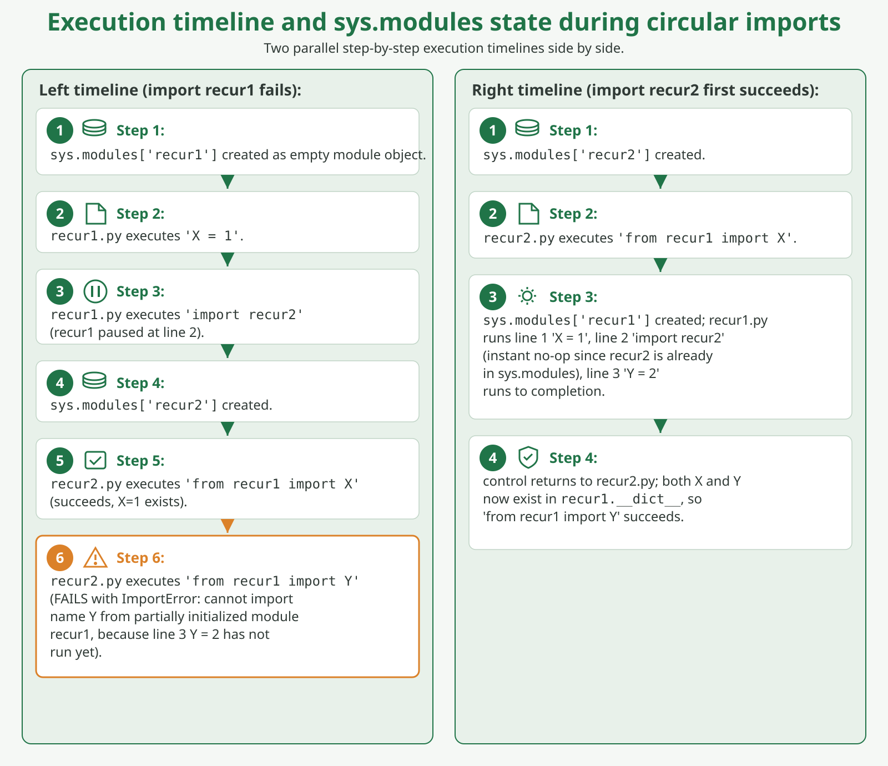

*Figure 3.0.0. Modules register in sys.modules before running their body, so circular imports fail when a from statement requests an attribute before the source file has executed its assignment.*

Two modules can import each other without looping forever. The trick is the order in which Python builds them. Python adds the new module object to `sys.modules` before it runs the file's top-level statements. The problem is that a circular `from` import can catch a module only partly built. The book uses two files to show it.

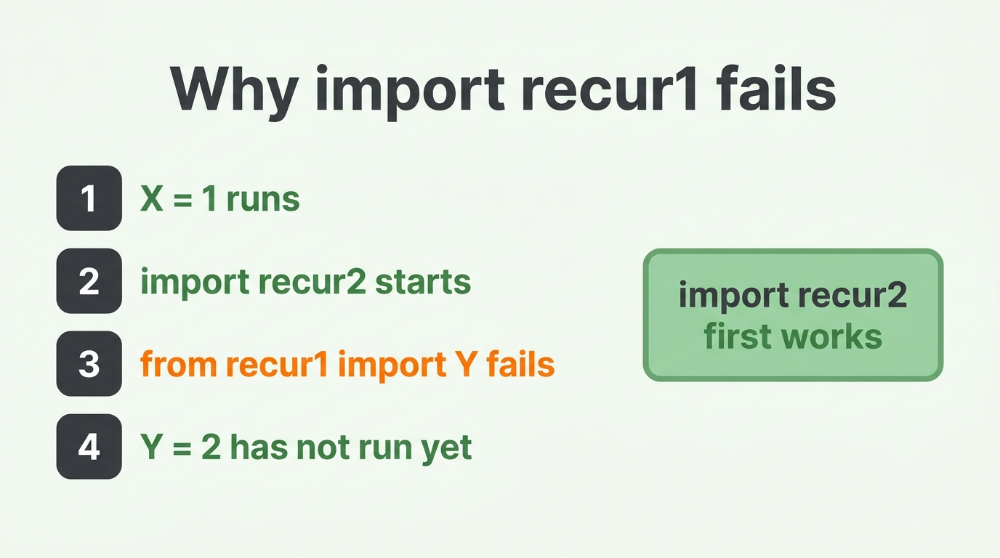

*Figure 3.2.23. Why import recur1 fails: Y = 2 has not run when recur2 asks for it. Importing recur2 first works.*

`recur1.py` sets `X = 1`, then runs `import recur2`, then sets `Y = 2`. `recur2.py` runs `from recur1 import X` and then `from recur1 import Y`.

Run `import recur1` in the REPL. Python executes `X = 1`, then jumps into `import recur2`. That happens before `Y = 2` has run. Inside `recur2`, the line `from recur1 import X` succeeds. But `from recur1 import Y` raises `ImportError: cannot import name 'Y' from partially initialized module 'recur1' (most likely due to a circular import)`.

Now reverse the order. Restart Python and run `import recur2` first. Or run `python3 recur1.py` as a script. In that case `recur1` is `__main__`, not `sys.modules['recur1']`, so `recur2` is the first module imported. `recur1` then runs from top to bottom during `from recur1 import X`. It finishes `X = 1`. It treats `import recur2` as a no-op, because `recur2` is already in `sys.modules`. It finishes `Y = 2` as well. Only then does `from recur1 import Y` run, and it succeeds.

You have four ways to break such a cycle. Move the shared helpers into a third module. Or use `import recur1`, and qualify names such as `recur1.Y` inside functions, which run after both modules finish loading. You can also move the `from` import to the bottom of the file, or into a function body. For imports used only in type annotations, guard them with `if typing.TYPE_CHECKING:`.

Two other tools avoid hard-coded imports. For lazy imports, `importlib.import_module("pkg.plugins." + name)` loads a module by name at runtime. For plugin discovery, `importlib.metadata.entry_points(group="myops.plugins")` lets you extend a tool without naming its plugins in the code. Section 6 covers entry points in detail.

For data files inside a package, use `importlib.resources.files("myops") / "templates/x.j2"`, rather than a path built from `__file__`. The resources call keeps working in zip archives and wheel installs.

### Typical project layout (src layout)

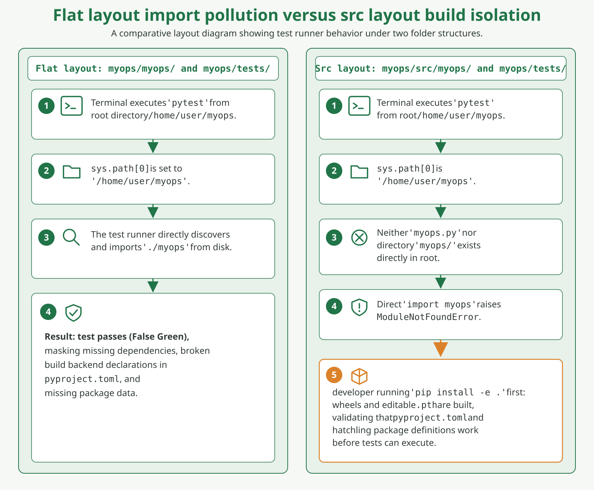

*Figure 3.0.0. The src layout prevents accidental imports from the working directory, ensuring tests run against an installed editable package and catching missing build metadata before CI passes.*

The layout below is the one to copy when you start a new tool. It uses the src layout, which puts your package inside a folder called `src/`.

```text
myops/
├── pyproject.toml
├── README.md
├── LICENSE
├── src/
│   └── myops/
│       ├── __init__.py
│       ├── __main__.py
│       └── ...
├── tests/
│   └── test_config.py
├── docs/
└── .github/workflows/ci.yml
```

The src layout puts the package under `src/`. Tests can import `myops` only after you install it with `pip install -e .`. That step catches packaging mistakes, such as missing files or wrong imports. A flat layout hides those mistakes, because the project root is already on `sys.path`. If you want packaging errors to show up during testing, the src layout is the one to use.

## 3. Virtual environments

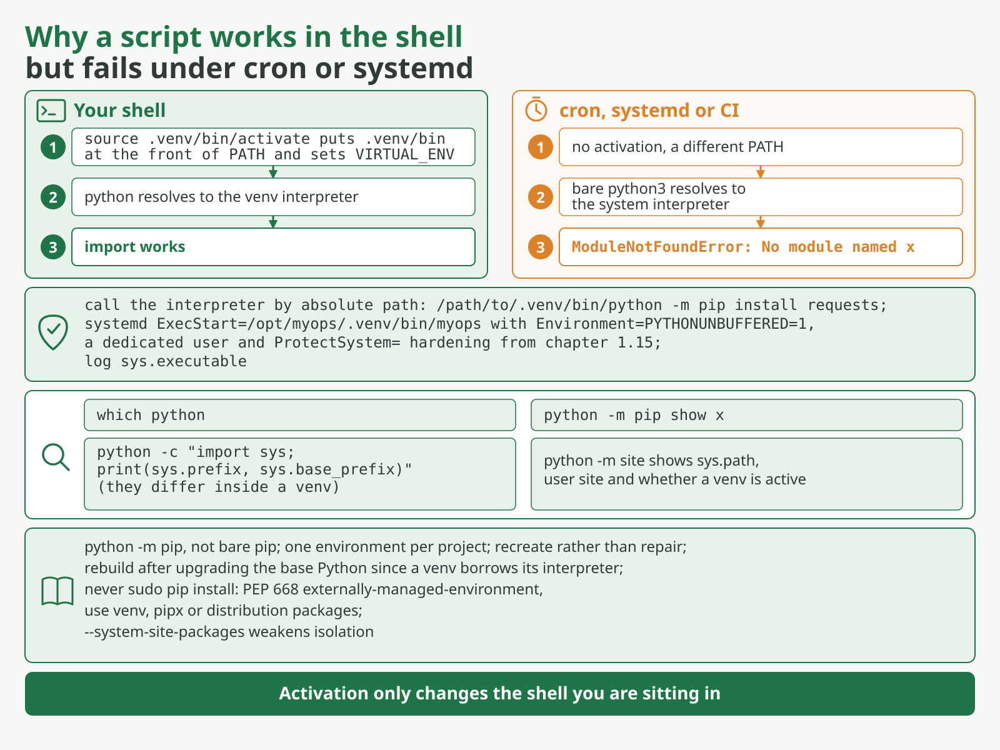

*Figure 3.2.24. Activation only changes the PATH of your shell, so services must call the venv interpreter by absolute path.*

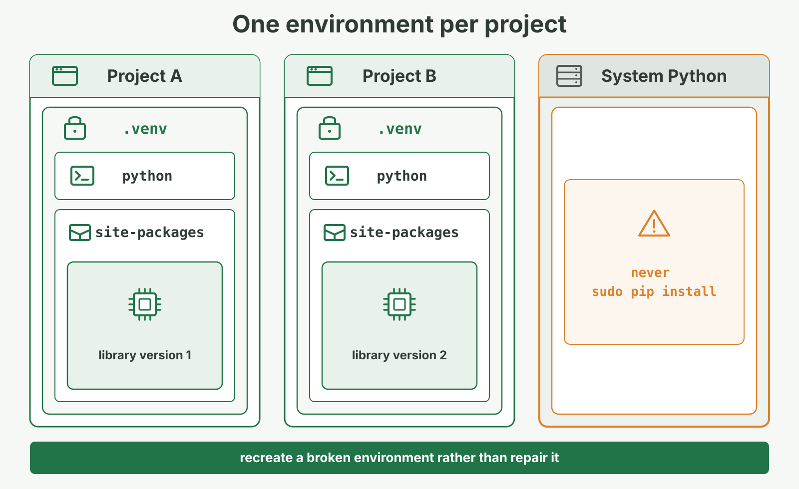

*Figure 3.2.25. One environment per project: each .venv has its own python and site-packages, so two library versions do not clash.*

Picture two projects on one machine. One needs one version of a library, and the other needs a different version. Without a virtual environment, both share the same installed packages, and one of them breaks.

A virtual environment is a directory with its own `site-packages` and its own `python` executable. The `site-packages` folder is where that environment's libraries live. The `python` executable is a symlink or a copy, and it is the interpreter that reads that folder. The environment keeps each project's dependencies apart from the system and from other projects.

Think of it as a private shelf of libraries. Only the interpreter on that shelf can reach them, and nothing outside the shelf can rearrange them.

```bash
python3 -m venv .venv                       # create (needs python3-venv package on Debian/Ubuntu)
source .venv/bin/activate                    # sets PATH and VIRTUAL_ENV; 'deactivate' to leave
python -c 'import sys; print(sys.prefix, sys.base_prefix)'     # differ inside a venv
.venv/bin/python -m pip install requests     # no activation needed: call the interpreter directly (best in scripts, cron, systemd)
python -m pip list ; python -m pip freeze > requirements.txt
rm -rf .venv                                 # envs are disposable; never commit them
```

Run these lines in order to create, use and remove an environment. Notice the fourth line. `.venv/bin/python` works without activation, and that is exactly what a cron job or a service needs.

Several rules keep environments predictable. Use one environment per project or per tool. When one breaks, recreate it rather than repair it. Run `python -m pip`, not bare `pip`, so you know which interpreter receives the install. After you activate an environment, run `which python` to confirm it.

Systemd units, cron jobs and CI should call `/path/to/.venv/bin/python` explicitly. They should not depend on activation. Activation only puts `.venv/bin` at the front of the `PATH` of the shell you are sitting in, and a service never gets that shell.

Never run `sudo pip install`, and avoid installing into the distribution's own Python. Modern distributions mark that interpreter **externally managed** under PEP 668, which means the distribution's package manager owns it and pip should keep its hands off. Pip then refuses with `error: externally-managed-environment`. Use a venv for your project instead. Use pipx for command-line tools, because `pipx install ansible-lint` gives each tool its own isolated environment. For system scripts, install the distribution's package, such as `apt install python3-yaml`.

The `--system-site-packages` option lets a venv see the system packages. Some bindings need that, such as `python3-apt` or GPU vendor packages. The cost is weaker isolation.

An environment is tied to the interpreter that created it, because it borrows that interpreter rather than copying it. Upgrading the base Python can break it, so rebuild the environment after an upgrade. Activation scripts exist for bash, zsh, fish and PowerShell. direnv or `uv run` can activate an environment automatically for each directory.

### Managing Python versions

Sooner or later a dependency will demand an interpreter you do not have. You can get the interpreter you need in several ways. pyenv builds interpreters under `~/.pyenv`. `uv python install 3.12` downloads standalone builds. The deadsnakes PPA serves Debian and Ubuntu, and conda, mamba and container base images also work. Pin the minor version in `pyproject.toml`, as in `requires-python = ">=3.10,<3.13"`. Repeat the pin in your CI matrix and Dockerfiles.

Your support window is set by the oldest Python that your dependencies still support. NumPy and PyTorch drop old versions every year, so check their policies before you choose a version.

## 4. Installing and managing dependencies

You have an environment, and now something has to go into it. Here is where most of the surprises live. Someone runs `pip install` in a terminal and the package lands in a different Python than the one that runs the job. Or the same command installs a different set of files on two machines, and nobody can say why.

### pip

Most installs follow a few patterns, and once you know them the rest is detail. The commands below cover the cases you meet most often. Each is one line you can run from a shell or place in a script.

```bash
python -m pip install requests                  # latest compatible
python -m pip install "requests>=2.31,<3"       # version specifiers (PEP 440): ==, !=, >=, <=, ~=2.31 (compatible release), *
python -m pip install -r requirements.txt       # from a file
python -m pip install -e .                      # editable install of the current project (dev)
python -m pip install --upgrade pip setuptools wheel
python -m pip install 'torch==2.4.0' --index-url https://download.pytorch.org/whl/cu121   # alternate index (CUDA wheels)
python -m pip install --extra-index-url https://pypi.example.com/simple internal-lib       # additional index: dependency confusion risk!
python -m pip install --require-hashes -r requirements.txt   # integrity-verified install
python -m pip install --no-cache-dir --no-deps pkg           # container tuning / manual resolution
python -m pip check                              # report broken dependency requirements
python -m pip show -f pkg ; python -m pip download pkg -d wheelhouse/ ; python -m pip wheel . -w dist/
python -m pip uninstall pkg ; python -m pip cache purge
```

Notice that the version specifiers follow PEP 440. The `~=2.31` form means a compatible release. After an install, `python -m pip check` reports any broken requirements, so it makes a useful last step.

The pip resolver has used backtracking since version 20.3. It searches for one set of versions that fit together, and backtracking is simply the habit of trying a combination, backing out when it conflicts, and trying another. When it cannot find one, it prints `ResolutionImpossible` with the conflicting constraints. Two other options shape an install. Extras, such as `pip install "myops[redfish,slurm]"`, add optional dependency groups. A constraints file, passed with `-c constraints.txt`, limits versions without adding any new requirement. Environment markers make a dependency conditional, as in `pywin32; sys_platform == "win32"` or `importlib-metadata; python_version < "3.10"`.

### Declaring dependencies: libraries vs applications

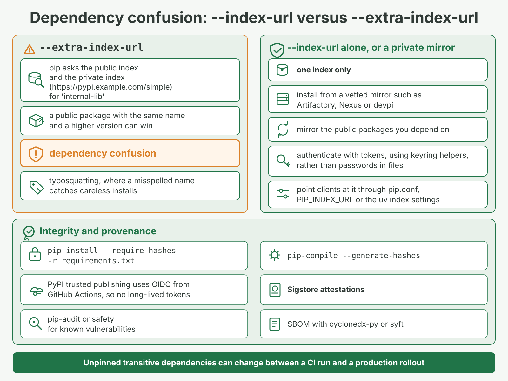

*Figure 3.2.26. An extra index lets a public package outrank a private one, so use a single vetted index and hashed requirements.*

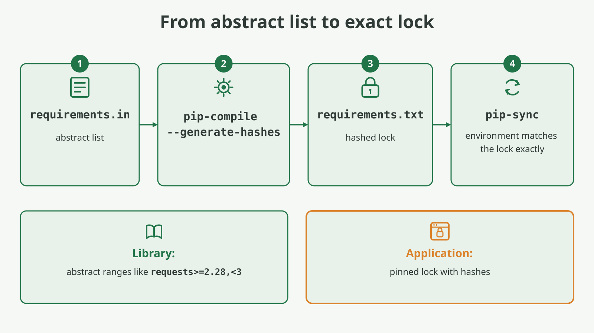

*Figure 3.2.27. Declaring dependencies: pip-compile turns an abstract list into a hashed lock, and pip-sync makes the environment match it.*

Libraries and applications need different kinds of declarations, and swapping them causes trouble in both directions. A library declares abstract, compatible ranges, such as `requests>=2.28,<3`. A range lets the library sit alongside other packages that also depend on requests. An application or deployment needs a concrete lockfile instead. The lockfile lists exact versions of everything, including transitive dependencies, along with hashes. Every machine then installs the same bits.

```bash
# pip-tools: compile abstract requirements into a fully pinned, hashed lock
pip install pip-tools
printf 'requests>=2.31\npyyaml\nprometheus-client\n' > requirements.in
pip-compile --generate-hashes requirements.in -o requirements.txt
pip-sync requirements.txt                       # make the environment match exactly (removes extras)

# uv (Rust, fast pip/pip-tools/venv replacement)
uv venv ; uv pip install -r requirements.txt ; uv pip compile requirements.in -o requirements.txt --generate-hashes
uv init app ; uv add requests ; uv lock ; uv sync ; uv run python main.py ; uv tool install ruff
# Poetry / PDM / Hatch: project managers with lockfiles (poetry.lock, pdm.lock, uv.lock)
poetry init ; poetry add requests ; poetry lock ; poetry install ; poetry run pytest
```

The first block uses pip-tools. Its `pip-compile` step turns the abstract list into a hashed lock, and `pip-sync` makes the environment match that lock exactly. The second block uses uv, a faster replacement for pip, pip-tools and venv. The third block shows project managers that keep lockfiles: Poetry, PDM and Hatch.

Locking matters because an unpinned transitive dependency can change between a CI run and a production rollout. A transitive dependency is one you never asked for, pulled in by a package you did ask for. A compromised or yanked release can also enter without anyone noticing, and a yanked release is one the publisher has withdrawn. Commit your lockfiles, and update them on purpose, through Dependabot or Renovate pull requests that run CI. Use hashes. In production, install from a vetted mirror such as Artifactory, Nexus or devpi. Run pip-audit or safety to find known vulnerabilities, and generate an SBOM with cyclonedx-py or syft. Watch out for dependency confusion, which is covered later in this chapter, and for typosquatting, where a misspelled name catches careless installs.

### conda / mamba

conda, and the faster mamba and micromamba, manage Python itself and also non-Python libraries. Those include CUDA toolkit pieces, MKL, compilers and ffmpeg. They come from channels such as conda-forge, nvidia and pytorch, and a channel is simply a package server. This is common in data science and on HPC systems, where compiled stacks matter.

Use one tool per environment. That is the rule to remember. Mixing pip and conda installs in the same environment causes subtle breakage. If you must mix them, install the conda packages first, add the pip packages that conda lacks afterwards, and never run pip as root. For reproducibility, export the environment with `conda env export --from-history` or `conda-lock`.

### Choosing

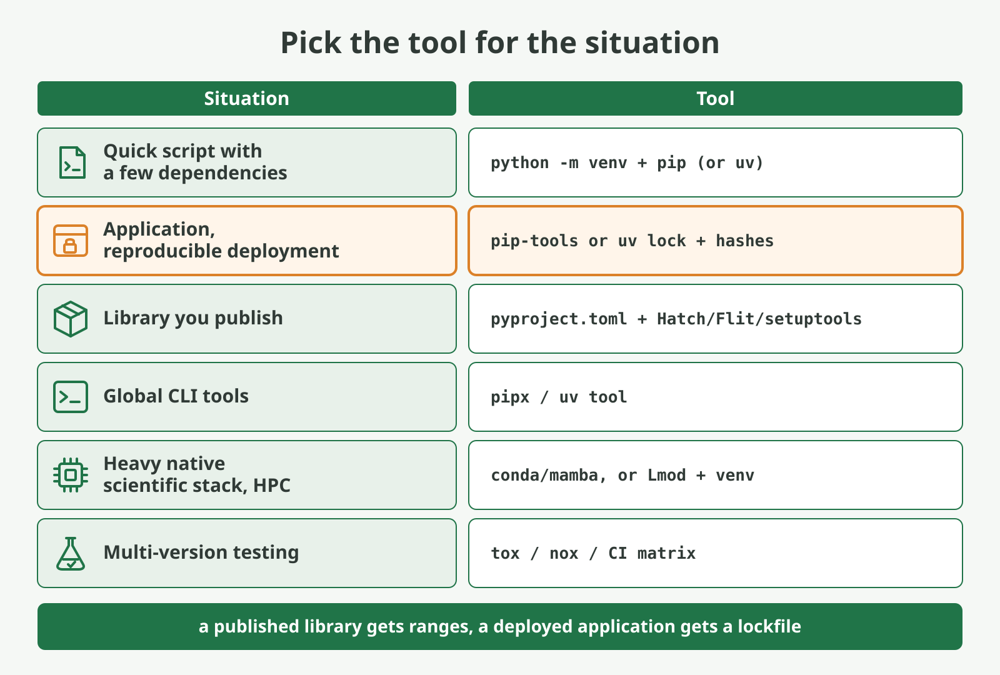

*Figure 3.2.28. Choosing a tool: match your situation to a row. A published library gets ranges, a deployed application gets a lockfile.*

The table maps common situations to a tool, so start with your situation rather than with a tool you have heard about.

| Situation | Tool |
|---|---|
| Quick script with a few dependencies | `python -m venv` + `pip` (or `uv`) |
| Application, reproducible deployment | `pip-tools` or `uv pip compile`/`uv lock` + hashes; container image |
| Library you publish | `pyproject.toml` + Hatch/Flit/setuptools; ranges not pins |
| Global CLI tools | `pipx` / `uv tool` |
| Heavy native scientific stack, HPC | conda/mamba, or system modules (Lmod) + venv |
| Multi-version testing | `tox` / `nox` / CI matrix |

Notice that a published library gets ranges, while a deployed application gets a lockfile. Match each project to its row before you pick a tool.

## 5. Packaging your own code

You have a tool that works on your laptop. Then a colleague wants it, and then a whole cluster wants it, and emailing a folder stops being an option. Packaging is how a folder of code becomes something another machine can install, version and trust.

### `pyproject.toml`

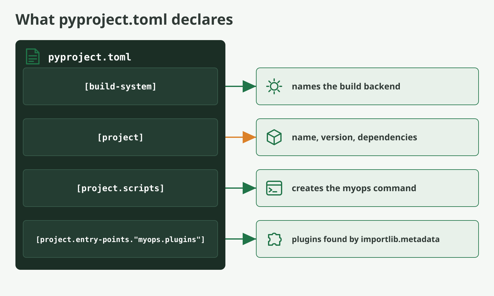

*Figure 3.2.29. pyproject.toml: four tables cover the build backend, project metadata, command launchers and plugin entry points.*

Every packaged project declares its build in a `pyproject.toml` file. The standard for this file, set by PEP 517, 518 and 621, names the build backend and the project metadata. A build backend is the tool that turns your source folder into a distributable file. The example below is a complete tool.

```toml
[build-system]
requires = ["hatchling>=1.24"]
build-backend = "hatchling.build"

[project]
name = "myops"
version = "0.3.1"                       # or dynamic = ["version"] from the package or VCS tags
description = "Operations tooling for the GPU cluster"
readme = "README.md"
requires-python = ">=3.10"
license = { text = "Apache-2.0" }
authors = [{ name = "Platform Team", email = "platform@example.com" }]
dependencies = ["requests>=2.31,<3", "pyyaml>=6", "prometheus-client>=0.20"]
classifiers = ["Programming Language :: Python :: 3", "Operating System :: POSIX :: Linux"]

[project.optional-dependencies]
redfish = ["python-redfish-library>=3"]
dev = ["pytest>=8", "ruff", "mypy", "pip-tools"]

[project.scripts]                         # console_scripts entry points: create 'myops' command
myops = "myops.cli:main"

[project.entry-points."myops.plugins"]    # plugin entry points discovered by importlib.metadata
gpu = "myops.plugins.gpu:Plugin"

[tool.hatch.build.targets.wheel]
packages = ["src/myops"]

[tool.ruff]
line-length = 100
[tool.pytest.ini_options]
testpaths = ["tests"]
```

The `[build-system]` table names the backend that builds your project. The `[project]` table holds the name, version, dependencies and classifiers. The `[project.scripts]` and `[project.entry-points]` tables expose your code to the outside world. The `[tool.*]` tables configure other tools.

Other backends are available. `setuptools` is still common, and it has legacy `setup.py` and `setup.cfg` files. You can also use `flit`, `poetry-core`, `pdm-backend`, `maturin` for Rust extensions, or `scikit-build-core` for CMake extensions. Settings for ruff, pytest, mypy, black and coverage all live in `[tool.*]` tables.

### Building, installing, publishing

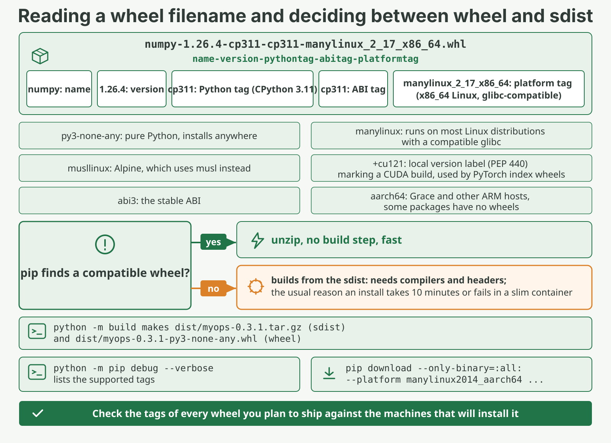

*Figure 3.2.30. The filename tags tell you which interpreter, ABI and platform a wheel fits, and a missing match falls back to a slow source build.*

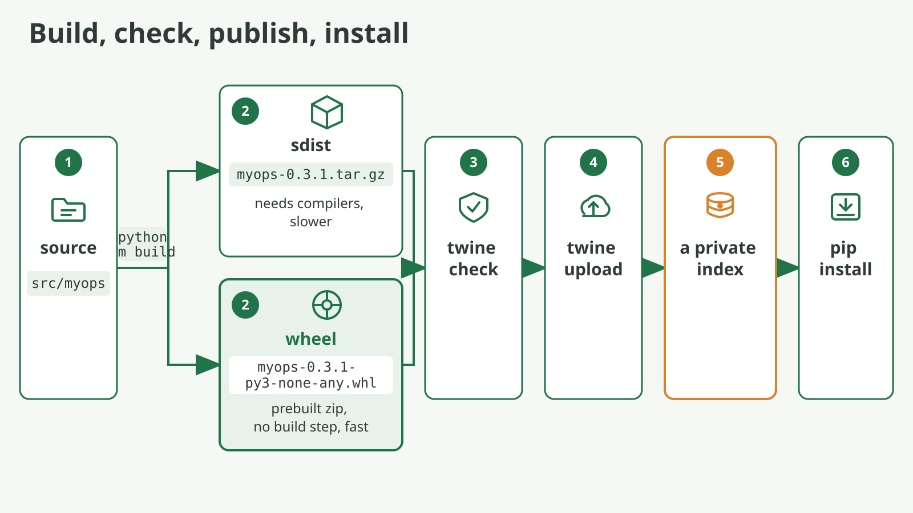

*Figure 3.2.31. Building and publishing: python -m build makes an sdist and a wheel, and a wheel installs without a build step.*

Building turns your source into files you can distribute. The commands below install the build tools, build an sdist and a wheel, check them, upload them to a private index, and install them.

```bash
python -m pip install build twine
python -m build                       # creates dist/myops-0.3.1.tar.gz (sdist) and dist/myops-0.3.1-py3-none-any.whl (wheel)
python -m twine check dist/*
python -m twine upload --repository-url https://pypi.example.com/ dist/*   # private index; or 'uv publish'
python -m pip install dist/myops-0.3.1-py3-none-any.whl
python -m pip install -e ".[dev]"     # editable + extras for development
```

A **wheel** (`.whl`) is a prebuilt zip file. It installs by unzipping, with no build step, so it is fast. Its filename carries tags in the form `name-version-pythontag-abitag-platformtag`. The filename `numpy-1.26.4-cp311-cp311-manylinux_2_17_x86_64.whl` is a NumPy wheel for CPython 3.11 on x86_64 Linux. A `py3-none-any` wheel is pure Python. A **manylinux** wheel runs on most Linux distributions that carry a compatible glibc, which is the C library nearly every Linux program links against. A **musllinux** wheel targets Alpine, which uses musl instead.

If no compatible wheel exists, pip builds from the **sdist**. The sdist needs compilers and headers, so this is the usual reason an install takes 10 minutes or fails in a slim container. Local version labels (PEP 440), such as `+cu121`, mark CUDA builds. PyTorch uses them on its index wheels.

For versioning, use SemVer (`MAJOR.MINOR.PATCH`) for libraries and CalVer (`2026.10.1`) for tools. Derive the version from Git tags with `hatch-vcs` or `setuptools-scm`, so you do not forget to bump it. Keep a changelog as well.

The `[project.scripts]` table has a practical effect. It makes the installer create a launcher in the environment's `bin/` directory. This is how pip, black and pytest are exposed as commands. The target function, `main()`, should return an exit code or call `sys.exit`.

Zipapps package an application as one file. The command `python -m zipapp myapp -m "myops.cli:main"` builds one. The tools `shiv` and `pex` do the same and bundle dependencies. That helps when you ship a tool to servers without internet access, although Python must still be installed on those servers. PyInstaller and Nuitka build standalone binaries instead.

For a private index, run a PyPI-compatible server, such as devpi, Artifactory, Nexus, GCP Artifact Registry, AWS CodeArtifact, or GitLab or GitHub packages. Point clients at it through `pip.conf`, `PIP_INDEX_URL` or the uv index settings. Authenticate with tokens, using keyring helpers, rather than storing passwords in files. Mirror the public packages you depend on.

Signing and provenance cover where a package came from. PyPI trusted publishing uses OIDC from GitHub Actions, so it needs no long-lived tokens. Sigstore attestations add more proof. So does `pip install --require-hashes`.

### Native extensions

Packages with C, C++, Rust or CUDA code ship compiled `.so` files inside their wheels. NumPy, PyTorch, cryptography and grpcio all do this. Those files bind to the Python ABI, which appears in tags such as `cp311` or the stable ABI `abi3`. The ABI is the binary contract between compiled code and the interpreter. They also bind to the CPU architecture, such as x86_64, or aarch64 on Grace and other ARM hosts. They bind to libc too. GPU packages add the CUDA runtime version and the NVIDIA driver. This is where reproducibility gets hard.

Check the tags of every wheel you plan to ship against the machines that will install it.

## 6. Plugins and entry points

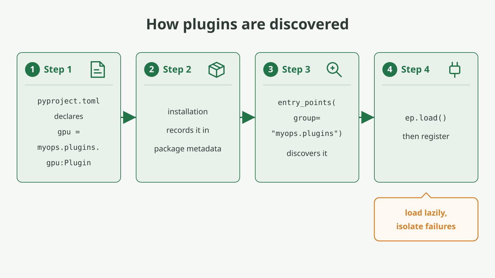

*Figure 3.2.32. Entry points: an installed package advertises a plugin, and the core discovers, loads and registers it without edits.*

Suppose your tool needs a new collector, such as one for GPUs. You do not want to edit the core every time. Entry points solve that problem. They let an installed distribution advertise its components to other programs, without any hard-coded imports. An entry point is a name plus a path to code, recorded in a package's metadata, where other programs can look it up. pytest plugins, Ansible and Click commands, and Prometheus collectors all work this way.

```python
from importlib.metadata import entry_points, version, metadata
for ep in entry_points(group="myops.plugins"):       # discover
    plugin_cls = ep.load()                            # imports 'myops.plugins.gpu:Plugin'
    plugin_cls().register(registry)
print(version("myops"), metadata("myops")["Summary"])
```

The loop discovers each plugin in the `myops.plugins` group, loads it, and registers it. Define a small base class or Protocol (chapter 3.4) for plugins. Load them lazily, and isolate failures, so that one broken plugin does not crash the host. Document the entry-point group name as part of the public API.

## 7. Python packaging on GPU and ML systems

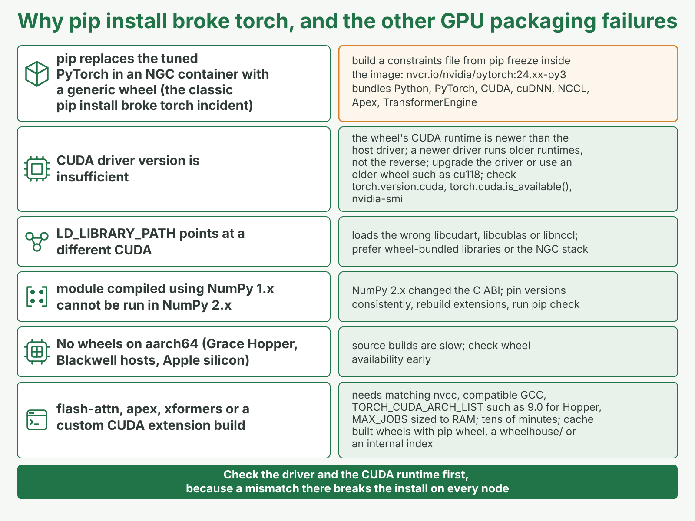

*Figure 3.2.33. Most GPU packaging failures come from a mismatch between the wheel, the driver and the shared libraries, and constraints files from the NGC image prevent the worst one.*

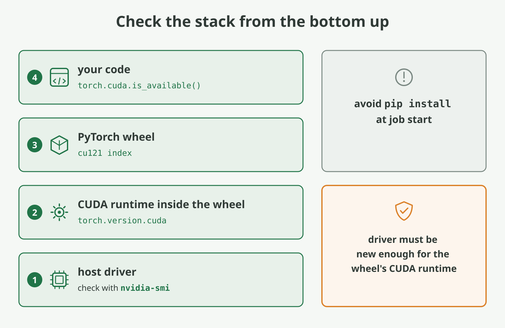

*Figure 3.2.34. GPU packaging: the host driver must be new enough for the CUDA runtime in the wheel, so check from the driver upward.*

A training container can build without error and still fail on the first GPU call, with a message that the driver is too old. The notes below cover the packaging causes, and they show you how to check each one.

PyTorch, TensorFlow and JAX wheels are CUDA-specific. PyTorch publishes a separate wheel for each CUDA minor version, on dedicated indexes such as `https://download.pytorch.org/whl/cu121`. The default PyPI wheel bundles a CUDA runtime through `nvidia-*-cu12` packages, which makes it large.

The driver on the host must be new enough for the CUDA runtime in the wheel. A newer driver runs older CUDA runtimes, which is driver forward compatibility. The reverse fails with `CUDA driver version is insufficient`.

To verify, check `torch.version.cuda`, `torch.cuda.is_available()` and `nvidia-smi`. The `nvidia-smi` output reports the driver and the maximum supported CUDA version. Run `python -c "import torch; print(torch.__file__)"` to confirm which copy of torch you are using.

You should not mix a system CUDA toolkit with wheel-bundled runtimes by accident. `LD_LIBRARY_PATH` is the list of directories the loader searches for shared libraries, so an `LD_LIBRARY_PATH` that points to a different CUDA can load the wrong `libcudart`, `libcublas` or `libnccl`. Prefer the libraries bundled in the wheel, or the consistent stack inside an NGC container.

NGC containers, such as `nvcr.io/nvidia/pytorch:24.xx-py3`, bundle Python, PyTorch, CUDA, cuDNN, NCCL, Apex, TransformerEngine and tuned builds. Use them as base images. Add your pure-Python dependencies with a constraints file derived from the image, made with `pip freeze` inside it. That keeps pip from replacing the tuned PyTorch with a generic wheel. This is the classic "pip install broke torch" incident.

NumPy 2.x changed the C ABI. Packages compiled against NumPy 1.x fail with `module compiled using NumPy 1.x cannot be run in NumPy 2.x`. Pin versions consistently, rebuild extensions, and run `pip check` to catch mismatches.

On aarch64 hosts, such as Grace Hopper and Blackwell hosts and Apple silicon, some packages have no wheels. Source builds then take a long time and need toolchains. You can check wheel availability early with `pip download --only-binary=:all: --platform manylinux2014_aarch64 ...`.

Building flash-attn, apex, xformers or a custom CUDA extension needs a matching `nvcc` and a compatible GCC. `nvcc` is the CUDA compiler, and it must speak the same CUDA version as the rest of the stack. It also needs the right `TORCH_CUDA_ARCH_LIST`, such as `9.0` for Hopper, and enough RAM for the parallel jobs that `MAX_JOBS` sets. The build takes tens of minutes. Cache the built wheels with `pip wheel`, a `wheelhouse/` directory or an internal index. That way each node does not rebuild them.

On HPC systems, load compilers, MPI and CUDA through environment modules (Lmod), which switch toolchains by setting environment variables. Create venvs or conda environments on shared file systems with care. Metadata-heavy import storms on Lustre or NFS slow startup, because every import becomes a round trip over the network. Copy the environment to node-local NVMe, or use zipimport or container images. Use `python -X importtime` to find slow imports. Set `PYTHONDONTWRITEBYTECODE` on read-only paths, and keep large packages such as torch in a squashfs or container image.

On Slurm and Kubernetes, bake environments into images or into shared read-only locations, and pin them by digest. Avoid `pip install` at job start. It adds a network dependency, rate limits and results that differ between runs.

If your cluster is offline or air-gapped, build a wheelhouse with `pip download -r requirements.txt -d wheelhouse`. Mirror the indexes, and install with `--no-index --find-links wheelhouse`.

Check the driver and the CUDA runtime first, because a mismatch there breaks the install on every node.

## 8. Containers and system integration

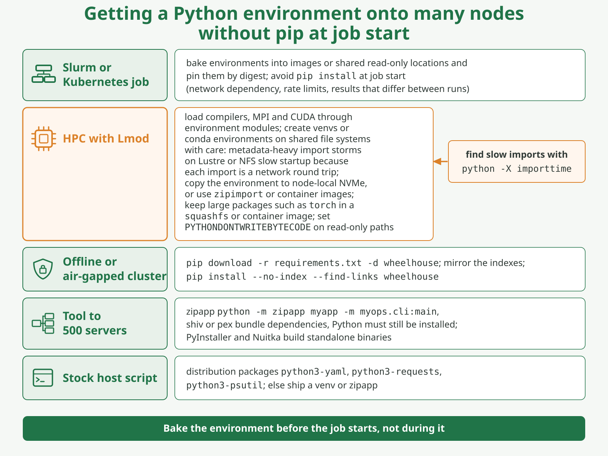

*Figure 3.2.35. Bake and pin the environment ahead of time, and use a wheelhouse for offline clusters and node-local copies to avoid import storms.*

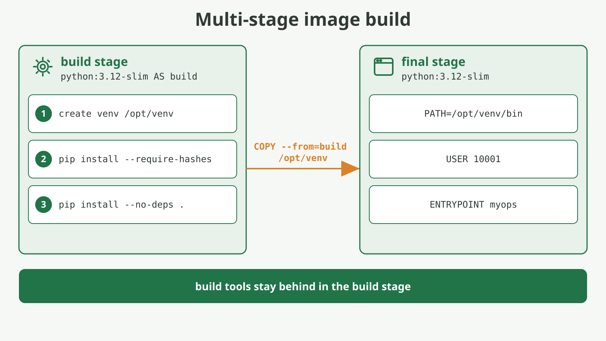

*Figure 3.2.36. Multi-stage build: dependencies are installed in a build stage, then only the virtual environment is copied into the final image.*

Your service works on your laptop, and now it has to become an image that a cluster can pull. A multi-stage Dockerfile is the usual starting point for a Python service. Multi-stage means the file has more than one `FROM` line, and only the last one becomes the image you ship. The first stage builds the virtual environment. The second stage copies only that environment into a clean runtime image.

```dockerfile
FROM python:3.12-slim AS build
ENV PIP_NO_CACHE_DIR=1 PYTHONDONTWRITEBYTECODE=1
WORKDIR /src
COPY requirements.txt .
RUN python -m venv /opt/venv && /opt/venv/bin/pip install --require-hashes -r requirements.txt
COPY pyproject.toml ./ ; COPY src/ src/
RUN /opt/venv/bin/pip install --no-deps .

FROM python:3.12-slim
COPY --from=build /opt/venv /opt/venv
ENV PATH=/opt/venv/bin:$PATH PYTHONUNBUFFERED=1
USER 10001
ENTRYPOINT ["myops"]
```

The multi-stage layout keeps compilers out of the runtime image, so the image you ship is smaller and has less in it that could go wrong. Pin base images by digest, and run the process as a non-root user. Set `PYTHONUNBUFFERED=1` so logs appear as soon as they are written. Set `PYTHONFAULTHANDLER=1` to get a traceback after a crash. Copy `requirements.txt` before the sources, so Docker can reuse the dependency layer when only your code changes.

Choose the base image with care. Alpine uses musl, and it often lacks wheels, which means slow builds and subtle differences. Compare slim images with Alpine before you choose one. Distroless images reduce the attack surface further.

For systemd services, point `ExecStart=/opt/myops/.venv/bin/myops` at the virtual environment, and set `Environment=PYTHONUNBUFFERED=1`. Run the service under a dedicated user, and add the `ProtectSystem=` hardening from chapter 1.15.

**System packages vs pip** matters on stock hosts. A script that must run on any stock host is best served by the distribution's own Python and packaged libraries, such as `python3-yaml`, `python3-requests` and `python3-psutil`. If those are not enough, ship a venv or a zipapp. `ansible` itself uses the system or a venv interpreter (`ansible_python_interpreter`) on its targets.

## 9. Troubleshooting imports and environments

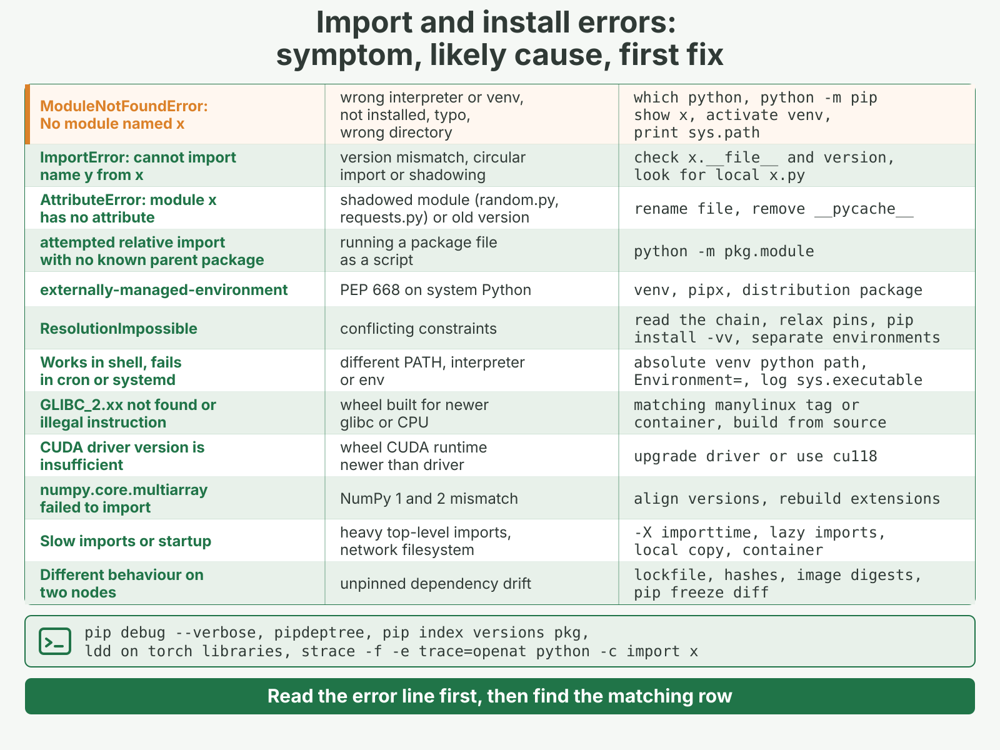

*Figure 3.2.37. Match the exact error text to a row for the likely cause, then use the deeper tools only if the first fix fails.*

When your import or install fails, start by matching the error text to a row in the table. Each row tells you the likely cause and the fix. The error text is the most reliable clue you have, so read it before you change anything.

| Symptom | Likely cause | Fix |
|---|---|---|
| `ModuleNotFoundError: No module named 'x'` | Wrong interpreter/venv; package not installed; typo; running from a different directory | `which python`, `python -m pip show x`, activate venv, install, `python -c 'import sys; print(sys.path)'` |
| `ImportError: cannot import name 'y' from 'x'` | Version mismatch or circular import or shadowing | Check `x.__file__` and version; look for local `x.py`; restructure imports |
| `AttributeError: module 'x' has no attribute ...` | Shadowed module (`random.py`, `requests.py`) or old version | Rename file; remove `__pycache__`; check version |
| `attempted relative import with no known parent package` | Running a package file as a script | `python -m pkg.module` |
| `externally-managed-environment` | PEP 668 on system Python | Use venv/pipx/distribution package |
| `ResolutionImpossible` | Conflicting constraints | Read the chain; relax pins; use `pip install -vv`; upgrade the culprit; separate environments |
| Works in shell, fails in cron/systemd | Different PATH/interpreter/env | Use absolute venv python path; set `Environment=`; log `sys.executable` |
| `GLIBC_2.xx not found` / illegal instruction | Wheel built for newer glibc/CPU | Use matching manylinux tag/container; build from source |
| `CUDA driver version is insufficient` | Wheel CUDA runtime newer than driver | Upgrade driver or use older CUDA wheel (`cu118`) |
| `numpy.core.multiarray failed to import` / ABI error | NumPy 1/2 mismatch | Align versions; rebuild extensions |
| Slow imports / startup | Heavy top-level imports, network filesystem | `-X importtime`, lazy imports, local copy, container |
| Different behaviour on two nodes | Unpinned dependency drift | Lockfile, hashes, image digests, `pip freeze` diff |

The table is a starting point, not a full diagnosis. If you are stuck, read the error line first, and then find the matching row. The commands below help you look deeper.

Several commands show what is installed and where it came from. `python -m pip debug --verbose` lists the supported tags. `python -c 'import platform; print(platform.platform(), platform.machine())'` shows the platform and the machine type. The `ldd` command checks which shared libraries `torch` loads. `pipdeptree` prints the dependency tree, and `pip index versions pkg` lists the available versions. `python -m trace --listfuncs` traces which functions run. To see where an import comes from, run `strace -f -e trace=openat python -c 'import x' 2>&1 | grep -v ENOENT`.

## 10. Lab: environments and a packaged tool

Start with the self-checking Python lab, and run it on your own machine. It covers several ideas from this chapter, so it doubles as a self-test. It verifies how `import` and `from` copy references, and how `reload()` behaves (*Learning Python*, chapters 23 and 25). It tests the 4-step import search precedence algorithm, where `regular_package`, with `__init__.py`, and `simple_module` beat bare PEP 420 `namespace_package` directories (chapter 24). It checks `_X` against `__all__` for exports (`unders.py` and `alls.py`), and module-level `__getattr__` and `__dir__` (`gamod.py`). It also compares `__import__('email.message')` with `importlib.import_module('email.message')`. Last, it compares the recursive reloader, `reloadall2.py`, with the explicit-stack reloader, `reloadall3.py`.

```bash
python3 code/part03/python_modules_packaging_lab.py
```

The lab file lives at `code/part03/python_modules_packaging_lab.py`, and running it takes one command. The exercises below all need Python 3.11 or newer. The interactive shell steps in them were not run on live hardware, so check each result on your own machine.

1. Start with the import system. Create `a.py` and `b.py`, which import each other in a cycle, as in `recur1.py` and `recur2.py`. Run them, observe the errors, and then refactor the cycle away. Next, create a local `random.py` and watch it shadow the standard library. Remove it afterward. Then write `mymod.py`, the module from the *Learning Python* Part V exercises. It should export `countLines(name)`, `countChars(name)` and `test(name)`. Include a `file.seek(0)` single-open variant and an `if __name__ == '__main__':` self-test. Import it from `myclient.py`, and package it inside `mypkg/`. Finally, print `sys.path` and the size of `sys.modules`, and use `-X importtime` on a heavy import.
2. Build the `myops` package skeleton shown earlier, with its subpackages. Use relative and absolute imports, add `__all__`, and add a `__main__.py`. Run it with `python -m myops`. Then reproduce the relative-import-as-script error, and explain why it happens.
3. Create two virtual environments with conflicting versions of one library, for example `requests==2.25.1` and the latest release. Show that they stay isolated. Call each interpreter directly, without activation, and inspect `sys.prefix`. On a throwaway VM, try `sudo pip install` and note the PEP 668 behavior. Finally, use pipx to install a command-line tool.
4. Write a `requirements.in` file with unpinned dependencies. Compile it with `pip-compile --generate-hashes`, and sync the environment. Remove a package by hand, then watch `pip-sync` clean it up. Repeat the process with `uv`, and compare the speed. Finish by running `pip-audit`.
5. Write a `pyproject.toml` for Hatch or setuptools, with a console script and an entry-point plugin. Build the sdist and the wheel. Unzip the wheel and inspect `METADATA`, `entry_points.txt` and `RECORD`. Install the wheel into a clean venv and run the command. Then install in editable mode and change the code, to see the effect live.
6. Run `devpi-server`, or a local `pypiserver`, inside a container. Upload your wheel, then install it with `--index-url`. Next, show the dependency confusion risk with `--extra-index-url`, and then show the mitigation.
7. Build a Docker image with hashed requirements. Simulate a transitive release by editing a pin, rebuild, and compare the output of `pip freeze`. Pin the base image by digest. Measure the image size and the import time. Then add a multi-stage build.
8. This one needs a GPU VM. Create a virtual environment with a CUDA-specific PyTorch wheel, and verify `torch.cuda.is_available()`. Break it on purpose with a mismatched `LD_LIBRARY_PATH`. Then compare the result with an NGC container. Finally, write the `pip check` and `pip freeze` audit commands you would run on every node.
9. Run the tool as a systemd service. Use the absolute venv interpreter, a dedicated user and `Environment=PYTHONUNBUFFERED=1`. Then show the same job failing when it calls bare `python3`, and fix it.
10. When you finish, clean up the environments and containers.

## 11. Common mistakes

Many environment problems begin with the install itself. Running `sudo pip install` is a mistake, and so is installing into the system Python. Bare `pip` is risky when you do not know which interpreter it targets.

Two habits cause trouble at deploy time. Committing `.venv` is a mistake, and so is skipping lockfiles. Relying on "latest" at deploy time gives you a different build each time.

Naming files after standard modules causes shadowing, and so does running scripts from a directory with stray `.py` files. Heavy work at import time is another common mistake. So is global state set up in `__init__.py`.

Pinning libraries too tightly breaks their downstream users. Pinning applications too loosely makes them non-reproducible. Mixing conda and pip installs carelessly causes breakage, and so does mixing system CUDA with wheel CUDA.

Using `--extra-index-url` with private package names invites dependency confusion. Downloading and running unpinned packages on production hosts is risky too. Installing at runtime, in containers and jobs, brings network flakiness, drift and security risk. Forgetting aarch64 and glibc compatibility also leads to failures.

## 12. Interview angles

Use these questions to test yourself before an interview. Each one touches a part of the chapter you should be able to explain out loud. Answer them aloud, because the interview will not happen inside your head.

- "What happens when you `import x`? Where does Python look?"
- "Difference between a module, a package and a namespace package?"
- "Why use virtual environments? How do you make an environment reproducible?"
- "What is a wheel versus an sdist? What do the tags mean?"
- "How would you deliver a Python tool to 500 servers? To an air-gapped cluster?"
- "A job works on one node and fails on another with the same code. What do you check?" (interpreter, packages, lockfile, CUDA/driver, glibc, CPU, env vars.)
- "How do you avoid dependency confusion and supply-chain risks?"
- "`pip install` of an ML package broke PyTorch in the container; why and how do you prevent it?"
- "How do console scripts and entry points work?"

## Exercises

The exercises below follow the chapter in order, so you can check each answer against the text above. Work through them in sequence, because each one leans on the section before it.

1. Start with the import pipeline, covered in *Learning Python* chapter 22. (a) Trace the three steps that Python runs on the first `import b`, after it checks `sys.modules`, `sys.builtin_module_names` and the frozen modules. Then list the five components that make up `sys.path`. (b) Explain the three checks Python applies to `__pycache__/codefile.cpython-312.pyc` before it skips compilation. Contrast timestamp-based `.pyc` files with hash-based ones (`compileall` / `--check-hash-based-pycs`). Last, explain why top-level scripts do not write `.pyc` files unless you run `python3 -m compileall -b -l .`.
2. Next, work through *Learning Python* chapter 23, using `simulate_import_vs_from_and_reload()` in `code/part03/python_modules_packaging.py`. Explain why `from share import x, y; x = 'hack'; y[0] = 'hack'` leaves `share.x == 1`, while it changes `share.y` to `['hack', 2]`. Explain why `importlib.reload(share)` updates `share.x` in place but not `copied_x`. Also explain why `lex1.f()` in `lex2.py` prints `11 99`. Lexical scoping (`lex1.py` and `lex2.py`) and downward qualification (`nest1..3.py`) belong to this exercise too.
3. Turn to *Learning Python* chapter 24, on packages. (a) Compare what you see when you run `python3 dir1` and when you run `python3 -m dir1`. Do this for each of the three forms in `dir1/__main__.py`: `import mod`, `from . import mod` and `import dir1.mod`, where the last one needs `export PYTHONPATH=.`. (b) Use `resolve_four_step_import_search()` to trace the four-step candidate scan across `['/ns/part1', '/ns/part2']`. Then explain why adding `/ns/part2/sub/__init__.py` or `/ns/part2/sub.py` overrides the bare directory `/ns/part1/sub`, which comes earlier on `sys.path`.
4. Move on to *Learning Python* chapter 25. Use `filter_from_star_exports()`, `build_dynamic_getattr_module()`, `compare_dunder_import_vs_import_module()`, `transitive_reload_recursive()` and `transitive_reload_stack()`. Then explain three things. (a) How `__all__ = ['a', '_c']` overrides `_X` in `from alls import *`, and how the `__getattr__` and `__dir__` in `gamod.py` work. (b) Why `__import__('email.message')` returns `'email'`, while `importlib.import_module('email.message')` returns `'email.message'`. (c) Why `reload(ra)` does not reload `rb` or `rc`, and how `reloadall2.py` (recursive) and `reloadall3.py` (explicit stack) solve that.
5. Cover environments, locks and entry points together. (a) Explain how `python3 -m venv .venv` isolates packages, using `sys.prefix` and `sys.base_prefix`. Explain why systemd and cron jobs should call `/path/to/.venv/bin/python` directly. Explain why PEP 668 raises `externally-managed-environment`. (b) Contrast the abstract version ranges in `pyproject.toml`, such as `dependencies = ["requests>=2.31,<3"]`, with hashed lockfiles made by pip-tools (`pip-compile --generate-hashes`, `pip-sync`) or by `uv lock`. Then show how `[project.scripts]` and `[project.entry-points."myops.plugins"]` work with `importlib.metadata.entry_points`.
6. Finish with wheels, dependency confusion and GPU containers. (a) Decode the wheel filename `numpy-1.26.4-cp311-cp311-manylinux_2_17_x86_64.whl`. Compare it with `py3-none-any.whl` and with the `+cu121` label. Then explain why `--extra-index-url` creates a dependency confusion risk, compared with using `--index-url` alone. (b) Diagnose why you might see `CUDA driver version is insufficient` or `module compiled using NumPy 1.x cannot be run in NumPy 2.x` on a GPU node. Then explain how multi-stage Docker builds and NGC constraints prevent these errors.

## Checkpoint questions (20)

<details>
<summary>1. What is a module, and how do `from mod import x` and `import mod` differ when rebinding `x`, mutating a shared list `y`, or calling `importlib.reload(mod)` (*Learning Python*, chapters 23 and 25)?</summary>

A module is a file, or a built-in or extension module, that provides a namespace. Python runs its top-level code once, on first import, and caches the result in `sys.modules`. The statement `from share import x, y` works like `import share`, then `x = share.x`, then `y = share.y`, and finally `del share`.

- **Rebinding:** `x = 'hack'`, or `X = 88` in `nested.py`, changes only the importer's local name. `share.x` stays `1`, and `nested.X` stays `99`. To change a value across files, go through the module, as in `import share; share.x = 23`.
- **Mutation:** `y[0] = 'hack'` changes the list that both modules share, so `share.y` becomes `['hack', 2]`.
- **Reloading:** `importlib.reload(changer)` runs the file again in place, inside the existing `changer.__dict__`. Code that calls `changer.printer()` sees the new function at once. Code that ran `from changer import printer` keeps the old function until it runs that import again.
</details>

<details>
<summary>2. What are the three runtime steps of an `import` operation, and what five components make up `sys.path` (*Learning Python*, chapter 22)?</summary>

If a module is not already in `sys.modules`, and it is not listed in `sys.builtin_module_names` or a frozen module such as `os`, Python does three things. First, it finds the file by scanning `sys.path` from left to right. Second, it compiles the `.py` source to `.pyc` bytecode in `__pycache__/`, unless a current `.pyc` already exists. A usable `.pyc` needs a matching magic number, a matching timestamp and size, or a hash checked with `--check-hash-based-pycs`, and an interpreter tag such as `cpython-312`. Top-level scripts do not save `.pyc` files unless you run `python3 -m compileall -b -l .`. Third, it runs the top-level statements from top to bottom to fill the namespace.

The five components of `sys.path`, in order, are these. The home directory of the top-level script, or `''` for the current directory in the REPL, `-c` and `-m`. This is separate from `os.getcwd()`. Next come the `PYTHONPATH` directories, then the standard-library directories, which `PYTHONHOME` can move. Then comes `site-packages`. Last are the directories listed in `.pth` files, which the `site` module adds. A `._pth` file can override this, and a program can change `sys.path` at runtime with `sys.path.append`.
</details>

<details>
<summary>3. How are module namespaces stored internally, and how does lexical scoping (`lex1.py`/`lex2.py`) differ from downward attribute qualification (`nest1..3.py`) (*Learning Python*, chapter 23)?</summary>

Each module's namespace lives in a dictionary, `module.__dict__`. `vars(module)` returns that same dictionary, so `dir(module)`, `sorted(module.__dict__)` and `sorted(vars(module))` all match.

Lexical scoping (LEGB) searches only the file where a `def` was written. Imports give no upward visibility. In `lex2.py`, calling `lex1.f()` changes `lex1.X` to `99`, and `lex2.X` stays at `11`.

Downward qualification, as in `X.Y.Z`, works the other way. Python finds the leftmost name by LEGB, then reads attributes from left to right. For example, in the `nest` example, `nest1` imports `nest2`, which imports `nest3`. So `nest1` can read `nest2.nest3.X` and print `1 2 3`. But `nest3` cannot see `nest2` or `nest1`.
</details>

<details>
<summary>4. What is the shadowing trap, and when must you use `import` (or `as`) instead of `from`?</summary>

Python puts the script's home directory first on `sys.path`, as `sys.path[0]`. So a local file named `json.py`, `random.py`, `requests.py` or `test.py` hides the standard or installed module with the same name. You then get an `AttributeError` or a circular import failure.

When two modules define the same name, you should use `import M, N` and call `M.func()` and `N.func()`. Or use `as`, as in `from M import func as mfunc`. Otherwise, `from M import func` followed by `from N import func` silently overwrites `func`.
</details>

<details>
<summary>5. What are the four roles of `__init__.py` in a package, and why does `import dir1` followed by `dir1.dir2.mod.var` fail (*Learning Python*, chapter 24)?</summary>

A package's `__init__.py` does four jobs. It runs package initialization code on the first import through that directory. It fills the module namespace of the directory object, so `dir1.var` works. It marks the directory as a regular package, which gives it priority over bare directories and modules later on `sys.path`. And through `__all__ = ['mod']`, it controls which submodules `from package import *` loads.

`import dir1` loads only `dir1/__init__.py`. Directory module objects do not check the file system when you read an attribute. So `dir1.dir2.mod.var` raises `AttributeError` until you run `import dir1.dir2.mod`, or `from dir1.dir2 import mod`.
</details>

<details>
<summary>6. How does launching a package via `python3 dir1` differ from `python3 -m dir1`, and how do `import mod`, `from . import mod`, and `import dir1.mod` behave in `dir1/__main__.py` (*Learning Python*, chapter 24)?</summary>

`python3 dir1` runs `__main__.py` as a plain script. It skips `dir1/__init__.py`, and `sys.path[0]` becomes `dir1/`. `python3 -m dir1` runs the full package machinery. It executes `dir1/__init__.py` first, and then `__main__.py` inside the package.

So, inside `__main__.py`:

1. `import mod` works with `python3 dir1`, but fails under `python3 -m dir1` with `ModuleNotFoundError`.
2. `from . import mod` works with `python3 -m dir1`, but fails with `python3 dir1`, with `ImportError: attempted relative import with no known parent package`.
3. `import dir1.mod` works in both modes, as long as the container directory is on `sys.path` (`export PYTHONPATH=.`).
</details>

<details>
<summary>7. Walk through Python's 4-step import search algorithm and explain how PEP 420 namespace packages (`__path__`) work (*Learning Python*, chapter 24).</summary>

For each candidate directory `d` on `sys.path`, or on a parent package's `__path__`, Python checks four things in order. If `d/name/__init__.py` exists, it returns a regular package. If `d/name` with a module suffix exists, such as `.py`, `.pyc` or `.so`, it returns a simple module. If `d/name` is a directory without `__init__.py`, it records that directory and keeps scanning. Otherwise it moves on to the next directory.

If the scan ends without a match in steps 1 or 2, and at least one directory was recorded, Python returns a PEP 420 namespace package. Its `__path__` is a `_NamespacePath` that joins all the recorded directories, such as `ns/part1/sub` and `ns/part2/sub`. The namespace package has no `__file__`.
</details>

<details>
<summary>8. How do `_X`, `__all__`, `__getattr__`, and `__dir__` control module attribute access and exports (*Learning Python*, chapter 25)?</summary>

- **`_X`:** When `__all__` is missing, `from module import *` skips names that begin with a single underscore, as in `unders.py`.
- **`__all__`:** When you set `__all__ = ['a', '_c']`, star imports copy only those names. This overrides the underscore rule, as in `alls.py`. Neither rule blocks an explicit import such as `from module import _d`.
- **`__getattr__(name)` and `__dir__()`, in `gamod.py` (Python 3.7+):** Lookups of undefined attributes, such as `gamod.test`, `gamod.hack` or `from gamod import code`, call `__getattr__`. Calls to `dir(gamod)` run `__dir__`. Bare global names inside the file do not call `__getattr__`. An outside assignment, such as `gamod.hack = 'real'`, creates a real attribute.
</details>

<details>
<summary>9. How do `exec`, `__import__`, and `importlib.import_module` differ when importing a module by runtime string name (*Learning Python*, chapter 25)?</summary>

`import 'string'` raises a `SyntaxError`. Also, `x = 'string'; import x` looks for `x.py`, not for the module the string names. So a name that arrives at runtime needs one of these tools.

- `exec('import ' + modname)` compiles and runs the import in the current scope. It is slow, and it is unsafe on untrusted input.
- `__import__('email.message')` returns the leftmost top-level package, `<module 'email'>`.
- `importlib.import_module('email.message')` is the preferred call. It returns the target module, `<module 'email.message'>`, and it handles relative imports when you pass `package=`.
</details>

<details>
<summary>10. Why does `importlib.reload(ra)` fail to reload nested imports `rb` and `rc`, and how do `reloadall.py`, `reloadall2.py`, and `reloadall3.py` reload transitively (*Learning Python*, chapter 25)?</summary>

`reload(ra)` runs only `ra.py` again. When that file runs `import rb`, Python finds `rb` in `sys.modules` and reuses the old copy. For example, `rb` and `rc` keep their old values. A transitive reloader fixes this. It walks `module.__dict__.values()`, keeps the entries whose `type(obj) == types.ModuleType`, and calls `reload` inside `tryreload`, a `try / except` wrapper. The wrapper stops crashes on modules that cannot be reloaded, such as `sys.monitoring`. The walker records the modules it has visited, so cycles and diamond imports are reloaded once. `reloadall.py` tracks them in a `visited` dictionary. `reloadall2.py` recurses with a `visited = set()`. `reloadall3.py` uses an explicit stack, with `objects.pop()` and `objects.extend()`.
</details>

<details>
<summary>11. In *Learning Python*'s chapter 25 circular import example (`recur1.py`: `X = 1; import recur2; Y = 2` and `recur2.py`: `from recur1 import X; from recur1 import Y`), why does `import recur1` fail while `import recur2` and `python3 recur1.py` succeed?</summary>

Python adds a module to `sys.modules` before it runs the module body. When you run `import recur1`, it executes `X = 1`, then enters `import recur2` before `Y = 2` runs. Then `recur2`'s `from recur1 import Y` finds a partly built `recur1`, and raises `ImportError: cannot import name 'Y' from partially initialized module 'recur1'`.

Starting from `import recur2`, or running `python3 recur1.py` as a script, reverses the order. `recur2` then imports `recur1` from top to bottom. `recur1` finishes both `X = 1` and `Y = 2`. The `import recur2` inside it does nothing, since `recur2` is already loaded, so the later `from recur1 import Y` succeeds. To fix a cycle, move the shared code into a separate module. Or use `import recur1` and qualify names, such as `recur1.Y`, inside functions. You can also defer the `from` import, or use `typing.TYPE_CHECKING`.
</details>

<details>
<summary>12. Why use the `src/` layout (`src/myops/__init__.py`) and `importlib.resources` for package data files?</summary>

In a flat layout, running `pytest` from the project root puts `''` on `sys.path[0]`. Python then imports the local source folder directly, which hides broken packaging and missing files in `pyproject.toml`. The `src/` layout forces you to install the package first, with `python -m pip install -e .`, before `myops` can be imported. So packaging defects show up in CI right away. For bundled data, use `importlib.resources.files("myops") / "templates/x.j2"` rather than `__file__` paths. That works with wheels, zipimports and editable installs.
</details>

<details>
<summary>13. How does a virtual environment (`python3 -m venv .venv`) work, how do you run it in systemd/cron without `activate`, and what are PEP 668 and `pipx`?</summary>

A virtual environment is an isolated directory. It has its own interpreter link, `.venv/bin/python`, which makes `sys.prefix` differ from `sys.base_prefix`. It also has a private `site-packages`. Activation with `source .venv/bin/activate` only puts `.venv/bin` at the front of `PATH`. In systemd units, cron jobs and CI, call `/path/to/.venv/bin/python` directly, or `/path/to/.venv/bin/python -m pip`, without activation.

PEP 668 produces `error: externally-managed-environment`. It stops pip from changing system Python packages that `apt` or `dnf` manage. Use a project `.venv` for apps and libraries. Use pipx or `uv tool` for standalone command-line tools, such as `ansible-lint` or `ruff`, so that each one gets its own environment.
</details>

<details>
<summary>14. Contrast declaring dependencies for a reusable library versus a deployed application, and explain `pip-compile --generate-hashes`, `pip-sync`, and `uv`.</summary>

A library declares abstract version ranges in `pyproject.toml`, such as `dependencies = ["requests>=2.28,<3"]`. That lets consumers resolve compatible versions alongside other libraries. An application or deployment commits a concrete, hash-pinned lockfile, such as `requirements.txt` or `uv.lock`. The lockfile pins every direct and transitive dependency to an exact version and SHA-256 digest, and it installs with `--require-hashes`.

`pip-compile --generate-hashes requirements.in -o requirements.txt` turns abstract requirements into the hashed lockfile. `pip-sync requirements.txt` installs what is missing, fixes mismatched versions, and removes any package that is not in the lockfile. And `uv` is a fast replacement, written in Rust, for `venv`, `pip`, pip-tools and pipx.
</details>

<details>
<summary>15. Why shouldn't you carelessly mix `conda` and `pip` in the same environment, and what is a dependency confusion attack?</summary>

conda and mamba resolve both Python packages and native C and CUDA libraries, from channels such as conda-forge and nvidia. pip sees only Python package metadata, in `dist-info`. Running pip and conda back and forth can overwrite shared libraries and leave the environment inconsistent. If you must combine them, install all the conda packages first, run pip last, and export the result with `conda-lock`.

In a dependency confusion attack, you install a private package, such as `internal-lib`, with `--extra-index-url https://internal.example.com/simple`. An attacker then publishes a package with the same name and a higher version on public PyPI. pip checks both indexes and picks the highest version, so it installs the attacker's package. The fix is to point `--index-url` only at a private mirror or proxy, such as Artifactory, Nexus or devpi, that namespaces or blocks internal names.
</details>

<details>
<summary>16. What does `pyproject.toml` define, and how do console-script entry points (`[project.scripts]`) and plugin entry points (`[project.entry-points]`) work?</summary>

PEPs 517, 518 and 621 define `pyproject.toml`. It declares the `[build-system]` backend, such as `hatchling`, `setuptools`, `flit` or `maturin`. It also holds the `[project]` metadata, such as `name`, `version`, `requires-python`, `dependencies` and `[project.optional-dependencies]`. Its `[tool.*]` tables configure tools like `ruff`, `pytest` and `mypy`.

- **`[project.scripts]`** maps a command name to a `module:function`, as in `myops = "myops.cli:main"`. The installer then creates a wrapper, such as `.venv/bin/myops`. The wrapper imports `myops.cli` and passes the return value of `main()` to `sys.exit()`.
- **`[project.entry-points."myops.plugins"]`** registers plugins, as in `gpu = "myops.plugins.gpu:Plugin"`. Code finds them at runtime with `importlib.metadata.entry_points(group="myops.plugins")`, and loads each one lazily with `ep.load()`.
</details>

<details>
<summary>17. Contrast a Wheel (`.whl`) and a Source Distribution (`sdist`), and decode the tags in `numpy-1.26.4-cp311-cp311-manylinux_2_17_x86_64.whl` and `2.4.0+cu121`.</summary>

An sdist (`.tar.gz`) holds the raw source and `pyproject.toml`. Pip must run a build backend on the target machine. If the package has native extensions, it also needs C, C++, Rust or CUDA compilers. A wheel (`.whl`, PEP 427) is a prebuilt zip. It unpacks straight into `site-packages`, with no compilation.

In the NumPy filename, the first `cp311` is the interpreter tag for CPython 3.11. The second `cp311` is the C ABI tag. Other ABI tags include `abi3`, for the stable ABI, and `none`, for pure Python wheels such as `py3-none-any`. The tag `manylinux_2_17_x86_64` means the wheel works on any x86_64 Linux distribution with `glibc >= 2.17`. Alpine uses `musllinux` instead. In `torch==2.4.0+cu121`, `+cu121` is a PEP 440 local version label that marks a build linked against CUDA 12.1.
</details>

<details>
<summary>18. How do CUDA driver forward compatibility, `LD_LIBRARY_PATH`, NGC containers, and NumPy 2.x ABI changes affect ML/GPU Python packaging?</summary>

- **Driver and runtime:** The host's NVIDIA driver, shown by `nvidia-smi`, is forward compatible with older CUDA runtimes. A CUDA 12.4 driver can run a `+cu121` wheel. A wheel built for a newer CUDA runtime than the driver fails with `CUDA driver version is insufficient`.
- **`LD_LIBRARY_PATH` and NGC containers:** Pointing `LD_LIBRARY_PATH` at a mismatched `/usr/local/cuda` can load the wrong `libcudart`, `libcublas` or `libnccl`. On an NGC PyTorch container, such as `nvcr.io/nvidia/pytorch:24.xx-py3`, export a constraints file with `pip freeze > constraints.txt`, and install extras with `pip install -c constraints.txt ...`. Pip then never replaces the container's tuned `torch` with a generic wheel.
- **NumPy 2.x ABI:** C extensions built against NumPy 1.x headers fail on NumPy 2.x, unless you rebuild them or constrain the versions.
</details>

<details>
<summary>19. Why should you never run `pip install` at Slurm/Kubernetes job startup or import massive venvs directly off Lustre/NFS at scale?</summary>

Installing at job start adds an external network dependency. It can hit PyPI rate limits, slow compilation and version drift between nodes. For offline or air-gapped clusters, build a wheelhouse with `pip download -r requirements.txt -d wheelhouse/`, then install with `pip install --no-index --find-links wheelhouse/`. Or bake the hashed dependencies into a container image pinned by its sha256 digest.

Importing a large venv from shared Lustre or NFS is also a problem at scale. On Slurm jobs with 1,000+ GPUs, importing `torch` triggers millions of small `stat()` and `openat()` calls. That is an import storm. Stage the environment on node-local NVMe, or pack it into a SquashFS or container image. Use `python3 -X importtime` to find the slow imports.
</details>

<details>
<summary>20. What are the best practices for packaging Python applications into production Docker containers?</summary>

1. Use a multi-stage build. Start the build stage from a `-slim`, glibc-based image, such as `FROM python:3.12-slim AS build`, rather than Alpine with musl, so manylinux wheels install without compiling. Build `/opt/venv` with `pip install --require-hashes -r requirements.txt`. Copy `requirements.txt` before `src/` to maximize Docker layer caching. Then copy `/opt/venv` into a clean runtime stage without compilers, using `COPY --from=build /opt/venv /opt/venv`.
2. Set `PYTHONDONTWRITEBYTECODE=1`, `PIP_NO_CACHE_DIR=1` and `PYTHONUNBUFFERED=1`. The last one makes logs flush to container logs at once. Set `PYTHONFAULTHANDLER=1` to dump tracebacks after a C-level segfault.
3. Run as a non-root `USER`, such as `USER 10001`, and pin base images by digest.
</details>

## Sources and review notes

- **Sources read in full:**
  - `learning-python-6th-edition` — Mark Lutz, *Learning Python*, 6th ed., **Part V: Modules and Packages** (`Chapter 22. Modules: The Big Picture`, `Chapter 23. Module Coding Basics`, `Chapter 24. Module Packages`, and `Chapter 25. Module Odds and Ends` read in full): `a.py`/`b.py`/`c.py` architecture, `sys.stdlib_module_names` (`300`) and `sys.builtin_module_names`, 3-step import execution (`sys.modules`, timestamp-based vs hash-based `.pyc` in `__pycache__` with magic number and interpreter tags `cpython-312`/`cpython-38`/`pypy310`, `compileall -b -l`), 5-part `sys.path` (`PYTHONPATH`, `PYTHONHOME`, `site-packages`, `.pth` and `._pth` files), `import` vs `from` vs `from *` (`init.py`, `share.py`, `spaces.py`, `lex1.py`/`lex2.py`, `nest1..3.py`, `changer.py` and `importlib.reload`), package imports (`dir0/dir1/dir2/mod.py`, `system1`/`system2` `utilities.py`, `__init__.py` 4 roles, `__main__.py` direct vs `-m` launch modes, relative vs absolute imports, PEP 420 namespace packages `ns/part1/sub` and `ns/part2/sub` with `_NamespacePath` and the 4-step search algorithm), data hiding (`_X` in `unders.py`, `__all__` in `alls.py`, module `__getattr__` and `__dir__` in `gamod.py`), `__future__`, `__name__ == '__main__'` (`dualmode.py`, `minmax.py`), `as` extension, module introspection (`mydir.py` and `PYTHONSTARTUP`), dynamic string imports (`exec`, `__import__`, `importlib.import_module`), transitive reloaders (`reloadall.py`, `reloadall2.py`, `reloadall3.py`), circular import gotchas (`recur1.py`, `recur2.py`), and Part V `mymod.py`/`myclient.py`/`mypkg` exercises.
  - `nvidia-devops` (`volume-02/00-python-fundamentals-for-infrastructure-masterclass.md` and `volume-02/03-python-tooling-operations-masterclass.md`) and packaging standards (PEP 420, 427, 440, 503/691, 517/518, 562, 621, 668).
- **Run here:** `python3 code/part03/python_modules_packaging_lab.py` (8 passed, 0 failed).
- **Explicitly labelled inferences:** The `myops` `pyproject.toml`, multi-stage Dockerfile, and Section 6–9 GPU/container packaging checklists are the author's constructions applying PEP packaging standards and *Learning Python* Part V semantics to AI infrastructure operations (plus original study items 21, 22, 23, 24, 25, 26, 27, 28, 29, 30, 31, 32, 33, 34, and 35).
- **Not verified on live hardware:** Interactive `pip`, `uv`, `pip-tools`, `poetry`, `conda`, `build`, `twine`, `devpi-server`, Docker, and GPU VM commands (`cu118`, `cu121`, `24.xx-py3`, `2.25.1`, `0.20`, `0.3.1`, `20.3`, `2026.10.1`, `10001`, `500`) are marked where not executed by `python_modules_packaging_lab.py`.
