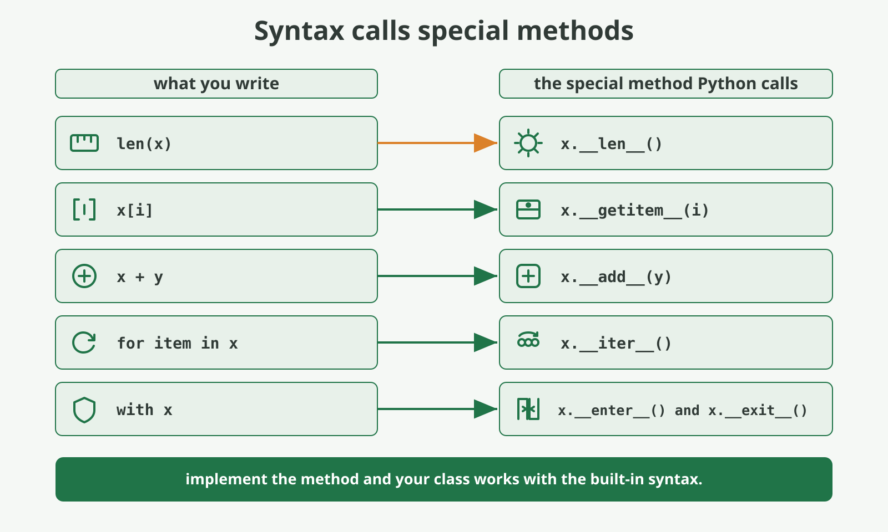
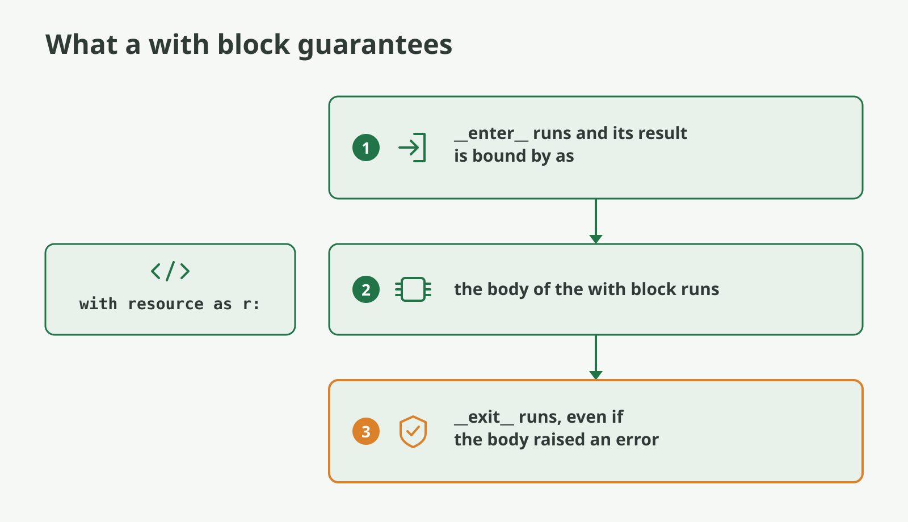
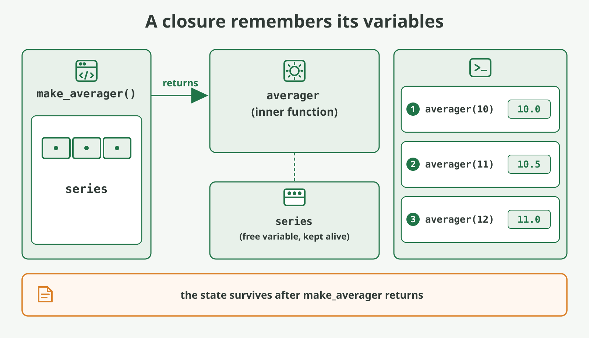
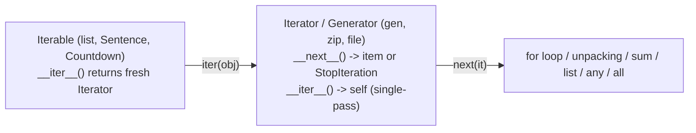
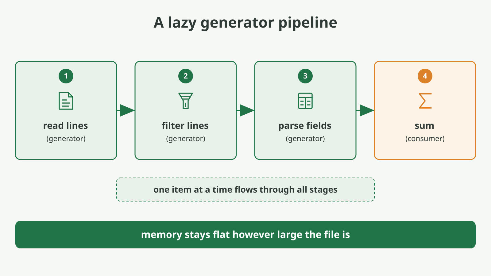

# 3.3 Idiomatic Python: the data model, comprehensions, generators

| | |
|---|---|
| Level | Intermediate |
| Priority tier | 0 |
| Lab venue | Any machine with Python 3.11 or newer |
| Part | Part 3: Python for infrastructure |
| Status | Drafted, labs **untested** |

## Why this matters for AI infrastructure

Picture a script that has to stream several gigabytes of logs before it can tell you anything. Your first version loads the whole file into memory. The job starts, grows for a few minutes, and dies with a memory error before it prints a single result. That failure is what this chapter is built to prevent.

It has a quieter failure mode too, and you have probably met it. A teammate opens a comprehension you wrote last month and cannot work out what it does. It runs correctly, but nobody dares change it, so the script that depends on it never improves. Code that works but cannot be read is code nobody can safely build on.

"Pythonic" is not decoration. It is how the language and its libraries expect you to behave, and it is why frameworks such as pandas, PyTorch, FastAPI and the Kubernetes clients all feel consistent once you know the pattern. The pattern is the data model: the set of special methods, such as `__len__`, `__getitem__`, `__iter__` and `__enter__`, that decide how your own objects work with `len()`, `for`, `with`, `sorted` and slicing.

Comprehensions and generators are the tools that let you stream those logs, paginate cloud APIs and transform metrics without exhausting memory. Getting them right also changes the size of your code. A 40-line loop with a bug can often become a three-line pipeline that you can test on its own.

This chapter covers the data model and the sequence, mapping and set types in depth. It then moves on to comprehensions, the iterator protocol, and generators, including coroutine-style generators. Last, it covers `itertools`, `functools` and `operator`, text versus bytes, object references, and design patterns that use first-class functions.

## Prerequisites and outcomes

Before you start, you should be comfortable with the core language from chapter 3.1 and with modules from chapter 3.2. The lab runs on any machine with Python 3.11 or newer; no GPU node is required.

When you finish this chapter, you should be able to do the following.

- Explain the data model. Describe how special (dunder) methods are called by built-ins and syntax, and implement a small class that behaves like a sequence, mapping, context manager or numeric type.
- Choose and use sequence types (list, tuple, deque, array, memoryview), with slicing, unpacking, sorting, key functions and bisect. Use mapping and set types (dict, defaultdict, Counter, OrderedDict, ChainMap, MappingProxyType and set operations), and understand the hash and equality contracts.
- Write list, dict and set comprehensions and generator expressions, know when not to use them, and handle scoping rules and the walrus operator inside comprehensions.
- Explain iterables, iterators and the iterator protocol. Write generator functions, `yield from`, generator pipelines and infinite generators, understand send, throw and close, and use `itertools` recipes.
- Handle text versus bytes, encodings and normalisation, and understand references, aliasing, weak references and object lifecycle.
- Use first-class functions for patterns such as strategy, command, registry and callbacks, instead of class hierarchies.
- Process large inputs in constant memory and paginate APIs lazily.

## 1. The Python data model



*Figure 3.3.1. The data model: everyday syntax is a call to a special method on your object.*

Suppose you write a small class and then find that `len()` and `for` refuse to work with it. A list answers `len()` in an instant; your class crashes. Neither piece of code is wrong on its own, so something must be wrong between them. That something is the data model, and it is the subject of this section.

When you write `len(x)`, `x[i]`, `for a in x`, `x + y`, `with x:` or `print(x)`, Python does not search your object for built-in behaviour. It calls special methods on the object's type. These include `type(x).__len__(x)`, `__getitem__`, `__iter__`, `__add__`, `__enter__`/`__exit__` and `__str__`. Their names start and end with double underscores, which is why people call them dunder methods: dunder is short for double underscore.

Implementing these methods lets your classes take part in built-in behaviour. You should rarely call them directly yourself, so write `len(x)` rather than `x.__len__()`. You should also never invent new ones.

```python
from collections import abc
import math

class Vector:
    """2D vector demonstrating the data model."""
    __slots__ = ("x", "y")                       # fixed attributes: smaller, faster objects

    def __init__(self, x=0.0, y=0.0):
        self.x, self.y = float(x), float(y)

    def __repr__(self):                          # unambiguous, for developers/logs: eval-like
        return f"Vector({self.x!r}, {self.y!r})"
    def __str__(self):                           # for humans
        return f"({self.x}, {self.y})"
    def __eq__(self, other):
        if not isinstance(other, Vector): return NotImplemented     # let Python try the reflected operation
        return (self.x, self.y) == (other.x, other.y)
    def __hash__(self):                          # must agree with __eq__ if instances are used in sets/dict keys
        return hash((self.x, self.y))
    def __abs__(self):  return math.hypot(self.x, self.y)
    def __bool__(self): return bool(abs(self))
    def __add__(self, other):
        if not isinstance(other, Vector): return NotImplemented
        return Vector(self.x + other.x, self.y + other.y)
    def __mul__(self, k):
        if not isinstance(k, (int, float)): return NotImplemented
        return Vector(self.x * k, self.y * k)
    __rmul__ = __mul__                           # 3 * v
    def __iter__(self):                          # unpacking: x, y = v
        yield self.x; yield self.y
```

The table below groups the special methods by the behaviour they add. Find the row that matches what your class needs, then implement only those methods. Notice that most rows are triggered by ordinary syntax, such as `x + y` or `for a in x`, rather than by a direct call.

### Categories of special methods

| Purpose | Methods | Triggered by |
|---|---|---|
| Representation | `__repr__`, `__str__`, `__format__`, `__bytes__` | `repr()`, `print`, f-strings, `bytes()` |
| Truthiness/size | `__bool__`, `__len__` | `if x`, `len(x)` |
| Comparison/hash | `__eq__`, `__lt__`, `__le__`... `__hash__` | `==`, `<`, `sorted`, sets, dict keys; `functools.total_ordering` fills in the rest |
| Arithmetic | `__add__`, `__sub__`, `__mul__`, `__truediv__`, `__floordiv__`, `__mod__`, `__pow__`, `__neg__`, `__abs__` plus reflected `__radd__` and in-place `__iadd__` | operators |
| Container | `__getitem__`, `__setitem__`, `__delitem__`, `__contains__`, `__iter__`, `__reversed__`, `__missing__` | `x[i]`, `in`, `for`, `reversed` |
| Iteration | `__iter__`, `__next__` | `iter()`, `next()` |
| Context managers | `__enter__`, `__exit__` | `with` |
| Callable | `__call__` | `x()` |
| Attribute access | `__getattr__`, `__getattribute__`, `__setattr__`, `__delattr__`, `__dir__`, descriptors `__get__`/`__set__` | `x.a` (chapter 3.11) |
| Lifecycle | `__new__`, `__init__`, `__del__`, `__init_subclass__`, `__class_getitem__` | construction, destruction, subclassing |
| Async | `__aiter__`, `__anext__`, `__aenter__`, `__aexit__`, `__await__` | `async for`, `async with`, `await` (chapter 3.6) |

Four design rules keep these methods safe, and they are worth carrying with you into every class you write.

First, return `NotImplemented` instead of raising an error for operand types you do not support. It tells Python to try the other operand before it gives up. Second, keep `__eq__` and `__hash__` consistent, because equal objects must hash equal, and mutable objects should not be hashable. Third, make `__repr__` always useful by including the fields that identify the object. Finally, prefer composition and the abstract collection base classes, such as `collections.abc.Sequence`, `Mapping` and `MutableMapping`. They supply many methods once you implement a few.

### A sequence by protocol: a node inventory

Here is a concrete example you can carry to your own classes. You keep an inventory of 52 nodes: 13 slots in each of four racks. A class only has to implement `__len__` and `__getitem__` to behave like a full Python sequence. The class `NodeInventory` in `code/part03/python_idiomatic_data_model.py` does this with a `Node` named tuple of `slot` and `rack`.

Once that is in place, `inv = NodeInventory()` supports `len(inv)`, which returns `52`. For built-in CPython types such as `list` or `str`, `len(x)` takes a shortcut: it reads a size field in the C structure directly, in constant time, rather than calling a method. Indexing works too: `inv[0] == Node(slot='01', rack='r1')` and `inv[-1] == Node(slot='13', rack='r4')`. Random selection comes along for free with `from random import choice; choice(inv)`.

Slicing works as well, with no extra code. `inv[:3]` returns the first three nodes, and `inv[12::13]` picks slot 13 of every rack by starting at index 12 and stepping by 13. Forward and reverse iteration work with `for node in inv:` and `for node in reversed(inv):`. Membership is a sequential scan, so `Node('07', 'r2') in inv` is `True`, while `Node('07', 'r9') in inv` is `False`.

Custom sorting follows the same pattern. The function `drain_order(node)` multiplies the slot position by the number of racks and adds a rack priority from `RACK_PRIORITY = dict(r4=3, r3=2, r2=1, r1=0)`. That ranks slot 01 of rack r1 at `0` and slot 13 of rack r4 at `51`, so `sorted(inv, key=drain_order)` orders the nodes by that rule. One thing the inventory cannot do is shuffle in place with `random.shuffle(inv)`, unless it also implements `__setitem__`.

Host inventories follow the same idea. The `Fleet` class below needs only `__len__` and `__getitem__`.

```python
class Fleet(abc.Sequence):
    """Immutable ordered collection of host names; gets index, count, iteration, 'in', reversed for free."""
    def __init__(self, hosts): self._hosts = list(hosts)
    def __len__(self): return len(self._hosts)
    def __getitem__(self, i):
        if isinstance(i, slice): return Fleet(self._hosts[i])      # slicing returns the same type
        return self._hosts[i]
    def __repr__(self): return f"Fleet({self._hosts!r})"

f = Fleet(["gpu01", "gpu02", "gpu03"])
len(f), f[0], f[-1], f[1:], "gpu02" in f, list(reversed(f)), f.index("gpu03")
```

Only `__len__` and `__getitem__` were needed, and `Fleet` still gained index, count, iteration, `in` and `reversed` along the way. This is the essence of duck typing with protocols. The `collections.abc.Collection` hierarchy unifies `Iterable` (which needs `__iter__`), `Sized` (which needs `__len__`) and `Container` (which needs `__contains__`). `Sequence`, `Mapping` and `Set` specialise those. Anything with the right methods plugs in.

### Context managers



*Figure 3.3.2. A context manager: __exit__ always runs, even when the body raises.*

```python
from contextlib import contextmanager
import time

class Timer:
    def __enter__(self): self.t0 = time.perf_counter(); return self
    def __exit__(self, exc_type, exc, tb):
        self.elapsed = time.perf_counter() - self.t0
        return False                                  # do not swallow exceptions

@contextmanager
def drained(node):
    cordon(node); drain(node)
    try:
        yield node                                    # body of the with statement runs here
    finally:
        uncordon(node)                                # always executes, even on errors
with drained("gpu07") as n: upgrade(n)
```

Read the `drained` function as two conversations with the `with` statement. A context manager is any object that `with` runs acquire-and-release logic for: `__enter__` runs when the block starts, and `__exit__` runs when the body ends, whatever happened inside it. The `Timer` class above keeps a start time and records the elapsed time on the way out. The `drained` function does the same for a node: cordon and drain on the way in, and uncordon in the `finally` clause on the way out, even when the upgrade raises.

The `contextlib` module also provides `suppress`, `closing`, `redirect_stdout`, `ExitStack` (which manages a dynamic number of resources), `nullcontext`, `contextlib.chdir` (3.11) and `asynccontextmanager`. Use `with` for files, locks, sockets, temporary directories, database transactions, timers and any other acquire-and-release pair.

## 2. Sequences

Most of the data in a script sits in sequences, so the choice of sequence type affects both memory and speed. The larger your data grows, the more this choice matters, and the less obvious it becomes from reading the code. This section starts with the two families of sequences, then shows the everyday tools for slicing, unpacking and sorting.

### The sequence family

Two axes separate every sequence type, and it pays to name them up front. Container sequences hold references to objects. The list, the tuple and `collections.deque` are container sequences; each item is a pointer to some object stored elsewhere. Flat sequences hold values of one type, stored side by side in memory. The `str`, `bytes`, `bytearray`, `memoryview` and `array.array` types are flat.

Mutability is the second axis. The list, deque, bytearray and array types are mutable, which means you can change them in place. The tuple, str and bytes types are immutable, so any change builds a new object instead.

The next block shows slicing, unpacking and sorting, which you will use in almost every script.

```python
# slicing: seq[start:stop:step]; half-open; negative indices; slice objects are first class
data = list(range(10))
data[2:7:2], data[::-1], data[-3:], data[:0]
data[2:5] = ["a", "b"]           # slice assignment (lists): replaces and can change length
del data[::2]
s = slice(0, 4); data[s]

# unpacking
first, *middle, last = data
(a, b), c = (1, 2), 3
for host, (cpu, mem) in {"a": (8, 64), "b": (16, 128)}.items(): ...
def f(a, b, c): ...
f(*[1, 2, 3]); f(**{"a": 1, "b": 2, "c": 3})

# sorting
nodes.sort(key=lambda n: (n.rack, -n.gpus, n.name))      # stable, multi-key, descending on one key
from operator import itemgetter, attrgetter
sorted(rows, key=itemgetter("rack", "name")); sorted(objs, key=attrgetter("rack", "name"))
import bisect; i = bisect.bisect_left(sorted_list, x); bisect.insort(sorted_list, x)
heapq.nlargest(5, items, key=...)      # top-k without full sort
```

Two details matter here. The `sort()` method sorts in place and returns `None`, while `sorted()` returns a new list and leaves the original untouched. Python's sort, Timsort, is stable, which means items with equal keys keep their original order, and it runs in O(n log n) time, with an O(n) best case on data that is already partly ordered. Use `key=` rather than a comparison function, and remember that tuple comparison is lexicographic, so the first field decides the order.

Watch out for `list.insert(0, x)` and `list.pop(0)`. Both are O(n), because every remaining item has to shift one position to close the gap. Use `collections.deque` instead. It supports `appendleft`, `popleft` and a `maxlen=N` ring buffer, which keeps the deque at a fixed size and is ideal for holding the most recent N metrics or log lines.

```python
from collections import deque
recent = deque(maxlen=1000)           # keeps only the last 1000 entries
recent.append(sample)
from array import array
temps = array("f", [71.0, 72.5])      # compact numeric storage (4 bytes each) vs list of float objects (~32 bytes each)
mv = memoryview(bytearray(1024)); chunk = mv[100:200]     # zero-copy views over binary buffers (sockets, mmap, NumPy)
```

The `array` type stores each float in 4 bytes, while a list stores a separate float object of about 32 bytes for each value. That difference in footprint is worth thinking about whenever the list grows large. The `memoryview` gives you a window into a binary buffer without copying it, which matters for sockets and NumPy data.

Augmented assignment, such as `+=`, behaves differently on mutable and immutable sequences. On a mutable sequence, `a += [1]` calls `__iadd__`, which acts like `list.extend` on the shared list, so the change is visible to every name that points at that list. On an immutable sequence such as a tuple or a string, Python falls back to `__add__` and rebinds the variable to a brand-new object. That means repeated `+=` on tuples or strings copies the whole sequence each time.

This becomes a puzzle that has surprised more than one careful engineer. The statement `t = (1, 2, [30, 40]); t[2] += [50, 60]` raises `TypeError: 'tuple' object does not support item assignment`, and it still leaves `t` changed to `(1, 2, [30, 40, 50, 60])`. The same happens with `t = ([1], 2); t[0] += [3]`: an error and a change at the same time. Running `dis.dis('s[a] += b')` shows why. Python first runs `BINARY_SUBSCR` to push the list `s[a]` onto the stack. It then calls `INPLACE_ADD`, which succeeds and extends the list. Finally it runs `STORE_SUBSCR` to assign `s[a] = result`, and that step fails because `s` is a tuple. The lesson is to avoid putting mutable items inside tuples, and to remember that `+=` is not an atomic operation.

Several more everyday patterns are worth knowing. Take `ports = [22, 80, 443, 8080, 9100]`. The list comprehension `[p for p in ports if p > 1023]` returns `[8080, 9100]`, and it reads more clearly than `list(filter(lambda p: p > 1023, ports))`. Generator expressions can fill a tuple or an array without building a list first, as in `tuple(p * 2 for p in ports)` and `array.array('I', (p for p in ports))`. Cartesian products over `racks = ['r1', 'r2']` and `roles = ['gpu', 'login', 'storage']` replace nested loops with `[(rack, role) for rack in racks for role in roles]`, or with the lazy form `(f'{r}-{x}' for r in racks for x in roles)`.

Tuples also work as unnamed records, where the position of each field carries the meaning. Examples include `rack_position = (4, 17)` for rack and slot, and `divmod(20, 8) == (2, 4)`. To check whether a tuple is recursively immutable, run `def fixed(o): try: hash(o) except TypeError: return False; return True`. The call `fixed((10, 'alpha', (1, 2)))` returns `True`, while `fixed((10, 'alpha', [1, 2]))` returns `False`, because the inner list is not hashable.

A list of site records shows how nested unpacking reads. Each tuple holds a name, a region, a node count and a pair of coordinates, for example `('dc-east', 'us', 480, (39.04, -77.49))` and `('dc-west', 'us', 320, (45.59, -121.18))`. The loop `for name, _, _, (lat, lon) in sites:` pulls the coordinates out directly. Structural pattern matching does the same job with `case [str(name), _, _, (float(lat), float(lon))] if lon <= 0:`.

For fixed-width files, named slices keep the index math readable. Define `HOST = slice(0, 8); STATE = slice(8, 16); LOAD = slice(16, 22)` once, and each line parses as `line[HOST]`, `line[STATE]` and `line[LOAD]`. Slices also take a step, so `'gpu0123'[::2] == 'g03'` and `'gpu0123'[::-1] == '3210upg'`. For multidimensional data, NumPy accepts the `...` (`Ellipsis`) index. Named tuples, from `collections.namedtuple` and `typing.NamedTuple`, give you tuple behaviour with named fields. Chapter 3.4 compares them with dataclasses.

### Memory and performance notes

Four notes about memory and performance come up in almost every data-handling script.

- A list stores pointers, which take 8 bytes each on a 64-bit system, to separate objects. A list of one million floats therefore costs about 32 MB before you count the objects. For large numeric data, use NumPy arrays or `array` instead (chapter 3.10).
- Prefer comprehensions and built-ins such as `sum`, `max`, `any`, `all` and `join` over manual loops. They are faster and easier to read.
- A test like `x in list` scans the list in linear time. Convert the data to a `set` when you test membership many times.
- `copy.copy`, slicing and `list()` each make a shallow copy.

If your code tests membership in a large list, convert it to a set before the loop.

## 3. Mappings and sets

Dictionaries and sets answer the question "have I seen this before?" in almost constant time. That question sits behind most infrastructure scripts: group nodes by rack, count error codes, look up a port by name. They also hold the per-host and per-rack data that most scripts build. The snippet below shows the everyday operations.

```python
d = {"gpu01": 8, "gpu02": 8}
d["gpu03"] = 4; d.get("x", 0); d.pop("gpu01"); d.setdefault("gpu04", 8); d |= {"gpu05": 2}; dict(zip(keys, values))
{k: v for k, v in d.items() if v >= 8}; sorted(d.items(), key=lambda kv: kv[1], reverse=True)
for k in list(d):                       # iterate over a copy of keys if you delete
    if d[k] == 0: del d[k]
```

Keys must be hashable. Their hash value never changes, and if `a == b` then `hash(a) == hash(b)` must also hold. Thanks to hashing, dict and set lookups take O(1) time on average. If many keys collide, though, lookups degrade toward O(n).

Dicts keep insertion order, which is newer than many people expect. CPython 3.6 adopted the compact dict layout from PyPy, and Python 3.7 made that order an official guarantee. The same period brought PEP 412 key-sharing instance `__dict__` dictionaries, which cut object-oriented memory use by 10% to 20%. `OrderedDict` still exists, and it adds `move_to_end`, which is useful for LRU caches, along with order-sensitive equality.

Dict comprehensions turn a list of pairs into a lookup table. Given `services = [(22, 'ssh'), (80, 'http'), (443, 'https'), (9100, 'node_exporter'), (9400, 'dcgm_exporter')]`, the comprehension `{name: port for port, name in services}` builds `port_of`, and `{port: name.upper() for name, port in sorted(port_of.items()) if port < 1024}` filters it. Structural pattern matching also destructures semi-structured JSON events, with patterns such as `case {'type': 'node', 'api': 2, 'tags': [*tags]}:` and `case {'type': 'node', 'api': 1, 'tag': tag}:`.

Missing keys need care, and there are three common ways to handle them. Suppose you index word locations, written as `(line_no, column_no)`, using `WORD_RE = re.compile(r'\w+')`. Writing `occurrences = index.get(word, []); occurrences.append(location); index[word] = occurrences` performs two hash lookups per word. The version `index.setdefault(word, []).append(location)` performs one, and so does `index = collections.defaultdict(list); index[word].append(location)`.

When `d[key]` misses, `dict.__getitem__` calls `__missing__(self, key)`. The method runs only for `d[k]`, not for `d.get(k)` or `k in d`, unless you override those too. The example class `StrKeyDict0(dict)` uses `def __missing__(self, key): if isinstance(key, str): raise KeyError(key); return self[str(key)]`. The `isinstance` guard stops infinite recursion when `str(key)` is also absent. Together with `get` and `def __contains__(self, key): return key in self.keys() or str(key) in self.keys()`, it lets integer and string keys find each other, so `d[2] == d['2'] == 'two'`. If you write a custom mapping that normalises keys in `__setitem__`, subclass `collections.UserDict` rather than `dict`. `UserDict` stores the underlying dict in `self.data` and extends `abc.MutableMapping`, so built-in C methods cannot bypass your overrides.

`Counter` is a multiset. For example, `ct = collections.Counter('abracadabra'); ct.update('aaaaazzz'); ct.most_common(3)` counts letters. It supports `+`, `-`, `&` (minimum) and `|` (maximum). `shelve.open` gives you a `shelve.Shelf`, which is persistent, DBM-backed `MutableMapping` storage for string keys.

`ChainMap` gives you layered lookups without copying. It fits configuration precedence, as in `ChainMap(cli_args, os.environ, file_cfg, defaults)`. Python's own scope lookup uses the same idea: `pylookup = ChainMap(locals(), globals(), vars(builtins))`. A write such as `chain['c'] = -1` changes only the first mapping, `d1`.

`types.MappingProxyType(d)` gives you a read-only view of `d` that still reflects later updates to `d`. This stops callers from changing a hardware pin map while the owner keeps it current. `dict.keys()` (`dict_keys`) and `dict.items()` (`dict_items`) are live views that cost no copying, and they support set operations such as `&`, `|`, `-` and `^`.

Sets are written `{1, 2}` or built with `set(iterable)`. Note that `{}` is an empty dict, so always write `set()` for an empty set. Sets support `|` (union), `&` (intersection), `-` (difference), `^` (`symmetric_difference`), `<=` (subset), `<`, `>=` (superset), `>` and `isdisjoint`. Elements must be hashable, and `frozenset` is the hashable version of a set. Sets are useful for comparing desired state with actual state, and for removing duplicates. They are unordered, so if you need order, use `dict.fromkeys(items)` instead.

Equal containers compare in different ways. Dicts compare equal regardless of key order, while lists compare order-sensitively. The values `1 == 1.0 == True` are equal and hash the same, so `{1, 1.0, True}` has one element. For two-level grouping, use `defaultdict(lambda: defaultdict(list))`, and for deeply nested configuration, prefer typed models from chapter 3.4. To merge mappings, use `a | b`, `{**a, **b}` or `ChainMap`. A deep merge needs recursion.

```python
from collections import defaultdict, Counter, ChainMap
by_rack = defaultdict(list)
for n in nodes: by_rack[n["rack"]].append(n["name"])
errors = Counter(e["code"] for e in events)
cfg = ChainMap({"retries": 5}, {"retries": 3, "timeout": 10})        # first mapping wins
cfg["timeout"], cfg["retries"]
```

The snippet groups nodes by rack, counts error codes and layers two configuration mappings. Use `ChainMap` when the first mapping should win.

## 4. Text versus bytes

Chapter 3.5 covers this topic in more depth, and the traps are worth learning once here. Picture a log pipeline that works on your laptop, then fails inside a container with a decode error nobody can reproduce locally. The boundary between text and bytes is usually the cause. The essentials are below.

A `str` is Unicode text, which is a sequence of code points. `bytes` is binary data. Convert only at the boundaries of your program. Decode bytes to text when input arrives, with `data.decode("utf-8")`, and encode text to bytes when output leaves, with `s.encode("utf-8")`.

UTF-8 is the default for new work. ASCII is a subset of it. Latin-1 maps bytes one to one onto code points 0 to 255, which helps when you need to carry arbitrary bytes through text APIs. The `errors` argument decides what happens on failure. You can choose `"replace"`, `"ignore"`, `"surrogateescape"`, `"backslashreplace"` or `"strict"`. The result of `locale.getpreferredencoding()` changes with the environment, and containers that set `LANG=C` often surprise people. Always pass `encoding="utf-8"` to `open()`.

Unicode has its own traps. The same visible text can use different code point sequences, for example `é` as one code point or as `e` plus a combining accent. Normalise both strings with `unicodedata.normalize("NFC", s)` before you compare them. Use `str.casefold()` for caseless matching. `len()` counts code points, not bytes or visual characters, which are called graphemes. Sorting follows code point order, so use `locale.strxfrm` or ICU when you need order that people expect.

Indexing bytes returns integers, so `b"abc"[0] == 97`. The bytes API includes `bytes.hex()`, `bytes.fromhex`, `int.from_bytes`, `struct.pack/unpack` for binary protocols, along with `base64` and `hashlib`. Bytes go in and bytes come out with the hashing functions.

Subprocess output, socket reads and file reads in binary mode all return bytes. JSON, YAML and regular expressions work on text, so decode the bytes first.

## 5. Object references, mutability and recycling

Suppose a helper removes a passenger from one bus object, and the same name vanishes from a copy you made earlier. Nothing raised an error. The two objects simply share one inner list, so the removal touched both. That surprise comes from how Python handles references, so this section explains how names and objects relate.

The key idea is that variables are labels, not boxes. In `x = Pool()`, Python first runs the right-hand side to build the `Pool` object, and only then binds the label `x` to it. Aliasing binds two labels to one object. After `prod = {'name': 'gpu-prod', 'nodes': 8}; same = prod`, `same is prod` is `True`. A second dict, `copy_of = {'name': 'gpu-prod', 'nodes': 8}`, has equal value (`copy_of == prod`) but a different identity (`copy_of is not prod`).

Copying shows the same point. Given `rack1 = Rack(['gpu01', 'gpu02', 'gpu03', 'gpu04'])`, `rack2 = copy.copy(rack1)` and `rack3 = copy.deepcopy(rack1)`, the call `rack1.drain('gpu02')` also removes `'gpu02'` from `rack2.hosts`. A shallow copy shares the inner `hosts` list. The deep copy in `rack3.hosts` keeps all four hosts. `copy.deepcopy` also handles cycles. For `a = [10, 20]; b = [a, 30]; a.append(b)`, it records each copied object's ID in a `memo` dictionary, so it does not loop forever.

Function arguments are passed by object reference, a model often called call by sharing. The parameter becomes an alias of the caller's object, not a private copy of it. This creates two classic bugs, and both have haunted production systems.

1. A mutable default argument, `def __init__(self, hosts=[]):`, is shared by every instance. Two racks created with `Rack()` share the one default list stored in `Rack.__init__.__defaults__[0]`, so adding `'gpu09'` to one rack makes it appear in the other. Default to `hosts=None`, and set `self.hosts = []` when the argument is `None`.
2. A class that stores `self.hosts = hosts` aliases the caller's list. Suppose `maintenance = ['gpu01', 'gpu02', 'gpu03']` is passed to `rack = Rack(maintenance)`. Then `rack.drain('gpu02')` calls `remove` on the caller's own list, and the name vanishes from `maintenance`. The fix is a defensive copy in `__init__`, written as `self.hosts = list(hosts)`. This also accepts any iterable, such as a tuple or a set.

Identity, equality, interning and small-integer caching were covered in chapter 3.1. The `del` statement is worth a second look. `del s1` deletes the name `s1`, not the object. The object is garbage-collected only after its last reference goes away. In a small experiment, the call `ender = weakref.finalize(s1, bye)` is registered on `s1 = s2 = {1, 2, 3}`. After `del s1`, `ender.alive` is still `True`. The callback `bye()` runs only when `s2 = 'spam'` rebinds the final reference, and then `ender.alive` becomes `False`.

Weak references let you keep a cache or registry without keeping its objects alive. The tools are `weakref.ref(obj)`, `WeakValueDictionary`, `WeakKeyDictionary` and `WeakSet`. In API design, functions should not change their arguments unless the documentation says so. A pure function should return new objects, and values are best kept in tuples or frozen dataclasses.

Do not rely on `__del__` for cleanup, because it is unreliable. Use a context manager, a `try/finally` block or `weakref.finalize` instead. The garbage collector also has tools of its own. `gc.collect()` and `gc.get_stats()` show what it is doing, and `gc.freeze()` before forking workers reduces copy-on-write memory growth in preforking servers. That matters for inference and data-loader workers.

## 6. Functions as objects, closures, decorators and design patterns

In Python, a function is an object, like any value you can keep in a variable. It has attributes such as `__name__`, `__doc__`, `__defaults__`, `__kwdefaults__`, `__code__`, `__annotations__` and `__closure__`. You can call it, pass it to another function and return it from one. Python has nine callable flavours. Besides functions, they include built-in functions and methods, user-defined methods, classes, class instances that implement `__call__`, generators, native coroutines and asynchronous generators. Because functions are objects, you can pass them to `map(factorial, range(11))`, `sorted(fruits, key=len)` and `sorted(fruits, key=reverse)`.

```python
def apply(fn, items): return [fn(i) for i in items]
callable(apply); apply.__name__; apply.__defaults__
```

Many small patterns become simpler once functions can be passed around. The sections below start with callable objects and the `operator` tools, then move on to closures and decorators, and finish with the Strategy pattern.

### Callable objects (`RoundRobin`), `operator` (`itemgetter`, `attrgetter`, `methodcaller`), and `functools.partial`

A class that implements `__call__` behaves like a function that keeps state. A `RoundRobin` class, for example, copies its hosts into `self._hosts` and keeps an index. Its `pick(self)` method returns the next host, and `def __call__(self): return self.pick()` makes the instance callable. After `rr = RoundRobin(['gpu01', 'gpu02'])`, the call `rr()` works the same way as `rr.pick()`, and `callable(rr)` is `True`.

Keyword-only arguments give callers clearer code. In `command(name, *args, user=None, **env)`, the `user=None` parameter comes after `*args`, so callers must pass `user='deploy'` by keyword. The `**env` parameter collects any environment variables, as in `command('restart', 'nginx', user='deploy', LANG='C')`.

The `operator` module gives you fast key and extraction functions without writing `lambda`. The `operator.itemgetter(1)` call extracts one item, and `itemgetter(1, 0)` returns a tuple of items. The `operator.attrgetter('name', 'loc.rack')` call follows nested attributes on `Host = namedtuple('Host', 'name gpus loc')` and `Loc = namedtuple('Loc', 'rack slot')`. The `operator.methodcaller('replace', ' ', '-')` call invokes a method by name with fixed arguments.

`functools.partial` fixes some arguments of a general function. The line `restart_nginx = functools.partial(command, 'restart', 'nginx', user='deploy')` builds a callable that already knows the action, the service and the user. You can inspect the frozen values through `restart_nginx.func`, `restart_nginx.args` and `restart_nginx.keywords`. This is a simple way to fit a general function to a callback signature.

### Closures (`make_averager`), decorators at import time, `@cache`, and `@singledispatch`



*Figure 3.3.3. A closure: the inner function keeps the variable it uses from the enclosing function alive between calls.*

Decorators are the first place where this idea pays off, and there is one subtlety to see early. Function decorators run at import time. The decorator call happens when the `def` statement executes, while the decorated function itself runs only when you call it later. A module that prints from inside its decorator shows this when you import it: the print lands during `import`, before any call. A stack such as `@alpha` above `@beta` is the same as `alpha(beta(f))`.

Variable scope has a trap, and you can see it in the bytecode with `dis.dis`. In `def f2(a): print(a); print(b); b = 9`, CPython sees the assignment to `b` and treats `b` as a local variable. It compiles the reads as `LOAD_FAST` instead of `LOAD_GLOBAL`, so the first `print(b)` raises `UnboundLocalError`. A closure is a function that keeps access to free variables from an enclosing function, even after the outer function has returned. The `Averager` class and the `make_averager` function in the code file compare the two approaches.

In `make_averager()`, the outer scope stores `series = []`. The inner `averager(new_value)` calls `series.append(new_value)`, so the list is kept in `avg.__closure__[0].cell_contents`, and `avg.__code__.co_freevars == ('series',)`. The better version stores only the running values `count = 0; total = 0`. It declares `nonlocal count, total` inside `averager(new_value)`, so the memory use stays O(1) instead of growing with every value in a `series` list.

Decorators such as `@clock` show how wrapping works. A decorator that wraps `func` with `functools.wraps(func)` keeps `__name__` and `__doc__`. A parameterised decorator, such as `@clock('{name}: {elapsed}s')`, needs three levels of nesting: `clock(fmt)`, then `decorate(func)`, then `clocked(*_args)`. You can also write it as a class that implements `__call__`. The `@functools.cache` decorator, and `@lru_cache(maxsize=128, typed=False)`, memoise recursive functions such as `fibonacci(n)`. That turns an exponential number of calls into O(n) calls. The `@functools.singledispatch` decorator turns a base function into a generic one. You write `@singledispatch def htmlize(obj: object) -> str:` and then add handlers with `@htmlize.register def _(text: str) -> str:`, `@htmlize.register def _(seq: abc.Sequence) -> str:` and `@htmlize.register def _(n: numbers.Integral) -> str:`. Python picks a handler by the type of the first argument, and it prefers abstract base classes such as `abc.Sequence` or `numbers.Integral` over concrete types such as `list` or `int`.

### Refactoring the Strategy pattern with first-class functions

The class-heavy way of writing patterns is about to shrink, and it is worth seeing why. In his 1996 presentation *Design Patterns in Dynamic Languages*, Peter Norvig observed that 16 of the 23 Gang-of-Four patterns become "invisible or simpler" in languages with first-class functions. A small discount engine in the code file shows this. The engine uses `Customer(name, fidelity)`, `LineItem(product, quantity, price)` and `Order(customer, cart, promotion)`.

The classic object-oriented version comes first. The classic version defines an abstract base class `Promotion(ABC)` with `@abstractmethod def discount(self, order: Order) -> Decimal:`. It then adds three concrete subclasses. `FidelityPromo` gives a `5%` discount when `order.customer.fidelity >= 1000`. `BulkItemPromo` gives a `10%` discount on each `LineItem` with `item.quantity >= 20`. `LargeOrderPromo` gives a `7%` discount when `len({item.product for item in order.cart}) >= 10`. These classes hold no instance state, because `self` is never used. Creating them just to pass them in, as in `Order(ann, cart, FidelityPromo())`, is pure ceremony.

The function-oriented version removes the classes. Plain functions `fidelity_promo(order: Order) -> Decimal`, `bulk_item_promo(order: Order) -> Decimal` and `large_order_promo(order: Order) -> Decimal` can be passed straight into `Order(ann, cart, fidelity_promo)`. A meta-strategy, `def best_promo(order: Order) -> Decimal: return max(promo(order) for promo in promos)`, chooses the largest discount, so you call it with `Order(ann, cart, best_promo)`. To build the list `promos`, you could scan `globals()`, as in `[globals()[name] for name in globals() if name.endswith('_promo') and name != 'best_promo']`, or call `inspect.getmembers(promotions, inspect.isfunction)`. Both approaches are fragile. A better choice is a `@promotion` decorator, which registers each strategy as soon as the module imports. Its body is `def promotion(promo: Promotion) -> Promotion: promos.append(promo); return promo`.

The same idea simplifies the Command pattern. You do not need a `Command` subclass with an `.execute()` method, or a `MacroCommand` that holds a list of commands. A plain function or closure does the job. A `MacroCommand` can also implement `def __call__(self): for cmd in self.commands: cmd()`.

Several other patterns also become smaller. Strategy can be a function you pass in, such as `sort(key=...)` or `retry(fn)`, or a dictionary of functions, such as `ACTIONS = {"start": start, "stop": stop}; ACTIONS[cmd](*args)`. A registry can be built with a decorator, as in the next block.

```python
HANDLERS = {}
def handler(event_type):
    def register(fn):
        HANDLERS[event_type] = fn
        return fn
    return register

@handler("node_down")
def on_node_down(ev): ...
HANDLERS[ev["type"]](ev)
```

Command objects can be made with `functools.partial(deploy, app="api", env="prod")`, which gives you a pre-bound callable that you can queue or schedule. Callbacks and hooks are functions you pass to libraries, such as signal handlers, `atexit.register` and progress callbacks. Callable objects that implement `__call__` can hold state, such as a rate limiter, while still behaving like functions.

The `functools` module offers more. `lru_cache(maxsize=...)` and `cache` memoise pure functions. Their arguments must be hashable, and you should watch memory and staleness when a function depends on external state. The module also has `cached_property`, `singledispatch` (which overloads on the first argument's type), `total_ordering`, `reduce`, and `wraps`, which preserves metadata in decorators (chapter 3.11). The `operator` module provides `itemgetter`, `attrgetter`, `methodcaller`, `add` and `mul`, which replace trivial lambdas. Higher-order built-ins such as `map`, `filter`, `sorted(key=)`, `min` and `max` with `key=`, `any/all` and `sum` also take functions.

Pass a plain function when there is no state to keep, and reach for a closure or a `__call__` class when there is.

## 7. Comprehensions

A comprehension builds a collection in one expression. It reads more like a description of the result than a loop does, and it is usually faster than the equivalent loop. Used well, it makes your intent visible; used badly, it hides a whole program in one line, which is the risk the KISS advice in this section guards against. The block below shows the common forms.

```python
squares   = [n * n for n in range(10)]
evens     = [n for n in range(20) if n % 2 == 0]
labels    = ["even" if n % 2 == 0 else "odd" for n in range(5)]          # conditional expression goes BEFORE 'for'
pairs     = [(r, n) for r in racks for n in nodes_in(r)]                 # nested loops: read left to right like nested for statements
matrix_t  = [[row[i] for row in matrix] for i in range(len(matrix[0]))]  # transpose
flat      = [x for sub in nested for x in sub]
by_name   = {n.name: n for n in nodes}                                    # dict comprehension
inverse   = {v: k for k, v in mapping.items()}
racks     = {n.rack for n in nodes}                                       # set comprehension
lazy      = (len(line) for line in lines)                                 # generator expression: no list built
total     = sum(n.gpus for n in nodes)                                    # generator expression as sole argument: no extra parentheses
```

Notice where the conditional goes. A filter `if` sits after the `for`, while a conditional expression that picks a value sits before it. Nested `for` clauses read from left to right, just like nested `for` statements.

Comprehensions have a few rules that catch people out. The `for` variable in a list, set, dict or generator comprehension lives in the comprehension's own scope. It does not leak out or overwrite a name in the enclosing scope, which is different from a regular `for` statement. An assignment expression written with `:=`, however, does leak out. It binds its target in the enclosing scope. A `yield` inside a comprehension is forbidden.

```python
# Comprehension variables do not leak:
X = 99
[X for X in range(5)]                                  # [0, 1, 2, 3, 4]; outer X is still 99
for X in range(5): pass                                # regular for statement changes outer X to 4

S = 'hack'
[(temp := S[i]) + temp.upper() for i in range(len(S))] # ['hH', 'aA', 'cC', 'kK']
# temp == 'k' in the enclosing scope, whereas i raises NameError: name 'i' is not defined
```

The first comprehension leaves the outer `X` at 99. The second one leaks `temp` out with the final value `'k'`, but `i` stays local and raises `NameError` when you look it up.

The walrus operator also helps you avoid repeated work. In `[y for x in data if (y := expensive(x)) is not None]`, the call to `expensive` runs once per item, and the result is reused. Keep a comprehension readable, though. Picture a teammate opening it cold, six months after you wrote it. If it has more than two `for` or `if` clauses, or it has side effects, use a loop instead. Never use a comprehension for side effects, because `[print(x) for x in xs]` builds a useless list.

Memory matters too. A list comprehension builds every item at once. When `sum`, `any`, `all`, `max`, `sorted`, `",".join`, `set(...)` or `tuple(...)` only needs to read the items, pass a generator expression instead. Comprehensions shine when you filter and map at the same time. You can use `map` or `filter` with a named function when that function already exists.

Comprehensions avoid repeated attribute lookups such as `list.append`, and they are usually 20 to 50% faster than the equivalent loops. Still, your choice of algorithm matters far more, such as using a set instead of a list for lookups. Watch for three pitfalls. Do not modify the source while you comprehend it. Do not build lists of lists with shared references; use `[[0]*c for _ in range(r)]` instead. Finally, you cannot catch exceptions inside a comprehension, so wrap the risky code in a function.

Nested 3x3 lists show matrix comprehensions. Take `M = [[1, 2, 3], [4, 5, 6], [7, 8, 9]]` and `N = [[2, 2, 2], [3, 3, 3], [4, 4, 4]]`. A list comprehension can extract a column, as in `[row[1] for row in M] == [2, 5, 8]`. It can also pull out the main diagonal, `[M[i][i] for i in range(len(M))] == [1, 5, 9]`, and the anti-diagonal, `[M[i][len(M)-1-i] for i in range(len(M))] == [3, 5, 7]`. The order of the `for` clauses matters. `[col + 10 for row in M for col in row]` gives a flat list, while `[[col + 10 for col in row] for row in M]` creates a new row list for each outer iteration. Pairwise multiplication uses `zip`: `[[col1 * col2 for (col1, col2) in zip(row1, row2)] for (row1, row2) in zip(M, N)]` returns `[[2, 4, 6], [12, 15, 18], [28, 32, 36]]`. Still, the KISS principle applies. If you must rewrite a deeply nested comprehension as statement loops to understand it, write the explicit `for` statements from the start.

The next example parses `key=value` pairs from an environment-style file. It skips comments and blank lines in a single expression.

```python
# Parse "key=value" pairs from an environment-style file, ignoring comments and blanks
env = {
    k.strip(): v.strip()
    for line in Path("/etc/default/myapp").read_text().splitlines()
    if (line := line.strip()) and not line.startswith("#") and "=" in line
    for k, _, v in [line.partition("=")]
}
```

If a comprehension needs a second look to understand, split it into a loop.

## 8. Iterables, iterators and generators

A script that reads a large log file cannot afford to load it all at once. Iterators and generators let it handle one item at a time, so the memory use stays flat. The three words in this section's title are easier to keep straight with a picture, so let us build one before the protocol details. Generators, the lazy relatives, then follow from the same idea.

### The iterator protocol: multiple-pass iterables vs single-pass iterators



An iterable is any object you can loop over. It has an `__iter__()` method that returns a fresh iterator each time you call it. If a class has no `__iter__()`, Python can fall back to `__getitem__(0, 1, ...)`, which starts at `0` and continues until it raises `IndexError`. Built-in sequences such as `L = [1, 2, 3, 4]` and `R = range(5)` are multiple-pass iterables. Each call to `iter(R)` gives you a new object, since `iter(R) is R` is `False`. `I1, I2 = iter(L), iter(L)` gives you two iterators with independent positions.

A short picture helps here. The list is a book: you can open it again and again, at any page. Each iterator is a bookmark: it remembers one position and moves forward only. Two bookmarks in the same book never disturb each other, which is why `L` supports several passes.

An iterator has a `__next__()` method, which returns the next item or raises `StopIteration`. Its `__iter__()` method returns `self`, so `iter(G) is G` is `True`. That last detail is what makes the single-pass rule fall out of the protocol: an iterator is its own iterator, so every loop over it shares one cursor. Generator objects, `enumerate`, `zip`, `map`, `filter`, `os.walk('..')` and open files are iterators. You should iterate an open file directly, line by line, rather than calling `.readlines()`. Iterators are single-pass and stateful. Suppose `I1 = iter(G)` and `I2 = iter(G)` come from the same generator `G = (c * 4 for c in 'hack')`. Both names point at the same position, so `next(I1)` returns `'hhhh'`, the next `next(I1)` returns `'aaaa'`, and `next(I2)` returns `'cccc'`. Once the iterator is exhausted, a new loop over it yields nothing until you build a new generator.

There are three ways to write a `LogLine(text)` class that yields its words, extracted with `RE_WORD = re.compile(r'\w+')`. The first uses `__getitem__` over `self.words = RE_WORD.findall(text)`, which works through sequence fallback. The second is the classic Gang-of-Four Iterator pattern, with a separate iterator class that holds `self.index` and a `__next__` method. It is verbose, and you should never give the iterable class itself a `__next__` method. The third is a lazy `__iter__` generator, `for match in RE_WORD.finditer(self.text): yield match.group()`, which you can also write as the generator expression `(match.group() for match in RE_WORD.finditer(self.text))`. It yields matches on demand and never builds a list.

A `for` loop is simple underneath, now that you have the two words above. `for x in obj:` calls `it = iter(obj)` and then loops with `x = next(it)` until `StopIteration`. Unpacking, `list()`, `sum()`, `any()`, `all()`, `max()`, `min()`, `in`, `zip`, `enumerate` and comprehensions all consume iterables in the same way. The two-argument form `iter(callable, sentinel)` keeps calling a function until it returns the sentinel. For example, `for block in iter(lambda: f.read(65536), b""):` reads a binary file in 65536-byte chunks.

Reusing an iterator is a common bug, and it bites quietly. If you loop over a generator, or a `map`, `filter` or `zip` object, a second loop yields nothing: the bookmark has already moved past the end. If you need two passes, convert the object to a list or tuple first. You can also wrap the generator in an iterable class, such as `Countdown` or `ArithmeticProgression(begin, step, end)`. Its `__iter__` returns a fresh generator each time. `itertools.tee` is another option, but use it with care, because it buffers the items it has not yet handed out in memory.

```python
class Countdown:
    """Iterable producing a fresh iterator each time (restartable)."""
    def __init__(self, n): self.n = n
    def __iter__(self):
        n = self.n
        while n > 0:
            yield n
            n -= 1
list(Countdown(3)), list(Countdown(3))
```

Because `Countdown` builds a new generator on each call, both lists in the last line contain the full countdown.

### Generator functions, `scramble` vs `permute` (`factorial(N)` explosion), and `myzip` / `mymapPad`

Generators are the lazy relatives, and the idea is worth walking through slowly. A function that contains `yield` returns a generator iterator when you call it. Examples are `def gensquares(n): for i in range(n): yield i ** 2` and `def ups(line): for sub in line.split(','): yield sub.upper()`. The body does not run at call time. It runs lazily, pauses at each `yield`, and resumes on the next `next()` call. Its local scope and instruction pointer are kept while it is paused. When the function returns, Python raises `StopIteration`.

Three generator case studies follow. Their code is in `code/part03/python_idiomatic_data_model.py`.

The first case is sequence rotation, from `scramble.py`. The function `def scramble1(seq): for i in range(len(seq)): yield seq[i:] + seq[:i]` yields the N cyclic rotations one at a time. The generator-expression form is `scramble2 = lambda seq: (seq[i:] + seq[:i] for i in range(len(seq)))`, and the walrus form is `F = lambda seq: (seq := (seq[1:] + seq[:1]) for i in range(len(seq)))`. For `'hack'`, where N = 4, the output is `['hack', 'ackh', 'ckha', 'khac']`.

The second case, from `permute.py`, is permutations, and it shows why memory matters. `permute1(seq)` builds a list of all `factorial(N)` permutations before it returns anything. `permute2(seq)` uses a recursive `yield seq[i:i+1] + x` to produce each permutation on demand. For `'hack'`, where N = 4, both give `factorial(4) == 24` permutations, and `permute1('hack') == list(permute2('hack'))`. At N = 10, `math.factorial(10) == 3,628,800`. The call `permute1(list(range(10)))` pauses for about 17 seconds while it allocates 3.6 million lists. The call `p2 = permute2(seq); next(p2)` returns the first permutation almost immediately. At N = 20, the count is `2,432,902,008,176,640,000`, and `permute1` is physically impossible. At N = 50, `math.factorial(50) == 30414093201713378043612608166064768844377641568960512000000000000`. Even there, `random.shuffle(seq); p = permute2(seq); next(p)` gives you a randomised permutation at once, in O(N) memory.

The third case rebuilds the built-in tools. The function `def mymap_func(func, *seqs): for args in zip(*seqs): yield func(*args)` applies `func` lazily across several iterables. Its one-line form is `(func(*args) for args in zip(*seqs))`. The function `def myzip(*seqs): seqs = [list(S) for S in seqs]; while all(seqs): yield tuple(S.pop(0) for S in seqs)` stops at the shortest iterable. The index-based version is `(tuple(S[i] for S in seqs) for i in range(min(len(S) for S in seqs)))`. Calling `list(myzip('abc', 'xyz123')) == [('a', 'x'), ('b', 'y'), ('c', 'z')]` shows the truncation. The function `def mymapPad(*seqs, pad=None): seqs = [list(S) for S in seqs]; while any(seqs): yield tuple((S.pop(0) if S else pad) for S in seqs)` keeps going until every iterable runs out, filling the gaps with `pad`. With `pad=99`, `list(mymapPad('abc', 'xyz123', pad=99)) == [('a', 'x'), ('b', 'y'), ('c', 'z'), (99, '1'), (99, '2'), (99, '3')]`.

The next block shows two more generators. `fib` is infinite, which is safe because you consume it lazily. `read_chunks` reads a binary file in chunks, and `tail_lines` follows a file the way `tail -f` does.

```python
def fib():
    a, b = 0, 1
    while True:                 # infinite generator: safe because consumption is lazy
        yield a
        a, b = b, a + b
from itertools import islice
list(islice(fib(), 10))

def read_chunks(path, size=1 << 20):
    with open(path, "rb") as f:
        while chunk := f.read(size):
            yield chunk

def tail_lines(path):
    """Follow a file like tail -f."""
    with open(path, encoding="utf-8", errors="replace") as f:
        f.seek(0, 2)
        while True:
            line = f.readline()
            if not line:
                time.sleep(0.5); continue
            yield line.rstrip("\n")
```

Generators are lazy and memory-efficient. They hold only their current state, so they suit large files, database cursors, API pagination, directory walks and streaming transforms. Ramalho's `isis2json.py` uses pluggable generators, `iter_iso_records` and `iter_mst_records`, to stream CDS/ISIS bibliographic records into CouchDB or MongoDB in constant RAM. A generator's `with` blocks and `try/finally` clauses clean up when the generator is exhausted, when you call `gen.close()` (which raises `GeneratorExit` inside it), or when it is garbage-collected. Consume the generator fully, or close it yourself, whenever it holds a resource.

`yield from` hands iteration to a sub-iterable. Think of it as delegation: one stage passes the work down the chain. The statement `def both(N): yield from range(N); yield from map(lambda x: x ** 2, range(N))` shows the simplest use. A chain such as `def a(n): yield from b(n)` followed by `def b(n): yield from c(n)` passes items through each level. A small `tree` function walks a class hierarchy with `def tree(cls, level=0): yield cls.__name__, level; for sub_cls in cls.__subclasses__(): yield from tree(sub_cls, level+1)`. Applied to `BaseException`, it lists every subclass with its depth. `yield from` also forwards `send()` and `throw()` into the sub-generator while the outer one is paused. It evaluates to the sub-generator's return value, so `result = yield from averager_coro()` captures the value that `averager_coro` returns. That value is `Result(count, average)`, and Python attaches it to `StopIteration.value`.

Classic coroutines use `send()`, `throw()` and `close()`. Take `def gen(): for i in range(10): X = yield i`, or the `averager_coro()` function in `code/part03/python_idiomatic_data_model.py`. Its type is written as `collections.abc.Generator[YieldType, SendType, ReturnType]`. You must first prime the generator with `next(G)` or `G.send(None)`, which runs it to the first `yield`. After that, `G.send(77)` makes the paused `yield` return `77` and runs to the next `yield`. A plain `next(G)` sends `None`. Modern asynchronous I/O uses native `async def` and `await` coroutines instead (chapter 3.6).

A generator expression, such as `(f(x) for x in xs)`, is an anonymous one-shot generator. You can leave out its parentheses when it is the only argument, as in `sum(x ** 2 for x in range(3))`. You must keep them when more arguments follow, as in `sorted((x ** 2 for x in range(3)), reverse=True)`. An exception raised inside a generator travels to the consumer. A `StopIteration` raised inside a generator is converted to `RuntimeError` under PEP 479, so use `return` to stop early.

### Pipelines



*Figure 3.3.4. A generator pipeline: each stage pulls one item at a time from the stage before it, so memory stays flat.*

A pipeline chains generators together so that each stage handles one item at a time. The whole chain runs in constant memory, and you can test each stage on its own. The example below counts the top IP addresses behind 5xx errors in a set of compressed nginx logs.

```python
import gzip, re, json
from pathlib import Path
from collections import Counter

def files(root, pattern="*.log.gz"): yield from Path(root).rglob(pattern)
def lines(paths):
    for p in paths:
        with gzip.open(p, "rt", encoding="utf-8", errors="replace") as f:
            yield from f
def parse(lines):
    rx = re.compile(r'(?P<ip>\S+) \S+ \S+ \[(?P<ts>[^\]]+)\] "(?P<req>[^"]*)" (?P<status>\d{3}) (?P<size>\d+|-)')
    for l in lines:
        if m := rx.match(l): yield m.groupdict()
def errors(records): return (r for r in records if r["status"].startswith("5"))

top = Counter(r["ip"] for r in errors(parse(lines(files("/var/log/nginx"))))).most_common(10)
```

Each stage pulls one item from the stage before it, so only one line is in memory at any moment. Because each stage is its own function, you can test one stage without running the others.

Paginated APIs follow the same pattern. The function below fetches one page at a time and yields each item as it arrives. The generator expression at the end filters the results without building a list.

```python
def list_instances(client, project):
    token = None
    while True:
        resp = client.list(project=project, page_token=token, page_size=500)
        yield from resp["items"]
        token = resp.get("nextPageToken")
        if not token: break
running = (i for i in list_instances(c, "p") if i["status"] == "RUNNING")
```

Some APIs accept only a limited number of items per call, so you need to group items into batches. The `batched` helper below does that. On Python 3.12 and later, `itertools.batched` gives you the same result as tuples.

```python
from itertools import islice
def batched(iterable, n):
    it = iter(iterable)
    while batch := list(islice(it, n)):
        yield batch
# Python 3.12+: itertools.batched(iterable, n) yields tuples
for ids in batched(all_instance_ids, 100): client.bulk_delete(ids)       # API limits of 100 per call
```

Here the bulk delete runs in batches of 100, which matches the API limit of 100 per call.

### `itertools`, `functools`, `operator`

The table below lists the most useful tools. Use it to find a helper before you write a loop by hand.

| Tool | Purpose |
|---|---|
| `islice(it, start, stop, step)` | Lazy slicing |
| `chain(a, b)` / `chain.from_iterable(xs)` | Concatenate iterables lazily |
| `zip_longest`, `zip(strict=True)` | Pairwise combine |
| `groupby(sorted_items, key)` | Group **consecutive** equal keys (sort first) |
| `accumulate(xs, func)` | Running totals (cumulative sums, max) |
| `takewhile`, `dropwhile` | Take/drop by predicate |
| `product`, `permutations`, `combinations`, `combinations_with_replacement` | Combinatorics (test matrices, parameter sweeps) |
| `cycle`, `repeat`, `count` | Infinite iterators (round robin: `cycle(backends)`) |
| `tee(it, n)` | n independent iterators over one (buffers) |
| `starmap(f, tuples)` | Apply f(*args) |
| `pairwise(xs)` (3.10) | Adjacent pairs (deltas of counters) |
| `batched(xs, n)` (3.12) | Chunks |
| `functools.reduce`, `partial`, `lru_cache` | Folding, partial application, memoisation |

The next block shows three of these tools at work. `groupby` only groups neighbouring items, so the nodes must be sorted by rack first. `pairwise` gives the change between adjacent samples, and `product` builds a grid of benchmark settings.

```python
from itertools import groupby, accumulate, pairwise, product, chain
rows = sorted(nodes, key=lambda n: n["rack"])
for rack, grp in groupby(rows, key=lambda n: n["rack"]): print(rack, [n["name"] for n in grp])
rates = [b - a for a, b in pairwise(counter_samples)]                # per-interval deltas
matrix = list(product(["bf16", "fp8"], [1, 8, 64], [128, 2048]))      # benchmark parameter grid
```

Sort by the same key before you call `groupby`, because it only groups consecutive items.

## 9. Idioms for clarity and correctness

Idioms are the small habits that make Python code short and safe. Each one is tiny on its own. Together they separate a script that survives a code review from one that hides its bugs behind cleverness. The first habit to learn is asking forgiveness instead of permission.

Python prefers EAFP, which stands for "easier to ask forgiveness than permission." Writing `try: value = d[key] except KeyError: ...` often beats checking `if key in d:` first. For files, `try: open(...)` is also race-free, while `if os.path.exists` can be out of date by the time you open the file. Use LBYL, "look before you leap," only when the check is cheap and failure is rare.

Test truthiness with `if items:`, but use `is None` when `None` is a value you must tell apart from other empty values. Use `enumerate`, `zip`, `reversed` and `sorted` instead of index arithmetic, so write `for i, x in enumerate(xs, 1)` for a one-based index. Unpacking handles swaps and head-and-tail splits, as in `a, b = b, a` and `head, *tail = xs`, and you can ignore a value by naming it `_`. For removing duplicates, use `sorted(set(xs))` or `dict.fromkeys`.

Use `with` for resources, `pathlib` for paths, `str.join` for concatenation and f-strings for formatting. Use `!r` in log messages to show the `repr` of a value. The functions `any()` and `all()` stop as soon as the answer is known when you feed them a generator expression. Prefer `dict.get`, `setdefault`, `defaultdict` and `Counter` over manual key checks.

When you check types, use `isinstance` with abstract base classes, such as `collections.abc.Mapping`, rather than exact type checks. Accept the most general useful type, such as a `Sequence` or an `Iterable`, and return a concrete one. Callers can then hand you a `tuple` where you expected a `list`, and your code still works.

Avoid a few habits that cause trouble later. Do not write a bare `except:`, use mutable defaults or run `from x import *`. Never run `eval` or `exec` on external input, and never build SQL or shell commands by formatting strings. Avoid shadowing built-ins, overusing lambdas and premature optimisation. The Zen of Python, which you can print with `import this`, puts it plainly: errors should never pass silently, and flat is better than nested.

Use the built-in helpers before you write a loop by hand, and keep the code flat.

## 10. Infrastructure examples

Now the ideas from this chapter land in real work. Each of the four helpers below is small enough to copy into a code review, and each is a pattern you will reuse in log processing and service plumbing.

### LRU cache of expensive lookups

A log processor may look up the same address many times. A bounded cache keeps recent answers and drops the oldest one when it fills.

```python
from functools import lru_cache
import socket

@lru_cache(maxsize=4096)
def reverse_dns(ip: str) -> str:
    try:
        return socket.gethostbyaddr(ip)[0]
    except OSError:
        return ip
reverse_dns.cache_info(); reverse_dns.cache_clear()
```

### Sliding-window rate / anomaly detector

A fixed-size `deque` keeps only the last N values. The detector flags a sample that sits far from the window's mean.

```python
from collections import deque
from statistics import mean, pstdev

class Window:
    def __init__(self, n=60): self.v = deque(maxlen=n)
    def add(self, x): self.v.append(x)
    def anomalous(self, x, k=3.0):
        if len(self.v) < self.v.maxlen: return False
        m, s = mean(self.v), pstdev(self.v) or 1e-9
        return abs(x - m) > k * s
```

### Merging layered configuration

A service can read settings from the command line, from environment variables and from a file. `ChainMap` searches them in the order you give them, so the first match wins.

```python
from collections import ChainMap
import os, json
def load_config(cli: dict) -> ChainMap:
    env = {k[6:].lower(): v for k, v in os.environ.items() if k.startswith("MYOPS_")}
    file_cfg = json.load(open("/etc/myops.json")) if os.path.exists("/etc/myops.json") else {}
    return ChainMap({k: v for k, v in cli.items() if v is not None}, env, file_cfg, {"retries": 3, "timeout": 30})
```

### A resource pool as a context manager

A pool keeps a fixed number of expensive connections ready. You borrow one with a `with` block.

```python
from contextlib import contextmanager
from queue import Queue
class Pool:
    def __init__(self, make, n): self._q = Queue(); [self._q.put(make()) for _ in range(n)]
    @contextmanager
    def acquire(self):
        c = self._q.get()
        try: yield c
        finally: self._q.put(c)
```

The `finally` clause returns the connection to the queue even when the body raises an error.

## 11. Lab

Start by running the self-checking lab on your own machine. It verifies `NodeInventory` (`__len__`, `__getitem__`, slicing and `drain_order`), the tuple puzzle `t = (1, 2, [30, 40]); t[2] += [50, 60]`, `StrKeyDict0` (`__missing__`, `get`, `__contains__`), `make_averager` closures with `nonlocal`, the `Order` strategy patterns and the `@promotion` decorator registry, `scramble1` against `permute1` and `permute2`, `myzip_gen` and `mymap_pad_gen`, and `yield from averager_coro()` coroutine delegation.

```bash
python3 code/part03/python_idiomatic_data_model_lab.py
```

After that, work through the exercises on any machine with Python 3.11 or newer. The interactive steps were not run on live systems.

1. Implement `Vector`, then `Fleet` as a `Sequence`, then `Config` as a `MutableMapping` with dotted-key access and layering. Check `len`, iteration, `in`, slicing, `repr`, equality, hashing and sorting, and check `sorted(set(...))`. Use `collections.abc` to see which methods you received for free. Write the tests with plain `assert`.
2. Work through the special-method puzzles. Show what `NotImplemented` does compared with raising an error. Show that defining `__eq__` without `__hash__` makes instances unhashable, and show how `__radd__` works. Compare `__bool__` with `__len__`, run the `t[0] += [3]` puzzle, and explain each result.
3. Rewrite five loops as comprehensions, then rewrite two over-nested comprehensions back into functions. Benchmark a loop, a list comprehension and a generator expression that compute a sum, using `timeit` for speed and `tracemalloc` for memory.
4. Implement `Countdown` once as an iterator class and once as a generator function. Show the single-pass behaviour. Write `read_chunks`, `tail_lines`, `batched` and `window(iterable, n)`, then implement `yield from` delegation. Use `send()` to build a running-average coroutine, and show that `close()` triggers the `finally` block.
5. Generate 5 million synthetic log lines into gzip files, and implement the pipeline shown in this chapter. Measure its memory with `/usr/bin/time -v`, and compare it with a version that calls `readlines()`. Add a `dedupe` stage that uses a bounded set or a Bloom-filter-like structure.
6. Use `groupby`, `accumulate`, `pairwise`, `product`, `chain.from_iterable` and `islice`. Build a benchmark parameter sweep generator and a round-robin backend selector with `cycle`.
7. Round-trip strings through different encodings. Reproduce a `UnicodeDecodeError`, then fix it with `errors="replace"` and with `surrogateescape`. Normalise composed and decomposed Unicode, and compute byte lengths and code point lengths.
8. Implement a memoised function with `lru_cache`, simulate expensive I/O, and measure it. Demonstrate the staleness bug, then replace the cache with a TTL cache. Show a `WeakValueDictionary` cache as well.
9. Build a command dispatcher that uses a registry decorator. The retry decorator is deferred to 3.11. Implement pre-bound commands with `partial`.
10. Take a script of your own, or one provided to you, and refactor it into idiomatic form. List each change and the principle behind it.
11. Clean up.

## 12. Common mistakes

These mistakes show up again and again in Python code that handles data and services. Most of them are silent until the worst moment, so it pays to know them before your next code review.

- Reaching for index loops such as `range(len(x))` instead of iteration helpers.
- Consuming an iterator twice, or returning a generator where callers expect a list, or the reverse, without documenting it.
- Modifying a collection while you iterate over it, or changing arguments without meaning to.
- Defining `__eq__` but not `__hash__`, or hashing mutable objects.
- Treating `str` as bytes, or the reverse, and relying on the default locale encoding.
- Using comprehensions for side effects, or nesting them so deeply that nobody can read them.
- Using a list as a queue with `pop(0)`, or using `in` on large lists.
- Creating unbounded caches with `lru_cache(maxsize=None)` in long-running services.
- Leaving a file handle open inside a generator that you stopped halfway through.
- Writing `except Exception: pass` inside a generator pipeline, which hides data loss.

## 13. Interview angles

Interviewers use these questions to test how well you understand the mechanisms behind the syntax. Answer each one out loud, and you will notice quickly which concepts you truly know and which you only recognise.

- "What is the Python data model? Implement a class that works with `len`, indexing and `for`."
- "Iterable vs iterator vs generator?"
- "How would you process a 200 GB log file for the top 10 IPs by 5xx errors with 100 MB of RAM?"
- "Generator expression vs list comprehension: when does it matter?"
- "What does `yield from` do? How do `send` and `close` work?"
- "What are the `__eq__`/`__hash__` rules?"
- "Why is `deque` better than `list` for queues? When is a list better?"
- "What is EAFP?"
- "What does `lru_cache` require of its arguments? What are its risks in a service?"
- "Explain `sorted` stability and multi-key sorting with `key`."
- "How do `defaultdict`, `Counter` and `ChainMap` simplify code?"

## Exercises

1. Start with `NodeInventory` and `drain_order` in `code/part03/python_idiomatic_data_model.py`. Explain how implementing only `__len__` and `__getitem__` unlocks `len()`, slicing (`inv[12::13]`), `in`, `reversed()`, `random.choice()` and `sorted(inv, key=drain_order)`. Then explain why `len(x)` is a built-in function that reads `ob_size`, rather than a method. Next, explain the contract between `__eq__` and `__hash__`, why binary dunders return `NotImplemented` for unknown types, and what returning `True` or `False` from `__exit__` does in a context manager.
2. Contrast container sequences (`list`, `tuple`, `deque`) with flat sequences (`str`, `bytes`, `array.array`, `memoryview`). Explain when to use `deque(maxlen=N)` and `bisect`. Then use `demonstrate_tuple_inplace_add_puzzle()` to trace the bytecode of `t = (1, 2, [30, 40]); t[2] += [50, 60]`, through `BINARY_SUBSCR`, `INPLACE_ADD` and `STORE_SUBSCR`. Explain why it both raises `TypeError` and mutates `t[2]` in place.
3. Compare `d.get(k, [])`, `d.setdefault(k, []).append(v)` and `defaultdict(list)` when you index word occurrences. Explain how CPython's compact dict layout preserves insertion order. Then, using `StrKeyDict0` in `code/part03/python_idiomatic_data_model.py`, explain why `__missing__` needs `if isinstance(key, str): raise KeyError(key)`, and why `__contains__` must inspect `self.keys()` rather than using `key in self`.
4. Contrast the mutable-default bug (`def __init__(self, hosts=[]):`) with the aliasing bug, where `self.hosts = hosts` aliases the caller's list. Explain how `del` differs from object destruction, using `weakref.finalize`. Then, using `make_averager()`, `Order`, `@promotion` and `best_promo()` in `code/part03/python_idiomatic_data_model.py`, explain how `nonlocal` closures and first-class function registries replace stateful and stateless OOP Strategy classes. Also explain how `ChainMap` layers configuration and how `MappingProxyType` exposes a read-only view.
5. Given the 3x3 matrices `M` and `N`, write list comprehensions that extract column 1, extract the main diagonal, add 10 to every element while keeping the shape, and multiply `M` and `N` pairwise using `zip`. Then explain why `[X for X in range(5)]` leaves an outer `X = 99` unchanged, while `[(temp := S[i]) + temp.upper() for i in range(len(S))]` leaks `temp` into the enclosing scope.
6. Contrast multiple-pass iterables (`list`, `Countdown`, `Sentence`) with single-pass iterators, where `iter(G) is G`. Compare `scramble1('hack')` (N = 4) with `permute1` and `permute2` (`factorial(4)=24`, `factorial(10)=3,628,800`, `factorial(50)`), and compare `myzip_gen` with `mymap_pad_gen` (`mymapPad`). Then, using `averager_coro()` and `delegate_averager()`, explain how `yield from` passes `send()` calls through and captures the sub-generator's `return Result(count, average)` value.

## Checkpoint questions (20)

<details>
<summary>1. What is the Python data model, why do you call `len(x)` instead of `x.__len__()`, and how does a node inventory class work with only `__len__` and `__getitem__`?</summary>

The **Python data model** is the set of special (**dunder**) methods, such as `__len__`, `__getitem__`, `__iter__`, `__repr__`, `__add__` and `__enter__`/`__exit__`. The interpreter calls them implicitly to support syntax and built-in functions. You call **`len(x)`** rather than `x.__len__()` because, for built-in types such as `list`, `str` and `dict`, CPython reads the `ob_size` field from the C `PyVarObject` struct directly, in constant time. For user classes, it dispatches to `type(x).__len__(x)`. Because `NodeInventory` implements just `__len__` and `__getitem__`, delegating to `self._nodes[position]`, it supports `len(deck)` (`52`), indexing, slicing (`inv[12::13]`), iteration, `reversed()`, `in`, `random.choice()` and `sorted(inv, key=drain_order)`.
</details>

<details>
<summary>2. Contrast `__repr__` and `__str__`, explain why binary operator dunders return `NotImplemented`, and state the `__eq__` / `__hash__` contract.</summary>

- **`__repr__` vs `__str__`:** `__repr__` returns an unambiguous representation for developers and debugging, ideally valid Python such as `Vector(3.0, 4.0)`. It is also the fallback when `__str__` is not defined. `__str__` returns a display string for people, which `print()` and `str()` use.
- **`NotImplemented`:** When `__add__(self, other)` or `__eq__(self, other)` gets an operand type it does not support, it returns the singleton **`NotImplemented`** instead of raising `TypeError`. That lets Python try the reflected method, `other.__radd__(self)`, before it raises `TypeError`.
- **`__eq__` and `__hash__`:** Objects that compare equal, `a == b`, **must** have the same hash, `hash(a) == hash(b)`. If you define `__eq__` without `__hash__`, Python sets `__hash__ = None`, which makes the instances unhashable. Mutable objects should never implement `__hash__`.
</details>

<details>
<summary>3. How does the context manager protocol (`__enter__` / `__exit__` and `@contextmanager`) handle exceptions?</summary>

When Python enters `with expr as var:`, it calls `mgr.__enter__()` and binds the return value to `var`. When the block exits, it calls **`mgr.__exit__(exc_type, exc_val, exc_tb)`**, however the block ended. If `__exit__` returns **`True`**, any exception raised inside the block is **suppressed**. If it returns **`False` or `None`**, the exception propagates as usual. With `@contextlib.contextmanager`, the code before `yield` plays the role of `__enter__`. The code after `yield` plays the role of `__exit__`, and it must sit inside a `try ... finally:` block.
</details>

<details>
<summary>4. Contrast container vs. flat sequences, `list` vs. `deque(maxlen=N)` vs. `array.array` vs. `memoryview`, and explain the `t = (1, 2, [30, 40]); t[2] += [50, 60]` puzzle.</summary>

- **Container sequences** (`list`, `tuple`, `collections.deque`) hold pointers to arbitrary objects. **Flat sequences** (`str`, `bytes`, `bytearray`, `array.array`, `memoryview`) store raw values of one primitive type side by side in memory. For example, `array('f', ...)` uses 4 bytes per float, while a float object in a list takes about 32 bytes. A `memoryview` slices a binary buffer without copying it. `deque(maxlen=N)` gives you O(1) `appendleft` and `popleft`, and it works as a ring buffer. By contrast, `list.pop(0)` is O(n).
- **The `t[2] += [50, 60]` puzzle:** Python first fetches `t[2]`, which is the mutable list `[30, 40]`. It then runs `INPLACE_ADD`, which calls `list.__iadd__` and changes the list in place to `[30, 40, 50, 60]`. Finally it runs `STORE_SUBSCR`, which tries `t[2] = result`. That raises `TypeError: 'tuple' object does not support item assignment`. So the statement fails, and `t` has still been changed.
</details>

<details>
<summary>5. How does Python's `sort()` / `sorted()` work (`Timsort`), and how do `operator.itemgetter`, `operator.attrgetter`, and `bisect` complement it?</summary>

Python's **Timsort** is an adaptive, **stable** hybrid of merge and insertion sort. It runs in O(n log n) time, with an O(n) best case on nearly sorted data. Stability means items with equal keys keep their original order, which lets you sort on several keys in passes, or sort once on a tuple key such as `key=lambda n: (n.rack, -n.gpus, n.name)`. `list.sort()` sorts in place and returns `None`, while `sorted(iterable)` returns a new list. `operator.itemgetter('rack', 'name')` and `operator.attrgetter('name', 'coord.lat')` pull out dict keys or nested attributes at C speed, without a `lambda`. `bisect.bisect_left` and `bisect.insort` search and maintain a sorted sequence in O(log n) search time.
</details>

<details>
<summary>6. How do `dict.setdefault`, `collections.defaultdict`, and `__missing__` (`StrKeyDict0` and `collections.UserDict`) handle missing keys?</summary>

- `d.setdefault(k, []).append(v)` inserts `[]` when `k` is missing and appends `v`, all in a **single** key lookup. By contrast, `d.get(k, [])` followed by `d[k] = ...` takes two lookups.
- `collections.defaultdict(list)` stores a `default_factory`, which `__getitem__` calls automatically whenever `d[k]` misses.
- **`__missing__(self, key)`** is called by `dict.__getitem__` when a key is missing. It runs for `d[k]`, but not for `d.get(k)`. In `StrKeyDict0`, `if isinstance(key, str): raise KeyError(key); return self[str(key)]` converts non-string keys during lookup without infinite recursion. Using `key in self.keys() or str(key) in self.keys()` avoids a recursive `in` check. When you customise `__setitem__` or other mapping methods, subclass `collections.UserDict` rather than `dict`.
</details>

<details>
<summary>7. When should you use `Counter`, `ChainMap`, `MappingProxyType`, `set` operations, and `dict.fromkeys`?</summary>

- **`Counter`** counts hashable items in a multiset. Use `most_common(k)`, `+`, `-`, `&` and `|`.
- **`ChainMap(cli, env, file_cfg, defaults)`** searches several mappings in order without copying. Writes change only the first mapping.
- **`types.MappingProxyType(d)`** gives you a dynamic, read-only view of `d`.
- **`set` and `frozenset`, and `dict` views (`dict_keys`, `dict_items`),** support O(1) membership and set algebra. Use `&` for intersection, `|` for union, `-` for difference, `^` for symmetric difference, `<=` for subset and `isdisjoint`. You can use them to reconcile desired and actual cluster state. To remove duplicates while keeping insertion order, use **`list(dict.fromkeys(items))`**.
</details>

<details>
<summary>8. How do you handle `str` vs. `bytes` at I/O boundaries, Unicode normalization (`NFC`), and locale traps?</summary>

Follow the **Unicode sandwich**. Decode bytes to `str` as early as you can on input, for example with `data.decode('utf-8', errors='replace')`. Process only `str` code points inside your program. Encode `str` to bytes as late as you can on output, for example with `text.encode('utf-8')`. Always pass `encoding='utf-8'` to `open()` and `Path.read_text()`, so that containers with `LANG=C` do not default to ASCII. Normalise visually identical strings, such as `'é'` precomposed and `'e' + '\u0301'` decomposed, with **`unicodedata.normalize('NFC', s)`**. For caseless comparison, use `s.casefold()`.
</details>

<details>
<summary>9. Contrast the mutable-default-argument bug and the aliased-list bug, and explain how `del`, `weakref.finalize`, and `gc.freeze()` work.</summary>

- **Mutable default (`def __init__(self, hosts=[]):`)** changes a default list that is shared through `__init__.__defaults__`, so hosts leak between instances that omit the argument.
- **Aliasing (`self.hosts = hosts`)** aliases the caller's list instead of copying it. The fix is `self.hosts = list(hosts)`. Without it, `.drain()` changes the caller's list in place.
- **`del` and `weakref`:** `del s1` removes the **name `s1`**, not the object. `weakref.finalize(obj, callback)` and `WeakValueDictionary` observe or cache an object without raising its reference count. Calling **`gc.freeze()`** before `os.fork()` in a pre-forking server moves existing objects into the permanent generation. This stops garbage-collector reference-count updates from triggering copy-on-write page faults in every worker.
</details>

<details>
<summary>10. How do closures (`make_averager`), decorators at import time, `@functools.lru_cache`, and `@functools.singledispatch` work?</summary>

- **Decorators run at import time**, when the `def` is evaluated. `@wraps(func)` preserves the metadata.
- **Closures (`make_averager`)** keep free variables, which you can inspect through `avg.__code__.co_freevars` and `avg.__closure__` cells, from an enclosing function scope. With `nonlocal count, total`, a running average uses O(1) memory.
- **`@lru_cache(maxsize=4096)` and `@cache`** memoise pure functions whose arguments are hashable. Never use an unbounded `maxsize=None` cache for request data with unbounded variety in a long-running service.
- **`@singledispatch`** registers type-specific implementations, such as `@htmlize.register`. It chooses one based on the type of the first argument, and it can register against abstract base classes such as `abc.Sequence` and `numbers.Integral`.
</details>

<details>
<summary>11. How do first-class functions and the `@promotion` registry simplify the Gang-of-Four Strategy and Command patterns?</summary>

Concrete strategies such as `FidelityPromo`, `BulkItemPromo` and `LargeOrderPromo` hold no state. Plain functions, `fidelity_promo`, `bulk_item_promo` and `large_order_promo`, can replace the abstract base class and its subclasses. You pass them directly, as in `Order(customer, cart, fidelity_promo)`, which removes all of the class boilerplate. Decorating each function with **`@promotion`**, which calls `promos.append(promo_fn)`, fills the strategy registry when the module imports. Then `best_promo(order)` can compute `max(promo(order) for promo in promos)` in one line.
</details>

<details>
<summary>12. How does variable scoping work inside comprehensions versus the walrus operator (`:=`), and where do filter `if` vs. conditional `if/else` clauses go?</summary>

- **Clause placement:** A filter `if` goes **after** the `for`, as in `[x for x in xs if x > 0]`. A conditional expression, `a if cond else b`, produces the value and goes **before** the `for`, as in `["even" if x % 2 == 0 else "odd" for x in xs]`.
- **Scope and `:=` leakage:** In every comprehension, whether it uses `[]`, `{}` or `()`, the `for` variable, such as `X` or `i`, stays local. It does not leak into the enclosing scope, so `X = 99; [X for X in range(5)]` leaves `X == 99`. A walrus assignment inside a comprehension, such as `temp := expr`, **does** bind `temp` in the enclosing scope, so `temp == 'k'` afterwards.
</details>

<details>
<summary>13. How do nested list comprehensions map to nested `for` statements and matrix operations?</summary>

- A comprehension with several `for` clauses, such as `[x + y for x in [0, 1, 2] for y in [100, 200, 300]]` or `[col + 10 for row in M for col in row]`, runs left to right, like nested `for` loops, and produces a **flat** list.
- A comprehension nested on the **left**, such as `[[col + 10 for col in row] for row in M]` or the pairwise multiplication `[[col1 * col2 for (col1, col2) in zip(row1, row2)] for (row1, row2) in zip(M, N)]`, makes the rightmost `for row in M` the outer loop. It builds a new inner list for each row, so the 2D shape is kept.
</details>

<details>
<summary>14. What is the exact difference between an Iterable and an Iterator, and why is `iter(G) is G` `True` for generators?</summary>

- An **Iterable**, such as a `list`, `tuple`, `range`, `Sentence` or `Countdown`, implements `__iter__()` to return a **new, independent iterator** each time. That is why `iter(R) is R` is `False`, and why it supports several passes.
- An **Iterator** implements both `__next__()`, which returns the next item or raises `StopIteration`, and `__iter__()`, which returns **`self`**. That makes `iter(G) is G` `True`. Generators from a generator function or generator expression are iterators, and so are `zip`, `enumerate`, `map`, `filter` and `open()` file objects. Because an iterator is its own iterator, it allows only one pass. If `I1 = iter(G)` and `I2 = iter(G)` both point at the same generator, they share one cursor. A second `for` loop over an exhausted iterator yields zero items.
</details>

<details>
<summary>15. Compare `scramble1(seq)` (N rotations) with `permute1(seq)` and `permute2(seq)` (`factorial(N)` permutations).</summary>

- `scramble1(seq)` yields the N cyclic rotations, `seq[i:] + seq[:i]` for each `i` in `range(len(seq))`. For `'hack'`, that gives 4 items.
- `permute1(seq)` and `permute2(seq)` each produce all `factorial(N)` permutations, which is 24 for `'hack'`. The count grows fast. `factorial(10) = 3,628,800`, `factorial(20)` is about 2.43 times 10 to the power 18, and `factorial(50)` is about 3.04 times 10 to the power 64. `permute1` builds the whole result list in memory before it returns. At N = 10 it is slow, and at N = 20 it runs out of memory. By contrast, `permute2(seq)` is a generator that yields each permutation as soon as `next()` asks for it, in O(N) memory.
</details>

<details>
<summary>16. How do you implement generator versions of `mymap`, `myzip`, and `mymapPad`?</summary>

- **`mymap`:** `def mymap(func, *seqs): for args in zip(*seqs): yield func(*args)`, or `(func(*args) for args in zip(*seqs))`.
- **`myzip` (truncating):** `seqs = [list(S) for S in seqs]; while all(seqs): yield tuple(S.pop(0) for S in seqs)`, or `(tuple(S[i] for S in seqs) for i in range(min(len(S) for S in seqs)))`.
- **`mymapPad` (padding, like `itertools.zip_longest`):** `seqs = [list(S) for S in seqs]; while any(seqs): yield tuple((S.pop(0) if S else pad) for S in seqs)`.
</details>

<details>
<summary>17. What does `yield from subgen` do, and how do `send()`, `throw()`, `close()`, and subgenerator `return` values work?</summary>

- **`yield from subgen`** hands iteration to `subgen`, which replaces `for x in subgen: yield x`. Generators can chain this way, as in the `tree(cls)` example that walks `cls.__subclasses__()`. Calls to `.send(val)` and `.throw(exc)` pass straight into `subgen`. The expression evaluates to `subgen`'s **`return` value**, so `result = yield from averager_coro()` captures it from `StopIteration.value`.
- **`.send(val)`, `.throw(exc)` and `.close()`:** Before you send values, you must prime the coroutine by running it to its first `yield` with `next(g)` or `g.send(None)`. After that, `g.send(val)` makes the paused `yield` evaluate to `val`. `g.close()` raises **`GeneratorExit`** at the paused `yield`, so `with` blocks and `finally:` clauses can close open files or sockets.
</details>

<details>
<summary>18. How do you stream a 200 GB directory of compressed logs or paginate a cloud API in constant memory?</summary>

Build a **chained generator pipeline**. (1) `files(root)` yields matching paths using `Path(root).rglob("*.log.gz")`. (2) `lines(paths)` opens each file with `gzip.open` inside a `with` block, and it `yield from`s the file one line at a time. (3) `parse(lines)` yields regular-expression match dicts. (4) `Counter(r["ip"] for r in errors(parse(lines(files(...))))).most_common(10)` counts the results, holding only one line in RAM at any moment. For a paginated API, loop with `while True: resp = client.list(page_token=token); yield from resp["items"]; token = resp.get("nextPageToken"); if not token: break`.
</details>

<details>
<summary>19. What is the critical requirement when using `itertools.groupby(data, key=...)`, and what do `islice`, `pairwise`, `batched`, and `accumulate` do?</summary>

**`itertools.groupby(iterable, key=...)` groups only *consecutive* items that share a key.** This works like Unix `uniq`. You **must sort the input by the same `key` function first**, as in `rows = sorted(nodes, key=key_fn); groupby(rows, key=key_fn)`.

- `islice(it, start, stop, step)` slices any iterator lazily, without building a list.
- `pairwise(xs)`, from Python 3.10, yields overlapping adjacent pairs, `(x0, x1), (x1, x2)`, which suits counter rate deltas.
- `batched(xs, n)`, from Python 3.12, groups an iterable into chunks of up to `n` items for bulk API calls.
- `accumulate(xs, func)` yields running reductions, such as cumulative sums or running `min` and `max`.
</details>

<details>
<summary>20. Contrast `EAFP` and `LBYL`, and explain why `try: open(...)` is preferred over `if os.path.exists(...): open(...)` in systems scripts.</summary>

- **`LBYL` (*Look Before You Leap*)** checks preconditions before it acts, as in `if key in d: return d[key]` or `if os.path.exists(p): open(p)`.
- **`EAFP` (*Easier to Ask Forgiveness than Permission*)** does the operation directly inside a `try` block and catches the specific exception, as in `try: return d[key] except KeyError: ...`.

In Python, `EAFP` avoids the extra lookups on the normal path. It also avoids **TOCTOU (*Time-of-Check to Time-of-Use*) race conditions**. Those happen when another process deletes or replaces the file between `os.path.exists(p)` and `open(p)`.
</details>

## Sources and review notes

- **Sources read in full:**
  - `fluent-python-2nd-edition` — Luciano Ramalho, *Fluent Python*, 2nd ed., **Chapter 1: The Python Data Model** (`Card`, `FrenchDeck`, `spades_high`, `Vector`, `Collection` ABCs, `ob_size`), **Chapter 2: An Array of Sequences** (container vs flat sequences, listcomps vs `map`/`filter`, Cartesian products, tuple records `metro_areas`, `fixed()` hashability, `lis.py` pattern matching, named slices `invoice`, `t[2] += [50, 60]` bytecode puzzle, `sort`/`sorted` Timsort, `bisect`, `deque`, `array.array`, `memoryview`, NumPy), **Chapter 3: Dictionaries and Sets** (`dial_codes` dictcomps, `match` mapping destructuring, compact & key-sharing dicts PEP 412, `setdefault` vs `defaultdict` vs `__missing__` in `StrKeyDict0` and `UserDict`, `ChainMap`, `Counter`, `shelve.Shelf`, `MappingProxyType`, dict views & set theory), **Chapter 4: Unicode Text Versus Bytes**, **Chapter 6: Object References, Mutability, and Recycling** (`Gizmo`, `charles`/`lewis`/`alex`, `Bus` shallow/deep copy, cyclic `deepcopy`, `HauntedBus` vs `TwilightBus`, `del` vs `weakref.finalize`), **Chapter 7: Functions as First-Class Objects** (9 callable flavors, `BingoCage.__call__`, keyword-only `tag()`, `itemgetter`/`attrgetter`/`methodcaller`, `functools.partial`), **Chapter 9: Decorators and Closures** (`registration.py` import-time execution, variable scope bytecode `LOAD_FAST`, `Averager` vs `make_averager` with `__closure__`/`co_freevars` and `nonlocal`, `@clock`, `@cache`/`@lru_cache`, `@singledispatch`), **Chapter 10: Design Patterns with First-Class Functions** (`Order`, `Customer`, `LineItem`, `FidelityPromo`/`BulkItemPromo`/`LargeOrderPromo` refactored to `fidelity_promo`/`bulk_item_promo`/`large_order_promo`, `best_promo`, `@promotion` registry decorator, `MacroCommand`), and **Chapter 17: Iterators, Generators, and Classic Coroutines** (`Sentence` 3 ways with lazy `re.finditer`, iterable vs iterator, `ArithmeticProgression`, `itertools` recipes, `yield from` and `tree.py` on `BaseException`, `averager_coro` classic coroutine with `send()` and `Result`, `isis2json.py` pluggable generators).
  - `learning-python-6th-edition` — Mark Lutz, *Learning Python*, 6th ed., **Chapter 14: Iterations and Comprehensions** and **Chapter 20: Comprehensions and Generations** (read in full: manual `iter`/`next`, file iteration vs `readlines()`, single-pass vs multiple-pass iterables, matrix comprehensions on `M` and `N`, comprehension variable localization vs `:=` leakage, `gensquares`, `ups`, `send`/`throw`/`close`, `yield from` chains, `os.walk`, `scramble1`/`scramble2`, `permute1`/`permute2` factorial scaling up to `math.factorial(50)`, `mymap`, `myzip`, and `mymapPad`).
  - `nvidia-devops` (`volume-02/01-python-core-oop-masterclass.md` and `volume-02/00-python-fundamentals-for-infrastructure-masterclass.md`): data-structure selection, `list` vs `set` membership complexity, and generator pipelines for log streaming.
- **Run here:** `python3 code/part03/python_idiomatic_data_model_lab.py` (8 passed, 0 failed).
- **Explicitly labelled inferences:** The Section 8 nginx log pipeline, `list_instances` API paginator, and Section 10 `reverse_dns`, `Window`, `load_config`, and `Pool` helpers are the author's constructions applying *Fluent Python* and *Learning Python* patterns to infrastructure services (plus original study items 21, 22, 23, 24, 25, 26, 27, 28, 29, 30, 31, 32, 33, 34, 35, 36, 37, 38, 39, and 40).
- **Not verified on live hardware:** Interactive shell benchmarks (`/usr/bin/time -v`, `tracemalloc`, `200 GB` / `100 MB` log streaming, `500` page size, `4096` DNS cache, `65536` block size) were not run on live systems unless `python_idiomatic_data_model_lab.py` covers them.
- **Rework note.** The card-deck example from *Fluent Python*, chapter 1, was replaced by a node inventory (`NodeInventory`, `Node`, `drain_order`) in `code/part03/python_idiomatic_data_model.py` and its lab, which still passes 8 of 8 checks. The dial-code, city and bus examples in the prose were replaced with port, site and rack examples written for this handbook. The order discount engine in the code file is still the book's example.
