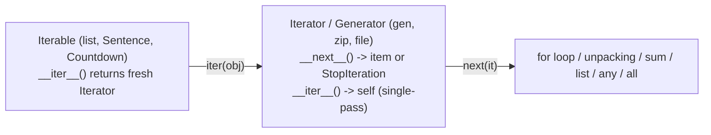

# 3.3 Idiomatic Python: the data model, comprehensions, generators

| | |
|---|---|
| Level | Intermediate |
| Priority tier | 0 |
| Lab venue | Any machine with Python 3.11 or newer |
| Part | Part 3: Python for infrastructure |
| Status | Drafted, labs **untested** |

## Why this matters for AI infrastructure

"Pythonic" is not decoration; it is how the language and its libraries expect you to behave, and the reason frameworks (pandas, PyTorch, FastAPI, Kubernetes clients) feel consistent. The **data model** (special methods such as `__len__`, `__getitem__`, `__iter__`, `__enter__`) is what makes your own objects work with `len()`, `for`, `with`, `sorted` and slicing. **Comprehensions and generators** are how infrastructure scripts stream gigabytes of logs, paginate cloud APIs, and transform metrics without exhausting memory. Getting them right turns a 40-line loop with a bug into a three-line pipeline you can test. This chapter covers the data model, the sequence/mapping/set types in depth, comprehensions, the iterator protocol, generators and coroutine-style generators, `itertools`/`functools`/`operator`, text vs bytes, object references, and design patterns with first-class functions.

## Prerequisites and outcomes

You should know the core language (chapter 3.1) and modules (3.2).

After this chapter you can:

- Explain the data model: special (dunder) methods, how built-ins and syntax dispatch to them, and implement a small class that behaves like a sequence, mapping, context manager, or numeric type.
- Choose and use sequence types (list, tuple, deque, array, memoryview), slicing and unpacking, sorting and key functions, bisect; mapping and set types (dict, defaultdict, Counter, OrderedDict, ChainMap, MappingProxyType, set operations), and understand hash and equality contracts.
- Write list/dict/set comprehensions and generator expressions, know when not to, and handle scoping rules and the walrus operator in comprehensions.
- Explain iterables, iterators and the iterator protocol; write generator functions, `yield from`, generator pipelines, infinite generators, and send/throw/close semantics; use `itertools` recipes.
- Handle text vs bytes, encodings and normalisation; understand references, aliasing, weak references, and object lifecycle.
- Use first-class functions for patterns (strategy, command, registry, callbacks) instead of class hierarchies.
- Process large inputs in constant memory and paginate APIs lazily.

## 1. The Python data model

The data model defines how objects interact with the language. When you write `len(x)`, `x[i]`, `for a in x`, `x + y`, `with x:` or `print(x)`, Python calls **special methods** on the object's type: `type(x).__len__(x)`, `__getitem__`, `__iter__`, `__add__`, `__enter__`/`__exit__`, `__str__`. Implementing them lets your classes participate in built-in behaviour. You should rarely call dunder methods directly (call `len(x)`, not `x.__len__()`), and you should not invent new ones.

```python
from collections import abc
import math

class Vector:
    """2D vector demonstrating the data model."""
    __slots__ = ("x", "y")                       # fixed attributes: smaller, faster objects

    def __init__(self, x=0.0, y=0.0):
        self.x, self.y = float(x), float(y)

    def __repr__(self):                          # unambiguous, for developers/logs: eval-like
        return f"Vector({self.x!r}, {self.y!r})"
    def __str__(self):                           # for humans
        return f"({self.x}, {self.y})"
    def __eq__(self, other):
        if not isinstance(other, Vector): return NotImplemented     # let Python try the reflected operation
        return (self.x, self.y) == (other.x, other.y)
    def __hash__(self):                          # must agree with __eq__ if instances are used in sets/dict keys
        return hash((self.x, self.y))
    def __abs__(self):  return math.hypot(self.x, self.y)
    def __bool__(self): return bool(abs(self))
    def __add__(self, other):
        if not isinstance(other, Vector): return NotImplemented
        return Vector(self.x + other.x, self.y + other.y)
    def __mul__(self, k):
        if not isinstance(k, (int, float)): return NotImplemented
        return Vector(self.x * k, self.y * k)
    __rmul__ = __mul__                           # 3 * v
    def __iter__(self):                          # unpacking: x, y = v
        yield self.x; yield self.y
```

### Categories of special methods

| Purpose | Methods | Triggered by |
|---|---|---|
| Representation | `__repr__`, `__str__`, `__format__`, `__bytes__` | `repr()`, `print`, f-strings, `bytes()` |
| Truthiness/size | `__bool__`, `__len__` | `if x`, `len(x)` |
| Comparison/hash | `__eq__`, `__lt__`, `__le__`... `__hash__` | `==`, `<`, `sorted`, sets, dict keys; `functools.total_ordering` fills in the rest |
| Arithmetic | `__add__`, `__sub__`, `__mul__`, `__truediv__`, `__floordiv__`, `__mod__`, `__pow__`, `__neg__`, `__abs__` plus reflected `__radd__` and in-place `__iadd__` | operators |
| Container | `__getitem__`, `__setitem__`, `__delitem__`, `__contains__`, `__iter__`, `__reversed__`, `__missing__` | `x[i]`, `in`, `for`, `reversed` |
| Iteration | `__iter__`, `__next__` | `iter()`, `next()` |
| Context managers | `__enter__`, `__exit__` | `with` |
| Callable | `__call__` | `x()` |
| Attribute access | `__getattr__`, `__getattribute__`, `__setattr__`, `__delattr__`, `__dir__`, descriptors `__get__`/`__set__` | `x.a` (chapter 3.11) |
| Lifecycle | `__new__`, `__init__`, `__del__`, `__init_subclass__`, `__class_getitem__` | construction, destruction, subclassing |
| Async | `__aiter__`, `__anext__`, `__aenter__`, `__aexit__`, `__await__` | `async for`, `async with`, `await` (chapter 3.6) |

Design rules: return `NotImplemented` (not raise) for unsupported operand types so Python can try the other operand; keep `__eq__` and `__hash__` consistent (equal objects must hash equal; mutable objects should not be hashable); make `__repr__` always useful (include the identifying fields); prefer composition and the abstract collection base classes (`collections.abc.Sequence`, `Mapping`, `MutableMapping`) which supply many methods once you implement a few.

### A sequence by protocol: `FrenchDeck`, `spades_high`, and `Fleet`

In *Fluent Python* Chapter 1 (`Example 1-1`), Luciano Ramalho shows how implementing just two dunder methods—`__len__` and `__getitem__`—turns a 12-line class into a full-fledged Python sequence (`collections.abc.Sequence`). By defining `Card = collections.namedtuple('Card', ['rank', 'suit'])` and `class FrenchDeck` with `ranks = [str(n) for n in range(2, 11)] + list('JQKA')` and `suits = 'spades diamonds clubs hearts'.split()`, a `deck = FrenchDeck()` instance immediately supports `len(deck)` (`52`—note that for built-in CPython types like `list` or `str`, `len(x)` reads the C struct's `ob_size` field in `PyVarObject` directly in $O(1)$ time rather than calling a method), indexing (`deck[0] == Card(rank='2', suit='spades')`, `deck[-1] == Card(rank='A', suit='hearts')`), random selection (`from random import choice; choice(deck)`), slicing (`deck[:3]` and `deck[12::13]` to pick all four Aces by starting at index 12 and stepping by 13), forward and reverse iteration (`for card in deck:` and `for card in reversed(deck):`), sequential `in` membership scans (`Card('Q', 'hearts') in deck` is `True`, `Card('7', 'beasts') in deck` is `False`), and custom sorting via `suit_values = dict(spades=3, hearts=2, diamonds=1, clubs=0)` and `def spades_high(card): rank_value = FrenchDeck.ranks.index(card.rank); return rank_value * len(suit_values) + suit_values[card.suit]` (which ranks the `2` of clubs at `0` and the Ace of spades at `51` via `sorted(deck, key=spades_high)`). Note that an immutable `FrenchDeck` cannot be shuffled in place with `random.shuffle(deck)` unless it also implements `__setitem__`. Similarly, for infrastructure host inventories:

```python
class Fleet(abc.Sequence):
    """Immutable ordered collection of host names; gets index, count, iteration, 'in', reversed for free."""
    def __init__(self, hosts): self._hosts = list(hosts)
    def __len__(self): return len(self._hosts)
    def __getitem__(self, i):
        if isinstance(i, slice): return Fleet(self._hosts[i])      # slicing returns the same type
        return self._hosts[i]
    def __repr__(self): return f"Fleet({self._hosts!r})"

f = Fleet(["gpu01", "gpu02", "gpu03"])
len(f), f[0], f[-1], f[1:], "gpu02" in f, list(reversed(f)), f.index("gpu03")
```

Only `__len__` and `__getitem__` were needed. This is the essence of **duck typing with protocols** (part of the `collections.abc.Collection` hierarchy, which unifies `Iterable` (`__iter__`), `Sized` (`__len__`), and `Container` (`__contains__`), specialized by `Sequence`, `Mapping`, and `Set`): anything with the right methods plugs in.

### Context managers

```python
from contextlib import contextmanager
import time

class Timer:
    def __enter__(self): self.t0 = time.perf_counter(); return self
    def __exit__(self, exc_type, exc, tb):
        self.elapsed = time.perf_counter() - self.t0
        return False                                  # do not swallow exceptions

@contextmanager
def drained(node):
    cordon(node); drain(node)
    try:
        yield node                                    # body of the with statement runs here
    finally:
        uncordon(node)                                # always executes, even on errors
with drained("gpu07") as n: upgrade(n)
```

`contextlib` also provides `suppress`, `closing`, `redirect_stdout`, `ExitStack` (manage a dynamic number of resources), `nullcontext`, `contextlib.chdir` (3.11), and `asynccontextmanager`. Use `with` for files, locks, sockets, temporary directories, DB transactions, timers, and any acquire/release pair.

## 2. Sequences

### The sequence family

Container sequences hold references to objects (list, tuple, `collections.deque`); flat sequences hold values of one type contiguously (`str`, `bytes`, `bytearray`, `memoryview`, `array.array`). Mutable: list, deque, bytearray, array; immutable: tuple, str, bytes.

```python
# slicing: seq[start:stop:step]; half-open; negative indices; slice objects are first class
data = list(range(10))
data[2:7:2], data[::-1], data[-3:], data[:0]
data[2:5] = ["a", "b"]           # slice assignment (lists): replaces and can change length
del data[::2]
s = slice(0, 4); data[s]

# unpacking
first, *middle, last = data
(a, b), c = (1, 2), 3
for host, (cpu, mem) in {"a": (8, 64), "b": (16, 128)}.items(): ...
def f(a, b, c): ...
f(*[1, 2, 3]); f(**{"a": 1, "b": 2, "c": 3})

# sorting
nodes.sort(key=lambda n: (n.rack, -n.gpus, n.name))      # stable, multi-key, descending on one key
from operator import itemgetter, attrgetter
sorted(rows, key=itemgetter("rack", "name")); sorted(objs, key=attrgetter("rack", "name"))
import bisect; i = bisect.bisect_left(sorted_list, x); bisect.insort(sorted_list, x)
heapq.nlargest(5, items, key=...)      # top-k without full sort
```

Notes: `sort()` sorts in place and returns `None`; `sorted()` returns a new list. Python's sort (Timsort) is stable and O(n log n) with O(n) best case on partially ordered data. Use `key=` instead of `cmp`. **Tuple comparison** is lexicographic. **`list.insert(0, x)` and `list.pop(0)` are O(n)**: use `collections.deque` (`appendleft`, `popleft`, `maxlen=N` ring buffers, ideal for recent-N windows of metrics or log lines).

```python
from collections import deque
recent = deque(maxlen=1000)           # keeps only the last 1000 entries
recent.append(sample)
from array import array
temps = array("f", [71.0, 72.5])      # compact numeric storage (4 bytes each) vs list of float objects (~32 bytes each)
mv = memoryview(bytearray(1024)); chunk = mv[100:200]     # zero-copy views over binary buffers (sockets, mmap, NumPy)
```

**Augmented assignment** on mutable sequences mutates in place (`a += [1]` calls `__iadd__`, which acts like `list.extend` on the shared list), whereas on immutable sequences like tuples or strings it falls back to `__add__` and rebinds the variable to a brand-new object (so repeated `+=` on tuples or strings copies the entire sequence each time). In *Fluent Python* Chapter 2 (`Examples 2-17` and `2-18`), the puzzle `t = (1, 2, [30, 40]); t[2] += [50, 60]` (or `t = ([1], 2); t[0] += [3]`) both raises `TypeError: 'tuple' object does not support item assignment` **and** leaves `t` mutated as `(1, 2, [30, 40, 50, 60])`. Inspecting `dis.dis('s[a] += b')` shows why: Python first executes `BINARY_SUBSCR` to push `s[a]` (the mutable list) onto the stack, calls `INPLACE_ADD` (`__iadd__`, which succeeds in extending the list in place), and then executes `STORE_SUBSCR` (`s[a] = result`), which fails because `s` is an immutable `tuple`. Lesson: avoid putting mutable items inside tuples, and bear in mind that `+=` is not an atomic operation.

Also from *Fluent Python* Chapter 2:
- **Listcomps vs `map`/`filter` and Cartesian products (`Examples 2-1` to `2-6`):** For `symbols = '$¢£¥€¤'`, `[ord(s) for s in symbols if ord(s) > 127]` (`[162, 163, 165, 8364, 164]`) is clearer than `list(filter(lambda c: c > 127, map(ord, symbols)))`, while generator expressions initialize tuples and arrays without allocating an intermediate list (`tuple(ord(s) for s in symbols)` and `array.array('I', (ord(s) for s in symbols))`). Cartesian products over `colors = ['black', 'white']` and `sizes = ['S', 'M', 'L']` (`[(color, size) for color in colors for size in sizes]`, or lazily `(f'{c} {s}' for c in colors for s in sizes)`) replace nested loops.
- **Tuples as records, nested unpacking (`metro_areas`), and named `slice` objects (`Examples 2-7` to `2-13`):** Beyond serving as immutable lists, tuples act as unnamed records where field position carries meaning (`lax_coordinates = (33.9425, -118.408056)`, `divmod(20, 8) == (2, 4)`). To test whether a tuple `o` is recursively immutable (hashable), you can run `def fixed(o): try: hash(o) except TypeError: return False; return True` (`fixed((10, 'alpha', (1, 2)))` is `True`; `fixed((10, 'alpha', [1, 2]))` is `False`). In `metro_areas = [('Tokyo', 'JP', 36.933, (35.689722, 139.691667)), ('Delhi NCR', 'IN', 21.935, (28.613889, 77.208889)), ('Mexico City', 'MX', 20.142, (19.433333, -99.133333)), ('New York-Newark', 'US', 20.104, (40.808611, -74.020386)), ('São Paulo', 'BR', 19.649, (-23.547778, -46.635833))]`, nested tuple unpacking `for name, _, _, (lat, lon) in metro_areas:` (or structural pattern matching `case [str(name), _, _, (float(lat), float(lon))] if lon <= 0:`) extracts nested coordinates directly, just as a Scheme-subset `lis.py` evaluator matches `case ['quote', x]:`, `case ['if', test, consequence, alternative]:`, and `case ['lambda', [*parms], *body] if body:`. For flat-file parsing (`invoice`), naming slices (`SKU = slice(0, 6); DESCRIPTION = slice(6, 40); UNIT_PRICE = slice(40, 52)` with `'bicycle'[::3] == 'bye'`, `'bicycle'[::-1] == 'elcycib'`, and multidimensional `...` `Ellipsis` in NumPy `floats-10M-lines.txt`) keeps index math readable. **Named tuples** (`collections.namedtuple`, `typing.NamedTuple`) give tuple semantics with named fields (chapter 3.4 compares them to dataclasses).

### Memory and performance notes

- Lists store pointers (8 bytes each on 64-bit) to separate objects: a list of one million floats costs about 32 MB plus the objects; use NumPy arrays or `array` for numeric bulk data (chapter 3.10).
- Prefer comprehensions and built-ins (`sum`, `max`, `any`, `all`, `join`) over manual loops for speed and clarity.
- `x in list` is linear; convert to a `set` for repeated membership tests.
- `copy.copy`, slicing and `list()` make shallow copies.

## 3. Mappings and sets

```python
d = {"gpu01": 8, "gpu02": 8}
d["gpu03"] = 4; d.get("x", 0); d.pop("gpu01"); d.setdefault("gpu04", 8); d |= {"gpu05": 2}; dict(zip(keys, values))
{k: v for k, v in d.items() if v >= 8}; sorted(d.items(), key=lambda kv: kv[1], reverse=True)
for k in list(d):                       # iterate over a copy of keys if you delete
    if d[k] == 0: del d[k]
```

- **Hashing contract**: keys must be hashable (hash never changes, `a == b` implies `hash(a) == hash(b)`). Dict and set lookups are O(1) on average because of hashing; many collisions degrade to O(n).
- **Ordering and compact/key-sharing layout**: dicts preserve insertion order (adopted from PyPy's compact dict layout in CPython 3.6 and made an official language guarantee in Python 3.7, alongside PEP 412 key-sharing instance `__dict__` dictionaries that cut OOP memory by 10% to 20%); `OrderedDict` adds `move_to_end` (useful for LRU caches) and order-sensitive equality. In *Fluent Python* Chapter 3 (`Example 3-1`), dict comprehensions transform `dial_codes = [(880, 'Bangladesh'), (55, 'Brazil'), (86, 'China'), (91, 'India'), (62, 'Indonesia'), (81, 'Japan'), (234, 'Nigeria'), (92, 'Pakistan'), (7, 'Russia'), (1, 'United States')]` into `country_dial = {country: code for code, country in dial_codes}` and `{code: country.upper() for country, code in sorted(country_dial.items()) if code < 70}`, while `match` destructures semi-structured JSON records (`case {'type': 'book', 'api': 2, 'authors': [*names]}:` or `case {'type': 'book', 'api': 1, 'author': name}:` in `get_creators(record)`).
- **`setdefault` vs `defaultdict(factory)` vs `__missing__` (`StrKeyDict0` and `collections.UserDict`):** When indexing word locations `(line_no, column_no)` with `WORD_RE = re.compile(r'\w+')` (`Examples 3-4` to `3-8`), writing `occurrences = index.get(word, []); occurrences.append(location); index[word] = occurrences` performs **two** hash lookups per word, whereas `index.setdefault(word, []).append(location)` or `index = collections.defaultdict(list); index[word].append(location)` performs only **one** lookup. Under the hood, if `d[key]` misses, `dict.__getitem__` calls **`__missing__(self, key)`** (note that `__missing__` is called **only** by `d[k]`, not by `d.get(k)` or `k in d` unless overridden). In *Fluent Python*'s `StrKeyDict0(dict)`, implementing `def __missing__(self, key): if isinstance(key, str): raise KeyError(key); return self[str(key)]` (where the `isinstance(key, str)` guard prevents infinite recursion if `str(key)` is absent) alongside `get` and `def __contains__(self, key): return key in self.keys() or str(key) in self.keys()` lets integer and string keys look up seamlessly (`d[2] == d['2'] == 'two'`). When writing a custom mapping that also normalizes keys on insertion (`__setitem__`), subclass **`collections.UserDict`** (which stores the underlying `dict` in `self.data` and extends `abc.MutableMapping`) rather than `dict` directly so built-in C methods do not bypass your overrides.
- **`Counter` and `shelve.Shelf`**: `Counter` is a multiset (`ct = collections.Counter('abracadabra'); ct.update('aaaaazzz'); ct.most_common(3)`) supporting `+`, `-`, `&` (min), and `|` (max); `shelve.open` provides persistent DBM-backed `MutableMapping` storage for string keys.
- **`ChainMap`**: layered lookups without copying: configuration precedence (`ChainMap(cli_args, os.environ, file_cfg, defaults)` or Python's own scope lookup `pylookup = ChainMap(locals(), globals(), vars(builtins))`; mutations like `chain['c'] = -1` modify only the **first** mapping `d1`).
- **`types.MappingProxyType(d)`** read-only dynamic view over `d` (preventing callers from mutating hardware pin maps while still reflecting updates made to `d`); `dict.keys()` (`dict_keys`) and `dict.items()` (`dict_items`) are zero-copy live views supporting set operations (`&`, `|`, `-`, `^`).
- **Sets**: `{1, 2}`, `set(iterable)` (note `{}` is an empty `dict`; always write `set()` for an empty set), `|` (`union`), `&` (`intersection`), `-` (`difference`), `^` (`symmetric_difference`), `<=` (`issubset`), `<`, `>=` (`issuperset`), `>`, `isdisjoint`; elements must be hashable; `frozenset` for hashable sets. Great for diffing desired vs actual state, deduplication (note: unordered; for ordered dedupe use `dict.fromkeys(items)`).
- **Equality of different containers**: `{1: "a"} == {1: "a"}` True regardless of order; lists compare order-sensitively; `1 == 1.0 == True` and they hash equal, so `{1, 1.0, True}` has one element.
- **Nested defaults**: `defaultdict(lambda: defaultdict(list))` for two-level grouping; for deeply nested configuration prefer typed models (chapter 3.4).
- **Merging**: `a | b`, `{**a, **b}`, `ChainMap`; deep merges require recursion.

```python
from collections import defaultdict, Counter, ChainMap
by_rack = defaultdict(list)
for n in nodes: by_rack[n["rack"]].append(n["name"])
errors = Counter(e["code"] for e in events)
cfg = ChainMap({"retries": 5}, {"retries": 3, "timeout": 10})        # first mapping wins
cfg["timeout"], cfg["retries"]
```

## 4. Text versus bytes

(Expanded in chapter 3.5; the essentials here.)

- **`str`** is Unicode text (sequence of code points); **`bytes`** is binary data. Convert only at the boundaries: decode bytes to text on input (`data.decode("utf-8")`), encode text to bytes on output (`s.encode("utf-8")`).
- **Encodings**: UTF-8 is the default for new work; ASCII subset; Latin-1 maps bytes 1:1 to code points 0 to 255 (useful to carry arbitrary bytes through text APIs); `errors="replace"|"ignore"|"surrogateescape"|"backslashreplace"|"strict"` control failures. `locale.getpreferredencoding()` varies by environment (containers with `LANG=C` surprise people); always pass `encoding="utf-8"` to `open()`.
- **Unicode pitfalls**: the same visible text can have different code point sequences (`é` as one code point or `e` + combining accent): normalise with `unicodedata.normalize("NFC", s)` before comparing; `str.casefold()` for caseless matching; `len()` counts code points, not bytes or visual characters (graphemes); sorting is by code point (use `locale.strxfrm` or ICU for human order).
- **Bytes API**: `bytes` indexing returns ints; `b"abc"[0] == 97`; `bytes.hex()`, `bytes.fromhex`, `int.from_bytes`, `struct.pack/unpack` for binary protocols, `base64`, `hashlib` (bytes in, bytes out).
- Subprocess output, socket reads and file reads in binary mode are bytes; JSON/YAML/regex operate on text.

## 5. Object references, mutability and recycling

- **Variables are labels, not boxes (`FP` Chapter 6)**: in `x = Gizmo()`, the right-hand side executes first to construct the `Gizmo` object, and then the label `x` is bound to it (so `y = Gizmo() * 10` prints the new `Gizmo id` before raising `TypeError` on `* 10`). Aliasing (`charles = {'name': 'Charles L. Dodgson', 'born': 1832}; lewis = charles`) binds two labels to the same object (`lewis is charles` is `True`), whereas an impostor dict `alex = {'name': 'Charles L. Dodgson', 'born': 1832, 'balance': 950}` has equal value (`alex == charles`) but distinct identity (`alex is not charles`).
- **Shallow vs. deep copy (`Bus`) and cyclic references**: in *Fluent Python* (`Examples 6-8` to `6-10`), given `bus1 = Bus(['Alice', 'Bill', 'Claire', 'David'])`, `bus2 = copy.copy(bus1)`, and `bus3 = copy.deepcopy(bus1)`, dropping `'Bill'` from `bus1` (`bus1.drop('Bill')`) also removes `'Bill'` from `bus2.passengers` because `copy.copy` shares the inner `passengers` list, whereas `bus3.passengers` retains all four passengers; `copy.deepcopy` also handles cyclic references (`a = [10, 20]; b = [a, 30]; a.append(b)`) by tracking already-copied object IDs in a `memo` dictionary.
- **Parameter passing ("call by sharing") and the `HauntedBus` / `TwilightBus` traps (`Examples 6-12` to `6-15`)**: function arguments are passed by object reference (the parameter becomes an alias of the caller's object). This creates two classic bugs:
  1. **`HauntedBus` (mutable default argument `def __init__(self, passengers=[]):`)**: `bus2 = HauntedBus()` and `bus3 = HauntedBus()` share the single default list stored in `HauntedBus.__init__.__defaults__[0]`, so `bus2.pick('Carrie')` makes `'Carrie'` unexpectedly appear in `bus3.passengers`. Always default to `passengers=None` and initialize `self.passengers = []` when `None`.
  2. **`TwilightBus` (aliasing a caller's mutable argument `self.passengers = passengers`)**: when `basketball_team = ['Sue', 'Tina', 'Maya', 'Diana', 'Pat']` is passed to `bus = TwilightBus(basketball_team)`, calling `bus.drop('Tina')` and `bus.drop('Pat')` calls `self.passengers.remove(...)` directly on the caller's list, making `'Tina'` and `'Pat'` vanish from `basketball_team`. Fix it by making a defensive copy in `__init__`: `self.passengers = list(passengers)` (which also accepts any iterable, such as a tuple or set).
- **Identity, equality, interning, small-int caching** (chapter 3.1); `del s1` deletes the **name (reference) `s1`**, not the object itself; the object is garbage-collected only when its last reference is removed or rebound. In `Example 6-16`, registering `ender = weakref.finalize(s1, bye)` on `s1 = s2 = {1, 2, 3}` leaves `ender.alive == True` after `del s1`, and triggers `bye()` (`...like tears in the rain.`, setting `ender.alive == False`) only when `s2 = 'spam'` rebinds the final reference.
- **Weak references**: `weakref.ref(obj)`, `WeakValueDictionary`, `WeakKeyDictionary`, `WeakSet` allow caches and registries that do not keep objects alive.
- **Copy semantics in APIs**: functions should not mutate arguments unless documented; return new objects for pure functions; use tuples/frozen dataclasses for values.
- **`__del__`** is unreliable for cleanup; use context managers, `try/finally`, or `weakref.finalize`.
- **Garbage collector**: `gc.collect()`, `gc.get_stats()`, `gc.freeze()` before forking workers (reduces copy-on-write memory growth in preforking servers, relevant to inference and data-loader workers).

## 6. Functions as objects, closures, decorators and design patterns

Functions are first-class objects (instances of `function`, one of Python's nine callable flavors alongside built-in functions/methods, user-defined methods, classes, class instances implementing `__call__`, generators, native coroutines, and asynchronous generators), with attributes (`__name__`, `__doc__`, `__defaults__`, `__kwdefaults__`, `__code__`, `__annotations__`, `__closure__`), callable, passable (`map(factorial, range(11))`, `sorted(fruits, key=len)`, `sorted(fruits, key=reverse)`), and returnable (`FP` Chapter 7).

```python
def apply(fn, items): return [fn(i) for i in items]
callable(apply); apply.__name__; apply.__defaults__
```

### Callable objects (`BingoCage`), `operator` (`itemgetter`, `attrgetter`, `methodcaller`), and `functools.partial`

- **User-defined callable types (`__call__`, `FP` Chapter 7 `Example 7-8`):** Implementing `__call__` on a class (such as `class BingoCage:` whose `__init__` copies and `random.shuffle`s items into `self._items`, `pick(self)` pops an item, and `def __call__(self): return self.pick()`) creates stateful function-like instances where `bingo = BingoCage(range(3)); bingo()` works identically to `bingo.pick()` and `callable(bingo)` is `True`.
- **Keyword-only arguments in `tag(name, *content, class_=None, **attrs)` (`Example 7-9`):** Placing `class_=None` after `*content` (or after a bare `*`) forces callers to pass `class_='sidebar'` by keyword while `**attrs` captures arbitrary HTML attributes (`tag('p', 'hello', 'world', class_='sidebar', id=33)`).
- **`operator` module (`Examples 7-13` to `7-15`):** `operator.itemgetter(1)` (or `itemgetter(1, 0)` returning a tuple of items) and `operator.attrgetter('name', 'coord.lat')` (which navigates nested attributes on `Metropolis = namedtuple('Metropolis', 'name cc pop coord')` and `LatLon = namedtuple('LatLon', 'lat lon')`) build fast C-level key/extraction functions without `lambda`, while `operator.methodcaller('replace', ' ', '-')` invokes a method by name with bound arguments.
- **`functools.partial` (`Example 7-18`):** `picture = functools.partial(tag, 'img', class_='pic-frame')` freezes positional and keyword arguments (`picture.func`, `picture.args`, `picture.keywords`) to adapt a general function to a callback signature.

### Closures (`make_averager`), decorators at import time, `@cache`, and `@singledispatch` (`FP` Chapter 9)

- **When Python executes decorators (`registration.py`, `Example 9-2`):** Function decorators (`@register`, or stacked `@alpha` above `@beta`, which equals `alpha(beta(f))`) run **immediately at module import time** (when `def` executes), whereas the decorated function itself only runs when explicitly called at runtime.
- **Variable scope bytecode (`dis.dis`) and closures (`Averager` vs `make_averager`, `Examples 9-5` to `9-14`):** If a function body assigns to `b = 9` anywhere inside `def f2(a): print(a); print(b); b = 9`, CPython compiles `b` as a local variable (`LOAD_FAST` instead of `LOAD_GLOBAL`), raising `UnboundLocalError` before `b = 9` is reached. A **closure** is a function that retains bindings to **free variables** defined in an enclosing function scope even after the outer function has returned. In `make_averager()`, storing `series = []` in the outer scope lets the inner `averager(new_value)` call `series.append(new_value)` (stored in `avg.__closure__[0].cell_contents` with `avg.__code__.co_freevars == ('series',)`). Better yet (`Example 9-14`), storing only running scalars `count = 0; total = 0` and declaring `nonlocal count, total` inside `averager(new_value)` updates the average in $O(1)$ memory instead of growing a `series` list forever.
- **Timing decorators (`@clock`), `@functools.cache` / `@lru_cache`, and `@singledispatch` (`Examples 9-15` to `9-27`):** A decorator that wraps `func` with `functools.wraps(func)` preserves `__name__` and `__doc__` (and parameterized decorators like `@clock('{name}: {elapsed}s')` use a 3-level function nesting `clock(fmt) -> decorate(func) -> clocked(*_args)` or a class implementing `__call__`). Applying `@functools.cache` (or `@lru_cache(maxsize=128, typed=False)`) memoizes recursive functions like `fibonacci(n)` from exponential calls down to $O(n)$ calls. And `@functools.singledispatch` turns a base function (`@singledispatch def htmlize(obj: object) -> str:`) into a generic function whose type-specialized handlers (`@htmlize.register def _(text: str) -> str:`, `@htmlize.register def _(seq: abc.Sequence) -> str:`, `@htmlize.register def _(n: numbers.Integral) -> str:`) dispatch on the first argument's runtime type (preferring ABCs like `abc.Sequence` or `numbers.Integral` over concrete `list` or `int`).

### Refactoring the Strategy pattern with first-class functions (`FP` Chapter 10)

In his landmark 1996 presentation *Design Patterns in Dynamic Languages*, Peter Norvig observed that 16 of the 23 Gang-of-Four patterns become "invisible or simpler" in languages with first-class functions. In *Fluent Python* Chapter 10 (`Examples 10-1` to `10-9`), Ramalho demonstrates this by refactoring an ecommerce `Order` discount engine (`Customer(name, fidelity)`, `LineItem(product, quantity, price)`, and `Order(customer, cart, promotion)`):
- **Classic OOP Strategy (`Example 10-1`):** Defines an abstract base class `Promotion(ABC)` with `@abstractmethod def discount(self, order: Order) -> Decimal:` and three stateless concrete subclasses—`FidelityPromo` (`5%` discount when `order.customer.fidelity >= 1000`), `BulkItemPromo` (`10%` discount on each `LineItem` with `item.quantity >= 20`), and `LargeOrderPromo` (`7%` discount when `len({item.product for item in order.cart}) >= 10`). Because concrete strategy instances hold zero instance attributes (`self` is unused), instantiating classes (`Order(ann, cart, FidelityPromo())`) is pure ceremony.
- **Function-oriented Strategy & `@promotion` decorator registry (`Examples 10-3` to `10-9`):** Replacing the `Promotion` class hierarchy with plain functions `fidelity_promo(order: Order) -> Decimal`, `bulk_item_promo(order: Order) -> Decimal`, and `large_order_promo(order: Order) -> Decimal` (passed directly as `Order(ann, cart, fidelity_promo)`) eliminates the ABC and subclasses completely. Moreover, a meta-strategy `def best_promo(order: Order) -> Decimal: return max(promo(order) for promo in promos)` picks the highest discount automatically (`Order(ann, cart, best_promo)`). Instead of fragile `globals()` scanning (`[globals()[name] for name in globals() if name.endswith('_promo') and name != 'best_promo']`, `Example 10-7`) or `inspect.getmembers(promotions, inspect.isfunction)` (`Example 10-8`), decorating each strategy with `@promotion` (`def promotion(promo: Promotion) -> Promotion: promos.append(promo); return promo`, `Example 10-9`) explicitly registers every strategy function on import. The same principle simplifies the **Command pattern**: instead of a `Command` subclass with an `.execute()` method (or a `MacroCommand` holding a list of commands), pass a callable function, closure, or `MacroCommand` implementing `def __call__(self): for cmd in self.commands: cmd()`.

Other patterns that replace class hierarchies:

- **Strategy**: pass the function (`sort(key=...)`, `retry(fn)`), or a dict of functions: `ACTIONS = {"start": start, "stop": stop}; ACTIONS[cmd](*args)`.
- **Registry via decorator**: 

```python
HANDLERS = {}
def handler(event_type):
    def register(fn):
        HANDLERS[event_type] = fn
        return fn
    return register

@handler("node_down")
def on_node_down(ev): ...
HANDLERS[ev["type"]](ev)
```

- **Command objects**: `functools.partial(deploy, app="api", env="prod")` creates a pre-bound callable you can queue or schedule.
- **Callbacks and hooks**: pass functions to libraries (signal handlers, `atexit.register`, progress callbacks).
- **Callable objects** (`__call__`) hold state (a rate limiter instance) while behaving like functions.
- **`functools`**: `lru_cache(maxsize=...)`/`cache` memoise pure functions (arguments must be hashable; watch memory and staleness for functions depending on external state); `cached_property`; `singledispatch` (overload by first argument type); `total_ordering`; `reduce`; `wraps` (preserve metadata in decorators; chapter 3.11).
- **`operator`** module: `itemgetter`, `attrgetter`, `methodcaller`, `add`, `mul` replace trivial lambdas.
- **Higher-order built-ins**: `map`, `filter`, `sorted(key=)`, `min/max(key=)`, `any/all`, `sum`.

## 7. Comprehensions

Comprehensions build collections declaratively from iterables, in one expression, usually faster and more readable than the equivalent loop.

```python
squares   = [n * n for n in range(10)]
evens     = [n for n in range(20) if n % 2 == 0]
labels    = ["even" if n % 2 == 0 else "odd" for n in range(5)]          # conditional expression goes BEFORE 'for'
pairs     = [(r, n) for r in racks for n in nodes_in(r)]                 # nested loops: read left to right like nested for statements
matrix_t  = [[row[i] for row in matrix] for i in range(len(matrix[0]))]  # transpose
flat      = [x for sub in nested for x in sub]
by_name   = {n.name: n for n in nodes}                                    # dict comprehension
inverse   = {v: k for k, v in mapping.items()}
racks     = {n.rack for n in nodes}                                       # set comprehension
lazy      = (len(line) for line in lines)                                 # generator expression: no list built
total     = sum(n.gpus for n in nodes)                                    # generator expression as sole argument: no extra parentheses
```

Rules and gotchas:

- **Scope**: in all comprehension forms (list, set, dict, and generator expressions), the `for` loop variable lives in the comprehension's own nested scope and does not leak into or overwrite names in the enclosing scope (unlike a regular `for` loop statement). However, a named assignment expression (`:=`) inside a comprehension **does** leak out and binds its target variable in the **enclosing scope** (and `yield` inside a comprehension is forbidden):

```python
# In the book's examples (untested here):
X = 99
[X for X in range(5)]                                  # [0, 1, 2, 3, 4]; outer X is still 99
for X in range(5): pass                                # regular for statement changes outer X to 4

S = 'hack'
[(temp := S[i]) + temp.upper() for i in range(len(S))] # ['hH', 'aA', 'cC', 'kK']
# temp == 'k' in the enclosing scope, whereas i raises NameError: name 'i' is not defined
```

- **Walrus** avoids recomputation: `[y for x in data if (y := expensive(x)) is not None]`.
- **Readability limit**: more than two `for`/`if` clauses, or side effects, belong in a loop. Do not use comprehensions for side effects (`[print(x) for x in xs]` builds a useless list).
- **Memory**: list comprehensions materialise everything; use generator expressions to feed `sum`, `any`, `all`, `max`, `sorted`, `",".join`, `set(...)`, `tuple(...)` when you don't need the list.
- **Filtering and mapping combined** is where they shine; `map`/`filter` with named functions are fine when the function exists already.
- **Performance**: comprehensions avoid repeated attribute lookups (`list.append`) and are typically 20 to 50% faster than equivalent loops; but algorithmic choices (set vs list) matter far more.
- **Pitfalls**: modifying the source while comprehending; building lists of lists with shared references (use the comprehension form `[[0]*c for _ in range(r)]`); catching exceptions inside (not possible: wrap in a function).
- **Matrix comprehensions and when not to use comprehensions (`LP` Chapter 20):** Given 3x3 nested list matrices `M = [[1, 2, 3], [4, 5, 6], [7, 8, 9]]` and `N = [[2, 2, 2], [3, 3, 3], [4, 4, 4]]`, list comprehensions extract columns (`[row[1] for row in M] == [2, 5, 8]`), main and anti-diagonals (`[M[i][i] for i in range(len(M))] == [1, 5, 9]` and `[M[i][len(M)-1-i] for i in range(len(M))] == [3, 5, 7]`), flat vs nested scalar transforms (`[col + 10 for row in M for col in row]` where `for` clauses indent right vs `[[col + 10 for col in row] for row in M]` where left-nested brackets create a new row list per outer iteration), and pairwise matrix multiplication (`[[col1 * col2 for (col1, col2) in zip(row1, row2)] for (row1, row2) in zip(M, N)]` == `[[2, 4, 6], [12, 15, 18], [28, 32, 36]]`). However, follow the **KISS principle**: if you have to translate a deeply nested comprehension into statement loops to understand what it does, write the explicit `for` statements instead.

```python
# Parse "key=value" pairs from an environment-style file, ignoring comments and blanks
env = {
    k.strip(): v.strip()
    for line in Path("/etc/default/myapp").read_text().splitlines()
    if (line := line.strip()) and not line.startswith("#") and "=" in line
    for k, _, v in [line.partition("=")]
}
```

## 8. Iterables, iterators and generators

### The iterator protocol: multiple-pass iterables vs single-pass iterators



- An **iterable** has `__iter__()` returning a **fresh iterator** on each call (or falls back to `__getitem__(0, 1, ...)` starting at `0` until `IndexError`). Built-in sequences (`L = [1, 2, 3, 4]`, `R = range(5)`) are multiple-pass iterables (`iter(R) is R` is `False`; `I1, I2 = iter(L), iter(L)` maintain independent positions).
- An **iterator** has `__next__()` (returns the next item or raises `StopIteration`) and `__iter__()` returning **`self`** (`iter(G) is G` is `True`). Iterators—including generator objects, `enumerate`, `zip`, `map`, `filter`, `os.walk('..')`, and open files (`open('data.txt')`, which should be iterated directly line-by-line rather than calling `.readlines()`)—are **single-pass** and stateful: if `I1 = iter(G)` and `I2 = iter(G)` are created on the same generator `G = (c * 4 for c in 'hack')`, both `I1` and `I2` point to the exact same position (`next(I1) -> 'hhhh'`, `next(I1) -> 'aaaa'`, `next(I2) -> 'cccc'`), and once exhausted, iterating again yields nothing until you construct a new generator (`LP` Chapters 14 & 20).
- In *Fluent Python* Chapter 17 (`Examples 17-1` to `17-7`), Ramalho contrasts three implementations of `Sentence(text)` extracting words with `RE_WORD = re.compile(r'\w+')`: (1) `__getitem__` over `self.words = RE_WORD.findall(text)` (works by sequence fallback), (2) the classic GoF Iterator pattern returning a separate `SentenceIterator(self.words)` class with `self.index` and `__next__` (verbose boilerplate; never make the iterable class itself an iterator by putting `__next__` on `Sentence`), and (3) a lazy Pythonic `__iter__` generator `for match in RE_WORD.finditer(self.text): yield match.group()` (or generator expression `(match.group() for match in RE_WORD.finditer(self.text))`) that yields matches on demand without building a list.
- `for x in obj:` is `it = iter(obj)` then `while True: x = next(it)` until `StopIteration`. Unpacking (`a, *b = open('data.txt')`), `list()`, `sum()`, `any()`, `all()`, `max()`, `min()`, `in`, `zip`, `enumerate`, and comprehensions all consume iterables the same way.
- `iter(callable, sentinel)` builds an iterator from a zero-argument callable until it returns the sentinel: `for block in iter(lambda: f.read(65536), b""):` reads a binary file in chunks.
- **Reuse bug**: iterating a generator or `map`/`filter`/`zip` object twice yields nothing the second time. Convert to a list/tuple if you need two passes, or wrap the generator in an iterable class (`Countdown` or `ArithmeticProgression(begin, step, end)` in `FP` Chapter 17 `Example 17-11`) whose `__iter__` returns a fresh generator each time; use `itertools.tee` carefully (it buffers unconsumed items in memory).

```python
class Countdown:
    """Iterable producing a fresh iterator each time (restartable)."""
    def __init__(self, n): self.n = n
    def __iter__(self):
        n = self.n
        while n > 0:
            yield n
            n -= 1
list(Countdown(3)), list(Countdown(3))
```

### Generator functions, `scramble` vs `permute` (`factorial(N)` explosion), and `myzip` / `mymapPad`

A function containing `yield` (`def gensquares(n): for i in range(n): yield i ** 2` or `def ups(line): for sub in line.split(','): yield sub.upper()`) returns a **generator iterator** when called; its body runs lazily, suspending at each `yield` and resuming on the next `next()`, preserving its local scope and instruction pointer. When the function returns, `StopIteration` is raised.

In *Learning Python* Chapter 20 (`Examples 20-1` to `20-6`), Lutz demonstrates three foundational generator case studies (modeled and tested in `code/part03/python_idiomatic_data_model.py`):
1. **Sequence rotations (`scramble.py`, $N$ results):** `def scramble1(seq): for i in range(len(seq)): yield seq[i:] + seq[:i]` (or generator expression `scramble2 = lambda seq: (seq[i:] + seq[:i] for i in range(len(seq)))`, or walrus rotation `F = lambda seq: (seq := (seq[1:] + seq[:1]) for i in range(len(seq)))`) yields the $N = 4$ cyclic rotations of `'hack'` (`['hack', 'ackh', 'ckha', 'khac']`) one at a time.
2. **Recursive sequence permutations (`permute.py`, `factorial(N)` explosion):** `permute1(seq)` builds a list of all `factorial(N)` permutations in memory, whereas `permute2(seq)` uses recursive `yield seq[i:i+1] + x` to yield each permutation on demand. For `'hack'` ($N = 4$), both produce `factorial(4) == 24` permutations (`permute1('hack') == list(permute2('hack'))`). At $N = 10$ (`math.factorial(10) == 3,628,800`), `permute1(list(range(10)))` pauses for ~17 seconds to allocate 3.6 million lists while `p2 = permute2(seq); next(p2)` returns the first permutation instantaneously. At $N = 20$ (`2,432,902,008,176,640,000`) or $N = 50$ (`math.factorial(50) == 30414093201713378043612608166064768844377641568960512000000000000`), `permute1` is physically impossible, whereas `random.shuffle(seq); p = permute2(seq); next(p)` yields randomized permutations immediately in $O(N)$ memory.
3. **Emulating `map`, `zip`, and padding `map` (`mymap`, `myzip`, `mymapPad`):**
   - `def mymap_func(func, *seqs): for args in zip(*seqs): yield func(*args)` (or `(func(*args) for args in zip(*seqs))`) projects `func` lazily across multiple iterables.
   - `def myzip(*seqs): seqs = [list(S) for S in seqs]; while all(seqs): yield tuple(S.pop(0) for S in seqs)` (or index-based `(tuple(S[i] for S in seqs) for i in range(min(len(S) for S in seqs)))`) truncates at the shortest iterable (`list(myzip('abc', 'xyz123')) == [('a', 'x'), ('b', 'y'), ('c', 'z')]`).
   - `def mymapPad(*seqs, pad=None): seqs = [list(S) for S in seqs]; while any(seqs): yield tuple((S.pop(0) if S else pad) for S in seqs)` pads shorter iterables with `pad` until all are exhausted (`list(mymapPad('abc', 'xyz123', pad=99)) == [('a', 'x'), ('b', 'y'), ('c', 'z'), (99, '1'), (99, '2'), (99, '3')]`).

```python
def fib():
    a, b = 0, 1
    while True:                 # infinite generator: safe because consumption is lazy
        yield a
        a, b = b, a + b
from itertools import islice
list(islice(fib(), 10))

def read_chunks(path, size=1 << 20):
    with open(path, "rb") as f:
        while chunk := f.read(size):
            yield chunk

def tail_lines(path):
    """Follow a file like tail -f."""
    with open(path, encoding="utf-8", errors="replace") as f:
        f.seek(0, 2)
        while True:
            line = f.readline()
            if not line:
                time.sleep(0.5); continue
            yield line.rstrip("\n")
```

Properties:

- Generators are **lazy and memory-efficient**: only the current state is held; they are ideal for large files, database cursors (such as Ramalho's `isis2json.py` pluggable generators `iter_iso_records` and `iter_mst_records` streaming CDS/ISIS bibliographic records into CouchDB/MongoDB in constant RAM), API pagination, directory walks, and streaming transformations.
- A generator's `with` blocks and `try/finally` clean up when the generator is exhausted, closed (`gen.close()` raises `GeneratorExit` inside), or garbage collected: always consume fully or close explicitly when holding resources.
- **`yield from subgen` (subgenerator delegation and `tree.py`, `LP` Ch. 20 & `FP` Ch. 17):** `yield from` delegates iteration directly to a sub-iterable (`def both(N): yield from range(N); yield from map(lambda x: x ** 2, range(N))`, or chained `def a(n): yield from b(n)` -> `def b(n): yield from c(n)`), recursively walks class hierarchies (`def tree(cls, level=0): yield cls.__name__, level; for sub_cls in cls.__subclasses__(): yield from tree(sub_cls, level+1)` on `BaseException`), pipes `send()` and `throw()` straight through to the subgenerator while the delegating generator is suspended, and captures the subgenerator's `return` value (`result = yield from averager_coro()`, where returning `Result(count, average)` attaches the value to `StopIteration.value`).
- **Classic coroutines (`send()`, `throw()`, `close()`):** In `def gen(): for i in range(10): X = yield i` (or `averager_coro()` in `code/part03/python_idiomatic_data_model.py`, typed as `collections.abc.Generator[YieldType, SendType, ReturnType]`), you must first **prime** the generator with `next(G)` (or `G.send(None)`) to advance execution to the first `yield`; subsequent `G.send(77)` calls supply the value of the `yield` expression and advance to the next `yield`, while `next(G)` sends `None`. Modern asynchronous I/O uses native `async def` / `await` coroutines (chapter 3.6).
- **Generator expressions** `(f(x) for x in xs)` are anonymous one-shot generators; parentheses are optional when passed as the sole argument to a function (`sum(x ** 2 for x in range(3))`), but required when additional arguments follow (`sorted((x ** 2 for x in range(3)), reverse=True)`).
- **Exceptions inside generators** propagate to the consumer; `StopIteration` raised inside a generator is converted to `RuntimeError` (PEP 479): use `return`.

### Pipelines

Chain generators so each stage processes one item at a time; the whole pipeline runs in constant memory and is easy to test per stage:

```python
import gzip, re, json
from pathlib import Path
from collections import Counter

def files(root, pattern="*.log.gz"): yield from Path(root).rglob(pattern)
def lines(paths):
    for p in paths:
        with gzip.open(p, "rt", encoding="utf-8", errors="replace") as f:
            yield from f
def parse(lines):
    rx = re.compile(r'(?P<ip>\S+) \S+ \S+ \[(?P<ts>[^\]]+)\] "(?P<req>[^"]*)" (?P<status>\d{3}) (?P<size>\d+|-)')
    for l in lines:
        if m := rx.match(l): yield m.groupdict()
def errors(records): return (r for r in records if r["status"].startswith("5"))

top = Counter(r["ip"] for r in errors(parse(lines(files("/var/log/nginx"))))).most_common(10)
```

Paginating an API lazily:

```python
def list_instances(client, project):
    token = None
    while True:
        resp = client.list(project=project, page_token=token, page_size=500)
        yield from resp["items"]
        token = resp.get("nextPageToken")
        if not token: break
running = (i for i in list_instances(c, "p") if i["status"] == "RUNNING")
```

Batching:

```python
from itertools import islice
def batched(iterable, n):
    it = iter(iterable)
    while batch := list(islice(it, n)):
        yield batch
# Python 3.12+: itertools.batched(iterable, n) yields tuples
for ids in batched(all_instance_ids, 100): client.bulk_delete(ids)       # API limits of 100 per call
```

### `itertools`, `functools`, `operator`

| Tool | Purpose |
|---|---|
| `islice(it, start, stop, step)` | Lazy slicing |
| `chain(a, b)` / `chain.from_iterable(xs)` | Concatenate iterables lazily |
| `zip_longest`, `zip(strict=True)` | Pairwise combine |
| `groupby(sorted_items, key)` | Group **consecutive** equal keys (sort first) |
| `accumulate(xs, func)` | Running totals (cumulative sums, max) |
| `takewhile`, `dropwhile` | Take/drop by predicate |
| `product`, `permutations`, `combinations`, `combinations_with_replacement` | Combinatorics (test matrices, parameter sweeps) |
| `cycle`, `repeat`, `count` | Infinite iterators (round robin: `cycle(backends)`) |
| `tee(it, n)` | n independent iterators over one (buffers) |
| `starmap(f, tuples)` | Apply f(*args) |
| `pairwise(xs)` (3.10) | Adjacent pairs (deltas of counters) |
| `batched(xs, n)` (3.12) | Chunks |
| `functools.reduce`, `partial`, `lru_cache` | Folding, partial application, memoisation |

```python
from itertools import groupby, accumulate, pairwise, product, chain
rows = sorted(nodes, key=lambda n: n["rack"])
for rack, grp in groupby(rows, key=lambda n: n["rack"]): print(rack, [n["name"] for n in grp])
rates = [b - a for a, b in pairwise(counter_samples)]                # per-interval deltas
matrix = list(product(["bf16", "fp8"], [1, 8, 64], [128, 2048]))      # benchmark parameter grid
```

## 9. Idioms for clarity and correctness

- **EAFP vs LBYL**: "easier to ask forgiveness than permission": `try: value = d[key] except KeyError: ...` often beats `if key in d:` (and is race-free for files: `try: open(...)`, not `if os.path.exists`). Use LBYL where the check is cheap and failure rare.
- **Truthiness**: `if items:`; but use `is None` when None is distinct.
- **Enumerate, zip, reversed, sorted** instead of index arithmetic; `for i, x in enumerate(xs, 1)`.
- **Unpacking**: `a, b = b, a`; `head, *tail = xs`; ignore with `_`.
- **`with`** for resources; **`pathlib`** for paths.
- **`str.join`** for concatenation; **f-strings** for formatting; `!r` in log messages.
- **`any()` / `all()`** over generator expressions short-circuit.
- **`dict.get`/`setdefault`/`defaultdict`/`Counter`** instead of manual key checks.
- **`next(iter_, default)`** to get the first match: `first_up = next((n for n in nodes if n.up), None)`.
- **`sorted(set(xs))`, `dict.fromkeys`** for dedupe.
- **`enumerate` over `range(len())`**, **`min/max(key=)`**.
- **`isinstance(x, (list, tuple))`** with ABCs (`collections.abc.Mapping`) rather than exact type checks; accept the most general useful type (a `Sequence`/`Iterable`) and return a concrete one.
- **Avoid**: bare `except:`, mutable defaults, `from x import *`, `global` state, `eval`/`exec` on external input, `type(x) == T`, building SQL/shell by formatting, shadowing built-ins, overusing lambdas, deeply nested comprehensions, premature optimisation.
- **Zen of Python** (`import this`): explicit is better than implicit; readability counts; errors should never pass silently; flat is better than nested.

## 10. Infrastructure examples

### LRU cache of expensive lookups

```python
from functools import lru_cache
import socket

@lru_cache(maxsize=4096)
def reverse_dns(ip: str) -> str:
    try:
        return socket.gethostbyaddr(ip)[0]
    except OSError:
        return ip
reverse_dns.cache_info(); reverse_dns.cache_clear()
```

### Sliding-window rate / anomaly detector

```python
from collections import deque
from statistics import mean, pstdev

class Window:
    def __init__(self, n=60): self.v = deque(maxlen=n)
    def add(self, x): self.v.append(x)
    def anomalous(self, x, k=3.0):
        if len(self.v) < self.v.maxlen: return False
        m, s = mean(self.v), pstdev(self.v) or 1e-9
        return abs(x - m) > k * s
```

### Merging layered configuration

```python
from collections import ChainMap
import os, json
def load_config(cli: dict) -> ChainMap:
    env = {k[6:].lower(): v for k, v in os.environ.items() if k.startswith("MYOPS_")}
    file_cfg = json.load(open("/etc/myops.json")) if os.path.exists("/etc/myops.json") else {}
    return ChainMap({k: v for k, v in cli.items() if v is not None}, env, file_cfg, {"retries": 3, "timeout": 30})
```

### A resource pool as a context manager

```python
from contextlib import contextmanager
from queue import Queue
class Pool:
    def __init__(self, make, n): self._q = Queue(); [self._q.put(make()) for _ in range(n)]
    @contextmanager
    def acquire(self):
        c = self._q.get()
        try: yield c
        finally: self._q.put(c)
```

## 11. Lab

First, run the self-checking Python lab (`code/part03/python_idiomatic_data_model_lab.py`) locally. It verifies `FrenchDeck` (`__len__`, `__getitem__`, slicing, and `spades_high`, `FP` Ch. 1), the `t = (1, 2, [30, 40]); t[2] += [50, 60]` tuple in-place addition puzzle (`FP` Ch. 2), `StrKeyDict0` (`__missing__`, `get`, `__contains__`, `FP` Ch. 3), `make_averager` closures with `nonlocal` (`FP` Ch. 9), first-class function `Order` Strategy patterns and the `@promotion` decorator registry (`FP` Ch. 10), `scramble1` vs `permute1`/`permute2` and `myzip_gen`/`mymap_pad_gen` (`LP` Ch. 20), and `yield from averager_coro()` coroutine delegation (`FP` Ch. 17).

```bash
python3 code/part03/python_idiomatic_data_model_lab.py
```

Next, on any machine with Python 3.11+ (all interactive shell steps below are `untested here`), work through these exercises:

1. **Data model**: implement `Vector`, then `Fleet` (a `Sequence`), then `Config` (a `MutableMapping` with dotted-key access and layering), verifying `len`, iteration, `in`, slicing, `repr`, equality, hashing, sorting, and `sorted(set(...))` behaviour. Use `collections.abc` to see which methods you got for free. Write tests with plain `assert`.
2. **Special-method puzzles**: show `NotImplemented` vs raising; `__eq__` without `__hash__` makes instances unhashable; `__radd__`; `__bool__` vs `__len__`; the `t[0] += [3]` puzzle; explain each result.
3. **Comprehensions**: rewrite five loops as comprehensions, then rewrite two over-nested ones back into functions; benchmark loop vs list comprehension vs generator expression for sum with `timeit` and memory with `tracemalloc`.
4. **Iterators and generators**: implement `Countdown` as iterator class and generator function; demonstrate single-pass behaviour; write `read_chunks`, `tail_lines`, `batched`, `window(iterable, n)`; implement `yield from` delegation; use `send()` to build a running-average coroutine; show `close()` triggering `finally`.
5. **Pipelines**: generate 5 million synthetic log lines to gzip files; implement the pipeline above; compare memory (`/usr/bin/time -v`) against a `readlines()` version; add a `dedupe` stage using a bounded set or Bloom-filter-like structure.
6. **itertools**: use `groupby`, `accumulate`, `pairwise`, `product`, `chain.from_iterable`, `islice`; build a benchmark parameter sweep generator and a round-robin backend selector with `cycle`.
7. **Text vs bytes**: round-trip strings with different encodings; reproduce a `UnicodeDecodeError` and fix it with `errors="replace"` and `surrogateescape`; normalise composed/decomposed Unicode; compute byte vs code point lengths.
8. **Memoisation and weak refs**: implement an `lru_cache` function with expensive IO simulated; measure; demonstrate staleness bug; replace with TTL cache; show a `WeakValueDictionary` cache.
9. **Patterns**: implement a command dispatcher using a registry decorator; a retry decorator is deferred to 3.11; implement `partial`-based pre-bound commands.
10. **Review**: take a script of your own (or a provided one) and refactor it to idiomatic form; list each change and the principle behind it.
11. **Clean up.**

## 12. Common mistakes

- Reaching for index loops (`range(len(x))`) instead of iteration helpers.
- Consuming an iterator twice; returning a generator when callers expect a list (and vice versa) without documenting it.
- Modifying a collection during iteration; mutating arguments unexpectedly.
- Defining `__eq__` but not `__hash__` (or hashing mutable objects).
- Treating `str` as bytes (or the reverse); relying on the default locale encoding.
- Overusing comprehensions for side effects or deeply nested logic; unreadable one-liners.
- Using `list` for queues (`pop(0)`) or `in` on big lists.
- Unbounded caches (`lru_cache(maxsize=None)`) in long-running services.
- Holding file handles open in a half-consumed generator.
- `except Exception: pass` inside generator pipelines, hiding data loss.

## 13. Interview angles

- "What is the Python data model? Implement a class that works with `len`, indexing and `for`."
- "Iterable vs iterator vs generator?"
- "How would you process a 200 GB log file for the top 10 IPs by 5xx errors with 100 MB of RAM?"
- "Generator expression vs list comprehension: when does it matter?"
- "What does `yield from` do? How do `send` and `close` work?"
- "What are the `__eq__`/`__hash__` rules?"
- "Why is `deque` better than `list` for queues? When is a list better?"
- "What is EAFP?"
- "What does `lru_cache` require of its arguments? What are its risks in a service?"
- "Explain `sorted` stability and multi-key sorting with `key`."
- "How do `defaultdict`, `Counter` and `ChainMap` simplify code?"

## Exercises

1. **The Python Data Model: `FrenchDeck`, `spades_high`, `Vector`, and Context Managers (`FP` Chapter 1):** (a) Using `FrenchDeck` and `spades_high` in `code/part03/python_idiomatic_data_model.py`, explain how implementing only `__len__` and `__getitem__` unlocks `len()`, slicing (`deck[12::13]`), `in`, `reversed()`, `random.choice()`, and `sorted(deck, key=spades_high)`, and why `len(x)` is a built-in function reading `ob_size` rather than a method; (b) explain the contract between `__eq__` and `__hash__`, why binary dunders return `NotImplemented` on unknown types, and what returning `True` vs `False` from `__exit__` does in a context manager.
2. **Sequences, Slicing, `deque`/`array`/`memoryview`, and the `t[2] += [50, 60]` Bytecode Puzzle (`FP` Chapter 2):** (a) Contrast container sequences (`list`, `tuple`, `deque`) with flat sequences (`str`, `bytes`, `array.array`, `memoryview`), and explain when to use `deque(maxlen=N)` and `bisect`; (b) using `demonstrate_tuple_inplace_add_puzzle()`, trace the bytecode (`BINARY_SUBSCR`, `INPLACE_ADD`, `STORE_SUBSCR`) of `t = (1, 2, [30, 40]); t[2] += [50, 60]` to explain why it both raises `TypeError` and mutates `t[2]` in place.
3. **Mappings, Sets, `__missing__` (`StrKeyDict0`), `ChainMap`, and `MappingProxyType` (`FP` Chapter 3):** (a) Compare `d.get(k, [])`, `d.setdefault(k, []).append(v)`, and `defaultdict(list)` when indexing word occurrences, and explain how CPython's compact dict layout preserves insertion order; (b) using `StrKeyDict0` in `code/part03/python_idiomatic_data_model.py`, explain why `__missing__` needs `if isinstance(key, str): raise KeyError(key)` and why `__contains__` must inspect `self.keys()` rather than `key in self`.
4. **Object References, `HauntedBus` vs. `TwilightBus`, `weakref.finalize`, First-Class Functions, and the Strategy Pattern (`FP` Chapters 6, 7, 9, 10):** (a) Contrast the `HauntedBus` bug (`def __init__(self, passengers=[]):`) with the `TwilightBus` bug (`self.passengers = passengers` aliasing the caller's list), and explain how `del` differs from object destruction (`weakref.finalize`); (b) using `make_averager()`, `Order`, `@promotion`, and `best_promo()` in `code/part03/python_idiomatic_data_model.py`, explain how `nonlocal` closures and first-class function registries replace stateful and stateless OOP Strategy classes.
5. **Comprehensions, Matrix Operations, and Variable Scope vs. `:=` Leakage (`LP` Chapters 14 & 20):** (a) Given 3x3 matrices `M` and `N`, write list comprehensions to extract column 1, the main diagonal, add 10 to every element while preserving shape, and multiply `M` and `N` pairwise using `zip`; (b) explain why `[X for X in range(5)]` leaves an outer `X = 99` unchanged whereas `[(temp := S[i]) + temp.upper() for i in range(len(S))]` leaks `temp` into the enclosing scope.
6. **Iterables vs. Single-Pass Iterators, `scramble` vs. `permute` (`factorial(N)`), `myzip`/`mymapPad`, and `yield from` Coroutines (`LP` Ch. 20 & `FP` Ch. 17):** (a) Contrast multiple-pass iterables (`list`, `Countdown`, `Sentence`) with single-pass iterators (`iter(G) is G`), and compare `scramble1('hack')` ($N=4$) against `permute1`/`permute2` (`factorial(4)=24`, `factorial(10)=3,628,800`, `factorial(50)`) and `myzip_gen` vs `mymap_pad_gen`; (b) using `averager_coro()` and `delegate_averager()`, explain how `yield from` delegates `send()` calls and captures the subgenerator's `return Result(count, average)` value.

## Checkpoint questions (20)

<details>
<summary>1. What is the Python data model, why do you call `len(x)` instead of `x.__len__()`, and how does `FrenchDeck` work with only `__len__` and `__getitem__` (`FP` Chapter 1)?</summary>

The **Python data model** is the set of special (**dunder**) methods (`__len__`, `__getitem__`, `__iter__`, `__repr__`, `__add__`, `__enter__`/`__exit__`) that the interpreter invokes implicitly to support language syntax and built-in functions. You call **`len(x)`** rather than `x.__len__()` because for built-in types (`list`, `str`, `dict`), CPython reads the `ob_size` field from the C `PyVarObject` struct directly in $O(1)$ time, and for user classes it dispatches cleanly to `type(x).__len__(x)`. By implementing just `__len__` and `__getitem__` (delegating to `self._cards[position]`), `FrenchDeck` automatically supports `len(deck)` (`52`), indexing, slicing (`deck[12::13]`), iteration, `reversed()`, `in`, `random.choice()`, and `sorted(deck, key=spades_high)`.
</details>

<details>
<summary>2. Contrast `__repr__` and `__str__`, explain why binary operator dunders return `NotImplemented`, and state the `__eq__` / `__hash__` contract.</summary>

- **`__repr__` vs `__str__`:** `__repr__` returns an unambiguous developer/debugging representation (ideally valid Python like `Vector(3.0, 4.0)`) and serves as the fallback if `__str__` is not defined; `__str__` returns a human-readable display string for `print()` and `str()`.
- **`NotImplemented`:** When `__add__(self, other)` or `__eq__(self, other)` receives an unsupported operand type, returning the singleton **`NotImplemented`** (instead of raising `TypeError`) lets Python try the reflected method (`other.__radd__(self)`) before raising `TypeError`.
- **`__eq__` and `__hash__`:** Objects that compare equal (`a == b`) **must** have identical hashes (`hash(a) == hash(b)`). Defining `__eq__` without `__hash__` sets `__hash__ = None` (making instances unhashable); mutable objects should never implement `__hash__`.
</details>

<details>
<summary>3. How does the context manager protocol (`__enter__` / `__exit__` and `@contextmanager`) handle exceptions?</summary>

Entering `with expr as var:` calls `mgr.__enter__()` and binds its return value to `var`; exiting the block calls **`mgr.__exit__(exc_type, exc_val, exc_tb)`** no matter how the block exits. If `__exit__` returns **`True`**, any exception raised inside the `with` block is **suppressed**; if it returns **`False` or `None`**, the exception propagates normally. With `@contextlib.contextmanager`, code before `yield` is `__enter__` and code after `yield` (which must be wrapped in `try ... finally:`) is `__exit__`.
</details>

<details>
<summary>4. Contrast container vs. flat sequences, `list` vs. `deque(maxlen=N)` vs. `array.array` vs. `memoryview`, and explain the `t = (1, 2, [30, 40]); t[2] += [50, 60]` puzzle (`FP` Chapter 2).</summary>

- **Container sequences** (`list`, `tuple`, `collections.deque`) hold pointers to arbitrary objects; **flat sequences** (`str`, `bytes`, `bytearray`, `array.array`, `memoryview`) store raw values of a single primitive type contiguously in memory (`array('f', ...)` uses 4 bytes per float vs ~32 bytes per float object in a list; `memoryview` slices binary buffers with zero copying; `deque(maxlen=N)` provides $O(1)$ `appendleft`/`popleft` and an automatic ring buffer, whereas `list.pop(0)` is $O(n)$).
- **The `t[2] += [50, 60]` puzzle:** Bytecode evaluation first fetches `t[2]` (the mutable list `[30, 40]`), executes `INPLACE_ADD` (`list.__iadd__`, mutating the list in place to `[30, 40, 50, 60]`), and then executes `STORE_SUBSCR` (`t[2] = result`), which raises `TypeError: 'tuple' object does not support item assignment`—leaving `t` both failed and mutated.
</details>

<details>
<summary>5. How does Python's `sort()` / `sorted()` work (`Timsort`), and how do `operator.itemgetter`, `operator.attrgetter`, and `bisect` complement it?</summary>

Python's **Timsort** is an adaptive, **stable** $O(n \log n)$ hybrid merge/insertion sort ($O(n)$ best case on nearly sorted data) that preserves the relative order of items with equal keys—allowing multi-pass sorting or single-pass tuple-key sorting (`key=lambda n: (n.rack, -n.gpus, n.name)`). `list.sort()` sorts in place and returns `None`; `sorted(iterable)` returns a new list. `operator.itemgetter('rack', 'name')` and `operator.attrgetter('name', 'coord.lat')` extract dict keys or nested object attributes at C speed without `lambda`, while `bisect.bisect_left` and `bisect.insort` search and maintain sorted sequences in $O(\log n)$ search time.
</details>

<details>
<summary>6. How do `dict.setdefault`, `collections.defaultdict`, and `__missing__` (`StrKeyDict0` and `collections.UserDict`) handle missing keys (`FP` Chapter 3)?</summary>

- `d.setdefault(k, []).append(v)` inserts `[]` if `k` is absent and appends `v` in a **single** key lookup (unlike `d.get(k, [])` + `d[k] = ...`, which does two lookups).
- `collections.defaultdict(list)` stores a `default_factory` invoked automatically by `__getitem__` whenever `d[k]` misses.
- **`__missing__(self, key)`**: invoked by `dict.__getitem__` on a missing key (`d[k]`, not `d.get(k)`). In `StrKeyDict0`, `if isinstance(key, str): raise KeyError(key); return self[str(key)]` converts non-string keys on lookup without infinite recursion, while `key in self.keys() or str(key) in self.keys()` avoids recursive `in` checks. Subclass `collections.UserDict` rather than `dict` when customizing `__setitem__` or other mapping methods.
</details>

<details>
<summary>7. When should you use `Counter`, `ChainMap`, `MappingProxyType`, `set` operations, and `dict.fromkeys` (`FP` Chapter 3)?</summary>

- **`Counter`**: multiset counting hashable items (`most_common(k)`, `+`, `-`, `&`, `|`).
- **`ChainMap(cli, env, file_cfg, defaults)`**: searches multiple mappings in order without copying; writes mutate only the first mapping.
- **`types.MappingProxyType(d)`**: returns a dynamic, read-only view of `d`.
- **`set` / `frozenset` and `dict` views (`dict_keys`, `dict_items`)**: support $O(1)$ membership and set algebra (`&` intersection, `|` union, `-` difference, `^` symmetric difference, `<=` subset, `isdisjoint`) to reconcile desired vs. actual cluster state. To deduplicate an iterable **while preserving insertion order**, use **`list(dict.fromkeys(items))`**.
</details>

<details>
<summary>8. How do you handle `str` vs. `bytes` at I/O boundaries, Unicode normalization (`NFC`), and locale traps (`FP` Chapter 4)?</summary>

Apply the **Unicode sandwich**: decode `bytes` to `str` (`data.decode('utf-8', errors='replace')`) as early as possible on input, process exclusively `str` code points inside your program, and encode `str` to `bytes` (`text.encode('utf-8')`) as late as possible on output. Always pass `encoding='utf-8'` explicitly to `open()` and `Path.read_text()` so containers with `LANG=C` do not default to ASCII; normalize visually identical strings (`'é'` precomposed vs `'e' + '\u0301'` decomposed) with **`unicodedata.normalize('NFC', s)`** and use `s.casefold()` for caseless comparisons.
</details>

<details>
<summary>9. Contrast the `HauntedBus` and `TwilightBus` mutability bugs, and explain how `del`, `weakref.finalize`, and `gc.freeze()` work (`FP` Chapter 6).</summary>

- **`HauntedBus` (`def __init__(self, passengers=[]):`)**: mutates a default list shared on `__init__.__defaults__`, leaking passengers across instances that omit the argument.
- **`TwilightBus` (`self.passengers = passengers`)**: aliases the caller's list directly instead of copying it (`self.passengers = list(passengers)`), so `.drop()` mutates the caller's `basketball_team` list in place.
- **`del` and `weakref`:** `del s1` deletes the **label `s1`**, not the object; `weakref.finalize(obj, callback)` and `WeakValueDictionary` observe or cache objects without incrementing their reference count. Calling **`gc.freeze()`** before `os.fork()` in pre-forking servers moves existing objects to the permanent generation so GC reference-count updates do not trigger copy-on-write page faults across worker processes.
</details>

<details>
<summary>10. How do closures (`make_averager`), decorators at import time, `@functools.lru_cache`, and `@functools.singledispatch` work (`FP` Chapters 7 & 9)?</summary>

- **Decorators run at import time** when `def` is evaluated; `@wraps(func)` preserves metadata.
- **Closures (`make_averager`)**: bind free variables (`avg.__code__.co_freevars`, stored in `avg.__closure__` cells) from an enclosing function scope; using `nonlocal count, total` maintains a running average in $O(1)$ memory.
- **`@lru_cache(maxsize=4096)` / `@cache`**: memoizes pure functions with hashable arguments (never use an unbounded `maxsize=None` cache on request data with unbounded cardinality in a long-running service).
- **`@singledispatch`**: registers type-specific implementations (`@htmlize.register`) dispatched on the first argument's type (registering against ABCs like `abc.Sequence` and `numbers.Integral`).
</details>

<details>
<summary>11. How do first-class functions and the `@promotion` registry simplify the Gang-of-Four Strategy and Command patterns (`FP` Chapter 10)?</summary>

When concrete strategies (`FidelityPromo`, `BulkItemPromo`, `LargeOrderPromo`) have no internal state, replacing the abstract base class and subclasses with plain functions (`fidelity_promo`, `bulk_item_promo`, `large_order_promo`) passed directly to `Order(customer, cart, fidelity_promo)` removes all class boilerplate. Decorating each function with **`@promotion`** (`promos.append(promo_fn)`) populates the strategy registry automatically on import so `best_promo(order)` can evaluate `max(promo(order) for promo in promos)` in one line.
</details>

<details>
<summary>12. How does variable scoping work inside comprehensions versus the walrus operator (`:=`), and where do filter `if` vs. conditional `if/else` clauses go (`LP` Chapter 20)?</summary>

- **Clause placement:** A filter `if` goes **after** `for` (`[x for x in xs if x > 0]`), whereas a conditional expression `a if cond else b` is the accumulation expression and goes **before** `for` (`["even" if x % 2 == 0 else "odd" for x in xs]`).
- **Scope vs `:=` leakage:** In all comprehensions (`[]`, `{}`, `()`), the `for` target variable (`X` or `i`) is local to the comprehension's own scope and **does not leak** into or overwrite variables in the enclosing scope (`X = 99; [X for X in range(5)]` leaves `X == 99`). However, a walrus assignment expression **`temp := expr`** inside a comprehension **binds `temp` in the enclosing scope** (`temp == 'k'`).
</details>

<details>
<summary>13. How do nested list comprehensions map to nested `for` statements and matrix operations (`LP` Chapter 20)?</summary>

- Multiple `for` clauses inside a single comprehension (`[x + y for x in [0, 1, 2] for y in [100, 200, 300]]` or `[col + 10 for row in M for col in row]`) execute **left-to-right like nested `for` loops** producing a **flat** list.
- Nesting a comprehension on the **left** (`[[col + 10 for col in row] for row in M]` or pairwise matrix multiplication `[[col1 * col2 for (col1, col2) in zip(row1, row2)] for (row1, row2) in zip(M, N)]`) makes the **rightmost `for row in M` the outer loop**, constructing a new inner list for each row to preserve the 2D matrix shape.
</details>

<details>
<summary>14. What is the exact difference between an Iterable and an Iterator, and why is `iter(G) is G` `True` for generators (`LP` Chapters 14 & 20, `FP` Chapter 17)?</summary>

- An **Iterable** (`list`, `tuple`, `range`, `Sentence`, `Countdown`) implements `__iter__()` to return a **new, independent iterator** on every call (`iter(R) is R` is `False`), supporting multiple concurrent and repeated passes.
- An **Iterator** (including every generator returned by a generator function or generator expression, `zip`, `enumerate`, `map`, `filter`, and `open()` file objects) implements both `__next__()` (returning the next item or raising `StopIteration`) and `__iter__()` returning **`self`** (`iter(G) is G` is `True`). Because an iterator is its own iterator, it supports **only a single pass**: creating `I1 = iter(G)` and `I2 = iter(G)` aliases the exact same cursor, and a second `for` loop over an exhausted iterator yields zero items.
</details>

<details>
<summary>15. Compare `scramble1(seq)` ($N$ rotations) with `permute1(seq)` and `permute2(seq)` (`factorial(N)` permutations) in `LP` Chapter 20.</summary>

- `scramble1(seq)` yields $N$ cyclic rotations (`seq[i:] + seq[:i]` for `i in range(len(seq))`, giving `4` items for `'hack'`).
- `permute1(seq)` and `permute2(seq)` recursively compute all **`factorial(N)` permutations** (`24` for `'hack'`). Because `factorial(N)` grows factorially (`factorial(10) = 3,628,800`, `factorial(20)` $\approx 2.43 \times 10^{18}$, `factorial(50)` $\approx 3.04 \times 10^{64}$), `permute1` (which builds the entire result list in RAM before returning) pauses for 17 seconds at $N=10$ and hangs/OOMs at $N=20$, whereas the recursive generator **`permute2(seq)`** yields each permutation immediately on `next()` in $O(N)$ memory.
</details>

<details>
<summary>16. How do you implement generator versions of `mymap`, `myzip`, and `mymapPad` (`LP` Chapter 20)?</summary>

- **`mymap`**: `def mymap(func, *seqs): for args in zip(*seqs): yield func(*args)` (or `(func(*args) for args in zip(*seqs))`).
- **`myzip` (truncating)**: `seqs = [list(S) for S in seqs]; while all(seqs): yield tuple(S.pop(0) for S in seqs)` (or `(tuple(S[i] for S in seqs) for i in range(min(len(S) for S in seqs)))`).
- **`mymapPad` (padding like `itertools.zip_longest`)**: `seqs = [list(S) for S in seqs]; while any(seqs): yield tuple((S.pop(0) if S else pad) for S in seqs)`.
</details>

<details>
<summary>17. What does `yield from subgen` do, and how do `send()`, `throw()`, `close()`, and subgenerator `return` values work (`LP` Ch. 20 & `FP` Ch. 17)?</summary>

- **`yield from subgen`** delegates iteration to `subgen` (replacing `for x in subgen: yield x`), recursively chains generators (such as `tree(cls)` walking `cls.__subclasses__()`), forwards caller `.send(val)` and `.throw(exc)` calls directly into `subgen`, and evaluates to `subgen`'s **`return` value** (`result = yield from averager_coro()`, captured from `StopIteration.value`).
- **`.send(val)` / `.throw(exc)` / `.close()`:** After priming a coroutine to its first `yield` with `next(g)` (or `g.send(None)`), `g.send(val)` makes the suspended `yield` expression evaluate to `val`; `g.close()` raises **`GeneratorExit`** at the paused `yield` so `with` and `finally:` blocks clean up open files or sockets.
</details>

<details>
<summary>18. How do you stream a 200 GB directory of compressed logs or paginate a cloud API in constant memory?</summary>

Build a **chained generator pipeline**: (1) `files(root)` yields matching paths via `Path(root).rglob("*.log.gz")`, (2) `lines(paths)` opens each file with `gzip.open` inside a `with` block and `yield from f`s one line at a time, (3) `parse(lines)` yields regex match dicts, and (4) `Counter(r["ip"] for r in errors(parse(lines(files(...))))).most_common(10)` aggregates counts while holding only a single line in RAM at any instant. For paginated APIs, loop `while True: resp = client.list(page_token=token); yield from resp["items"]; token = resp.get("nextPageToken"); if not token: break`.
</details>

<details>
<summary>19. What is the critical requirement when using `itertools.groupby(data, key=...)`, and what do `islice`, `pairwise`, `batched`, and `accumulate` do?</summary>

**`itertools.groupby(iterable, key=...)` only groups *consecutive* items sharing the same key**—just like Unix `uniq`—so you **must sort the input by the same `key` function first** (`rows = sorted(nodes, key=key_fn); groupby(rows, key=key_fn)`).
- `islice(it, start, stop, step)` slices any iterator lazily without materializing a list.
- `pairwise(xs)` (Python 3.10+) yields overlapping adjacent pairs `(x0, x1), (x1, x2)` for counter rate deltas.
- `batched(xs, n)` (Python 3.12+) groups an iterable into chunks of up to `n` items for bulk API calls.
- `accumulate(xs, func)` yields running reductions (cumulative sums, running `min`/`max`).
</details>

<details>
<summary>20. Contrast `EAFP` and `LBYL`, and explain why `try: open(...)` is preferred over `if os.path.exists(...): open(...)` in systems scripts.</summary>

- **`LBYL` (*Look Before You Leap*)** checks preconditions before acting (`if key in d: return d[key]` or `if os.path.exists(p): open(p)`).
- **`EAFP` (*Easier to Ask Forgiveness than Permission*)** performs the operation directly inside a `try` block and catches the specific exception (`try: return d[key] except KeyError: ...`).
In Python, `EAFP` avoids redundant dictionary lookups on the happy path and eliminates **TOCTOU (*Time-of-Check to Time-of-Use*) race conditions** on the filesystem where another process deletes or replaces the file between `os.path.exists(p)` and `open(p)`.
</details>

## Sources and review notes

- **Sources read in full:**
  - `fluent-python-2nd-edition` — Luciano Ramalho, *Fluent Python*, 2nd ed., **Chapter 1: The Python Data Model** (`Card`, `FrenchDeck`, `spades_high`, `Vector`, `Collection` ABCs, `ob_size`), **Chapter 2: An Array of Sequences** (container vs flat sequences, listcomps vs `map`/`filter`, Cartesian products, tuple records `metro_areas`, `fixed()` hashability, `lis.py` pattern matching, named slices `invoice`, `t[2] += [50, 60]` bytecode puzzle, `sort`/`sorted` Timsort, `bisect`, `deque`, `array.array`, `memoryview`, NumPy), **Chapter 3: Dictionaries and Sets** (`dial_codes` dictcomps, `match` mapping destructuring, compact & key-sharing dicts PEP 412, `setdefault` vs `defaultdict` vs `__missing__` in `StrKeyDict0` and `UserDict`, `ChainMap`, `Counter`, `shelve.Shelf`, `MappingProxyType`, dict views & set theory), **Chapter 4: Unicode Text Versus Bytes**, **Chapter 6: Object References, Mutability, and Recycling** (`Gizmo`, `charles`/`lewis`/`alex`, `Bus` shallow/deep copy, cyclic `deepcopy`, `HauntedBus` vs `TwilightBus`, `del` vs `weakref.finalize`), **Chapter 7: Functions as First-Class Objects** (9 callable flavors, `BingoCage.__call__`, keyword-only `tag()`, `itemgetter`/`attrgetter`/`methodcaller`, `functools.partial`), **Chapter 9: Decorators and Closures** (`registration.py` import-time execution, variable scope bytecode `LOAD_FAST`, `Averager` vs `make_averager` with `__closure__`/`co_freevars` and `nonlocal`, `@clock`, `@cache`/`@lru_cache`, `@singledispatch`), **Chapter 10: Design Patterns with First-Class Functions** (`Order`, `Customer`, `LineItem`, `FidelityPromo`/`BulkItemPromo`/`LargeOrderPromo` refactored to `fidelity_promo`/`bulk_item_promo`/`large_order_promo`, `best_promo`, `@promotion` registry decorator, `MacroCommand`), and **Chapter 17: Iterators, Generators, and Classic Coroutines** (`Sentence` 3 ways with lazy `re.finditer`, iterable vs iterator, `ArithmeticProgression`, `itertools` recipes, `yield from` and `tree.py` on `BaseException`, `averager_coro` classic coroutine with `send()` and `Result`, `isis2json.py` pluggable generators).
  - `learning-python-6th-edition` — Mark Lutz, *Learning Python*, 6th ed., **Chapter 14: Iterations and Comprehensions** and **Chapter 20: Comprehensions and Generations** (read in full: manual `iter`/`next`, file iteration vs `readlines()`, single-pass vs multiple-pass iterables, matrix comprehensions on `M` and `N`, comprehension variable localization vs `:=` leakage, `gensquares`, `ups`, `send`/`throw`/`close`, `yield from` chains, `os.walk`, `scramble1`/`scramble2`, `permute1`/`permute2` factorial scaling up to `math.factorial(50)`, `mymap`, `myzip`, and `mymapPad`).
  - `nvidia-devops` (`volume-02/01-python-core-oop-masterclass.md` and `volume-02/00-python-fundamentals-for-infrastructure-masterclass.md`): data-structure selection, `list` vs `set` membership complexity, and generator pipelines for log streaming.
- **Run here:** `python3 code/part03/python_idiomatic_data_model_lab.py` (8 passed, 0 failed).
- **Explicitly labelled inferences:** The Section 8 nginx log pipeline, `list_instances` API paginator, and Section 10 `reverse_dns`, `Window`, `load_config`, and `Pool` helpers are the author's constructions applying *Fluent Python* and *Learning Python* patterns to infrastructure services (plus original study items 21, 22, 23, 24, 25, 26, 27, 28, 29, 30, 31, 32, 33, 34, 35, 36, 37, 38, 39, and 40).
- **Not verified on live hardware:** Interactive shell benchmarks (`/usr/bin/time -v`, `tracemalloc`, `200 GB` / `100 MB` log streaming, `500` page size, `4096` DNS cache, `65536` block size) are marked (`untested here`) where not executed by `python_idiomatic_data_model_lab.py`.
