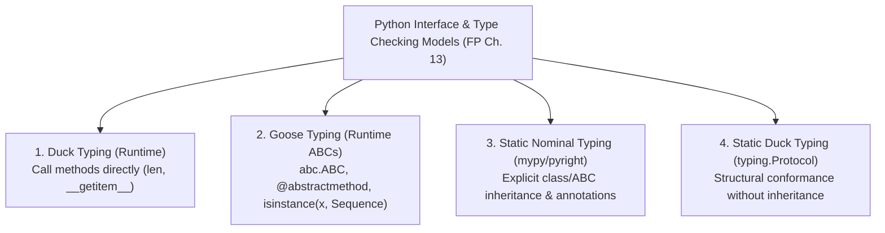

# 3.4 Classes, dataclasses, typing and protocols

| | |
|---|---|
| Level | Intermediate |
| Priority tier | 0 |
| Lab venue | Any machine with Python 3.11+; `pip install mypy pyright pydantic` |
| Part | Part 3: Python for infrastructure |
| Status | Drafted, labs **untested** |

## Why this matters for AI infrastructure

Infrastructure scripts grow into software: a Redfish client with a session and retry policy, a Slurm wrapper with typed job records, a provider interface hiding GCP, AWS and on-prem differences, a configuration model validated from YAML, an exporter holding metric state. Object-oriented design, data classes, and type hints are how that growth stays maintainable: they make state explicit, interfaces enforceable and errors catchable before production. Modern Python also leans on typing at runtime (pydantic models validate API input, FastAPI builds documentation from annotations, dataclasses generate boilerplate), so understanding the machinery matters. This chapter covers classes and the object model, inheritance and composition, data class builders (`namedtuple`, `NamedTuple`, `dataclass`, `attrs`, pydantic), type hints and static checking (`mypy`, `pyright`), protocols and ABCs, generics, operator overloading, and design guidance for infrastructure code.

## Prerequisites and outcomes

You should know functions and the data model (chapters 3.1 and 3.3).

After this chapter you can:

- Write classes with instance and class attributes, methods, `@classmethod`, `@staticmethod`, `@property`, `__slots__`, and explain attribute lookup and bound methods.
- Use inheritance (single and multiple), `super()`, the MRO (C3), mixins, and know when to prefer composition; design abstract interfaces with `abc.ABC` and `typing.Protocol`.
- Build data classes with `namedtuple`/`NamedTuple`, `@dataclass` (fields, defaults, `field(default_factory=...)`, `frozen`, `slots`, `kw_only`, `__post_init__`, ordering), `attrs`, and pydantic; choose among them.
- Add type hints to functions, variables and classes; use `Optional`/`|`, `list[str]`, `dict[str, int]`, `Callable`, `TypedDict`, `Literal`, `Final`, `Annotated`, `TypeVar`, generics, `ParamSpec`, `overload`, `Self`; run mypy/pyright in CI and configure strictness.
- Implement operator overloading and rich comparisons properly (`total_ordering`, NotImplemented).
- Validate configuration and API data with pydantic; manage secrets and settings.
- Apply design principles: composition over inheritance, dependency injection, small interfaces, immutability, explicit errors.

## 1. Classes and objects

### Class definition and instances

```python
class Node:
    """A compute node in the cluster."""
    cluster = "ai-prod"                      # class attribute: shared by all instances
    _count = 0

    def __init__(self, name: str, gpus: int = 8) -> None:
        self.name = name                      # instance attributes live in the instance __dict__
        self.gpus = gpus
        self._state = "unknown"               # leading underscore: "internal" by convention
        Node._count += 1

    def __repr__(self) -> str:
        return f"Node(name={self.name!r}, gpus={self.gpus})"

    def drain(self) -> None:                  # instance method: first parameter is self
        self._state = "draining"

    @property
    def state(self) -> str:                   # read-only computed attribute, accessed as node.state
        return self._state

    @state.setter
    def state(self, value: str) -> None:      # validation on assignment
        if value not in {"ready", "draining", "down", "unknown"}:
            raise ValueError(f"bad state {value!r}")
        self._state = value

    @classmethod
    def from_dict(cls, d: dict) -> "Node":    # alternative constructor; cls supports subclasses
        return cls(d["name"], d.get("gpus", 8))

    @staticmethod
    def valid_name(name: str) -> bool:        # utility namespaced in the class; no self/cls
        return name.isidentifier() or "-" in name
```

Key facts:

- `class` is an **executable statement** creating a class object (an instance of `type`). Calling the class creates an instance: `__new__` allocates, `__init__` initialises.
- `self` is just the conventional name for the instance; methods are functions stored on the class that become **bound methods** when accessed through an instance (`node.drain` is a bound method object carrying `node`).
- **Attribute lookup (`object.attr`) and inheritance search**: every `object.attr` expression triggers a bottom-up search of a tree of linked namespace objects—looking first in the **instance** object (`self`, via `self.__dict__`), then in its **class** (`self.__class__`), and then in all higher **superclasses** in the class tree from bottom to top and left to right (linearised as `self.__class__.__mro__`), returning the first `attr` found (with data descriptors such as `@property` or `__slots__` on the class taking precedence over the instance `__dict__`, and `__getattr__` called as a fallback if nothing is found). Because lower definitions in the tree are found first, subclasses override superclass attributes simply by redefining them. Assignment (`obj.attr = v`), by contrast, does not climb the inheritance tree: it writes directly to the target object's namespace (`obj.__dict__`, or invokes a data descriptor setter). Class attributes are shared; assigning via an instance **shadows** rather than modifying them (`node.cluster = "x"` creates an instance attribute on `node`).
- **Classes are not enclosing (`E`) scopes in LEGB**: while a `class` body executes in its own local namespace dictionary (which becomes the class's attribute dictionary), a `class` statement **never acts as an enclosing (`E`) scope** for `def` methods or nested classes inside it under the `LEGB` rule (lookup is `LEGB`, not `LCEGB`). Unqualified names inside a method skip the enclosing `class` and resolve in enclosing `def` functions, the module global (`G`) scope, or built-ins (`B`). Methods must always qualify class attributes via `self.attr` (inheritance search) or `ClassName.attr`:

```python
# In the book's classscope3.py example (untested here):
X = 1
def nester():
    X = 2                        # enclosing function scope (E)
    class C:
        X = 3                    # class attribute C.X (not in LEGB for methods)
        def method1(self):
            print(X)             # prints 2 (from nester's E scope, NOT 3 in class C)
            print(self.X)        # prints 3 (via inheritance on self -> C.X)
```

- **Mutable class attributes** (a list or dict at class level) are shared by all instances: a common bug source. Create per-instance mutable state in `__init__`.
- **Privacy and pseudoprivate name mangling (`__X`, `_Class__name`, `_Class__x`, `LP` Chapter 31 `pseudoprivate.py`)** is by convention: `_name` signals an internal attribute, whereas a double leading underscore `__X` (`__name`) inside a `class` body is **name-mangled** at compile time to `_ClassName__X` (`_Class__name` / `_Class__x`) so two classes in a hierarchy (`class C1: def meth1(self): self.__X = 88` and `class C2: def metha(self): self.__X = 99` combined in `class C3(C1, C2): pass`) can store their own internal attributes on the same `self.__dict__` (`{'_C1__X': 88, '_C2__X': 99}`) without accidentally overwriting each other. It prevents accidental collisions in deep hierarchies, not deliberate access (`I._C1__X` is still readable, just as Java `private` fields can be read via `setAccessible(True)` reflection). Python trusts programmers; document the public API.
- **Bound vs. unbound method objects (`LP` Chapter 31):** In `class Hack: def doit(self, message): print(message)`, fetching `meth = inst.doit` on an instance returns a **bound method object** that packages both the instance (`meth.__self__ is inst`) and the underlying function (`meth.__func__ is Hack.doit`), so `meth('bonjour')` can be stored in a callback list or passed around like a simple function with `self` already bound. Fetching `Hack.doit` on the class returns the plain function, requiring `Hack.doit(inst, 'privit')`.
- **The Zen of namespaces (`manynames.py` and `docstr.py`, `LP` Chapter 29):** Where you assign a name determines which namespace it lives in: `X = 11` at the top of a module is module-global (`manynames.X`), `X = 22` inside a function `g()` is local to that call, `X = 33` inside `class C:` is a class attribute (`C.X`, inherited by `I.X`), and `self.X = 55` inside `def m(self):` creates an instance attribute in `I.__dict__['X']` (while `I.__class__` links the instance to `C` and `C.__bases__` holds the tuple of direct superclasses). Docstrings (`__doc__` in `docstr.py`) attach at every layer (`module.__doc__`, `func.__doc__`, `Klass.__doc__`, and `Klass.method.__doc__`) and are rendered together by `help(module)`.
- **A Pythonic object (`Vector2d` and `ShortVector2d`, `FP` Chapter 11):** In *Fluent Python*'s `Vector2d(3, 4)` (`Examples 11-1` to `11-19`, modeled in `code/part03/python_classes_typing_protocols.py`), a well-crafted domain object combines:
  1. `__iter__` (`return (i for i in (self.x, self.y))`) so tuple unpacking `x, y = v1` and `tuple(self)` work automatically.
  2. `__repr__` (`"{}({!r}, {!r})".format(type(self).__name__, *self)`) so `eval(repr(v1)) == v1` works and subclasses inherit the right class name without hardcoding `'Vector2d'`.
  3. `__bytes__` (`bytes([ord(self.typecode)]) + bytes(array(self.typecode, self))`) and the `@classmethod` alternative constructor `frombytes(cls, octets)` (`typecode = chr(octets[0]); memv = memoryview(octets[1:]).cast(typecode); return cls(*memv)`).
  4. Custom `__format__(self, fmt_spec='')` extending the Format Specification Mini-Language with a `'p'` suffix for polar coordinates `<r, theta>` (`format(Vector2d(1, 1), '0.5fp') == '<1.41421, 0.78540>'`).
  5. Hashable immutability: turning `x` and `y` into read-only `@property` getters backed by `self.__x` and `self.__y` and implementing `def __hash__(self): return hash((self.x, self.y))`, plus `__match_args__ = ('x', 'y')` for positional `match` patterns (`case Vector2d(0, 0):`) and `__slots__ = ('__x', '__y')` (which shrinks 10 million `Vector2d` instances in `mem_test.py` from 1.62 GiB to 655 MiB). Because `typecode = 'd'` (8-byte IEEE 754 float) is a class attribute read via `self.typecode`, you can customize an individual instance (`v1.typecode = 'f'`) or subclass `class ShortVector2d(Vector2d): typecode = 'f'` (4-byte float) cleanly.
- **`@property`** exposes methods as attributes: start with plain attributes and add properties later without changing callers. Use for validation, derived values, lazy computation (`functools.cached_property`), and read-only fields.
- **`__slots__` and its inheritance rules**: assigning a sequence of attribute name strings to `__slots__` reserves fixed per-instance storage managed by class-level descriptors instead of allocating a per-instance `__dict__` (and `__weakref__`), saving memory when millions of instances exist. However, `__slots__` has strict inheritance rules:
  - **Every class in the hierarchy must define `__slots__`:** if a subclass defines `__slots__` but a superclass does not (or a superclass defines `__slots__` and a subclass does not), the class without `__slots__` still creates an instance `__dict__` on every instance, negating the memory savings (in the book's example, `class C: pass; class D(C): __slots__ = ['a']` still gives `D()` an instance `__dict__`). Subclasses that add no new attributes must still declare `__slots__ = ()`.
  - **Do not repeat slot names in subclasses:** instances inherit the union of all `__slots__` along the MRO; repeating a superclass slot name in a subclass hides the superclass slot descriptor and wastes space.
  - **No class-level defaults of the same name and single non-empty base:** because each slot name is a class-level descriptor on the class, assigning a class attribute with the same name (`class C: __slots__ = ['a']; a = 99`) raises `ValueError: 'a' in __slots__ conflicts with class variable`. In multiple inheritance, at most one base class may have a non-empty `__slots__` (mixing two classes with non-empty `__slots__` raises `TypeError: multiple bases have instance lay-out conflict`; mixins should use `__slots__ = ()`).
  - **Generic attribute inspection:** because slotted instances lack `__dict__` (unless `'__dict__'` is explicitly included in `__slots__`) and `obj.__slots__` shows only the lowest class's list rather than the union across superclasses, generic tools should use `dir(obj)` and `getattr(obj, name)` rather than indexing `obj.__dict__`.
- **`__init__` must not do heavy IO** (network calls, file reads) when avoidable: prefer explicit factory classmethods or lazy connection, so objects are cheap to construct and test.

### Object lifecycle and identity

`__new__` (rarely overridden; used for singletons, immutables), `__init__`, `__del__` (avoid), `__enter__/__exit__` for deterministic cleanup. Equality and hashing by value need explicit methods (or dataclasses). `copy.copy(obj)` and `copy.deepcopy(obj)` customise via `__copy__`/`__deepcopy__`. Pickling (`pickle`, `__getstate__`) is unsafe for untrusted data and brittle across versions: serialise to JSON/YAML/protobuf instead.

### Classes as factories for many objects

Suppose one script tracks a dozen GPU nodes, and each node needs its own name and its own state. A module cannot do this on its own. Python imports one copy of a module, so every name inside it is shared. A class fixes that problem by acting as a factory. You define the shape once, then call it as many times as you need.

Python's class model has two kinds of objects. A class object holds default behavior, and a `class` statement creates it. An instance object is what your program actually works with. You get one by calling the class like a function. Each call makes a new instance, and each instance is its own namespace that can still see the names on its class.

Modules and classes differ in this way. Only one copy of each module lives in a program, and `reload` updates that single shared object. Each instance of a class can hold its own data, so several versions of the same kind of thing can exist at once. Closure factory functions from Learning Python Chapter 17 can keep per-call state too. A class makes that state explicit as attributes, not as hidden scope references.

Here is a small class to see this in action:

```python
class FirstClass:                       # Define a class object
    def setdata(self, value):           # Define the class's methods
        self.data = value               # self is the instance
    def display(self):
        print(self.data)                # self.data: per instance
```

Nothing exists until Python reaches and runs this statement. Usually that happens when the module file is imported. Each `def` inside the class creates a function and stores it as an attribute of the class. Functions defined this way are called methods. The first argument, named `self` by convention, receives the instance that the call is made on.

```
>>> x = FirstClass()     # Make two instances
>>> y = FirstClass()     # Each is a new namespace
```

The parentheses matter. Calling the class creates two instances, so you now have three linked namespaces: the class and its two instances. Both `x` and `y` are `FirstClass` objects, which means each one inherits the names attached to the class.

### Instance attributes and inherited method lookup

The next problem is sharing behavior while keeping data separate. Every instance should have the same `setdata` and `display` methods, but each should remember its own value. Python handles this with a lookup chain. When you ask an instance for a name it does not have, Python follows the link to its class.

```
>>> x.setdata('coding')     # Call methods: self is x
>>> y.setdata(3.14159)      # Runs: FirstClass.setdata(y, 3.14159)
```

Neither `x` nor `y` has a `setdata` attribute of its own. Python checks the instance first, then follows the link to the class. Lookup happens each time you write a dot expression, and it only walks through linked objects. Assignments work differently. Inside `setdata`, `self.data` stores the value in the instance, not in the class.

```
>>> x.display()     # Runs: FirstClass.display(x)
coding
>>> y.display()     # self.data differs in each instance
3.14159
```

The `display` name is the same in both instances because it comes from the class. The `data` value differs because each instance stores its own copy. Instance attributes are not declared ahead of time, and they carry no type. An attribute appears the first time you assign it. If you call `display` before `setdata`, Python raises an undefined name error, since `data` does not exist yet.

Attributes can also change from outside the class. You can set `x.data` directly, and you can even add a brand new attribute to one instance:

```
>>> x.data = 'hacking'     # Can get/set attributes outside the class too
>>> x.display()
hacking
>>> x.anothername = 'apps' # Can set new attributes here too!
```

This freedom has a cost. Adding data that the class cannot use usually does not make sense. Learning Python Chapters 30 and 39 show how attribute-access overloading can add privacy checks. Still, the open style saves syntax, and it suits simple data records well.

### Subclasses customize by inheritance

Sometimes you want a slightly different version of a class without editing the original. Python lets one class inherit from another. You list the superclass in parentheses in the new class header. The new class is the subclass, and it can redefine any name it wants to change.

```python
class SecondClass(FirstClass):          # Inherits setdata
    def display(self):                  # Changes display
        print(f'Current value = "{self.data}"')
```

The subclass defines `display` with a new format. Python searches from the instance up to the subclass, then to the superclass, and it stops at the first match. Because `SecondClass` defines `display` first, its version wins. The book calls this replacing an inherited name overloading.

`SecondClass` still uses the `setdata` method from `FirstClass` without any change:

```
>>> z = SecondClass()
>>> z.setdata('LP6e')     # Finds setdata in FirstClass
>>> z.display()           # Finds overridden method in SecondClass
Current value = "LP6e"
```

The change stays outside `FirstClass`. Older instances keep their old behavior, so `x.display()` still prints the earlier message. This is why subclassing supports reuse so well. You customize a component without touching its source. Python's full inheritance rules include diamond patterns and metaclasses, which Learning Python handles in Chapters 31 and 40. For everyday application code, the instance and class view is enough.

### Classes live inside modules

A class name has no special power. It is a variable that gets assigned when the `class` statement runs. You can reach it with any normal expression. If `FirstClass` lived in a module file, you could import it and use its name in a subclass header:

```python
from modulename import FirstClass       # Copy name into my scope

class SecondClass(FirstClass):          # Use class name directly
    def display(self): ...
```

You can also import the whole module and qualify the name:

```python
import modulename                       # Access the whole module

class SecondClass(modulename.FirstClass):   # Qualify to reference
    def display(self): ...
```

Class names follow the same rules as any other name in a module. A single module file can hold several classes, along with functions and variables. Each of those names becomes a separate attribute of the module. Here is a hypothetical file:

```python
# names.py
var1 = 6                                # names.var1
var2 = 3.12
def func1(): ...                        # names.func1
def func2(): ...
class Cls1: ...                         # names.Cls1
class Cls2: ...                         # names.Cls2
```

Sometimes a module and a class share a name. If `person.py` contains `class person`, you must go through the module to reach the class:

```python
import person                           # Import the module
x = person.person()                     # Class within the module
```

Using `from person import person` also works, and then `x = person()` builds the object. Common Python style fixes the confusion from the start. Modules get lowercase names and classes get names that start with an uppercase letter, so `person.Person()` reads clearly. A module reflects a whole file, while a class is one statement inside a file.

### Operator overloading

Suppose you want your own object to respond to `+` or to `print`. Python lets a class intercept built-in operations. Operations such as addition, slicing, printing, and attribute access route to methods that the class provides. Modules cannot do this for expressions. They can only provide function calls.

The hooks are special methods with names that start and end with double underscores, such as `__add__`. Python defines the fixed mapping from each operation to its method name. Python calls the method automatically when an instance appears in that operation. The return value of the method becomes the result of the expression. A class does not have to define every hook. If `__add__` is missing, a `+` expression raises an exception.

The following class adds three hooks and one normal method:

```python
class ThirdClass(SecondClass):          # Inherit from SecondClass
    def __init__(self, value):          # On "ThirdClass(value)"
        self.data = value
    def __add__(self, other):           # On "self + other"
        return ThirdClass(self.data + other)
    def __str__(self):                  # On "print(self)", "str()"
        return f'[ThirdClass: {self.data}]'
    def mul(self, other):               # In-place change: named
        self.data *= other
```

`__init__` runs when the object is created, and it stores the value automatically. The inherited `display` method still works. For `+`, Python passes the left operand to `self` and the right operand to `other`. The method builds and returns a new `ThirdClass`, so the result keeps the same type:

```
>>> a = ThirdClass(3)     # __init__ called
>>> a.display()           # Inherited method called
Current value = "3"
>>> b = a + 3             # __add__: makes a new instance
>>> b.display()
Current value = "6"
```

For `print`, Python passes the object to `__str__`, and the returned string becomes the printed text. A normal method such as `mul` works differently. It changes the instance in place:

```
>>> print(b)              # __str__: returns display string
[ThirdClass: 6]
>>> a.mul(3)              # mul: changes instance in place
>>> print(a)
[ThirdClass: 9]
```

Some hooks must return a value, such as `__str__`. Others are more flexible. The `__add__` method returns a new object, which matches how built-in numbers and strings behave. Overloaded operators should behave like built-in ones, so a `*` hook that changed its object in place would surprise readers. Learning Python Chapter 30 covers the in-place hooks, such as `__imul__` for `*=`.

Operator overloading is an optional feature. Most application code never needs it. Unless a class must mimic a built-in interface, plain method names are clearer. An expression like `*` may suit a matrix, but a named method usually serves the callers better. Special names are inherited like any other names. The `__init__` method appears in nearly every class, and `__str__` appears often. You can usually learn which attributes an instance will have by reading its `__init__`.

### Classes as records

Programs often need to store facts about an entity, such as a person's name, age, and jobs. A tuple or a dictionary can hold these facts, but a class can hold them with less noise. Here is the dictionary version:

```python
rec = {}
rec['name'] = 'Pat'                     # Dictionary-based record
rec['age'] = 40.5
rec['jobs'] = ['dev', 'mgr']
print(rec['name'])
```

A class can do the same job with attributes instead of keys:

```python
class rec: pass                         # Empty namespace object
rec.name = 'Pat'                        # Class-based record
rec.age = 40.5
rec.jobs = ['dev', 'mgr']
print(rec.name)
```

The class version has less syntax. It uses an empty `class` statement to create a namespace, then fills it in with attributes. This works, but you need a new class for every distinct record. A better habit is to create instances of an empty class, one for each entity:

```python
class rec: pass
pers1 = rec()                           # Instance-based records
pers1.name = 'Bob'
pers1.jobs = ['dev', 'mgr']
pers1.age = 40.5

pers2 = rec()
pers2.name = 'Sue'
pers2.jobs = ['dev', 'cto']
print(pers1.name, pers2.name)           # Bob Sue
```

Each instance starts empty, then collects its own attributes. The two records do not even need the same set of names. Only `pers1` has an `age`. A class with a constructor and methods goes further. It keeps every record consistent and adds processing logic that a dictionary cannot hold:

```python
class Person:
    def __init__(self, name, jobs, age=None):   # class = data + logic
        self.name = name
        self.jobs = jobs
        self.age = age
    def info(self):
        return (self.name, self.jobs)

rec1 = Person('Bob', ['dev', 'mgr'], 40.5)  # Construction calls
rec2 = Person('Sue', ['dev', 'cto'])
print(rec1.jobs, rec2.info())
```

The constructor sets `name`, `jobs`, and `age` on every instance. The `age` value can be left out, and the default `None` fills it in. Named tuples fit a similar role. They behave like classes with extra logic that maps attribute names to tuple positions. A dictionary holds the data, but it has no room for processing logic. A class packages both together.

### Under the hood: namespaces are dictionaries

Classes and instances are linked namespace objects, and Python usually stores each namespace as a dictionary. The `__dict__` attribute shows the namespace of an instance or a class, much as it does for a module. Here is the `rec` example from the previous section:

```
>>> list(key for key in rec.__dict__ if not key.startswith('__'))
['name', 'age']
>>> list(x.__dict__)
['name']
>>> list(y.__dict__)
[]
```

The class holds `name` and `age`. The instance `x` has its own `name`, and the instance `y` is still empty. An attribute can be read with dictionary indexing or with dot notation, but only if the object holds it directly. Dot notation runs the inheritance search. Dictionary indexing checks one object only:

```
>>> x.name, x.__dict__['name']
('Sue', 'Sue')
>>> x.age                  # But attribute fetch checks classes too
40
>>> x.__dict__['age']      # Indexing dict does not do inheritance
KeyError: 'age'
>>> x.__dict__
{'name': 'Sue'}
>>> [attr for attr in dir(x) if attr[:2] != '__']
['age', 'name']
```

The `dir` built-in collects inherited names as well. Two more attributes connect the class tree. Each instance has `__class__`, which points to the class that made it. Each class has `__bases__`, a tuple of its superclasses. A class with no explicit parent points to the implicit `object` root:

```
>>> x.__class__
<class '__main__.rec'>
>>> rec.__bases__
(<class 'object'>,)
```

Because the namespaces are simple objects, a function can become a method later. Define a plain function that takes one object, then assign it to a class attribute:

```
>>> def uppername(obj):
...     return obj.name.upper()     # Still needs a self argument (obj)
>>> rec.method = uppername          # Now it's a class's method!
>>> x.method()
'SUE'
>>> rec.method(x)                  # Can call through instance or class
'SUE'
```

Normally a `class` statement and the methods inside it build these namespaces. The point is that Python simply looks up attributes in linked objects. Some classes define `__slots__` instead of `__dict__`, an advanced feature that Learning Python covers in Chapter 32.

## 2. Inheritance, composition and protocols

### Inheritance and `super()`

```python
class Resource:
    def __init__(self, name):
        self.name = name
    def describe(self): return f"{type(self).__name__}({self.name})"

class GpuNode(Resource):
    def __init__(self, name, gpus):
        super().__init__(name)         # cooperative: delegates to the next class in the MRO
        self.gpus = gpus
    def describe(self):                 # override and extend
        return super().describe() + f" gpus={self.gpus}"
```

- `super()` returns a proxy that delegates to the **next class in the instance's MRO** (`self.__class__.__mro__` past the class containing the `super()` call), not necessarily the direct parent; this is what makes cooperative multiple inheritance work, provided the class hierarchy satisfies three cooperative `super()` call-chain rules:
  1. **Universal deployment:** every class in the MRO that implements the method before the anchor must call `super().method()`. The first class that omits `super()` stops the chain (in the book's example, if `class C(B, A)` calls `super().act()` and `B.act` does not call `super().act()`, `A.act` is never reached).
  2. **Call-chain anchors:** the MRO chain must end at an anchor class that defines the method without calling `super()` again. For `__init__`, the built-in root `object` provides an anchor (`object.__init__(self)`), but for custom methods such as `act(self)`, calling `super().act()` in the last class before `object` raises `AttributeError: 'super' object has no attribute 'act'` unless a common base/anchor class (such as `class X: def act(self): ...`) precedes `object` on the MRO.
  3. **Compatible argument signatures:** because a class's next neighbor on `self.__class__.__mro__` depends on the subclass's inheritance graph, all cooperative implementations of a method across the tree must accept compatible signatures (or consume their own keyword arguments and forward `**kwargs`), and `object.__init__()` at the end of an `__init__` chain accepts no extra arguments beyond `self` (`TypeError: object.__init__() takes exactly one argument`).
- **Method Resolution Order**: Python linearises the class hierarchy using the **C3 algorithm**: children before parents, parents in the declared order, and each class appears once; `Class.__mro__` or `Class.mro()` shows it. In diamond inheritance, the shared base is reached once, after all its subclasses.

```python
class A: 
    def f(self): return "A"
class B(A): 
    def f(self): return "B>" + super().f()
class C(A): 
    def f(self): return "C>" + super().f()
class D(B, C): 
    def f(self): return "D>" + super().f()
D().f()        # 'D>B>C>A'
D.__mro__      # (D, B, C, A, object)
```

- **Mixins and class interface techniques (`LP` Chapters 28, 29, 31 & `FP` Chapter 14)**:
  - In `LP` Chapter 29 (`Example 29-1 specialize.py`), Lutz classifies four ways a subclass can interface with a superclass `Super`: (1) `Inheritor(Super)` inherits methods verbatim (`pass`), (2) `Replacer(Super)` overrides `method(self)` completely, (3) `Extender(Super)` overrides `method(self)` and calls back to `Super.method(self)` (as `Manager.giveRaise(self, percent, bonus=.10)` calls `Person.giveRaise(self, percent + bonus)` in `LP` Chapter 28's `person_14.py`—which can then be persisted by key in a `shelve.open('persondb')` DBM database via `makedb.py` and `updatedb.py`), and (4) `Provider(Super)` implements the abstract `action(self)` hook expected by `Super.delegate(self)` (the Template Method pattern).
  - **Mixins (`...Mixin`, `AttrDisplay`, `ListInstance`, `ListInherited`, `ListTree`, `UpperCaseMixin`, `ThreadingMixIn`):** Small classes (conventionally named `...Mixin`) adding a single orthogonal capability via multiple inheritance. In `LP` Chapters 28–31, `AttrDisplay` (`classtools.py`), `ListInstance` (inspecting `self.__dict__`), `ListInherited` (inspecting `dir(self)`), and `ListTree` (climbing `self.__class__` and `__bases__` like `classtree.py`) mix a generic `__repr__`/`__str__` display into any application class (`class Person(AttrDisplay):`). In `FP` Chapter 14 (`Example 14-8`), `UpperCaseMixin` uppercases string keys via `super().__setitem__(_upper(key), item)` and must be listed **first** (`class UpperDict(UpperCaseMixin, collections.UserDict): pass`) so its methods intercept calls before `UserDict` on the MRO (and note that subclassing built-in C types like `dict` or `list` directly in `DoppelDict` / `AnswerDict` is hazardous because C methods ignore Python overrides—always subclass `collections.UserDict`, `UserList`, or `UserString`).
- **Composition and delegation (`Department`, `PizzaShop`, `streams.py`, `Set` wrapper, `LP` Chapters 28, 31, 32)**:
  - While inheritance models `"is-a"` relationships (`PizzaRobot(Chef)` -> `Chef(Employee)` -> `Employee` in `employees.py`), **composition** models `"has-a"` relationships where a composite controller directs embedded components: `Department` (`Example 28-12`) aggregates `Person` and `Manager` objects to give group raises, `PizzaShop` (`Example 31-2 pizzashop.py`) embeds `Server('Pat')`, `PizzaRobot('Bob')`, and `Oven()` to process `scene.order('Sue')`, and `Processor(reader, writer)` (`Example 31-3 streams.py` and `Uppercase(Processor)` in `converters.py`) reads from any file/socket stream, transforms via `converter(data)`, and writes to any output stream.
  - **Delegation (`__getattr__` proxy):** Wraps an embedded object (such as `Manager` embedding `self.person = Person(name, 'mgr', pay)` or `Set` wrapping a list in `setwrapper.py`) and forwards attribute fetches via `def __getattr__(self, attr): return getattr(self.person, attr)` (noting that in Python 3, special dunder operators like `__str__` or `__add__` look up on the class directly and bypass instance `__getattr__`).
- **`isinstance(x, Base)`** and **`issubclass`** respect inheritance; `type(x) is T` checks exact types (rarely wanted).
- **Liskov substitution principle**: subclasses must honour the base class contract (accept at least what the base accepts, return no less than promised, not raise new surprising exceptions).

### Composition over inheritance

"Has-a" beats "is-a" for most infrastructure code: inheritance couples subclasses to parent implementation and creates deep, fragile hierarchies. Prefer holding collaborators as attributes and delegating:

```python
class RedfishClient:
    def __init__(self, session, retry_policy, logger):      # dependencies injected
        self._session, self._retry, self._log = session, retry_policy, logger
    def get_power(self, host): return self._retry(lambda: self._session.get(f"https://{host}/redfish/v1/Chassis/1/Power"))
```

Benefits: dependencies are explicit and swappable (pass a fake session in tests), classes stay small, behaviours combine freely. **Dependency injection** is simply passing collaborators in rather than constructing them inside (no framework needed).

### Abstract base classes

```python
from abc import ABC, abstractmethod

class Provider(ABC):
    """Contract for cloud/on-prem providers."""
    @abstractmethod
    def create_vm(self, name: str, cpus: int) -> str: ...
    @abstractmethod
    def delete_vm(self, vm_id: str) -> None: ...
    def ensure_vm(self, name: str, cpus: int) -> str:       # concrete template method built on abstract ones
        return self.find(name) or self.create_vm(name, cpus)
    @abstractmethod
    def find(self, name: str) -> str | None: ...

class Gcp(Provider): ...         # must implement all abstract methods or instantiation raises TypeError
```

ABCs enforce that subclasses implement required methods at instantiation time, and provide **virtual subclassing** (`Provider.register(Third)`); `collections.abc` supplies container ABCs (`Iterable`, `Sequence`, `Mapping`, `Callable`) for `isinstance` checks (what Alex Martelli calls **goose typing** in *Fluent Python* Chapter 13). In `FP` Chapter 13 (`Examples 13-7` to `13-14`), Ramalho's `Tombola(ABC)` defines two `@abstractmethod`s—`.load(iterable)` and `.pick()` (raising `LookupError`, the parent of `IndexError` and `KeyError`, when empty)—and two concrete methods built on them (`.loaded()` and `.inspect()`), implemented by `BingoCage(Tombola)`, `LottoBlower(Tombola)`, and virtual subclass `@Tombola.register class TomboList(list):` (verified in `TomboList.__mro__` vs `Tombola._abc_registry`). And for structural ABCs like `collections.abc.Sized` whose `__subclasshook__` checks whether `"__len__"` is in the class's `__mro__` dictionaries, any class implementing `def __len__(self): return 23` (`class Struggle:`) satisfies `isinstance(Struggle(), abc.Sized)` and `issubclass(Struggle, abc.Sized)` automatically without inheritance or `.register()` (`FP` Chapter 13 also contrasts duck typing, goose typing, static nominal typing, and **static duck typing** via `typing.Protocol`, as well as runtime **monkey patching** such as `FrenchDeck.__setitem__ = set_card` to enable `random.shuffle(deck)`). Use an ABC when you want shared concrete behaviour plus enforced abstract methods and runtime checks.



### Protocols (structural typing)

A `typing.Protocol` describes an interface by the methods an object has, with no inheritance required: "if it quacks like a duck." Static checkers verify conformance; `@runtime_checkable` allows `isinstance` checks (method presence only).

```python
from typing import Protocol, runtime_checkable

@runtime_checkable
class SupportsClose(Protocol):
    def close(self) -> None: ...

class Sink(Protocol):
    def write(self, data: bytes) -> int: ...

def flush_to(sink: Sink, data: bytes) -> int:        # accepts files, sockets, BytesIO, your own classes
    return sink.write(data)
```

Choose: **Protocol** for interfaces at boundaries where implementers are third-party or unrelated (loose coupling, test fakes); **ABC** when you control the hierarchy and want runtime enforcement and shared code.

## 3. Data class builders

Plain classes need boilerplate (`__init__`, `__repr__`, `__eq__`). Data class builders generate it.

| Builder | Mutable? | Typing | Validation | Notes |
|---|---|---|---|---|
| `collections.namedtuple("P", "x y")` | No (tuple) | Untyped | None | Lightweight, tuple behaviour (unpack, index, hashable) |
| `typing.NamedTuple` | No | Typed fields | None | Class syntax, defaults, methods |
| `@dataclasses.dataclass` | Yes (or `frozen=True`) | Typed annotations (not enforced) | Via `__post_init__` | Standard library; most common |
| `attrs` (`@define`) | Yes/frozen | Optional | Validators/converters | Third party; predates dataclasses; richer |
| `pydantic.BaseModel` | Yes/frozen | Enforced at runtime (coercion/validation) | Strong, with errors | Parsing external data, settings, FastAPI |
| `TypedDict` | A dict | Static only | None | Typing JSON-like dicts; no runtime class |

```python
from dataclasses import dataclass, field, asdict, replace
from typing import ClassVar

@dataclass(order=True, frozen=True, slots=True, kw_only=True)
class GpuNode:
    name: str
    rack: str
    gpus: int = 8
    tags: tuple[str, ...] = ()
    MAX_GPUS: ClassVar[int] = 16                        # class variable, not a field

    def __post_init__(self):                              # validation hook
        if not 0 < self.gpus <= self.MAX_GPUS:
            raise ValueError(f"gpus out of range: {self.gpus}")

@dataclass
class Cluster:
    name: str
    nodes: list[GpuNode] = field(default_factory=list)   # NEVER default=[]: dataclasses reject mutable defaults
    meta: dict[str, str] = field(default_factory=dict)

n = GpuNode(name="gpu01", rack="r1")
n2 = replace(n, gpus=4)                  # frozen: create modified copies
asdict(n)                                # to dict (recursive), for JSON
sorted([n2, n])                          # order=True generates comparisons from field order
```

Options: `frozen=True` (immutable, hashable with `eq`), `order=True`, `slots=True` (3.10+), `kw_only=True`, `eq=True`, `unsafe_hash`, `repr=False`; field options `field(default_factory, repr=False, compare=False, init=False, metadata={...})`; `InitVar` for init-only parameters; `dataclasses.fields(obj)` for introspection. Inheritance works, but field ordering rules (non-default after default) can bite; `kw_only` helps.

In *Fluent Python* Chapter 5 (`Examples 5-4` to `5-21`), Ramalho highlights several essential details across the three standard data class builders:
- **`collections.namedtuple` (`City = namedtuple('City', 'name country population coordinates')`):** Instances use the exact same memory as a plain `tuple` because field names live on the class (`City._fields`), while `_make(iterable)` constructs an instance from a sequence, `_asdict()` returns a `dict` for JSON serialization, and `defaults=(...)` sets rightmost default values.
- **How type annotations behave in plain classes vs `typing.NamedTuple` vs `@dataclass` (`DemoPlainClass`, `DemoNTClass`, `DemoDataClass`):** In a plain class `class DemoPlainClass: a: int; b: float = 1.1; c = 'spam'`, `a` exists **only** in `DemoPlainClass.__annotations__` (`DemoPlainClass.a` raises `AttributeError`). In `class DemoNTClass(typing.NamedTuple): a: int; b: float = 1.1; c = 'spam'`, `a` and `b` become read-only tuple descriptor fields (`nt.a`, `nt.b`). In `@dataclass class DemoDataClass: a: int; b: float = 1.1; c = 'spam'`, `a` and `b` become mutable instance attributes initialized by the generated `__init__(self, a: int, b: float = 1.1) -> None` (and notice that unannotated `c = 'spam'` remains a plain class attribute).
- **`ClassVar` and `__post_init__` in `ClubMember` and `HackerClubMember` (`Example 5-16`):** When `HackerClubMember(ClubMember)` tracks a class-wide set of handles `all_handles: ClassVar[set[str]] = set()`, annotating it with `typing.ClassVar` tells `@dataclass` **not** to turn `all_handles` into an instance field (while satisfying `mypy`), and `__post_init__(self)` populates `self.handle = self.name.split()[0]` if empty, checks `if self.handle in cls.all_handles: raise ValueError(...)`, and registers `cls.all_handles.add(self.handle)`. Similarly, Dublin Core `Resource` (`Example 5-19`) uses `ResourceType(Enum)` and a custom multi-line `__repr__` iterating `for f in fields(cls):`. All three builders automatically generate `__match_args__` so positional structural pattern matching (`case City(continent='Asia', name=_, country=cc):`) works out of the box (unlike the 9 blessed built-in types `bytes`, `dict`, `float`, `frozenset`, `int`, `list`, `set`, `str`, `tuple` that match a single positional argument directly). Also keep Martin Fowler's refactoring advice in mind: a **Data Class** with zero behavior can be a code smell if logic that belongs on the class is scattered across callers.

**Pitfalls:** annotations are not enforced (`GpuNode(name=5)` succeeds); validate in `__post_init__` or use pydantic at boundaries. `frozen` dataclasses are shallowly immutable (a list inside can still be mutated; use tuples/frozenset). Dataclass equality compares all fields (use `compare=False` for volatile ones).

### Pydantic

Pydantic models validate and coerce input at runtime and are the standard for parsing external data (YAML/JSON configs, API requests, environment variables).

```python
from pydantic import BaseModel, Field, field_validator, ValidationError, SecretStr
from pydantic_settings import BaseSettings, SettingsConfigDict
from ipaddress import IPv4Address
from typing import Literal

class NodeSpec(BaseModel):
    model_config = {"extra": "forbid", "frozen": True}     # reject unknown keys: catches typos in config files
    name: str = Field(pattern=r"^[a-z0-9-]+$", max_length=63)
    ip: IPv4Address
    gpus: int = Field(8, ge=1, le=16)
    role: Literal["compute", "login", "storage"] = "compute"

    @field_validator("name")
    @classmethod
    def no_reserved(cls, v):
        if v in {"localhost", "admin"}: raise ValueError("reserved name")
        return v

try:
    spec = NodeSpec.model_validate({"name": "gpu01", "ip": "10.0.0.5", "gpus": "8"})     # "8" coerced to int 8
except ValidationError as e:
    print(e.errors())                    # structured list of errors with locations

spec.model_dump(), spec.model_dump_json(), NodeSpec.model_json_schema()

class Settings(BaseSettings):
    model_config = SettingsConfigDict(env_prefix="MYOPS_", env_file=".env")
    api_url: str
    api_token: SecretStr                 # repr shows '**********'; use .get_secret_value() deliberately
    timeout: float = 10.0
```

Notes: pydantic v2 (Rust core) is fast; v1 has a different API; models can be nested, generic, discriminated unions (`Field(discriminator="type")`), computed fields; FastAPI uses them for request/response schemas (chapter 3.7). Validate **at the boundary** (config load, API ingress), then pass trusted, typed objects internally (parse, don't validate repeatedly).

## 4. Type hints and static checking

Type hints (PEP 484 and successors) annotate intent. **CPython ignores them at runtime** (stored in `__annotations__`); tools enforce them: `mypy`, `pyright`/Pylance, `pyre`, `pytype`, and IDEs. Libraries like pydantic and FastAPI read them at runtime.

```python
from collections.abc import Iterable, Iterator, Mapping, Sequence, Callable
from typing import Any, Final, Literal, TypedDict, TypeVar, Generic, overload, Self, TypeAlias, NewType, Annotated

def parse_size(s: str) -> int: ...
def first_up(nodes: Iterable[Node]) -> Node | None: ...                  # 3.10+ union syntax (Optional[Node] before)
def group(nodes: Sequence[Node]) -> dict[str, list[Node]]: ...           # builtin generics (3.9+): list[int], dict[str, int], tuple[int, ...]
def retry(fn: Callable[[], T], attempts: int = 3) -> T: ...
Port = NewType("Port", int)                                               # distinct type for the checker
MAX_RETRIES: Final = 5                                                    # constant
Mode = Literal["dry-run", "apply"]
class Event(TypedDict, total=False):                                      # shape of a dict
    type: str
    node: str
JsonScalar: TypeAlias = str | int | float | bool | None
```

Essentials:

- **Parameters accept general types, return specific types (`FP` Chapter 8)**: follow Postel's Law—take `Iterable`/`Sequence`/`Mapping` (`def name2hex(name: str, color_map: Mapping[str, int]) -> str:`, which accepts `dict`, `defaultdict`, `ChainMap`, or `UserDict`), and return concrete `list`/`dict` (`def columnize(sequence: Sequence[str], num_columns: int = 0) -> list[tuple[str, ...]]:`). Don't annotate a read-only parameter with `dict` or `list` when `Mapping` or `Sequence`/`Iterable` will do.
- **Gradual typing, `show_count`, and duck vs nominal typing (`Birds`, `FP` Chapter 8 `Examples 8-1` to `8-6`):** PEP 484 introduces a **gradual type system**: unannotated functions are ignored by default, types are optional at runtime, and static checkers (`mypy`) catch bugs before tests run (such as `show_count(count: int, singular: str, plural: Optional[str] = None) -> str` catching `show_count(2, 'child', 'children')` when `plural` was missing, or `alert_bird(birdie: Bird)` flagging `birdie.quack()` because `quack` is defined on `Duck(Bird)`, not `Bird`). Distinguish fixed-length record tuples (`tuple[str, float, str]`) from variable-length homogeneous tuples (`tuple[int, ...]`).
- **`Optional[X]` is `X | None`**: the checker forces you to handle `None`. Narrowing: `if x is not None:`; `isinstance`; `assert x`; early returns.
- **`Any` vs `object`**: `Any` is simultaneously a subtype-of and supertype-of every type, which **disables type checking** (and is contagious when returned by functions like `json.loads()` unless constrained with a variable annotation `whatever: BookDict = json.loads(data)` and checked with `--disallow-any-expr` or validated at runtime with Pydantic); **`object`**, by contrast, accepts any value but only permits operations supported by all objects (`==`, `isinstance`) until narrowed. Use `typing.cast(Type, val)` or `# type: ignore[code]` sparingly.
- **Generics, bounded `TypeVar`, and `@overload` (`FP` Chapters 8 & 15)**: `TypeVar("T")` for functions preserving types (`def sample(population: Sequence[T], size: int) -> list[T]:`); bounded `LT = TypeVar("LT", bound=SupportsLessThan)` for `def top(series: Iterable[LT], length: int) -> list[LT]:` (`Example 8-18`) where `class SupportsLessThan(Protocol): def __lt__(self, other: Any) -> bool: ...`; restricted `NumberT = TypeVar("NumberT", float, Decimal, Fraction)` for `mode()`; generic classes `class LottoBlower(Tombola, Generic[T]):` (`Example 15-15`, instantiated as `LottoBlower[int](range(1, 11))`) or Python 3.12 syntax `class Stack[T]:`; `ParamSpec`/`Concatenate` for decorators preserving signatures (chapter 3.11); `Self` for fluent methods/classmethods returning the same class.
- **`@overload` (`FP` Chapter 15 `Examples 15-1` to `15-4`)**: expresses signatures where the return type depends on argument types or defaults (such as `sum`, `max` with or without `key=` and `default=`, or `mymax`), followed by a single unannotated implementation function.
- **Callable** types and variance: `Callable[[int, str], bool]` is **contravariant in argument types** and **covariant in return type** (`Callable[[float], None]` is a subtype of `Callable[[int], None]` because a callback that can handle any `float` can safely handle an `int`, whereas `Callable[[int], None]` is not a subtype of `Callable[[float], None]`). For keyword or variadic callables, define a `Protocol` with `def __call__(self, ...):`.
- **Variance (`Invariant`, `Covariant`, `Contravariant`, `FP` Chapter 15 `Examples 15-18` to `15-20`)**:
  - **Invariant (default, `T = TypeVar('T')`):** `list[Dog]` is **not** a subtype of `list[Animal]` (and `BeverageDispenser[OrangeJuice]` is rejected where `BeverageDispenser[Juice]` is expected if `T` is invariant) because a caller could append a `Cat` into a mutable `list[Animal]`.
  - **Covariant (`T_co = TypeVar('T_co', covariant=True)`):** Read-only containers/producers like `Sequence[T_co]`, `Iterator[T_co]`, and `BeverageDispenser[T_co]` vary in the **same direction** as `T` (`BeverageDispenser[OrangeJuice]` **is** a subtype of `BeverageDispenser[Juice]`).
  - **Contravariant (`T_contra = TypeVar('T_contra', contravariant=True)`):** Write-only sinks/consumers like `TrashCan[T_contra]` vary in the **opposite direction** (`TrashCan[Refuse]` **is** a subtype of `TrashCan[Biodegradable]` because a general refuse can safely accepts biodegradable trash).
- **`TypedDict` (`BookDict`, `FP` Chapter 15 `Examples 15-5` to `15-11`)**: `class BookDict(TypedDict): isbn: str; title: str; authors: list[str]; pagecount: int` provides static type checking for dictionary keys and value types, but performs **zero runtime validation** (`from_json` returning arbitrary JSON will pass at runtime unless validated by Pydantic).
- **`TYPE_CHECKING` and `typing.get_type_hints()`**: `if TYPE_CHECKING:` blocks hold imports used only in annotations (`reveal_type(x)` prints Mypy's inferred type during checking); with `from __future__ import annotations` (PEP 563 / PEP 649), annotations are stored lazily, and runtime tools inspect them with `typing.get_type_hints(func)` or `inspect.signature(func)`.
- **`Annotated[int, Field(ge=0)]`** attaches metadata used by pydantic/FastAPI.
- **`typing.Protocol`, `TypedDict`, `NamedTuple`, `dataclass_transform`** support framework authors.
- **Gradual typing**: annotate public APIs first; enable strictness progressively (`mypy --strict`, per-module overrides, `pyright` basic vs strict); keep the type-check job in CI (chapter 3.9) and treat new errors as build failures.

```toml
# pyproject.toml
[tool.mypy]
python_version = "3.12"
strict = true
warn_unused_ignores = true
[[tool.mypy.overrides]]
module = ["redfish.*", "paramiko.*"]
ignore_missing_imports = true
```

```bash
mypy src/ ; pyright ; python -m mypy --install-types ; stubgen -p thirdparty   # stubs for untyped libraries (types-requests, types-PyYAML packages)
```

Typing for infrastructure code is high value at **boundaries** (API clients, config models, plugin interfaces) and in code with many `None`/Optional cases; it catches wrong argument order, missing awaits, and forgotten error paths.

## 5. Operator overloading and comparison

Overload operators only when the meaning is natural (vectors, sizes, versions, durations), return new objects (value semantics), return `NotImplemented` for unknown operand types, and keep `__eq__`/`__hash__`/ordering consistent.

```python
from functools import total_ordering

@total_ordering                      # supply __eq__ and one of <, <=, >, >=; others are generated
class Version:
    def __init__(self, s: str): self.parts = tuple(int(p) for p in s.split("."))
    def __eq__(self, o): return NotImplemented if not isinstance(o, Version) else self.parts == o.parts
    def __lt__(self, o): return NotImplemented if not isinstance(o, Version) else self.parts < o.parts
    def __hash__(self): return hash(self.parts)
    def __repr__(self): return f"Version({'.'.join(map(str, self.parts))!r})"

class Bytes(int):                    # subclass a builtin for a domain type
    def __str__(self):
        n, units = float(self), ["B", "KiB", "MiB", "GiB", "TiB"]
        for u in units:
            if n < 1024 or u == units[-1]: return f"{n:.1f} {u}"
            n /= 1024
```

For real version handling use `packaging.version.Version`; for IP addresses `ipaddress`; for durations `datetime.timedelta`.

### Sequence special methods (`Vector` Takes #1–#5, `FP` Chapter 12) and operator overloading (`FP` Chapter 16 & `LP` Chapter 30)

In *Fluent Python* Chapters 12 and 16 (and *Learning Python* Chapter 30, modeled in `code/part03/python_classes_typing_protocols.py`), an N-dimensional `Vector` class backed by `array('d', components)` demonstrates production-grade sequence and operator overloading:
1. **Abbreviated `__repr__` with `reprlib.repr` (`Vector` Take #1):** For large vectors (`Vector(range(1000))`), `reprlib.repr(self._components)` truncates the output to 30 characters (`Vector([0.0, 1.0, 2.0, 3.0, 4.0, ...])`) so logs and interactive sessions never dump megabytes of text.
2. **Slice-aware `__getitem__` and `operator.index` (`Vector` Take #2, and `LP` Chapter 30 `StepperIndex` / `SkipObject`):** A sequence's `__getitem__(self, key)` checks `if isinstance(key, slice): return type(self)(self._components[key])` so slicing a `Vector` returns a new `Vector` (not a raw `array`), and otherwise calls **`operator.index(key)`** (which invokes `key.__index__()` to accept integers and integer-like types while raising `TypeError` on floats or tuples; note `slice.indices(length)` normalizes start/stop/step bounds). In `LP` Chapter 30, Lutz also contrasts `__getitem__` fallback iteration (`StepperIndex`) with single-scan (`Squares` with `__iter__` returning `self`) vs. **multi-scan** iterables (`SkipObject('abcdef')` in `skipper.py` / `skipper_yield.py`, whose `__iter__` returns a new iterator/generator on each call so nested loops `[x + y for x in skipper for y in skipper]` produce all `9` pairs `'aa'`..`'ee'`).
3. **Dynamic read-only attributes `x, y, z, t` (`__getattr__` and `__setattr__`, `Vector` Take #3):** Defining `__match_args__ = ('x', 'y', 'z', 't')` and `def __getattr__(self, name):` lets callers read `v.x, v.y, v.z, v.t` dynamically from `self._components[0..3]`. However, if a caller accidentally assigns `v.x = 10` without `__setattr__` protection, Python would create an instance attribute `v.__dict__['x'] = 10` that shadows `__getattr__` while leaving `v[0]` unchanged. Overriding `__setattr__` to raise `AttributeError` on any single-letter lowercase attribute (`'a'` to `'z'`) prevents inconsistent shadowing (in `LP` Chapter 30 `accesscontrol.py` / `private0.py`, `__setattr__` delegates allowed writes via `self.__dict__[attr] = val` or `super().__setattr__(attr, val)` to avoid infinite recursion).
4. **Hashing via `functools.reduce` and `operator.xor` (`Vector` Take #4):** Combining component hashes with `hashes = (hash(x) for x in self); return functools.reduce(operator.xor, hashes, 0)` (with initializer `0` for empty vectors) and streaming equality `len(self) == len(other) and all(a == b for a, b in zip(self, other))` works in $O(1)$ extra memory for vectors of any dimension (and formatting in hyperspherical coordinates `'h'` in Take #5).
5. **Unary (`__neg__`, `__pos__`), infix `+` (`__add__` / `__radd__`), scalar `*` (`__mul__` / `__rmul__`), matrix/dot product `@` (`__matmul__` / `__rmatmul__`), membership (`__contains__`), and in-place `+=` (`__iadd__`) (`FP` Chapter 16 & `LP` Chapter 30 `Commuter1..5`):**
   - **Dispatch flow (`a + b`):** Python calls `type(a).__add__(a, b)`. If `a` does not implement `__add__` or returns **`NotImplemented`** (and `type(a) is not type(b)`), Python calls the reflected **`type(b).__radd__(b, a)`**; if that also returns `NotImplemented`, Python raises `TypeError` (or for `==` / `!=`, falls back to comparing object `id()`s).
   - In `Vector.__add__`, wrapping `pairs = itertools.zip_longest(self, other, fillvalue=0.0); return Vector(a + b for a, b in pairs)` inside `try ... except TypeError: return NotImplemented` and aliasing `__radd__ = __add__` allows `Vector([3, 4, 5]) + (10, 20)` and `(10, 20) + Vector([3, 4, 5])` (`Vector([13.0, 24.0, 5.0])`) while cleanly rejecting `Vector([3, 4, 5]) + 1`. In `LP` Chapter 30's `Commuter5(88) + Commuter5(99)` (`commuter.py`), testing `if isinstance(other, Commuter5): other = other.val` inside `__add__` avoids nested `Commuter5(Commuter5(187))` wrapping when two instances are added together.
   - In `Vector.__matmul__` (`@`, PEP 465), checking `isinstance(other, abc.Sized) and isinstance(other, abc.Iterable)` computes the dot product `sum(a * b for a, b in zip(self, other))` (`Vector([1, 2, 3]) @ Vector([4, 5, 6]) == 32.0`).
   - **In-place operators (`__iadd__` in `AddableBingoCage`):** If a class does not implement `__iadd__`, `v1 += v2` falls back to `v1 = v1 + v2` (allocating a new instance and changing `id(v1)`). On a mutable class (`AddableBingoCage`), implementing `def __iadd__(self, other): ... return self` mutates the receiver in place and **must return `self`**. (Also note two unary operator subtleties from `FP` Chapter 16: `Decimal('1') / Decimal('3')` under a changed precision `ctx.prec = 28` can make `one_third != +one_third`, and `ct = Counter('abracadabra'); ct['r'] = -3; +ct` filters out zero and negative counts.)

## 6. Design guidance for infrastructure code

1. **Use functions until state or polymorphism appears.** A module of functions is often the best design. Use a class when you have state that travels together (a session and its credentials), an interface with multiple implementations, or a lifecycle (open/close).
2. **Separate IO from logic.** Pure functions that transform data (parse, decide, format) are easy to test; thin IO shells call them. This is the "functional core, imperative shell" pattern and makes tools testable without clusters (chapter 3.9).
3. **Make illegal states unrepresentable**: use enums/Literals for states, frozen dataclasses for values, validation at construction.
4. **Small, explicit interfaces**: depend on a Protocol with two methods rather than a concrete client with fifty; inject it.
5. **Immutability by default** for configuration and value objects.
6. **Errors as part of the API**: define a small exception hierarchy (`class MyOpsError(Exception)`; `class NodeNotFound(MyOpsError)`), raise specific errors, document them; don't return `None`/magic values to signal failure when an exception is clearer (chapter 3.5).
7. **Avoid deep inheritance**; keep to one or two levels; prefer composition and mixins sparingly.
8. **Enums** for fixed choices: `class State(enum.StrEnum): READY = "ready"; DOWN = "down"` (3.11 `StrEnum`), `enum.auto()`, `Flag` for bit flags; they serialise cleanly and prevent typos.
9. **Logging and repr**: give every domain object a useful `__repr__`; log with `%r`.
10. **Avoid global mutable singletons**; pass objects explicitly or use a clearly scoped context (a `Settings` instance).
11. **Document behaviour with docstrings and types**, and keep public APIs stable (deprecate with `warnings.warn(..., DeprecationWarning)`).
12. **SOLID in practice**: single responsibility (a class changes for one reason), open/closed via registries/plugins, Liskov via contracts, interface segregation via Protocols, dependency inversion via injection.

### Example: a typed provider layer

```python
from dataclasses import dataclass
from enum import StrEnum
from typing import Protocol

class State(StrEnum):
    PENDING = "pending"; RUNNING = "running"; STOPPED = "stopped"

@dataclass(frozen=True, slots=True)
class Instance:
    id: str
    name: str
    state: State
    ip: str | None = None

class Compute(Protocol):
    def list_instances(self, project: str) -> list[Instance]: ...
    def start(self, project: str, instance_id: str) -> None: ...

def ensure_running(c: Compute, project: str, names: set[str]) -> list[str]:
    started = []
    for inst in c.list_instances(project):
        if inst.name in names and inst.state is not State.RUNNING:
            c.start(project, inst.id)
            started.append(inst.name)
    return started

class FakeCompute:                                      # test double satisfying the Protocol, no inheritance
    def __init__(self, instances): self.instances, self.started = instances, []
    def list_instances(self, project): return self.instances
    def start(self, project, instance_id): self.started.append(instance_id)

def test_ensure_running():
    fake = FakeCompute([Instance("1", "a", State.STOPPED), Instance("2", "b", State.RUNNING)])
    assert ensure_running(fake, "p", {"a", "b"}) == ["a"] and fake.started == ["1"]
```

## 7. Lab

First, run the self-checking Python lab (`code/part03/python_classes_typing_protocols_lab.py`) locally. It verifies `ThirdClass`, `Person`, `Manager`, and `AttrDisplay` (`LP` Ch. 27–28), `specialize.py` (`Inheritor`/`Replacer`/`Extender`/`Provider`), `SkipObject` multi-scan iteration, `Commuter5` commutative addition, and `_C1__X`/`_C2__X` name mangling (`LP` Ch. 29–31), `Vector2d` (`__bytes__`, `frombytes`, polar `'0.5fp'`, `__slots__`, `FP` Ch. 11), N-dimensional `Vector` (`__getitem__` slicing, dynamic `x, y, z, t`, `zip_longest` `+`, scalar `*`, `@` dot product, `FP` Ch. 12 & 16), `HackerClubMember` (`ClassVar` and `__post_init__`, `FP` Ch. 5), and `LottoBlower[int]`, `SupportsLessThan` `top()`, and `UpperDict` (`FP` Ch. 8, 13, 14, 15).

```bash
python3 code/part03/python_classes_typing_protocols_lab.py
```

Next, on any machine with Python 3.11+ (all interactive shell steps below are `untested here`), work through these exercises:

1. **Class basics**: build `Node` with properties, class/static methods and `__slots__`; show instance vs class attribute shadowing; reproduce the shared mutable class attribute bug and fix it; view bound methods, `__dict__`, `vars()`, `dir()`.
2. **Inheritance and MRO**: implement the diamond (A, B, C, D) with cooperative `super()`; print `__mro__`; break it by omitting a `super()` call and explain; build a mixin (`TaggableMixin`) and a composition-based alternative; compare.
3. **ABC vs Protocol**: define `Provider` as an ABC (instantiation error for missing methods) and `Compute` as a Protocol; implement a fake satisfying the Protocol without inheritance; run mypy to see conformance errors; use `@runtime_checkable`.
4. **Data classes**: model the cluster with `namedtuple`, `NamedTuple`, `dataclass` (frozen, slots, order), and `pydantic`; compare memory (`sys.getsizeof`/`tracemalloc`), speed of creation (`timeit`), and behaviour with bad input; show the mutable default error; use `replace` and `asdict`.
5. **Pydantic**: load a YAML cluster definition into nested models with `extra="forbid"`; produce clear error messages for typos and wrong types; generate a JSON schema; use `BaseSettings` with environment variables and `SecretStr`.
6. **Typing**: annotate a small module (API client, parser, scheduler); run `mypy --strict` and fix errors; introduce `Optional` bugs and see them caught; write generic `first[T]` and a `Protocol` with `__call__`; use `TypedDict` for a JSON payload; add `py.typed` marker to a package.
7. **Operator overloading**: implement `Version` with `total_ordering`, a `Size` class (add, compare, format) and `Money` using `Decimal`; test mixed-type behaviour and `NotImplemented`.
8. **Refactor**: take a script with global state and dict-shaped data; refactor into a functional core (pure functions on dataclasses) and an IO shell; write tests with fakes.
9. **Enums**: replace string constants with `StrEnum` and `Flag`; serialise to JSON; show invalid-value errors.
10. **Clean up.**

## 8. Common mistakes

- Mutable class attributes and mutable default arguments; forgetting `default_factory` in dataclasses.
- Deep inheritance hierarchies; calling `super().__init__` inconsistently (breaking cooperative inheritance); overriding methods with different signatures.
- Using classes as namespaces for functions (use modules) or singletons (use module-level objects).
- Assuming type hints enforce anything at runtime; sprinkling `Any`; unchecked `# type: ignore`.
- Validating the same data repeatedly (or never) instead of at the boundary.
- Exposing mutable internals (returning the internal list) instead of copies/tuples.
- Overloading operators with surprising semantics; defining `__eq__` without `__hash__`.
- Doing IO in `__init__`; catching exceptions in constructors and leaving half-initialised objects.
- Pickling untrusted data; relying on `__del__`.
- Storing secrets in `repr`-visible attributes (use `SecretStr`).

## 9. Interview angles

- "What is the difference between a class attribute and an instance attribute? What bug can class-level lists cause?"
- "Explain MRO and `super()`. What is C3 linearisation? Resolve this diamond."
- "Composition vs inheritance: examples where you chose each."
- "ABC vs Protocol?"
- "Dataclass vs namedtuple vs pydantic vs plain class?"
- "Do type hints affect runtime? How do you enforce them in CI?"
- "How would you design a multi-cloud provisioning tool in Python?" (Interface, factory, injected clients, typed models, errors, tests.)
- "What does `@property` give you? `@classmethod` vs `@staticmethod`?"
- "What is `__slots__` and when would you use it?"
- "How do you make a class hashable and sortable correctly?"

## Exercises

1. **Classes, Attribute Inheritance Search, `classscope3.py` (`LEGB`), Bound Methods, `__slots__`, and `Vector2d` (`LP` Ch. 26–32 & `FP` Ch. 11):** (a) Trace how `object.attr` climbs `self.__dict__` -> `self.__class__` -> `self.__class__.__mro__` whereas `class` bodies are skipped by `LEGB` inside methods (`classscope3.py`), and state the four `__slots__` inheritance rules; (b) using `Vector2d` and `PseudoprivateC3` in `code/part03/python_classes_typing_protocols.py`, explain how `__bytes__`, `@classmethod frombytes`, polar `__format__` (`'0.5fp'`), `@property`, and `__X` name mangling (`_C1__X`, `_C2__X`) work.
2. **Inheritance (`Inheritor`/`Replacer`/`Extender`/`Provider`), Cooperative `super()` & C3 MRO, Mixins (`AttrDisplay`, `UpperCaseMixin`), and Composition (`LP` Ch. 28, 29, 31 & `FP` Ch. 14):** (a) State the three cooperative `super()` call-chain rules (universal deployment, call-chain anchors, compatible signatures) and trace `D.__mro__` in a diamond `(D, B, C, A, object)`; (b) using `Manager`, `AttrDisplay`, and `UpperDict` in `code/part03/python_classes_typing_protocols.py`, explain why `UpperCaseMixin` must precede `collections.UserDict` in `class UpperDict(UpperCaseMixin, collections.UserDict):` and when to prefer composition (`PizzaShop`, `Department`, `RedfishClient`) over inheritance.
3. **Four Approaches to Interfaces: Duck Typing, Goose Typing (`Tombola` ABC), Static Nominal Typing, and Static Duck Typing (`typing.Protocol`, `FP` Ch. 13):** Using `Tombola`, `LottoBlower`, `SupportsLessThan`, and `top()` in `code/part03/python_classes_typing_protocols.py`, compare `abc.ABC` (`@abstractmethod`, virtual subclasses via `.register()`, and `__subclasshook__` on `abc.Sized`) with `typing.Protocol` (`@runtime_checkable` structural typing without inheritance).
4. **Data Class Builders (`namedtuple`, `NamedTuple`, `@dataclass`, `HackerClubMember`, and Pydantic, `FP` Ch. 5):** (a) Contrast how type annotations `a: int; b: float = 1.1; c = 'spam'` behave in a plain class (`DemoPlainClass`), `typing.NamedTuple` (`DemoNTClass`), and `@dataclass` (`DemoDataClass`); (b) using `HackerClubMember` in `code/part03/python_classes_typing_protocols.py`, explain why mutable defaults require `field(default_factory=list)`, why class attributes require `ClassVar[set[str]]`, how `__post_init__` validates state, and when to use Pydantic (`BaseModel`, `extra="forbid"`, `SecretStr`) instead.
5. **Type Hints, Generics (`LottoBlower[T]`), Variance (`Invariant`, `Covariant`, `Contravariant`), `@overload`, and `TypedDict` (`FP` Ch. 8 & 15):** (a) Explain why function parameters should accept general ABCs/Protocols (`Mapping`, `Sequence`, `Iterable`) while returning concrete types (`list`, `dict`), and contrast `Any` with `object`; (b) explain why `list[T]` is invariant, `Sequence[T_co]` (`BeverageDispenser[T_co]`) is covariant, `TrashCan[T_contra]` is contravariant, and `Callable[[Arg], Ret]` is contravariant in `Arg` and covariant in `Ret`.
6. **Sequence Special Methods and Operator Overloading (`Vector`, `SkipObject`, `Commuter5`, `Version`, `FP` Ch. 12 & 16, `LP` Ch. 30):** Using `Vector`, `SkipObject`, and `Commuter5` in `code/part03/python_classes_typing_protocols.py`, explain: (a) how `Vector.__getitem__` handles slices vs `operator.index(key)`, how `__getattr__` and `__setattr__` expose read-only `v.x, v.y, v.z, v.t` without shadowing bugs, and how `SkipObject` supports nested multi-scan loops; and (b) how `__add__`/`__radd__`, `__mul__`/`__rmul__`, `@` (`__matmul__`), `__iadd__`, and `@total_ordering` dispatch and why returning `NotImplemented` is mandatory on unknown operand types.

## Checkpoint questions (20)

<details>
<summary>1. How does `object.attr` inheritance search work, why is `class` NOT an enclosing (`E`) scope in `LEGB` (`classscope3.py`), and how do bound methods work (`LP` Chapters 26, 29, 31)?</summary>

- **`object.attr` search:** Climbs `self.__dict__` -> `self.__class__.__dict__` -> superclasses in `self.__class__.__mro__` order from bottom to top, left to right (with data descriptors like `@property` or `__slots__` on the class taking precedence over `self.__dict__`); attribute assignment (`obj.attr = val`) writes directly to `obj.__dict__` (shadowing class attributes if `obj` is an instance).
- **`class` is not in `LEGB` (`classscope3.py`):** Unqualified names inside a method (`print(X)`) search **L**ocal, **E**nclosing `def` functions (`nester`'s `X = 2`), module **G**lobal (`X = 1`), and **B**uilt-in—skipping the enclosing `class C` (`X = 3`) completely. Methods must qualify class attributes as `self.X` or `C.X`.
- **Bound methods:** Accessing `inst.doit` returns a bound method object packaging `inst` (`__self__`) and `Class.doit` (`__func__`), callable directly as `meth(arg)` without passing `self`.
</details>

<details>
<summary>2. What is the difference between a class attribute and an instance attribute, and what happens when a class attribute is a mutable list (`LP` Chapters 29 & 32)?</summary>

A **class attribute** (`cluster = "ai-prod"`) is stored once on the class dictionary (`Node.__dict__`) and shared by all instances; an **instance attribute** (`self.name = name`) is stored in each instance's `self.__dict__`. Rebinding `node.cluster = "x"` creates a shadowing key in `node.__dict__` without changing `Node.cluster`. However, if a class attribute is a **mutable object** (`shared = []`), mutating it in place via `x.shared.append('hack')` mutates the single shared list across every instance (`y.shared` sees `['hack']`). Always initialize per-instance mutable collections inside `__init__` (`self.perobj = []`).
</details>

<details>
<summary>3. Contrast `@property`, `@classmethod`, and `@staticmethod`, and show how `Vector2d.frombytes` uses `@classmethod` (`FP` Chapter 11 & `LP` Chapter 32).</summary>

- **`@property`**: turns a getter method into a computed/read-only attribute (`node.state`, `v.x`) with optional `@state.setter` validation—letting a class start with simple public attributes and add validation later without breaking callers.
- **`@classmethod`**: receives the class `cls` as its first argument (`def from_dict(cls, d):` or `def frombytes(cls, octets): return cls(*memv)`), allowing alternative constructors to instantiate the exact subclass (`ShortVector2d.frombytes(...)` returns a `ShortVector2d`) or track per-class instance counters.
- **`@staticmethod`**: receives neither `self` nor `cls`; behaves like a plain function namespaced inside the class.
</details>

<details>
<summary>4. What does `__slots__` do, how much memory does it save on `Vector2d`, and what are its four inheritance rules (`LP` Chapter 32 & `FP` Chapter 11)?</summary>

Defining `__slots__ = ('__x', '__y')` replaces each instance's dynamic `__dict__` hash table with a compact fixed array of references managed by class descriptors (shrinking 10 million `Vector2d` instances from 1.62 GiB to 655 MiB). Its four inheritance rules are:
1. **Every class in the hierarchy must define `__slots__`** (use `__slots__ = ()` in subclasses that add no new fields); if any class omits `__slots__`, instances still get a `__dict__`.
2. **Never repeat superclass slot names** in a subclass.
3. **Slot names cannot have class-level default values** (`ValueError`), and at most one base class in multiple inheritance may define non-empty `__slots__` (`TypeError: multiple bases have instance lay-out conflict`).
4. Slotted instances have **no `__dict__`** (and no weakref support unless `'__weakref__'` is in `__slots__`), so generic introspection tools must use `dir(obj)` and `getattr(obj, name)`.
</details>

<details>
<summary>5. How does pseudoprivate name mangling (`__X`) work (`LP` Chapter 31 `pseudoprivate.py`), and why is it used?</summary>

Inside a `class` statement, any identifier starting with **two leading underscores and no more than one trailing underscore** (`self.__X` or `def __method(self):`) is automatically rewritten by the compiler to **`_ClassName__X`** (for example, `_C1__X` in `C1` and `_C2__X` in `C2`). When `class C3(C1, C2)` inherits from both classes (or in `Vector2d` with `self.__x`), `I.__dict__` stores `{'_C1__X': 88, '_C2__X': 99}` so the two classes' internal attributes never collide on `self`. It is a safety mechanism against accidental subclass collisions, not security against deliberate access.
</details>

<details>
<summary>6. How does C3 Method Resolution Order (`__mro__`) linearize diamond hierarchies, and what are the three rules for cooperative `super()` (`LP` Chapters 31 & 32, `FP` Chapter 14)?</summary>

Python's **C3 algorithm** linearizes the inheritance graph into `Class.__mro__` so that: (1) subclasses always precede superclasses, (2) multiple base classes stay in the left-to-right order listed in the `class` header, and (3) common ancestors in a diamond (`class D(B, C)` where `B(A)` and `C(A)`) appear only once at their last visitation (`(D, B, C, A, object)`).
Calling `super().method()` delegates to the **next class after the current class in `self.__class__.__mro__`**, which requires:
1. **Universal deployment:** every class along the chain must call `super().method()`.
2. **A call-chain anchor:** the final class before `object` must define `method()` without calling `super().method()` (for `__init__`, `object.__init__` is the built-in anchor).
3. **Compatible argument signatures** across all classes in the chain.
</details>

<details>
<summary>7. What are the four subclass interface patterns in `LP` Chapter 29's `specialize.py`, and how do Mixin classes (`AttrDisplay`, `UpperCaseMixin`) work?</summary>

In `specialize.py`: (1) **`Inheritor`** inherits `Super.method` verbatim, (2) **`Replacer`** overrides `method` completely, (3) **`Extender`** overrides `method` and calls back to `Super.method` to augment behavior (like `Manager.giveRaise`), and (4) **`Provider`** implements the abstract `action()` method called by `Super.delegate()`.
A **Mixin** (`AttrDisplay`, `ListInstance`, `UpperCaseMixin`) is a small class designed to contribute one orthogonal capability via multiple inheritance rather than stand alone; it must be listed **before** the base class (`class UpperDict(UpperCaseMixin, collections.UserDict):`) so its methods come first in `__mro__` and forward via `super()`.
</details>

<details>
<summary>8. Why should infrastructure code favor Composition and Dependency Injection over deep Inheritance (`LP` Chapters 28 & 31, `FP` Chapter 14)?</summary>

Inheritance (`"is-a"`) tightly couples subclasses to parent implementation details across a fragile hierarchy. **Composition (`"has-a"`)** holds collaborators as attributes (`RedfishClient(session, retry_policy, logger)`, `PizzaShop` embedding `Chef`, `Server`, and `Oven`, or `Processor(reader, writer)` in `streams.py`) and delegates work to them. **Dependency injection** simply passes those collaborators into `__init__` so tests can inject an in-memory `FakeCompute` or fake HTTP session with zero monkey-patching or network I/O.
</details>

<details>
<summary>9. Compare the four interface/typing approaches in Python (`FP` Chapter 13): Duck Typing, Goose Typing (`abc.ABC`), Static Nominal Typing, and Static Duck Typing (`typing.Protocol`).</summary>

1. **Duck typing (runtime):** Call methods (`obj.write(data)`) directly without type checks.
2. **Goose typing (`abc.ABC`, runtime):** Inherit from an ABC (`Tombola`, `Provider(ABC)` with `@abstractmethod`) or register a virtual subclass (`Tombola.register(TomboList)`), enforcing abstract methods at instantiation time and checking `isinstance(x, collections.abc.Sequence)` at runtime.
3. **Static nominal typing (`mypy` / `pyright`):** Check explicit class/ABC inheritance hierarchies via type annotations before runtime.
4. **Static duck typing (`typing.Protocol`, PEP 544):** Define a structural interface (`class Sink(Protocol): def write(self, data: bytes) -> int: ...` or `@runtime_checkable class SupportsLessThan(Protocol):`); any class with matching methods satisfies the `Protocol` statically (and at runtime if `@runtime_checkable`) **without inheriting from it**.
</details>

<details>
<summary>10. Compare `namedtuple`, `typing.NamedTuple`, `@dataclass`, `TypedDict`, and `pydantic.BaseModel` (`FP` Chapter 5).</summary>

- **`collections.namedtuple` / `typing.NamedTuple`**: immutable tuple subclasses (same compact memory as a `tuple`, unpackable, hashable, `_asdict()`, `_fields`); `NamedTuple` adds type annotations and class syntax.
- **`@dataclass`**: code generator producing `__init__`, `__repr__`, `__eq__` (plus optional `order=True`, `frozen=True`, `slots=True`, `kw_only=True`, `replace()`, `asdict()`), using `field(default_factory=list)` for mutable defaults, `ClassVar` for class attributes (`HackerClubMember.all_handles`), and `__post_init__` for custom validation. Does **not** enforce type hints at runtime.
- **`TypedDict`**: static-only type hints for plain `dict` structures (`BookDict`); zero runtime overhead or validation.
- **`pydantic.BaseModel`**: enforces and coerces types **at runtime**, supports `extra="forbid"`, `@field_validator`, `SecretStr`, `BaseSettings` (env vars), and JSON Schema generation.
</details>

<details>
<summary>11. How do type annotations `a: int; b: float = 1.1; c = 'spam'` behave differently in a plain class, `typing.NamedTuple`, and `@dataclass` (`FP` Chapter 5)?</summary>

- **Plain class (`DemoPlainClass`):** `a` is recorded in `__annotations__` only and **does not exist as a class attribute** (`DemoPlainClass.a` raises `AttributeError`), while `b = 1.1` and `c = 'spam'` are plain class attributes.
- **`typing.NamedTuple` (`DemoNTClass`):** `a` and `b` become read-only tuple element descriptors (`_tuplegetter`), with `b` defaulting to `1.1`, while unannotated `c = 'spam'` remains a plain class attribute.
- **`@dataclass` (`DemoDataClass`):** `a` and `b` become instance attributes set by `__init__(self, a: int, b: float = 1.1)` (`DemoDataClass.a` is not a class attribute, `DemoDataClass.b` holds the default `1.1`), while unannotated `c = 'spam'` remains a plain class attribute.
</details>

<details>
<summary>12. How do Pydantic `BaseModel`, `model_config = {"extra": "forbid", "frozen": True}`, `@field_validator`, `SecretStr`, and `BaseSettings` protect infrastructure boundaries?</summary>

At external boundaries (YAML/JSON config files, REST APIs, environment variables), Pydantic parses untrusted dicts via `NodeSpec.model_validate(data)` into guaranteed-valid objects:
- **`extra="forbid"`** rejects unknown keys immediately, catching misspelled YAML fields (`timout: 30`) that would otherwise be silently ignored.
- **`Field(ge=1, le=16, pattern=...)` and `@field_validator`** enforce domain invariants at construction time, raising a structured `ValidationError` (`e.errors()`).
- **`SecretStr`** masks credentials as `'**********'` in `repr()`, `str()`, and logs until `.get_secret_value()` is called explicitly.
- **`BaseSettings`** loads and validates configuration from environment variables (`env_prefix="MYOPS_"`) and `.env` files.
</details>

<details>
<summary>13. Why should function annotations accept `Mapping` or `Sequence`/`Iterable` for parameters while returning concrete `list` or `dict` (`FP` Chapter 8)?</summary>

Annotating a parameter as `color_map: Mapping[str, int]` or `items: Iterable[str]` (or `Sequence[str]` when `len()`/indexing is needed) lets callers pass a `dict`, `defaultdict`, `ChainMap`, `UserDict`, `tuple`, `set`, or generator without unnecessary conversions. Annotating the return value as a concrete type (`-> list[str]` or `-> dict[str, int]`) gives callers the full concrete API without forcing them to guess what concrete container was returned.
</details>

<details>
<summary>14. What is the difference between `Any` and `object` in Python type hints (`FP` Chapters 8 & 15)?</summary>

- **`Any`** is the gradual-typing escape hatch that is simultaneously a subtype of and supertype of **every** type: assigning an `Any` value (such as the return value of `json.loads()`) to any variable or calling any method `x.foo()` on `Any` **bypasses static type checking completely**.
- **`object`** is the root of the nominal class hierarchy: every type is a subtype of `object` (so a parameter `x: object` accepts any value), but the type checker **rejects any operation on `x`** that is not defined on `object` itself (such as `x + 1` or `x.upper()`) until you narrow `x`'s type with `isinstance(x, ...)`.
</details>

<details>
<summary>15. Explain Invariance (`list[T]`), Covariance (`Sequence[T_co]`), and Contravariance (`TrashCan[T_contra]`, `Callable`) with concrete examples (`FP` Chapter 15).</summary>

Given a subtype hierarchy `OrangeJuice <: Juice <: Beverage` (or `Biodegradable <: Refuse`):
- **Invariant (`TypeVar('T')`, mutable containers like `list[T]`):** Neither `list[OrangeJuice]` nor `list[Beverage]` is a subtype of `list[Juice]`, because a function taking `list[Juice]` could append CranberryJuice into a `list[OrangeJuice]`.
- **Covariant (`TypeVar('T_co', covariant=True)`, read-only producers like `Sequence[T_co]`, `Iterator[T_co]`, `BeverageDispenser[T_co]`):** Subtyping goes in the **same direction** (`Sequence[OrangeJuice]` is a subtype of `Sequence[Juice]`).
- **Contravariant (`TypeVar('T_contra', contravariant=True)`, write-only consumers like `TrashCan[T_contra]`):** Subtyping goes in the **opposite direction** (`TrashCan[Refuse]` is a subtype of `TrashCan[Biodegradable]` because a general refuse bin can safely accept biodegradable waste).
- **`Callable[[ParamType], ReturnType]`** is **contravariant** in `ParamType` and **covariant** in `ReturnType` (`Callable[[float], int]` is a subtype of `Callable[[int], float]`).
</details>

<details>
<summary>16. How do bounded `TypeVar` (`LT = TypeVar("LT", bound=SupportsLessThan)`), `@overload`, `TYPE_CHECKING`, and `from __future__ import annotations` work (`FP` Chapters 8 & 15)?</summary>

- **Bounded `TypeVar`:** `LT = TypeVar("LT", bound=SupportsLessThan)` in `def top(series: Iterable[LT], length: int) -> list[LT]:` requires the input elements to support `<` (`sorted()`) and guarantees the returned list holds that exact element subtype.
- **`@overload`:** Declares multiple type-level signatures for a single function (e.g., returning `T` when `default` is omitted vs `T | U` when `default: U` is passed), followed by the single runtime implementation.
- **`if TYPE_CHECKING:`** is `False` at runtime and `True` during static analysis, preventing circular imports and import-time overhead for annotation-only types; `from __future__ import annotations` defers evaluation of annotations into strings so forward references (`-> Node`) work without quotes.
</details>

<details>
<summary>17. In *Fluent Python*'s N-dimensional `Vector` (`FP` Chapter 12), how do slice-aware `__getitem__`, `operator.index`, dynamic `__getattr__`/`__setattr__`, and XOR `__hash__` work?</summary>

- **Slice-aware `__getitem__`:** If `isinstance(key, slice)`, it constructs a new `Vector` via `type(self)(self._components[key])`; otherwise it converts `key` via **`operator.index(key)`** (which calls `__index__()` and rejects floats/tuples) and returns the float element.
- **Dynamic `x, y, z, t` (`__getattr__` + `__setattr__`):** `__getattr__` looks up `name` in `__match_args__ = ('x', 'y', 'z', 't')` and returns `self._components[pos]`; **`__setattr__` blocks single-letter lowercase assignments (`'a'..'z'`)** with `AttributeError` so assigning `v.x = 10` cannot silently create a shadowing instance attribute in `v.__dict__`.
- **XOR `__hash__`:** `functools.reduce(operator.xor, (hash(x) for x in self), 0)` folds all element hashes in $O(1)$ space.
</details>

<details>
<summary>18. Trace Python's dispatch algorithm for `a + b` (`__add__` and `__radd__`), `@` (`__matmul__`), in-place `+=` (`__iadd__`), and `@functools.total_ordering` (`FP` Chapter 16 & `LP` Chapter 30).</summary>

- **Infix `a + b` (and `a @ b`):** Python calls `type(a).__add__(a, b)`. If that method is missing or returns **`NotImplemented`** (and `type(a)` differs from `type(b)`), Python calls **`type(b).__radd__(b, a)`**. If both return `NotImplemented`, Python raises `TypeError` (or for `==` and `not-equal`, falls back to `id(a) == id(b)`).
- **In-place `a += b` (`__iadd__`):** If `a` defines `__iadd__`, Python calls `a.__iadd__(b)` which mutates `a` in place and **must return `self`**; if `__iadd__` is not defined, `a += b` falls back to `a = a + b` (rebinding `a` to a new object).
- **`@functools.total_ordering`:** Given `__eq__` and one ordering method (`__lt__`), the decorator generates `__le__`, `__gt__`, and `__ge__` automatically.
</details>

<details>
<summary>19. Why does `SkipObject('abcdef')` (`LP` Chapter 30) support nested `for` loops whereas a single-class iterator (`def __iter__(self): return self`) fails on nested loops?</summary>

When a class returns `self` from `__iter__` and stores iteration cursor state (`self.offset`) on the instance itself, it has only **one** cursor—so an outer loop `for x in obj:` and an inner loop `for y in obj:` advance the exact same `self.offset` and exhaust it in a single pass. `SkipObject.__iter__` returns a **fresh iterator** (either a separate `SkipIterator(self.wrapped)` instance or a generator function `while offset < len(self.wrapped): yield ...`) on every `iter(skipper)` call, giving each nested loop its own independent `offset` (`9` pairs `'aa'`..`'ee'`).
</details>

<details>
<summary>20. Explain the "Functional Core, Imperative Shell" design pattern and how `StrEnum`, Protocols, and frozen dataclasses work together in infrastructure code.</summary>

- **Functional Core, Imperative Shell:** Model cluster state as immutable value objects (`@dataclass(frozen=True, slots=True) class Instance` and `class State(StrEnum): PENDING = "pending"; RUNNING = "running"; STOPPED = "stopped"`), keep decision logic in pure functions or methods with no network/disk I/O, and isolate side effects behind small **`typing.Protocol`** interfaces (`class Compute(Protocol):`).
- In unit tests, you pass a 5-line in-memory `FakeCompute` satisfying the `Protocol` without inheritance, testing every reconciliation branch deterministically in milliseconds without touching cloud APIs.
</details>

## Sources and review notes

- **Sources read in full:**
  - `fluent-python-2nd-edition` — Luciano Ramalho, *Fluent Python*, 2nd ed., **Chapter 5: Data Class Builders** (`Coordinate`, `City` `namedtuple` `_fields`/`_make`/`_asdict`, `DemoPlainClass` vs `DemoNTClass` vs `DemoDataClass` annotations, `ClubMember` and `HackerClubMember` with `field(default_factory=list)`, `ClassVar[set[str]]`, and `__post_init__`, Dublin Core `Resource` with `ResourceType(Enum)`, `__match_args__`, and Martin Fowler's Data Class code smell), **Chapter 8: Type Hints in Functions** (gradual typing PEP 484, `show_count`, `Bird`/`Duck` nominal vs duck typing, `tuple` record vs homogeneous types, `Mapping`/`Sequence`/`Iterable` parameters vs concrete returns in `name2hex` and `columnize`, `Bounded TypeVar` `SupportsLessThan` in `top()`, `Callable` variance), **Chapter 11: A Pythonic Object** (`Vector2d` and `ShortVector2d`, `__bytes__`/`frombytes`, polar `__format__` `'p'`, read-only `@property` and `__hash__`, `__slots__` saving 1.62 GiB -> 655 MiB on 10M instances, `__X` name mangling), **Chapter 12: Special Methods for Sequences** (N-dim `Vector` Takes #1–#5: `reprlib.repr`, slice-aware `__getitem__` and `operator.index` / `slice.indices`, dynamic `x, y, z, t` `__getattr__`/`__setattr__`, `functools.reduce` + `operator.xor` `__hash__`, hyperspherical `'h'` format), **Chapter 13: Interfaces, Protocols, and ABCs** (4 typing models: duck typing, goose typing with `Tombola` ABC / `BingoCage` / `LottoBlower` / `@Tombola.register` `TomboList` and `abc.Sized` `__subclasshook__` on `Struggle`, static nominal typing, and static duck typing with `typing.Protocol` `RandomPicker` and `@runtime_checkable` `SupportsComplex`/`SupportsFloat`, plus `FrenchDeck.__setitem__` monkey patching), **Chapter 14: Inheritance: For Better or for Worse** (`super()`, `DoppelDict`/`AnswerDict` why to subclass `UserDict` instead of `dict`, MRO in `ping`/`pong` diamond, `UpperCaseMixin` and `UpperDict`/`UpperCounter`, `ThreadingMixIn`, Django `View`/`ListView`, Tkinter widget hierarchy, and 7 inheritance guidelines), **Chapter 15: More About Type Hints** (`@overload` on `sum`/`max`, `TypedDict` `BookDict` and `from_json` `Any` contagion, `typing.cast`, `get_type_hints`, generic `LottoBlower[T]`, and `Invariant` vs `Covariant` `BeverageDispenser[T_co]` vs `Contravariant` `TrashCan[T_contra]`), and **Chapter 16: Operator Overloading** (`Vector` unary `-`/`+`, `Decimal` precision `+x` differing from `x` and `+Counter`, `zip_longest` `__add__`/`__radd__`, scalar `__mul__`/`__rmul__`, `@` `__matmul__`/`__rmatmul__`, rich comparisons, and in-place `__iadd__` on `AddableBingoCage`).
  - `learning-python-6th-edition` — Mark Lutz, *Learning Python*, 6th ed., **Part VI: Classes and OOP** (`Chapter 26. OOP: The Big Picture`, `Chapter 27. Class Coding Basics`, `Chapter 28. A More Realistic Example`, `Chapter 29. Class Coding Details`, `Chapter 30. Operator Overloading`, `Chapter 31. Designing with Classes`, and `Chapter 32. Class Odds and Ends` read in full): `object.attr` inheritance search (`C1(C2, C3)`), `FirstClass`/`SecondClass`/`ThirdClass`, `Person`/`Manager`/`Department` and `AttrDisplay` (`classtools.py`) with `pickle` and `shelve` (`makedb.py`, `updatedb.py`), `specialize.py` (`Inheritor`/`Replacer`/`Extender`/`Provider`), `manynames.py`, `classscope3.py` (`class` not in `LEGB`), `classtree.py`, `docstr.py`, `StepperIndex`, `Squares` vs multi-scan `SkipObject`, `__getattr__`/`__setattr__` (`Empty`, `accesscontrol.py`), `Commuter1..5`, `Callee`/`Prod`/`Callback`, `__del__` (`Life`), `employees.py` (`PizzaRobot`), `pizzashop.py` (`PizzaShop`), `streams.py`/`converters.py` (`Processor`), `pseudoprivate.py` (`_C1__X`, `_C2__X`), bound methods (`Hack`, `Number`), `ListInstance`/`ListInherited`/`ListTree`, `setwrapper.py`/`typesubclass.py`, `__slots__` inheritance rules, `@property`, `@staticmethod`/`@classmethod` (`Hack` instance counting), and cooperative `super()` rules.
  - `nvidia-devops` (`volume-02/01-python-core-oop-masterclass.md` and `volume-02/05-advanced-oop-design-masterclass.md`): ABC provider interfaces, factories, MRO and multiple inheritance, class vs instance variables, dataclasses, and Pydantic configuration validation and secrets.
- **Run here:** `python3 code/part03/python_classes_typing_protocols_lab.py` (6 passed, 0 failed).
- **Explicitly labelled inferences:** The `Node`, `RedfishClient`, `Provider` ABC, `GpuNode`/`Cluster` dataclasses, `NodeSpec`/`Settings` Pydantic models, `Version`/`Bytes`, and `Instance`/`Compute`/`FakeCompute` examples are the author's constructions applying *Fluent Python* and *Learning Python* OOP/typing principles to infrastructure code (plus original study items 21, 22, 23, 24, 25, 26, 27, 28, 29, 30, 31, 32, 33, 34, 35, 36, 37, 38, 39, and 40).
- **Not verified on live hardware:** Interactive `mypy`, `pyright`, `stubgen`, and `pydantic` CLI commands (`10.0.0.5`, `63`, `16`, `1024`, `3.9`, `3.10`, `3.11`, `3.12`, `3.14`, `484`, `695`) are marked (`untested here`) where not executed by `python_classes_typing_protocols_lab.py`.
