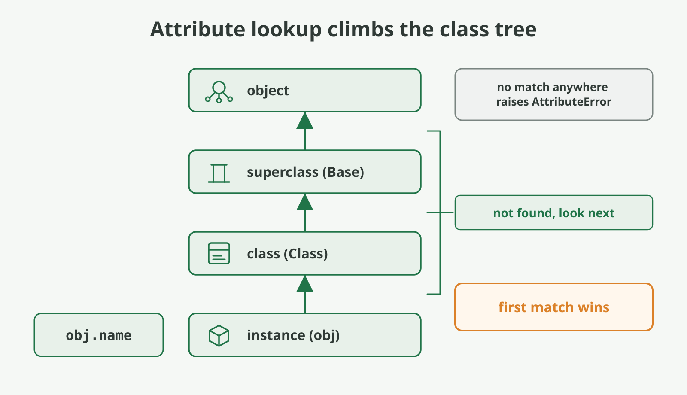
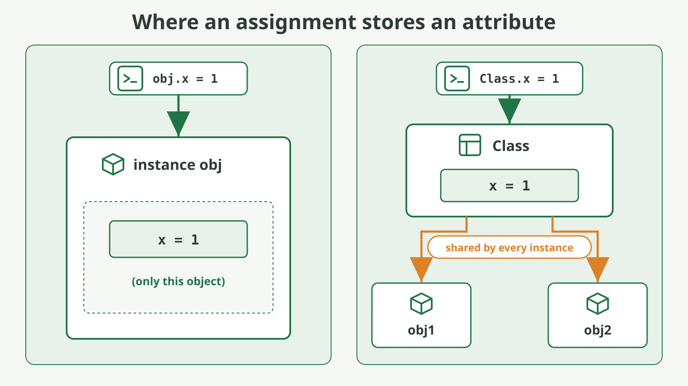
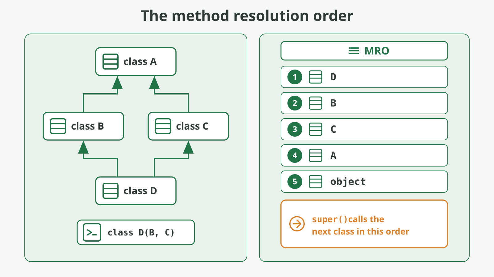
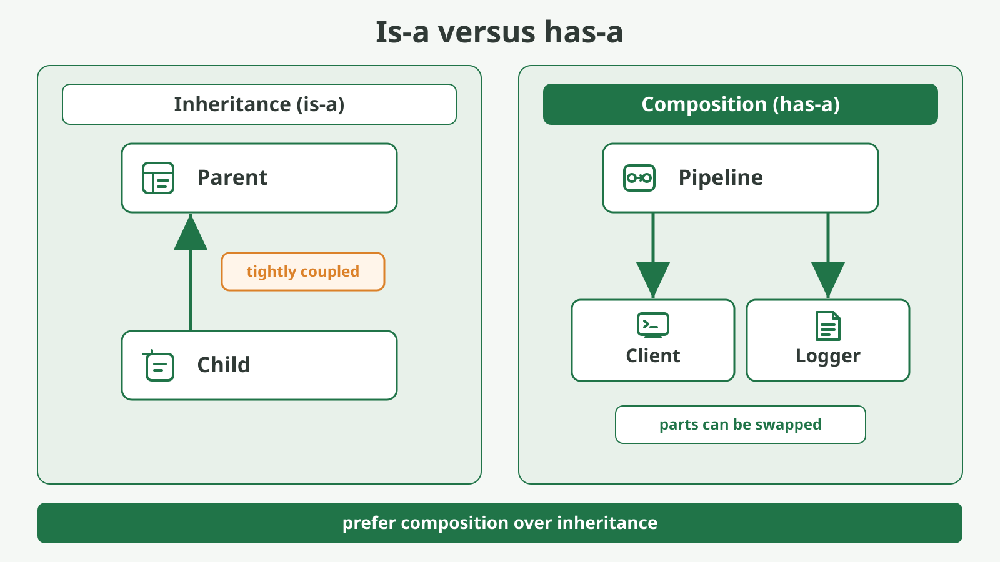
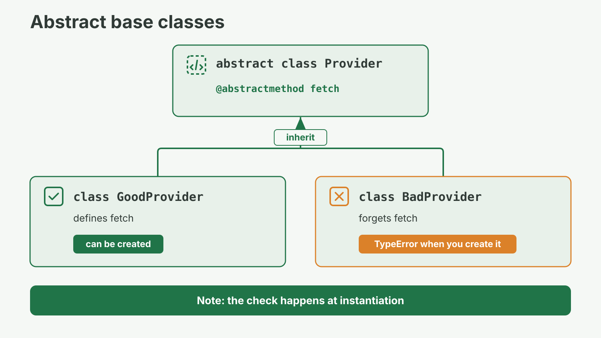
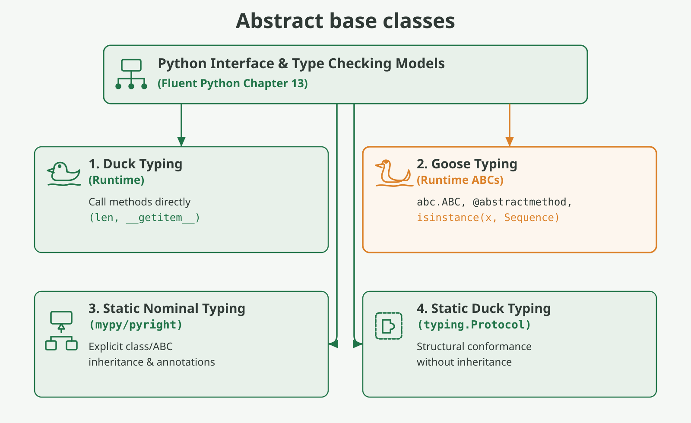
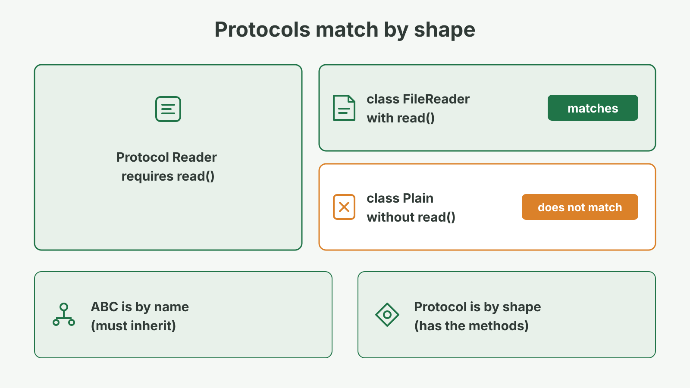
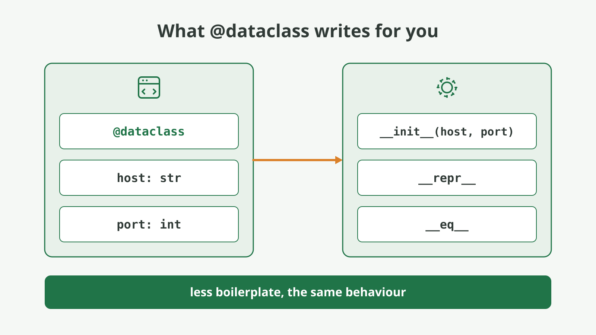
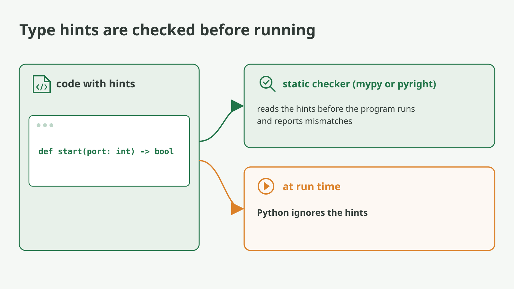

# 3.4 Classes, dataclasses, typing and protocols

| | |
|---|---|
| Level | Intermediate |
| Priority tier | 0 |
| Lab venue | Any machine with Python 3.11+; `pip install mypy pyright pydantic` |
| Part | Part 3: Python for infrastructure |
| Status | Drafted, labs **untested** |

## Why this matters for AI infrastructure

Picture a small script that grows over a few months. First it gains a Redfish client with a session and a retry policy. Then it gains a Slurm wrapper with typed job records. Next comes a provider interface that hides GCP, AWS and on-prem differences, a configuration model validated from YAML, and an exporter that holds metric state. At that point it is no longer a script. It is software, and it needs the same care.

Object-oriented design, data classes and type hints are what keep that software maintainable. They make state explicit, so a reader can see what an object remembers. They make interfaces enforceable, so a caller knows what it may safely rely on. They catch errors before the code reaches production, which is the cheapest place to catch anything. Modern Python also relies on types at runtime. pydantic models validate API input, FastAPI builds documentation from annotations, and dataclasses generate boilerplate, so you need to understand how that machinery works.

This chapter covers classes and the object model, inheritance and composition, and the data class builders `namedtuple`, `NamedTuple`, `dataclass`, attrs and pydantic. It then moves on to type hints and static checking with mypy and pyright, protocols and ABCs, generics, operator overloading, and design guidance for infrastructure code.

## Prerequisites and outcomes

Before you start, you should know functions and the data model from chapters 3.1 and 3.3.

By the end of this chapter, you will be able to:

- Write classes with instance and class attributes, methods, `@classmethod`, `@staticmethod`, `@property` and `__slots__`, and explain attribute lookup and bound methods.
- Use single and multiple inheritance, `super()`, the MRO (C3) and mixins, and know when composition is the better choice. Design abstract interfaces with `abc.ABC` and `typing.Protocol`.
- Build data classes with `namedtuple`, `NamedTuple`, `@dataclass` (fields, defaults, `field(default_factory=...)`, `frozen`, `slots`, `kw_only`, `__post_init__` and ordering), `attrs` and pydantic, and choose among them.
- Add type hints to functions, variables and classes. Use `Optional` and `|`, `list[str]`, `dict[str, int]`, `Callable`, `TypedDict`, `Literal`, `Final`, `Annotated`, `TypeVar`, generics, `ParamSpec`, `overload` and `Self`. Run mypy and pyright in CI and configure how strict they are.
- Implement operator overloading and rich comparisons correctly, using `total_ordering` and `NotImplemented`.
- Validate configuration and API data with pydantic, and manage secrets and settings.
- Apply design principles such as composition over inheritance, dependency injection, small interfaces, immutability and explicit errors.

## 1. Classes and objects

### Class definition and instances

Suppose someone defines one shared tag list at the top of a node class, and a single node appends a tag to it. Overnight every node in the cluster reports that tag, including the nodes nobody touched. Nothing in the code looks wrong, and that is what makes this bug so common.

Most infrastructure tools start by modelling one real thing, such as a compute node. A **class** is the place where you describe that thing once. An **instance** is one concrete object built from that description. The example below shows the parts a class can hold, and each part has its own job.

```python
class Node:
    """A compute node in the cluster."""
    cluster = "ai-prod"                      # class attribute: shared by all instances
    _count = 0

    def __init__(self, name: str, gpus: int = 8) -> None:
        self.name = name                      # instance attributes live in the instance __dict__
        self.gpus = gpus
        self._state = "unknown"               # leading underscore: "internal" by convention
        Node._count += 1

    def __repr__(self) -> str:
        return f"Node(name={self.name!r}, gpus={self.gpus})"

    def drain(self) -> None:                  # instance method: first parameter is self
        self._state = "draining"

    @property
    def state(self) -> str:                   # read-only computed attribute, accessed as node.state
        return self._state

    @state.setter
    def state(self, value: str) -> None:      # validation on assignment
        if value not in {"ready", "draining", "down", "unknown"}:
            raise ValueError(f"bad state {value!r}")
        self._state = value

    @classmethod
    def from_dict(cls, d: dict) -> "Node":    # alternative constructor; cls supports subclasses
        return cls(d["name"], d.get("gpus", 8))

    @staticmethod
    def valid_name(name: str) -> bool:        # utility namespaced in the class; no self/cls
        return name.isidentifier() or "-" in name
```

The `class` keyword is not a declaration. It is an executable statement, and when Python runs it, it creates a class object. That class object is itself an instance of `type`. Calling the class creates an instance: `__new__` allocates the new object, and `__init__` initializes it.

The name `self` is only a convention for the instance, though every Python programmer follows it. Methods are ordinary functions stored on the class. When you reach one through an instance, Python turns it into a bound method. So `node.drain` is a bound method object that carries `node` along with it, so the caller never passes the instance.

Four ideas explain the rest of this code, and each one is worth a minute of your time.

The first is how Python finds an attribute. Every dot expression, such as `object.attr`, starts a search. Python looks first in the instance, through `self.__dict__`. Next it looks in the class, through `self.__class__`. Then it looks in every superclass above that class, from the bottom of the tree upward and from left to right, in the order given by `self.__class__.__mro__`. It returns the first `attr` it finds. A data descriptor, such as a `@property` or a `__slots__` entry on the class, takes precedence over the instance dictionary. If the search finds nothing, Python calls `__getattr__` as a fallback.

Because lower definitions are found first, a subclass overrides a superclass attribute just by defining it again. Assignment works differently. When you write `obj.attr = v`, Python does not climb the tree. It writes directly into the target object's namespace, or it calls a data descriptor's setter.

Keep one rule in mind for the rest of the chapter. **Class attributes are shared, but assigning through an instance only shadows them.** For example, `node.cluster = "x"` creates an instance attribute on `node`, and `Node.cluster` stays the same.

The second idea concerns scope. A `class` body runs in its own local namespace, and that namespace becomes the class's attribute dictionary. However, a class is not an enclosing scope for the methods inside it. Under the LEGB rule (Local, Enclosing, Global, Built-in), an unqualified name inside a method skips the class entirely. It resolves in enclosing `def` functions, the module's global scope or the built-ins. Methods must therefore reach class attributes through `self.attr` or `ClassName.attr`. The example below is the book's `classscope3.py`:

```python
# In the book's classscope3.py example:
X = 1
def nester():
    X = 2                        # enclosing function scope (E)
    class C:
        X = 3                    # class attribute C.X (not in LEGB for methods)
        def method1(self):
            print(X)             # prints 2 (from nester's E scope, NOT 3 in class C)
            print(self.X)        # prints 3 (via inheritance on self -> C.X)
```

In `method1`, `print(X)` prints 2 because the method finds `X` in `nester`'s scope. The class attribute with the value 3 is invisible to that lookup. `print(self.X)` prints 3, because the lookup goes through `self` and the inheritance search reaches `C.X`. A class body holds names, but it is not a place a method can see.

The third idea is the one from the opening. A list or dict defined at class level is shared by every instance, so changing it through one instance changes it for all of them. That is a common source of bugs, and a quiet one, because the code looks perfectly reasonable. Create per-instance mutable state in `__init__` instead.

The fourth idea is name mangling, which is Python's way of avoiding accidental collisions between subclasses. Mangled names take the form `_Class__name` and `_Class__x`. A single leading underscore, as in `_name`, is only a convention that marks an attribute as internal. A double leading underscore, as in `__X`, does more. Inside a `class` body, the compiler rewrites `__X` to `_ClassName__X`.

This is the Learning Python Chapter 31 example, `pseudoprivate.py`. The class `C1` sets `self.__X = 88` in `meth1`, and the class `C2` sets `self.__X = 99` in `metha`. When `class C3(C1, C2): pass` combines them, the object's dictionary holds `{'_C1__X': 88, '_C2__X': 99}`. Both values survive because the names differ. Mangling prevents collisions in deep hierarchies, but it does not prevent deliberate access. `I._C1__X` is still readable, much as Java `private` fields can be read through `setAccessible(True)` reflection. Python trusts programmers, so you document the public API and leave the rest to convention.

Bound methods come from the same model. Take `class Hack: def doit(self, message): print(message)`. Fetching `meth = inst.doit` returns a bound method object. That object holds the instance, which `meth.__self__ is inst` confirms, and the function, which `meth.__func__ is Hack.doit` confirms. So `meth('bonjour')` works like a plain function with `self` already filled in. You can store it in a callback list or pass it around. Fetching `Hack.doit` through the class returns the plain function instead. You then have to pass the instance yourself, as in `Hack.doit(inst, 'privit')`.

Where you assign a name decides which namespace holds it. This is the Learning Python Chapter 29 example, with `manynames.py` and `docstr.py`. `X = 11` at the top of a module creates a module global, `manynames.X`. `X = 22` inside a function `g()` is local to that call. `X = 33` inside `class C:` becomes a class attribute, `C.X`, which `I.X` inherits. `self.X = 55` inside `def m(self):` creates an instance attribute in `I.__dict__['X']`. The instance links to its class through `I.__class__`, and `C.__bases__` holds the direct superclasses. Docstrings attach at every layer, as `module.__doc__`, `func.__doc__`, `Klass.__doc__` and `Klass.method.__doc__`, and `help(module)` shows them together.

A well-built domain object combines several features. The Fluent Python Chapter 11 example, `Vector2d(3, 4)` (`Examples 11-1` to `11-19`), is modeled in `code/part03/python_classes_typing_protocols.py`. It shows five habits worth copying:

1. `__iter__` returns `(i for i in (self.x, self.y))`, so tuple unpacking such as `x, y = v1` and `tuple(self)` work automatically.
2. `__repr__` uses `"{}({!r}, {!r})".format(type(self).__name__, *self)`. That makes `eval(repr(v1)) == v1` hold, and subclasses inherit the right class name without hardcoding `'Vector2d'`.
3. `__bytes__` returns `bytes([ord(self.typecode)]) + bytes(array(self.typecode, self))`. The `@classmethod` alternative constructor `frombytes(cls, octets)` reverses it with `typecode = chr(octets[0]); memv = memoryview(octets[1:]).cast(typecode); return cls(*memv)`.
4. A custom `__format__(self, fmt_spec='')` extends the Format Specification Mini-Language with a `'p'` suffix for polar coordinates `<r, theta>`. So `format(Vector2d(1, 1), '0.5fp') == '<1.41421, 0.78540>'`.
5. The object is hashable and immutable. Read-only `@property` getters are backed by `self.__x` and `self.__y`, and `def __hash__(self): return hash((self.x, self.y))` supplies the hash. `__match_args__ = ('x', 'y')` allows positional `match` patterns such as `case Vector2d(0, 0):`. The `__slots__ = ('__x', '__y')` declaration shrinks 10 million `Vector2d` instances in `mem_test.py` from 1.62 GiB to 655 MiB. Because `typecode = 'd'` (an 8-byte IEEE 754 float) is a class attribute read through `self.typecode`, you can change one instance with `v1.typecode = 'f'`, or subclass with `class ShortVector2d(Vector2d): typecode = 'f'` (a 4-byte float).

A `@property` makes a method look like an attribute, so callers keep writing `node.state` while validation happens behind the name. Start with plain attributes, and add a property later without changing the callers. Properties suit validation, derived values, lazy computation through `functools.cached_property`, and read-only fields.

`__slots__` is the feature to reach for when millions of instances exist. Assigning a sequence of attribute names to `__slots__` reserves fixed storage for each instance. Class-level descriptors manage that storage, so no per-instance `__dict__` is allocated, and no `__weakref__` either. The saving comes with strict inheritance rules, and breaking them quietly brings the memory cost back. There are four rules:

1. Every class in the hierarchy must define `__slots__`. If a subclass defines it but its superclass does not, the superclass still creates an instance `__dict__` on every object. For example, `class C: pass; class D(C): __slots__ = ['a']` still gives `D()` an instance `__dict__`. A subclass that adds no new attributes must still declare `__slots__ = ()`.
2. Do not repeat slot names in subclasses. Instances inherit the union of all `__slots__` along the MRO. Repeating a superclass slot name hides the superclass slot descriptor and wastes space.
3. A slot name cannot also have a class-level default of the same name. `class C: __slots__ = ['a']; a = 99` raises `ValueError: 'a' in __slots__ conflicts with class variable`. Under multiple inheritance, at most one base may have a non-empty `__slots__`. Mixing two such classes raises `TypeError: multiple bases have instance lay-out conflict`, so mixins should use `__slots__ = ()`.
4. Slotted instances have no `__dict__`, unless `'__dict__'` is listed in `__slots__`. Also, `obj.__slots__` shows only the lowest class's list, not the union across superclasses. Generic tools should therefore use `dir(obj)` and `getattr(obj, name)` instead of indexing `obj.__dict__`.

Keep `__init__` cheap. A constructor runs every time an object appears, including in every test, so heavy work there is paid over and over. Avoid IO such as network calls or file reads, when you can. Use an explicit factory classmethod or a lazy connection instead. Objects that are cheap to construct are also easier to test.

### Object lifecycle and identity

`__new__` is rarely overridden, though it is used for singletons and immutable types. `__init__` sets up each instance, and it is where most classes do their work. Avoid `__del__`. For deterministic cleanup, use `__enter__/__exit__`. Equality and hashing by value need explicit methods, or you can get them from dataclasses. `copy.copy(obj)` and `copy.deepcopy(obj)` can be customized through `__copy__` and `__deepcopy__`. Be careful with pickling. The `pickle` module, along with `__getstate__`, is unsafe for untrusted data and breaks easily across versions. Serialize to JSON, YAML or protobuf instead.

### Classes as factories for many objects

Suppose one script tracks a dozen GPU nodes, and each node needs its own name and its own state. A module cannot do this alone. Python imports one copy of a module, so every name inside it is shared. A class solves that problem by acting as a factory. You define the shape once, then call it as many times as you need.

Python's class model has two kinds of objects. A class object holds default behavior, and a `class` statement creates it. An instance object is what your program actually works with. You get one by calling the class like a function. Each call makes a new instance, and each instance is its own namespace that can still see the names on its class.

Modules and classes differ here. Only one copy of each module lives in a program, and `reload` updates that single shared object. Each instance of a class holds its own data, so several versions of the same kind of thing can exist at once. Closure factory functions from Learning Python Chapter 17 can keep per-call state too. A class makes that state explicit, as attributes instead of hidden scope references.

Here is a small class to see this in action:

```python
class FirstClass:                       # Define a class object
    def setdata(self, value):           # Define the class's methods
        self.data = value               # self is the instance
    def display(self):
        print(self.data)                # self.data: per instance
```

Nothing exists until Python reaches and runs this statement. Usually that happens when the module file is imported. Each `def` inside the class creates a function and stores it as an attribute of the class. Functions defined this way are called methods. The first argument, named `self` by convention, receives the instance that the call is made on.

```
>>> x = FirstClass()     # Make two instances
>>> y = FirstClass()     # Each is a new namespace
```

The parentheses matter. Calling the class creates two instances, so you now have three linked namespaces: the class and its two instances. Both `x` and `y` are `FirstClass` objects, so each one inherits the names attached to the class.

### Instance attributes and inherited method lookup

The next problem is sharing behavior while keeping data separate. Every instance should have the same `setdata` and `display` methods, but each should remember its own value. Python handles this with a lookup chain. When you ask an instance for a name it does not have, Python follows the link to its class.

```
>>> x.setdata('coding')     # Call methods: self is x
>>> y.setdata(3.14159)      # Runs: FirstClass.setdata(y, 3.14159)
```

Neither `x` nor `y` has a `setdata` attribute of its own. Python checks the instance first, then follows the link to the class. The lookup happens each time you write a dot expression, and it only walks through linked objects. Assignments behave differently. Inside `setdata`, `self.data` stores the value in the instance, not in the class.

```
>>> x.display()     # Runs: FirstClass.display(x)
coding
>>> y.display()     # self.data differs in each instance
3.14159
```

The `display` name is the same in both instances because it comes from the class. The `data` value differs because each instance stores its own copy. Instance attributes are not declared ahead of time, and they carry no type. An attribute appears the first time you assign it. If you call `display` before `setdata`, Python raises an undefined name error, since `data` does not exist yet.

Attributes can also change from outside the class. You can set `x.data` directly, and you can even add a brand new attribute to one instance:

```
>>> x.data = 'hacking'     # Can get/set attributes outside the class too
>>> x.display()
hacking
>>> x.anothername = 'apps' # Can set new attributes here too!
```

This freedom has a cost. Adding data that the class cannot use usually does not make sense. Learning Python Chapters 30 and 39 show how attribute-access overloading can add privacy checks. Still, the open style saves syntax, and it suits simple data records well.

### Attribute search climbs a class tree



*Figure 3.4.1. Attribute search: Python looks in the instance, then the class, then each superclass, and the first match wins.*

Every dot expression starts a search through a tree of linked objects. Picture a tree with two instances, `I1` and `I2`, a class `C1` that both were made from, and two superclasses, `C2` and `C3`, above `C1`. Each object carries its own names. When you ask for `I2.w`, Python checks `I2`, then `C1`, then `C2`, then `C3`. It stops at the first `w` it finds. If no object in the tree has the name, Python raises an error.

In this tree, only `C3` defines `w`. So `I2.w` resolves to `C3.w`, and `I2` inherits `w` from `C3`. Other lookups take shorter paths. Both instances find `x` in `C1` and stop there, because `C1` sits lower in the tree and redefines `x`. A name stored on the instance itself, such as `I2.name`, is found without any climbing.

Classes higher in a tree are superclasses, and classes lower down are subclasses. The two words describe both a position and a role. A superclass provides behavior that all of its subclasses share. Because lookups start at the bottom, a redefinition lower in the tree replaces the version above it. That replacement is how a class customizes what it inherits.

Python makes this literal. The classes and instances are real linked objects, and Python climbs those links each time you write `object.attribute`. A class acts as a factory for instances and holds shared behavior. An instance holds data that differs from one object to the next. In that sense, instances are like records, and classes are the programs that process them.

Method calls follow the same tree with one extra step. When `I2.w` is a function and you write `I2.w()`, Python turns the call into `C3.w(I2)`. The instance becomes the first argument, which the method receives as `self`. Every method call therefore has a subject object. Calling `pat.giveRaise()` first finds `giveRaise` by inheritance, then passes `pat` to it. Writing `Employee.giveRaise(pat)` performs both steps by hand. This is the default case, and Python also has static and class methods, which are covered later.

### Where an assignment stores an attribute



*Figure 3.4.2. Assignment through an instance stores on that instance, while assignment through the class is shared by all instances.*

Attributes appear the first time you assign them. The place where the assignment runs decides which object gets the name. Assignments at the top level of a `class` body attach names to the class, so every instance and subclass shares them. Assignments through `self` inside a method attach names to the instance being processed.

In the next example, `setname` is defined inside the class. A `def` in a class assigns a name to the class, so every instance inherits `setname`. Inside the method, `self` is whichever instance made the call, so each instance stores its own name:

```python
class C2: ... # Make superclass objects
class C3: ...
class C1(C2, C3): # Make and link class C1
    def setname(self, who): # Assign name: C1.setname
        self.name = who # Self is either I1 or I2
I1 = C1() # Make two instances
I2 = C1()
I1.setname('sue') # Sets I1.name to 'sue'
I2.setname('bob') # Sets I2.name to 'bob'
print(I1.name) # Prints 'sue'
```

Every object in a class tree is a namespace, so you can read or set any attribute by its full path. `C1.setname` is as valid as `I1.setname`, as long as the names `C1` and `I1` are in scope.

### The constructor: `__init__`

Calling `setname` after you create an instance is easy to forget. If you read `I1.name` before that call, Python raises an undefined name error. A constructor solves this by filling in the attribute when the object is built.

Python calls a method named `__init__` each time it creates an instance from a class. The new instance arrives in `self`, and any values in the class call's parentheses go to the arguments after `self`:

```python
class C2: ... # Make superclass objects
class C3: ...
class C1(C2, C3):
    def __init__(self, who): # Set name when constructed
        self.name = who # Self is either I1 or I2
I1 = C1('sue') # Sets I1.name to 'sue'
I2 = C1('bob') # Sets I2.name to 'bob'
print(I1.name) # Prints 'sue'
```

Special names such as `__init__` start and end with double underscores, so they stand apart from your own names. Python runs them automatically when a matching operation appears, and inheritance passes them down to subclasses. If a class omits one, the matching operation is not supported. If a class has no `__init__`, a class call still returns an instance, but Python does not initialize it.

### Subclasses customize by inheritance

Sometimes you want a slightly different version of a class without editing the original. Python lets one class inherit from another. You list the superclass in parentheses in the new class header. The new class is the **subclass**, and it can redefine any name it wants to change. The class it builds on is the **superclass**.

```python
class SecondClass(FirstClass):          # Inherits setdata
    def display(self):                  # Changes display
        print(f'Current value = "{self.data}"')
```

The subclass defines `display` with a new format. Python searches from the instance up to the subclass, then to the superclass, and it stops at the first match. Because `SecondClass` defines `display` first, its version wins, and `FirstClass` never learns about the change. The book calls replacing an inherited name overloading.

`SecondClass` still uses the `setdata` method from `FirstClass` without any change:

```
>>> z = SecondClass()
>>> z.setdata('LP6e')     # Finds setdata in FirstClass
>>> z.display()           # Finds overridden method in SecondClass
Current value = "LP6e"
```

The change stays outside `FirstClass`. Older instances keep their old behavior, so `x.display()` still prints the earlier message. This is why subclassing supports reuse so well. You customize a component without touching its source. Python's full inheritance rules include diamond patterns and metaclasses, which Learning Python covers in Chapters 31 and 40. For everyday application code, the instance and class view is enough.

### Polymorphism and programming by customization

Suppose you build an employee database. Most employees follow the same rules for salary, raises, promotions and retirement. Engineers compute their pay differently, and every other rule still applies to them. You do not want to copy the shared rules for every job type.

Start with a general superclass that holds the default behavior. The bodies are placeholders here:

```python
class Employee: # General superclass
    def computeSalary(self): … # Common or default behaviors
    def giveRaise(self): …
    def promote(self): …
    def retire(self): …
```

Then write a subclass that changes only the method that differs:

```python
class Engineer(Employee): # Specialized subclass
    def computeSalary(self): … # Something custom here
```

Because `computeSalary` in `Engineer` sits lower in the tree, it overrides the version in `Employee`. The other methods pass through unchanged. You then make instances of the class that matches each real employee:

```python
sue = Employee() # Default behavior
bob = Employee() # Default behavior
pat = Engineer() # Custom salary calculator
```

You can make an instance from any class in the tree, not only from the bottom. The class you call decides where the search begins, and so which version of each method runs.

Put the three objects in one list and loop over them:

```python
company = [sue, bob, pat] # A composite object
for emp in company:
    print(emp.computeSalary()) # Run this emp's version: default or custom
```

Each `computeSalary` call runs the version that belongs to that object's class. The loop never checks what each object is. This is polymorphism: the meaning of an operation depends on the object it runs on. Code should care about what an object does, not what it is.

Polymorphism also hides differences in interfaces. Consider a function that copies data from a reader to a writer. It only needs objects with `read` and `write` methods, and it does not care how those methods work:

```python
def processor(reader, converter, writer):
    while True:
        data = reader.read()
        if not data: break
        data = converter(data)
        writer.write(data)
```

You then pass in subclasses that implement `read` and `write` for each data source:

```python
class Reader:
    def other(self): … # Default behavior and tools
class FileReader(Reader):
    def read(self): … # Read from a local file
class SocketReader(Reader):
    def read(self): … # Read from a network socket
…and others…
processor(FileReader(…), converter, FileWriter(…))
processor(SocketReader(…), converter, FileWriter(…))
processor(FtpReader(…), converter, JsonWriter(…))
```

Each source keeps its `read` and `write` code in one place. You can change that code without affecting the callers, and the same `processor` function works for files, sockets and any future source.

After you work this way, a new program often comes together from existing parts. Most of the job is mixing superclasses that already do the required work. An `Employee` or `Reader` class written for one program can serve another program with no changes, so you get its code for free.

Whole collections of superclasses, called frameworks, cover common jobs such as database access, testing and GUI toolkits. With a framework, you often write one subclass that fills in a few expected methods. The framework's classes higher in the tree do most of the work. This style means combining and specializing code that is already tested.

Getting there takes time. Object-oriented work also needs careful design to get the full reuse benefit. Programmers catalog common structures as design patterns, which help with those design choices. The Python syntax itself is simple, so it should not be the hard part.

### Classes live inside modules

A class name has no special power. It is a variable that gets assigned when the `class` statement runs. You can reach it with any normal expression. If `FirstClass` lived in a module file, you could import it and use its name in a subclass header:

```python
from modulename import FirstClass       # Copy name into my scope

class SecondClass(FirstClass):          # Use class name directly
    def display(self): ...
```

You can also import the whole module and qualify the name:

```python
import modulename                       # Access the whole module

class SecondClass(modulename.FirstClass):   # Qualify to reference
    def display(self): ...
```

Class names follow the same rules as any other name in a module. A single module file can hold several classes, along with functions and variables. Each of those names becomes a separate attribute of the module. Here is a hypothetical file:

```python
# names.py
var1 = 6                                # names.var1
var2 = 3.12
def func1(): ...                        # names.func1
def func2(): ...
class Cls1: ...                         # names.Cls1
class Cls2: ...                         # names.Cls2
```

Sometimes a module and a class share a name. If `person.py` contains `class person`, you must go through the module to reach the class:

```python
import person                           # Import the module
x = person.person()                     # Class within the module
```

Using `from person import person` also works, and then `x = person()` builds the object. Common Python style avoids the confusion from the start. Modules get lowercase names and classes get names that start with an uppercase letter, so `person.Person()` reads clearly. A module reflects a whole file, while a class is one statement inside a file.

### Operator overloading

Suppose you want your own object to respond to `+` or to `print`. Python lets a class intercept built-in operations. Operations such as addition, slicing, printing and attribute access route to methods that the class provides. Modules cannot do this for expressions. They can only provide function calls.

The hooks are special methods whose names start and end with double underscores, such as `__add__`. Python defines the fixed mapping from each operation to its method name. It calls the method automatically when an instance appears in that operation, and the return value becomes the result of the expression. A class does not have to define every hook. If `__add__` is missing, a `+` expression raises an exception.

The class below adds three hooks and one ordinary method:

```python
class ThirdClass(SecondClass):          # Inherit from SecondClass
    def __init__(self, value):          # On "ThirdClass(value)"
        self.data = value
    def __add__(self, other):           # On "self + other"
        return ThirdClass(self.data + other)
    def __str__(self):                  # On "print(self)", "str()"
        return f'[ThirdClass: {self.data}]'
    def mul(self, other):               # In-place change: named
        self.data *= other
```

`__init__` runs when the object is created, and it stores the value automatically. The inherited `display` method still works. For `+`, Python passes the left operand to `self` and the right operand to `other`. The method builds and returns a new `ThirdClass`, so the result keeps the same type:

```
>>> a = ThirdClass(3)     # __init__ called
>>> a.display()           # Inherited method called
Current value = "3"
>>> b = a + 3             # __add__: makes a new instance
>>> b.display()
Current value = "6"
```

For `print`, Python passes the object to `__str__`, and the returned string becomes the printed text. A normal method such as `mul` works differently. It changes the instance in place:

```
>>> print(b)              # __str__: returns display string
[ThirdClass: 6]
>>> a.mul(3)              # mul: changes instance in place
>>> print(a)
[ThirdClass: 9]
```

Some hooks must return a value, such as `__str__`. Others are more flexible. The `__add__` method returns a new object, which matches how built-in numbers and strings behave. Overloaded operators should behave like built-in ones, so a `*` hook that changed its object in place would surprise readers. Learning Python Chapter 30 covers the in-place hooks, such as `__imul__` for `*=`.

Operator overloading is optional. Most application code never needs it. Unless a class must mimic a built-in interface, plain method names are clearer. An expression like `*` may suit a matrix, but a named method usually serves the callers better. Special names are inherited like any other names. The `__init__` method appears in nearly every class, and `__str__` appears often. You can usually learn which attributes an instance will have by reading its `__init__`.

A custom set intersection shows the choice. You can write it as a plain method named `intersect` and call it by name. You can also write it as `__and__`, and Python calls that method when it sees `&`. The operator form lets your objects act like built-in types, so code that expects a built-in can use them. Plain names are still clearer unless your objects truly behave like built-ins.

### Classes as records

Programs often need to store facts about an entity, such as a person's name, age and jobs. A tuple or a dictionary can hold these facts, but a class can hold them with less noise. Here is the dictionary version:

```python
rec = {}
rec['name'] = 'Pat'                     # Dictionary-based record
rec['age'] = 40.5
rec['jobs'] = ['dev', 'mgr']
print(rec['name'])
```

A class can do the same job with attributes instead of keys:

```python
class rec: pass                         # Empty namespace object
rec.name = 'Pat'                        # Class-based record
rec.age = 40.5
rec.jobs = ['dev', 'mgr']
print(rec.name)
```

The class version has less syntax. It uses an empty `class` statement to create a namespace, then fills it in with attributes. This works, but you need a new class for every distinct record. A better habit is to create instances of an empty class, one for each entity:

```python
class rec: pass
pers1 = rec()                           # Instance-based records
pers1.name = 'Bob'
pers1.jobs = ['dev', 'mgr']
pers1.age = 40.5

pers2 = rec()
pers2.name = 'Sue'
pers2.jobs = ['dev', 'cto']
print(pers1.name, pers2.name)           # Bob Sue
```

Each instance starts empty, then collects its own attributes. The two records do not even need the same set of names. Only `pers1` has an `age`. A class with a constructor and methods goes further. It keeps every record consistent and adds processing logic that a dictionary cannot hold:

```python
class Person:
    def __init__(self, name, jobs, age=None):   # class = data + logic
        self.name = name
        self.jobs = jobs
        self.age = age
    def info(self):
        return (self.name, self.jobs)

rec1 = Person('Bob', ['dev', 'mgr'], 40.5)  # Construction calls
rec2 = Person('Sue', ['dev', 'cto'])
print(rec1.jobs, rec2.info())
```

The constructor sets `name`, `jobs` and `age` on every instance. The `age` value can be left out, and the default `None` fills it in. Named tuples fill a similar role. They behave like classes with extra logic that maps attribute names to tuple positions. A dictionary holds the data but has no room for processing logic. A class packages both together.

### Under the hood: namespaces are dictionaries

Classes and instances are linked namespace objects, and Python usually stores each namespace as a dictionary. The `__dict__` attribute shows the namespace of an instance or a class, much as it does for a module. Here is the `rec` example from the previous section:

```
>>> list(key for key in rec.__dict__ if not key.startswith('__'))
['name', 'age']
>>> list(x.__dict__)
['name']
>>> list(y.__dict__)
[]
```

The class holds `name` and `age`. The instance `x` has its own `name`, and the instance `y` is still empty. You can read an attribute with dictionary indexing or with dot notation, but indexing only sees what the object holds directly. Dot notation runs the inheritance search:

```
>>> x.name, x.__dict__['name']
('Sue', 'Sue')
>>> x.age                  # But attribute fetch checks classes too
40
>>> x.__dict__['age']      # Indexing dict does not do inheritance
KeyError: 'age'
>>> x.__dict__
{'name': 'Sue'}
>>> [attr for attr in dir(x) if attr[:2] != '__']
['age', 'name']
```

The `dir` built-in collects inherited names as well. Two more attributes connect the class tree. Each instance has `__class__`, which points to the class that made it. Each class has `__bases__`, a tuple of its superclasses. A class with no explicit parent points to the implicit `object` root:

```
>>> x.__class__
<class '__main__.rec'>
>>> rec.__bases__
(<class 'object'>,)
```

Because the namespaces are simple objects, a function can become a method later. Define a plain function that takes one object, then assign it to a class attribute:

```
>>> def uppername(obj):
...     return obj.name.upper()     # Still needs a self argument (obj)
>>> rec.method = uppername          # Now it's a class's method!
>>> x.method()
'SUE'
>>> rec.method(x)                  # Can call through instance or class
'SUE'
```

Normally a `class` statement and the methods inside it build these namespaces. The point is that Python looks up attributes in linked objects. Some classes define `__slots__` instead of `__dict__`, an advanced feature that Learning Python covers in Chapter 32. When an attribute surprises you, ask which namespace holds it before you add a guard.

## 2. Inheritance, composition and protocols

### Inheritance and `super()`



*Figure 3.4.3. Inheritance: Python searches classes in the method resolution order, and super() moves to the next one.*

Suppose a `GpuNode` must do everything a generic `Resource` does, plus report its GPU count. You do not want to copy the generic code, because two copies of `describe` drift apart the first time someone fixes a bug in one of them. Inheritance lets the subclass reuse the parent's `__init__` and `describe` and extend them.

```python
class Resource:
    def __init__(self, name):
        self.name = name
    def describe(self): return f"{type(self).__name__}({self.name})"

class GpuNode(Resource):
    def __init__(self, name, gpus):
        super().__init__(name)         # cooperative: delegates to the next class in the MRO
        self.gpus = gpus
    def describe(self):                 # override and extend
        return super().describe() + f" gpus={self.gpus}"
```

The `super()` call returns a proxy. The proxy hands work to the next class in the instance's MRO, which is `self.__class__.__mro__` after the class that contains the call. That next class is not always the direct parent, and that surprise is the whole point. This is what makes cooperative multiple inheritance work. It only works when the hierarchy follows three rules.

1. Universal deployment: every class in the MRO that implements the method before the anchor must call `super().method()`. The first class that omits `super()` stops the chain. For example, if `class C(B, A)` calls `super().act()` and `B.act` does not call `super().act()`, then `A.act` is never reached.
2. Call-chain anchors: the chain must end at an anchor class that defines the method without calling `super()` again. For `__init__`, the built-in root `object` serves as the anchor, through `object.__init__(self)`. For a custom method such as `act(self)`, calling `super().act()` in the last class before `object` raises `AttributeError: 'super' object has no attribute 'act'`. A common base class with its own `act` method, such as `class X: def act(self): ...`, must sit before `object` on the MRO to prevent that.
3. Compatible argument signatures: a class's next neighbor on `self.__class__.__mro__` depends on the subclass's inheritance graph, so every cooperative implementation must accept compatible signatures. Each one can also consume its own keyword arguments and forward `**kwargs`. The `object.__init__()` at the end of an `__init__` chain accepts no arguments beyond `self`, so passing one raises `TypeError: object.__init__() takes exactly one argument`.

Python linearizes the class hierarchy with the C3 algorithm. The rule is that children come before parents, parents keep the order you declared them in, and each class appears only once. You can see the result in `Class.__mro__` or `Class.mro()`. In a diamond, the shared base is reached once, after all of its subclasses.

```python
class A: 
    def f(self): return "A"
class B(A): 
    def f(self): return "B>" + super().f()
class C(A): 
    def f(self): return "C>" + super().f()
class D(B, C): 
    def f(self): return "D>" + super().f()
D().f()        # 'D>B>C>A'
D.__mro__      # (D, B, C, A, object)
```

Lutz's Learning Python Chapter 29 (`specialize.py`) names four ways a subclass can interface with a superclass called `Super`. In the first, `Inheritor(Super)` inherits the methods unchanged, using `pass`. In the second, `Replacer(Super)` overrides `method(self)` completely. In the third, `Extender(Super)` overrides `method(self)` and calls back into `Super.method(self)`. Learning Python Chapter 28 shows this with `Manager.giveRaise(self, percent, bonus=.10)`, which calls `Person.giveRaise(self, percent + bonus)` in `person_14.py`. That example can also be stored by key in a `shelve.open('persondb')` DBM database through `makedb.py` and `updatedb.py`. In the fourth, `Provider(Super)` implements the abstract `action(self)` hook that `Super.delegate(self)` expects. This is the Template Method pattern.

A mixin is a small class, usually named `...Mixin`, that adds one independent capability through multiple inheritance. In Learning Python Chapters 28 to 31, `AttrDisplay` in `classtools.py`, `ListInstance`, `ListInherited` and `ListTree` mix a generic `__repr__` or `__str__` display into any application class, as in `class Person(AttrDisplay):`. `ListInstance` inspects `self.__dict__`. `ListInherited` inspects `dir(self)`. `ListTree` climbs `self.__class__` and `__bases__`, as in `classtree.py`. Fluent Python Chapter 14 shows `UpperCaseMixin`. It uppercases string keys with `super().__setitem__(_upper(key), item)`. It must be listed first, as in `class UpperDict(UpperCaseMixin, collections.UserDict): pass`, so that its methods intercept calls before `UserDict` on the MRO. Subclassing a built-in C type such as `dict` or `list` directly is risky, because C methods ignore Python overrides. Subclass `collections.UserDict`, `UserList` or `UserString` instead. Fluent Python's `DoppelDict` and `AnswerDict` examples show why. Fluent Python Chapter 14 also covers `ThreadingMixIn`.

Composition and delegation appear in Learning Python Chapters 28, 31 and 32. Inheritance models "is-a" relationships. A `PizzaRobot` is a `Chef`, and a `Chef` is an `Employee`, as in `employees.py`. Composition models "has-a" relationships instead. A composite controller directs the parts it contains. `Department` gathers `Person` and `Manager` objects to give group raises. `PizzaShop` in `pizzashop.py` contains `Server('Pat')`, `PizzaRobot('Bob')` and `Oven()`, which it uses to process `scene.order('Sue')`. `Processor(reader, writer)` in `streams.py` reads from any file or socket stream, transforms the data with `converter(data)` and writes to any output stream. `Uppercase(Processor)` in `converters.py` is one such converter.

Delegation is a close cousin of composition. A wrapper object holds an embedded object and forwards requests to it. `Manager` embeds `self.person = Person(name, 'mgr', pay)`, and `Set` wraps a list in `setwrapper.py`. The wrapper forwards attribute fetches with `def __getattr__(self, attr): return getattr(self.person, attr)`. In Python 3, special operators such as `__str__` or `__add__` are looked up on the class directly, so they bypass instance-level `__getattr__`.

Use `isinstance(x, Base)` and `issubclass` when you want the check to respect inheritance. `type(x) is T` checks the exact type, which you rarely want. The Liskov substitution principle says a subclass must honor the contract of its base class. It should accept at least what the base accepts, return no less than the base promises, and avoid raising new, surprising exceptions.

### Composition over inheritance



*Figure 3.4.4. Composition: an object that has parts can swap them, while inheritance couples a child to its parent.*

Inheritance and composition answer different questions. Inheritance describes what something is. A pizza-making robot is a kind of robot, so it inherits the usual robot properties. Those shared properties are written once and reused by every kind of robot. Composition describes what something has. The same robot is also a team of parts, such as arms to roll dough and motors to move it to the oven. Each part can be its own class.

A GUI shows both ideas. A window is built from widgets such as buttons and labels, and drawing the window draws those widgets too. That is composition. A custom button with its own font is a specialized version of a general button, which is inheritance.

For most infrastructure code, "has-a" beats "is-a". Inheritance couples subclasses to the parent's implementation and creates deep, fragile hierarchies. Instead, hold collaborators as attributes and delegate work to them:

```python
class RedfishClient:
    def __init__(self, session, retry_policy, logger):      # dependencies injected
        self._session, self._retry, self._log = session, retry_policy, logger
    def get_power(self, host): return self._retry(lambda: self._session.get(f"https://{host}/redfish/v1/Chassis/1/Power"))
```

The benefits are concrete. Dependencies are explicit and easy to swap, so you can pass a fake session in tests. Classes stay small, and behaviors combine freely. This pattern is called **dependency injection**. It simply means passing collaborators in rather than constructing them inside the class, and it needs no framework.

### Abstract base classes



*Figure 3.4.5. Abstract base classes: a subclass that forgets an abstract method cannot be instantiated.*

An abstract base class, or ABC, is a contract that subclasses must satisfy. Suppose three providers are written, a fourth is on the way, and nobody notices that `find` was never implemented until a user calls it. An ABC moves that discovery to the moment the object is created. Here, `Provider` lists the methods every cloud or on-prem provider must implement:

```python
from abc import ABC, abstractmethod

class Provider(ABC):
    """Contract for cloud/on-prem providers."""
    @abstractmethod
    def create_vm(self, name: str, cpus: int) -> str: ...
    @abstractmethod
    def delete_vm(self, vm_id: str) -> None: ...
    def ensure_vm(self, name: str, cpus: int) -> str:       # concrete template method built on abstract ones
        return self.find(name) or self.create_vm(name, cpus)
    @abstractmethod
    def find(self, name: str) -> str | None: ...

class Gcp(Provider): ...         # must implement all abstract methods or instantiation raises TypeError
```

The ABC enforces its contract at instantiation time. A subclass that misses an abstract method cannot be created, and Python raises `TypeError`. The class also provides `ensure_vm`, a concrete template method built on the abstract ones. ABCs support virtual subclassing through `Provider.register(Third)`. The `collections.abc` module supplies container ABCs such as `Iterable`, `Sequence`, `Mapping` and `Callable` for `isinstance` checks. Alex Martelli calls this style goose typing in Fluent Python Chapter 13.

Fluent Python Chapter 13, `Examples 13-7` to `13-14`, shows the full pattern. Ramalho's `Tombola(ABC)` defines two `@abstractmethod`s, `.load(iterable)` and `.pick()`. The `.pick()` method raises `LookupError` when the container is empty, and `LookupError` is the parent of `IndexError` and `KeyError`. The class also has two concrete methods built on them, `.loaded()` and `.inspect()`. `BingoCage(Tombola)` and `LottoBlower(Tombola)` implement the abstract methods. `@Tombola.register class TomboList(list):` is a virtual subclass, which you can verify by comparing `TomboList.__mro__` with `Tombola._abc_registry`. Structural ABCs work without any registration. `collections.abc.Sized` checks its `__subclasshook__` for a `"__len__"` entry in the class's `__mro__` dictionaries. So `class Struggle:` with `def __len__(self): return 23` satisfies `isinstance(Struggle(), abc.Sized)` and `issubclass(Struggle, abc.Sized)` automatically, without inheritance or `.register()`. Fluent Python Chapter 13 also contrasts duck typing, goose typing, static nominal typing and static duck typing through `typing.Protocol`. It shows runtime monkey patching too, such as `FrenchDeck.__setitem__ = set_card`, which enables `random.shuffle(deck)`. Use an ABC when you want shared concrete behavior, enforced abstract methods and runtime checks.



*Figure 3.4.6. Abstract base classes, as a diagram.*

### Protocols (structural typing)



*Figure 3.4.7. A Protocol is satisfied by any class that has the right methods, with no inheritance needed.*

Suppose a refactor splits one storage client into two, and a pile of `isinstance` checks still names the old class. The tests pass for reasons that have nothing to do with what the code actually needs. A **protocol** avoids that trap. It describes an interface by the methods an object has, with no inheritance required. This is the "if it quacks like a duck" idea. Static checkers verify that an object conforms. `@runtime_checkable` allows `isinstance` checks, but those check only that the methods exist.

```python
from typing import Protocol, runtime_checkable

@runtime_checkable
class SupportsClose(Protocol):
    def close(self) -> None: ...

class Sink(Protocol):
    def write(self, data: bytes) -> int: ...

def flush_to(sink: Sink, data: bytes) -> int:        # accepts files, sockets, BytesIO, your own classes
    return sink.write(data)
```

Choose a Protocol for interfaces at boundaries, where the implementers are third-party or unrelated to you. That keeps coupling loose and makes test fakes easy. Choose an ABC when you control the hierarchy and want runtime enforcement with shared code.

## 3. Data class builders



*Figure 3.4.8. A dataclass generates __init__, __repr__ and __eq__ from the field list.*

You have just written the fourth `__init__`, the fourth `__repr__` and the fourth `__eq__` for what is really the same kind of record. Nothing in those lines is new, and every one of them can drift. That is the moment to reach for a data class builder. A **dataclass** is a class whose boring methods Python writes for you from the field annotations. The table compares the builders, so you can pick one for the job at hand.

| Builder | Mutable? | Typing | Validation | Notes |
|---|---|---|---|---|
| `collections.namedtuple("P", "x y")` | No (tuple) | Untyped | None | Lightweight, tuple behaviour (unpack, index, hashable) |
| `typing.NamedTuple` | No | Typed fields | None | Class syntax, defaults, methods |
| `@dataclasses.dataclass` | Yes (or `frozen=True`) | Typed annotations (not enforced) | Via `__post_init__` | Standard library; most common |
| `attrs` (`@define`) | Yes/frozen | Optional | Validators/converters | Third party; predates dataclasses; richer |
| `pydantic.BaseModel` | Yes/frozen | Enforced at runtime (coercion/validation) | Strong, with errors | Parsing external data, settings, FastAPI |
| `TypedDict` | A dict | Static only | None | Typing JSON-like dicts; no runtime class |

The `@dataclass` decorator is the one you will see most often in the standard library. It is also the one that stops you with an error the first time you try to give a list as a default. The example below uses it with several options, and each option changes behavior in a visible way.

```python
from dataclasses import dataclass, field, asdict, replace
from typing import ClassVar

@dataclass(order=True, frozen=True, slots=True, kw_only=True)
class GpuNode:
    name: str
    rack: str
    gpus: int = 8
    tags: tuple[str, ...] = ()
    MAX_GPUS: ClassVar[int] = 16                        # class variable, not a field

    def __post_init__(self):                              # validation hook
        if not 0 < self.gpus <= self.MAX_GPUS:
            raise ValueError(f"gpus out of range: {self.gpus}")

@dataclass
class Cluster:
    name: str
    nodes: list[GpuNode] = field(default_factory=list)   # NEVER default=[]: dataclasses reject mutable defaults
    meta: dict[str, str] = field(default_factory=dict)

n = GpuNode(name="gpu01", rack="r1")
n2 = replace(n, gpus=4)                  # frozen: create modified copies
asdict(n)                                # to dict (recursive), for JSON
sorted([n2, n])                          # order=True generates comparisons from field order
```

In this example, `frozen=True` makes the node immutable, so `replace` is the way to get a modified copy. `order=True` lets `sorted` compare nodes by their fields in order. The `Cluster` class shows the right way to write a mutable default, which is `field(default_factory=list)`. Read that line twice, because forgetting it is the mistake this chapter keeps warning about.

The decorator accepts several options. `frozen=True` makes instances immutable and hashable together with `eq`. `order=True`, `slots=True` (Python 3.10 and later), `kw_only=True`, `eq=True`, `unsafe_hash` and `repr=False` change how the generated class behaves. Field options include `field(default_factory, repr=False, compare=False, init=False, metadata={...})`. `InitVar` marks parameters that are used only during initialization, and `dataclasses.fields(obj)` lets you introspect a class. Inheritance works, but the rule that a non-default field cannot follow a default one can bite you. The `kw_only` option helps with that.

Fluent Python Chapter 5 (`Examples 5-4` to `5-21`) highlights several details across the three standard builders. The first is `collections.namedtuple`, which you create with `City = namedtuple('City', 'name country population coordinates')`. Its instances use the same memory as a plain `tuple`, because the field names live on the class in `City._fields`. The `_make(iterable)` method builds an instance from a sequence. `_asdict()` returns a `dict` for JSON serialization. The `defaults=(...)` option sets default values for the rightmost fields.

The second detail is how annotations behave in three kinds of class. In a plain class, `class DemoPlainClass: a: int; b: float = 1.1; c = 'spam'`, the name `a` exists only in `DemoPlainClass.__annotations__`, so `DemoPlainClass.a` raises `AttributeError`. In `class DemoNTClass(typing.NamedTuple): a: int; b: float = 1.1; c = 'spam'`, `a` and `b` become read-only tuple fields, such as `nt.a` and `nt.b`. In `@dataclass class DemoDataClass: a: int; b: float = 1.1; c = 'spam'`, `a` and `b` become mutable instance attributes. The generated `__init__(self, a: int, b: float = 1.1) -> None` sets them. In all three, the unannotated `c = 'spam'` stays a plain class attribute.

The third detail concerns `ClassVar` and `__post_init__`, which Fluent Python shows in `ClubMember` and `HackerClubMember`. `HackerClubMember(ClubMember)` tracks a set of handles shared by the whole class, `all_handles: ClassVar[set[str]] = set()`. The `typing.ClassVar` annotation tells `@dataclass` not to turn `all_handles` into an instance field, and `mypy` accepts it. `__post_init__(self)` fills in `self.handle = self.name.split()[0]` when it is empty. It then raises `ValueError(...)` if the handle is already in `cls.all_handles`, and otherwise adds the handle to that set. The Dublin Core `Resource` example uses a `ResourceType(Enum)` and a custom multi-line `__repr__` that loops over `for f in fields(cls):`.

All three builders generate `__match_args__` automatically. That lets positional structural pattern matching work, as in `case City(continent='Asia', name=_, country=cc):`. The 9 built-in types `bytes`, `dict`, `float`, `frozenset`, `int`, `list`, `set`, `str` and `tuple` behave differently. They match a single positional argument directly. Martin Fowler's refactoring advice is worth keeping in mind here. A **Data Class** with no behavior can be a code smell when logic that belongs on the class is scattered across its callers.

Dataclasses have three pitfalls, and all three are quiet. Annotations are not enforced, so `GpuNode(name=5)` succeeds. Validate in `__post_init__`, or use pydantic at the boundaries of your code. A frozen dataclass is only shallowly immutable, because a list inside it can still change, so use tuples or frozensets for its contents. Equality compares every field by default, so use `compare=False` for fields that change often.

### Pydantic

A YAML file arrives from another team with `gpus: "8"` in quotes and a field spelled `timout` instead of `timeout`. Nothing in Python objects, and the mistake travels until something fails far away. Pydantic models validate and coerce input at runtime, so the file is judged the moment it is read. They are the standard tool for parsing external data, such as YAML or JSON configs, API requests and environment variables. Here is a model for a node specification, plus a settings class that reads from the environment:

```python
from pydantic import BaseModel, Field, field_validator, ValidationError, SecretStr
from pydantic_settings import BaseSettings, SettingsConfigDict
from ipaddress import IPv4Address
from typing import Literal

class NodeSpec(BaseModel):
    model_config = {"extra": "forbid", "frozen": True}     # reject unknown keys: catches typos in config files
    name: str = Field(pattern=r"^[a-z0-9-]+$", max_length=63)
    ip: IPv4Address
    gpus: int = Field(8, ge=1, le=16)
    role: Literal["compute", "login", "storage"] = "compute"

    @field_validator("name")
    @classmethod
    def no_reserved(cls, v):
        if v in {"localhost", "admin"}: raise ValueError("reserved name")
        return v

try:
    spec = NodeSpec.model_validate({"name": "gpu01", "ip": "10.0.0.5", "gpus": "8"})     # "8" coerced to int 8
except ValidationError as e:
    print(e.errors())                    # structured list of errors with locations

spec.model_dump(), spec.model_dump_json(), NodeSpec.model_json_schema()

class Settings(BaseSettings):
    model_config = SettingsConfigDict(env_prefix="MYOPS_", env_file=".env")
    api_url: str
    api_token: SecretStr                 # repr shows '**********'; use .get_secret_value() deliberately
    timeout: float = 10.0
```

The `extra` setting is the one to notice. With `"forbid"`, a typo in a config file is rejected at once instead of being silently ignored, so the error arrives at the person who wrote the file. The `"8"` string in the example becomes the integer 8, because Pydantic coerces it to match the `int` annotation. Errors arrive as a structured list, which `e.errors()` returns, so you can report exactly which field is wrong. A `SecretStr` hides its value in the output until you call `.get_secret_value()` on purpose.

Pydantic v2 uses a Rust core, which makes it fast. Version 1 has a different API. Models can be nested, generic, discriminated unions (`Field(discriminator="type")`) and computed fields. FastAPI uses them for request and response schemas, which chapter 3.7 covers. Validate once at the boundary, when the config loads or the API request arrives. Then pass trusted, typed objects through the rest of the code, so you parse once and do not keep re-validating.

## 4. Type hints and static checking



*Figure 3.4.9. Type hints are read by a static checker before running, and Python itself does not enforce them at run time.*

You change a function so that it takes a node object instead of a node name, and nothing complains until a scheduled job fails at 2 a.m. A type checker would have complained at your desk, before lunch. **Type hints**, defined in PEP 484 and its successors, record what you intend a value to be. CPython ignores them at runtime and stores them in `__annotations__`. Tools do the enforcing. mypy, pyright (through Pylance), pyre, pytype and many IDEs read the hints and report mismatches before your code runs. Libraries such as pydantic and FastAPI also read them at runtime, so the hints do real work in those cases.

The block below shows the common forms. Read the annotations as a list of promises the code makes to its readers and to the checker.

```python
from collections.abc import Iterable, Iterator, Mapping, Sequence, Callable
from typing import Any, Final, Literal, TypedDict, TypeVar, Generic, overload, Self, TypeAlias, NewType, Annotated

def parse_size(s: str) -> int: ...
def first_up(nodes: Iterable[Node]) -> Node | None: ...                  # 3.10+ union syntax (Optional[Node] before)
def group(nodes: Sequence[Node]) -> dict[str, list[Node]]: ...           # builtin generics (3.9+): list[int], dict[str, int], tuple[int, ...]
def retry(fn: Callable[[], T], attempts: int = 3) -> T: ...
Port = NewType("Port", int)                                               # distinct type for the checker
MAX_RETRIES: Final = 5                                                    # constant
Mode = Literal["dry-run", "apply"]
class Event(TypedDict, total=False):                                      # shape of a dict
    type: str
    node: str
JsonScalar: TypeAlias = str | int | float | bool | None
```

A few ideas in this block come back again and again. The sections below take them one at a time.

Parameters should accept general types, and return values should be specific. Follow Postel's Law: accept `Iterable`, `Sequence` or `Mapping` parameters, and return concrete `list` or `dict` values. Fluent Python Chapter 8 gives `def name2hex(name: str, color_map: Mapping[str, int]) -> str:`, which accepts a `dict`, a `defaultdict`, a `ChainMap` or a `UserDict`. It also gives `def columnize(sequence: Sequence[str], num_columns: int = 0) -> list[tuple[str, ...]]:`. Do not annotate a read-only parameter as `dict` or `list` when `Mapping` or `Sequence` or `Iterable` will do.

PEP 484 introduces a gradual type system. Unannotated functions are ignored by default, types are optional at runtime, and static checkers such as mypy catch bugs before the tests run. Fluent Python Chapter 8, `Examples 8-1` to `8-6`, shows this with `show_count(count: int, singular: str, plural: Optional[str] = None) -> str`. The checker catches a call such as `show_count(2, 'child', 'children')` when the plural argument is missing. It also flags `alert_bird(birdie: Bird)` when the code calls `birdie.quack()`, because `quack` is defined on `Duck(Bird)` and not on `Bird`. Keep fixed-length record tuples such as `tuple[str, float, str]` separate from variable-length tuples of one type, such as `tuple[int, ...]`.

`Optional[X]` is the same as `X | None`, and it means the value may be missing. The checker forces you to handle `None`. You narrow the type with `if x is not None:`, with `isinstance`, with `assert x`, or with an early return.

`Any` and `object` are easy to confuse. `Any` is both a subtype and a supertype of every type. That turns off type checking, and the effect spreads when a function returns `Any`, as `json.loads()` does. You can constrain it with a variable annotation such as `whatever: BookDict = json.loads(data)`, check it with `--disallow-any-expr`, or validate it at runtime with Pydantic. `object` accepts any value, but the checker allows only the operations every object supports, such as `==` and `isinstance`, until you narrow the type. Use `typing.cast(Type, val)` or `# type: ignore[code]` sparingly, because each one switches off checking for that line.

Generics let a function keep the type it receives. `TypeVar("T")` works for functions such as `def sample(population: Sequence[T], size: int) -> list[T]:`. A bounded `LT = TypeVar("LT", bound=SupportsLessThan)` restricts `T` to types that support `<`. Fluent Python Chapter 8 applies it in `def top(series: Iterable[LT], length: int) -> list[LT]:`, where `class SupportsLessThan(Protocol): def __lt__(self, other: Any) -> bool: ...` defines the requirement. A restricted `NumberT = TypeVar("NumberT", float, Decimal, Fraction)` limits `mode()` to those three types. Generic classes look like `class LottoBlower(Tombola, Generic[T]):`, which Fluent Python shows and which you instantiate as `LottoBlower[int](range(1, 11))`. Python 3.12 adds the shorter syntax `class Stack[T]:`. `ParamSpec` and `Concatenate` type decorators that keep their signatures, as chapter 3.11 covers. `Self` types fluent methods and classmethods that return their own class.

`@overload` handles signatures where the return type depends on the arguments or the defaults. Fluent Python Chapter 15, `Examples 15-1` to `15-4`, uses it for `sum` and `max`, with or without `key=` and `default=`, and for `mymax`. You write several overloaded signatures, followed by one unannotated implementation.

Callable types follow variance rules. `Callable[[int, str], bool]` is contravariant in its argument types and covariant in its return type. So `Callable[[float], None]` is a subtype of `Callable[[int], None]`. A callback that can handle any `float` can safely handle an `int`. The reverse does not hold. For callables with keyword or variadic arguments, define a `Protocol` with a `def __call__(self, ...):` method.

Variance describes how a generic type's subtypes relate to its parameter's subtypes. Fluent Python Chapter 15, `Examples 15-18` to `15-20`, explains three cases. An invariant type, such as `T = TypeVar('T')`, does not allow `list[Dog]` to be used as `list[Animal]`, because a caller could append a `Cat` to a mutable `list[Animal]`. A covariant type, such as `T_co = TypeVar('T_co', covariant=True)`, applies to read-only producers such as `Sequence[T_co]`, `Iterator[T_co]` and `BeverageDispenser[T_co]`. These types vary in the same direction as `T`, so `BeverageDispenser[OrangeJuice]` is a subtype of `BeverageDispenser[Juice]`. A contravariant type, such as `T_contra = TypeVar('T_contra', contravariant=True)`, applies to write-only consumers such as `TrashCan[T_contra]`. These vary in the opposite direction, so `TrashCan[Refuse]` is a subtype of `TrashCan[Biodegradable]`, because a general refuse bin can safely accept biodegradable trash.

A `TypedDict` gives static type checking to dictionary keys and value types. The Fluent Python Chapter 15 example, `Examples 15-5` to `15-11`, defines `class BookDict(TypedDict): isbn: str; title: str; authors: list[str]; pagecount: int`. It performs zero runtime validation, so a `from_json` function that returns arbitrary JSON passes at runtime unless you validate it with Pydantic.

`if TYPE_CHECKING:` blocks hold imports that are needed only for annotations. `reveal_type(x)` prints the type that mypy infers during checking. With `from __future__ import annotations` (PEP 563 and PEP 649), annotations are stored lazily. Runtime tools read them with `typing.get_type_hints(func)` or `inspect.signature(func)`.

`Annotated[int, Field(ge=0)]` attaches metadata that pydantic and FastAPI use. `typing.Protocol`, `TypedDict`, `NamedTuple` and `dataclass_transform` support framework authors who build their own tools.

For gradual typing, start by annotating the public APIs. Then turn on stricter checking step by step, with `mypy --strict`, per-module overrides, or the basic and strict modes in pyright. Keep the type-check job in CI, as chapter 3.9 describes, and treat new errors as build failures.

```toml
# pyproject.toml
[tool.mypy]
python_version = "3.12"
strict = true
warn_unused_ignores = true
[[tool.mypy.overrides]]
module = ["redfish.*", "paramiko.*"]
ignore_missing_imports = true
```

```bash
mypy src/ ; pyright ; python -m mypy --install-types ; stubgen -p thirdparty   # stubs for untyped libraries (types-requests, types-PyYAML packages)
```

Typing pays off most at boundaries, such as API clients, config models and plugin interfaces. It also helps in code with many `None` or Optional cases. The checker catches wrong argument order, missing awaits and forgotten error paths, so turn it on early for infrastructure code.

## 5. Operator overloading and comparison

Two release tags, `1.9` and `1.10`, compare as plain strings, and `1.10` comes first. The rollout then picks the older image, and the bug looks like a build problem for an hour. A `Version("1.10")` compared with `Version("1.9")` should sort the way a human expects, and a `Bytes(1024)` should print as `1.0 KiB` rather than `1024`. That is what operator overloading buys you when it is used well. Overload an operator only when its meaning is natural, such as for vectors, sizes, versions or durations. If you let `+` mean something surprising, your readers will struggle to follow the code. Follow a few rules, and you will avoid most of the trouble. Return new objects so the value semantics stay clear. Return `NotImplemented` for operand types you do not understand. Keep `__eq__`, `__hash__` and the ordering methods consistent with each other.

```python
from functools import total_ordering

@total_ordering                      # supply __eq__ and one of <, <=, >, >=; others are generated
class Version:
    def __init__(self, s: str): self.parts = tuple(int(p) for p in s.split("."))
    def __eq__(self, o): return NotImplemented if not isinstance(o, Version) else self.parts == o.parts
    def __lt__(self, o): return NotImplemented if not isinstance(o, Version) else self.parts < o.parts
    def __hash__(self): return hash(self.parts)
    def __repr__(self): return f"Version({'.'.join(map(str, self.parts))!r})"

class Bytes(int):                    # subclass a builtin for a domain type
    def __str__(self):
        n, units = float(self), ["B", "KiB", "MiB", "GiB", "TiB"]
        for u in units:
            if n < 1024 or u == units[-1]: return f"{n:.1f} {u}"
            n /= 1024
```

The `Version` class defines `__eq__` and `__lt__`, and `@total_ordering` generates the remaining comparisons. `Bytes` subclasses `int` to get a domain type that prints in human units. If you need real version handling, use `packaging.version.Version`. For IP addresses, use `ipaddress`. For durations, use `datetime.timedelta`.

### Sequence special methods (`Vector` Takes #1–#5, Fluent Python Chapter 12) and operator overloading (Fluent Python Chapter 16 and Learning Python Chapter 30)

Fluent Python Chapters 12 and 16, and Learning Python Chapter 30, use an N-dimensional `Vector` class backed by `array('d', components)`. The class shows how a production-grade sequence should behave, one feature at a time. The code is modeled in `code/part03/python_classes_typing_protocols.py`. Each numbered item below adds one capability, so you can read them in order.

1. A short `__repr__` with `reprlib.repr`. For a large vector such as `Vector(range(1000))`, `reprlib.repr(self._components)` truncates the output to 30 characters, like `Vector([0.0, 1.0, 2.0, 3.0, 4.0, ...])`. Logs and interactive sessions never dump megabytes of text.
2. Slice-aware `__getitem__` with `operator.index`, from Take #2 and from Learning Python Chapter 30's `StepperIndex` and `SkipObject`. A sequence's `__getitem__(self, key)` checks `if isinstance(key, slice): return type(self)(self._components[key])`, so slicing a `Vector` returns a new `Vector` rather than a raw `array`. Otherwise it calls `operator.index(key)`. That calls `key.__index__()`, which accepts integers and integer-like types, and raises `TypeError` for floats or tuples. The `slice.indices(length)` call normalizes the start, stop and step bounds. Learning Python Chapter 30 also contrasts fallback iteration through `__getitem__`, as in `StepperIndex`, with single-scan iterables and multi-scan iterables. `Squares` uses `__iter__` that returns `self`, so it can be scanned only once. `SkipObject('abcdef')`, in `skipper.py` and `skipper_yield.py`, returns a new iterator or generator from each `__iter__` call. That lets nested loops such as `[x + y for x in skipper for y in skipper]` produce all `9` pairs, from `'aa'` to `'ee'`.
3. Dynamic read-only attributes `x`, `y`, `z` and `t`, from Take #3. Defining `__match_args__ = ('x', 'y', 'z', 't')` and `def __getattr__(self, name):` lets callers read `v.x`, `v.y`, `v.z` and `v.t` from `self._components[0..3]`. Without protection, though, an accidental assignment such as `v.x = 10` creates `v.__dict__['x'] = 10`. That instance attribute then shadows `__getattr__`, while `v[0]` stays unchanged, so the object becomes inconsistent. Overriding `__setattr__` to raise `AttributeError` for any single lowercase letter from `'a'` to `'z'` prevents this. In Learning Python Chapter 30's `accesscontrol.py` and `private0.py`, allowed writes go through `self.__dict__[attr] = val` or `super().__setattr__(attr, val)`, which avoids infinite recursion.
4. Hashing with `functools.reduce` and `operator.xor`, from Take #4. The code combines component hashes with `hashes = (hash(x) for x in self); return functools.reduce(operator.xor, hashes, 0)`. The initializer `0` covers empty vectors. Streaming equality, `len(self) == len(other) and all(a == b for a, b in zip(self, other))`, also works in $O(1)$ extra memory for vectors of any dimension. Take #5 adds formatting in hyperspherical coordinates with the `'h'` format.
5. Unary operators, infix and scalar operators, the matrix product, membership and in-place addition. These cover `__neg__`, `__pos__`, `__add__`, `__radd__`, `__mul__`, `__rmul__`, `__matmul__`, `__rmatmul__`, `__contains__` and `__iadd__`. Fluent Python Chapter 16 and Learning Python Chapter 30, `Commuter1` to `Commuter5`, cover them.

Dispatch works in a specific order, and it is worth knowing. For `a + b`, Python calls `type(a).__add__(a, b)`. If `a` has no `__add__`, or the method returns **`NotImplemented`** (and `type(a) is not type(b)`), Python calls the reflected method `type(b).__radd__(b, a)`. If that also returns `NotImplemented`, Python raises `TypeError`. For `==` and `!=`, Python falls back to comparing the objects' `id()` values instead.

In `Vector.__add__`, the code wraps `pairs = itertools.zip_longest(self, other, fillvalue=0.0); return Vector(a + b for a, b in pairs)` in `try ... except TypeError: return NotImplemented`. It then aliases `__radd__ = __add__`. That allows `Vector([3, 4, 5]) + (10, 20)` and `(10, 20) + Vector([3, 4, 5])`, which both give `Vector([13.0, 24.0, 5.0])`. It rejects `Vector([3, 4, 5]) + 1` cleanly. In Learning Python Chapter 30, `Commuter5(88) + Commuter5(99)`, from `commuter.py`, tests `if isinstance(other, Commuter5): other = other.val` inside `__add__`. That avoids nesting, such as `Commuter5(Commuter5(187))`, when two instances are added.

In `Vector.__matmul__` (`@`, PEP 465), the code checks `isinstance(other, abc.Sized) and isinstance(other, abc.Iterable)`. It then computes the dot product `sum(a * b for a, b in zip(self, other))`, so `Vector([1, 2, 3]) @ Vector([4, 5, 6]) == 32.0`.

In-place operators behave differently, and the difference shows up as a changed object identity. If a class does not implement `__iadd__`, then `v1 += v2` falls back to `v1 = v1 + v2`. That allocates a new instance and changes `id(v1)`. On a mutable class such as `AddableBingoCage`, `def __iadd__(self, other): ... return self` changes the receiver in place, and it must return `self`. Fluent Python Chapter 16 also covers two unary subtleties. With `Decimal('1') / Decimal('3')` under a changed precision, `ctx.prec = 28` can make `one_third != +one_third`. With `ct = Counter('abracadabra'); ct['r'] = -3; +ct`, the unary plus filters out zero and negative counts. If an operator has no natural meaning for your type, give the method a name instead, because a named method never surprises the next reader.

## 6. Design guidance for infrastructure code

Picture a provisioning script that has grown to a dozen functions, three module-level globals and one deep subclass. Every new provider touches all of them, and every change is a small act of courage. Everything so far has described how Python works. This section is about judgement, the part no checker can supply. The guidance below is a set of habits for infrastructure code. Each one is short, so you can check your own design against the list.

1. Use functions until state or polymorphism appears. A module of functions is often the best design. Use a class when you have state that travels together, such as a session and its credentials, an interface with multiple implementations, or a lifecycle such as open and close.
2. Separate IO from logic. Pure functions that parse, decide and format data are easy to test, and thin IO shells call them. This is the "functional core, imperative shell" pattern. It makes tools testable without clusters, as chapter 3.9 shows.
3. Make illegal states unrepresentable. Use enums or Literals for states, frozen dataclasses for values, and validation at construction time.
4. Keep interfaces small and explicit. Depend on a Protocol with two methods rather than a concrete client with fifty methods, and inject it.
5. Keep configuration and value objects immutable by default.
6. Treat errors as part of the API. Define a small exception hierarchy, such as `class MyOpsError(Exception)` with `class NodeNotFound(MyOpsError)` beneath it. Raise specific errors and document them. Do not return `None` or magic values to signal failure when an exception is clearer. Chapter 3.5 covers errors.
7. Avoid deep inheritance. Keep it to one or two levels, and use composition and mixins sparingly.
8. Use enums for fixed choices, such as `class State(enum.StrEnum): READY = "ready"; DOWN = "down"` (the Python 3.11 `StrEnum`). `enum.auto()` assigns values for you, and `Flag` handles bit flags. Enums serialize cleanly and prevent typos.
9. Give every domain object a useful `__repr__`, and log with `%r`.
10. Avoid global mutable singletons. Pass objects explicitly, or use a clearly scoped context, such as a `Settings` instance.
11. Document behavior with docstrings and types. Keep public APIs stable, and deprecate them with `warnings.warn(..., DeprecationWarning)`.
12. Apply SOLID in practice. Each class should have one responsibility, so it changes for one reason. Open-closed design uses registries or plugins. Liskov substitution comes from contracts, interface segregation from Protocols, and dependency inversion from injection.

### Example: a typed provider layer

The example below pulls these habits together. It uses an enum for the state, a frozen dataclass for the instance, a Protocol for the cloud client, and a fake that needs no inheritance:

```python
from dataclasses import dataclass
from enum import StrEnum
from typing import Protocol

class State(StrEnum):
    PENDING = "pending"; RUNNING = "running"; STOPPED = "stopped"

@dataclass(frozen=True, slots=True)
class Instance:
    id: str
    name: str
    state: State
    ip: str | None = None

class Compute(Protocol):
    def list_instances(self, project: str) -> list[Instance]: ...
    def start(self, project: str, instance_id: str) -> None: ...

def ensure_running(c: Compute, project: str, names: set[str]) -> list[str]:
    started = []
    for inst in c.list_instances(project):
        if inst.name in names and inst.state is not State.RUNNING:
            c.start(project, inst.id)
            started.append(inst.name)
    return started

class FakeCompute:                                      # test double satisfying the Protocol, no inheritance
    def __init__(self, instances): self.instances, self.started = instances, []
    def list_instances(self, project): return self.instances
    def start(self, project, instance_id): self.started.append(instance_id)

def test_ensure_running():
    fake = FakeCompute([Instance("1", "a", State.STOPPED), Instance("2", "b", State.RUNNING)])
    assert ensure_running(fake, "p", {"a", "b"}) == ["a"] and fake.started == ["1"]
```

The test builds two instances, one stopped and one running. Only the stopped instance named `a` needs to start, so `ensure_running` returns `["a"]`. Because `FakeCompute` satisfies the Protocol, the test runs without touching a cloud API.

## 7. Lab

Start with the self-checking Python lab, `code/part03/python_classes_typing_protocols_lab.py`. Run it on your own machine. It checks many of the topics in this chapter. It verifies `ThirdClass`, `Person`, `Manager` and `AttrDisplay` from Learning Python Chapters 27 and 28. It then checks `specialize.py`, with its `Inheritor`, `Replacer`, `Extender` and `Provider` classes. The lab also covers the `SkipObject` multi-scan iteration, the `Commuter5` commutative addition, and the `_C1__X` and `_C2__X` name mangling from Learning Python Chapters 29 to 31. Fluent Python Chapter 11 supplies `Vector2d`, with its `__bytes__`, `frombytes`, the polar `'0.5fp'` format and `__slots__`. The N-dimensional `Vector` covers slicing through `__getitem__`, the dynamic `x, y, z, t` attributes, `+` through `zip_longest`, scalar `*` and the `@` dot product, from Fluent Python Chapters 12 and 16. The lab also tests `HackerClubMember` with `ClassVar` and `__post_init__` from Fluent Python Chapter 5. Last, it covers `LottoBlower[int]`, the `top()` function that uses `SupportsLessThan`, and `UpperDict`, from Fluent Python Chapters 8, 13, 14 and 15.

```bash
python3 code/part03/python_classes_typing_protocols_lab.py
```

Next, move to any machine with Python 3.11 or later. The interactive shell steps below were not run on live hardware, so treat each one as a first run and note what you see. Work through the ten exercises in order, and keep notes on your results as you go.

1. Class basics. Build `Node` with properties, class and static methods, and `__slots__`. Show how an instance attribute shadows a class attribute. Reproduce the shared mutable class attribute bug, then fix it. Look at bound methods, `__dict__`, `vars()` and `dir()`.
2. Inheritance and the MRO. Implement the diamond of classes A, B, C and D with cooperative `super()`, and print `__mro__`. Then break the chain by leaving out one `super()` call, and explain what changes. Build a mixin called `TaggableMixin`, build a composition-based alternative, and compare the two.
3. ABC versus Protocol. Define `Provider` as an ABC, and confirm that a missing method causes an instantiation error. Define `Compute` as a Protocol. Implement a fake that satisfies the Protocol without inheriting from it. Run mypy to see the conformance errors, and use `@runtime_checkable`.
4. Data classes. Model the cluster with `namedtuple`, `NamedTuple`, `dataclass` (frozen, slots, order) and pydantic. Compare memory with `sys.getsizeof` or `tracemalloc`, compare creation speed with `timeit`, and see how each one behaves with bad input. Show the mutable default error. Then use `replace` and `asdict`.
5. Pydantic. Load a YAML cluster definition into nested models with `extra="forbid"`. Produce clear error messages for typos and wrong types. Generate a JSON schema. Use `BaseSettings` with environment variables and `SecretStr`.
6. Typing. Annotate a small module, such as an API client, a parser or a scheduler. Run `mypy --strict` and fix the errors. Introduce an `Optional` bug and watch the checker catch it. Write a generic `first[T]` and a Protocol with `__call__`. Use `TypedDict` for a JSON payload, and add a `py.typed` marker to a package.
7. Operator overloading. Implement `Version` with `total_ordering`, a `Size` class that supports addition, comparison and formatting, and a `Money` class that uses `Decimal`. Test mixed-type behavior and `NotImplemented`.
8. Refactor. Take a script that holds global state and dict-shaped data. Split it into a functional core of pure functions on dataclasses and an IO shell. Write tests that use fakes.
9. Enums. Replace string constants with `StrEnum` and `Flag`, serialize the values to JSON, and look at the errors you get for invalid values.
10. Clean up.

## 8. Common mistakes

Every chapter earns its own list of scars, and this is ours. The mistakes below are the ones this chapter warns about. When you review your own code, look for each of them in turn.

- Mutable class attributes and mutable default arguments. A common slip is to forget `default_factory` in a dataclass.
- Deep inheritance hierarchies. Calling `super().__init__` inconsistently breaks cooperative inheritance, and overriding methods with different signatures causes trouble too.
- Using classes as namespaces for functions, where a module is the right tool, or as singletons, where module-level objects are simpler.
- Assuming type hints enforce anything at runtime. Sprinkling `Any` and leaving unchecked `# type: ignore` comments both hide real errors.
- Validating the same data over and over, or never validating it. Validate at the boundary instead.
- Exposing mutable internals, such as returning the internal list. Return copies or tuples.
- Overloading operators with surprising semantics, or defining `__eq__` without `__hash__`.
- Doing IO in `__init__`, or catching exceptions in constructors and leaving half-initialized objects behind.
- Pickling untrusted data, or relying on `__del__`.
- Storing secrets in attributes that `repr` shows. Use `SecretStr` for them.

## 9. Interview angles

Interviews for infrastructure roles rarely ask you to recite a definition. They hand you a design and ask what happens next. These questions are a useful way to check what you know about the topics in this chapter.

- "What is the difference between a class attribute and an instance attribute? What bug can class-level lists cause?"
- "Explain MRO and `super()`. What is C3 linearization? Resolve this diamond."
- "Composition versus inheritance: give examples where you chose each."
- "ABC versus Protocol?"
- "Dataclass versus namedtuple versus pydantic versus a plain class?"
- "Do type hints affect runtime? How do you enforce them in CI?"
- "How would you design a multi-cloud provisioning tool in Python?" A good answer covers an interface, a factory, injected clients, typed models, errors and tests.
- "What does `@property` give you? How does `@classmethod` differ from `@staticmethod`?"
- "What is `__slots__` and when would you use it?"
- "How do you make a class hashable and sortable correctly?"

## Exercises

1. Start with attribute lookup, the `classscope3.py` example of `LEGB`, bound methods and `__slots__`, using `Vector2d` from Learning Python Chapters 26 to 32 and Fluent Python Chapter 11. First, trace how `object.attr` climbs from `self.__dict__` to `self.__class__` and then through `self.__class__.__mro__`. Explain why `class` bodies are skipped by `LEGB` inside methods, as `classscope3.py` shows. Then state the four `__slots__` inheritance rules. Second, use `Vector2d` and `PseudoprivateC3` in `code/part03/python_classes_typing_protocols.py`. Explain how `__bytes__`, the `@classmethod` `frombytes`, the polar `__format__` (`'0.5fp'`), `@property` and `__X` name mangling (`_C1__X`, `_C2__X`) work.
2. Work on inheritance, and you can use these as a checklist. Cover the four subclass patterns `Inheritor`, `Replacer`, `Extender` and `Provider`, cooperative `super()` with the C3 MRO, mixins such as `AttrDisplay` and `UpperCaseMixin`, and composition. Use Learning Python Chapters 28, 29 and 31 with Fluent Python Chapter 14. If you work through these in order, each one builds on the last. First, state the three cooperative `super()` call-chain rules: universal deployment, call-chain anchors and compatible signatures. Then trace `D.__mro__` in the diamond `(D, B, C, A, object)`. Second, use `Manager`, `AttrDisplay` and `UpperDict` in `code/part03/python_classes_typing_protocols.py`. Explain why `UpperCaseMixin` must come before `collections.UserDict` in `class UpperDict(UpperCaseMixin, collections.UserDict):`. Then explain when composition, as in `PizzaShop`, `Department` or `RedfishClient`, is the better choice over inheritance.
3. Compare four approaches to interfaces: duck typing, goose typing, static nominal typing and static duck typing. Use Fluent Python Chapter 13 and the `Tombola` example. Using `Tombola`, `LottoBlower`, `SupportsLessThan` and `top()` in `code/part03/python_classes_typing_protocols.py`, compare `abc.ABC` with `@abstractmethod`, virtual subclasses through `.register()`, and `__subclasshook__` on `abc.Sized`. Then compare that with `typing.Protocol`, which gives structural typing through `@runtime_checkable` without inheritance.
4. Work with data class builders. Cover `namedtuple`, `NamedTuple`, `@dataclass`, `HackerClubMember` and pydantic, using Fluent Python Chapter 5. First, contrast how the annotations `a: int; b: float = 1.1; c = 'spam'` behave in a plain class (`DemoPlainClass`), in `typing.NamedTuple` (`DemoNTClass`) and in `@dataclass` (`DemoDataClass`). Second, use `HackerClubMember` in `code/part03/python_classes_typing_protocols.py`. Explain why mutable defaults need `field(default_factory=list)`, why class attributes need `ClassVar[set[str]]`, and how `__post_init__` validates state. Then explain when to use Pydantic instead, with `BaseModel`, `extra="forbid"` and `SecretStr`.
5. Cover type hints, generics, variance, `@overload` and `TypedDict`, using Fluent Python Chapters 8 and 15. First, explain why function parameters should accept general ABCs and Protocols, such as `Mapping`, `Sequence` and `Iterable`, while returning concrete types such as `list` and `dict`. Contrast `Any` with `object`. Second, explain why `list[T]` is invariant. Explain why `Sequence[T_co]`, as in `BeverageDispenser[T_co]`, is covariant, and why `TrashCan[T_contra]` is contravariant. Finally, explain why `Callable[[Arg], Ret]` is contravariant in `Arg` and covariant in `Ret`.
6. Work on sequence special methods and operator overloading, using `Vector`, `SkipObject`, `Commuter5` and `Version`. Fluent Python Chapters 12 and 16 and Learning Python Chapter 30 cover them, and you will need all three to answer fully. Use `Vector`, `SkipObject` and `Commuter5` in `code/part03/python_classes_typing_protocols.py`. First, explain how `Vector.__getitem__` handles slices compared with `operator.index(key)`. Explain how `__getattr__` and `__setattr__` expose read-only `v.x`, `v.y`, `v.z` and `v.t` without shadowing bugs, and how `SkipObject` supports nested multi-scan loops. Second, explain how `__add__` and `__radd__`, `__mul__` and `__rmul__`, `@` (`__matmul__`), `__iadd__` and `@total_ordering` dispatch. Explain why returning `NotImplemented` is mandatory for unknown operand types.

## Checkpoint questions (20)

<details>
<summary>1. How does `object.attr` inheritance search work, why is `class` NOT an enclosing (`E`) scope in `LEGB` (`classscope3.py`), and how do bound methods work (Learning Python Chapters 26, 29, 31)?</summary>

When you write `object.attr`, Python first checks `self.__dict__`, then `self.__class__.__dict__`, then each superclass in `self.__class__.__mro__` order, from bottom to top and left to right. Data descriptors such as `@property` or `__slots__` on the class take precedence over `self.__dict__`. Attribute assignment, `obj.attr = val`, writes straight to `obj.__dict__`, which shadows any class attribute of the same name.

A `class` body is skipped by `LEGB`. Inside a method, `print(X)` looks in the **L**ocal scope, then the **E**nclosing `def` functions (here `nester`'s `X = 2`), then the module **G**lobal scope (`X = 1`), and finally the **B**uilt-ins. It never checks the enclosing `class C` with `X = 3`. A method must write `self.X` or `C.X` to reach that attribute.

When you access `inst.doit`, you get a bound method object. It holds `inst` as `__self__` and the function `Class.doit` as `__func__`. You can call it directly as `meth(arg)`, without passing `self`.
</details>

<details>
<summary>2. What is the difference between a class attribute and an instance attribute, and what happens when a class attribute is a mutable list (Learning Python Chapters 29 and 32)?</summary>

A class attribute, such as `cluster = "ai-prod"`, is stored once in the class dictionary, `Node.__dict__`, and every instance shares it. An instance attribute, such as `self.name = name`, lives in each instance's own `self.__dict__`. If you assign `node.cluster = "x"`, Python creates a new key in `node.__dict__` and leaves `Node.cluster` unchanged.

A mutable class attribute behaves differently. Suppose `shared = []` is defined on the class. Calling `x.shared.append('hack')` changes the one list that all instances share, so `y.shared` also shows `['hack']`. To avoid this, create per-instance collections inside `__init__`, such as `self.perobj = []`.
</details>

<details>
<summary>3. Contrast `@property`, `@classmethod`, and `@staticmethod`, and show how `Vector2d.frombytes` uses `@classmethod` (Fluent Python Chapter 11 and Learning Python Chapter 32).</summary>

- **`@property`** turns a getter into a computed, read-only attribute, such as `node.state` or `v.x`. You can add an `@state.setter` later to validate assignments. A class can therefore start with plain public attributes and add validation without breaking its callers.
- **`@classmethod`** receives the class as `cls`, as in `def from_dict(cls, d):` or `def frombytes(cls, octets): return cls(*memv)`. Alternative constructors can then build the exact subclass. `ShortVector2d.frombytes(...)` returns a `ShortVector2d`. A classmethod can also keep a per-class instance counter.
- **`@staticmethod`** receives neither `self` nor `cls`. It works like a plain function that is namespaced inside the class.
</details>

<details>
<summary>4. What does `__slots__` do, how much memory does it save on `Vector2d`, and what are its four inheritance rules (Learning Python Chapter 32 and Fluent Python Chapter 11)?</summary>

Defining `__slots__ = ('__x', '__y')` replaces each instance's dynamic `__dict__` hash table with a compact, fixed array of references. Class descriptors manage that array. With this change, 10 million `Vector2d` instances shrink from 1.62 GiB to 655 MiB. The four inheritance rules are these:

1. Every class in the hierarchy must define `__slots__`. Subclasses that add no new fields use `__slots__ = ()`. If any class leaves it out, its instances still get a `__dict__`.
2. Never repeat a superclass slot name in a subclass.
3. A slot name cannot also have a class-level default, which raises `ValueError`. With multiple inheritance, at most one base class may define a non-empty `__slots__`. Otherwise you get `TypeError: multiple bases have instance lay-out conflict`.
4. Slotted instances have no `__dict__`, and no weakref support unless `'__weakref__'` is listed in `__slots__`. Generic introspection tools must therefore use `dir(obj)` and `getattr(obj, name)`.
</details>

<details>
<summary>5. How does pseudoprivate name mangling (`__X`) work (Learning Python Chapter 31 `pseudoprivate.py`), and why is it used?</summary>

Inside a `class` statement, an identifier with two leading underscores and at most one trailing underscore, such as `self.__X` or `def __method(self):`, is rewritten by the compiler to `_ClassName__X`. For example, `C1` stores `_C1__X` and `C2` stores `_C2__X`. When `class C3(C1, C2)` inherits from both, the object's dictionary holds `{'_C1__X': 88, '_C2__X': 99}`, so the two values never collide. The same applies to `self.__x` in `Vector2d`. Mangling guards against accidental collisions between subclasses. It is not a security mechanism, since a deliberate access still works.
</details>

<details>
<summary>6. How does C3 Method Resolution Order (`__mro__`) linearize diamond hierarchies, and what are the three rules for cooperative `super()` (Learning Python Chapters 31 and 32, Fluent Python Chapter 14)?</summary>

Python's C3 algorithm builds the `Class.__mro__` order from the inheritance graph. It follows three ideas. Subclasses always come before their superclasses. Multiple bases keep the left-to-right order given in the `class` header. A common ancestor in a diamond, such as `class D(B, C)` where `B(A)` and `C(A)`, appears only once, at its last visit. For that diamond, the order is `(D, B, C, A, object)`.

Calling `super().method()` delegates to the next class after the current one in `self.__class__.__mro__`. That works only if three rules hold. First, every class along the chain calls `super().method()`. Second, the last class before `object` defines `method()` without calling `super()`. For `__init__`, `object.__init__` already serves as that anchor. Third, every class in the chain accepts compatible arguments.
</details>

<details>
<summary>7. What are the four subclass interface patterns in Learning Python Chapter 29's `specialize.py`, and how do Mixin classes (`AttrDisplay`, `UpperCaseMixin`) work?</summary>

In `specialize.py`, there are four patterns. `Inheritor` inherits `Super.method` unchanged. `Replacer` overrides `method` completely. `Extender` overrides `method` and calls back into `Super.method` to add to its behavior, as `Manager.giveRaise` does. `Provider` implements the abstract `action()` method that `Super.delegate()` calls.

A mixin, such as `AttrDisplay`, `ListInstance` or `UpperCaseMixin`, is a small class that adds one independent capability through multiple inheritance. It is not meant to stand on its own. It must be listed before the base class, as in `class UpperDict(UpperCaseMixin, collections.UserDict):`. That placement puts its methods first in `__mro__`, and it forwards work onward with `super()`.
</details>

<details>
<summary>8. Why should infrastructure code favor Composition and Dependency Injection over deep Inheritance (Learning Python Chapters 28 and 31, Fluent Python Chapter 14)?</summary>

Inheritance, which models an "is-a" relationship, ties each subclass tightly to the implementation details of its parent. Across a deep hierarchy, that makes the code fragile. Composition, which models a "has-a" relationship, holds collaborators as attributes and delegates work to them. Examples include `RedfishClient(session, retry_policy, logger)`, `PizzaShop` containing `Chef`, `Server` and `Oven`, and `Processor(reader, writer)` in `streams.py`. Dependency injection passes those collaborators into `__init__`. Tests can then inject an in-memory `FakeCompute` or a fake HTTP session, with no monkey-patching and no network I/O.
</details>

<details>
<summary>9. Compare the four interface/typing approaches in Python (Fluent Python Chapter 13): Duck Typing, Goose Typing (`abc.ABC`), Static Nominal Typing, and Static Duck Typing (`typing.Protocol`).</summary>

1. **Duck typing (runtime):** You call methods, such as `obj.write(data)`, directly, without type checks.
2. **Goose typing (`abc.ABC`, runtime):** You inherit from an ABC, such as `Tombola` or `Provider(ABC)` with `@abstractmethod`. Or you register a virtual subclass, as `Tombola.register(TomboList)` does. Python then enforces the abstract methods when you create an instance, and `isinstance(x, collections.abc.Sequence)` checks work at runtime.
3. **Static nominal typing (`mypy` and `pyright`):** The checker verifies explicit class and ABC inheritance through type annotations, before the code runs.
4. **Static duck typing (`typing.Protocol`, PEP 544):** You define a structural interface, such as `class Sink(Protocol): def write(self, data: bytes) -> int: ...`, or `@runtime_checkable class SupportsLessThan(Protocol):`. Any class with matching methods satisfies the Protocol statically, and at runtime if it is `@runtime_checkable`. It does not need to inherit from the Protocol.
</details>

<details>
<summary>10. Compare `namedtuple`, `typing.NamedTuple`, `@dataclass`, `TypedDict`, and `pydantic.BaseModel` (Fluent Python Chapter 5).</summary>

- **`collections.namedtuple` and `typing.NamedTuple`** create immutable tuple subclasses. They use the same compact memory as a `tuple`, and they can be unpacked and hashed. They also provide `_asdict()` and `_fields`. `NamedTuple` adds type annotations and class syntax.
- **`@dataclass`** generates `__init__`, `__repr__` and `__eq__`. You can add `order=True`, `frozen=True`, `slots=True`, `kw_only=True`, `replace()` and `asdict()`. Mutable defaults use `field(default_factory=list)`, class-level values use `ClassVar`, as in `HackerClubMember.all_handles`, and custom checks go in `__post_init__`. It does not enforce type hints at runtime.
- **`TypedDict`** gives static type hints to plain `dict` structures, as `BookDict` does. It adds no runtime overhead and performs no validation.
- **`pydantic.BaseModel`** enforces and coerces types at runtime. It supports `extra="forbid"`, `@field_validator`, `SecretStr`, `BaseSettings` for environment variables, and JSON Schema generation.
</details>

<details>
<summary>11. How do type annotations `a: int; b: float = 1.1; c = 'spam'` behave differently in a plain class, `typing.NamedTuple`, and `@dataclass` (Fluent Python Chapter 5)?</summary>

- **Plain class (`DemoPlainClass`):** `a` is recorded only in `__annotations__`. It does not exist as a class attribute, so `DemoPlainClass.a` raises `AttributeError`. The assignments `b = 1.1` and `c = 'spam'` are ordinary class attributes.
- **`typing.NamedTuple` (`DemoNTClass`):** `a` and `b` become read-only tuple element descriptors, called `_tuplegetter`. `b` defaults to `1.1`. The unannotated `c = 'spam'` stays a plain class attribute.
- **`@dataclass` (`DemoDataClass`):** `a` and `b` become instance attributes set by `__init__(self, a: int, b: float = 1.1)`. `DemoDataClass.a` is not a class attribute, while `DemoDataClass.b` holds the default `1.1`. The unannotated `c = 'spam'` stays a plain class attribute.
</details>

<details>
<summary>12. How do Pydantic `BaseModel`, `model_config = {"extra": "forbid", "frozen": True}`, `@field_validator`, `SecretStr`, and `BaseSettings` protect infrastructure boundaries?</summary>

At external boundaries, such as YAML or JSON config files, REST APIs and environment variables, Pydantic parses untrusted dicts. `NodeSpec.model_validate(data)` turns them into objects that are known to be valid.

- **`extra="forbid"`** rejects unknown keys at once. A misspelled YAML field, such as `timout: 30`, would otherwise be ignored without warning.
- **`Field(ge=1, le=16, pattern=...)` with `@field_validator`** enforces the rules for each field when the object is built. Failures raise a structured `ValidationError`, which you can inspect with `e.errors()`.
- **`SecretStr`** masks credentials as `'**********'` in `repr()`, `str()` and logs. The real value appears only after you call `.get_secret_value()` on purpose.
- **`BaseSettings`** loads and validates settings from environment variables with `env_prefix="MYOPS_"` and from `.env` files.
</details>

<details>
<summary>13. Why should function annotations accept `Mapping` or `Sequence`/`Iterable` for parameters while returning concrete `list` or `dict` (Fluent Python Chapter 8)?</summary>

When a parameter is annotated as `color_map: Mapping[str, int]`, or as `items: Iterable[str]`, or as `Sequence[str]` when the code needs `len()` or indexing, callers can pass a `dict`, `defaultdict`, `ChainMap`, `UserDict`, `tuple`, `set` or generator. They do not need to convert anything first. A concrete return type, such as `-> list[str]` or `-> dict[str, int]`, gives callers the full API of that container. They do not have to guess which concrete container they received.
</details>

<details>
<summary>14. What is the difference between `Any` and `object` in Python type hints (Fluent Python Chapters 8 and 15)?</summary>

- **`Any`** is the gradual-typing escape hatch. It is both a subtype and a supertype of **every** type. If you assign an `Any` value, such as the result of `json.loads()`, to a variable, or call any method on it, such as `x.foo()`, the type checker stops checking that code completely.
- **`object`** is the root of the class hierarchy. Every type is a subtype of `object`, so a parameter annotated `x: object` accepts any value. The checker rejects any operation that `object` itself does not define, such as `x + 1` or `x.upper()`. That stays true until you narrow the type with `isinstance(x, ...)`.
</details>

<details>
<summary>15. Explain Invariance (`list[T]`), Covariance (`Sequence[T_co]`), and Contravariance (`TrashCan[T_contra]`, `Callable`) with concrete examples (Fluent Python Chapter 15).</summary>

Take the subtype chain `OrangeJuice <: Juice <: Beverage`, or `Biodegradable <: Refuse`, as the starting point.

- **Invariant (`TypeVar('T')`, mutable containers such as `list[T]`):** Neither `list[OrangeJuice]` nor `list[Beverage]` is a subtype of `list[Juice]`. A function that takes `list[Juice]` could append CranberryJuice to a `list[OrangeJuice]`.
- **Covariant (`TypeVar('T_co', covariant=True)`, read-only producers such as `Sequence[T_co]`, `Iterator[T_co]` and `BeverageDispenser[T_co]`):** Subtyping runs in the **same direction**. `Sequence[OrangeJuice]` is a subtype of `Sequence[Juice]`.
- **Contravariant (`TypeVar('T_contra', contravariant=True)`, write-only consumers such as `TrashCan[T_contra]`):** Subtyping runs in the **opposite direction**. `TrashCan[Refuse]` is a subtype of `TrashCan[Biodegradable]`, because a general refuse bin can safely accept biodegradable waste.
- **`Callable[[ParamType], ReturnType]`** is **contravariant** in `ParamType` and **covariant** in `ReturnType`. So `Callable[[float], int]` is a subtype of `Callable[[int], float]`.
</details>

<details>
<summary>16. How do bounded `TypeVar` (`LT = TypeVar("LT", bound=SupportsLessThan)`), `@overload`, `TYPE_CHECKING`, and `from __future__ import annotations` work (Fluent Python Chapters 8 and 15)?</summary>

- **Bounded `TypeVar`:** In `def top(series: Iterable[LT], length: int) -> list[LT]:`, the bound `LT = TypeVar("LT", bound=SupportsLessThan)` requires each element to support `<`, as `sorted()` does. The returned list is guaranteed to hold that same element type.
- **`@overload`:** You declare several type-level signatures for one function. For example, the return type is `T` when `default` is omitted, and `T | U` when `default: U` is passed. The single runtime implementation follows them.
- **`if TYPE_CHECKING:`** is `False` at runtime and `True` during static analysis. It prevents circular imports and import-time cost for types used only in annotations. `from __future__ import annotations` stores annotations as strings, so forward references such as `-> Node` work without quotes.
</details>

<details>
<summary>17. In *Fluent Python*'s N-dimensional `Vector` (Fluent Python Chapter 12), how do slice-aware `__getitem__`, `operator.index`, dynamic `__getattr__`/`__setattr__`, and XOR `__hash__` work?</summary>

- **Slice-aware `__getitem__`:** If `isinstance(key, slice)` is true, the method builds a new `Vector` with `type(self)(self._components[key])`. Otherwise it converts `key` with **`operator.index(key)`**, which calls `__index__()` and rejects floats and tuples. It then returns the float element.
- **Dynamic `x`, `y`, `z`, `t` (`__getattr__` and `__setattr__`):** `__getattr__` looks up `name` in `__match_args__ = ('x', 'y', 'z', 't')` and returns `self._components[pos]`. **`__setattr__` blocks assignments to single lowercase letters, from `'a'` to `'z'`,** and raises `AttributeError`. So `v.x = 10` cannot quietly create a shadowing instance attribute in `v.__dict__`.
- **XOR `__hash__`:** `functools.reduce(operator.xor, (hash(x) for x in self), 0)` combines all the element hashes in $O(1)$ extra space.
</details>

<details>
<summary>18. Trace Python's dispatch algorithm for `a + b` (`__add__` and `__radd__`), `@` (`__matmul__`), in-place `+=` (`__iadd__`), and `@functools.total_ordering` (Fluent Python Chapter 16 and Learning Python Chapter 30).</summary>

- **Infix `a + b` and `a @ b`:** Python calls `type(a).__add__(a, b)`. If that method is missing, or returns **`NotImplemented`** while `type(a)` differs from `type(b)`, Python calls `type(b).__radd__(b, a)`. If both return `NotImplemented`, Python raises `TypeError`. For `==` and `!=`, Python instead falls back to comparing `id(a)` with `id(b)`.
- **In-place `a += b` (`__iadd__`):** If `a` defines `__iadd__`, Python calls `a.__iadd__(b)`. That method changes `a` in place and **must return `self`**. If `__iadd__` is not defined, `a += b` falls back to `a = a + b`, which rebinds `a` to a new object.
- **`@functools.total_ordering`:** Given `__eq__` and one ordering method, such as `__lt__`, the decorator generates `__le__`, `__gt__` and `__ge__` for you.
</details>

<details>
<summary>19. Why does `SkipObject('abcdef')` (Learning Python Chapter 30) support nested `for` loops whereas a single-class iterator (`def __iter__(self): return self`) fails on nested loops?</summary>

A class that returns `self` from `__iter__` and keeps its cursor, `self.offset`, on the instance has only one cursor. An outer loop and an inner loop over the same object advance the same `self.offset`, so the first pass exhausts it. `SkipObject.__iter__` avoids this by returning a fresh iterator on each `iter(skipper)` call. That iterator is either a new `SkipIterator(self.wrapped)` or a generator, as in `while offset < len(self.wrapped): yield ...`. Each loop then has its own `offset`, which is why all 9 pairs from `'aa'` to `'ee'` come out.
</details>

<details>
<summary>20. Explain the "Functional Core, Imperative Shell" design pattern and how `StrEnum`, Protocols, and frozen dataclasses work together in infrastructure code.</summary>

Model cluster state as immutable value objects. An example is `@dataclass(frozen=True, slots=True) class Instance` together with `class State(StrEnum): PENDING = "pending"; RUNNING = "running"; STOPPED = "stopped"`. Keep the decision logic in pure functions or methods that do no network or disk I/O. Put the side effects behind small `typing.Protocol` interfaces, such as `class Compute(Protocol):`.

In unit tests, you pass a five-line in-memory `FakeCompute` that satisfies the Protocol without inheriting from it. That lets you test every reconciliation branch quickly and deterministically, without touching cloud APIs.
</details>

## Sources and review notes

- **Sources read in full:**
  - `fluent-python-2nd-edition` — Luciano Ramalho, *Fluent Python*, 2nd ed., **Chapter 5: Data Class Builders** (`Coordinate`, `City` `namedtuple` `_fields`/`_make`/`_asdict`, `DemoPlainClass` vs `DemoNTClass` vs `DemoDataClass` annotations, `ClubMember` and `HackerClubMember` with `field(default_factory=list)`, `ClassVar[set[str]]`, and `__post_init__`, Dublin Core `Resource` with `ResourceType(Enum)`, `__match_args__`, and Martin Fowler's Data Class code smell), **Chapter 8: Type Hints in Functions** (gradual typing PEP 484, `show_count`, `Bird`/`Duck` nominal vs duck typing, `tuple` record vs homogeneous types, `Mapping`/`Sequence`/`Iterable` parameters vs concrete returns in `name2hex` and `columnize`, `Bounded TypeVar` `SupportsLessThan` in `top()`, `Callable` variance), **Chapter 11: A Pythonic Object** (`Vector2d` and `ShortVector2d`, `__bytes__`/`frombytes`, polar `__format__` `'p'`, read-only `@property` and `__hash__`, `__slots__` saving 1.62 GiB -> 655 MiB on 10M instances, `__X` name mangling), **Chapter 12: Special Methods for Sequences** (N-dim `Vector` Takes #1–#5: `reprlib.repr`, slice-aware `__getitem__` and `operator.index` / `slice.indices`, dynamic `x, y, z, t` `__getattr__`/`__setattr__`, `functools.reduce` + `operator.xor` `__hash__`, hyperspherical `'h'` format), **Chapter 13: Interfaces, Protocols, and ABCs** (4 typing models: duck typing, goose typing with `Tombola` ABC / `BingoCage` / `LottoBlower` / `@Tombola.register` `TomboList` and `abc.Sized` `__subclasshook__` on `Struggle`, static nominal typing, and static duck typing with `typing.Protocol` `RandomPicker` and `@runtime_checkable` `SupportsComplex`/`SupportsFloat`, plus `FrenchDeck.__setitem__` monkey patching), **Chapter 14: Inheritance: For Better or for Worse** (`super()`, `DoppelDict`/`AnswerDict` why to subclass `UserDict` instead of `dict`, MRO in `ping`/`pong` diamond, `UpperCaseMixin` and `UpperDict`/`UpperCounter`, `ThreadingMixIn`, Django `View`/`ListView`, Tkinter widget hierarchy, and 7 inheritance guidelines), **Chapter 15: More About Type Hints** (`@overload` on `sum`/`max`, `TypedDict` `BookDict` and `from_json` `Any` contagion, `typing.cast`, `get_type_hints`, generic `LottoBlower[T]`, and `Invariant` vs `Covariant` `BeverageDispenser[T_co]` vs `Contravariant` `TrashCan[T_contra]`), and **Chapter 16: Operator Overloading** (`Vector` unary `-`/`+`, `Decimal` precision `+x` differing from `x` and `+Counter`, `zip_longest` `__add__`/`__radd__`, scalar `__mul__`/`__rmul__`, `@` `__matmul__`/`__rmatmul__`, rich comparisons, and in-place `__iadd__` on `AddableBingoCage`).
  - `learning-python-6th-edition` — Mark Lutz, *Learning Python*, 6th ed., **Part VI: Classes and OOP** (`Chapter 26. OOP: The Big Picture`, `Chapter 27. Class Coding Basics`, `Chapter 28. A More Realistic Example`, `Chapter 29. Class Coding Details`, `Chapter 30. Operator Overloading`, `Chapter 31. Designing with Classes`, and `Chapter 32. Class Odds and Ends` read in full): `object.attr` inheritance search (`C1(C2, C3)`), `FirstClass`/`SecondClass`/`ThirdClass`, `Person`/`Manager`/`Department` and `AttrDisplay` (`classtools.py`) with `pickle` and `shelve` (`makedb.py`, `updatedb.py`), `specialize.py` (`Inheritor`/`Replacer`/`Extender`/`Provider`), `manynames.py`, `classscope3.py` (`class` not in `LEGB`), `classtree.py`, `docstr.py`, `StepperIndex`, `Squares` vs multi-scan `SkipObject`, `__getattr__`/`__setattr__` (`Empty`, `accesscontrol.py`), `Commuter1..5`, `Callee`/`Prod`/`Callback`, `__del__` (`Life`), `employees.py` (`PizzaRobot`), `pizzashop.py` (`PizzaShop`), `streams.py`/`converters.py` (`Processor`), `pseudoprivate.py` (`_C1__X`, `_C2__X`), bound methods (`Hack`, `Number`), `ListInstance`/`ListInherited`/`ListTree`, `setwrapper.py`/`typesubclass.py`, `__slots__` inheritance rules, `@property`, `@staticmethod`/`@classmethod` (`Hack` instance counting), and cooperative `super()` rules.
  - `nvidia-devops` (`volume-02/01-python-core-oop-masterclass.md` and `volume-02/05-advanced-oop-design-masterclass.md`): ABC provider interfaces, factories, MRO and multiple inheritance, class vs instance variables, dataclasses, and Pydantic configuration validation and secrets.
- **Run here:** `python3 code/part03/python_classes_typing_protocols_lab.py` (6 passed, 0 failed).
- **Explicitly labelled inferences:** The `Node`, `RedfishClient`, `Provider` ABC, `GpuNode`/`Cluster` dataclasses, `NodeSpec`/`Settings` Pydantic models, `Version`/`Bytes`, and `Instance`/`Compute`/`FakeCompute` examples are the author's constructions applying *Fluent Python* and *Learning Python* OOP/typing principles to infrastructure code (plus original study items 21, 22, 23, 24, 25, 26, 27, 28, 29, 30, 31, 32, 33, 34, 35, 36, 37, 38, 39, and 40).
- **Not verified on live hardware:** Interactive `mypy`, `pyright`, `stubgen`, and `pydantic` CLI commands (`10.0.0.5`, `63`, `16`, `1024`, `3.9`, `3.10`, `3.11`, `3.12`, `3.14`, `484`, `695`) are marked where not executed by `python_classes_typing_protocols_lab.py`.
