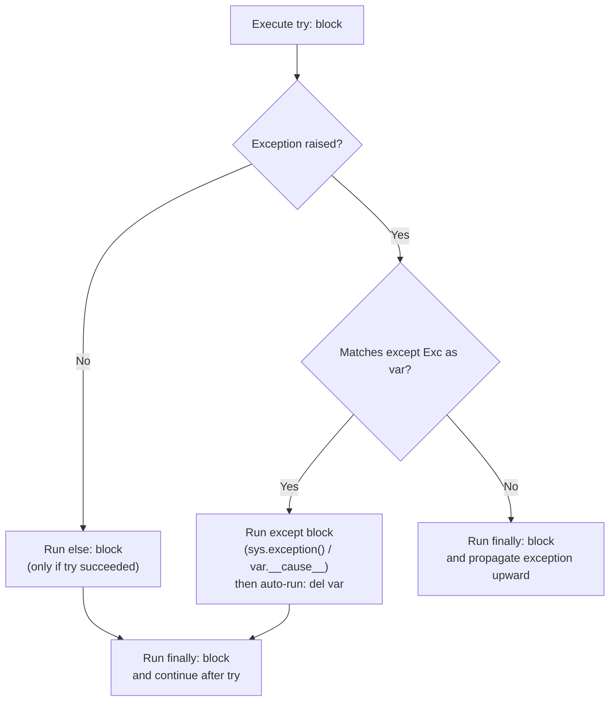

# 3.5 Errors, files, text and bytes, subprocess and system scripting

| | |
|---|---|
| Level | Intermediate |
| Priority tier | 0 |
| Lab venue | Linux VM (root for some exercises), Python 3.11+ |
| Part | Part 3: Python for infrastructure |
| Status | Drafted, labs **untested** |

## Why this matters for AI infrastructure

Infrastructure code lives at the boundary with the messy world: files that don't exist or are half-written, commands that fail with partial output, encodings that differ between hosts, signals that arrive mid-operation, terminals that aren't there under cron or systemd. A script that works on a laptop and corrupts a checkpoint directory at 3 a.m. usually failed in one of these places. This chapter covers the discipline of failure (exceptions, cleanup, retries, exit codes, logging), file and path handling (`pathlib`, atomic writes, permissions, temporary files, locking), text versus bytes and serialisation formats (JSON, YAML, CSV, TOML, struct), running external programs safely (`subprocess`), interacting with the OS (environment, signals, processes, `psutil`, `/proc`, `/sys`), and a template for robust operational scripts.

## Prerequisites and outcomes

You should know functions and collections (3.1), idioms (3.3) and classes (3.4); Linux fundamentals from Part 1 help.

After this chapter you can:

- Use `try`/`except`/`else`/`finally`, raise and chain exceptions, define exception hierarchies, use `with`, `ExceptionGroup`/`except*`, and design error handling (what to catch, where, how to report), including exit codes.
- Use `logging` correctly (levels, handlers, formatters, structured logs), and `warnings`.
- Read and write files safely: modes, encodings, buffering, atomic replace, permissions, temp files, file locks, `pathlib`, `shutil`, `os`, globbing, directory walks, `os.scandir`, `mmap`.
- Convert between text and bytes; handle encodings and errors; use `struct`, `base64`, `hashlib`, `zlib`/`gzip`/`tarfile`/`zipfile`.
- Parse and emit JSON, YAML, TOML, CSV and INI safely; handle large and malformed data.
- Run subprocesses safely (`subprocess.run`, `Popen`, pipes, timeouts, env, cwd, streaming output, process groups), avoid shell injection, and wrap CLI tools robustly.
- Handle signals and graceful shutdown; inspect processes and system state (`psutil`, `/proc`, `/sys`, `os`, `platform`, `socket`, `ipaddress`).
- Write production-grade operational scripts: idempotent, observable, safe to re-run, with dry-run mode and clear exit codes.

## 1. Exceptions

### Why exceptions exist

Imagine a pizza-making robot, a culinary automaton that runs a plan written as a Python program. It takes an order, prepares the dough, adds the toppings, and bakes the pie. Now suppose something goes very wrong in the "bake the pie" step. Perhaps the oven is broken, or the robot miscalculates its reach and spontaneously combusts. There is no point in finishing the plan, so the robot should jump to code that handles the problem right away.

Exceptions let a program do exactly that. When something goes wrong, Python jumps to an exception handler in one step. Everything started since the handler was entered gets abandoned. The handler then decides how to respond, for example by calling the fire department.

Think of an exception as a structured `goto`. A `try` statement leaves a marker and runs some code. Later, an exception sends Python back to that marker, and any functions called after it are dropped. The program then resumes at the marker.

The big payoff is simpler code. You do not check a status code after every operation and every function call. You catch errors only in the places where you can actually recover from them.

### Exception roles

Exceptions do more than report errors. They show up in five common roles.

**Error handling.** Python raises an exception whenever it finds an error while the program runs. You can catch it and recover, or you can ignore it. If you ignore it, Python stops the program and prints an error message. A `try` statement lets your program keep going after the error.

**Event notification.** An exception can also signal a normal but important condition. A search routine might raise an exception when nothing is found. That is better than returning an integer result code, because a code might also be a real answer.

**Special-case handling.** Some conditions are so rare that handling them in many places clutters the code. You can handle them once, in a handler higher up the program. An `assert` can also check that conditions hold while you develop.

**Termination actions.** The `finally` clause guarantees that closing work runs, whether or not an error happened. The `with` statement gives the same guarantee for objects that support it.

**Unusual control flows.** Python has no `go to` statement and no built-in backtracking. Exceptions can still fill some of these roles. A `raise` can jump out of several nested loops, which a `break` cannot do.

### Mechanics

An **exception** is an object representing an error or unusual condition; raising it unwinds the call stack until a matching handler is found; if none exists the program prints a traceback and exits with status 1.

```python
try:
    value = int(text)
    result = 100 / value
except ValueError as exc:                 # specific exception first
    print(f"not a number: {exc}")
except ZeroDivisionError:
    result = float("inf")
except (KeyError, IndexError) as exc:     # multiple types
    raise                                  # bare raise re-raises the current exception with its traceback
else:                                      # runs only if no exception occurred in try
    print("ok", result)
finally:                                   # ALWAYS runs: cleanup
    print("done")
```

- Handlers are matched **in order** by `isinstance`; put specific before general. The exception hierarchy: `BaseException` → `Exception` → (`OSError` → `FileNotFoundError`, `PermissionError`, `TimeoutError`, `ConnectionError`...; `ValueError`; `TypeError`; `KeyError`/`IndexError` (`LookupError`); `RuntimeError`; `AttributeError`; `ImportError`; `StopIteration`...). `KeyboardInterrupt` and `SystemExit` derive from `BaseException`, deliberately not from `Exception`, so `except Exception` doesn't swallow Ctrl-C or `sys.exit()`.
- **Never use a bare `except:`** (it catches `KeyboardInterrupt`/`SystemExit` too) and avoid `except Exception: pass`: silent failure is how data loss hides. Catch the narrowest exceptions you can *handle*; let others propagate to a boundary that logs and exits.
- `else` keeps the `try` body minimal (only the code that may raise what you catch), preventing accidental catching of unrelated errors from the success path.
- `finally` and `with` guarantee cleanup; a `return` inside `finally` swallows exceptions (avoid).
- **Raising**: `raise ValueError("bad value")`; instantiate with context (`raise ConfigError(f"missing key {key!r} in {path}")`). **Chaining**: `raise NewError("...") from exc` sets `__cause__` (explicit translation of low-level errors into domain errors); implicit chaining shows "During handling of the above exception, another exception occurred"; `raise ... from None` suppresses context when the original is noise.
- **Exception objects**: `exc.args`, `str(exc)`, `repr(exc)`, `exc.__traceback__`, `exc.add_note("hint")` (3.11), `traceback.format_exc()`, `logging.exception()` (logs message + traceback inside handlers).
- **`except Exc as var:` scope and reference-cleanup rule**: the variable bound after `as` in an `except` clause is local to that `except` block and is **automatically unbound (`del var`) when the `except` block exits**—even if `var` was previously assigned a value in the surrounding scope. Python removes this binding on exit because the caught exception's `__traceback__` attribute holds references to the runtime call stack frames (and their local variables), so keeping `var` alive would create a reference cycle that delays garbage collection and retains memory. If you need the exception object after the `try` statement finishes, assign it to a separate variable inside the handler:

```python
# In the book's examples (untested here):
X = 99
try:
    1 / 0
except Exception as X:
    print(X)               # division by zero
    saveit = X             # assign to another name if you need the exception after the block
# Here X is unbound (raises NameError: name 'X' is not defined), whereas saveit is ZeroDivisionError('division by zero')
```

- **Custom exceptions (`NodeUnreachable`), category hierarchies (`NumErr`), and structured state (`FormatError`, `LP` Chapter 35)**: derive from `Exception` (never a standalone class that doesn't inherit from `BaseException`), name them for the condition (`NodeUnreachable`), and organize library exceptions under a common superclass category (such as `class NumErr(Exception): pass` with subclasses `Divzero(NumErr)`, `Oflow(NumErr)`, and `Uflow(NumErr)`, or `General` -> `Specific1`, `Specific2` in `categoric.py`) so callers catching `except mathlib.NumErr:` automatically catch future subclasses like `Uflow` without editing their `except` list. Any positional arguments passed to `Exception(...)` are stored in the `exc.args` tuple and displayed by `str(exc)` (to customize display, override `__str__` rather than `__repr__` because built-in `BaseException` already defines `__str__`). Better yet, attach explicit attributes and behavior methods (`class FormatError(Exception): def __init__(self, line, file): self.line = line; self.file = file; def logerror(self): ...` in `parsely.py`).
- **Control-flow and syntactic `try` nesting (`action1..3`), `sys.exc_info()` vs `sys.exception()`, and bare `except:` traps (`LP` Chapters 33, 34, 36)**:
  - Unlike true backtracking, Python exceptions do **not** undo mutations performed before the exception was raised (`L.append('added')` inside a `try` block stays in `L` after `except IndexError:`), and once an `except` block finishes, execution continues **after** the `try` statement rather than resuming at the line that raised.
  - Python stacks active `try` handlers at runtime (whether nested across function calls `action1 -> action2 -> action3` in `nested_exc_normal.py` or nested syntactically): when an exception is raised, Python unwinds to the nearest matching `except`, executing **every** enclosing `finally` block along the way (`Inner try` -> `Outer try`).
  - Inside an `except` handler without an `as var` target, **`sys.exception()`** (added in Python 3.11) returns the active exception instance directly, while **`sys.exc_info()`** returns the 3-tuple `(exc_type, exc_value, exc_traceback)` used by `traceback.print_exc(file=open('badly.txt', 'w'))` (`badly.py`) and `traceback.format_exc()`.
  - Two classic bugs show why bare `except:` is dangerous (`LP` Chapter 36 `exiter.py`): (1) `sys.exit(62)` raises `SystemExit` (a subclass of `BaseException`, not `Exception`), so a bare `except:` catches and ignores the exit request (`Got it -> Continuing...`) instead of terminating; and (2) `try: x = myditctionary[key] except: x = None` silently catches the `NameError` from the misspelled variable name `myditctionary` and turns a typo into silent data corruption.



```python
class OpsError(Exception):
    """Base class for errors in this tool."""
class ConfigError(OpsError): ...
class RemoteError(OpsError):
    def __init__(self, host, status, body=""):
        super().__init__(f"{host}: HTTP {status}")
        self.host, self.status, self.body = host, status, body

def load_config(path):
    try:
        text = Path(path).read_text(encoding="utf-8")
    except FileNotFoundError as exc:
        raise ConfigError(f"config file not found: {path}") from exc
    ...
```

- **Assertions** (`assert cond, "message"`, `LP` Chapter 34 `asserter.py`, equivalent to `if __debug__: if not cond: raise AssertionError("message")`) check programmer assumptions in tests and internal invariants; they are compiled out completely when running with `python -O` (setting `__debug__ == False`), so never use them for input validation or security checks.
- **Warnings** (`warnings.warn("x is deprecated", DeprecationWarning, stacklevel=2)`), controlled by `-W` flags and filters; tests can turn them into errors.
- **Exception groups (3.11, `LP` Chapter 35)**: `ExceptionGroup("batch failed", [IndexError(), TypeError(1), TypeError(2)])` and **`except*`** (`except* IndexError as E:` followed by `except* TypeError as E:`) can execute **multiple** handler clauses for a single `try` statement, binding `E` to a sub-`ExceptionGroup` containing all matching exceptions (`E.exceptions`), while any unmatched exceptions propagate upward in a remaining `ExceptionGroup` (used by `asyncio.TaskGroup`, chapter 3.6; note that `except*` cannot be mixed with plain `except` in the same `try`, and cannot contain `return`, `break`, or `continue`).
- **Context managers (`LookingGlass` and `@contextmanager looking_glass`, `FP` Chapter 18 & `LP` Chapter 34)**: `with expr1 as v1, expr2 as v2:` (or parenthesized multi-line `with (open('lines1.txt') as input, open('uppers.txt', 'w') as output):` in Python 3.10+) guarantees deterministic teardown (`decimal.localcontext()`, `threading.Lock()`, files). In *Fluent Python* Chapter 18 (`Examples 18-1` to `18-8`, modeled in `code/part03/python_errors_files_subprocess.py`), `LookingGlass.__enter__(self)` monkey-patches `sys.stdout.write` to reverse printed strings and returns `'JABBERWOCKY'` (bound to the `as what` variable), while `__exit__(self, exc_type, exc_value, traceback)` restores `sys.stdout.write` and, if `exc_type is ZeroDivisionError`, logs a divide-by-zero message and returns `True` to suppress the exception. When writing the equivalent `@contextlib.contextmanager def looking_glass():` generator, **you must wrap the `yield` in a `try ... finally:` block** (`try: yield 'JABBERWOCKY' except ZeroDivisionError: ... finally: sys.stdout.write = original_write`), because an unhandled exception inside the `with` body is thrown into the generator at the `yield` point via `gen.throw(exc)`. And when a function needs to enter a dynamic or variable number of context managers (such as opening an arbitrary list of files without nested `with` blocks), use **`contextlib.ExitStack`** (`with ExitStack() as stack: files = [stack.enter_context(open(f)) for f in filenames]`), which unwinds all registered callbacks and context managers in LIFO order on exit.

### Default exception handler

Here is a small function that picks one item out of an object by index.

```python
def fetcher(obj, index):
    return obj[index]

food = 'pizza'
fetcher(food, 4)    # like food[4], the last item: 'a'
fetcher(food, 5)    # off the end of the string
```

With a legal index, the function returns a character. Index 5 falls off the end of `pizza`. Python detects the bad index and raises the built-in `IndexError`. Our code does not catch it, so the exception travels up to the top of the program. There, Python's default handler prints a message and a traceback.

```
Traceback (most recent call last):
File "<stdin>", line 1, in <module>
File "<stdin>", line 2, in fetcher
IndexError: string index out of range
```

A traceback lists the lines and functions that were active when the error happened. The text can change a little by release, and by interactive shell, so do not depend on its exact wording in your code. In a console, the filename may show as `<stdin>`. In IDLE's shell, it shows as `<pyshell...>` and the source lines appear too. Line numbers mean little when there is no file behind the code.

Outside the REPL, the default handler also stops the program right after it prints. That is fine for simple scripts, because errors are often fatal. The best you can do is read the message and fix the cause.

### Catching exceptions

Some programs must stay up after an internal error. A server that quits on the first bad index is not much use. So you wrap the risky call in a `try` statement and catch the exception yourself.

```python
try:
    fetcher(food, 5)
except IndexError:          # handle the error here
    print('got exception')
```

Python jumps to the block under `except` when an exception is raised while the `try` block runs. The result is a handler that wraps a nested block of code. When you type top-level `try` examples into a REPL, leave out the `...` continuation prompts. The `except` and `finally` lines must line up with their `try`.

In a real function, the handler also lets the program carry on:

```python
def catcher():
    try:
        fetcher(food, 5)
    except IndexError:
        print('got exception')
    print('continuing')

catcher()
```

This prints `got exception` and then `continuing`. The program resumes after the whole `try` statement, so you never see the default message. There is no way to go back to the line that failed. You would have to run that code again. Functions that were exited because of the error lose their variables, and they cannot be resumed. The `try` is both the catch point and the resume point.

Python also does not undo work done before the error. Changes to mutable objects and to global names stay in place.

```python
L, S = [], 'text'

def modder():
    L.append('added')           # change a mutable object
    global S; S = 'changed'     # change a global name
    fetcher(food, 5)            # raise an exception

try:
    modder()
except IndexError:
    print('got exception')

L, S    # (['added'], 'changed')
```

That is fine once you know about it. The `try` can also use `except*` clauses to handle several exceptions at once. That is a convoluted extension with a narrow scope. You can safely study it after you master the basics.

### Raising exceptions

Your own code can also find a bad state. When it does, it should signal the problem the same way Python does. The `raise` statement does that.

```python
try:
    raise IndexError            # trigger the exception ourselves
except IndexError:
    print('got exception')
```

This prints `got exception`. User-triggered exceptions are caught the same way as the ones Python raises. If nothing catches them, they reach the default handler and stop the program:

```
Traceback (most recent call last):
File "<stdin>", line 1, in <module>
IndexError
```

The `assert` statement is a conditional `raise`. It fires only when its test is false, and it is mostly for debugging and sanity checks during development. In this example, the test `1 < 0` is false, so Python raises `AssertionError` with the message `Not in this universe!`.

```python
assert 1 < 0, 'Not in this universe!'
```

A `raise` can also use a `from` clause to chain exceptions. This is not common, but it can add context where that context helps.

### User-defined exceptions

Built-in names such as `IndexError` do not describe every problem. A failed pizza needs its own name. You make one by writing a class that inherits from a built-in exception, usually `Exception`.

```python
class Combust(Exception): pass      # user-defined exception

def makePizza():
    raise Combust()                 # raise an instance

try:
    makePizza()
except Combust:                     # catch the class name
    print('got exception')
```

This prints `got exception`. Exception classes let scripts build categories. They can inherit behavior, hold state, and define methods. An `as` clause on `except` gives you access to the exception object itself.

An exception class can also control the message it shows when nothing catches it:

```python
class Combust(Exception):
    def __str__(self):
        return 'Call the fire department!...'

raise Combust()
```

Because nothing catches this one, the default handler prints the usual traceback. The last line shows the class name, followed by the text your `__str__` method returned.

### Termination actions with `finally`

Termination actions are the steps that must run no matter how a block ends. Closing a file is the usual example. The `finally` option guarantees that required closing-time operations run, with or without exceptions in your program. Plain code after a call is a weak fix, because it never runs when the call raises an error.

```python
fetcher(food, 4)
print('after fetch')
```

If `fetcher` raises an exception, the `print` is skipped. A `try` with a `finally` clause fixes that. The `finally` block runs on the way out, whether or not an error happened.

```python
try:
    fetcher(food, 4)
finally:
    print('after fetch')
```

When nothing goes wrong, the `finally` block runs and the program continues after the `try`. Now look at the error case inside a function:

```python
def after():
    try:
        fetcher(food, 5)
    finally:
        print('after fetch')
    print('after try?')
```

Calling `after()` prints `after fetch` first, then the traceback. You never see `after try?`, because control does not return after the `try` when an exception occurs. Python runs the `finally` block, then passes the exception up to a handler above it. In this case, that handler is the default one.

If the index is legal, both lines run:

```python
def after():
    try:
        fetcher(food, 4)
    finally:
        print('after fetch')
    print('after try?')
```

This prints `after fetch` and then `after try?`. Use `except` to recover from errors, such as ones raised by a third-party library. Use `try` with `finally` to make sure files close and server connections end. You can mix `except` and `finally` in one `try`. The `finally` block still runs either way.

The `with` statement offers a shorter form for some object types. It runs the object's setup and cleanup methods, so termination work happens even if the block raises an exception.

```python
with open('pizzarobot.txt', 'w') as file:     # always close the file on exit
    file.write('Catch fire!\n')
```

This form needs fewer lines, but it works only with object types that support it. `try`/`finally` is more general. It is often simpler than writing a class when `with` is not supported. The `with` statement can also run startup actions, and it accepts your own context managers.

### Exceptions and backtracking

Backtracking undoes the work done before it jumps back. Python exceptions do not do that. Local variables in the functions called inside a `try` are discarded. Changes to globals and to objects stay in place.

You can still build backtracking yourself. Use exceptions together with logic that unwinds your assignments. Generators in *Learning Python* Chapter 20 do not backtrack fully either. They save their state and resume when `next()` asks for the next value. For more on true backtracking, look at books on AI or at the Prolog and Icon languages.

### Why exceptions save code

In languages without exceptions, you check every result. Here is a C-style sketch of a function that runs several steps.

```c
int run_job(void) {
    if (doFirstThing() == ERROR)
        return ERROR;
    if (doNextThing() == ERROR)
        return ERROR;
    ...
    return doLastThing();
}
```

Robust C code often has as much error-checking as real work. Python does not need that much care. You wrap a large part of the program in a handler, and you write only the steps that do the work.

```python
def do_stuff():
    do_first_thing()    # no error checks here,
    do_next_thing()     # so we do not need to detect errors
    ...
    do_last_thing()

if __name__ == '__main__':
    try:
        do_stuff()      # the one place where we check results
    except Exception:
        bad_ending()
    else:
        good_ending()
```

The *Learning Python* version uses a bare `except:`. This handbook prefers `except Exception:`, because a bare `except:` also catches Ctrl-C and `sys.exit()`. Control jumps straight to the handler when an error happens. You do not guard every line, and the normal path does not run extra checks. Python also finds many errors on its own, so your code often does not look for them at all.

### Summary of exception tools

Exceptions are a control-flow tool. Python raises them, or your own code does. If nothing catches one, the default handler prints the error and stops the program. A `try` statement catches and recovers, and its `finally` block runs cleanup either way. `raise` and `assert` trigger exceptions on demand, and `with` handles termination work for objects that support it.

### Error-handling strategy for tools and services

1. **Fail fast on programmer errors and invalid input** at the boundary (validate config/arguments immediately, with clear messages).
2. **Handle expected operational failures** (network timeouts, missing files, 404s, lock contention) where you can do something sensible: retry with backoff, skip with a log, fall back, or translate to a domain error.
3. **Don't catch what you can't handle**; let unexpected exceptions bubble to one top-level handler that logs the traceback and exits non-zero.
4. **Preserve information**: chain exceptions, include identifiers (host, path, request id) in messages, log tracebacks once (not at every level).
5. **Make cleanup unconditional** (`with`, `finally`) and **idempotent**.
6. **Be explicit about partial failure**: when processing 500 hosts, collect results per host and report a summary and non-zero exit if any failed, rather than aborting at the first error or hiding failures.
7. **Retries**: only for transient errors and idempotent operations; exponential backoff with jitter and a cap; limit attempts and total time; log each attempt. Libraries: `tenacity`, `backoff`, or a small helper (chapter 3.1).
8. **Timeouts everywhere** on network and subprocess calls (the default is often "forever").

```python
import sys, logging
log = logging.getLogger("myops")

def main(argv=None) -> int:
    try:
        args = parse_args(argv)
        results = run(args)
    except OpsError as exc:
        log.error("%s", exc)                  # expected, user-facing errors: message only
        return 2
    except KeyboardInterrupt:
        log.warning("interrupted"); return 130
    except Exception:
        log.exception("unexpected failure")   # bug: full traceback
        return 1
    failed = [r for r in results if not r.ok]
    for r in failed: log.error("%s failed: %s", r.host, r.error)
    return 1 if failed else 0

if __name__ == "__main__":
    raise SystemExit(main())
```

Conventional exit codes: `0` success, `1` general error, `2` usage/argument error (argparse uses 2), `126/127` command not executable/not found (shell), `128+N` killed by signal N (130 = SIGINT, 143 = SIGTERM). Use documented codes when callers (CI, systemd, schedulers) distinguish them (for example, EX_TEMPFAIL 75 to request retry).

## 2. Logging

`print` is for program output; **`logging`** is for diagnostics, with levels, destinations and structure.

```python
import logging, sys

def setup_logging(verbosity=0, json_logs=False):
    level = {0: logging.WARNING, 1: logging.INFO}.get(verbosity, logging.DEBUG)
    handler = logging.StreamHandler(sys.stderr)                  # logs to stderr; stdout stays clean for data
    handler.setFormatter(logging.Formatter("%(asctime)s %(levelname)-8s %(name)s: %(message)s", "%Y-%m-%dT%H:%M:%S%z"))
    root = logging.getLogger(); root.setLevel(level); root.handlers[:] = [handler]

log = logging.getLogger(__name__)         # one logger per module; never configure handlers in library code
log.debug("polling %s", host)             # lazy formatting: args formatted only if the record is emitted
log.info("started job %s on %d nodes", job_id, len(nodes))
log.warning("retrying %s in %.1fs", host, delay)
log.error("failed to reach %s", host, exc_info=True)       # attaches the current traceback
log.exception("unexpected")               # error + traceback (use inside except)
log.critical("out of disk")
```

- Levels: DEBUG, INFO, WARNING, ERROR, CRITICAL; set them via config/env, not by editing code.
- Use `%s` args, not f-strings, in log calls (cheaper when disabled; consistent aggregation).
- Libraries get a logger and add `logging.NullHandler()`; applications configure handlers once at startup.
- **Destinations**: stderr (containers/systemd capture it into the journal), `RotatingFileHandler`/`TimedRotatingFileHandler`, `SysLogHandler`, `SocketHandler`, `QueueHandler` for non-blocking logging, `logging.config.dictConfig` for declarative setups.
- **Structured logging** (JSON lines with fields like `host`, `job_id`, `duration_ms`) is far easier to search: `structlog`, `python-json-logger`, or a custom `Formatter`; include a correlation/request id. Redact secrets and personal data.
- Do not log inside tight loops at INFO; log summaries and sampled details; include units.
- In containers log to stdout/stderr and let the platform ship them (chapter on observability).

## 3. Files and paths

### `open()` and modes

```python
with open(path, "r", encoding="utf-8", errors="strict", newline=None) as f: ...
# modes: 'r' read text, 'w' truncate+write, 'a' append, 'x' exclusive create (fails if exists), '+' read/write, 'b' binary
with open("/tmp/x.bin", "rb") as f:
    header = f.read(16); f.seek(0, 2); size = f.tell(); f.seek(0)
for line in f_text: ...        # iterate lazily
data = f.read(); f.readlines(); f.readline(); f.write("text"); f.writelines(items); f.flush(); os.fsync(f.fileno())
```

- Text mode decodes/encodes with the given `encoding` and translates newlines; **always specify the encoding** (`utf-8`) for text. Binary mode returns `bytes`.
- Files are **buffered**; `flush()` pushes Python's buffer to the OS, `os.fsync()` forces data to disk (needed for durability, e.g. before renaming a checkpoint). `buffering=0` (binary only) unbuffered; line buffering with `buffering=1` or `-u`.
- Always use `with` (closes even on exceptions); never leave file handles to the garbage collector.
- Iterate files line by line (`for line in f`) for streaming; `read()` loads everything (fine for small files only).
- **Large files**: chunked reads (`iter(lambda: f.read(1<<20), b"")`), `mmap` for random access without copying (`mmap.mmap(f.fileno(), 0, access=mmap.ACCESS_READ)`), `os.sendfile`, `shutil.copyfileobj`.
- `errors="replace"|"backslashreplace"|"surrogateescape"` for logs and file names that may contain invalid UTF-8 (`surrogateescape` round-trips arbitrary bytes).

### `pathlib`

```python
from pathlib import Path
p = Path("/etc/kubernetes") / "manifests" / "kube-apiserver.yaml"      # '/' joins
p.exists(), p.is_file(), p.is_dir(), p.is_symlink(), p.stat().st_size, p.stat().st_mtime, p.resolve(), p.parent, p.name, p.stem, p.suffix, p.suffixes, p.with_suffix(".bak"), p.relative_to("/etc"), p.expanduser()
p.read_text(encoding="utf-8"); p.write_text("x\n", encoding="utf-8"); p.read_bytes(); p.write_bytes(b"")
p.mkdir(parents=True, exist_ok=True); p.touch(); p.unlink(missing_ok=True); p.rename(q); p.replace(q); p.rmdir()
Path("/var/log").glob("*.log"); Path("/data").rglob("*.parquet"); sorted(Path(".").iterdir())
Path.home(), Path.cwd(), Path(__file__).resolve().parent
p.chmod(0o640); p.owner(); p.group(); os.chown(p, uid, gid)
p.walk()                       # 3.12+: like os.walk
```

Prefer `pathlib` over string manipulation and `os.path`; pass `Path` objects to most standard functions (they implement `os.PathLike`). `os.scandir` is the fast low-level directory iterator (used by `os.walk`) and returns file type info without extra `stat` calls; for millions of files on parallel file systems, minimise metadata operations (avoid per-file `stat` when possible, batch, or use the file system's tools).

### Safe writes: atomic replace

Writing a file in place can leave a truncated file if the process crashes or the disk fills; readers may see partial content. The pattern: write to a temporary file **in the same directory** (same file system), flush and fsync, then `os.replace()` (atomic rename).

```python
import os, tempfile
from pathlib import Path

def atomic_write(path, data: str | bytes, mode=0o644):
    path = Path(path); path.parent.mkdir(parents=True, exist_ok=True)
    binary = isinstance(data, bytes)
    fd, tmp = tempfile.mkstemp(dir=path.parent, prefix=f".{path.name}.", suffix=".tmp")
    try:
        with os.fdopen(fd, "wb" if binary else "w", **({} if binary else {"encoding": "utf-8"})) as f:
            f.write(data); f.flush(); os.fsync(f.fileno())
        os.chmod(tmp, mode)
        os.replace(tmp, path)                      # atomic on POSIX
        dirfd = os.open(path.parent, os.O_DIRECTORY); os.fsync(dirfd); os.close(dirfd)    # persist the rename
    except BaseException:
        Path(tmp).unlink(missing_ok=True); raise
```

Use this for config files, state files, checkpoints' manifests and anything read by other processes. Beware network file systems (NFS, Lustre): atomic rename semantics hold within a directory on most, but caching and consistency rules differ; test.

### Temporary files and directories

`tempfile.TemporaryDirectory()`, `NamedTemporaryFile(delete=False)`, `mkstemp()` (secure, unique, 0600), `mkdtemp()`. Never construct temp file names yourself in `/tmp` (predictable names enable symlink attacks and collisions). Clean up with context managers; place large scratch data on the right file system (`TMPDIR`).

### Permissions, ownership and umask

`os.chmod`, `os.chown`, `os.umask`, `Path.chmod`, `stat` modes (`stat.S_IRUSR`), `os.access` (beware TOCTOU). Create secret files with restrictive modes from the start (`os.open(path, os.O_WRONLY | os.O_CREAT | os.O_EXCL, 0o600)`), not create-then-chmod. Check `0o` octal literals.

### Locking and races

Concurrent scripts (cron overlap, two operators) can corrupt state. Options: **lock files** with `fcntl.flock(fd, fcntl.LOCK_EX | fcntl.LOCK_NB)` (advisory, released on process exit), `os.open(path, O_CREAT | O_EXCL)` exclusive creation, the `filelock` library, `flock` command wrapper, or databases/etcd leases for distributed locks. Avoid **TOCTOU** races: instead of `if not exists: create`, attempt the operation and handle the exception (`open(..., "x")`, `os.mkdir`, `Path.mkdir(exist_ok=True)`).

```python
import fcntl, sys
lock = open("/run/myops.lock", "w")
try:
    fcntl.flock(lock, fcntl.LOCK_EX | fcntl.LOCK_NB)
except BlockingIOError:
    sys.exit("another instance is running")
```

### `shutil`, archives and compression

`shutil.copy2` (preserves metadata), `copytree(dirs_exist_ok=True)`, `move`, `rmtree` (dangerous: validate the path first), `disk_usage`, `which`, `make_archive`, `unpack_archive`; `Path.walk` (3.12+); `tarfile` (beware path traversal when extracting untrusted archives: use `filter="data"` in 3.12+ or validate members), `zipfile`, `gzip`, `bz2`, `lzma`, `zlib`; `hashlib.sha256` streaming digests for integrity of artifacts (`for chunk in iter(lambda: f.read(1<<20), b""): h.update(chunk)`).

## 4. Text, bytes and encodings in practice

- **Rule (`LP` Chapter 37 & `FP` Chapter 4)**: decode at the input boundary, work with `str` internally, encode at the output boundary. Python 3 strictly separates three string/byte types:
  1. **`str`**: an immutable sequence of Unicode code points (`ord('a') == 97 == 0x61`, `ord('Ä') == 196 == 0xc4`, `ord('🙂') == 128578 == 0x1f642`; literals support `\xNN`, `\uNNNN`, `\UNNNNNNNN`, and `\N{NAME}` escapes).
  2. **`bytes`**: an immutable sequence of 8-bit integers (`0..255`, where `b'code'[0] == 99`, slicing `b'code'[1:3] == b'od'` returns `bytes`, and mixing `b'ab' + 'cd'` or `open('temp.txt', 'w').write(b'abc\n')` raises `TypeError`).
  3. **`bytearray`**: a mutable sequence of 8-bit integers (`C = bytearray(b'code'); C[0] = ord('x'); C.extend(b'LMNO')`).
  In `LP` Chapter 37's `'AÄBèC'` example (`len('AÄBèC') == 5` characters), encoding to UTF-8 (`'AÄBèC'.encode('utf-8')`) produces **7 bytes** (`b'A\xc3\x84B\xc3\xa8C'`, taking 2 bytes for each accented character), whereas encoding to Latin-1 (`'AÄBèC'.encode('latin-1')`) produces **5 bytes** (`b'A\xc4B\xe8C'`, 1 byte per character for code points `0..255`), and `'AÄBèC'.encode('ascii')` raises `UnicodeEncodeError`.
- **UTF-8 and the 4 default encodings (`LP` Chapter 37 & `FP` Chapter 4)**: Python queries four distinct encoding settings—`sys.getdefaultencoding()` (`'utf-8'`), `locale.getpreferredencoding(False)` (default for `open()` when `encoding=` is omitted; can be `'ANSI_X3.4-1968'`/`ASCII` in containers with `LANG=C` or `'cp1252'` on Windows), `sys.stdout.encoding` (overridden by `PYTHONIOENCODING`), and `sys.getfilesystemencoding()` (used by `os.listdir`/`os.walk`, which return `str` paths when passed a `str` directory or `bytes` paths when passed a `bytes` directory like `os.walk(b'.')`). Set **`PYTHONUTF8=1`** (or `-X utf8`, PEP 540/597/686) and always pass `encoding="utf-8"` explicitly.
- **Unicode errors and BOMs**: `UnicodeDecodeError` means bytes aren't valid in the assumed encoding (and `UnicodeEncodeError` when characters cannot be represented in the target codec, handled via `errors="ignore"|"replace"|"xmlcharrefreplace"|"backslashreplace"`). Diagnose with `file -i`, `chardet`/`charset-normalizer`, or `bytes.decode("utf-8", errors="replace")`; for opaque undecodable bytes in OS filenames use `os.fsdecode`/`os.fsencode` and **`errors="surrogateescape"`** (PEP 383, which maps lone bytes `0x80..0xFF` to low surrogate code points `U+DC80..U+DCFF` on decode and restores the exact original bytes on encode). UTF-16 (`b'\xff\xfe'` little-endian `utf-16-le` or `b'\xfe\xff'` big-endian `utf-16-be`) and Windows UTF-8 files often prepend a Byte Order Mark (**BOM**); use **`encoding="utf-8-sig"`** to strip an optional UTF-8 BOM (`b'\xef\xbb\xbf'`) transparently on read.
- **Unicode normalization (`NFC`, `NFD`, `NFKC`, `NFKD`), `casefold()`, `shave_marks_latin()`, and `str` vs `bytes` regexes (`FP` Chapter 4 & `LP` Chapter 37)**:
  - Precomposed `'caf\u00e9'` (`len == 4`) and decomposed `'cafe\u0301'` (`len == 5`, `'e'` + `COMBINING ACUTE ACCENT`) render identically as `'café'` but compare unequal (`s1 == s2` is `False`) until normalized with **`unicodedata.normalize('NFC', s)`** (`nfc_equal(s1, s2)` is `True`; W3C recommends `'NFC'`, whereas `'NFKC'`/`'NFKD'` also transform compatibility characters like `'½'` -> `'1⁄2'` and `'µ'` -> `'μ'`, and singletons like Ohm `'\u2126'` normalize to Greek Omega `'\u03a9'` under `'NFC'`).
  - For case-insensitive comparisons (`fold_equal`), normalize with `'NFC'` and call **`.casefold()`** (`'Straße'.casefold() == 'strasse'`).
  - To strip diacritics from Latin characters without corrupting Greek or Cyrillic text (`shave_marks_latin` in `FP` Chapter 4 `Example 4-16`), decompose with `'NFD'`, drop `unicodedata.combining(c)` marks only when the preceding base character is in `string.ascii_letters`, and recompose with `'NFC'` (`'São Paulo: Zéphyr & Ελληνικά'` -> `'Sao Paulo: Zephyr & Ελληνικά'`). For human-alphabetical sorting of accented words (`['caju', 'atemoia', 'cajá', 'açaí', 'acerola']`), use `locale.strxfrm` or `pyuca.Collator()`.
  - In `re` regular expressions (`FP` Chapter 4 `Example 4-23 ramanujan.py`), a **`str` pattern `r'\d+'`** matches both ASCII and Unicode digits (such as Tamil digits `'\u0be7\u0bed\u0be8\u0bef'`), whereas a **`bytes` pattern `rb'\d+'`** matches only ASCII `0..9` (or pass `re.ASCII` to a `str` regex).
- **Binary protocols (`struct`)**: `struct.pack(">i4sh", 7, b"code", 8)` (`b'\x00\x00\x00\x07code\x00\x08'` in `LP` Chapter 37) and `struct.unpack(">i4sh", B)` (`(7, b'code', 8)`), `struct.pack("<IHB", 1, 2, 3)`, `struct.unpack_from`, `int.from_bytes(b, "big")`, `.to_bytes(4, "little")`, `memoryview`, `bytearray`; endianness (network order is big-endian: `!` or `>`); `ctypes`/`cffi` for C structures; `construct`/`kaitai` for complex formats.
- **Encodings of text protocols**: HTTP headers are Latin-1/ASCII; JSON must be UTF-8; YAML UTF-8/16; CSV from spreadsheets may be `utf-8-sig` (BOM) or `cp1252`.
- **Newlines**: `\n` vs `\r\n`; open with `newline=""` for CSV; strip with `rstrip("\n")` or `splitlines()`.
- **Base64/hex**: `base64.b64encode(b).decode("ascii")`, `urlsafe_b64encode`, `bytes.hex()`.
- **Terminal output**: ANSI colours only when `sys.stdout.isatty()`; honour `NO_COLOR`; progress bars to stderr; machine-readable output (JSON lines) when piped.

## 5. Data formats

```python
import json, csv, tomllib, configparser
# JSON
data = json.loads(text); text = json.dumps(data, indent=2, sort_keys=True, ensure_ascii=False, default=str)
with open("x.json", encoding="utf-8") as f: data = json.load(f)
for line in open("events.jsonl", encoding="utf-8"): rec = json.loads(line)          # JSON Lines: stream-friendly
# YAML (PyYAML)
import yaml
cfg = yaml.safe_load(open("cfg.yaml", encoding="utf-8"))             # never yaml.load on untrusted input (arbitrary object construction)
yaml.safe_dump(cfg, sort_keys=False, default_flow_style=False)
docs = list(yaml.safe_load_all(open("k8s.yaml")))                    # multi-document manifests
# TOML (read-only stdlib since 3.11; use tomli-w to write)
cfg = tomllib.loads(Path("pyproject.toml").read_text(encoding="utf-8"))
# CSV
with open("nodes.csv", newline="", encoding="utf-8") as f:
    for row in csv.DictReader(f): ...
with open("out.csv", "w", newline="", encoding="utf-8") as f:
    w = csv.DictWriter(f, fieldnames=["name", "gpus"]); w.writeheader(); w.writerows(rows)
# INI
cp = configparser.ConfigParser(); cp.read("/etc/app.ini"); cp["db"].getint("port", fallback=5432)
```

Guidance: JSON for machine interchange, YAML for human-edited configs (use `ruamel.yaml` to preserve comments on edit), TOML for tool settings, CSV for tabular exports (use pandas for big data, chapter 3.10), JSON Lines or Parquet for large datasets. Validate parsed data (schema/pydantic, chapters 2.28 and 3.4), handle `JSONDecodeError`/`YAMLError` with file and line context, never `eval` data, and be careful with float precision, large integers, `NaN`, duplicate keys and date formats (ISO 8601 with timezone; use `datetime.fromisoformat`, `zoneinfo`, store UTC).

### Dates and times

`datetime.now(timezone.utc)` (aware datetimes), `time.monotonic()` for durations (immune to clock changes), `time.time()` wall clock, `time.perf_counter()` for benchmarks, `zoneinfo.ZoneInfo("Europe/Berlin")`, `timedelta`, `strftime/strptime`, `datetime.fromisoformat`. Avoid naive datetimes in infrastructure; log in UTC.

## 6. Running external programs: `subprocess`

### Safe defaults

```python
import subprocess, shlex

# Preferred: argument list, no shell, capture output, check status, set a timeout
result = subprocess.run(
    ["kubectl", "get", "nodes", "-o", "json"],
    capture_output=True,         # stdout=PIPE, stderr=PIPE
    text=True, encoding="utf-8", errors="replace",
    check=True,                  # raise CalledProcessError on non-zero exit
    timeout=30,                  # raise TimeoutExpired (and kill the child) if it runs too long
    env={**os.environ, "KUBECONFIG": "/etc/kubernetes/admin.conf"},
    cwd="/tmp",
)
nodes = json.loads(result.stdout)
```

- **Use a list of arguments**, never a single string with `shell=True` when any part comes from outside: shell metacharacters (`;`, `$()`, backticks, `&&`, quotes, globs) in a hostname or file name become command injection. If you must use a shell (pipelines, globbing), quote every dynamic part with `shlex.quote()` or build pipelines in Python with `Popen` pipes.
- `check=True` turns failures into exceptions; handle `CalledProcessError` (has `returncode`, `stdout`, `stderr`, `cmd`), `TimeoutExpired`, and `FileNotFoundError` (command missing) or `PermissionError`.
- `capture_output` buffers all output in memory: for huge outputs stream instead.
- Pass an explicit `env` (copy of `os.environ` plus changes) instead of mutating the global environment; clear secrets you don't need to pass.
- Always set `timeout`; for services and daemons use `Popen` and manage lifecycle.
- Prefer machine-readable output (`-o json`, `--format=json`, `ip -j`, `lsblk -J`, `nvidia-smi --query-gpu=... --format=csv,noheader,nounits`) and parse it; avoid regex-scraping human tables.
- `stdin`: `input="data"` (text) to send data; `stdin=subprocess.DEVNULL` to prevent interactive prompts that would hang a script; `stdout=subprocess.DEVNULL` to discard.
- Encoding: set `text=True` with an explicit `encoding` or keep bytes.
- `universal_newlines` is the old name for `text`.

### Streaming, pipelines and process control

```python
# Stream output line by line (long-running command), still bounded by a deadline
import time
with subprocess.Popen(["ping", "-c", "5", "10.0.0.1"], stdout=subprocess.PIPE, stderr=subprocess.STDOUT, text=True, bufsize=1) as p:
    deadline = time.monotonic() + 30
    for line in p.stdout:
        handle(line.rstrip())
        if time.monotonic() > deadline:
            p.kill(); break
    rc = p.wait()

# Pipeline without a shell:  dmesg | grep -i error | tail -20
p1 = subprocess.Popen(["dmesg"], stdout=subprocess.PIPE)
p2 = subprocess.Popen(["grep", "-i", "error"], stdin=p1.stdout, stdout=subprocess.PIPE)
p1.stdout.close()                       # allow p1 to receive SIGPIPE if p2 exits
p3 = subprocess.run(["tail", "-20"], stdin=p2.stdout, capture_output=True, text=True)

# Run in a new session/process group so you can kill the whole tree on timeout
p = subprocess.Popen(cmd, start_new_session=True)
os.killpg(os.getpgid(p.pid), signal.SIGTERM)
```

- **Deadlocks**: reading only `stdout` while the child fills the `stderr` pipe buffer blocks both; use `communicate()`, `capture_output=True`, merge `stderr=STDOUT`, or threads/`asyncio.create_subprocess_exec` (chapter 3.6).
- **Zombies**: `wait()`/`communicate()` reap children; unreaped children linger as `<defunct>`.
- **Return codes**: negative `returncode` means killed by that signal (`-9` = SIGKILL).
- **Which program**: `shutil.which("kubectl")` finds an executable on `PATH`; pin absolute paths in privileged scripts; scrub `PATH`.
- **Security**: never run user-controlled executable names; avoid `sudo` in scripts when you can run the whole script with the right capabilities; use `sudo -n` (non-interactive) and restrict with sudoers; don't pass secrets on the command line (visible in `ps`): use environment variables, stdin, or files with 0600.
- **Wrappers**: write a small `run()` helper that logs the command (redacting secrets), enforces timeout/check, supports dry-run, and returns a typed result; libraries like `sh`, `plumbum`, `invoke`/`fabric`, and `pyinfra` provide richer ergonomics; `paramiko`/`asyncssh`/`fabric` run commands over SSH; `ansible-runner` for Ansible.

```python
from dataclasses import dataclass

@dataclass(frozen=True)
class CmdResult:
    cmd: tuple[str, ...]
    rc: int
    out: str
    err: str

def run(cmd: list[str], *, dry_run=False, timeout=60, check=True, **kw) -> CmdResult:
    log.info("exec: %s", shlex.join(cmd))
    if dry_run:
        return CmdResult(tuple(cmd), 0, "", "")
    try:
        p = subprocess.run(cmd, capture_output=True, text=True, timeout=timeout, **kw)
    except subprocess.TimeoutExpired as exc:
        raise OpsError(f"timeout after {timeout}s: {shlex.join(cmd)}") from exc
    except FileNotFoundError as exc:
        raise OpsError(f"command not found: {cmd[0]}") from exc
    if check and p.returncode != 0:
        raise OpsError(f"{shlex.join(cmd)} exited {p.returncode}: {p.stderr.strip()[:500]}")
    return CmdResult(tuple(cmd), p.returncode, p.stdout, p.stderr)
```

### Avoid shelling out when Python can do it

Use libraries instead of parsing command output: `socket`, `ipaddress`, `psutil` (processes, CPU, memory, disks, network counters), `os.statvfs`/`shutil.disk_usage`, `platform`, `pwd/grp`, `pyudev`, `netifaces`/`pyroute2` (netlink), `docker`/`kubernetes` clients, `boto3`, `paramiko`, NVML bindings (`pynvml`/`nvidia-ml-py`) instead of scraping `nvidia-smi` (chapter 3.8 for exporters).

## 7. Interacting with the operating system

### Environment, arguments, process info

```python
import os, sys, platform, socket, getpass, pwd, resource
os.environ.get("HOME"); os.environ["X"] = "1"; os.getenv("X", "default"); os.environ.copy()
sys.argv; sys.executable; sys.platform; platform.node(); platform.machine(); platform.release()
os.getpid(); os.getppid(); os.getuid(); os.geteuid(); os.cpu_count(); len(os.sched_getaffinity(0))      # usable CPUs (respects cgroups/affinity better than cpu_count)
socket.gethostname(); socket.getfqdn(); pwd.getpwuid(os.getuid()).pw_name
resource.getrlimit(resource.RLIMIT_NOFILE); resource.setrlimit(resource.RLIMIT_NOFILE, (65536, 65536))
os.nice(5); os.sched_setaffinity(0, {0, 1}); os.setsid()      # Linux process control
```

Command-line arguments: use `argparse` (chapter 3.8 covers CLIs fully), not hand parsing of `sys.argv`. Environment variables for configuration and secrets (injected by systemd/Kubernetes); never log them wholesale.

### `/proc`, `/sys`, `psutil`

```python
import psutil
psutil.cpu_percent(interval=1, percpu=True); psutil.virtual_memory()._asdict(); psutil.disk_usage("/"); psutil.net_io_counters(pernic=True)
for p in psutil.process_iter(["pid", "name", "cmdline", "cpu_percent", "memory_info"]): ...
psutil.Process(pid).children(recursive=True); psutil.Process(pid).terminate()
psutil.sensors_temperatures(); psutil.boot_time()
open("/proc/meminfo").read(); Path("/sys/class/net/eth0/speed").read_text(); Path("/proc/loadavg").read_text().split()
```

Reading `/proc` and `/sys` directly is cheap and dependency-free; values are text; handle files that vanish (processes exit) with `FileNotFoundError`/`ProcessLookupError`. Containers see namespaced and cgroup-limited views (`/sys/fs/cgroup/...`): `psutil` totals may show the host, not the limit.

### Signals and graceful shutdown

```python
import signal, threading

stop = threading.Event()
def handle(signum, frame):
    log.warning("received %s, shutting down", signal.Signals(signum).name)
    stop.set()
signal.signal(signal.SIGTERM, handle)        # Kubernetes/systemd stop
signal.signal(signal.SIGINT, handle)         # Ctrl-C
signal.signal(signal.SIGHUP, lambda *_: reload_config())       # reload convention
signal.signal(signal.SIGPIPE, signal.SIG_DFL)                  # let 'script | head' end quietly
while not stop.is_set():
    do_work()
    stop.wait(5)                              # interruptible sleep
cleanup()
```

- Handlers run in the main thread between bytecode instructions; keep them tiny (set a flag), do real work in the main loop. You can't handle `SIGKILL`/`SIGSTOP`.
- Kubernetes sends `SIGTERM`, waits `terminationGracePeriodSeconds`, then `SIGKILL`: use the grace period to finish in-flight work and checkpoint.
- Python as PID 1 in containers does not reap zombies or forward signals by default: use `tini`/`--init`, or `exec` the process from a shell wrapper.
- `atexit.register(fn)` runs on normal exit (not on `SIGKILL`/`os._exit`). `faulthandler.enable()` dumps tracebacks on crashes and `kill -SIGUSR1` (with `faulthandler.register`) for diagnosing hangs.

### Network and system helpers

`socket` (TCP/UDP clients/servers, `getaddrinfo`, timeouts: `sock.settimeout(5)`; connect checks `socket.create_connection((host, port), timeout=3)`), `ipaddress` (parse, networks, subnets, containment), `ssl`, `urllib.request` (dependency-free HTTP) or `requests`/`httpx` (chapter 3.7), `select`/`selectors`, `datetime`, `uuid`, `secrets` (tokens), `hashlib`, `hmac`, `getpass`, `crypt`-like password hashing via `bcrypt`/`argon2-cffi`.

## 8. A template for robust operational scripts

```python
#!/usr/bin/env python3
"""drain_nodes: cordon and drain Kubernetes nodes matching a label, safely and idempotently."""
from __future__ import annotations
import argparse, json, logging, shlex, signal, subprocess, sys, threading
from dataclasses import dataclass

log = logging.getLogger("drain_nodes")
stop = threading.Event()

class OpsError(Exception): ...

@dataclass
class Result:
    node: str
    ok: bool
    detail: str = ""

def kubectl(*args, dry_run=False, timeout=120):
    cmd = ["kubectl", *args]
    log.info("exec: %s", shlex.join(cmd))
    if dry_run and args[0] in {"drain", "cordon", "uncordon", "delete"}:
        return ""
    try:
        p = subprocess.run(cmd, capture_output=True, text=True, timeout=timeout, check=True)
    except subprocess.CalledProcessError as exc:
        raise OpsError(f"{shlex.join(cmd)}: {exc.stderr.strip()}") from exc
    except subprocess.TimeoutExpired as exc:
        raise OpsError(f"timeout: {shlex.join(cmd)}") from exc
    return p.stdout

def select_nodes(selector):
    out = kubectl("get", "nodes", "-l", selector, "-o", "json")
    return [i["metadata"]["name"] for i in json.loads(out)["items"]]

def drain(node, *, dry_run):
    if stop.is_set(): return Result(node, False, "interrupted")
    try:
        kubectl("cordon", node, dry_run=dry_run)                       # idempotent
        kubectl("drain", node, "--ignore-daemonsets", "--delete-emptydir-data", "--timeout=300s", dry_run=dry_run)
        return Result(node, True)
    except OpsError as exc:
        return Result(node, False, str(exc))

def parse_args(argv):
    ap = argparse.ArgumentParser(description=__doc__)
    ap.add_argument("--selector", required=True, help="label selector, e.g. pool=gpu-a")
    ap.add_argument("--max-failures", type=int, default=0)
    ap.add_argument("--dry-run", action="store_true", help="show what would be done")
    ap.add_argument("-v", "--verbose", action="count", default=0)
    return ap.parse_args(argv)

def main(argv=None):
    args = parse_args(argv)
    logging.basicConfig(level=[logging.WARNING, logging.INFO, logging.DEBUG][min(args.verbose, 2)], format="%(asctime)s %(levelname)s %(message)s", stream=sys.stderr)
    signal.signal(signal.SIGINT, lambda *_: stop.set()); signal.signal(signal.SIGTERM, lambda *_: stop.set())
    try:
        nodes = select_nodes(args.selector)
    except OpsError as exc:
        log.error("%s", exc); return 2
    if not nodes:
        log.warning("no nodes match %r", args.selector); return 0
    results = []
    for n in nodes:                                                    # sequential for safety (rolling): parallelise cautiously
        r = drain(n, dry_run=args.dry_run); results.append(r)
        log.info("%s: %s %s", n, "ok" if r.ok else "FAILED", r.detail)
        if sum(not x.ok for x in results) > args.max_failures: break
    failed = [r for r in results if not r.ok]
    print(json.dumps({"drained": [r.node for r in results if r.ok], "failed": [vars(r) for r in failed]}, indent=2))
    return 1 if failed else 0

if __name__ == "__main__":
    raise SystemExit(main())
```

Qualities to copy: single `main()` returning an exit code; `--dry-run`; idempotent steps; per-item error isolation with a failure budget; timeouts on every subprocess; logs to stderr and machine-readable results to stdout; graceful interrupt; no shell; clear error messages with command and stderr; small testable functions.

## 9. Lab

First, run the self-checking Python lab (`code/part03/python_errors_files_subprocess_lab.py`) locally. It verifies `try`/`except`/`else`/`finally` execution order, the `except Exc as var` unbinding rule (`del var`), `raise ... from` (`__cause__`), and `sys.exception()` (`LP` Ch. 34 & 36), `NumErr -> Divzero` exception hierarchies and `ExceptionGroup` / `except*` selective group handling (`LP` Ch. 35), `'AÄBèC'` UTF-8 (7 B) vs Latin-1 (5 B) encoding, `struct.pack('>i4sh')`, `NFC` normalization, `casefold()`, `shave_marks_latin()`, and `r'\d+'` vs `rb'\d+'` regex matching (`LP` Ch. 37 & `FP` Ch. 4), `LookingGlass` and `@contextmanager safe_looking_glass` (`FP` Ch. 18), and `TemporaryDirectory` + `open(..., 'x')` exclusive file creation.

```bash
python3 code/part03/python_errors_files_subprocess_lab.py
```

Next, on any machine with Python 3.11+ (all interactive shell steps below are `untested here`), work through these exercises:

1. **Exceptions**: write functions that raise and catch `ValueError`, `FileNotFoundError`, a custom `ConfigError` chained with `from`; demonstrate `else`/`finally`, `raise` re-raise, `suppress`, exception groups with `except*`; show what bare `except:` swallows (Ctrl-C) and why that's wrong.
2. **Exit codes and top-level handler**: build the `main()` pattern; verify exit codes in a shell (`echo $?`), under `systemd-run --wait`, and in a Kubernetes Job (or `docker run`).
3. **Logging**: configure console and rotating file handlers, a JSON formatter, a correlation id via `LoggerAdapter` or `contextvars`; compare `%s` args vs f-strings with `timeit` when DEBUG is off.
4. **Files**: implement `atomic_write`; test with a process killed mid-write (`kill -9`) vs naive `open("w")`; add `fsync`; test on a full tmpfs (`mount -t tmpfs -o size=1m`) to see `ENOSPC` handling; create a file with 0600 securely; show a TOCTOU race and its fix; implement a lock file and run two instances.
5. **Large files**: generate a 5 GB file; compare `read()`, line iteration, chunked reads, and `mmap` for memory and time; compute SHA-256 streaming; compress with `gzip` streaming.
6. **Encodings**: create files in UTF-8, UTF-8-BOM, Latin-1 and UTF-16; write a loader that detects and decodes; reproduce `UnicodeDecodeError` and fix with `errors="replace"`; handle undecodable filenames with `surrogateescape`; run with `LANG=C` vs `PYTHONUTF8=1` in a container.
7. **Formats**: round-trip data through JSON, YAML (`safe_load`), TOML, CSV; show the YAML "Norway problem"; show why `yaml.load` is unsafe (construct a harmless object); stream a large JSON Lines file.
8. **Subprocess**: wrap `ip -j addr`, `lsblk -J`, `nvidia-smi --query-gpu=...` (if available) and parse; demonstrate shell injection with `shell=True` and an attacker-controlled string, then fix with an argument list; reproduce a pipe deadlock and fix; implement timeout-and-kill of a process tree with `start_new_session` and `killpg`; build the `run()` helper with dry-run.
9. **Signals**: write a worker that checkpoints on SIGTERM and reloads config on SIGHUP; test with `kill`, `systemctl stop` and in a container (`docker stop`, observing the 10 s grace period); run it as PID 1 without and with `--init` to see zombie/signal behaviour.
10. **System inspection**: write a node-info script using `psutil`, `/proc`, `/sys` (CPU, memory, disks, NICs speed/MTU, load, GPU via `pynvml` if available) producing JSON; compare container vs host views.
11. **Operational script**: implement the `drain_nodes` template against a kind cluster; add unit tests with a fake `kubectl` (a stub executable on `PATH` or monkeypatched `subprocess.run`); run in dry-run and real mode; kill it mid-run and re-run to check idempotency.
12. **Clean up.**

## 10. Common mistakes

- Bare `except`/`except Exception: pass`; catching too much around too much code; losing tracebacks; logging the same error at every level.
- Writing files in place (partial writes), not fsyncing before declaring success, relying on exists-then-create checks.
- Default text encoding assumptions; opening files without `encoding=`; mixing bytes and str.
- `shell=True` with interpolated input; no timeouts; ignoring return codes; parsing human-formatted output; secrets in command lines.
- Capturing huge output in memory; pipe deadlocks; unreaped children.
- Using `os.system`, `os.popen`, or the deprecated `commands`.
- Mutating global state (`os.environ`, `os.chdir`) in libraries; assuming the current directory.
- Scripts that are not safe to re-run; no dry-run; no lock against overlapping runs; non-UTC naive timestamps.
- Heavy work in signal handlers; ignoring SIGTERM in containers.
- Extracting untrusted tar/zip archives without path validation; `yaml.load`; `pickle` from the network.

## 11. Interview angles

- "What's the difference between `try/except/else/finally`? When use `else`?"
- "Why shouldn't you use a bare `except`? What does `raise ... from` do?"
- "How do you write a file atomically? Why `os.replace` and why same directory?"
- "How do you run a command safely from Python? What's wrong with `shell=True`?"
- "How would you avoid deadlocks when reading a subprocess's stdout and stderr?"
- "A script works interactively but not under cron/systemd. What could differ?" (PATH, env, cwd, locale, TTY, umask, user, HOME, signals.)
- "How do you handle SIGTERM in a container?"
- "How would you make an operational script safe to re-run, and safe to run concurrently?"
- "Explain text vs bytes and the failure modes of encodings."
- "How would you process a 50 GB file safely?"

## Exercises

1. **`try`/`except`/`else`/`finally` Mechanics, `except Exc as var` Unbinding, `raise ... from`, and `sys.exception()` (`LP` Chapters 33, 34, 36):** Using `trace_try_except_else_finally()` in `code/part03/python_errors_files_subprocess.py`, explain: (a) when `else:` vs `finally:` runs and why `try` bodies should be kept minimal; (b) why Python automatically executes `del var` when exiting `except Exc as var:`; and (c) why bare `except:` is dangerous around `sys.exit()` (`exiter.py`) and dictionary lookups (`myditctionary`).
2. **Exception Hierarchies (`NumErr`), Custom State (`FormatError`), `ExceptionGroup` / `except*`, and Context Managers (`LookingGlass`, `LP` Ch. 35 & `FP` Ch. 18):** Using `NumErr`/`Divzero`, `FormatError`, `split_exception_group_demo()`, `LookingGlass`, and `safe_looking_glass()` in `code/part03/python_errors_files_subprocess.py`, explain: (a) why library exceptions should inherit from a common category base class and store structured attributes; (b) how `except*` splits an `ExceptionGroup`; and (c) why a `@contextlib.contextmanager` generator must wrap `yield` in `try ... finally:`.
3. **Files, `pathlib`, Atomic Writes (`mkstemp` + `fsync` + `os.replace`), and File Locking (`flock`):** (a) Trace every step of `atomic_write(path, data)`—why must `tempfile.mkstemp` create the temp file in `path.parent`, why call both `f.flush()` and `os.fsync(f.fileno())` before `os.replace(tmp, path)`, and why `fsync` the parent directory descriptor afterward? (b) Contrast `open(path, "x")` (avoiding TOCTOU races) with `fcntl.flock(fd, fcntl.LOCK_EX | fcntl.LOCK_NB)` for preventing overlapping cron runs.
4. **Unicode Text vs. Bytes, Encodings (`'AÄBèC'`), Normalization (`NFC`/`casefold`/`shave_marks_latin`), and Binary `struct` (`LP` Ch. 37 & `FP` Ch. 4):** Using `inspect_unicode_and_struct()` and `shave_marks_latin()` in `code/part03/python_errors_files_subprocess.py`, explain: (a) why `'AÄBèC'` is 5 characters, 7 UTF-8 bytes, and 5 Latin-1 bytes, and how `struct.pack('>i4sh', 7, b'code', 8)` works; (b) why `'caf\u00e9' != 'cafe\u0301'` until normalized with `unicodedata.normalize('NFC', s)`, how `shave_marks_latin` strips Latin accents while preserving Greek, how `errors="surrogateescape"` round-trips undecodable filenames, and why `r'\d+'` vs `rb'\d+'` differ on non-ASCII digits.
5. **Serialization Formats (`json`, `yaml.safe_load`, `tomllib`, `csv`) and Structured Logging:** (a) Explain why `yaml.safe_load` and `tarfile` `filter="data"` are mandatory on untrusted inputs, why CSV files require `newline=""` and sometimes `encoding="utf-8-sig"`, and why timestamps should use `datetime.now(timezone.utc)` while durations use `time.monotonic()`; (b) explain why `logging` handlers belong in the application entry point (`sys.stderr`, `%s` lazy formatting) while libraries attach `NullHandler()`.
6. **Safe Subprocess Execution (`subprocess.run`, `Popen`), Pipe Deadlocks, Process Groups (`killpg`), and Signals (`SIGTERM`):** (a) Explain why `subprocess.run(["kubectl", ...], capture_output=True, text=True, check=True, timeout=30)` with an argument list prevents shell injection compared to `shell=True`, how a child filling `stderr` while the parent reads `stdout` deadlocks, and how `start_new_session=True` + `os.killpg` terminates an entire subprocess tree on timeout; (b) explain how `drain_nodes` uses `threading.Event` inside a `SIGTERM`/`SIGINT` handler to finish in-flight work cleanly and return conventional exit codes (`0`, `1`, `2`, `130`).

## Checkpoint questions (20)

<details>
<summary>1. In a `try / except / else / finally` statement, when does `else:` run versus `finally:`, and why should the `try:` block be kept as small as possible (`LP` Chapters 33 & 34)?</summary>

- **`else:`** runs **only if no exception was raised** in the `try:` block (and is not covered by the preceding `except:` clauses). Keeping only the statement that can raise the expected exception inside `try:` and placing follow-up work in `else:` prevents `except:` from accidentally catching unrelated bugs raised by the follow-up code.
- **`finally:`** runs **unconditionally on every exit path** (whether `try:` succeeded, an exception was caught, an uncaught exception is unwinding the stack, or a `return`/`break`/`continue` executed), making it the right place for deterministic cleanup alongside `with`.
</details>

<details>
<summary>2. Why should you never use a bare `except:` (`exiter.py`), and what happens to `X` after `except Exception as X:` exits (`LP` Chapters 34 & 36)?</summary>

- **Bare `except:` traps:** `SystemExit` (raised by `sys.exit(62)`), `KeyboardInterrupt` (Ctrl-C), and `GeneratorExit` inherit directly from **`BaseException`**, not `Exception`, specifically so `except Exception:` will let the program exit cleanly. A bare `except:` swallows `sys.exit()` and Ctrl-C, and also masks programmer typos like `NameError` (`myditctionary`).
- **`except Exception as X:` unbinding rule:** When the `except` block exits, Python automatically executes **`del X`** (even if `X = 99` existed before the `try`), because `X.__traceback__` references the stack frames and local variables; keeping `X` bound would create a reference cycle that delays garbage collection. Save `saveit = X` inside the handler if needed later.
</details>

<details>
<summary>3. How do `raise NewError(...) from exc`, `raise ... from None`, and bare `raise` work (`LP` Chapter 34)?</summary>

- **Bare `raise`** (inside an `except` handler): re-raises the currently active exception while preserving its original traceback (`sys.exception()` / `sys.exc_info()`).
- **`raise ConfigError("...") from exc`**: sets **`__cause__`** on the new exception (`The above exception was the direct cause of the following exception`), translating a low-level `FileNotFoundError` into a domain error without losing root-cause provenance.
- **`raise ConfigError("...") from None`**: sets `__suppress_context__ = True`, hiding the chained traceback when the low-level exception is internal noise.
</details>

<details>
<summary>4. Why should library exceptions form a class hierarchy (`NumErr -> Divzero, Oflow, Uflow`) and store structured attributes (`FormatError`), and why are `assert` statements unsuitable for input validation (`LP` Chapters 34 & 35)?</summary>

- **Exception hierarchies:** When all library exceptions inherit from a common base class (`class NumErr(Exception)` or `class OpsError(Exception)`), callers catching `except OpsError:` automatically catch new specific subclasses added in future releases without modifying their `try` statements. Defining `__init__(self, line, file)` on `FormatError` attaches structured fields (`exc.line`, `exc.file`) instead of forcing callers to parse error strings.
- **`assert` statements (`asserter.py`):** Compiled into `if __debug__: if not test: raise AssertionError(msg)`; running Python with **`python -O`** sets `__debug__ = False` and **strips all `assert` statements from the bytecode**, so production input and security checks must always use explicit `if` tests raising `ValueError` or `OpsError`.
</details>

<details>
<summary>5. How do Python 3.11+ `ExceptionGroup` and `except*` differ from a standard `try / except` (`LP` Chapter 35)?</summary>

In a standard `try`, at most **one** `except` clause runs per raised exception. When an `ExceptionGroup("msg", [IndexError(), TypeError(1), TypeError(2)])` is raised (for example, by concurrent tasks in `asyncio.TaskGroup`), Python evaluates **every matching `except*` clause in sequence**: `except* IndexError as E:` receives an `ExceptionGroup` containing `(IndexError(),)`, and then `except* TypeError as E:` receives an `ExceptionGroup` containing `(TypeError(1), TypeError(2))`. Any unhandled sub-exceptions propagate upward in a new `ExceptionGroup`.
</details>

<details>
<summary>6. How do `LookingGlass` (`__enter__`/`__exit__`), `@contextlib.contextmanager`, and `contextlib.ExitStack` work (`FP` Chapter 18)?</summary>

- **Class context manager (`LookingGlass`):** `__enter__(self)` sets up state and returns the object bound to `as what` (`'JABBERWOCKY'`); `__exit__(self, exc_type, exc_val, exc_tb)` restores state and returns `True` only if it intentionally suppresses the exception.
- **`@contextmanager` generator (`looking_glass`):** Everything before `yield val` runs in `__enter__` (yielding `val` to `as what`); if the `with` block raises an exception, Python throws that exception into the generator at the `yield` via `gen.throw(exc)`—so **cleanup code after `yield` must be inside a `finally:` block** to guarantee execution.
- **`contextlib.ExitStack`:** Manages a dynamic number of context managers (`[stack.enter_context(open(p)) for p in paths]`) and unwinds them in reverse (LIFO) order on exit.
</details>

<details>
<summary>7. What are the conventional POSIX exit codes for operational scripts, and how should a top-level `main()` structure its error handling?</summary>

- **`0`**: success.
- **`1`**: general operational or unhandled runtime failure.
- **`2`**: CLI usage or configuration error (`argparse` default).
- **`126` / `127`**: command found but not executable / command not found.
- **`128 + N`**: terminated by signal `N` (**`130`** for `SIGINT` = `128 + 2`, **`143`** for `SIGTERM` = `128 + 15`).
A clean `main(argv=None) -> int` catches expected `OpsError`s (logs a concise error message to `stderr` and returns `2`), `KeyboardInterrupt` (logs warning and returns `130`), and unexpected `Exception`s (`log.exception(...)` with full traceback and returns `1`), invoked via `if __name__ == "__main__": raise SystemExit(main())`.
</details>

<details>
<summary>8. Why should operational scripts log to `sys.stderr` using `%s` lazy formatting, and why should libraries use `NullHandler`?</summary>

- **`sys.stderr` vs `sys.stdout`:** Sending diagnostic logs to `stderr` keeps `stdout` clean for machine-parsable data (JSON, CSV) when piped (`myops --json | jq .`), while systemd and container runtimes capture `stderr` into the journal/log collector.
- **`%s` lazy formatting:** `log.debug("polling %s", host)` only formats the string if `DEBUG` logging is enabled, whereas an f-string `log.debug(f"polling {host}")` pays the formatting cost on every call even when discarded.
- **Libraries vs applications:** Libraries call `logging.getLogger(__name__).addHandler(logging.NullHandler())` and never configure global handlers or levels; only the application entry point configures root handlers and formatters.
</details>

<details>
<summary>9. Explain the difference between `f.flush()` and `os.fsync(f.fileno())`, and walk through the `atomic_write` pattern.</summary>

- **`f.flush()`** copies data from Python's user-space `BufferedWriter` into the OS kernel page cache, but a power loss or kernel crash can still lose the data.
- **`os.fsync(f.fileno())`** forces the OS kernel to flush those dirty pages to physical disk/NVMe media.
To update a config or state file atomically (`atomic_write`) so readers never see a half-written file:
1. Create a temp file **in the same directory (`dir=path.parent`)** via `tempfile.mkstemp` (guaranteeing it sits on the same filesystem mount).
2. Write the content, call `f.flush()`, and call `os.fsync(f.fileno())`.
3. Set permissions (`os.chmod(tmp, mode)`) and call **`os.replace(tmp, path)`** (an atomic POSIX `rename(2)` syscall).
4. `os.fsync()` the parent directory file descriptor to persist the directory entry update.
</details>

<details>
<summary>10. How do you prevent TOCTOU file races and overlapping script executions (`open(..., "x")` and `fcntl.flock`)?</summary>

- **Avoid TOCTOU (`Time-of-Check to Time-of-Use`):** Instead of checking `if not os.path.exists(p): open(p, "w")`, open the file with **`open(p, "x", encoding="utf-8")`** (or `os.open(p, os.O_WRONLY | os.O_CREAT | os.O_EXCL, 0o600)` for secret files), which atomically fails with `FileExistsError` if another process created it first.
- **Prevent overlapping cron/systemd runs:** Open a lock file (`/run/myops.lock`) and acquire a non-blocking exclusive advisory lock via **`fcntl.flock(lock_fd, fcntl.LOCK_EX | fcntl.LOCK_NB)`**; if another instance holds the lock, `flock` immediately raises `BlockingIOError`, and if the holder crashes, the kernel automatically releases the lock when its file descriptors close.
</details>

<details>
<summary>11. Compare `str`, `bytes`, and `bytearray`, and explain why `'AÄBèC'` has `len == 5`, 7 UTF-8 bytes, and 5 Latin-1 bytes (`LP` Chapter 37 & `FP` Chapter 4).</summary>

- **`str`** is an immutable sequence of Unicode code points (`'AÄBèC'` has 5 code points: `'A'`, `'Ä'`, `'B'`, `'è'`, `'C'`).
- **`bytes`** (immutable) and **`bytearray`** (mutable) are sequences of 8-bit integers (`0..255`).
In **UTF-8** (a variable-length encoding using 1 to 4 bytes per code point), ASCII `'A'`, `'B'`, `'C'` take 1 byte each while `'Ä'` (`U+00C4`) and `'è'` (`U+00E8`) take 2 bytes each, totaling **7 bytes** (`b'A\xc3\x84B\xc3\xa8C'`). In **Latin-1** (`iso-8859-1`), every code point in `0..255` maps to a single byte, totaling **5 bytes** (`b'A\xc4B\xe8C'`).
</details>

<details>
<summary>12. What four default encodings exist in Python, and why should you set `PYTHONUTF8=1` and pass `encoding="utf-8"` explicitly (`LP` Chapter 37 & `FP` Chapter 4)?</summary>

1. `sys.getdefaultencoding()`: used by `str.encode()` / `bytes.decode()` (`'utf-8'`).
2. `locale.getpreferredencoding(False)`: used by **`open()`** when `encoding=` is omitted. In minimal Linux containers where `LANG=C` or `POSIX`, or on Windows (`cp1252`), omitting `encoding="utf-8"` causes `open()` to fail or corrupt non-ASCII text.
3. `sys.stdout.encoding` / `sys.stderr.encoding`: used by `print()` (overridable via `PYTHONIOENCODING`).
4. `sys.getfilesystemencoding()`: used to encode/decode OS filenames (`os.fsencode`/`os.fsdecode`).
Setting **`PYTHONUTF8=1`** (or `-X utf8`) forces UTF-8 across all locale-dependent defaults.
</details>

<details>
<summary>13. How do Unicode normalization (`NFC` vs `NFD` vs `NFKC`), `.casefold()`, `shave_marks_latin()`, and `errors="surrogateescape"` work (`FP` Chapter 4)?</summary>

- **`unicodedata.normalize('NFC', s)`**: composes base characters and combining marks into canonical precomposed form so `'caf\u00e9'` and `'cafe\u0301'` compare equal (`'NFD'` decomposes; `'NFKC'`/`'NFKD'` also convert compatibility characters like `'½'` -> `'1⁄2'`, which is useful for search indexing).
- **`s.casefold()`**: aggressive lowercase conversion for caseless matching (`'Straße'.casefold() == 'strasse'`).
- **`shave_marks_latin(txt)`**: decomposes to `'NFD'`, strips `unicodedata.combining(c)` marks only after ASCII letters, and recomposes to `'NFC'`.
- **`errors="surrogateescape"` (PEP 383)**: maps undecodable bytes `0x80..0xFF` into lone surrogate code points `U+DC80..U+DCFF` on decode and back to the exact original bytes on encode, allowing Python to read, manipulate, and pass back broken POSIX filenames without crashing.
</details>

<details>
<summary>14. How do `struct.pack('>i4sh', 7, b'code', 8)` and `r'\d+'` vs. `rb'\d+'` work (`LP` Chapter 37 & `FP` Chapter 4)?</summary>

- **`struct.pack('>i4sh', 7, b'code', 8)`**: packs values into binary `bytes` according to a format string where `>` specifies **big-endian** (network) byte order, `i` is a 4-byte signed int (`\x00\x00\x00\x07`), `4s` is a 4-byte raw bytes string (`b'code'`), and `h` is a 2-byte signed short (`\x00\x08`), producing the 10-byte sequence `b'\x00\x00\x00\x07code\x00\x08'` (unpacked to `(7, b'code', 8)` by `struct.unpack('>i4sh', B)`).
- **`str` vs `bytes` regexes (`ramanujan.py`):** `re.compile(r'\d+')` (`str`) matches all Unicode decimal digits (including Tamil digits), whereas `re.compile(rb'\d+')` (`bytes`) matches only ASCII digits `0..9`.
</details>

<details>
<summary>15. What are the critical safety and portability rules when parsing JSON, YAML, TOML, CSV, and tar archives in Python?</summary>

- **YAML:** Always use **`yaml.safe_load()`** (and `yaml.safe_load_all()` for multi-doc Kubernetes manifests); never call `yaml.load()` on untrusted input because it can instantiate arbitrary Python objects and execute code.
- **CSV:** Always pass **`newline=""`** to `open()` so embedded newlines inside quoted CSV fields are handled properly by the `csv` module; use `encoding="utf-8-sig"` when reading CSVs exported from Excel that may start with a UTF-8 BOM.
- **JSON / JSON Lines (`.jsonl`):** Stream large event logs line-by-line (`for line in f: json.loads(line)`).
- **TOML:** Use stdlib `tomllib.loads()` (Python 3.11+, read-only).
- **`tarfile`:** Pass **`filter="data"`** (Python 3.12+) or validate member paths before `extractall()` to prevent `../` directory-traversal attacks.
</details>

<details>
<summary>16. Why must `subprocess.run` use an argument list instead of `shell=True`, and what do `check=True`, `timeout=30`, and `stdin=subprocess.DEVNULL` do?</summary>

Passing a list `["kubectl", "get", "node", host]` invokes `execve(2)` directly without a shell, so shell metacharacters (`; rm -rf /`, `$(...)`, backticks) in `host` are treated as literal argument strings rather than executed as commands.
- **`check=True`**: automatically raises `subprocess.CalledProcessError` (carrying `.returncode`, `.stdout`, `.stderr`, `.cmd`) if the command exits non-zero.
- **`timeout=30`**: kills the child process and raises `subprocess.TimeoutExpired` if it does not finish within 30 seconds.
- **`stdin=subprocess.DEVNULL`**: closes standard input immediately so a child tool that unexpectedly prompts for confirmation fails fast instead of hanging an unattended cron/CI job forever.
</details>

<details>
<summary>17. What causes a `subprocess.Popen` pipe deadlock, how do you build a shell-free pipeline, and how do you kill an entire subprocess tree on timeout?</summary>

- **Pipe deadlock:** If you start a child with `stdout=PIPE, stderr=PIPE` and read `p.stdout.read()` to completion while the child writes enough data to `stderr` to fill the OS pipe buffer (~64 KB), the child blocks waiting for `stderr` to drain while the parent blocks waiting for `stdout` EOF. Fix it by calling **`p.communicate(timeout=...)`** (or `subprocess.run(..., capture_output=True)` or merging `stderr=subprocess.STDOUT`).
- **Shell-free pipeline (`p1 | p2`):** Wire `p2 = Popen(cmd2, stdin=p1.stdout, stdout=PIPE)` and immediately call **`p1.stdout.close()`** in the parent so `p1` receives `SIGPIPE` if `p2` exits early.
- **Killing a process tree:** Launch with **`start_new_session=True`** (creating a new process group whose PGID equals `p.pid`) and call **`os.killpg(os.getpgid(p.pid), signal.SIGTERM)`** on timeout so grandchild processes do not survive as orphans.
</details>

<details>
<summary>18. How should a long-running Python daemon handle `SIGTERM`, `SIGINT`, `SIGHUP`, and `SIGPIPE`, and why does PID 1 in a container need `--init` / `tini`?</summary>

- **Signal handlers must stay minimal:** Inside `def handle(signum, frame):`, set a `threading.Event` flag (`stop.set()`) and let the main loop finish its current unit of work, checkpoint state, and exit cleanly within Kubernetes's `terminationGracePeriodSeconds` (before `SIGKILL` arrives). Use `SIGHUP` to trigger config reload and `signal.signal(signal.SIGPIPE, signal.SIG_DFL)` so piping output into `head` exits quietly without a `BrokenPipeError` traceback.
- **PID 1 in containers:** On Linux, PID 1 has two special kernel responsibilities: reaping orphaned zombie processes and explicitly registering signal handlers (the kernel ignores default `SIGTERM` delivery to PID 1 if no handler is installed). Running under **`tini` / `docker run --init`** (or installing explicit `SIGTERM`/`SIGINT` handlers and reaping children) prevents zombie accumulation and hung `docker stop` / pod termination.
</details>

<details>
<summary>19. Why should you use `len(os.sched_getaffinity(0))` instead of `os.cpu_count()` and `time.monotonic()` instead of `time.time()` in infrastructure scripts?</summary>

- **`len(os.sched_getaffinity(0))` vs `os.cpu_count()`:** `os.cpu_count()` returns the total physical/logical CPUs on the bare-metal host (e.g., `128`), whereas `os.sched_getaffinity(0)` returns the set of CPUs the current process is actually allowed to run on under Linux `taskset` / Slurm / Kubernetes CPU pinning.
- **`time.monotonic()` vs `time.time()`:** `time.time()` reads the wall-clock system time, which can jump backward or forward when NTP (`chronyd`) steps the clock; **`time.monotonic()`** is guaranteed to move forward monotonically, making it mandatory for timeouts, retry backoffs, and latency measurements.
</details>

<details>
<summary>20. What design properties make an operational script (such as `drain_nodes`) safe for production use at 3 a.m.?</summary>

1. **Idempotency:** Re-running the script on an already-cordoned/drained node succeeds without side effects.
2. **`--dry-run` mode:** Logs every destructive command (`shlex.join(cmd)`) without mutating cluster state.
3. **Per-item error isolation and failure budget (`--max-failures`):** Records `Result(node, ok, detail)` per node and stops if failures exceed the budget rather than crashing mid-loop with unlogged state.
4. **Bounded timeouts on every external call** (`timeout=120`) and **graceful `SIGTERM`/`SIGINT` interruption** (`stop.is_set()`).
5. **Clean stream separation and exit codes:** Structured JSON summary to `stdout`, human/structured logs to `stderr`, and exit code `0` (all ok), `1` (node failure), `2` (config/CLI error), or `130` (interrupted).
</details>

## Sources and review notes

- **Sources read in full:**
  - `learning-python-6th-edition` — Mark Lutz, *Learning Python*, 6th ed., **Part VII: Exceptions and Tools** (`Chapter 33. Exception Basics`, `Chapter 34. Exception Coding Details`, `Chapter 35. Exception Objects`, `Chapter 36. Exception Odds and Ends`) and **Part VIII (`Chapter 37. Unicode and Byte Strings`)** read in full: `fetcher(obj, index)`, no backtracking on mutations before raise, combined `try`/`except`/`else`/`finally` order, `raise NewExc from OldExc` (`__cause__`), `except Exc as X` unbinding (`del X`) to avoid traceback frame reference cycles, `assert` (`asserter.py`) stripped under `python -O`, multiple-context `with`, exception hierarchies (`General`/`Specific1`/`Specific2` in `categoric.py`, `NumErr -> Divzero/Oflow/Uflow`), custom state and methods in `FormatError` (`parsely.py`), `ExceptionGroup` and `except*`, control-flow and syntactic `try` nesting (`action1..3`, `except-finally.py`), `sys.exc_info()` vs `sys.exception()`, `traceback.print_exc` (`badly.py`), bare `except:` bugs (`exiter.py` `sys.exit(62)` and `myditctionary`), `str` vs `bytes` vs `bytearray`, `'AÄBèC'` UTF-8 (7 B) vs Latin-1 (5 B), 4 default encodings and `PYTHONUTF8=1`, `NFC` vs `NFD`, `struct.pack('>i4sh', 7, b'code', 8)`, and text vs binary file I/O.
  - `fluent-python-2nd-edition` — Luciano Ramalho, *Fluent Python*, 2nd ed., **Chapter 4: Unicode Text Versus Bytes** (codecs, `UnicodeEncodeError`/`UnicodeDecodeError` error handlers, UTF-8 BOM `utf-8-sig`, `surrogateescape` PEP 383, `nfc_equal` and `fold_equal` with `NFC`/`NFKC` and `casefold()`, `shave_marks` and `shave_marks_latin`, `locale.strxfrm` / `pyuca`, Unicode character metadata, and `ramanujan.py` `str` vs `bytes` regexes) and **Chapter 18: `with`, `match`, and `else` Blocks** (`LookingGlass` context manager class, `@contextlib.contextmanager` `looking_glass` with `try/except/finally` around `yield`, `contextlib.ExitStack`, and `EAFP` vs `LBYL`).
  - `nvidia-devops` (`volume-02/00-python-fundamentals-for-infrastructure-masterclass.md` and `volume-02/03-python-tooling-operations-masterclass.md`) and Brian Ward, *How Linux Works*, 3rd ed. (`how-linux-works-3rd-edition`) for signals, process groups, and `/proc`/`/sys`.
- **Run here:** `python3 code/part03/python_errors_files_subprocess_lab.py` (6 passed, 0 failed).
- **Explicitly labelled inferences:** The `OpsError`/`RemoteError` classes, `setup_logging`, `atomic_write`, `run()` wrapper, and Section 8 `drain_nodes` operational script template are the author's constructions applying *Learning Python* Chapters 33–37 and *Fluent Python* Chapters 4 & 18 to Linux and Kubernetes operations (plus original study items 21, 22, 23, 24, 25, 26, 27, 28, 29, 30, 31, 32, 33, 34, 35, 36, 37, 38, 39, and 40).
- **Not verified on live hardware:** Interactive `kubectl`, `ping`, `dmesg`, `psutil`, `/proc`, `/sys`, `fcntl.flock`, and `killpg` commands (`10.0.0.1`, `5432`, `65536`, `0o644`, `0o640`, `0o600`, `75`, `126`, `127`, `130`, `143`, `300s`, `500`, `5 GB`, `50 GB`) are marked (`untested here`) where not executed by `python_errors_files_subprocess_lab.py`.
